# System Design Master: Zomato SDE-1

> **One document, all of system design, taught from zero** — about 55 pages (27,632 words), roughly 3 hours of focused reading. Every part explains the idea simply, shows it in a diagram, grounds it in how Zomato, Swiggy, Blinkit, Uber, DoorDash, Stripe and others actually do it (with source links), and ends with check-yourself questions.
> **Built from:** Zomato/Eternal engineering blogs and AWS posts, Indian and global engineering blogs, and ~100 real interview reports (IDs like Z2 or B10 refer to `sources/interview_reports.md`). Anything not public is marked so — never claim more in the interview.
> **Then:** practise designs in `07a`–`07c`; revise the night before with `08_SD_Revision_Sheet.md`. Diagrams are Mermaid and render on GitHub.

## Contents
- [Part 0: The system design interview at Zomato](#part-0-the-system-design-interview-at-zomato)
- [Part 1: How a request travels](#part-1-how-a-request-travels)
- [Part 2: Scaling compute](#part-2-scaling-compute)
- [Part 3: Databases](#part-3-databases)
- [Part 4: Caching](#part-4-caching)
- [Part 5: Asynchronous processing](#part-5-asynchronous-processing)
- [Part 6: APIs and real-time communication](#part-6-apis-and-real-time-communication)
- [Part 7: Reliability](#part-7-reliability)
- [Part 8: Concurrency and correctness](#part-8-concurrency-and-correctness)
- [Part 9: Location and maps](#part-9-location-and-maps)
- [Part 10: Search](#part-10-search)
- [Part 11: Files, media and CDNs](#part-11-files-media-and-cdns)
- [Part 12: Back-of-the-envelope estimation](#part-12-back-of-the-envelope-estimation)
- [Part 13: Security and low-level design](#part-13-security-and-low-level-design)
- [Part 14: How Zomato is actually built, from public sources](#part-14-how-zomato-is-actually-built-from-public-sources)
- [Part 15: The final exam — 50 questions](#part-15-the-final-exam--50-questions)

---

## Part 0: The system design interview at Zomato

A design interview is a conversation: you get a vague problem and the interviewer watches whether you ask the right questions, size it, defend choices, notice what breaks, and adapt to new constraints.

### 0.1 What the round looks like inside the Eternal group

Zomato's parent is **Eternal** (Zomato, Blinkit, District, Hyperpure, Nugget); loops are similar. **Design is asked of freshers**: ~15 of 18 group fresher/intern reports had a design element, usually inside a mixed DSA/SQL/resume round, as (1) **schema plus APIs** for a Zomato-like feature (ordering with a restaurant side Z5, image-upload CRUD Z8, "show a banner X times in Y hours" Z6); (2) a **small HLD** (high-level design: boxes, arrows, stores) such as a rate limiter or notifications; or (3) **LLD with code** (low-level design: classes and methods) such as LRU/LFU or browser history.

Typical loop: R1 DSA plus CS/SQL → R2 design-heavy → R3 EM round (project depth) → R4 VP culture round (offer often here). On-campus leans DSA and SQL; off-campus/referral looks like a backend interview. The biggest component is the **resume deep dive**: every listed technology is probed to internals and your internship project often becomes the HLD ("scale it 100x") ([example](https://leetcode.com/discuss/post/8434690/)). Experienced SDE-1s must cover failure modes, retries, idempotency (repeats are safe), monitoring. DSA stays a hard filter (Z16 rejected over a min/max stack).

### 0.2 What is actually asked: the frequency table

Approximate counts over ~100 reports ("Group" = Zomato, District, Nugget, Blinkit).

| # | Design theme | Total | Group | What it looks like |
|---|---|---|---|---|
| 1 | **Your own past project as an HLD** | 13+ | 10 | "Draw it", "phase 2", "scale it" |
| 2 | **Order flow / tracking** | 12 | 6 | Lifecycle, APIs, Kafka vs sync, duplicate events |
| 3 | **Ticket/seat booking** | 12 | 4 | Same seat twice, optimistic vs pessimistic locks |
| 4 | **Notification system** (most repeated SDE-1 HLD at Eternal) | 8 | 6 | Dedupe, channels, cooldowns, retries, crashes |
| 5 | **Rate limiter**, design then code | 7 | 6 | Token bucket, fixed/sliding window, Redis |
| 6 | Payments, wallet, refunds | 6 | 2 | Fails midway, idempotent APIs |
| 7 | **Cache class** and Redis-only trap | 6 | 6 | O(1) LRU/LFU, "why not replace the DB?" |
| 8 | Cart, inventory | 6 | 0 | Mostly Swiggy, Zepto, Meesho |
| 9 | Calendar scheduler | 5 | 1 | Recurrence, conflicts (SDE-2/3) |
| 10 | Spotify / shuffle | 4 | 4 | Playlist schema, no-repeat shuffle |
| 11 | **File/image upload** | 3 | 3 | Pre-signed S3 URLs, queue plus workers |
| 12 | Chat, WhatsApp, QR login | 3 | 3 | Why NoSQL, Mongo compound indexes |
| 13 | Coupons | 3 | 1 | Expiry, per-user limits |
| 15 | **Consistent hashing / KV store** | 3 | 3 | Minimal data movement on resize |
| 20 | Search, inverted index | 2 | 2 | Elasticsearch-style |
| 23 | **Schema modelling and live SQL** (very common SDE-1) | 9 | 9 | Banner cap, menu options, order-state SQL |
| 24 | Paginated / working API | 2 | 2 | Cursor vs offset |

**Kafka** appears in ~12 group reports, almost always as a follow-up (lag, idempotent consumers, Kafka vs SQS, replay). Predictable follow-ups: **notifications** (Z2, Z3, Z13, B1, Z29) — dedupe, user/team cooldowns, crash resilience; **schema** — live SQL like latest state per order in the last hour with indexes (Z12); **rate limiter** — code token bucket and fixed window, explain the 2x boundary burst (Z31).

### 0.3 LLD at Zomato vs machine coding elsewhere

Zomato/Blinkit have no formal machine-coding round for SDE-1; LLD sits in mixed rounds (implement a class, model a schema, write an API). Swiggy and Flipkart run machine coding (build a *working* in-memory program in 60-120 min) where running code beats neat OOP (S1 rejected for a partial Splitwise; F4, F7). The universal trap is **concurrency** (two users, one seat): name the lock scope (per seat/slot/SKU), pessimistic (lock first) vs optimistic (version check at write), and DB guards (unique constraint, `SELECT ... FOR UPDATE`, conditional update). A District candidate lost on messy hand-written code from being "too used to AI-assisted coding" ([R1](https://leetcode.com/discuss/post/8550229/)) — practise without autocomplete.

### 0.4 Follow-ups, traps and stated rejection reasons

- **DB:** "SQL vs NoSQL?" then "can't SQL scale?" (B10). **"MySQL vs PostgreSQL?"** — Z2 over-explained; the right answer was "I don't have enough real-world exposure to make that trade-off confidently." Composite vs separate indexes (Z9), left-prefix rule (Z5). **Nearby restaurants**: a lat/long box isn't enough — PostGIS or geohash (Z5).
- **Cache:** **"Infinite money — why not replace the DB with a cache?"** (B12): durability (RAM lost on crash), queries (no joins/range scans), transactions and constraints, consistency.
- **Async:** "Why async? Consumer down? Duplicates?" (B2, answered in 2.6).
- **API:** full payloads, codes, auth (Z5, Z8); **base64 image upload is wrong** (1.4); stolen session ID / shared IP (Z9, 2.4).
- **Process:** a long intro leaves the design unfinished (B12). Needing 2-3 attempts at a follow-up was "a negative signal" (Z2) — paraphrase once to confirm.

| Report | What happened | Lesson |
|---|---|---|
| Z2, Zomato SDE-1 | Bluffed MySQL vs Postgres; good design otherwise | Admit gaps, reason; confirm once |
| Z4, Zomato SWE-1 | Strong happy path, weak on orchestration failures, retries, cross-service consistency; "~80% close" ([source](https://leetcode.com/discuss/post/7609011/)) | Ask "what if this fails?" of every arrow |
| B12, Blinkit SDE-2 | Failed cache trap; overran on project | Know why DBs exist; watch time |
| B7, Blinkit SDE-1 | Unprepared for Design WhatsApp | Freshers get full HLDs |
| B15, Blinkit SDE-2 | Grilled on own vs team work | "Don't put a system on your resume unless you can sketch its failure modes." |

**What gets scored** (synthesized; no rubric is public): requirements before drawing, estimation aloud, APIs with codes and idempotency keys, schema with justified indexes, a diagram where every box has a reason, depth on one component, failure handling, named trade-offs, adaptability, honesty, clean code when asked.

### 0.5 The 7-step framework and time budgets

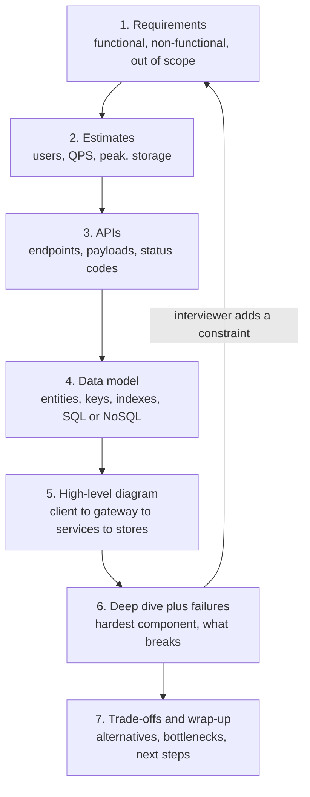

1. **Requirements**: *functional* (what it does) vs *non-functional* (latency, availability such as 99.9% up, consistency, durability, scale); state what's out of scope.
2. **Estimates**: 50 writes/s fits one DB; 50,000/s needs sharding (splitting data across machines). A day ≈ 10^5 s. Size the **peak**.
3. **APIs**: method, path, bodies, codes, auth, pagination, idempotency key for orders/money.
4. **Data model**: entities, keys, indexes per API; storage by access pattern (orders → SQL transactions; rider pings → KV).
5. **Diagram**: walk one request aloud.
6. **Failures**: per arrow — backoff with jitter (random spread), idempotency, timeouts, circuit breakers (stop calling a failing dependency), DLQ (dead-letter queue), fallbacks.
7. **Trade-offs**: what you gave up, first bottleneck, next steps.

On a new constraint, go back to step 1 and walk forward; don't restart.

> **Real world — Zomato:** NYE 2023 peaked at 8,400 orders/min and 80.92M requests/min across 300+ microservices ([source](https://www.zomato.com/blog/a-tale-of-scale-behind-the-scenes-at-zomato-tech-for-nye-2023)). FY24 had ~18M monthly transacting customers ([source](https://b.zmtcdn.com/investor-relations/Zomato_overview_May-24.pdf)) ≈ 2M orders/day, ~1,400/min (derived). ~140 orders/s vs ~1.35M req/s ≈ **10,000 backend requests per order** (derived): cache the read path, make the write path correct.

| Step | 45-min round | 15-20 min mini-design |
|---|---|---|
| 1. Requirements | 4-5 min | 2 min |
| 2. Estimates | 3 min | 1 min or skip |
| 3. APIs | 5 min | 3 min |
| 4. Data model | 7 min | 4 min |
| 5. Diagram | 8 min | 4 min |
| 6. Deep dive and failures | 12-14 min | 4 min |
| 7. Trade-offs | 3-5 min | 1 min |

Zomato often runs mini-designs after DSA (Z6; Z14 "jumped straight to data modelling") — follow their lead. Still on requirements at minute 20? "Let me lock these three features and move on."

### 0.6 Worked example: URL shortener

Asked at Blinkit (B16) and Zepto (P14).

1. **Requirements**: long URL → `zom.to/aB3xK9q`, redirect; expiry; analytics later. Redirect under 50 ms p99; availability over strict consistency; codes not guessable.
2. **Estimates** (assumed): 100M links/month, 100:1 reads → ~40 writes/s (400 peak), 4,000 reads/s (40,000 peak); 6B links × 500 B ≈ 3 TB over 5 years.
3. **APIs**: `POST /api/v1/links` (Idempotency-Key) → 201 `{code, short_url}`, 409 alias taken, 429. `GET /{code}` → **302** with `Location`, 404, 410 expired. A 301 is cached by browsers forever (less load, but no click counts or edits).
4. **Data**: `links(code PK, long_url, user_id, created_at, expires_at)`; pure key lookup → KV store partitioned by code. Base62 × 7 chars = 62^7 ≈ **3.5 trillion**. Hashing collides; a global counter is a SPOF and guessable; **counter ranges** (a coordinator hands each server 1M IDs) have no collisions or hot spot — a crash just leaves gaps.

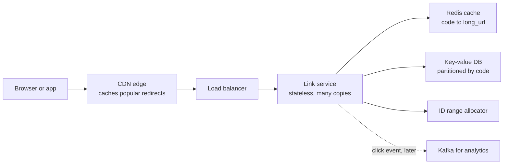

6. **Failures**: hot link in a mass push → CDN plus Redis, and **request coalescing** (one request refills a miss, others wait). Redis down → DB fallback with rate limiting (Zomato injects cache misses before NYE "to evaluate database reliability under stress", [source](https://www.zomato.com/blog/a-tale-of-scale-behind-the-scenes-at-zomato-tech-for-nye-2023)). Retried POST → idempotency key returns the same code. Abuse → rate limit, malware check.
7. **Trade-offs**: KV over SQL (no ad-hoc queries), 302 over 301 (more traffic), a small coordinator. Watch cache hit rate.

### 0.7 Communicating, and your resume project

Think aloud; draw early on one live diagram (Google Docs, draw.io); confirm the question once; and when you don't know, admit it and reason: "I haven't run PostgreSQL in production. I'd weigh feature needs like PostGIS, what the team runs, and our write pattern." Useful lines: "I'm picking X over Y because Z; the cost is W." · "The hardest parts are dedupe and cooldowns — which should I go deep on?" · "If this times out we retry, so it must be idempotent."

Your own project is the most common group question. Draw it from memory:

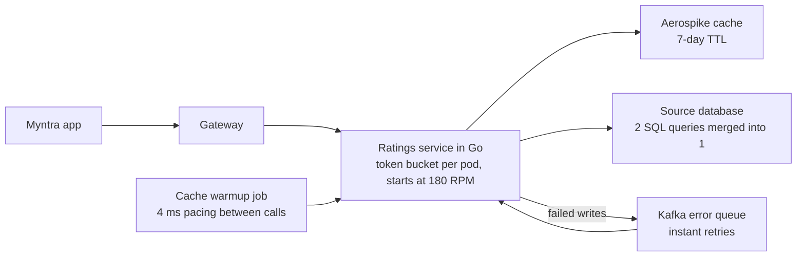

Expect: why Aerospike and a 7-day TTL? Per-pod 180 RPM — autoscaling 10 → 20 pods doubles the total; can downstream take it? 4 ms pacing = ≤250 calls/s per worker; what with 10 workers? How two caches drifted and what prevents it (one source of truth, invalidate-on-write, versioned keys). Instant retries loop forever on a poison message — add DLQ and backoff. The Atlassian SQS + idempotency + DLQ work answers "why async, consumer down, duplicates".

## Part 1: How a request travels

"What happens when you type zomato.com?" was asked directly (Z7, Z19).

### 1.1 IPs, ports and DNS

An **IP address** finds a machine (IPv4 4 bytes, IPv6 16 bytes); a **port** finds the program (HTTPS 443). Phones sit behind carrier **NAT** (many devices share one public IP), so IP is a weak identity — blocking by IP can block a whole carrier (Z9).

**DNS** turns names into IPs: the phone asks a **recursive resolver** (Jio, 8.8.8.8), which, if uncached, asks a **root** server (knows TLDs like `.com`), then the **TLD** server (knows who's authoritative), then Zomato's **authoritative** server (e.g. Route 53). Answers carry a **TTL** (seconds they may be cached). Long TTL: fewer lookups, slow failover. Short TTL (30-60 s): fast failover, more queries. Before moving IPs, drop the TTL a day ahead.

### 1.2 TCP, UDP and TLS

The IP layer is best-effort. **TCP** gives a reliable ordered stream (sequence numbers, ACKs, retransmits, flow and congestion control) after a **three-way handshake** (SYN, SYN-ACK, ACK) costing one **RTT** (round trip; ~30 ms Delhi-Mumbai, approximate). **UDP** just sends packets: DNS, video calls, QUIC.

**TLS** authenticates the server via a certificate, agrees a shared key without sending it, and encrypts. TLS 1.3 costs 1 RTT (1.2 cost 2) and supports resumption. A fresh HTTPS connection = **3 RTTs before the first byte** (TCP, TLS, request) — 150 ms on 50 ms mobile RTT. **Hence keep-alive and connection pools.** **mTLS** = both sides present certificates (service meshes, Z27).

### 1.3 HTTP

A request has a method, path, headers (`Authorization`, `Content-Type`, `Cache-Control`/`ETag`, `Idempotency-Key`, `X-Request-ID` trace ID) and body. **Methods**: GET (safe, idempotent), **POST** (not idempotent unless the server stores an idempotency key with the result and replays it), PUT (replace, idempotent), PATCH (partial), DELETE (idempotent). **Status codes** (Z8): 200/201/204 · 301/302 redirect · 304 cached copy valid · 400 bad input · **401 not authenticated vs 403 not allowed** · 404 · 409 conflict · 429 rate limited · 500 bug · 502/503/504 upstream bad/unavailable/timeout. Retry 503/504 with backoff; never a 400.

**HTTP/1.1** is text, one request at a time per connection. **HTTP/2** multiplexes binary streams on one TCP connection with header compression (gRPC runs on it), but one lost packet stalls all streams. **HTTP/3** uses **QUIC over UDP**: independent streams, faster handshake, survives Wi-Fi ↔ 4G switches — ideal for riders (Z30).

### 1.4 Uploads with pre-signed URLs

Base64 images in JSON (the Z5 trap) inflate ~33% and tie up app servers and memory. Issue a **pre-signed URL** — short-lived permission to PUT one S3 object:

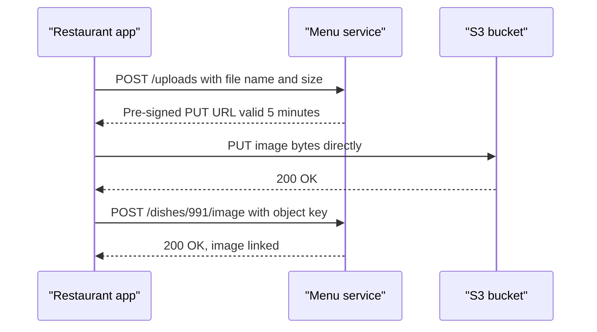

### 1.5 The full journey: opening the Zomato app

Zomato's edge layout is not public; these are components it's known to run, typically arranged.

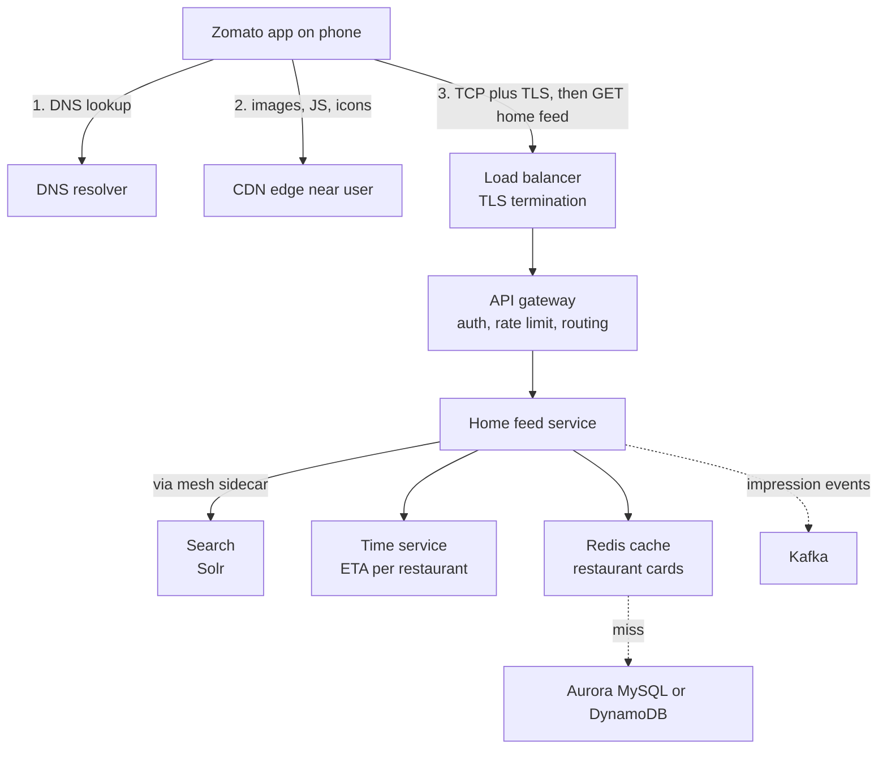

The home service fans out in parallel, mostly from cache — dozens of internal calls per screen, which is how 8,400 orders/min becomes 80M req/min. Search serves 100M+ queries/day on Solr ([source](https://www.zomato.com/blog/explained-how-zomato-handles-100-million-daily-search-queries-p1/)). Fan-out multiplies tails: 5 calls each fast 99% of the time → 1 − 0.99^5 ≈ 4.9% of requests see a slow one.

### 1.6 Real-time on mobile: polling, WebSockets, SSE, MQTT and push

| Technique | How | Weakness |
|---|---|---|
| **Short polling** | Ask every N s | Mostly empty calls, header/TLS cost, late updates |
| **Long polling** | Server holds request until news | Hanging request per client, reconnect churn |
| **SSE** | One streaming HTTP response | Server to client only |
| **WebSocket** | Persistent two-way channel (chat) | You own reconnects, heartbeats, fan-out |
| **MQTT** | Lightweight pub/sub over persistent TCP via a broker; built for flaky mobile networks | Needs a broker and topic design |
| **Push (FCM/APNs)** | OS channel; wakes closed apps | Rate-limited, low frequency |

In **MQTT**, clients keep one connection to a **broker**, **subscribe** to topics (`order/ORD8812/location`) and **publish**; the broker fans out. Headers are 2 bytes; QoS 0/1/2 = at most / at least / exactly once.

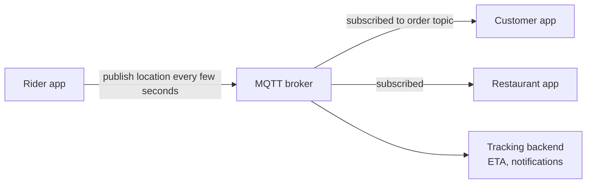

> **Real world:** Zomato's polling stopped scaling — TLS and header overhead outweighed tiny payloads and markers jumped — so it moved live location to MQTT, with its open-source Pulse-MQTT library handling reconnect, re-subscribe and retries ([source](https://www.eternal.com/blog/pulse/)); its broker internals are not public. Uber found 80% of gateway requests were polling and built push with sequence numbers for replay on reconnect ([source](https://www.uber.com/blog/real-time-push-platform/)).

Estimate: 500,000 orders polled every 5 s = 100,000 mostly-empty req/s.

### 1.7 Latency numbers, percentiles and Little's Law

| Operation | Approx. time |
|---|---|
| RAM reference | 100 ns |
| Random 4 KB SSD read | 150 µs |
| Round trip inside a data centre | 500 µs |
| Disk seek | 10 ms |
| Delhi-Mumbai round trip (assumption) | ~30 ms |
| California-Netherlands round trip | 150 ms |

**RAM ≈ 1,000x a random SSD read** (why Redis is sub-ms); crossing continents dwarfs in-DC work; **round trips dominate** (reusing connections or merging queries beats code tuning); sequential beats random (why Kafka is fast).

**Latency** = time per request; **throughput** = requests/s completed; **bandwidth** = a link's max rate. **Percentiles**: 100 requests — 90 at 40 ms, 8 at 120, 2 at 2,000. Average 85.6 ms looks fine, but **p99 = 2,000 ms**; a user making 50 requests hits it ~40% of the time. SLOs are percentiles ("p99 under 200 ms"). Swiggy cites ~50 ms P99 budgets given 3-5x fan-out ([source](https://bytes.swiggy.com/engineering-challenges-at-swiggy-430dea6c86a3), search snippet).

**Little's Law: L = λ × W** (concurrency = arrival rate × time in system). Checkout at 140 orders/s × an assumed 3 s = 420 in flight; if the payment gateway slows to 10 s, 1,400 — 3x the threads and connections for the same traffic. **That is how a slow dependency kills a healthy service**; timeouts and breakers cap W. Likewise 50 DB connections at 5 ms = 10,000 QPS max, but a bad index at 50 ms drops it to 1,000 (Swiggy's wrong-column-order index outage, [source](https://bytes.swiggy.com/behindthebug-indexing-gone-wrong-6b4d682fd805), search snippet).

## Part 2: Scaling compute

### 2.1 Zomato from one server to thousands

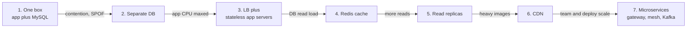

Each stage fixes one bottleneck: one box is a **SPOF** (single point of failure); a separate DB lets each be sized; an LB needs **stateless** servers; Redis absorbs repeated reads; **read replicas** serve reads (watch **replication lag**); a CDN serves photos; microservices split by domain (orders, menu, search, delivery, payments) once one codebase blocks 200 engineers. **Don't start at stage 7; say what forces each step.** **Vertical** scaling (bigger machine) is capped and a SPOF; **horizontal** (more machines) needs statelessness. DBs usually scale up first because sharding is hard (Z19).

> **Real world — Zomato:** NYE 2023: 300+ microservices, 11,000 EC2 instances, ~40,000 ECS tasks; Kafka 450M+ messages/min; ElastiCache 35 TB serving 1B GETs/min ([source](https://www.zomato.com/blog/a-tale-of-scale-behind-the-scenes-at-zomato-tech-for-nye-2023)). Services are largely Go and a monolith still exists alongside ([source](https://www.zomato.com/blog/building-a-cost-effective-logging-platform-using-clickhouse-for-petabyte-scale)); no public post describes a PHP-to-Go migration — don't claim one. ML serving runs on Kubernetes with spot instances ([source](https://www.zomato.com/blog/elements-of-scalable-machine-learning/)).

Containers package a service with its dependencies; an orchestrator (**Kubernetes**, unit = pod; **AWS ECS**, unit = task) places, restarts, rolls out and scales them.

### 2.2 Load balancers

| Algorithm | Use when |
|---|---|
| **Round robin** | Identical servers, similar requests |
| **Weighted round robin** | Mixed sizes, canaries (5% to new version) |
| **Least connections** | Durations vary (long polls, uploads) |
| **Least response time** | Latency-sensitive, uneven servers |
| **IP / consistent hash** | Same client or key to same server (cache locality) |
| **Power of two choices** | Pick 2 at random, use the less loaded; large fleets |

Trap: round robin keeps feeding a slow server; least connections adapts. **L4** (NLB) forwards TCP/UDP by IP/port — fast, any protocol (MQTT, DB). **L7** (ALB, Nginx, Envoy) reads HTTP to route by path/header, retry and terminate TLS (Z27). **Health checks**: *liveness* (alive?) vs *readiness* (can serve now?); a check that hits the DB fails every server in a DB blip and drains the pool — DoorDash's **death spiral** ([source](https://doordash.engineering/2023/03/14/failure-mitigation-for-microservices-an-intro-to-aperture/)). **Connection draining** lets in-flight requests finish before an instance leaves, with graceful shutdown on SIGTERM, so deploys don't cut checkouts. LBs themselves span availability zones to avoid being a SPOF.

### 2.3 Stateless servers and sessions

Stateless = any instance serves any request (Z15). **Sticky sessions** are simple but uneven, and users log out when their server dies. A **shared Redis session store** makes servers stateless and revocation easy, at one lookup per request. A **JWT** (signed token with user ID, roles, expiry) verifies locally with no store but is **hard to revoke**. Production answer: ~15-minute JWTs plus a server-side refresh token.

**Z9 — stolen session ID, shared IP?** HTTPS, `HttpOnly` + `Secure` cookies, short lifetimes; rotate the ID on login; bind to device ID and user-agent, not IP (NAT); OTP step-up for payments or address changes; "log out everywhere" via server-side revocation.

### 2.4 Gateway, mesh and CDN

A **reverse proxy** (Nginx) fronts servers. An **API gateway** is the edge proxy for APIs — auth, rate limits, routing, versioning, a **BFF** (backend for frontend) — for north-south traffic. A **service mesh** handles east-west traffic: each instance gets an **Envoy sidecar**, and a **control plane** pushes retries, timeouts and mTLS certificates, so teams don't reimplement them.

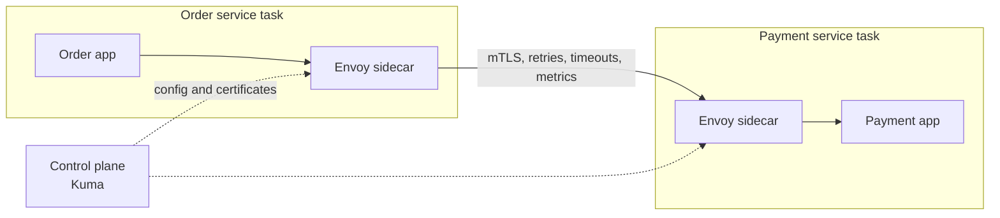

Zomato injects chaos latency "via our internal service mesh layer built using Kuma" ([source](https://www.zomato.com/blog/a-tale-of-scale-behind-the-scenes-at-zomato-tech-for-nye-2023)); DoorDash adopted an Envoy mesh after a 2-hour-plus 2021 outage ([source](https://careersatdoordash.com/blog/inside-doordashs-service-mesh-journey-part-1-migration-at-scale/)).

A **CDN** caches static content on edges (PoPs) near users. Pull (fetch on first miss) is the default; push uploads ahead. Use `Cache-Control: public, max-age=...` for shared content, `private, no-store` for user data, `ETag` for cheap 304s. Invalidate with **content-hashed URLs** (`cover.3f9a1c.jpg`) rather than slow purges. Never cache carts or live order status. **GeoDNS** routes users to the nearest healthy region (Z19), limited by resolver location and TTL; multi-region *data* is the hard part (Zomato's setup is not public).

### 2.5 Autoscaling, and why Zomato pre-scales

**Reactive** autoscaling (CPU above 60% → add instances) lags by minutes: metric, alarm, boot, warmup, health checks. At a spike, saturated instances pile up concurrency (Little's Law), fail health checks, get removed, and survivors overload — while new ones boot. **Scheduled/predictive** scaling suits food delivery's predictable peaks. Scale in slower than out, and remember scaling one tier moves the bottleneck (3x app servers = 3x DB connections).

> **Real world — Zomato:** For NYE 2023 SRE pre-scaled to 11,000 EC2 instances; its benchmarking platform ramps load "so autoscaling can react" and ran 14,000 minutes across 100+ services peaking at 50M RPM ([source](https://www.zomato.com/blog/a-tale-of-scale-behind-the-scenes-at-zomato-tech-for-nye-2023)). NYE 2021 had 15+ days of load tests and per-feature kill switches ([source](https://www.zomato.com/blog/our-learnings-from-nye/)).

**Say this:** "Autoscale for everyday variation; pre-scale for known peaks; load-test above peak; kill switches on non-critical features to protect checkout." Trap: CPU autoscaling during a payment-gateway slowdown does nothing — threads wait, CPU stays low. Use timeouts, breakers, gateway failover, or scale on concurrency.

### 2.6 Monolith vs microservices, and sync vs async

A **monolith** is one deployable with in-process calls and low ops cost, but all-or-nothing scaling and weak isolation — right for startups. A **modular monolith** keeps one deployable with strict module boundaries, so it can be split later. **Microservices** give independent deploys, per-service DBs and team ownership, at the cost of failing network calls, discovery, tracing and distributed consistency (Z5). Services find each other through a **registry** (Consul, Kubernetes Services), queried by the caller's sidecar or a server-side LB.

> **Real world — DoorDash:** Its 2013 Django monolith strained by 2017; in 2019 it halted features to re-architect. Early "satellite" services still used the monolith's DB, so they failed with it ([source](https://doordash.engineering/2020/12/02/how-doordash-transitioned-from-a-monolith-to-microservices/)). **A shared database defeats the point.** Split along domains and migrate gradually (the **strangler fig** pattern).

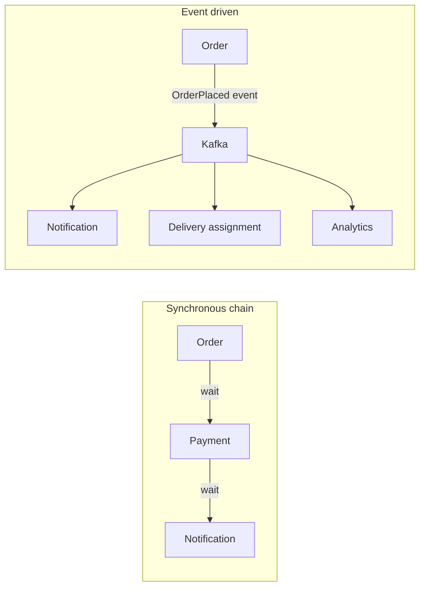

Sync calls (REST, or gRPC = Protobuf over HTTP/2) give an answer now, but latency sums along the chain and the caller fails if the callee is down. Async (Kafka, SQS) lets the callee be down and absorbs spikes, at the cost of duplicates, ordering and lag. **The B2 answers:** async decouples and keeps slow work off the user path; absorbs spikes; if the consumer is down, messages wait (monitor lag); delivery is at least once, so consumers are **idempotent** (dedupe by event ID, or "set PICKED_UP only if ASSIGNED"). Kafka is Zomato's "backbone of our event-driven architecture" ([source](https://www.zomato.com/blog/a-tale-of-scale-behind-the-scenes-at-zomato-tech-for-nye-2023)). Rule: **synchronous for the decision, asynchronous for the consequences.**

### Check yourself

**Q: Round trips before the first byte on fresh HTTPS?** Three (TCP, TLS 1.3, request) — hence connection reuse.
**Q: Why MQTT for tracking?** Polling overhead dwarfed tiny payloads; persistent pub/sub with tiny headers.
**Q: Average 85 ms but users complain?** The p99 tail hides behind the average; fan-out makes it worse.
**Q: Sticky vs Redis vs JWT?** Sticky is fragile; Redis is stateless with easy revocation; JWT needs no lookup but is hard to revoke. Use short JWTs plus refresh tokens.
**Q: Why pre-scale for NYE?** Reactive autoscaling lags spikes and saturated instances spiral.
**Q: Why did DoorDash's early services fail with the monolith?** They shared its database.

---

## Part 3: Databases

**The database is where the hard decisions live**: servers are stateless, but the state can't be copied without asking "which copy is correct?". ~100 interview reports call databases and SQL "the most common source of rejections at Zomato"; "why SQL vs NoSQL?" appears in almost every one.

### 3.1 What a database really does

A database does five jobs: **durability** ("saved" survives a crash), **querying** by more than one key, **concurrency control** (two riders accepting one order gives a sane result), **integrity** (real restaurant, unique email, balance never negative) and **recovery** (half-finished work completed or undone).

A **planner** picks the query plan; data lives in **pages** (8-16 KB) cached in a RAM **buffer pool**. Durability comes from the **write-ahead log (WAL)**: every change is appended and flushed to a log before pages change, and replayed after a crash. Replication ships the WAL to followers (3.12) and CDC tools like Debezium read it (3.18).

### 3.2 The relational model: tables, keys and joins

Relational DBs (MySQL, Postgres, Aurora) store **tables** of typed columns and rows. A **primary key** uniquely identifies a row; a **foreign key** points at another table's PK (no order for a non-existent user); a **unique key** forbids repeats (`phone`); a **composite key** spans columns; prefer **surrogate** IDs over **natural** keys (people change phones). **One-to-many** uses an FK on the "many" side; **many-to-many** uses a **join table**. Core schema: `users(user_id PK, name, phone UNIQUE)`, `restaurants(restaurant_id PK, name, city)`, `dishes(dish_id PK, restaurant_id FK, name, price)`, `orders(order_id PK, user_id FK, restaurant_id FK, amount, status, created_at)`, `order_items(order_id FK, dish_id FK, quantity, price_at_order)`.

`price_at_order` is deliberate: prices change, old bills must not. Schema-only tasks are "very common at Zomato for SDE-1".

**Joins:** INNER keeps matches, LEFT keeps every left row (NULLs if no match), FULL OUTER everything. Zomato asked "restaurants with no cuisines, JOINs only":

```sql
SELECT r.restaurant_id, r.name
FROM restaurants r
LEFT JOIN restaurant_cuisines rc ON rc.restaurant_id = r.restaurant_id
WHERE rc.restaurant_id IS NULL;
```

Joins are cheap with an index on the join column and only work inside one database; across shards (3.13) they become network work, which drives much of NoSQL design.

### 3.3 SQL vs NoSQL, and the four NoSQL families

**NoSQL** trades joins, fixed schema or multi-row transactions for built-in scale or a better-fitting shape.

| Question | Relational (MySQL, Postgres, Aurora) | NoSQL (DynamoDB, MongoDB, Cassandra, Redis) |
|---|---|---|
| Transactions | Multi-row ACID | Often per-item, limited multi-item |
| Scaling writes | One primary; sharding you mostly build yourself | Partitions across nodes automatically |
| Query flexibility | Any ad-hoc query | Tables designed around known access patterns |

**Trap** (Blinkit B10, https://leetcode.com/discuss/post/4630366/): "can't SQL scale?" Yes: replicas, caching, sharding; Zomato's Aurora served **610k selects/s and 16,000 write txn/s** on NYE 2023. NoSQL just makes scaling *built in* for simple patterns, at the cost of joins.

**Key-value stores.** A distributed hash map (`get/put`), value opaque: Redis, Memcached, Aerospike, DynamoDB. *Use for* sessions, carts, OTPs, rate limits, rider location. Zomato's feature store: Redis Cluster plus DynamoDB, ~18M requests/min ([source](https://www.zomato.com/blog/elements-of-scalable-machine-learning/)).

DynamoDB (Blinkit B4 asked): a **partition key** picks the machine, an optional **sort key** orders items within it (range queries inside one partition), and a **GSI (global secondary index)** is a second copy keyed differently.

**Document stores.** Nested JSON-like documents whose fields the DB can index (MongoDB, DocumentDB). *Use for* nested data read whole (chats, menus, catalogs); not many-to-many or multi-entity transactions. Zomato's Nugget support platform (15M+ conversations/month) runs on MongoDB Atlas ([vendor blog](https://www.mongodb.com/company/blog/innovation/zomato-ai-solution-nugget-reduces-support-costs), self-reported).

**Wide-column stores.** Cassandra, ScyllaDB, HBase: a map `partition key -> sorted (clustering key -> columns)`, so "latest 50 pings for rider r9" is one sequential read. Cheap LSM writes; for time-series and location history. **No evidence Zomato uses Cassandra**: say "a store like Cassandra would fit".

**Graph databases.** Neo4j, Neptune: **nodes** and **edges**, each hop a pointer chase, not a self-join. For fraud rings; no public Zomato use.

### 3.4 How real companies chose, and a decision flowchart

Teams pick per workload (**polyglot persistence**).

> **Zomato:** primary DBs are DynamoDB, Aurora MySQL and MongoDB. NYE 2023: DynamoDB 12.3M RCU / 5.2M WCU per minute, RDS 610k selects/s, MongoDB 470k reads/s and 180k writes/s ([source](https://www.zomato.com/blog/a-tale-of-scale-behind-the-scenes-at-zomato-tech-for-nye-2023)).

> **Zomato billing, TiDB → DynamoDB:** TiDB grew 5 → 25 manually scaled nodes. On DynamoDB: 4x throughput (2,000 → 8,000 RPM), ~90% lower latency (~75 ms), ~50% lower cost, zero-downtime dual-write migration. Single-table adjacency-list design, partition key **merchant ID + payout cycle + business vertical** (high cardinality spreads load), GSI keys suffixed `_<division-number>` against hot partitions ([AWS Database Blog](https://aws.amazon.com/blogs/database/unlocking-performance-scalability-and-cost-efficiency-of-zomatos-billing-platform-by-switching-from-tidb-to-dynamodb/)).

> **DoorDash:** one Postgres primary, then PgBouncer and Cassandra ([source](https://doordash.engineering/2020/12/02/how-doordash-transitioned-from-a-monolith-to-microservices/)), later CockroachDB for inventory, where 1,000-row batched upserts cut storage QPS 99% ([source](https://doordash.engineering/2023/02/22/how-doordash-designed-a-successful-write-heavy-scalable-and-reliable-inventory-platform/)): scale *and* SQL transactions, the swing back to distributed SQL.

> **Zepto (and Deliveroo):** a billion-row Aurora Postgres orders table with row-lock contention and lagging autovacuum led Zepto to a **Draft-Order service on DynamoDB** (sparse GSI of awaiting-payment orders, idempotent Create Order, 5-minute sweeper): Create Order ~60% faster ([source](https://aws.amazon.com/blogs/database/how-zepto-scales-to-millions-of-orders-per-day-using-amazon-dynamodb/)). Deliveroo made the same move and added random-suffix write sharding to a hot GSI ([source](https://aws.amazon.com/blogs/database/how-deliveroo-migrated-their-dispatcher-service-to-amazon-dynamodb/)).

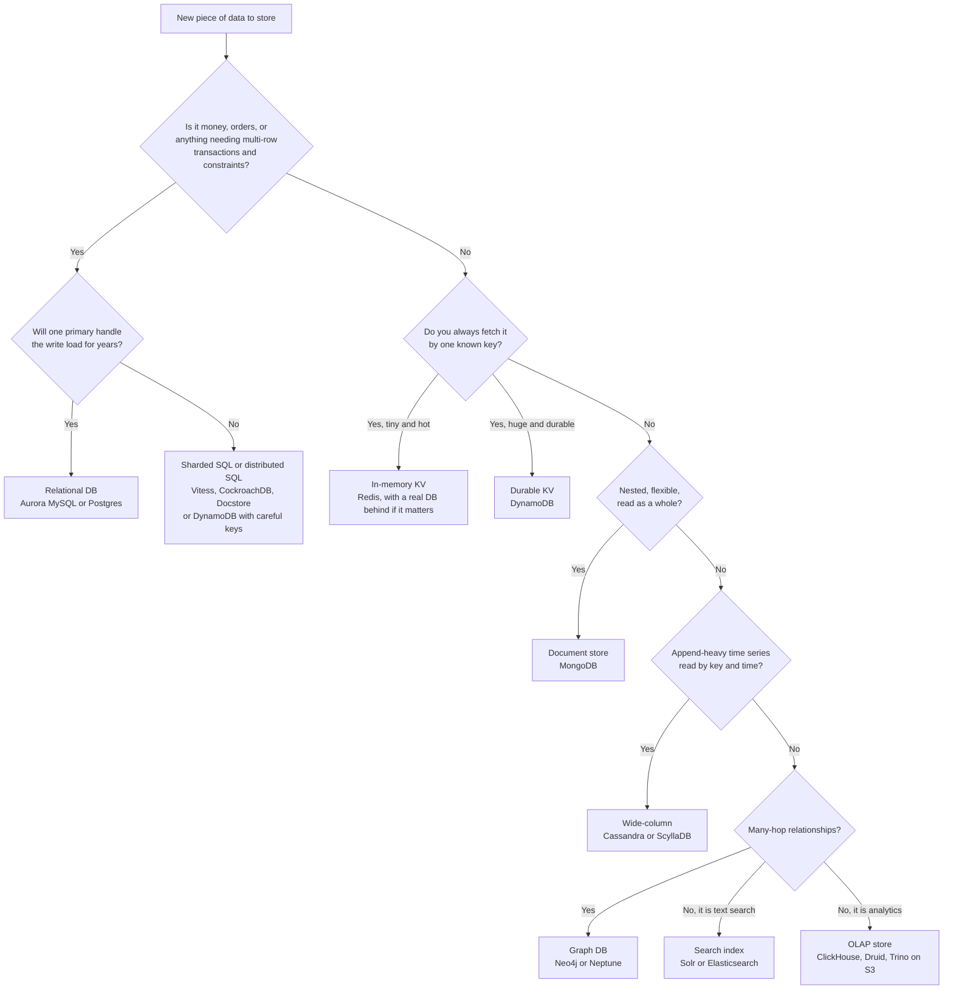

**Say this:** "Orders need transactions and several query shapes, so I'd start with Aurora MySQL, which Zomato uses. If writes outgrow one primary, I'd shard, or move the hottest narrow pattern to DynamoDB, as Zepto did for draft orders."

### 3.5 Storage engines: B+ trees vs LSM trees

The **storage engine** lays bytes out on disk (Z30 asked "hash map vs B+ tree").

**B+ tree (read-optimised):** a shallow sorted tree of pages (a billion rows in 3-4 levels); **leaves** hold data and are linked for range scans. Updates are **in place**, full leaves **split**; writes are **random I/O**. InnoDB, Postgres.

**LSM tree (write-optimised):** all writes become sequential appends.

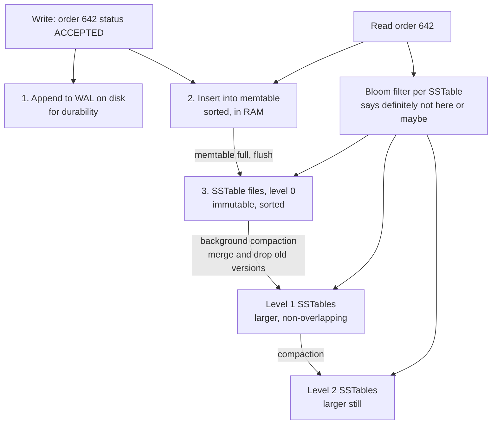

Writes go to the WAL and an in-memory sorted **memtable**; a full memtable flushes to an immutable sorted **SSTable**. **Compaction** merges SSTables, keeping the newest version. Reads check memtable then SSTables newest-first; each SSTable's **Bloom filter** ("definitely not here" or "maybe") skips most files. Cassandra, RocksDB (inside CockroachDB, TiKV), HBase. DynamoDB's engine isn't public.

| | B+ tree | LSM tree |
|---|---|---|
| Write path | Modify page in place (random I/O) | Append to WAL + memtable (sequential) |
| Point read | 3-4 page reads, predictable | Memtable + several SSTables, Bloom filters help |
| Background work | Page splits, VACUUM (Postgres) | Compaction, can cause latency spikes |

**Write amplification** = one write becoming many physical writes (compaction); **read amplification** = one read touching many files. Uber left Cassandra for metrics partly over compaction cost ([source](https://www.uber.com/blog/m3/)). GPS pings → LSM; order status → B+ tree.

### 3.6 Indexes, in depth

An **index** finds rows without a **full table scan**, like a textbook index.

**Clustered vs secondary** (Blinkit B2): a **clustered** index *is* the table (one per table; InnoDB's PK). A **secondary** index's leaves hold a pointer: the PK in InnoDB, a row location in Postgres (whose rows sit in a **heap**). InnoDB secondary lookups then walk the clustered index (a "bookmark lookup"). So keep PKs small (every secondary stores a copy), and avoid random PKs, which split pages everywhere (3.17).

#### Composite indexes and the leftmost prefix rule

A **composite index** on `(A, B, C)` sorts by A, then B, then C, like a phone book by (surname, first name): "all Kapoors" is easy, "everyone named Aman" is scattered.

**Leftmost prefix rule:** it serves `A`, `A,B`, `A,B,C`, not `B` or `C` alone.

**Range rule:** after a range column, later columns can't seek. `(restaurant_id, created_at, status)` for `restaurant_id = 10 AND created_at > '20:00' AND status = 'PLACED'` scans the time range checking status per row; `(restaurant_id, status, created_at)` seeks. **Equality first, then range, then sort-only columns.**

> **Swiggy Instamart, Nov 2022:** a wrong-order composite index drove the picker DB to 90%+ CPU and Instamart was shut down across India (~20 minutes by one summary) ([Swiggy Bytes](https://bytes.swiggy.com/behindthebug-indexing-gone-wrong-6b4d682fd805), search-snippet level detail).

#### The trap: separate indexes on A and B vs one composite (A, B)

Zomato Z9 (https://leetcode.com/discuss/post/6023375/), `WHERE A = 10 AND B = 20`, 10M rows, 10,000 with A = 10, 5,000 with B = 20, 3 with both. **Separate:** use B, fetch 5,000 rows, filter to 3 (index merge / bitmap AND still reads 15,000 entries). **Composite:** seek to the 3 adjacent entries. Composite wins; it also serves `A` alone but not `B`, and every extra index slows writes.

**Covering index** holds every column the query needs, so the table is never visited ("Using index" / "Index Only Scan"). E.g. `SELECT order_id, status, created_at ... WHERE restaurant_id = 10 AND status = 'PLACED' ORDER BY created_at DESC` is covered by `(restaurant_id, status, created_at)` in InnoDB (order_id is the PK, in every secondary leaf): no lookups, no sort.

**Cardinality** = distinct values (`user_id` high, `status` ~8); **selectivity** = fraction of rows matched. An index on `status` alone is ignored when it matches 95% of rows; it helps inside a composite or for a rare value. **Partial indexes** (Postgres) and **sparse GSIs** (DynamoDB) index only rows you care about.

**Write cost:** 8 indexes make one insert 9 tree writes and eat buffer-pool RAM. Indexes hurt on write-heavy tables, unused or low-cardinality columns, tiny tables.

**EXPLAIN** shows the plan; `EXPLAIN ANALYZE` runs it (District Z15). Look for **Seq Scan** on a big table, a separate **Sort**, and estimated-vs-actual row gaps (stale stats: run `ANALYZE`). MySQL: `type` `ALL` = full scan, `Extra` `Using filesort` / `Using index`.

### 3.7 Transactions and ACID

A **transaction** groups operations into one unit. Wallet payment:

```sql
BEGIN;
  UPDATE wallets SET balance = balance - 450 WHERE user_id = 1 AND balance >= 450;
  INSERT INTO orders (order_id, user_id, restaurant_id, amount, status) VALUES (504, 1, 10, 450, 'PAID');
  INSERT INTO wallet_ledger (user_id, order_id, delta) VALUES (1, 504, -450);
COMMIT;
```

- **Atomicity:** all or nothing; a crash after the debit can't lose ₹450 (undo log rolls back).
- **Consistency:** constraints (`CHECK (balance >= 0)`, FKs) always hold; partly the app's job.
- **Isolation:** concurrent transactions act as if alone, per the isolation level.
- **Durability:** after `COMMIT`, the change survives a crash (redo log flushed).

**Say this:** "Atomicity is about failure, isolation is about concurrency." Z22 asked how MySQL provides isolation: MVCC plus locks (3.9).

### 3.8 Isolation levels and the anomalies they prevent

**Serializable** (as if one after another) is expensive, so weaker levels allow **anomalies**:

- **Dirty read:** seeing uncommitted data (a price of 99 that gets rolled back).
- **Non-repeatable read:** one row read twice gives different values (a refund commits mid-invoice).
- **Phantom read:** the same query returns a *new* matching row the second time.

**Lost update: two read-modify-write cycles overwrite each other.**

```
time   T1 (add 1 to coupon usage)            T2 (add 1 to coupon usage)
 1     SELECT used FROM coupons -> 99
 2                                            SELECT used FROM coupons -> 99
 3     UPDATE coupons SET used=100
 4                                            UPDATE coupons SET used=100
 5     COMMIT                                 COMMIT
       Two uses recorded as one. A coupon limited to 100 uses gets 101.
```

**Write skew: each checks a condition, each writes a different row, together they break the rule.**

```
Rule: at least one support agent must be on shift.
time   T1 (agent A goes off shift)           T2 (agent B goes off shift)
 1     SELECT COUNT(*) on shift -> 2
 2                                            SELECT COUNT(*) on shift -> 2
 3     UPDATE agents SET on_shift=false WHERE id=A
 4                                            UPDATE agents SET on_shift=false WHERE id=B
 5     COMMIT                                 COMMIT
       Zero agents on shift. Neither transaction touched the other's row.
```

No row is written twice, so row locks miss it. Zomato version: two riders each see order 504 unassigned and both insert assignment rows.

| Isolation level | Dirty read | Non-repeatable | Phantom | Lost update | Write skew |
|---|---|---|---|---|---|
| Read uncommitted | possible | possible | possible | possible | possible |
| Read committed (Postgres default) | prevented | possible | possible | possible | possible |
| Repeatable read (InnoDB default) | prevented | prevented | mostly (InnoDB) | depends | possible |
| Serializable | prevented | prevented | prevented | prevented | prevented |

Postgres repeatable read is **snapshot isolation** (aborts lost updates, allows write skew; its serializable SSI catches write skew). InnoDB repeatable read can still lose an update computed from an earlier read. Fix lost updates in code:

1. **Atomic update (best):** `UPDATE coupons SET used = used + 1 WHERE id = 7 AND used < 100;` then check rows affected (stock: `SET avail = avail - n WHERE avail >= n`).
2. **Pessimistic:** `SELECT ... FOR UPDATE`.
3. **Optimistic:** `... WHERE id = 7 AND version = 7`; zero rows means retry.

Write skew: serializable, `FOR UPDATE` on rows you *read*, or a constraint (unique index on `assignments(order_id)`). "Two users buy the last unit" (Flipkart, Blinkit): cheapest fix is the conditional atomic update.

### 3.9 MVCC, row locks and deadlocks

**MVCC (multi-version concurrency control):** rows keep multiple **versions** tagged by transaction; each transaction reads a **snapshot** of what was committed when it (or, under read committed, the statement) started. Readers never block writers. Postgres keeps old versions in the table for **VACUUM** (Zepto's and Deliveroo's pain); InnoDB keeps them in the **undo log**.

**Row locks:** **shared (S)** for reads, **exclusive (X)** for writes; InnoDB **gap locks** block phantom inserts into a locked range. Held until commit, so keep transactions short and **never make a network call (payment gateway) while holding a row lock** (the Airbnb payments pattern says exactly this).

A **deadlock**: each transaction holds a lock the other needs.

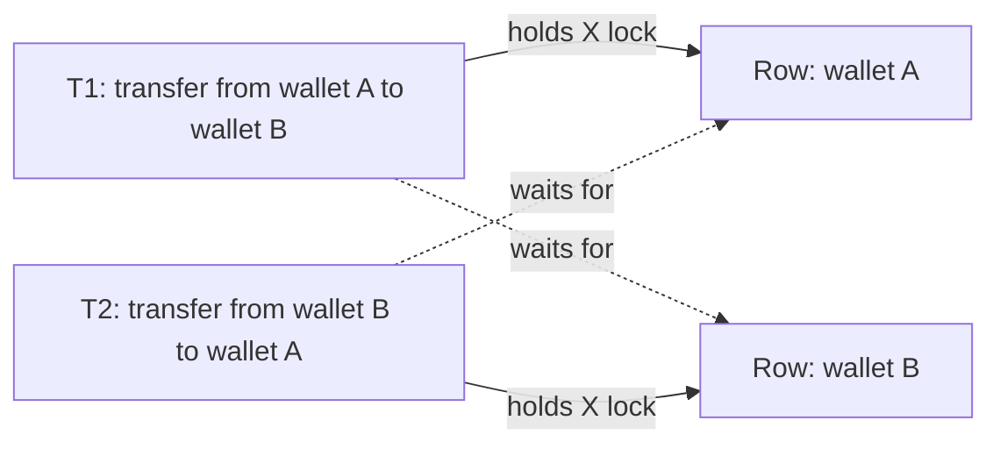

The DB detects the cycle and kills a **victim**. Prevent: **lock in a consistent order** (lower wallet ID first), short transactions, good indexes (unindexed `UPDATE`s lock more rows), and **retry** deadlock errors with backoff (District Z11 asked this).

### 3.10 Normalisation and denormalisation

**Normalisation** stores each fact once, avoiding update, insert and delete anomalies. From a flat `orders_flat(order_id, user_name, user_phone, rest_name, rest_city, items="Biryani x2, Raita x1")`:

**1NF** atomic cells (split `items` into `order_items`); **2NF** depend on the *whole* key (`dish_name` → `dishes`); **3NF** depend only on the key (`user_phone` → `users`). Result: the 3.2 schema. Hook: "the key, the whole key, and nothing but the key".

**Denormalisation** duplicates for faster reads: `restaurant_name` on orders, `orders.current_status` beside `order_events`, `avg_rating` updated per review; DynamoDB single-table is the extreme. Copies drift (your Myntra "two caches out of sync" bug), so update both in one transaction, or update copies from the source's CDC stream.

**Rule:** normalise the source of truth (orders, payments); denormalise read models (feeds, dashboards, search documents).

### 3.11 Connection pooling

Connections are expensive (TCP, TLS, auth; an OS process each in Postgres) and capped; 400 pods × 50 = 20,000 is too many. **Connection pools** lend out a fixed set: **in-app pools** (HikariCP, Go `SetMaxOpenConns`) plus **proxy poolers** (PgBouncer, RDS Proxy) whose **transaction pooling** lends a real connection per transaction. DoorDash needed PgBouncer when its monolith exhausted connections ([source](https://doordash.engineering/2020/12/02/how-doordash-transitioned-from-a-monolith-to-microservices/)).

Too small: requests queue; too big: DB thrashes. **"How can a DB make an app slow?" (Z1):** missing indexes, lock contention from long transactions, pool exhaustion, N+1 queries (one query per item in a loop; DoorDash's 1,000-row batched upsert is the fix), replication lag making reads stale.

> **Connect to Atlassian:** SQS worker pool size and HikariCP pool size must agree. 64 workers sharing 10 connections means 54 waiting.

### 3.12 Replication

**Replication** keeps copies for availability, read scaling and latency. **Leader-follower:** the **leader** takes writes and streams WAL/binlog to **followers**, which serve reads.

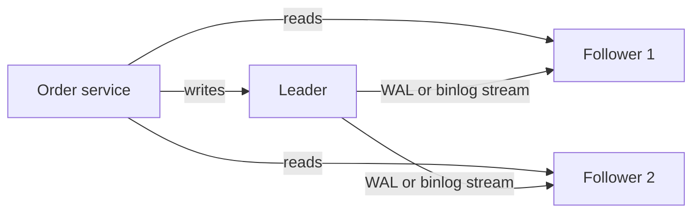

**Sync** waits for all followers (no loss, slow), **async** doesn't (may lose last writes), **semi-sync** waits for one.

#### Replication lag and its anomalies

Async followers lag. **Read-your-writes violation:**

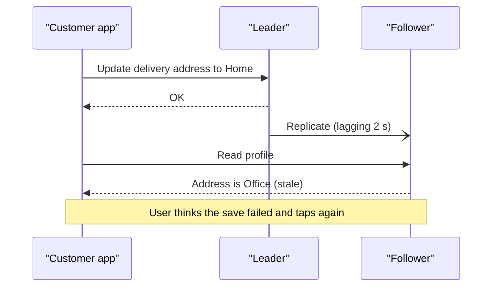

Fix: read a user's recent writes from the leader (say 10 s), or from a follower caught up to the write's log position.

**Monotonic reads violation:** reads hit different followers and status goes backwards (OUT_FOR_DELIVERY → PREPARING). Fix: pin users to one follower by hash.

Airbnb payments: **idempotency reads go to the master, since replica lag can cause duplicate charges** ([summary](https://medium.com/airbnb-engineering/avoiding-double-payments-in-a-distributed-payments-system-2981f6b070bb), secondary source). **Rule: anything that decides money or state transitions reads from the leader.**

#### Failover and split brain

**Failover** promotes the most up-to-date follower after missed heartbeats. Risks: lost async writes, a guessed timeout (GC pause → needless failover), and **split brain** (old leader only partitioned, both accept writes, two riders get one order). Prevent with **fencing** (reject writes with an old epoch/term) and **consensus** like Raft (majority needed to elect), as Uber's Docstore does ([Kleppmann on fencing](https://martin.kleppmann.com/2016/02/08/how-to-do-distributed-locking.html)).

**Multi-leader** (one per region) needs conflict rules like last-write-wins; use rarely.

**Leaderless quorums** (Cassandra): writes need **W** of N acks, reads ask **R**. **If R + W > N**, the sets overlap, so reads see the latest write.

N = 3, W = 2, R = 2 is balanced and tolerates one node down; **read repair** and **anti-entropy** fix stale replicas.

### 3.13 Sharding (partitioning)

**Sharding** splits *different* data across machines when one leader can't take the writes. The **shard key** picks the shard.

- **Range:** easy range queries, but increasing keys make a **hot shard**.
- **Hash** (`hash(key) mod N`): even load, but ranges hit every shard and changing N moves most keys (3.14).
- **Directory / geo:** a lookup maps key or city → shard; flexible, fits local delivery; directory must be cached and HA. Uber's early dispatch sharded by **S2 level-12 cell IDs** ([source](http://highscalability.com/blog/2015/9/14/how-uber-scales-their-real-time-market-platform.html)).

#### The user_id vs restaurant_id dilemma for orders

Customers read by `user_id`, restaurants by `restaurant_id`. Shard by user and the restaurant dashboard must **scatter-gather** every shard; shard by restaurant and the reverse, plus hot keys (a big cloud kitchen on NYE). Propose:

1. **Key for the critical path, a copy for the other:** shard by `order_id`/`user_id`; CDC/Kafka feeds a `restaurant_id`-keyed copy for dashboards (a second stale is fine). GSIs are this built in.
2. **Shard bits in the order ID** (3.17).
3. **Salt the few hot keys.**

**Key salting** spreads a hot key over N keys (`area_cp_gurugram#0..#3`: write a random suffix, read all N and merge), as Deliveroo and Zomato billing did. Salt only hot keys.

**Hard once sharded:** joins (co-locate order and items), global queries (use an analytics store), unique constraints (lookup table by email), transactions (3.16).

**Resharding:** backfill, **dual-write** (or CDC), verify, switch reads, then writes (as Zomato billing did). **Pre-split** into many logical shards (1,024 on 8 machines) so resharding just moves shards.

### 3.14 Consistent hashing

With `mod N`, 4 → 5 shards moves ~80% of keys (Z30 asked). Bend the hash space into a ring; hash servers and keys onto it; a key belongs to the **first server clockwise**. Adding a server moves only ~1/(N+1) of keys; removing one hands its keys to the next.

Few points land unevenly and a dead server dumps load on one neighbour, so use **virtual nodes** (100-200 points per server; bigger machines get more). Used by Cassandra, memcached clients. Redis Cluster uses 16,384 fixed **hash slots**.

### 3.15 CAP, PACELC and consistency models

**CAP:** during a **partition**, choose **Consistency** (latest or error) or **Availability** (an answer, maybe stale); "CA" isn't real. **PACELC** adds: **Else**, choose **Latency** or **Consistency**. Uber Docstore is openly "CP" ([source](https://www.uber.com/blog/schemaless-sql-database/)); low-quorum Cassandra is typical PA/EL.

Per feature:

| Zomato feature | Choice | Why |
|---|---|---|
| Payments, wallet, order status, coupon limits | CP, consistency over latency | No double charge, no two riders, no over-redemption |
| Menu and prices shown | AP, latency | Re-validate price at checkout |
| Search, ratings, rider location, feeds | AP, latency | Slightly stale beats blank |

**Consistency models:** **linearizable** (one copy; locks, seats) > **causal** (reply never before message) > **read-your-writes/monotonic** > **eventual** (ratings, search). Zepto accepts ~10 s search index lag because stock is re-checked against inventory afterwards ([source](https://aws.amazon.com/blogs/big-data/how-zepto-powers-sub-second-search-using-opensearch-service-or2-instances/)).

### 3.16 Distributed transactions: 2PC and sagas

#### Two-phase commit (2PC)

A **coordinator** asks all to **prepare** (hold locks, promise), then **commit** if all vote yes.

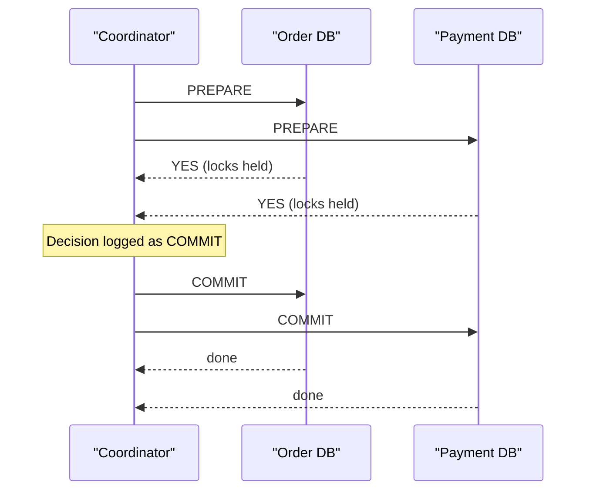

**Why it blocks:** a YES voter holds locks until it hears the decision; if the coordinator dies, everyone waits on locked rows. So 2PC lives mostly *inside* distributed databases (hardened with consensus), not across microservices.

#### Sagas

A **saga** is local transactions per service; on failure, **compensating transactions** undo earlier steps. Nothing blocks; intermediate states are visible.

Zomato order saga: create order (undo: cancel) → capture ₹450 (undo: refund) → mark coupon used (undo: un-mark) → restaurant accepts (may fail) → confirm. On rejection, run the undos in reverse.

**Choreography:** services react to Kafka events (OrderRejected → Payment refunds, Order cancels). Loosely coupled, but the flow lives in nobody's code.

**Orchestration:** a central **orchestrator** commands each step and tracks state.

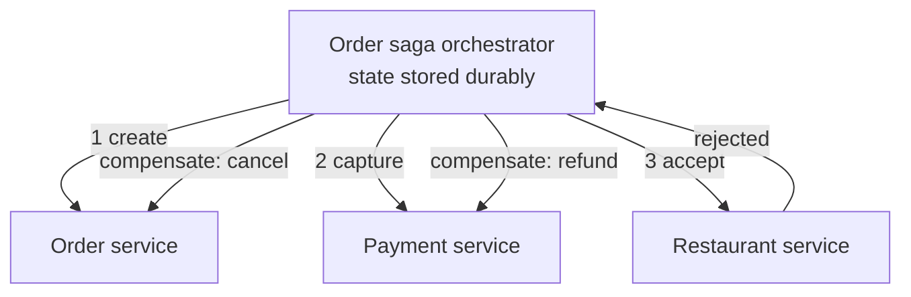

Explicit flow, easy timeouts ("no response in 3 minutes → compensate"); the orchestrator must be reliable (Cadence/Temporal). Uber Eats ran its 8-step order on **Cadence** ([source](https://www.uber.com/blog/open-source-orchestration-tool-cadence-overview/)); DoorDash's pain was **non-idempotent downstream calls** ([source](https://doordash.engineering/2020/08/14/workflows-cadence-event-driven-processing/)).

Rules (your Atlassian work): **idempotent steps and compensations**; **transactional outbox** (event row in the same local transaction, published by a relay/Debezium); **DLQ** for repeated failures. A Zomato SWE1 rejection (Z4, https://leetcode.com/discuss/post/7609011/) asked for "more depth on non-happy paths".

### 3.17 Generating unique IDs

- **Auto-increment:** breaks across shards, single bottleneck, leaks volume, guessable.
- **UUID v4:** no coordination, but 16 bytes, unsorted, InnoDB page splits. **UUID v7**/ULID add a timestamp prefix.
- **Snowflake-style (popularised by Twitter):** a 64-bit integer.

```
 1 bit   41 bits                       10 bits         12 bits
+---+-----------------------------+---------------+--------------+
| 0 | milliseconds since epoch    | machine id    | sequence     |
+---+-----------------------------+---------------+--------------+
      ~69 years                     1,024 machines  4,096 IDs/ms/machine
```

No per-ID coordination, time-sorted, fits a BIGINT. Clock going backwards risks repeats, so generators wait. Swap machine bits for a **logical shard ID** to route by ID. **Ticket servers** (odd/even pair, blocks of 1,000) are simpler but central. Default for Zomato orders: Snowflake, with a separate short display code.

### 3.18 OLTP vs OLAP: why analytics stays off the orders DB

**OLTP** = many small live reads/writes, row-oriented, milliseconds (Aurora, DynamoDB). **OLAP** = few huge scans, **column-oriented** (compresses well, reads only needed columns), minutes behind (ClickHouse, Druid, Trino on Iceberg). A month-long report on the live DB evicts hot pages and slows ordering, so copy data out via **CDC** (streaming the DB's log).

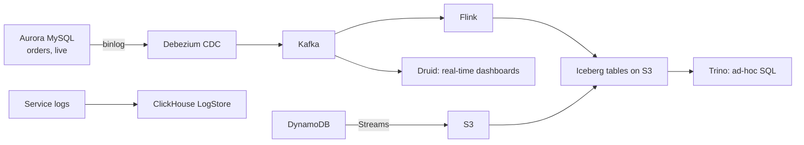

> **Zomato:** Debezium → Kafka → Flink → Iceberg on S3; Trino runs 250K+ queries scanning 2 PB, Druid serves 8M queries a week ([source](https://aws.amazon.com/blogs/opensource/how-zomato-boosted-performance-25-and-cut-compute-cost-30-migrating-trino-and-druid-workloads-to-aws-graviton/)). Logs go to ClickHouse (up to 150M logs/min), expected to save $1M+/year ([source](https://www.zomato.com/blog/building-a-cost-effective-logging-platform-using-clickhouse-for-petabyte-scale)). Kafka-to-Druid is a typical arrangement, not confirmed.

### 3.19 Interview traps, answered honestly

**"Why MySQL and not PostgreSQL?"** A Zomato SDE-1 candidate (Z2, https://leetcode.com/discuss/post/8377019/) was rejected partly for over-explaining; the interviewer wanted "I don't have enough real-world exposure to make that trade-off". Admit it, then offer labelled textbook differences: InnoDB clusters on the PK, keeps old versions in an undo log, defaults to repeatable read, uses a thread per connection; Postgres uses a heap plus VACUUM, defaults to read committed, has a process per connection (hence PgBouncer), and richer indexing (partial, JSONB, PostGIS). "Zomato runs Aurora MySQL, so I'd default to that."

**"Infinite money: why not replace the DB with a cache?"** (Blinkit B12, https://leetcode.com/discuss/post/7083108/.) Money buys RAM, not guarantees: eviction, TTLs, async persistence and replication lose acknowledged writes; no ad-hoc queries, multi-key ACID, constraints or PITR. "A cache is a copy optimised for speed; a database is the source of truth optimised for correctness." **"Only Redis?"** (B3): fine for OTPs, rate limits, sessions, live locations; not orders, payments, wallets.

**"Nearby restaurants in SQL."** A bounding box alone didn't satisfy a Zomato interviewer (Z5). Add a geospatial index (PostGIS GiST) or a geohash/H3 cell column with a B+ tree index: query the cell and neighbours, then refine by true distance.

### 3.20 Cheat table: which database for which Zomato component

| Component | Store | Anchor |
|---|---|---|
| Orders, items, status | Aurora MySQL, shard by order/user later | Zomato; Zepto drafts on DynamoDB |
| Payments, ledger | Strict relational, or DynamoDB with conditional writes | Zomato billing on DynamoDB |
| Menus, catalog | MongoDB or relational + cache | General |
| Search | Solr | Zomato |
| Carts, sessions, OTPs, rate limits | Redis with TTL | Zomato 35 TB ElastiCache |
| Rider live location | Redis geo/cell index, history to Kafka | Not public; Uber shards by cell |
| ML features | Redis + DynamoDB | Zomato feature store |
| Support chats | MongoDB | Zomato Nugget |
| Saga state | Cadence/Temporal | Uber, DoorDash |
| Analytics, logs | Iceberg + Trino, Druid, ClickHouse | Zomato |

### Check yourself

**Q: Composite (A, B) or separate indexes for `WHERE A = 10 AND B = 20`?** Composite: one seek to the matches; it also serves `A` alone, not `B`.

**Q: Which anomaly do row locks not stop?** Write skew (each writes a different row): use serializable, `FOR UPDATE` on rows read, or a unique constraint. Lost update: atomic `SET used = used + 1 WHERE used < 100` or a version column.

**Q: User saves an address and sees the old one?** Read-your-writes violation from replica lag: read their recent writes from the leader.

**Q: Why does 2PC block?** YES voters hold locks until the coordinator decides; sagas commit locally and compensate instead.

**Q: Why are UUID v4 PKs bad in InnoDB?** Random clustered inserts split pages and bloat every secondary index; use Snowflake or UUID v7.

---

## Part 4: Caching

Interviewers rarely ask "would you add a cache?" They ask what goes in it, how long it lives, what happens when it is wrong, and what happens when it dies.

### 4.1 Why we cache, and the hit-ratio formula

A **cache** is a small, fast store holding copies of data that lives somewhere slower. It works because a little data is read far more often than it changes: a popular menu is viewed thousands of times an hour and edited twice a day. It cuts **latency** (Redis ~1 ms vs 2-10 ms for an indexed DB read and 20-200 ms for heavy joins, assumed figures) and **protects the database**, which has a hard ceiling on queries per second.

> **Real world — Zomato:** On NYE 2023 Zomato's ElastiCache (managed Redis) fleet was scaled to **35 TB**, carried **20 Gbps**, and served about **1 billion GETs/min** against **100 million SETs/min** (~16.7M reads/s, 10:1). ([source](https://www.zomato.com/blog/a-tale-of-scale-behind-the-scenes-at-zomato-tech-for-nye-2023))

A **hit** means the cache had the data; a **miss** means we went to the DB too:

```
effective latency = hit × cache_time + (1 − hit) × (cache_time + db_time)
cache 1 ms, DB 20 ms:  90% → 3.0 ms    99% → 1.2 ms    0% → 21 ms (pure overhead)
100k reads/s:          90% → 10,000/s reach DB    99% → 1,000/s
```

Going from 90% to 99% cuts DB load **10x**, because the DB only feels the **miss ratio**. Twitter found **8 of its top 10 cache clusters had a miss ratio below 5%**. ([source](https://junchengyang.com/publication/osdi20-twemcache.pdf))

### 4.2 Where caches live: the layers

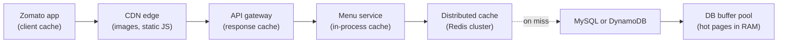

- **Client:** the phone reuses responses (`Cache-Control: max-age=300`). Fastest, but you can't delete a stale entry on a phone, so only data safe to be old.
- **CDN:** servers in many cities hold static files (dish photos, JS) near users.
- **Gateway:** caches whole responses for public endpoints ("cities we serve").
- **In-process (L1):** a bounded map inside each pod (Caffeine, Go `ristretto`). Nanoseconds, but 200 pods = 200 copies that can disagree.
- **Distributed (L2):** shared Redis/Memcached, ~1 ms away; what people mean by "the cache".
- **DB buffer pool:** InnoDB keeps hot pages in RAM, which is why a DB is slow just after restart.

### 4.3 Read and write patterns

**Cache-aside (lazy loading)** is the default: the app checks the cache, on a miss reads the DB and fills the cache; on a write it updates the DB and deletes the key.

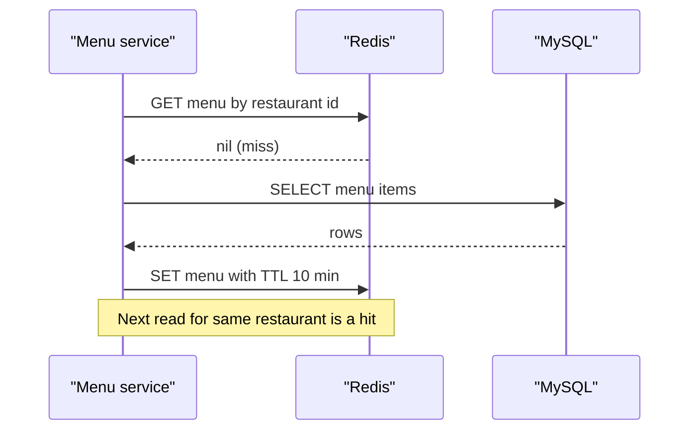

If Redis dies the service still works, just slower. Costs: a slow first read (**cold miss**) and a staleness window. Facebook calls its memcache a **"demand-filled look-aside cache"**. ([source](https://www.usenix.org/system/files/conference/nsdi13/nsdi13-final170_update.pdf))

| Pattern | How it works | Risk | Fit |
|---|---|---|---|
| Read-through | Cache library runs a loader on miss | Same as cache-aside | Cleaner code |
| Write-through | Write cache and DB synchronously | Slower writes, caches unread data | Small hot data (cart) |
| Write-behind | Write cache only, flush to DB later | Data loss if node dies | View counters, never payments |
| Write-around | Writes skip cache | Slow first read | Audit logs, GPS history |

**Say this:** "Cache-aside with delete-on-write and a TTL as a safety net."

### 4.4 Delete or update on writes? The race that decides it

Two admins update a price: A sets 200, B sets 250, B's DB write lands last (DB = 250, correct).

```
SET race:  A: DB=200 → B: DB=250 → B: cache SET 250 → A (slow): cache SET 200
           cache = 200, WRONG until TTL
DEL race:  A: DB=200 → B: DB=250 → B: DEL → A: DEL
           cache empty → next read loads 250, correct
```

Deleting twice equals deleting once: the operation is **idempotent** (many runs, same effect as one). Facebook deletes rather than sets **"because deletes are idempotent"**. Delete still has a reader-writer race: a reader misses and reads 200, the writer sets 250 and deletes, then the slow reader SETs 200 back. Fixes: **always set a TTL**; **leases** (Facebook: the cache issues a token on a miss and rejects the SET if a DEL invalidated it, preventing **stale sets**); or **delayed double delete** (delete, wait ~500 ms, delete again; cheap, less rigorous).

**Trap:** delete **after** the DB write. Deleting first lets a reader refill the old value with a full TTL ahead of it.

### 4.5 TTL: how long data should live

A **TTL** (time to live) expires a key; it bounds the damage of any invalidation bug. Pick by change rate and cost of staleness (assumptions, Zomato's are not public):

| Data | Suggested TTL |
|---|---|
| City / cuisine list | 24 h + CDN |
| Restaurant static info | 1 to 6 h, delete on edit |
| Menu items and prices | 5 to 15 min; checkout re-validates |
| Stock, restaurant open/closed | 30 to 60 s; re-check at order time |
| Search results (key includes location) | 1 to 5 min |
| Ratings | 1 h+ |
| Session lookup | Token life, delete on logout |
| Live rider location | 10 to 30 s |
| Order status, wallet, payment status | Don't cache for decisions |

**Say this:** "The cache is for browsing, the database is for deciding." A stale menu price is fine; charging it at checkout is not.

**Connect to your work (Myntra):** ratings in Aerospike with a 7-day TTL was defensible: slow change, cheap staleness, high hit ratio. Be ready to say why it would be terrible for price.

### 4.6 Eviction and the LRU cache

**Eviction** removes data when memory is full. **LRU** (least recently used) evicts the key unread longest, a good default. **LFU** (least frequently used) suits permanently hot items but is slow to forget old favourites. **FIFO** evicts the oldest insert; Twitter found it **performs as well as LRU** for many workloads, since TTLs clear old data anyway. ([source](https://junchengyang.com/publication/osdi20-twemcache.pdf))

**Build an O(1) LRU** (asked in Z1, B1, B2): a **hash map** from key to node, plus a **doubly linked list** ordered by recency (nodes point both ways, so unlinking is O(1)). Use dummy HEAD/TAIL **sentinels** to avoid empty-list cases.

```
get(key):   node = map[key]; if none: miss
            unlink node; insert after HEAD; return value
put(k, v):  if k in map: update value, move to front
            else: if full: victim = TAIL.prev; unlink; delete map[victim.key]
                  insert new node after HEAD; map[k] = node
```

Mention Java's `LinkedHashMap(accessOrder=true)` + `removeEldestEntry`. **LFU** adds a map of frequency → list plus `minFreq`; still O(1). For thread safety, use **lock striping** (segments with their own locks) rather than one global lock. **Redis approximates LRU**: it samples 5 random keys (`maxmemory-samples`) and evicts the oldest of them.

### 4.7 Invalidation strategies

1. **TTL only:** bounded staleness, fine for ratings.
2. **Delete in app code:** common, but every writer (scripts, admin tools) must remember.
3. **CDC-driven:** a process reads the DB's commit log (MySQL binlog) and deletes changed keys, so nobody can forget. Facebook's **mcsqueal** does exactly this. ([source](https://www.usenix.org/system/files/conference/nsdi13/nsdi13-final170_update.pdf))
4. **Versioned keys** (`menu:42:v17`): bump the version; old keys age out, no race.
5. **Broadcast for L1:** publish an invalidation (Redis pub/sub or Kafka) to every pod; keep L1 TTLs to seconds.

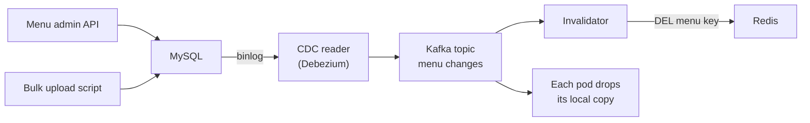

### 4.8 Failure modes

Probed directly ("what about thundering herd?", Z1, Z12).

#### Cache stampede (thundering herd)

A hot key expires and thousands of simultaneous misses all rebuild it from the DB. Fixes:

**1. One rebuilder.** The first misser takes `SET lock:menu:42 1 NX PX 3000` (NX = only if absent, PX = expiry ms); others wait and retry or get the old value.

```mermaid
sequenceDiagram
    participant U1 as "Request 1"
    participant U2 as "Requests 2 to 3000"
    participant C as "Redis"
    participant DB as "MySQL"
    U1->>C: miss, SET lock NX PX 3000
    C-->>U1: ok, you rebuild
    U2->>C: miss, SET lock NX
    C-->>U2: lock taken, wait
    U1->>DB: SELECT menu (only one query)
    U1->>C: SET menu with TTL
    U2->>C: retry GET after 20 ms
    C-->>U2: hit
```

> **Real world — Facebook:** leases issue a rebuild token per key **only once every 10 seconds**; **peak DB query rate fell from 17,000/s to 1,300/s**. ([source](https://www.usenix.org/system/files/conference/nsdi13/nsdi13-final170_update.pdf))

In-process, this is **single-flight / request coalescing** (Go's `singleflight`); Instagram caches a **promise** so misses share one fetch. ([source](https://instagram-engineering.com/thundering-herds-promises-82191c8af57d))

**2. Probabilistic early refresh (XFetch):** refresh if `now − delta × beta × ln(random()) ≥ expiry` (delta = recompute time), so one random reader refreshes before expiry (Vattani et al., VLDB 2015). **3. Serve stale while revalidating** between a soft and hard expiry. **4. TTL jitter:** `3600 + random(0, 600)` so bulk-loaded keys don't expire together. **5. Warm the cache** before peaks.

**Connect to your work (Myntra):** warming ~5.7M keys tripped the downstream rate limiter; a 4 ms pacing delay fixed it. Warmup is a load event: 250 calls/s per worker → ~6.3 h alone, ~38 min with 10 workers; size workers by the downstream limit. Zomato also **injected cache misses on purpose** in pre-NYE chaos tests. ([source](https://www.zomato.com/blog/a-tale-of-scale-behind-the-scenes-at-zomato-tech-for-nye-2023))

#### Cache penetration

Requests for non-existent IDs miss, find nothing, store nothing, repeat; a bot bypasses the cache. **Cache the "not found"** (`SET restaurant:999 "__NULL__" EX 60`), or put a **Bloom filter** in front: a bit array plus k hashes. If any of a key's bits is 0 it is **definitely absent**; all 1 means "maybe" (false positives, never false negatives). ~10 bits/key gives ~1% false positives; 1M IDs ≈ 1.2 MB.

#### Cache avalanche

Many keys at once: **mass expiry** (fix: jitter) or **cluster failure**, where 100% of reads hit a DB sized for 1%. Fixes: replicas with failover, L1 for hot keys, **circuit breakers** shedding non-critical reads, DB rate limits. Facebook's **gutter pool** (~**1% of servers**) takes over failed servers instead of rehashing (one hot key can be **20% of a server's load**), **cutting client-visible failures by 99%**.

#### Hot keys

One viral key lands on **one shard** however many you have. Fixes: **L1 copy** in each pod (200 pods × 1 read per 5 s = 40 reads/s instead of 100,000), **key salting** (`banner:1#0..#9` across shards), read replicas, and detection (`redis-cli --hotkeys`).

### 4.9 Consistency and the two-cache drift

**Eventual** (stale up to a TTL; menus), **read-your-writes** (the editor sees their own change; route their next read to the DB), **strong** (nobody sees stale; for wallets and the last seat, read the DB). There is no atomic transaction across a DB and a cache; you bound the window with TTLs, deletes and CDC.

```mermaid
sequenceDiagram
    participant W as "Writer service"
    participant DB as "Database"
    participant C1 as "Cache A (service 1)"
    participant C2 as "Cache B (service 2)"
    W->>DB: update rating to 4.5
    W->>C1: DEL rating key
    Note over C2: Nobody told cache B
    Note over C1,C2: One page shows 4.5, another 4.1 until TTL
```

**Connect to your work (Myntra):** you hit this: two caches of the same data drifted. Tell it as symptom → cause (one write path invalidated one cache, or mismatched TTLs) → fix. Standard fixes: **one owner** caches the data; **invalidate both from one event** (Kafka/CDC); **same TTL and key scheme**; **short L1 TTL**. Don't invent details you don't remember.

### 4.10 Redis essentials

**Redis** is an in-memory data store (Z1, Z12 ask how it is fast and scales).

| Type | Food delivery use |
|---|---|
| String | Menu JSON, counters, locks (`SET k v EX 600 NX`, `INCR`) |
| Hash | Restaurant profile, cart |
| List | Simple job queue |
| Set | Promo-push dedupe |
| Sorted set | Leaderboards, delay queues, sliding-window rate limits |
| Geo | Riders within 3 km (one common approach; Zomato's is not public) |
| HyperLogLog | Approx unique visitors in 12 KB |
| Stream / Pub/Sub | Light queue / L1 invalidation |

**Single-threaded yet fast:** data in RAM, **no locks**, **epoll** multiplexing thousands of sockets on one thread, and Redis 6+ I/O threads; ~100k+ ops/s per node (commonly quoted). Every command is **atomic**, but **one slow command blocks everyone** (`KEYS *`; use `SCAN`, `UNLINK`). For multi-step atomicity use a **Lua script**, which runs with nothing interleaved:

```lua
local t = tonumber(redis.call('GET', KEYS[1]) or '0')
if t > 0 then redis.call('DECR', KEYS[1]) return 1 end
return 0
```

> **Real world — GitHub:** its rate limiter uses Redis **Lua scripts**, and moved off shared Memcached because memory pressure was **evicting live rate-limit counters**. ([source](https://github.blog/2021-04-05-how-we-scaled-github-api-sharded-replicated-rate-limiter-redis/)) So give counters and locks their own Redis with `noeviction`.

**Connect to your work (Myntra):** a per-pod token bucket (180/min) avoids a network hop, but the global limit becomes 180 × pods; a shared Redis+Lua bucket is exact at the cost of a hop.

**Persistence:** **RDB** snapshots (lose since last snapshot) and **AOF** (`everysec` loses ~1 s). **Replication is asynchronous**, so failover can lose acked writes; **Sentinel** promotes replicas. Redis docs therefore call failover unsafe for locks and recommend **fencing tokens**. ([source](https://redis.io/docs/latest/develop/clients/patterns/distributed-locks/))

**Redis Cluster:** **16,384 slots**, `slot = CRC16(key) mod 16384`, each primary (with replicas) owns a range.

```
   slots 0 ──────── 5460 | 5461 ──────── 10922 | 10923 ──────── 16383
         Node A + A1         Node B + B1            Node C + C1
   "cart:u77" → slot 2,051 → A          "menu:42" → slot 9,173 → B
```

Clients cache the slot map and follow `MOVED` replies; adding a node moves only some slots; multi-key commands need one slot, forced with **hash tags** (`{order:123}:items`, `{order:123}:status`). Zomato's ML feature store keeps real-time features in **Redis Cluster**, load-tested to **18 million requests/min**. ([source](https://www.zomato.com/blog/elements-of-scalable-machine-learning/))

**Eviction policies:** `noeviction` (locks, queues), `allkeys-lru`/`allkeys-lfu` (general cache), `volatile-lru`/`volatile-lfu` (only TTL keys).

**Redis vs Memcached vs Aerospike:** Memcached is a multi-threaded plain blob cache with no built-in replication (Facebook, Netflix); Redis adds data structures, scripts, persistence and replication; Aerospike keeps the index in RAM and data on SSD, cheaper at large size (Myntra ratings; if you don't know why it was chosen, say "it predates me; here's how I'd reason"). Netflix EVCache serves about **400 million ops/s** on **22,000 servers** ([source](https://infoq.com/articles/netflix-global-cache)); Twitter found **over 35% of clusters write-heavy**, so check the read-write ratio before caching.

### 4.11 The trap: "With infinite money, why not replace the database with a cache?"

Asked in Blinkit SDE-2 (B12, unanswered) and SDE-1 (B3). Money buys RAM, not: **durability** (RAM dies; AOF loses ~1 s; async replicas lose acked writes), **querying** (indexes, joins, "undelivered orders for restaurant 42 in the last hour"), **transactions and constraints** (an order touches payment, coupon, inventory; Lua is per-slot with no rollback), **guarantees** (eviction is a cache feature and a database disaster), and **operations** (backups, point-in-time recovery, audit).

**Say this:** "A cache is a copy optimised for speed that is allowed to be lost. With infinite money I'd give the database enough RAM for its buffer pool to hold everything, getting most of the speed and keeping every guarantee."

**Don't cache:** money and decisions, data written more than read, one-off results, large blobs (block Redis's thread; use S3/CDN), sensitive data in shared caches, last-seat style inventory (use a conditional DB update), anything unmeasured.

### Check yourself

**Q: Cache 1 ms, DB 30 ms, 95% hit ratio?** A: 0.95 + 0.05 × 31 = 2.5 ms.

**Q: Why delete instead of set?** A: Concurrent SETs can land out of order; deletes are idempotent.

**Q: Stampede vs avalanche?** A: One hot key missing en masse vs many keys or the whole cluster failing.

**Q: Keep two keys on one Redis Cluster node?** A: Hash tags, e.g. {order:123}, so only the braced part is hashed.

**Q: Why not keep rate limits in the menu cache?** A: LRU can evict live counters (GitHub); use a separate noeviction Redis.

## Part 5: Asynchronous processing

Async processing makes writes and side effects survivable. When a user taps "Place order", the restaurant, a rider, a push, the ledger and analytics all need work; the question is what must happen before "Order placed" and how to make the rest reliable when things crash and messages arrive twice.

### 5.1 Synchronous vs asynchronous

**Synchronous**: the caller waits. **Asynchronous**: it hands off and continues. Calling payment, restaurant, dispatch, notification and analytics in sequence costs ~1.3 s (assumed), multiplies availability down (0.999^5 ≈ 99.5%) and couples the order service to every consumer. Instead, save the order and publish one event:

```mermaid
sequenceDiagram
    participant U as "User app"
    participant OS as "Order service"
    participant DB as "Orders DB"
    participant K as "Kafka topic order-events"
    participant RS as "Restaurant service"
    participant NS as "Notification"
    U->>OS: POST /orders
    OS->>DB: INSERT order, status PLACED
    OS->>K: publish OrderPlaced
    OS-->>U: Order placed (about 100 ms)
    K-->>RS: OrderPlaced
    K-->>NS: OrderPlaced
    Note over RS,NS: Each consumer works and retries on its own
```

**Rule:** synchronous for what decides success and what the user sees now (payment authorisation, "restaurant open?"); async for anything retryable unnoticed (push, analytics, invoices, ledger). Rider assignment is async with tight monitoring.

> **Real world — Zomato:** Kafka is **"the backbone of our event-driven architecture"**, at **450+ million messages per minute** and a **5.6 GBps** peak on NYE 2023. ([source](https://www.zomato.com/blog/a-tale-of-scale-behind-the-scenes-at-zomato-tech-for-nye-2023))

Blinkit SDE-1 (B2) asked: why async, what if the consumer is down, how to handle duplicates. Answers in 5.11.

### 5.2 Queues, and point-to-point vs pub/sub

A **message queue** stores messages from **producers** until **consumers** take them. It gives **decoupling** (producers know only a topic), **load levelling** (an NYE spike piles up as backlog and drains at consumer speed; the cost is delay), **durability and retries**, and **fan-out**.

- **Point-to-point (work queue):** each message to **one** worker ("generate this invoice"). SQS, RabbitMQ.
- **Pub/sub:** each message to **every** subscriber ("order 123 placed").

Kafka does both via **consumer groups**; on AWS, **SNS** fans out to several **SQS** queues.

**Connect to your work (Atlassian):** your API → SQS → worker pool is decoupling, load levelling and retry in one.

### 5.3 Kafka essentials

Kafka appears in ~12 Zomato-group reports (one round reportedly spent ~40 minutes on it).

**A log, not a queue.** Kafka stores an append-only ordered **log**. **Reading deletes nothing**; data stays until retention, so many consumers share it and can rewind. A **broker** is one server; a **topic** (`order-events`) splits into **partitions**, each an ordered log on one broker (plus replicas) and the unit of scaling. Each message has an **offset**, its position.

**Keys.** `partition = hash(key) mod partitions`, and **order is guaranteed only within a partition**. Key by `order_id` so PLACED → ACCEPTED → PICKED stay ordered. Adding partitions changes the mapping (provision headroom); a skewed key makes a hot partition.

**Consumer groups.** Each partition is owned by **exactly one** consumer per group; groups are independent with their own offsets.

```mermaid
flowchart LR
    subgraph T["Topic order-events"]
        P0["Partition 0"]
        P1["Partition 1"]
        P2["Partition 2"]
    end
    subgraph G1["Group notification-svc"]
        C1["Consumer 1"]
        C2["Consumer 2"]
    end
    subgraph G2["Group analytics"]
        C3["Consumer A"]
    end
    P0 --> C1
    P1 --> C1
    P2 --> C2
    P0 --> C3
    P1 --> C3
    P2 --> C3
```

**Max parallelism in a group = partition count**; extra consumers idle. Grab: partitions must be at least the number of consumer servers. ([source](https://engineering.grab.com/supporting-large-campaigns-at-scale))

**Commits and rebalancing.** Consumers **commit** "processed up to offset N"; commit after processing → at-least-once, before → at-most-once. When a consumer joins, leaves or misses heartbeats or `max.poll.interval.ms`, the group **rebalances**, pausing moved partitions (cooperative rebalancing moves only what must). Classic bug: a batch outlasts `max.poll.interval.ms`, Kafka assumes death, another consumer re-reads it, duplicates loop.

**Replication, ISR, acks.** Each partition has a **leader** and followers (replication factor 3). The **ISR (in-sync replicas)** are those caught up; new leaders come from it. Producer `acks`: `0` (fire and forget), `1` (leader only; lost if it dies before copying), `all` (every ISR member). Pair `acks=all` with **`min.insync.replicas=2`** so writes are rejected rather than landing on one copy, and set **`enable.idempotence=true`** so producer retries don't duplicate.

> **Real world — Confluent:** transactions (Kafka 0.11) give atomic multi-partition writes plus offset commits at ~**3% lower throughput**, but **exactly-once covers only Kafka-to-Kafka processing**; pushes and API calls still need idempotency. ([source](https://www.confluent.io/blog/exactly-once-semantics-are-possible-heres-how-apache-kafka-does-it/))

**Retention and replay.** Default 7 days; reset offsets to reprocess after a bug or backfill. Zomato replays recorded live requests from Kafka for load testing (~**52M messages/min**, per a WarpStream vendor case study, which also reports a **60%** logging cost cut by moving to S3-backed WarpStream). ([source](https://www.warpstream.com/blog/eternal-case-study)) **Log compaction** keeps the latest message per key (a durable `restaurant_id → status` table); a null **tombstone** deletes a key.

**Why fast:** sequential disk I/O, OS page cache, zero-copy `sendfile`, batching and compression, one offset per partition per group.

**Head-of-line blocking:** one slow message stalls its partition. Uber's uForwarder proxy processes in parallel with **out-of-order commits** (commit an offset only once all earlier ones finish) ([source](https://www.uber.com/blog/kafka-async-queuing-with-consumer-proxy/)); DoorDash, after RabbitMQ failover took **20+ minutes** and lost messages, moved to Kafka with a **non-blocking worker** feeding a local queue to many executors. ([source](https://doordash.engineering/2020/09/03/eliminating-task-processing-outages-with-kafka/))

### 5.4 SQS essentials, and the comparison

**SQS** is AWS's managed point-to-point queue. Consumers **poll**; a received message is hidden for the **visibility timeout** (default 30 s, up to 12 h), then deleted on success or made visible again.

```mermaid
sequenceDiagram
    participant W1 as "Worker 1"
    participant Q as "SQS queue"
    participant W2 as "Worker 2"
    W1->>Q: ReceiveMessage
    Q-->>W1: msg M, hidden for 30 s
    Note over W1: Worker 1 crashes mid-processing
    Note over Q: 30 s pass, M visible again
    W2->>Q: ReceiveMessage
    Q-->>W2: msg M (receive count 2)
    W2->>Q: DeleteMessage M
```

Set the timeout above worst-case job time or extend it with `ChangeMessageVisibility`; too short and jobs run twice. A **redrive policy** moves a message to a **DLQ** after `maxReceiveCount` receives. **FIFO** queues give order per **message group ID** (like a Kafka key) and dedup within 5 minutes; standard queues may reorder and duplicate. Always use **long polling** (`WaitTimeSeconds` 20); `DelaySeconds` delays up to 15 min.

**Connect to your work (Atlassian):** know your visibility timeout vs job time, workers per pod, idempotency on redelivery, and DLQ threshold. Razorpay's notification service hit a **single queue for all request types**; secondary write-ups say the fix added **P0/P1 priority queues** and a **retry queue**. ([source](https://engineering.razorpay.com/how-razorpays-notification-service-handles-increasing-load-f787623a490f))

**RabbitMQ** routes from **exchanges** (direct, topic, fanout) to queues with per-message acks: flexible routing and priorities, but no replay and weaker at huge backlogs.

| | Kafka | SQS | RabbitMQ |
|---|---|---|---|
| Replay | Yes | No | No |
| Ordering | Per partition | Per group (FIFO) | Per queue |
| Fan-out | Consumer groups | Needs SNS | Exchanges |
| Ops | High self-hosted | None | Medium |
| Delays | Retry topics | Up to 15 min | Plugin |

**Say this:** "Kafka for replayable, high-volume event streams with many consumers and per-key order; SQS for no-ops 'do this job once' queues with visibility timeout and DLQ built in."

### 5.5 Delivery semantics and idempotency

```
At-most-once:   receive → ACK → process → CRASH          → lost, never duplicated
At-least-once:  receive → process (push sent) → CRASH → redelivered → push sent again
```

At-most-once suits click analytics; at-least-once is the default for anything important. True exactly-once *delivery* is impossible (the ack can be lost); you get **effectively-once**: at-least-once plus idempotent consumers. **Say this:** "At-least-once delivery with idempotent consumers."

A consumer is **idempotent** if processing twice equals once. Techniques:

1. **Absolute values over deltas** ("set DELIVERED", not "add ₹50"). Zomato's ads Flink job uses incremental counts but adds an **hourly reconciliation job** as a fail-safe. ([source](https://www.zomato.com/blog/eliminating-bottlenecks-in-real-time-data-streaming-a-zomato-ads-flink-journey/))
2. **Processed-event table in the same transaction:**

```sql
BEGIN;
  INSERT INTO processed_events (event_id) VALUES ('evt-8f2a');  -- unique; fails if seen
  UPDATE loyalty_points SET points = points + 50 WHERE user_id = 77;
COMMIT;
```

3. **Unique business keys** (one invoice per `order_id`).
4. **Conditional updates:** `UPDATE orders SET status='PICKED_UP' WHERE id=123 AND status='RIDER_ASSIGNED'`; duplicates match zero rows.
5. **Redis `SET NX EX`** for short-lived dedupe (not for money: failover can lose keys).
6. **Idempotency keys on APIs:** Stripe replays the first response per key ([source](https://docs.stripe.com/api/idempotent_requests)); Razorpay webhooks are at-least-once and out of order, dedupe on `x-razorpay-event-id` ([source](https://razorpay.com/docs/webhooks/best-practices/)).

**Connect to your work (Atlassian):** "crash after the side effect, before recording the ID?" Same transaction, or an idempotency key to the external system.

### 5.6 Retries, backoff, jitter, DLQs

**Exponential backoff** (100, 200, 400 ms, capped) plus **jitter** (full jitter: random(0, backoff)) stops 10,000 failed clients retrying in sync; Stripe does this. ([source](https://stripe.com/blog/idempotency)) Retry 5xx and timeouts, never 4xx, and always with idempotency. **Retry storms:** 3 layers × 3 retries = 27x load on a failing service; DoorDash also names **death spirals**. ([source](https://doordash.engineering/2023/03/14/failure-mitigation-for-microservices-an-intro-to-aperture/)) Fixes: retry at one layer, retry budgets, circuit breakers, load shedding (Zomato reviews kill switches and degraded modes before NYE).

A **poison message** fails every time and, in Kafka, blocks its partition. Retry a bounded number of times through delayed tiers, then a **DLQ**, commit past it, alert.

```mermaid
flowchart LR
    M["order-events"] --> C["Consumer"]
    C -->|"ok"| D["Done, commit"]
    C -->|"transient error"| R1["retry-1m topic"]
    R1 --> C2["Retry consumer"]
    C2 -->|"fails again"| R2["retry-10m topic"]
    R2 -->|"still fails"| DLQ["DLQ plus alert"]
    C -->|"bug or bad data"| DLQ
    DLQ -.->|"after fix, redrive"| R1
```

Uber's "Reliable Reprocessing" does exactly this and **commits the original offset so the partition isn't blocked**. ([source](https://www.uber.com/blog/reliable-reprocessing/))

**Connect to your work (Myntra):** your Kafka error queue retried instantly; if downstream is down 10 minutes those retries all fail and add load. Better: delayed tiers with jitter, then DLQ, separating "retry later" from "never works". A DLQ needs alerts and redrive tooling.

### 5.7 Ordering and consumer lag

Ordering breaks when you don't key by entity, when retries let message 6 pass message 5, with parallel workers (hash keys to fixed threads), with multiple producers (add **version numbers**, ignore older), and with external sources (Razorpay webhooks). Safest: **order-tolerant consumers** ("apply only if event.version > stored.version").

**Consumer lag** = latest offset − committed offset; alert on lag **in time**, since 10,000 messages is nothing for analytics and a disaster for dispatch. To fix (Z12): find the slow call; add consumers up to partitions; add partitions; parallelise inside the consumer with per-key order; batch writes; split urgent and bulk topics. **Backpressure** means a slow consumer slows the producer (bounded queues, 429s); your Myntra 4 ms warmup pacing was manual backpressure.

### 5.8 Dual writes, the outbox and CDC

Saving to MySQL then publishing to Kafka is two systems with no shared transaction: crash after the insert and nobody is told; publish before a failed insert and a phantom order is cooked. Kafka doesn't support XA, so 2PC is out. ([Debezium](https://debezium.io/blog/2019/02/19/reliable-microservices-data-exchange-with-the-outbox-pattern/))

The **transactional outbox** writes the event into an `outbox` table **in the same DB transaction**; a relay publishes it.

```mermaid
sequenceDiagram
    participant OS as "Order service"
    participant DB as "MySQL"
    participant RL as "Relay (Debezium or poller)"
    participant K as "Kafka"
    OS->>DB: BEGIN, INSERT orders, INSERT outbox, COMMIT
    Note over OS,DB: One transaction, both rows or neither
    RL->>DB: read new outbox rows (binlog or poll)
    RL->>K: publish, key = order id
    Note over RL,K: Relay may republish, so consumers dedupe by event id
```

The outbox row has a UUID `id` (for dedupe), `aggregateid` (order id → Kafka key), `type` and JSON `payload`. The relay is either **CDC log tailing** (Debezium reads the binlog; low latency) or a **polling publisher** (simpler, adds DB load). Both are at-least-once. ([source](https://microservices.io/patterns/data/transactional-outbox.html))

**CDC** (change data capture) turns every committed change in the DB log into events, feeding cache invalidators, search indexers and analytics with no app code to forget. Zomato captures **Aurora MySQL changes with Debezium** into **Kafka (Avro)**, and **Flink** writes them to **Iceberg** on S3. ([source](https://aws.amazon.com/blogs/opensource/how-zomato-boosted-performance-25-and-cut-compute-cost-30-migrating-trino-and-druid-workloads-to-aws-graviton/)) Raw CDC exposes your schema, so use it for analytics and invalidation, and the outbox for stable domain events.

### 5.9 Choreography vs orchestration, event sourcing, CQRS

**Choreography:** each service reacts to events and emits its own (OrderPlaced → PaymentSucceeded → OrderAccepted → RiderAssigned). Loose coupling, but "where is order 123 stuck?" is hard and compensations scatter. **Orchestration:** one workflow tells each service what to do, with timeouts and compensations in one place, but it must be highly available. Uber's **Cadence** provides **durable timers** and ran the **8 steps of an Eats order workflow** ([source](https://www.uber.com/blog/open-source-orchestration-tool-cadence-overview/)); Temporal is its successor; Zomato's tooling is **not public**. **Say this:** choreography for broadcast facts, orchestration (a **saga**: local transactions each with an undo step) for the money-and-fulfilment flow.

**Event sourcing** stores what happened and derives state by replay, like a bank balance; Stripe's Ledger is an **immutable, append-only log** of ~**5 billion events/day**. ([source](https://stripe.dev/blog/ledger-stripe-system-for-tracking-and-validating-money-movement)) **CQRS** uses a transactional write model plus read models fed by events (tracking view, dashboard, search index); trade-off is lag.

### 5.10 Delayed and scheduled jobs

Auto-cancel after 3 minutes, "rate your meal" after 45. Kafka has no "deliver at T". Options:

```sql
SELECT id, payload FROM scheduled_jobs
 WHERE status = 'PENDING' AND run_at <= NOW()
 ORDER BY run_at LIMIT 50
 FOR UPDATE SKIP LOCKED;   -- workers skip rows others locked
```

1. **DB poller with `SKIP LOCKED`:** durable, transactional, fine to thousands/s.
2. **Redis sorted set:** score = run time; poll `ZRANGEBYSCORE`, and the worker whose `ZREM` returns 1 owns the job. Fast, but keep important timers' truth in the DB.
3. **Fixed-delay retry topics** (`retry-1m`, `retry-10m`).
4. **SQS `DelaySeconds`**, EventBridge Scheduler, or Cadence/Temporal timers.

DoorDash found Celery delayed tasks **overloaded RabbitMQ**; keep mass timers out of in-memory brokers.

### 5.11 Kafka follow-ups interviewers ask

From B2, Z4, Z12, Z13, Z15, B17.

**"Why async?"** Faster responses (1.3 s → 100 ms), failures isolated, teams decoupled, spikes absorbed.

**"Consumer down?"** Messages wait within retention; the offset resumes; alert on lag; a rebalance hands its partitions to others. In SQS, messages reappear after the visibility timeout.

**"Duplicates?"** At-least-once plus unique event IDs, idempotent consumers, idempotency keys outward, idempotent producer.

**"Order?"** Key by order_id, one consumer per partition or key-hashed threads, version numbers.

**"Poison message?"** Retry tiers, DLQ, commit past, alert, redrive.

**"Why not a DB table as a queue?"** Fine at small scale with SKIP LOCKED; Kafka adds throughput, cheap fan-out, replay and per-key ordering without polling the primary.

If you don't know an internal (KRaft details), say so and reason it out; bluffing hurts.

### Check yourself

**Q: 6 partitions, 10 consumers in one group?** A: 4 sit idle.

**Q: acks=all, min.insync.replicas=2, RF 3?** A: Acked writes are on 2+ replicas; with only one in sync, writes are rejected.

**Q: SQS job takes 45 s, timeout 30 s?** A: It reappears and runs twice; extend the timeout and stay idempotent.

**Q: Dual-write fix?** A: Outbox row in the same transaction, relay publishes, consumers dedupe on event ID.

**Q: Auto-cancel if not accepted in 3 minutes?** A: A scheduled job running `cancel WHERE status = 'PLACED'`, a no-op if already accepted.

---

## Part 6: APIs and real-time communication

An **API** is a contract between two programs: "send me this, I reply with that." Interviewers ask for real payloads: "write every API with sample request/response" (Eternal Nugget), "status codes, headers, auth" (Zomato SDE-1), "a paginated District Money history API" with SQL.

### 6.1 REST essentials

**REST** models the system as **resources** (nouns) at **URLs**, acted on by **HTTP methods**. Plural nouns, IDs in the path, children under parents: `POST /orders`, `GET /restaurants/42/menu`, never `POST /createOrder`.

**Safe** = changes nothing. **Idempotent** = once or ten times leaves the same final state ("set address to Home" is; "add one Butter Chicken" isn't).

| Method | Use | Safe | Idempotent |
|---|---|---|---|
| GET | Read | Yes | Yes |
| POST | Create / trigger (`POST /orders`) | No | **No** |
| PUT | Replace whole resource | No | Yes |
| PATCH | Change some fields | No | Not guaranteed |
| DELETE | Remove | No | Yes |

Why it matters: the order is created, the reply is lost in a tunnel, the app retries. GET/PUT/DELETE retries are harmless; a POST retry can double-charge (fixed in 6.4). Trap: a second DELETE returning 404 is still idempotent; idempotency is about state, not the response.

**Status codes**: 2xx success, 4xx client's fault (don't retry), 5xx server's fault (may retry). Know 201 Created (+`Location`), 202 Accepted (async), 400 bad body, **401** "who are you?" vs **403** "I know you, no", 404, **409** conflict (seat taken, idempotency key in flight), 422 business rule broken (expired coupon), **429** "*you* send too much" (+`Retry-After`) vs **503** "*I* am overloaded". Stripe recommends distinct 429s and 503s ([source](https://stripe.com/blog/rate-limiters)).

**Versioning**: old app versions live forever. Adding optional fields is safe; removing, renaming or retyping a field is breaking and needs `/v2` (or a header; Stripe uses dated versions). Run both, retire v1 when traffic is near zero.

### 6.2 The API contract interviewers want

```http
POST /v1/orders
Authorization: Bearer eyJhbGciOi...
Idempotency-Key: 6f1c2b7e-4a51-4d0e-9a8f-0b5d3c2e9f11

{"restaurant_id": 42, "items": [{"menu_item_id": 1201, "quantity": 2}],
 "address_id": 3, "coupon_code": "WELCOME50", "payment_method": "UPI",
 "client_total_paise": 64900}

HTTP/1.1 201 Created
Location: /v1/orders/9001
{"order_id": 9001, "status": "PAYMENT_PENDING", "amount_paise": 64900, "eta_minutes": 32}
```

One sentence each: **money in integer paise** (floats round); the server **recomputes the total** and returns 409/422 if the client's is stale; the **idempotency key** makes retries safe; return a **status**, since an order is a state machine; **token in a header**, because URLs land in logs. Then list errors (400, 401, 404, 409, 422 closed restaurant, 429).

**Pre-signed URL trap** (two Zomato-group reports: menu images as base64 in JSON; 10 MB voice files at 100K/day). The API server shouldn't carry big bytes. It checks auth and size, returns a **pre-signed S3 PUT URL** valid ~10 minutes for one object; the client uploads directly; an S3 event queues a worker (scan, resize); the client polls for READY plus a CDN URL.

### 6.3 gRPC and GraphQL

**gRPC**: a `.proto` contract generates typed client/server code; binary protobuf over **HTTP/2** (many requests multiplexed on one connection, streaming). The default *between* services: DoorDash standardized on Kotlin plus gRPC ([source](https://doordash.engineering/2020/12/02/how-doordash-transitioned-from-a-monolith-to-microservices/)). **GraphQL**: one endpoint, the client asks for the exact shape it needs, one round trip per screen; costs are no URL-based caching, queries that fan out into hundreds of DB calls, and rate limiting by query cost. HTTP/1.1 vs 2 (a Zomato intern question): 1.1 is one request at a time per connection; 2 multiplexes and compresses headers. **Say:** "REST for apps, gRPC internally, GraphQL or a BFF if screens need very different data."

### 6.4 Idempotency keys

The **client generates a unique key per user intent** and sends it on every retry; the server remembers processed keys and replays the stored answer.

> **Real world — Stripe:** Keys go in an `Idempotency-Key` header, up to **255 characters** (V4 UUIDs), prunable after **24 hours**. Stripe stores the first result once execution begins, **including 500s**, errors if a retry's parameters differ, and saves nothing if the request **conflicts with a concurrently executing one** ([source](https://docs.stripe.com/api/idempotent_requests)). Clients retry with exponential backoff and jitter ([source](https://stripe.com/blog/idempotency)).

Each rule fixes a bug: stored 500s stop half-done work being re-run blindly; parameter checks catch key reuse for a different amount; a concurrent duplicate gets **409** instead of doing the work twice.

```mermaid
sequenceDiagram
    participant App as "Customer app"
    participant OS as "Order service"
    participant DB as "Idempotency table"
    participant PG as "Payment gateway"
    App->>OS: POST /orders with Idempotency-Key K
    OS->>DB: INSERT key K, params hash, IN_PROGRESS
    Note over OS,DB: Unique index on user_id and key. Only one insert wins
    OS->>PG: Create payment, passing K to the gateway too
    OS->>DB: UPDATE K to DONE with response 201 and body
    OS--xApp: 201 lost in a tunnel
    App->>OS: Retry with the same key K
    OS->>DB: INSERT fails, SELECT stored response
    OS-->>App: Replay 201, same order_id
```

Table: `PRIMARY KEY (user_id, idempotency_key)`, plus `request_hash`, `status`, `recovery_point`, `response_code`, `response_body`, `created_at`.

**Crash halfway?** Brandur Leach's design splits the request into **atomic phases**, each its own transaction advancing a `recovery_point` (`started → order_created → payment_created → finished`); a **completer** resumes stuck keys and a **reaper** deletes old ones ([source](https://brandur.org/idempotency-keys)). Airbnb's Orpheus adds: **no DB work during the remote call**, read keys from the **primary** (replica lag could hide one), 5xx retryable, 4xx not (secondary [summary](https://biweekly-engineering.beehiiv.com/p/handling-double-payments-airbnb-biweekly-engineering-episode-32)). Never hold a transaction open across a 3-second gateway call; at NYE traffic the pool runs dry.

Trap: **the client** generates the key (when "Place order" is tapped, stored with the cart), else a retry can't be linked to the first attempt. **Your Atlassian SQS work** is the consumer side: "producers send idempotency keys, consumers dedupe on message ID, because every hop can duplicate."

### 6.5 Pagination: offset vs cursor

A District SDE-1 was rejected after this chain. **Offset** (`LIMIT 20 OFFSET 40`) allows page jumps but (1) slows with depth (OFFSET 100000 reads and discards 100,000 rows) and (2) **shifts**: a new row between page reads duplicates an item; a delete skips one.

**Cursor (keyset)**: "20 rows after the last one I saw." The cursor is the last row's `(created_at, id)`, base64-encoded so it's opaque; `id` breaks timestamp ties for a strict order.

```sql
SELECT id, amount_paise, type, created_at FROM transactions
WHERE user_id = 7 AND (created_at, id) < (:c_time, :c_id)
ORDER BY created_at DESC, id DESC
LIMIT 21;                                  -- extra row = "has next page"
CREATE INDEX idx_txn ON transactions (user_id, created_at DESC, id DESC);
```

Every page costs one index seek, and new rows don't disturb it. Trade-off: no page jumps. Other kinds: page-number (offset in disguise) and time-range.

**Three source tables** (cashback, tickets, refunds), one merged list: not a JOIN. Either **UNION ALL** with *each branch* applying the cursor and `LIMIT 21` (all 20 could come from one table), or **fetch 21 from each in parallel and k-way merge** in the app, or at scale a **read model**: sources publish to Kafka and one consumer builds a `user_wallet_feed` table (eventually consistent). Hidden bug: cashback 881 and refund 881 differ, so **the cursor must be unique across sources: `(created_at, src, id)`**.

### 6.6 Webhooks

After a UPI payment the gateway POSTs to *your* URL: a **webhook**.

> **Real world — Razorpay:** Respond within **5 seconds**; **any non-2xx is a failure**; retries back off for **24 hours**, then the **webhook is disabled**. Delivery is **at-least-once** (dedupe on **`x-razorpay-event-id`**) and **order isn't guaranteed** ([source](https://razorpay.com/docs/webhooks/best-practices/)). The browser redirect isn't a substitute; poll fetch APIs if no webhook arrives ([source](https://razorpay.com/docs/webhooks/)).

So: **ack fast, process later**; **dedupe** with a unique index; a **forward-only state machine** (late "authorized" can't overwrite "captured"); **alert** long before 24h; a **reconciliation poller** for stuck PAYMENT_PENDING orders. And **verify the HMAC-SHA256 signature** over the **raw bytes** with a **constant-time compare** (`hmac.compare_digest`), or anyone can POST "captured" for free biryani.

```mermaid
sequenceDiagram
    participant PG as "Razorpay"
    participant WH as "Webhook endpoint"
    participant DB as "payment_events table"
    participant K as "Kafka"
    participant OS as "Order service"
    PG->>WH: POST event with signature and event-id E1
    WH->>WH: Verify HMAC over raw body
    WH->>DB: INSERT E1, unique on event_id
    alt new event
        WH->>K: Publish keyed by order_id
        WH-->>PG: 200 within milliseconds
    else duplicate
        WH-->>PG: 200 already have it
    end
    K->>OS: PAYMENT_PENDING to CONFIRMED only if not past it
```

Trap: stored E1 then crashed before publishing; the retry hits the unique index, returns 200, and the event is never published. Fix with a **transactional outbox** (the event row is the outbox; a relay publishes) or check "processed?" in the duplicate branch. That's the non-happy-path depth a rejected Zomato payments candidate lacked.

### 6.7 Real-time options

HTTP can't speak first, so:

| | Short poll | Long poll | SSE | WebSocket | MQTT |
|---|---|---|---|---|---|
| How | Ask every few s | Server holds request till news | One HTTP response streams events | HTTP `Upgrade`, then two-way pipe | Pub/sub topics via a broker |
| Direction | Client asks | Client asks | Server → client | Both | Both |
| Overhead | Full request each time | Full request per update | Few bytes | 2-14 bytes | 2-byte header |
| Guarantees | DIY | DIY | Resume by `Last-Event-ID` | DIY | QoS 0/1/2, retained, last will |
| Fits | Rare checks | Fallback | Order status | Chat | Rider location, flaky mobile |

Before its push platform **80% of Uber's gateway requests were polling** ([source](https://www.uber.com/en/blog/real-time-push-platform/)). Zomato support chat ran **19,500 concurrent sessions, 51,400 messages/minute** on NYE 2023 ([source](https://www.zomato.com/blog/a-tale-of-scale-behind-the-scenes-at-zomato-tech-for-nye-2023)). MQTT terms: **QoS 0** at-most-once (location pings), **QoS 1** at-least-once ("picked up"), **QoS 2** exactly-once; **retained messages** give new subscribers the last position; **Last Will** announces an unclean disconnect.

> **Real world — Zomato:** Tracking started on HTTP polling; TLS and header overhead beat the tiny payloads and markers jumped. It moved to **MQTT**, with the open-source Android **Pulse-MQTT** library handling reconnect, re-subscribe and exponential retry ([source](https://www.eternal.com/blog/pulse/)). The **server-side broker is not public**; say "a clustered MQTT broker or equivalent".

**Say:** "Rare updates, poll. Server talks, SSE. Both talk, WebSocket. Many small messages from phones on bad networks, MQTT, which Zomato chose."

### 6.8 Scaling persistent connections

A connection is pinned to one gateway, so messages must reach *that* gateway: a **connection registry** (`user -> gateway` in Redis with heartbeat TTL) or **pub/sub** (gateways subscribe to `order:9001`; publishers don't care where users are).

```mermaid
flowchart LR
    RA["Rider apps"] --> LB1["L4 load balancer"]
    LB1 --> B1["Broker or gateway 1"]
    LB1 --> B2["Broker or gateway 2"]
    B1 --> K["Kafka location topic keyed by rider_id"]
    B2 --> K
    K --> TS["Tracking service"]
    TS --> PS["Pub/sub, channel per order"]
    PS --> B1
    PS --> B2
    B1 --> CA["Customer apps"]
    B2 --> CA
    TS --> REG["Connection registry in Redis"]
```

Size it (assumptions): 500K riders every 4 s = 125K messages/s; 1.5M watchers = 1.5M connections, tens of gateways. Use **L4, sticky** balancing; prevent **reconnect storms** with jittered backoff and gradual drains; make streams **resumable** with sequence numbers; give locations short TTLs; **fall back** to long polling. Uber's push platform: **1.5M+ connections, 250K+ messages/s**, at-least-once with per-session sequence numbers, 4 s heartbeats, priority lanes ([source](https://www.uber.com/en/blog/real-time-push-platform/)).

### 6.9 Push notifications: FCM and APNs limits

Closed apps are reached via **FCM**/**APNs** with a push token. **Push is best-effort, rate-limited, collapsible and droppable.**

> **Real world — FCM:** **600k messages/minute per project** (then 429); collapsible bursts of **20 per device, refilling 1 per 3 minutes**; Android ≤240/min per device ([source](https://firebase.google.com/docs/cloud-messaging/throttling-and-quotas)); at most **4 collapse keys per device**, and past **100 stored messages** offline **all are discarded**; TTL 0-28 days ([source](https://firebase.google.com/docs/cloud-messaging/customize-messages/collapsible-message-types)). **APNs:** **4 KB payload**, and an offline device keeps **only one notification per app** and **may reorder** ([source](https://developer.apple.com/documentation/usernotifications/sending-notification-requests-to-apns)).

So: one **collapse key per order**; **push a hint, fetch the truth**; promo blasts take time (10M users ≥ ~17 minutes) and drive click-back traffic; **transactional lanes before promotional**; **short TTL** for "rider 2 minutes away".

### 6.10 BFF

A **Backend for Frontend** is a thin per-app layer (customer, restaurant, rider) that turns one mobile request into parallel internal calls and returns the screen's exact shape, degrading gracefully (drop recommendations on timeout). DoorDash layers Frontend → BFF → Backend → Platform ([source](https://doordash.engineering/2020/12/02/how-doordash-transitioned-from-a-monolith-to-microservices/)). Keep business rules in core services. The **API gateway** differs: app-agnostic TLS, auth, rate limits, routing.

### Check yourself

**Q: Stripe-style idempotency?** Client UUID per action on every retry; unique-index insert before work; store the response (even 500s) and replay; mismatched params error; concurrent duplicate 409; prune after 24h.

**Q: Crash after charging, before saving?** Atomic phases with recovery points, key passed to the gateway, completer for stuck keys, no transaction across the call.

**Q: Paginate three tables?** Cursor `(created_at, src, id)`; UNION ALL or parallel fetch with N+1 per source and merge; at scale a feed table.

**Q: Razorpay webhook handler?** Verify HMAC on raw body, unique-insert event ID, enqueue and 200 within 5 s, forward-only state machine, alert early, reconcile.

**Q: Reach a user on gateway 3?** Registry or pub/sub; sequence numbers, jittered reconnects, long-poll fallback.

## Part 7: Reliability

On NYE 2023 Zomato served **80.92 million requests per minute** on **11,000 EC2 instances** ([source](https://www.zomato.com/blog/a-tale-of-scale-behind-the-scenes-at-zomato-tech-for-nye-2023)). Something is always broken; the job is keeping small failures small.

### 7.1 Failure types

Crash (fails fast: redundancy), **slowness** (the most dangerous: timeouts, breakers, bulkheads), overload (rate limits, shedding, pre-scaling), dependency outage (fallback provider, kill switch), bad deploy (canary, rollback), data problems (validate outputs), zone loss (multi-AZ). Swiggy's #BehindTheBug posts show a wrong-order index pinning the Instamart DB and a flag rollback that didn't reach the backend, and a model predicting *negative* delivery times with no sanity fallback ([index](https://bytes.swiggy.com/behindthebug-indexing-gone-wrong-6b4d682fd805), [PSLA](https://bytes.swiggy.com/behindthebug-unpacking-the-effects-of-negative-psla-predictions-on-serviceability-6e1712eceb56)).

### 7.2 Timeouts and cascading failure

A slow service holds callers' threads, so callers slow down, and theirs.

```mermaid
flowchart LR
    U["Users placing orders"] --> GW["API gateway<br/>threads filling up"]
    GW --> OS["Order service<br/>all 200 threads waiting"]
    OS --> CS["Coupon service<br/>answers in 10 s"]
    CS --> CDB["Coupon DB<br/>slow query"]
    GW --> MS["Menu service<br/>healthy but starved"]
    style CDB fill:#f8d7da
    style CS fill:#f8d7da
    style OS fill:#fff3cd
    style GW fill:#fff3cd
```

A nice-to-have coupon took down ordering *and* browsing. A 300 ms **timeout** (a bit above Coupon's p99) frees threads and places the order without the discount. "30 s to be safe" is unsafe. **Propagate deadlines**: with 1.5 s of a 2 s budget spent, the next call gets 0.5 s (Go: `context.WithTimeout`). Swiggy warns "misconfigured retries can turn a brownout into a blackout" ([source](https://bytes.swiggy.com/designing-resilient-microservices-part-1-6a72fe964759)).

### 7.3 Retries, jitter, retry storms

1. Retry only 5xx, timeouts, connection errors; POST only with an idempotency key.
2. **Exponential backoff** (100, 200, 400 ms) with **full jitter**: `sleep = random(0, min(cap, base * 2^attempt))`, so clients don't retry in one wave.
3. **Retry at one layer only.** Three layers × 4 attempts = **64 calls per tap** to a payment service that's already down.
4. A **retry budget** (retries ≤ ~10% of traffic, assumption) stops amplification during broad outages.

> **Real world — DoorDash:** Names **retry storms**, **death spirals** (slow pods fail readiness, get removed, survivors overload), **metastable failures** (still broken after the trigger leaves, because retries sustain overload), and a misconfigured breaker cutting unrelated traffic ([source](https://doordash.engineering/2023/03/14/failure-mitigation-for-microservices-an-intro-to-aperture/)).

Keep readiness checks cheap; an overloaded pod should shed, not vanish. **Your Myntra error queue** retried instantly; say "retry topics with increasing delays, then a DLQ" (Uber's pattern, [source](https://www.uber.com/blog/reliable-reprocessing/)).

### 7.4 Circuit breakers

Wrap calls to a dependency; after too many failures, **trip** and fail instantly with a fallback.

```mermaid
stateDiagram-v2
    [*] --> CLOSED
    CLOSED --> OPEN: error rate over threshold in window
    OPEN --> HALF_OPEN: cool-down timer expires
    HALF_OPEN --> CLOSED: trial calls succeed
    HALF_OPEN --> OPEN: a trial call fails
```

**CLOSED** counts failures over a sliding window; **OPEN** fails fast (no coupon, cached ratings); **HALF_OPEN** lets a few trials through after ~30 s. Tune threshold, a **minimum call count** (2 of 3 failing at 4 AM shouldn't trip), window, cool-down, and what counts (timeouts and 5xx, not 404). DoorDash calls 50% a rule of thumb that doesn't fit everything (same source); Zomato tuned breakers and added per-feature kill switches after NYE 2021 ([source](https://www.zomato.com/blog/our-learnings-from-nye/)). Blinkit twist ("store requests while down"): for must-not-lose writes, OPEN means **enqueue durably and replay on close**; for payments, route to another gateway.

### 7.5 Bulkheads

Separate resource pools per dependency (Payment 50 threads, Coupon 20, Ratings 10), so a slow Coupon fills only its 20. Same idea at scale: priority queues (Razorpay split notifications into P0 and P1, [source](https://engineering.razorpay.com/how-razorpays-notification-service-handles-increasing-load-f787623a490f)), separate DB pools for API and batch.

### 7.6 Load shedding

Reject some requests early with a fast 503 so the rest are served well, **by priority** (order and pay beat reviews). Stripe's **fleet usage shedder** reserves capacity (**20% critical, 80% non-critical**) and its **worker utilization shedder** drops test traffic first, critical last ([source](https://stripe.com/blog/rate-limiters)). **Adaptive concurrency** (Netflix's limiter, used by DoorDash as a gRPC interceptor) raises the in-flight limit while latency is flat and cuts it when latency rises. Grab sheds **geographically** with Redis counters per geohash ([source](https://engineering.grab.com/preventing-app-performance-degradation-due-to-sudden-ride-demand-spikes)); Zomato **throttled demand** on NYE 2021 where riders or kitchens ran out ([source](https://www.zomato.com/blog/our-learnings-from-nye/)).

### 7.7 Graceful degradation and kill switches

Decide, code and test each fallback: recommendations → cached popular list; ETA model → distance formula with bounds; road distance → Haversine; coupons → order without; gateway or SMS → alternate provider; tracking → 30 s polling. A **kill switch** turns a feature off at runtime. Tier services (tier 0: login, menu, cart, order, payment); **tier 0 never hard-depends on a lower tier**.

```mermaid
flowchart TD
    REQ["Home screen request"] --> BFF["Customer BFF"]
    BFF --> KS{"Kill switch<br/>recommendations on?"}
    KS -->|"off"| FB["Cached popular list"]
    KS -->|"on"| CB{"Breaker closed?"}
    CB -->|"open"| FB
    CB -->|"closed"| REC["Call recommendations<br/>150 ms timeout"]
    REC -->|"ok"| RES["Full home screen"]
    REC -->|"timeout or error"| FB
```

> **Real world — Zomato:** Before NYE 2023 it reviewed **kill switches and degraded modes** so lower-tier dependencies **cannot take down critical services**, and chaos tests **flipped kill switches**, **injected latency via the Kuma mesh** and **injected cache misses** ([source](https://www.zomato.com/blog/a-tale-of-scale-behind-the-scenes-at-zomato-tech-for-nye-2023)).

A switch never flipped is a hope, not a control.

### 7.8 Rate limiting

In **7 of ~100 reports, 6 in the Zomato group**, usually with code (token bucket, fixed and sliding window in Redis, boundary burst). A **rate limiter** caps requests per key per period (429 + `Retry-After`): **per-client fairness**, unlike shedding's whole-service protection.

- **Token bucket**: capacity C, refill R/s, each request takes a token. Allows bursts, holds the average. Store `tokens` and `last_ts`; refill lazily. Stripe's main limiter ([source](https://stripe.com/blog/rate-limiters)).
- **Leaky bucket**: a queue drained at a fixed rate; smooths output for a fixed-TPS downstream. Shopify: **40 requests per app per store, leaking 2/s** ([source](https://shopify.dev/docs/api/admin-rest/usage/rate-limits)).
- **Fixed window**: `INCR rl:user7:202610232005` + `EXPIRE`. Cheapest; **boundary burst**: 100 at 20:05:59 + 100 at 20:06:00.
- **Sliding log**: sorted set of timestamps; exact but one entry per request (the "O(N)"). Figma: ~20 MB vs ~2.4 MB for counters ([source](https://www.figma.com/blog/an-alternative-approach-to-rate-limiting/)).
- **Sliding window counter**: `prev × overlap/window + curr`; 42 × 45/60 + 18 = **49.5** < 50. Cloudflare: **0.003%** wrong over **400M requests** ([source](https://blog.cloudflare.com/counting-things-a-lot-of-different-things/)). Best default.
- **GCRA**: one timestamp (TAT); allow if `TAT − τ ≤ now`, then `TAT = max(TAT, now) + T` ([source](https://brandur.org/rate-limiting)).

**Distributed**: 50 pods × 100/min = 5,000/min, so share a Redis and make check-and-update **atomic** with Lua (GET then SET lets two pods spend the last token):

```lua
-- KEYS[1]=bucket. ARGV: capacity, refill per second, cost
local cap, rate, cost = tonumber(ARGV[1]), tonumber(ARGV[2]), tonumber(ARGV[3])
local t = redis.call('TIME'); local now = tonumber(t[1]) + tonumber(t[2]) / 1e6
local s = redis.call('HMGET', KEYS[1], 'tokens', 'ts')
local tokens = math.min(cap, (tonumber(s[1]) or cap) + math.max(0, now - (tonumber(s[2]) or now)) * rate)
local allowed = 0
if tokens >= cost then tokens = tokens - cost; allowed = 1 end
redis.call('HSET', KEYS[1], 'tokens', tokens, 'ts', now)
redis.call('EXPIRE', KEYS[1], math.ceil(cap / rate) * 2)
return { allowed, math.floor(tokens), allowed == 1 and 0 or math.ceil((cost - tokens) / rate) }
```

```mermaid
flowchart LR
    C["Clients"] --> GW["API gateway or Envoy sidecar"]
    GW --> LC{"Local cache says<br/>key already blocked?"}
    LC -->|"yes"| R429["429 without Redis call"]
    LC -->|"no"| RLS["Rate limit check"]
    RLS -->|"EVALSHA Lua"| RS1["Redis shard 1"]
    RLS -->|"EVALSHA Lua"| RS2["Redis shard 2"]
    RLS -->|"allowed"| SVC["Backend service"]
    RLS -->|"denied"| R429
    RLS -.->|"Redis down, fail open"| SVC
```

Use a **dedicated Redis**: GitHub's shared Memcached **evicted live counters**, silently resetting limits ([source](https://github.blog/2021-04-05-how-we-scaled-github-api-sharded-replicated-rate-limiter-redis/)). **Fail open** for browsing (Stripe's advice, plus dark-launching limiters first), **fail closed** for OTP, login, coupons. At huge scale Uber's Global Rate Limiter drops the central counter: local enforcement, aggregators, controllers pushing **drop ratios**, ~**80M RPS** ([source](https://www.uber.com/blog/ubers-rate-limiting-system/)). Zomato's internal limiter is **not public**. **Your Myntra per-pod token bucket (180 RPM)**: expect "make it global" and "why token bucket". Disguises: ad pacing (₹10,000 at ₹10/click lasting all day) is a token bucket with hour-weighted refill; "banner X times in Y hours" is a sliding window.

### 7.9 Redundancy, RPO and RTO

**Multi-AZ** is baseline: pods in 2-3 availability zones (separate data centres in a region), DB with a synchronous standby. Zomato uses **zone-aware routing in Kuma** to cut cross-AZ cost ([source](https://sessionize.com/arpit-mishra/)). **Multi-region** replication is async: **active-passive** (promote, some loss) or **active-active** (each user or city has a home region). **RPO** = data you can lose (≈ replication lag); **RTO** = time to recover. Orders: RPO ~0, RTO minutes. Rider location: RPO irrelevant (the next ping regenerates it), RTO seconds. Logs: hours.

### 7.10 Availability math

99.9% ≈ 8.76 h/year, 43 min/month; 99.99% ≈ 52.6 min/year; 99.999% ≈ 5.26 min/year. Peak matters most (NYE's peak minute ~8:06 PM). **Series multiply**: 0.999³ ≈ 99.7%, ten hops ≈ 99.0%; a dependency with a fallback drops out. **Parallel**: 1 − 0.01² = 99.99% from two 99% servers, *if failures are independent* (same AZ or same buggy release isn't).

### 7.11 Observability and SLOs

**Logs** (structured JSON with `trace_id`), **metrics** (never label by user or order ID: cardinality explodes), **traces** (spans per service reveal the 900 ms coupon wait). Zomato's **ClickHouse LogStore** replaced ELK at **150M logs/minute, 50+ TB/day**, saving **$1M+/year** ([source](https://www.zomato.com/blog/building-a-cost-effective-logging-platform-using-clickhouse-for-petabyte-scale)). **SLI** = measurement; **SLO** = internal target (99.9%/30 days); **SLA** = customer contract, looser; **error budget** = 100% − SLO (~43 min/month), spend it on shipping or freeze when burned. **Alert on p99** (with 5-way fan-out, 1 − 0.99⁵ ≈ 5% of pages hit a slow call) and on **user symptoms** (order success, checkout p99), plus business alerts and Kafka consumer lag. A Zomato SDE-1 DB-spike question: correlate with deploys/crons/cache hit rate; flatten with TTL jitter, coalescing, off-peak batches, query fixes.

### 7.12 Load and chaos testing

> **Real world — Zomato:** Its **Benchmarking Platform** replays recorded production traffic (safe reads and writes only), **ramps gradually** and **auto-aborts on critical alerts**: before NYE 2023, **14,000 minutes** across **100+ services**, peaking at **50M requests/minute** ([source](https://www.zomato.com/blog/a-tale-of-scale-behind-the-scenes-at-zomato-tech-for-nye-2023)). NYE 2021 tested MQTT at **10x expected load** ([source](https://www.zomato.com/blog/our-learnings-from-nye/)).

Replay beats synthetic scripts (real hot-restaurant and cache-miss mix). Ramp because autoscaling lags minutes; that's also why Zomato **pre-scales** rather than trusting reactive autoscaling. Chaos is injected at the mesh, no code changes.

### 7.13 Peak checklist (NYE, IPL, rain)

**Weeks before:** forecast (Zomato: 4,000+ orders/min NYE 2020 to 8,400 NYE 2023); design reviews and slow-query fixes; replayed load tests above peak; chaos tests incl. every kill switch; tune timeouts, retry budgets, breakers; degraded mode for every lower tier; alternate SMS/payment providers; business alerts. **Day of:** pre-scale (11,000 EC2, ~40,000 ECS tasks) and pre-warm caches; freeze deploys; war rooms; shedding priorities; demand throttling; promos off-peak. **After:** blameless review.

### Check yourself

**Q: Why is slow worse than dead?** Dead fails fast; slow holds callers' threads and cascades. Timeouts, bulkheads, breakers.

**Q: Three layers retry 3 times, payment down?** 64 calls per tap. One retry layer, jittered backoff, retry budget, breakers.

**Q: Global limiter across 50 pods?** Dedicated sharded Redis, Lua atomicity, local blocked-key cache, fail open/closed per endpoint.

**Q: "Infinite money, replace the DB with a cache?"** A cache is built to lose data and lacks constraints and point-in-time recovery; GitHub's evicted counters prove it.

## Part 8: Concurrency and correctness

"Two users, same seat" (Blinkit SDE-1), "double booking" (Blinkit SDE-2), "last unit" (Flipkart), "same slot" (Meesho): a few techniques answer all.

### 8.1 Race conditions

A **race condition** is a timing-dependent bug, shaped **read, decide, write**: Riya and Kabir both read seat F12 AVAILABLE, both write BOOKED, both pay. The same shape double-assigns rider 881, lets a 1,000-use coupon reach 1,001 (lost update), and sells the last milk packet twice. Fixes: one **atomic** step, a **lock**, or **detect** at write and retry.

### 8.2 Atomic conditional update

A single `UPDATE` is atomic on its row, so concurrent updates serialize:

```sql
UPDATE seats SET status='HELD', held_by=:u, hold_expires_at=NOW() + INTERVAL 10 MINUTE
WHERE show_id=:show AND seat_id='F12' AND status='AVAILABLE';   -- 1 row yours, 0 taken (409)
UPDATE inventory SET available = available - :qty
WHERE sku_id=:sku AND store_id=:store AND available >= :qty;
UPDATE coupons SET used = used + 1 WHERE code='FIRST1000' AND used < max_uses;
```

This is **compare-and-set**, the first thing to say. B waits for A's row lock, re-checks, affects 0 rows. Relatives: **unique constraints** (`UNIQUE (show_id, seat_id)`) and Redis `DECRBY`/Lua. Limit: one row; multi-row needs locks.

### 8.3 Pessimistic vs optimistic

**Pessimistic**: `BEGIN; SELECT ... WHERE seat_id IN ('F12','F13','F14') ORDER BY seat_id FOR UPDATE;` check, update, `COMMIT`. Others wait. **Deadlock** (A holds F12 wants F13, B the reverse) is avoided by **consistent lock order**. Keep it tiny, no external calls inside, lock wait timeout.

**Optimistic**: no lock; `UPDATE ... SET version = version + 1 WHERE id = 42 AND version = 17`; 0 rows means reload and retry. Fine across human think time.

| | Conditional update | Pessimistic | Optimistic |
|---|---|---|---|
| Suits | Single row, any contention | Multi-row, high contention | Low contention |
| Losers | Fail fast | Wait | Retry, can spiral |
| Example | Seat hold, stock, rider assign | Adjacent seats, wallet transfer | Menu edit |

**Say:** "Hot seat grab: conditional update. Several rows: short FOR UPDATE in consistent order. Low-contention edits: version column." Trap: optimistic on a Coldplay sale, where conflicts are the norm and retries multiply load.

### 8.4 Redis locks, Redlock and fencing

Acquire with one command: `SET lock:seat:77:F12 <random-token> NX PX 600000` (`NX` one winner, `PX` TTL so a crashed holder frees it; never `SETNX` then `EXPIRE`). Release only if still yours, atomically:

```lua
if redis.call('GET', KEYS[1]) == ARGV[1] then return redis.call('DEL', KEYS[1]) else return 0 end
```

> **Real world — Redis docs:** Failover is unsafe because **replication is asynchronous**: the primary can die before the key reaches the promoted replica, and a second client takes the lock. The docs recommend **fencing tokens** ([source](https://redis.io/docs/latest/develop/clients/patterns/distributed-locks/)).

**Redlock** (antirez): acquire on a **majority of 5** independent primaries within the validity time. **Kleppmann** split **efficiency locks** (a rare double is harmless; single Redis is fine) from **correctness locks**: a **GC pause** can outlast any lease, so use **fencing tokens** (increasing numbers the storage checks), which Redlock can't produce; use ZooKeeper or a transactional DB ([source](https://martin.kleppmann.com/2016/02/08/how-to-do-distributed-locking.html)). **antirez** replied Redlock needs only bounded clock drift and that if you can fence you barely need a strong lock, conceding Redis should use monotonic time ([source](http://antirez.com/news/101)).

```mermaid
sequenceDiagram
    participant C1 as "Worker 1"
    participant L as "Lock service"
    participant C2 as "Worker 2"
    participant S as "Storage"
    C1->>L: acquire lock
    L-->>C1: granted with token 33
    Note over C1: Long GC pause, lease expires
    C2->>L: acquire lock
    L-->>C2: granted with token 34
    C2->>S: write with token 34
    Note over C1: Wakes up, still thinks it holds the lock
    C1->>S: write with token 33
    S-->>C1: rejected, 33 is older than 34
```

Only the storage can reject the stale writer. For seats, **the DB row is the fence**: confirm with `WHERE status='HELD' AND held_by=:user AND version=:v`. **Say:** "Redis lock for efficiency; for correctness, a conditional write so storage rejects stale holders."

### 8.5 Double-booking, end to end (and the seat answer)

District's internals are **not public**; this is the standard design.

```mermaid
stateDiagram-v2
    [*] --> AVAILABLE
    AVAILABLE --> HELD: conditional update wins
    HELD --> AVAILABLE: hold expires or payment fails
    HELD --> BOOKED: payment confirmed and hold still valid
    BOOKED --> AVAILABLE: refund or cancellation
```

```mermaid
sequenceDiagram
    participant U as "User app"
    participant WR as "Waiting room"
    participant BS as "Booking service"
    participant DB as "Seats DB"
    participant PG as "Payment gateway"
    U->>WR: Join before sale starts
    WR-->>U: Random position at T0, admitted by capacity
    U->>BS: POST /holds F12 F13 with Idempotency-Key
    BS->>DB: UPDATE to HELD where AVAILABLE, plus Redis SET NX PX
    BS-->>U: 201 hold_id, expires in 10 min
    U->>PG: Pay for hold_id
    PG->>BS: Webhook captured, event-id E9 deduped
    BS->>DB: UPDATE to BOOKED where HELD by this hold and version matches
    BS-->>U: Confirmed
    Note over BS,DB: Sweeper frees expired holds with a conditional update
```

The 90-second answer (asked nearly verbatim at Blinkit): (1) **name the race**; (2) **atomic conditional update** plus a unique constraint, 0 rows → 409; (3) **hold then pay**, fenced HELD → BOOKED, a sweeper that is itself conditional so it can't free a just-booked seat; (4) **FOR UPDATE** in order for multi-seat, optimistic only for low contention; (5) **Redis `SET NX PX`** to absorb clicks and power the seat map, with the DB as source of truth (failover and GC pauses lose leases); (6) **waiting room** with random positions, per-user caps, bot detection; (7) **idempotency keys** on hold and payment, webhook dedupe. Edge case: **payment after hold expiry** affects 0 rows, so re-hold if free, else auto-refund; never drop it.

**Idempotency meets concurrency**: a double-tap on Pay is two concurrent writers resolved by the key's unique index (409 while in progress). Duplicate Kafka events need a **dedupe table** in the same transaction plus a **state guard** (`WHERE status='PAYMENT_PENDING'`), which also rejects out-of-order events; key by `order_id` for per-order ordering. Kafka exactly-once covers Kafka-to-Kafka only ([source](https://www.confluent.io/blog/exactly-once-semantics-are-possible-heres-how-apache-kafka-does-it/)). Zomato's ads team lost Flink state that reset totals and over-delivered ads; the fix was **incremental counts** plus hourly **reconciliation** ([source](https://www.zomato.com/blog/eliminating-bottlenecks-in-real-time-data-streaming-a-zomato-ads-flink-journey/)).

### 8.6 Real ticketing incidents

> **Real world — Ticketmaster, Eras Tour (Nov 2022):** **3.5 billion system requests, ~4x its previous peak**, **2M+ tickets** in a day, ~**15% of interactions had issues** including passcode errors ([source](https://business.ticketmaster.com/press-release/taylor-swift-the-eras-tour-onsale-explained/)); bots hit the **access-code servers** at **3x** prior levels (secondary, [source](https://www.semafor.com/article/01/24/2023/heres-how-ticketmaster-explained-the-taylor-swift-tour-debacle-to-congress)).

> **Real world — BookMyShow, Coldplay India (Sep 2024):** "Underprepared for **10 million instances**", largely bots, **down ~9.5 minutes**; the **FIFO** queue became **randomised token IDs** and the cap went **8 → 4 tickets** ([source](https://www.businesstoday.in/amp/india/story/we-were-underprepared-for-the-bots-bookmyshow-ceo-on-coldplay-ticketing-row-462362-2025-01-29)). Ahmedabad gave a **random position at 12:00** and **4 minutes for up to 4 tickets** ([source](https://embed.wionews.com/entertainment/coldplay-fans-upset-once-again-as-ahmedabad-concert-queues-go-in-lakhs-776663)).

Lessons: most load isn't buyers, so protect upstream (auth, code validation); **randomize at T0** ([Queue-it](https://queue-it.com/blog/first-in-first-out-randomization)); **admit by capacity** (Cloudflare Waiting Room, [source](https://blog.cloudflare.com/building-waiting-room-on-workers-and-durable-objects)); bound each user's work. Same shape for a Blinkit "₹1 for the first 500": filter at the edge, decrement atomically, confirm conditionally.

### Check yourself

**Q: Stock never negative in one statement?** Conditional decrement `WHERE available >= :qty`; check rows affected.

**Q: FOR UPDATE risk?** Deadlocks (lock in order) and long holds (tiny transaction, no external calls).

**Q: Fencing token?** An increasing number per lock grant that storage checks, because a pause can outlive a lease.

**Q: "Just a Redis lock for seats?"** Fast, not correct: async failover loses it, pauses outlive the TTL. The DB conditional update is the source of truth.

**Q: Double-tap Pay?** Same key, unique insert, one wins, the other 409s then gets the replay. One payment.

---

## Part 9: Location and maps

The home feed, "can this restaurant deliver to me?", the ETA and rider assignment all depend on location. Every technique in this part does one trick: **turn 2D space into keys an index can look up**.

### 9.1 The naive approach and the bounding-box trap

`WHERE haversine(lat, lng, 28.45, 77.02) < 5` is the first attempt. (**Haversine** is the formula for straight-line, "as the crow flies", distance on a sphere.) The condition is computed from two columns, so no index helps and the database scans **every row**. Swiggy's numbers show why that's fatal: about 100K visits/min × about 2,000 nearby pickup points = **200M serviceability evaluations per minute**, with a P99 target under 200 ms ([source](https://bytes.swiggy.com/designing-the-serviceability-platform-at-swiggy-for-high-scale-part-1-751a631f0379), search extracts).

**Bounding box:** draw a square around the user (1° lat ≈ 111 km), index `(lat, lng)`, filter with `BETWEEN`, then drop the corners with exact haversine. **The flaw:** a B-tree is sorted by `lat` first, so it can range-scan only the first column. It reads a latitude strip across the whole country, then filters by longitude.

> **Real world — interview trap (Zomato/Eternal, Dec 2025):** for nearby restaurants in SQL, **the bounding box was not enough**. The interviewer pushed for geo-indexing or PostGIS and "was not satisfied". The candidate still got the offer. ([source](https://leetcode.com/discuss/post/7407389/))

**Say this:** "Bounding box first, but a B-tree range-scans one dimension, so I'd use a spatial index (PostGIS GiST with `ST_DWithin`, or MySQL spatial), or store a geohash/H3 cell column so nearby becomes an equality lookup on a few cells."

### 9.2 Geohash and the 8-neighbour search

A **geohash** encodes (lat, lng) as a string like `ttnfv2u`. Halve the longitude range (right half = 1), then the latitude range, alternating. Every 5 bits become one base32 character, so each cell has **32 children**. Length 5 ≈ 4.9 km, 6 ≈ 1.2 × 0.6 km (nearby search), 7 ≈ 153 m, 8 ≈ 38 × 19 m.

**Prefix property:** every point in cell `ttnf` has a geohash starting with `ttnf`, so `LIKE 'ttnfv2%'` is a B-tree range scan on one column, in any store. Grab uses geohash for drivers, ETA and fare, and notes that buildings across a street can land in different cells ([source](https://www.grab.com/inside-grab/stories/grab-geohashing-location-grid/)).

**Edge problem:** two points 5 m apart can have different prefixes if a boundary runs between them. The fix is to **search your cell plus its 8 neighbours**: pick a precision whose cell is at least the radius, let a library compute the 9 cells, fetch candidates from all 9, then filter by exact distance and rank. Also note that density varies hugely between cells, and a moving rider must be moved between cell sets atomically.

### 9.3 Quadtree, S2, H3

**Quadtree:** each node is a map rectangle that splits into 4 children once it holds too many points (say 100). Dense Koramangala gets tiny cells and the outskirts stay as one big cell. Walk down to the user's leaf (log₄N steps), then check neighbouring leaves, which makes "nearest k" natural. It's an in-memory tree that's hard to shard and churns with moving objects, so it suits **static data like restaurants**, rebuilt every few minutes.

**S2 (Google):** project the Earth onto the 6 faces of a cube, build a 30-level quadtree per face, and number the cells along a **Hilbert curve** (a snake-like path where nearby numbers are nearby in space). With 64-bit IDs, an area becomes a few **integer ranges**, and a region coverer turns a zone polygon into cells. **Blinkit Iris** precomputed the visible merchants per S2 cell, so "no computation happens in real time" ([source](https://lambda.blinkit.com/iris-359b5dfd589b)). Early Uber used S2 level-12 cells as the **sharding key** ([source](http://highscalability.com/blog/2015/9/14/how-uber-scales-their-real-time-market-platform.html)). The pattern to reuse: **precompute the answer per cell**.

**H3 (Uber):** 122 base cells on an icosahedron (plus 12 unavoidable pentagons, mostly in oceans), **16 resolutions (0–15)**, each about **1/7 the area** of its parent, and 64-bit IDs. Res 7 ≈ 5.16 km² (zones, surge), res 8 ≈ 0.74 km², res 9 ≈ 0.105 km² (nearby) ([source](https://h3geo.org/docs/core-library/restable/)). **Why hexagons:** a square's corner neighbours are 1.41× farther than its edge neighbours, but all 6 hexagon neighbours are equidistant, so smoothing treats them equally. **Uber computes surge from supply and demand per hexagon** ([source](https://www.uber.com/blog/h3/)). **kRing(cell, k)** gives all cells within k steps (k=1 → 7 cells, k=2 → 19). **Compaction** merges 7 children into their parent (10,633 res-6 cells → 901). A surge sketch: tag pings with a res-8 cell → count demand/supply per minute in a stream job → smooth with kRing-1 → capped multiplier in a cache.

**Say this:** "Geohash is simplest, a string prefix anywhere. S2 suits polygon covering and integer ranges. H3 gives equidistant neighbours for surge. I'd use H3 res 9 for nearby and res 7–8 for zones. Any works if I handle neighbours."

### 9.4 Redis GEO

Redis stores a 52-bit geohash-like score in a **sorted set**, so a radius query is a few range scans: `GEOADD riders:blr 77.62 12.93 rider:9001` (**longitude first**), then `GEOSEARCH ... BYRADIUS 3 km ASC COUNT 20`. Keep one key per city or H3 area so a hot city doesn't overload one shard. A rider re-adding overwrites their old position. Members have no TTL, so add a `last_seen` key with a TTL plus a sweeper, and stream every ping to Kafka for history.

> **Real world — Zomato:** has **not** published how rider pings are stored server-side. "Redis plus WebSockets" claims are unverified third-party write-ups. Public: tracking moved from HTTP polling to **MQTT**, because TLS and header overhead dwarfed the tiny payloads ([source](https://www.eternal.com/blog/pulse/)). Say "not published; here's the typical way".

### 9.5 Straight-line vs road distance

A restaurant 0.8 km away across a railway can be a 3.9 km ride. So grids only generate candidates, and a **routing engine** (a road graph run through **Dijkstra**, or **A\***, which adds a straight-line-to-goal hint and explores far fewer nodes; OSRM/GraphHopper on OpenStreetMap, or Google Distance Matrix) computes road distance for the short list.

> **Real world — Grab Pharos:** replaced haversine-based "Sextant" (close by crow, far by road) with in-memory K-nearest search by **road** distance, with drivers indexed by **road segment**. P99 is **10 ms per update, 50 ms per query**, and it "favors high throughput over strong consistency" ([source](https://engineering.grab.com/pharos-searching-nearby-drivers-on-road-network-at-scale)). **Swiggy** caches distances keyed by **geohash-8** pairs and, **on a miss, falls back to real-time A\* on OSM, then haversine** ([source](https://bytes.swiggy.com/designing-the-serviceability-platform-at-swiggy-for-high-scale-part-1-751a631f0379), search extracts).

```mermaid
flowchart LR
  Req["Distance request"] --> Cache{"geohash8 pair<br/>in cache?"}
  Cache -->|"hit"| Ret["Return road distance"]
  Cache -->|"miss"| Astar["A-star on OSM graph"]
  Astar -->|"ok"| Store["Write to cache"]
  Store --> Ret
  Astar -->|"timeout"| Hav["Haversine times<br/>a road factor"]
  Hav --> Ret
```

Reusable pattern: **cache → compute → cheap approximation**, so the system never fails outright (like your Myntra Aerospike cache).

### 9.6 Serviceability

**Serviceable** means R can deliver to C right now. Swiggy defines it by **road distance and travel time, not radius**, AND **enough delivery capacity around the restaurant** ([source](https://bytes.swiggy.com/engineering-challenges-at-swiggy-430dea6c86a3), search extracts). The static part is the zone (an ops polygon stored as compacted H3 cells). The live part is rider supply, kitchen load and rain, which shrink the zone. Serve it Iris-style by precomputing **cell → restaurants**.

```mermaid
flowchart TD
  subgraph Offline["Background, every few minutes"]
    Z["Restaurant zones"] --> Cov["Cover with H3 res 9"]
    Live["Rider supply, kitchen load, rain"] --> Adj["Shrink low-supply zones"]
    Cov --> Inv["Invert to cell to restaurants"]
    Adj --> Inv
    Inv --> KV["Cache"]
  end
  App["User lat, lng to H3 cell"] --> KV
  KV --> Feed["Home feed ranks only these"]
```

On NYE 2021, Zomato **throttled demand** where partners or kitchens ran short ([source](https://www.zomato.com/blog/our-learnings-from-nye/)). Grab Spampede rejects bookings from overloaded geohash buckets (Redis `INCR`+`EXPIRE`) before any downstream calls ([source](https://engineering.grab.com/preventing-app-performance-degradation-due-to-sudden-ride-demand-spikes)). In quick commerce the question becomes "which dark store?": Instamart picks the nearest pod and tracks inventory per SKU per pod ([source](https://bytes.swiggy.com/adaptive-metric-alignment-for-demand-forecasting-in-instamart-9aa5d2fca308)). Customer GPS is noisy too: 60–150 m typically, sometimes **2–3 km** off, so Zomato built building footprints from clustered addresses ([source](https://www.zomato.com/blog/to-help-us-locate-you-better/)).

### 9.7 ETA

**Split ETA into legs:** assignment → first mile (rider to restaurant) → wait → last mile. Prep runs in parallel.

> **Real world — Zomato's Time service:** a **Time microservice** owns ETA and serves it to browsing, restaurant selection, assignment, tracking and delay messages. ETA = rider travel (DP-ETA) + kitchen prep time (KPT) + dynamic buffers (demand, traffic, weather, supply, system stress) + partner arrival. Zomato moved from a map-graph model to a **tree-based model** because Indian map data is sparse ([source](https://www.zomato.com/blog/the-accurate-eta-to-customer-satisfaction-part-one/)). DP-ETA uses **LightGBM** (gradient-boosted trees, each correcting the last; fast on CPU) with **per-city models**. Moving to FastAPI cut latency from ~7–8 ms to 2–3 ms at **under $10/day**. ETA is hidden from partners to avoid rash driving ([source](https://www.zomato.com/blog/the-accurate-eta-to-customer-satisfaction-part-two/)).

> **Real world — prep time:** the old label ("accepted" → "picked up") mixed prep with rider wait. A **Food Order Ready button** captured true prep time (**+9% 5-minute accuracy**), and a **stacked LSTM** (a sequence-reading neural net) over the kitchen's last 5 running and 5 completed orders cut MAE from **4.64 to 4.13 min** ([source](https://www.zomato.com/blog/food-preparation-time/)). **Line: the label matters more than the model.** DoorDash treats prep time as **censored data** ([source](https://doordash.engineering/2020/10/14/solving-for-unobserved-data-in-a-regression-model/)).

**Residual model:** a routing engine gives the base estimate and ML predicts only the correction. **Uber DeepETA** works this way, with an asymmetric Huber loss and a "few milliseconds" budget ([source](https://www.uber.com/blog/deepeta-how-uber-predicts-arrival-times/)). Swiggy models four legs and refreshes the tracking ETA from live pings ([source](https://bytes.swiggy.com/how-ml-powers-when-is-my-order-coming-part-i-4ef24eae70da), search extracts).

```mermaid
sequenceDiagram
  participant App as "Customer app"
  participant TS as "Time service"
  participant FS as "Feature store"
  participant M as "Model servers"
  participant K as "Kafka"
  App->>TS: GET eta for cart
  TS->>FS: features for restaurant and area
  TS->>M: predict prep, first mile, last mile
  M-->>TS: leg predictions in ms
  TS->>TS: sum, add buffer, clamp to sane bounds
  TS-->>App: ETA 32 min
  K-->>TS: rider assigned, food ready, picked up
  TS-->>App: push re-predicted ETA
```

> **Real world — Swiggy negative ETA outage:** a new model (PSLA) predicted **negative times**, rollback took ~3 hours, and there was **no fallback for negative predictions** ([source](https://bytes.swiggy.com/behindthebug-unpacking-the-effects-of-negative-psla-predictions-on-serviceability-6e1712eceb56)).

**Guardrails:** bound outputs, fall back (previous model, or distance/speed + fixed prep), canary new models, and use an asymmetric loss (late hurts more than early).

### 9.8 Dispatch and batching

**Greedy** (nearest free rider per order) loses. With R1→O1 = 2, R1→O2 = 3, R2→O1 = 5, R2→O2 = 10, greedy gives O1→R1 and O2→R2, total 12. Global gives R1→O2 and R2→O1, total **8**. **Global matching** collects orders and riders over a few seconds and minimises total cost. Uber Eats moved from greedy to global, which "couldn't live without accurate time predictions" ([source](https://www.infoq.com/articles/uber-eats-time-predictions)).

**Bipartite matching:** riders form one group and orders the other, with weighted edges only between groups (minutes to pickup). The assignment problem pairs them 1:1 at minimum total cost. The **Hungarian algorithm (Kuhn-Munkres)** solves it exactly in **O(n³)**, but only **1:1**. **Grab:** the **cost matrix (Dijkstra on a ~400k-node road graph) dominates runtime for m < 1,500**, and Incremental KM computes only the needed costs for a >10x speedup ([source](https://engineering.grab.com/using-real-world-patterns-to-improve-matching)). So **prune candidates first** (kRing-2, or the 10 nearest).

**Batching** means one rider carries several nearby orders. Swiggy says it "could double the capacity of the entire delivery fleet" and that it's **NP-hard**, and a wider window gives more batches but more first-order wait ([source](https://bytes.swiggy.com/the-swiggy-delivery-challenge-part-one-6a2abb4f82f6), search extracts). Hungarian can't batch, so the big players use an **ILP/MIP**: 0/1 variables ("rider r takes batch b?"), linear constraints and an objective, solved by e.g. Gurobi.

> **Real world:** **DoorDash** left Hungarian (slow, no multi-drop) for a **MIP on Gurobi**, "up to 10 times faster", which shadow-matched the old system **>99%** before cutover ([source](https://doordash.engineering/2020/02/28/next-generation-optimization-for-dasher-dispatch-at-doordash/)). Its DeepRed adds ML for Dasher acceptance probability and can delay dispatch ([source](https://doordash.engineering/2021/08/17/using-ml-and-optimization-to-solve-doordashs-dispatch-problem/)). **Swiggy** runs a city ILP in micro-batches, split into **logistic zones** ([source](https://bytes.swiggy.com/logistic-zones-for-assignment-48d9ce06c4a8), search extracts). **Zomato's** matching is **not public**. **Active Dispatch** (a Deep Q-Network RL model) repositions **idle** partners towards future demand ([source](https://www.zomato.com/blog/elements-of-scalable-machine-learning/)).

```mermaid
flowchart TD
  Ord["New orders and rider locations"] --> Win["Collect a few seconds per zone"]
  Win --> Cand["Candidates: riders in kRing 2,<br/>batchable order pairs"]
  Cand --> Score["Score edges: ETA, prep left,<br/>acceptance chance"]
  Score --> Solve["Hungarian for 1 to 1<br/>ILP or MIP with batches"]
  Solve --> Offer["Offer to one rider, timeout"]
  Offer -->|"declined"| Win
  Offer -->|"accepted"| Assign["RIDER_ASSIGNED"]
```

Say: **don't broadcast** to all riders (Gojek dropped it as unfair and a concurrency storm, [source](https://blog.gojek.io/how-gojek-manages-1-million-drivers-with-12-engineers-part-2-2/)). Assign **just in time** so the rider doesn't wait. Shard by zone. Prevent double assignment with `UPDATE riders SET state='ASSIGNED' WHERE id=? AND state='IDLE'`. Shadow-run new matchers. A Swiggy SDE-1 LLD asked "assign drivers to orders" with VIP priority ([source](https://leetcode.com/discuss/post/7642548/)): use priority queues plus a pluggable `MatchingStrategy`.

### Check yourself

**Q: Why isn't a bounding box enough?** A: A B-tree range-scans only the first column. Use a spatial index or a cell column.
**Q: Why 9 geohash cells?** A: Close points across an edge have different prefixes.
**Q: Why hexagons?** A: One neighbour distance, which means less quantization error and easy smoothing (Uber surge is per hexagon).
**Q: Swiggy's distance fallback?** A: geohash-8 cache → A* on OSM → haversine.
**Q: Why did DoorDash leave Hungarian?** A: It's 1:1 only and was slow at scale, while MIP batches. At Grab, the cost matrix is the expensive part, so prune.

---

## Part 10: Search

`LIKE '%paneer%'` can't use a B-tree (the leading wildcard) and has no relevance score. Search engines fix both.

### 10.1 Inverted index, analysis, BM25

An **inverted index** maps each **term** to a **postings list** of sorted doc IDs. `paneer → 1,3` and `masala → 1,3`, so "paneer masala" = intersect = {1,3}, a merge of sorted lists. An **analyser** runs on documents and queries: tokenise, lowercase, **stem** ("burgers" → `burger`), add synonyms ("dahi" = "curd"), and build n-grams for partial matches. Hinglish spellings ("biriyani") make this harder in India.

**Ranking intuition:** **TF**: more mentions means more relevant. **IDF**: rare words ("laphing") matter more than common ones ("masala"). **BM25** (Lucene's default) adds **TF saturation** and **length normalisation**, so a short dish name beats a long description. But text alone fails: a perfect match 9 km away that's closed is useless. Zomato's relevance = **text + popularity + intent** (location, time, day) ([source](https://www.zomato.com/blog/all-new-search-and-discovery-on-zomato/)).

### 10.2 Learn-to-Rank and query understanding

**LTR** trains a model on logged clicks and orders, in **two stages**: cheap retrieval of a few hundred candidates (BM25 + serviceability filters), then a rich **re-rank** (distance, ETA, rating, history). Zomato uses a **pairwise gradient-boosted** LTR ("A above B"), and auto-suggest drops outlets outside the delivery radius ([source](https://www.zomato.com/blog/rethinking-zomato-search-pt-1)). A **BiLSTM-CRF** tagger turns "burger 150rs wala" into `dish:burger AND price<=150` ([source](https://www.zomato.com/blog/how-we-make-our-search-more-conversational-and-inclusive/)).

### 10.3 Solr vs Elasticsearch

Both sit on **Lucene**. **Solr** is mature and tunable (master-slave or SolrCloud on ZooKeeper). **Elasticsearch/OpenSearch** has built-in sharding and a friendly JSON API (Swiggy earlier, Zepto).

> **Real world — Zomato runs Solr:** **100M+ queries/day**. Moving sort/facet fields from heap FieldCache (which OOM'd) to **DocValues** (columnar, memory-mapped, built at index time) gave **10x throughput per slave** and ~**80% lower cost (~₹30L/month)** ([source](https://www.zomato.com/blog/explained-how-zomato-handles-100-million-daily-search-queries-p1/)). **Trap:** don't say Zomato uses Elasticsearch for search. Per the research, ES was used only for logs.

### 10.4 Index sync

The index is a **derived copy**. **Dual writes** drift when one write fails and give no ordering, which is your Myntra "two caches out of sync" bug. **CDC** is better: **Debezium** reads the binlog into Kafka, and an indexer consumes it in order and resumes from its offset. **Zepto** runs P0 (price, stock) and P1 (tags, embeddings) Flink indexers, with OpenSearch refresh at 10 s. That works because stock is just a tiebreaker and **availability is re-checked against live inventory after retrieval** (p90 187 → 89 ms) ([source](https://aws.amazon.com/blogs/big-data/how-zepto-powers-sub-second-search-using-opensearch-service-or2-instances/)). **The index may be stale; the decision point must not be.**

### 10.5 Trie typeahead and per-store search

Typeahead runs on every keystroke. Swiggy ranks **inside OpenSearch** within **sub-10 ms** ([source](https://bytes.swiggy.com/real-time-ml-ranking-in-autocomplete-part-1-3cdbbd44f85a), search extracts). In a **trie** (prefix tree), each node stores its **precomputed top-k completions** (`pan → paneer tikka, paneer butter masala`), so a lookup is O(prefix length) with no subtree search. Build it per city offline, have the client debounce (100–200 ms) and cache per prefix, and filter by serviceability. A Zomato Ctrl+R question expected a trie ([source](https://www.geeksforgeeks.org/interview-experiences/zomato-interview-experience-for-sde1-1-year-experienced/), attribution slightly uncertain). A Zomato SDE-2 "highest matching frequency" search expected an inverted index ([source](https://leetcode.com/discuss/post/7478818/)).

**Per-store search (Blinkit/Zepto):** resolve the dark store from the location cell → query the index filtered by `store_id` → batch-check live stock → grey out sold-out items.

**Check yourself.** *BM25 over TF-IDF?* Saturation plus length normalisation. *Zomato's 10x?* FieldCache → DocValues. *CDC vs dual writes?* CDC is ordered, complete and resumable. *Zepto's 10 s refresh?* Live stock is re-checked after retrieval.

---

## Part 11: Files, media and CDNs

**Object storage** (S3) holds files as keyed objects. It's cheap, effectively unlimited and highly durable, but has no queries. **Bytes go in S3, metadata in the DB** (owner, key, type, size, status `PENDING_UPLOAD → PROCESSED`). Base64 through your API adds ~33% size and ties up a server thread for each slow upload.

> **Real world — interview trap (Eternal, Dec 2025):** base64 for images, then "what about big images?" The interviewer wanted **pre-signed S3 URLs** ([source](https://leetcode.com/discuss/post/7407389/)). District SDE-1 (voice files, ~10 MB, 100K/day) expected **pre-signed upload + queue + async workers + job status** ([source](https://medium.com/@samarth.bhutani/district-zomato-sde-1-interview-experience-off-campus-56-lpa-ctc-7806143fa708)).

A **pre-signed URL** is signed with the server's credentials and grants **one action on one key for a few minutes**, so the client uploads straight to S3.

```mermaid
sequenceDiagram
  participant C as "Restaurant app"
  participant API as "Media API"
  participant S3 as "S3 bucket"
  participant W as "Worker via queue"
  C->>API: POST uploads, image/jpeg, 3 MB
  API->>API: authz, validate, insert PENDING_UPLOAD
  API-->>C: pre-signed PUT url, 5 min
  C->>S3: PUT bytes directly
  S3->>W: ObjectCreated event via SQS
  W->>W: scan, moderate, strip EXIF, resize, WebP
  W->>S3: write variants
  W->>API: status PROCESSED
```

The **server picks the key**. Constrain expiry, type and size. Trust the **S3 event, not the client**, and sweep stale `PENDING_UPLOAD` rows. Big files use **multipart** (parts of 5 MB or more, a URL per part, parallel uploads, per-part retry, then complete). Make workers idempotent with deterministic keys (`processed/{id}/thumb.webp`) and send failures to a DLQ, the same shape as your Atlassian SQS work.

**CDN:** edges near users, an **origin shield** to stop miss storms, then S3. Use **versioned immutable URLs** instead of invalidation, and serve thumbnails, not originals. **ABR (briefly):** transcode to several bitrates, chunk into 2–6 s segments, and publish an HLS manifest. The player switches bitrate per segment as bandwidth changes, and segments cache perfectly on the CDN.

---

## Part 12: Back-of-the-envelope estimation

**Method:** assumptions (said out loud) → per second → peak (× factor) → size → bandwidth and storage → **"so this means..."**.

| Cheat number | Value |
|---|---|
| Seconds/day | 86,400 ≈ 1e5; **1M/day ≈ 12/s** |
| Peak vs average | 2–10x |
| RAM / SSD read / DC round trip | ~100 ns / ~100 µs / ~0.5 ms |
| One Redis node / MySQL primary | ~100k ops/s / a few thousand writes/s (rules of thumb) |

> **Real world — Zomato NYE 2023:** peak **8,400 orders/min (~140/s)** and **80.92M requests/min**, Redis 1B GETs/min ([source](https://www.zomato.com/blog/a-tale-of-scale-behind-the-scenes-at-zomato-tech-for-nye-2023), [140/s](https://www.theweek.in/news/biz-tech/2024/01/01/zomato-received-140-orders-every-second-on-new-years-eve-swiggy-says-broke-all-records.html)). FY24 average ≈ 2M orders/day (derived from [investor data](https://b.zmtcdn.com/investor-relations/Zomato_overview_May-24.pdf)).

**Orders:** 2M/day ≈ 23/s average against a 140/s peak (~6x). Design for 3x the peak with ~10 writes per order ≈ **4,200 writes/s**, so batch or shard. Requests at peak are ≈ 1.35M/s, so **~9,600 requests per order**. *So:* scale lives on the read path, so cache it.

**Rider pings:** assume 200k online, pinging every 4 s → **50k writes/s**, × 100 B = 5 MB/s, ≈ 144 GB/day. *So:* latest positions are 20 MB in memory (split by city or H3 to avoid a hot key), and history goes to Kafka → S3 Parquet, not OLTP.

**Storage:** 250k restaurants × 50 images × 2.4 MB ≈ **30 TB** → S3 + CDN. Orders at 2M × 2 KB ≈ 1.5 TB/yr → a partitioned relational DB. Under 10x growth, pings break first.

---

## Part 13: Security and low-level design

### 13.1 Authn, authz, JWT, TLS, secrets

**Authentication** is who you are; **authorisation** is what you may do. The classic bug is **IDOR**: `GET /orders/9876` checks login but not ownership. Fix it by scoping every query with `AND customer_id = :caller`.

**JWT** = `base64url(header).base64url(payload).signature`, which any service can verify without a lookup (asked in Zomato/Zepto reports, [Z7](https://leetcode.com/discuss/post/6493240/)). The payload is **encoded, not encrypted**, so keep PII out. Check the signature and `exp`. With RS256, verify with the public key. Revocation is hard, so use a **15-min access token + a revocable refresh token**, and logout deletes the refresh token. **OAuth/OIDC** ("Sign in with Google") exchanges a short-lived code for tokens, with PKCE on mobile. **Hashing** (one-way, salted bcrypt/Argon2 for passwords) vs **encryption** (reversible, for PII at rest) was asked in a Zomato intern round ([source](https://leetcode.com/discuss/post/6023375/)).

**TLS** gives encryption, integrity and server authentication: certificate → ECDHE key exchange → symmetric session key, one round trip in TLS 1.3. It usually terminates at the LB, and **mTLS** inside a mesh has both sides present certificates (Zomato runs Kuma; mTLS use is not published). **Secrets** live in a secrets manager, rotated and least-privilege, never in Git. **PII:** masked proxy numbers between rider and customer, masked logs (`+91******3210`), encryption at rest, and gateway-tokenised cards.

### 13.2 Webhook HMAC

An **HMAC** is a SHA-256 hash mixed with a shared secret, so only the real sender can produce it.

```mermaid
sequenceDiagram
  participant PG as "Payment gateway"
  participant WH as "Webhook endpoint"
  participant DB as "Payments DB"
  PG->>WH: POST event with signature and event id
  WH->>WH: HMAC-SHA256 of raw body, constant-time compare
  alt mismatch
    WH-->>PG: 401
  else valid
    WH->>DB: insert event id, ignore duplicate
    WH-->>PG: 200 fast, process async
  end
```

Hash the **raw bytes**, use a **constant-time compare** (so timing doesn't leak), reject stale timestamps, and **dedupe on event ID**. **Razorpay:** respond within **5 s** or it retries for 24 h, delivery is **at-least-once**, and **order is not guaranteed** ([source](https://razorpay.com/docs/webhooks/best-practices/)).

### 13.3 LLD method and SOLID

**Method:** clarify requirements (core vs bonus) → entities → relationships → **put what varies behind an interface** → class diagram → core code with a demo `main` → locks → extensibility.

- **S** (single responsibility): `PriceCalculator`, `OrderRepository` and `OrderNotifier` replace one god class.
- **O** (open/closed): a new discount is a new class, not an `if`.
- **L** (Liskov): a `Bicycle` that throws on heavy orders breaks `Vehicle.carry()`, so model `canCarry()`.
- **I** (interface segregation): `DeliveryCapable` and `DiningCapable` are separate, so a cloud kitchen skips `bookTable()`.
- **D** (dependency inversion): inject `PaymentProcessor` through the constructor (a fake in tests, Razorpay in prod).

### 13.4 Key patterns

**Strategy:** interchangeable algorithms behind one interface (Zepto rental pricing, [source](https://leetcode.com/discuss/post/8402132/)). **Factory:** `NotifierFactory.create(channel)` backed by a map registry instead of a switch. A Zepto interviewer "dug into Factory for payment processors" ([source](https://leetcode.com/discuss/post/5796357/)).

```mermaid
classDiagram
  class DiscountStrategy {
    <<interface>>
    +apply(cart, subtotal) Money
  }
  class FlatOff
  class PercentOff {
    -percent int
    -cap Money
  }
  class CartPricer {
    -strategy DiscountStrategy
    +total(cart) Money
  }
  DiscountStrategy <|.. FlatOff
  DiscountStrategy <|.. PercentOff
  CartPricer --> DiscountStrategy
```

**Observer:** a status change notifies listeners the publisher doesn't know (Kafka is the same idea across services). Wrap each call in try/catch so one failure doesn't stop the rest, and use `CopyOnWriteArrayList` for safe subscribe-while-publishing.

```mermaid
classDiagram
  class OrderEventPublisher {
    -listeners List
    +subscribe(listener)
    +publish(event)
  }
  class OrderStatusListener {
    <<interface>>
    +onStatusChanged(event)
  }
  class CustomerPushListener
  class AnalyticsListener
  OrderEventPublisher --> OrderStatusListener : notifies
  OrderStatusListener <|.. CustomerPushListener
  OrderStatusListener <|.. AnalyticsListener
```

**State:** allowed transitions depend on the current state, which blocks illegal jumps and makes duplicate events harmless.

```mermaid
stateDiagram-v2
  [*] --> PAYMENT_PENDING
  PAYMENT_PENDING --> PLACED: paid
  PAYMENT_PENDING --> CANCELLED: failed
  PLACED --> ACCEPTED: restaurant accepts
  PLACED --> CANCELLED: rejected
  ACCEPTED --> RIDER_ASSIGNED: dispatch
  RIDER_ASSIGNED --> PICKED_UP: pickup
  PICKED_UP --> DELIVERED: handover
  DELIVERED --> [*]
  CANCELLED --> [*]
```

Use an enum with a `NEXT` transition map, and in the DB `UPDATE orders SET status='PICKED_UP' WHERE id=? AND status='RIDER_ASSIGNED'` (0 rows means illegal or a duplicate). Swiggy's partner app runs an FSM per delivery ([source](https://bytes.swiggy.com/architecture-and-design-principles-behind-the-swiggys-delivery-partners-app-4db1d87a048a)). **Decorator** stacks wrappers: `new Jalapeno(new ExtraCheese(new BasePizza()))`. For the Zomato "menu with configurable options" question ([source](https://leetcode.com/discuss/post/7206483/)), say a real menu should be **data**: `option_groups(min_select, max_select)` → `options(price_delta)`, so there's no deploy per topping. **Singleton:** an enum works, but it's global state, so prefer DI. **Builder:** replaces a 12-arg constructor and validates in `build()`.

### 13.5 Concurrency in LLD

This is **the standard trap**: two threads buying the last unit (Flipkart, [source](https://leetcode.com/discuss/post/8567797/)). Lock the smallest thing (per SKU, never globally), prefer atomics, or use a conditional DB update (`SET avail=avail-1 WHERE avail>=1`, then check rows affected).

```java
while (true) {
  int cur = avail.get();
  if (cur < qty) return false;
  if (avail.compareAndSet(cur, cur - qty)) return true;  // retry if another thread won
}
```

A Zomato candidate (offer) solved "orders in the last X minutes" with a **ring of 30 one-minute buckets + ReentrantLock** ([source](https://leetcode.com/discuss/post/6493240/)). Your Myntra token bucket needs an atomic refill-and-take: a lock in-process, or a Redis Lua script across pods.

### 13.6 Zomato vs Swiggy vs Flipkart

| Company | Format | What wins |
|---|---|---|
| **Zomato / Blinkit** | No formal machine coding for SDE-1. LLD inside mixed rounds: implement a class (LRU, rate limiter, Ctrl+R), a schema, an API | DS choice, complexity, clean code, schema |
| **Swiggy** | 60-min live design + code, dry run | **Working code** (rejected for a partial Splitwise) |
| **Flipkart** | 90-min in-memory machine coding | **"Correct running code over neat OOP/SOLID"**, then concurrency |
| **Zepto / PhonePe** | Discussion or long machine coding | Schema, APIs, patterns, **thread safety** |

(Research synthesis, e.g. [Swiggy S1](https://leetcode.com/discuss/post/7278246/), [Flipkart F4](https://leetcode.com/discuss/post/6667785/).) For Zomato, practise small classes plus schema and APIs. For Swiggy and Flipkart, practise a full in-memory app in 60–90 min. Running code first.

**Check yourself.** *IDOR?* A missing ownership check; scope by caller. *JWT logout?* Short access token plus a revocable refresh token. *Webhook?* HMAC on raw body, constant-time compare, dedupe, ack under 5 s. *Last unit?* An atomic check-and-decrement. *New discount type?* Strategy.

---

## Part 14: How Zomato is actually built, from public sources

Everything in this part comes from Zomato's and Eternal's own engineering blogs, AWS posts co-written with Zomato engineers, and investor letters. Where something isn't public, it's marked **not public**, followed by how it's typically done. Use this part to make your answers sound like someone who has done their homework: "Zomato has written that they…" is a strong sentence in an interview. Never claim more than what's here.

### 14.1 The scale, in one table

| What | Number | When / source |
|---|---|---|
| Peak orders per minute | **8,400** (≈ 140 orders/s) | NYE 2023 — [Zomato blog](https://www.zomato.com/blog/a-tale-of-scale-behind-the-scenes-at-zomato-tech-for-nye-2023) |
| Peak requests per minute | **80.92 million** (≈ 1.35M requests/s) | NYE 2023 — same |
| Microservices | **300+** (NYE 2023); **500+** with ~10,000 mesh dataplanes (KubeCon India 2025 talk abstract) | [blog](https://www.zomato.com/blog/a-tale-of-scale-behind-the-scenes-at-zomato-tech-for-nye-2023), [talk abstract](https://sessionize.com/arpit-mishra/) |
| Compute on the night | **11,000 EC2 instances**, ~**40,000 ECS tasks** | NYE 2023 |
| Kafka | **450M+ messages/min**, 5.6 GBps peak | NYE 2023 |
| Redis (ElastiCache) | **35 TB** in memory, **~1B GETs/min**, ~100M SETs/min | NYE 2023 |
| MySQL (Aurora) | **610k selects/s**, 16k write transactions/s | NYE 2023 |
| DynamoDB | 12.3M read units and 5.2M write units per minute | NYE 2023 |
| Search | **100M+ queries/day** on Solr | [blog, 2023](https://www.zomato.com/blog/explained-how-zomato-handles-100-million-daily-search-queries-p1/) |
| Logs | up to **150M logs/min**, 50+ TB/day, in ClickHouse | [blog, 2023](https://www.zomato.com/blog/building-a-cost-effective-logging-platform-using-clickhouse-for-petabyte-scale) |
| Food delivery, FY24 | 18M monthly customers, 247k restaurants, 400k delivery partners; ≈ 750M orders/year (≈ 2M/day, derived) | [investor overview, May 2024](https://b.zmtcdn.com/investor-relations/Zomato_overview_May-24.pdf) |
| Blinkit | 2,751 dark stores (Q2 FY27), avg delivery 12.5 min (Mar 2024) | [Q2FY27 letter](https://www.eternal.com/blog/q2fy27), investor overview |

Two numbers to do quick maths with in the room:
- **Average vs peak:** ~2M orders a day ÷ 1,440 minutes ≈ 1,400 orders/min on average, against 8,400 at the NYE peak — about **6×**. Always design for the peak.
- **Reads vs writes:** ~1B cache GETs vs ~100M SETs per minute ≈ **10 : 1**. Zomato is read-heavy, which is why caching matters so much.

### 14.2 The big picture

The diagram below puts the public pieces together. Boxes with a ★ are confirmed in Zomato's own writing; the rest are the standard pieces any food-delivery system needs, where Zomato hasn't published the internals.

```mermaid
flowchart TD
    subgraph Apps["Apps"]
        CA["Customer app"]
        RA["Restaurant app"]
        DA["Delivery partner app"]
    end
    CA --> EDGE["Edge - CDN and load balancers"]
    RA --> EDGE
    DA --> EDGE
    DA -.->|"live location and lifecycle events"| MQ["★ MQTT brokers"]
    CA -.->|"live tracking"| MQ
    EDGE --> MESH["★ Go microservices on AWS ECS<br/>behind a Kuma - Envoy service mesh"]
    MESH --> SEARCH["★ Search - Solr with Learn-to-Rank"]
    MESH --> TIME["★ Time service - ETA<br/>LightGBM travel, LSTM prep time"]
    MESH --> ORD["Order, cart, menu, dispatch,<br/>notification services"]
    MESH --> BILL["★ Billing platform - DynamoDB"]
    ORD --> RDS["★ Aurora MySQL"]
    ORD --> DDB["★ DynamoDB"]
    ORD --> MONGO["★ MongoDB"]
    MESH --> REDIS["★ ElastiCache Redis - 35 TB"]
    ORD --> KAFKA["★ Kafka - event backbone"]
    MQ --> KAFKA
    KAFKA --> ML["★ ML platform - feature store on Redis and DynamoDB,<br/>models on Kubernetes with spot instances"]
    RDS -->|"★ Debezium CDC"| KAFKA
    KAFKA --> LAKE["★ Data lake - Flink to Iceberg on S3,<br/>Trino and Druid for analytics"]
    MESH --> LOGS["★ LogStore - ClickHouse"]
```

How to talk about it: *"Publicly, Zomato runs hundreds of Go microservices on ECS behind an Envoy-based service mesh, with Aurora MySQL, DynamoDB and MongoDB as primary stores, a very large Redis cache, Kafka as the event backbone, Solr for search, and a separate Time service for ETAs. For the pieces they haven't published, like dispatch, I'll describe the standard approach."*

### 14.3 Services and the mesh

- **Language and runtime.** Zomato's newer services are written in **Go**; there's still PHP legacy (their old PDF generator was PHP and was rewritten in Go as *Espresso*, which signs PDFs in under 200 ms and handles 120K requests per minute at peak — [blog](https://www.zomato.com/blog/espresso-brewing-pdfs-at-zomato-faster-than-you-can-say-cappuccino)). Services run on **AWS ECS**; ML models run separately on **Kubernetes with spot instances** (cheaper machines that AWS can reclaim — fine for stateless model servers).
- **Service mesh.** Every service has an **Envoy** sidecar managed by **Kuma**. A mesh moves cross-cutting network concerns — retries, timeouts, routing, mTLS, metrics — out of application code into the sidecar. Zomato uses it for two things they've written about: **chaos testing** (injecting latency into upstream calls to see what breaks) and **header-based routing** so a developer's laptop can receive staging traffic ("Local Preview", [blog](https://www.zomato.com/blog/embracing-shift-left-testing-with-local-preview/)).
- **Not public:** a story of breaking a PHP monolith into microservices. Don't invent one; their logging post mentions "microservices and monolithic applications" coexisting.

```mermaid
flowchart LR
    subgraph PodA["Order service task"]
        A["Order code"] --> SA["Envoy sidecar"]
    end
    subgraph PodB["Menu service task"]
        SB["Envoy sidecar"] --> B["Menu code"]
    end
    SA -->|"mTLS, retries, timeouts, metrics"| SB
    CP["Kuma control plane"] -.->|"policies - routing, fault injection"| SA
    CP -.-> SB
```

### 14.4 Databases: right tool per job

| Store | What Zomato uses it for (public) | Why it fits |
|---|---|---|
| **Aurora MySQL** | Core relational data; 610k selects/s at NYE peak | Transactions, joins, constraints |
| **DynamoDB** | Billing platform, ML profile/feature store, high-throughput key-value | Scales by partition key, predictable latency, no manual sharding |
| **MongoDB Atlas** | Flexible-schema data, e.g. Nugget AI support conversations (15M+/month) | Documents with varying shape |
| **Redis (ElastiCache)** | Cache (35 TB), online feature store | Sub-millisecond reads |
| **Solr** | Search over restaurants and dishes | Inverted index, ranking |
| **ClickHouse** | Logs (LogStore) | Columnar, cheap for append-only time-range queries |
| **Iceberg on S3 + Trino + Druid** | Analytics data lake | Keeps analytics off production databases |

**The billing migration — a great story to tell** ([AWS blog, Dec 2023](https://aws.amazon.com/blogs/database/unlocking-performance-scalability-and-cost-efficiency-of-zomatos-billing-platform-by-switching-from-tidb-to-dynamodb/)). Billing ran on TiDB (a distributed SQL database) that grew from 5 to 25 nodes and had to be manually scaled before peaks. They moved it to **one DynamoDB table** using the *adjacency-list* pattern (several entity types in one table, distinguished by key prefixes). The partition key combines **merchant ID + payout cycle + business vertical**, chosen for high cardinality so load spreads evenly, and a secondary index uses key suffixes (`_<division-number>`) to avoid hot partitions. Results: **4× throughput** (2,000 → 8,000 requests per minute), **~90% lower latency** (~75 ms), **~50% lower cost**, migrated with **zero downtime** using dual writes and a phased rollout.

```mermaid
flowchart LR
    APP["Billing services"] -->|"phase 1 - write both"| TIDB["TiDB - old"]
    APP -->|"phase 1 - write both"| DDB2["DynamoDB - new"]
    TIDB -->|"backfill and sync"| DDB2
    APP -->|"phase 2 - read new, verify"| DDB2
    APP -.->|"phase 3 - stop writing old"| TIDB
```

What this teaches you to say: *"Pick the partition key for even spread, not just convenience; migrate with dual writes, backfill, verify, then cut over."*

### 14.5 Caching and Kafka

- **Cache:** On NYE 2023 Redis held 35 TB and served ~1B GETs per minute. Before NYE, Zomato **caches frequently used queries** and runs **chaos tests that inject cache misses** to check the databases survive if the cache fails. That's the honest answer to the trap *"why not just put everything in cache?"* — because caches fail, and the database must survive without it.
- **Kafka** is, in their words, "the backbone of our event-driven architecture" — 450M+ messages per minute at peak. They split Kafka by workload: **latency-sensitive topics on Confluent Cloud**, logging and traffic-replay on **WarpStream** (Kafka on S3) for 60–80% savings ([case study](https://www.warpstream.com/blog/eternal-case-study), vendor-reported).
- **Exactly-once lesson from Zomato Ads** ([blog](https://www.zomato.com/blog/eliminating-bottlenecks-in-real-time-data-streaming-a-zomato-ads-flink-journey/)): their old Flink job kept running totals in a 150 GB state; losing state reset counters, which over-delivered ads and broke billing. The fix: emit **incremental counts** (not totals), plus an **hourly reconciliation job** as a safety net. State shrank 99%. Lesson for any counting or money question: *send deltas, make them idempotent, and reconcile periodically.*

### 14.6 Real-time tracking: from polling to MQTT

Zomato started with **HTTP polling** for live location. It stopped scaling: for tiny payloads, the TLS and header overhead of each request outweighed the data, and rider markers **jumped** instead of moving smoothly. They moved to **MQTT** — a lightweight publish/subscribe protocol over persistent connections, designed for mobile devices on flaky networks — for live location and delivery lifecycle events, which then feed tracking, ETA, notifications and the restaurant view. Their Android client library, **Pulse-MQTT**, handles auto-reconnect, re-subscribe, exponential retry and health checks, and is open source ([Eternal blog, Jun 2026](https://www.eternal.com/blog/pulse/)).

```mermaid
sequenceDiagram
    participant DP as "Delivery partner app"
    participant B as "MQTT broker"
    participant S as "Backend consumers"
    participant C as "Customer app"
    C->>B: subscribe to order 123 location topic
    loop every few seconds
        DP->>B: publish location for order 123
        B->>C: push location
        B->>S: forward to tracking, ETA, notifications
    end
    Note over DP,B: on network loss the client reconnects and re-subscribes with backoff
```

**Not public:** how rider locations are stored on the server (Redis GEO? geohash index?). Say: *"Zomato hasn't published that; the typical approach is latest position in an in-memory geo index like Redis GEO, and the stream into Kafka for history."*

### 14.7 ETA: a dedicated Time service

ETA appears everywhere — on the restaurant list, at checkout, in assignment, on the tracking screen — so Zomato built a **Time microservice** that owns it ([ETA part 1](https://www.zomato.com/blog/the-accurate-eta-to-customer-satisfaction-part-one/), [part 2](https://www.zomato.com/blog/the-accurate-eta-to-customer-satisfaction-part-two/)).

```mermaid
flowchart LR
    KPT["Kitchen prep time<br/>stacked LSTM over recent orders"] --> SUM["Total ETA"]
    ARR["Partner arrival at restaurant"] --> SUM
    TRAVEL["Partner travel time<br/>LightGBM, one model per city"] --> SUM
    BUF["Live buffers<br/>demand, traffic, weather, system stress"] --> SUM
    SUM --> USERS["Menu, checkout, assignment,<br/>tracking, delay messages"]
```

- **Travel time:** LightGBM (gradient-boosted trees) with one model per city; they moved away from a map-graph approach because Indian map data is sparse. Served on FastAPI at **~2–3 ms per request**, costing under $10/day for millions of calls.
- **Food preparation time:** the label problem was the key insight — they only knew when the rider picked food up, not when it was actually ready. They added a **"Food Order Ready" button** to the restaurant app, improving 5-minute accuracy by 9% ([blog](https://www.zomato.com/blog/food-preparation-time/)). A stacked LSTM looks at the restaurant's last few running and completed orders.
- **Design lesson:** split a hard prediction into parts, give each its own model and data, and put it behind one service with a strict latency budget.

### 14.8 Dispatch: what's public and what isn't

- **Public:** *Active Dispatch*, a reinforcement-learning model that recommends where **idle** delivery partners should move based on predicted demand — repositioning supply before orders arrive. A fast ETA improved the assignment system's prediction compliance by 4%. At peak, Zomato **throttles demand** in areas where riders or kitchens run out. It has experimented with **order clubbing** (multi-drop deliveries).
- **Not public:** the assignment algorithm itself. Use what others have published: Swiggy assigns in short city-wide batches using integer programming split into zones; DoorDash moved from the Hungarian algorithm to a mixed-integer program; Uber Eats and Grab batch orders and match them globally rather than greedily (see Part 9).

### 14.9 Search

Search runs on **Solr/Lucene** (not Elasticsearch — a detail worth getting right), handling 100M+ queries a day. Switching sort/facet fields from an unbounded in-memory FieldCache to **DocValues** (column-oriented, memory-mapped) gave **10× throughput per node and ~80% lower cost**. Ranking uses **Learn-to-Rank** (a gradient-boosted model over features like regional dish popularity, order history and keyword match); queries like *"Burger 150rs wala"* are understood with a **BiLSTM-CRF** tagger that labels dish, restaurant and intent; autocorrect uses a phonetic-weighted edit distance. The homepage uses LambdaMART ranking plus a contextual bandit that lifted GMV per app open by ₹3.

### 14.10 Surviving New Year's Eve: Zomato's playbook

This is your single best Zomato-specific story ([NYE 2023](https://www.zomato.com/blog/a-tale-of-scale-behind-the-scenes-at-zomato-tech-for-nye-2023), [NYE 2021 learnings](https://www.zomato.com/blog/our-learnings-from-nye/)).

```mermaid
timeline
    title Zomato NYE preparation - from their engineering blog
    Weeks before : Service design reviews : Slow query fixes and caching hot queries : Review past incidents and alert gaps
    Load testing : In-house benchmarking platform : Replays recorded production traffic from Kafka : Peaked at 50M requests per minute
    Chaos testing : Inject upstream latency via the mesh : Flip kill switches to test degraded modes : Inject cache misses
    Days before : Pre-scale infrastructure : War rooms staffed
    On the night : Throttle demand where riders or kitchens run out : Fail over SMS, calling and payment providers
```

- **Benchmarking platform:** replays recorded production traffic, safe reads/writes only, ramps up gradually so autoscaling can react, aborts automatically on critical alerts. Totals for NYE 2023 prep: 14,000 minutes of testing across 100+ services, peak 50M requests per minute, 30B requests, no outage.
- **Kill switches and degraded modes:** every lower-tier dependency can be switched off so it can't take down a critical service.
- **Pre-scaling:** infrastructure is scaled up **before** the night, because autoscaling reacts too slowly to a sudden spike.
- **Multi-provider:** when their calling provider failed in 2021, they switched to an alternate; payments route around gateways that are down.

### 14.11 One order, end to end

Here's the full journey, combining the public pieces with the standard design (which Part 1–13 taught you and `07` details). In the interview, this is your 3-minute answer to "design Zomato".

```mermaid
sequenceDiagram
    participant C as "Customer app"
    participant GW as "Gateway"
    participant O as "Order service"
    participant P as "Payment service"
    participant PG as "Payment gateway"
    participant K as "Kafka"
    participant R as "Restaurant app"
    participant D as "Dispatch"
    participant DP as "Delivery partner app"
    C->>GW: POST order with idempotency key
    GW->>O: authenticated, rate-limited request
    O->>O: re-price cart, check open and serviceable
    O->>O: insert order PAYMENT_PENDING plus outbox row in one transaction
    O->>P: create payment
    P->>PG: create payment order
    PG-->>C: payment screen
    PG->>P: webhook - payment succeeded, signed
    P->>K: PaymentSucceeded
    K->>O: PaymentSucceeded
    O->>K: OrderConfirmed via outbox relay
    K->>R: new order alert
    K->>D: find a partner, timed to food readiness
    R->>O: accept, then food ready
    D->>DP: offer with timeout, partner accepts
    DP->>O: picked up, delivered
    Note over C,DP: live location flows over MQTT throughout, ETA from the Time service
```

And the failures to say before they ask: duplicate taps (idempotency key), payment succeeded but we crashed (webhook retries plus reconciliation), restaurant rejects (saga: refund), Kafka consumer down (events wait; consumers idempotent), no partner nearby (widen radius, incentive, throttle demand), peak traffic (pre-scale, kill switches, degraded modes).

### Check yourself

**Q: What are Zomato's primary databases, publicly?**
A: Aurora MySQL, DynamoDB and MongoDB, with Redis (ElastiCache) as a large cache, Solr for search and ClickHouse for logs.

**Q: Why did Zomato move billing from TiDB to DynamoDB, and what did they gain?**
A: TiDB had grown to 25 nodes and needed manual scaling before peaks. A single-table DynamoDB design with a high-cardinality partition key gave 4× throughput, ~90% lower latency and ~50% lower cost, migrated with dual writes and zero downtime.

**Q: Why did Zomato replace polling with MQTT for tracking?**
A: For tiny location payloads, the per-request TLS and header overhead of polling outweighed the data, and markers jumped. MQTT keeps a persistent publish/subscribe connection built for mobile networks, so updates are cheap and smooth.

**Q: What's in Zomato's ETA, and who owns it?**
A: A dedicated Time service. ETA = kitchen prep time + partner arrival at the restaurant + travel time + live buffers. Travel uses per-city LightGBM models; prep time uses an LSTM trained with labels from a "Food Order Ready" button.

**Q: Zomato's search engine?**
A: Solr/Lucene, ~100M+ queries a day, with Learn-to-Rank ranking. Switching to DocValues gave 10× throughput per node.

**Q: Name four things Zomato does to survive New Year's Eve.**
A: Load tests with replayed production traffic on an in-house benchmarking platform; chaos tests (latency injection, kill switches, cache misses); pre-scaling before the night; kill switches and degraded modes plus multi-provider failover and demand throttling.

**Q: How does Zomato dispatch riders?**
A: The assignment algorithm isn't public. What's public is Active Dispatch (RL-based repositioning of idle partners), ETA feeding assignment, demand throttling at peak, and order clubbing experiments. For the algorithm, describe batch matching as Swiggy, DoorDash and Grab have published.

**Q: What's the lesson from Zomato Ads' Flink fix that applies to payments or counters?**
A: Emit incremental counts (deltas) rather than running totals, keep processing idempotent, and run a periodic reconciliation job so a lost state can't silently corrupt totals.

**Q: What's a service mesh and what does Zomato use theirs for?**
A: A sidecar proxy (Envoy) next to every service that handles networking concerns — retries, timeouts, mTLS, metrics — managed by a control plane (Kuma). Zomato uses it for chaos testing (latency injection) and header-based routing for developer previews.

**Q: Roughly how much bigger is Zomato's NYE peak than an average minute?**
A: About 6×: ~1,400 orders per minute on an average day (~2M/day) versus 8,400 at the NYE 2023 peak.

---

## Part 15: The final exam — 50 questions

Cover the answers. Say yours out loud. If you get 45+, you're ready for `07`.

**Foundations and scaling**
1. **What does DNS do?** Turns names like api.zomato.com into IP addresses; answers are cached for their TTL.
2. **Vertical vs horizontal scaling?** Bigger machine vs more machines; horizontal has no ceiling and survives machine failure.
3. **Why stateless app servers?** So any server can handle any request and servers can be added, removed or crash without losing user state.
4. **L4 vs L7 load balancer?** L4 routes by IP/port (fast); L7 understands HTTP and can route by path or header.
5. **What does an API gateway do?** Auth, rate limiting, routing, logging at one entry point.
6. **What's a service mesh?** A sidecar proxy beside every service handling retries, timeouts, mTLS and metrics, managed centrally.
7. **What's a CDN for?** Serving static content (images, bundles) from servers close to users.
8. **p99 latency means?** 99% of requests are faster than this; it shows the slow tail that averages hide.
9. **Little's Law?** Items in the system = arrival rate × time each spends there.

**Databases**
10. **When SQL, when NoSQL?** SQL for transactions and relations (orders, payments); NoSQL for massive simple key access, flexible schemas, easy scale-out.
11. **B+ tree vs LSM tree?** B+ tree: fast reads and ranges, in-place updates. LSM: append-only writes, very fast writes, background compaction.
12. **Composite index (a, b) — which queries does it help?** Filters on a, or a and b; not b alone (leftmost prefix).
13. **Separate indexes on A and B, query `A=10 AND B=20` — best index?** One composite index on (A, B); separate indexes force the DB to pick one or merge them.
14. **What isolation level prevents dirty reads but allows non-repeatable reads?** Read Committed.
15. **Replication vs sharding?** Copies of the same data vs splitting data into parts.
16. **Fix for reading stale data right after your own write?** Read-your-writes: route that user's reads to the leader briefly.
17. **Shard key for orders — user_id or restaurant_id?** Depends on the dominant query; usually user_id for customer history, with a second copy or index for restaurant views.
18. **Why consistent hashing?** Adding/removing a node moves only ~1/N of the keys.
19. **CAP in one line?** During a partition, choose consistency or availability.
20. **Saga vs 2PC?** Saga: local steps with compensating undo actions, eventually consistent; 2PC: coordinator-driven atomic commit that blocks if the coordinator fails.
21. **Snowflake ID?** 64-bit: timestamp + machine ID + sequence — unique and roughly time-ordered without coordination.

**Caching**
22. **Cache-aside on write?** Update the DB, then delete the cache key.
23. **Why delete instead of update?** Deletes are idempotent and avoid racing writers leaving an older value cached.
24. **Cache stampede fix?** Let one request rebuild (lease/lock/coalescing), serve stale meanwhile, jitter TTLs, warm up.
25. **Cache penetration fix?** Cache "not found" briefly, or a Bloom filter of valid keys.
26. **"With infinite money, replace the database with a cache?"** No — caches are volatile, lack durable transactions and constraints, and fail; the DB is the source of truth. Zomato even injects cache misses to test DBs survive without cache.
27. **Redis structure for a leaderboard?** Sorted set (ZINCRBY, ZREVRANGE).
28. **Redis command for a simple lock?** `SET key value NX PX ttl`, released only by its owner.

**Async**
29. **Queue vs pub/sub?** One consumer per message vs every subscriber group gets every message.
30. **How does Kafka keep order?** Per partition; same key → same partition.
31. **Consumer group parallelism limit?** Number of partitions.
32. **At-least-once delivery requires…?** Idempotent consumers.
33. **What is the outbox pattern?** Save the business change and an event row in one DB transaction; a relay publishes the event.
34. **Kafka vs SQS?** Kafka: replayable log, many consumer groups, per-key ordering. SQS: managed job queue, each message handled once and deleted.
35. **Kafka consumer is down for an hour — what happens?** Messages wait (retention); it resumes from its committed offset; watch consumer lag; handlers must be idempotent.
36. **What's a DLQ?** Where messages go after repeated failures so they don't block the rest.

**APIs and real-time**
37. **Make POST /orders safe to retry?** Idempotency key + unique constraint; return the stored result on repeat.
38. **Offset vs cursor pagination?** Cursor is fast at any depth and stable while data changes.
39. **How do you verify a payment webhook?** HMAC signature with the shared secret (and dedupe by event ID; expect out-of-order, at-least-once delivery).
40. **Polling vs MQTT for tracking?** MQTT keeps one persistent pub/sub connection — far less overhead than repeated requests; Zomato made this move.

**Reliability and concurrency**
41. **Circuit breaker states?** Closed → open (fail fast) → half-open (test) → closed.
42. **Why jitter in retries?** So clients don't retry in sync and overload a recovering service.
43. **Token bucket?** Tokens refill at rate R up to capacity B; each request takes one; allows bursts, caps the average.
44. **Fail open or fail closed if the rate limiter's Redis dies?** Usually fail open (availability); fail closed for login/OTP.
45. **Two users, last seat — how do you guarantee one winner?** Atomic conditional update `... WHERE status='AVAILABLE'`; only one matches.
46. **Optimistic locking?** Version column; update only if the version is unchanged.
47. **Why fencing tokens with distributed locks?** A paused lock holder may wake after its lock expired; the storage rejects writes with an older token.

**Location, search, estimation**
48. **Find restaurants within 3 km efficiently?** Geohash/H3 cells — user's cell plus neighbours — then exact distance; not a full SQL scan or plain bounding box.
49. **Why an inverted index for search?** Maps each word to the documents containing it, so text queries don't scan everything; handles stemming, typos and ranking.
50. **20 lakh orders/day — per second at peak?** 2×10⁶ ÷ 10⁵ ≈ 20/s average; × ~5–6 for peak ≈ 100–120/s.

Done? Go to `07a_SD_QA_Core_Zomato_Designs.md` and work through the designs, one a day. For the night before, use `08_SD_Revision_Sheet.md`.
