# System Design Master — 1. The Interview, How Requests Travel, Scaling Compute

> **Covers:** Parts 0–2. **Reading time:** about 105 minutes of focused reading (diagrams and code extra).
> Built from research into Zomato's and Eternal's engineering blogs, Swiggy, Blinkit, Zepto, BookMyShow, Uber, DoorDash, Grab, Stripe, Razorpay, Cloudflare and ~100 interview reports. Company facts link to their source; anything not public is marked so — never claim more in the interview.
> Diagrams are Mermaid and render on GitHub. Report IDs like Z2 or B10 refer to `sources/interview_reports.md`; all research notes with links are in `sources/`.

[← README](README.md) · [06b_SD_Databases.md →](06b_SD_Databases.md)

---

## Part 0: The system design interview at Zomato

Before learning any concept, you should know what the round tests. A system design interview is a conversation. The interviewer gives you a vague problem, such as "design a notification system for Zomato", and watches how you turn it into a working architecture. Nobody expects a perfect design in 45 minutes. They want to see how you think. Do you ask the right questions? Can you size the problem? Can you choose a database and defend the choice? Do you notice what breaks? Can you change course when they add a new constraint?

This part covers what Zomato and its sister companies actually ask, based on about 100 candidate reports from 2023 to 2026. It then covers how they score you, a 7-step method for any design question, one fully worked example, and how to talk while you design.

### 0.1 What the round looks like inside the Eternal group

Zomato's parent company is now called **Eternal**. Its businesses are Zomato (food delivery), Blinkit (10-minute grocery delivery), District (movie and event tickets, dining out), Hyperpure (supplies for restaurants) and Nugget (an AI customer-support platform). They hire through broadly similar loops, and candidates often move between them. A Zomato candidate may end up talking to a District team, and the reverse.

The research shows a pattern that surprises most freshers: **design is asked of freshers at Zomato.** In about 15 of the 18 fresher and intern reports from the group, at least one round had a design element. It rarely looks like the textbook "design Twitter in 45 minutes". Usually it is mixed into a round with DSA, SQL and resume questions, and it takes one of three forms:

1. **Schema plus APIs for a Zomato-like feature.** Examples: online ordering with a restaurant-manager side (Z5), an attendance system (Z9), an image upload system where you write the CRUD APIs (Z8), "show a banner X times in Y hours" (Z6), a food-delivery database (Z33).
2. **A classic small HLD** (HLD means high-level design: the boxes, the arrows and the data stores). Examples: rate limiter, notification system, order tracking, Spotify, coupon system, voice transcription pipeline, distributed key-value store.
3. **LLD as a class with code** (LLD means low-level design: classes, data structures and methods). Examples: LRU or LFU cache, browser back/forward history, a card deck, Ctrl+R reverse search, a feature-flag service, "orders in the last X minutes".

Where you are hired from changes the mix. **On-campus** rounds lean on DSA, CS fundamentals (OS, networks, DBMS) and SQL, with little HLD (Z21, Z22, Z24). **Off-campus and referral** rounds look much more like a normal backend-engineer interview: your projects, then a design problem, then follow-ups. Off-campus hiring across Eternal is reported to be almost entirely through referrals.

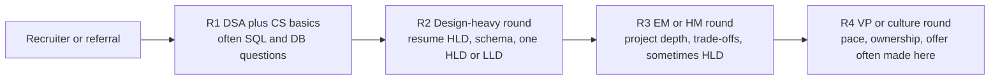

The diagram is a typical shape, not a fixed rule. Some candidates had two rounds, some had five (Z27). The last round is nearly always a VP or senior EM culture conversation. Several candidates report questions about pace, long days and five days a week in the office (Z14).

The biggest single component is the **resume deep dive**. Every technology on your resume (Kafka, Redis, MongoDB, RabbitMQ, DynamoDB) gets probed down to its internals. Very often your own internship project becomes the HLD question: "redesign it", "how would you scale it 100x", "draw its architecture". Section 0.8 shows how to prepare for that.

> **Real world — interview reports:** A Zomato SDE-1 who joined with a one-year internship had an SDE-2 spend round one on "the candidate's current company architecture", then "one ongoing problem Zomato is trying to solve, how would you approach it", then about 10 minutes on scaling and failures, then SQL vs NoSQL, connection pooling and indexing. The candidate got the offer. ([source](https://leetcode.com/discuss/post/8434690/))

**SDE-1 with one or two years of experience** gets the same question types, but the interviewer expects production depth: failure modes, retries, idempotency (making a repeated request safe) and monitoring. **SDE-2** at Zomato adds Redis and Kafka internals (consumer lag, why single-threaded Redis is fast), SQL at scale with index choices, auth designs such as WhatsApp QR-code login with TOTP, and search with an inverted index. DSA remains a hard filter even at SDE-2. One candidate (Z16) was rejected over a min/max stack question after a decent design discussion.

### 0.2 What is actually asked: the frequency table

This table counts design themes across the roughly 100 reports. "Group" means the Eternal companies (Zomato, District, Nugget, Blinkit). A report counts once per theme. The counts are approximate, because candidates only write down what they remember.

| # (research ID) | Design theme | Total reports | Eternal group | Typical level | What it looks like |
|---|---|---|---|---|---|
| 1 | **Your own past project as an HLD** | 13+ | 10 | Every level | "Draw your internship system", "phase 2 of it", "scale it" |
| 2 | **Order flow, food ordering, order tracking** | 12 | 6 | SDE-1, SDE-2 | Order lifecycle, APIs, schema, Kafka vs sync calls, duplicate events |
| 3 | **Ticket and seat booking** (BookMyShow, IRCTC, clinic slots) | 12 | 4 | SDE-1 (Blinkit) to SDE-2 | Two users pick the same seat, optimistic vs pessimistic locks |
| 4 | **Notification system** | 8 | 6 | **SDE-1, the most repeated single HLD at Eternal** | Dedupe, multi-channel, cooldowns, retries, crash resilience |
| 5 | **Rate limiter**, design then code | 7 | 6 | Fresher to SDE-2 | Token bucket, fixed window, sliding window, Redis version |
| 6 | **Payments, wallet, refunds, billing** | 6 | 2 | SDE-1 to SDE-2 | Payment fails midway, idempotent APIs, chargebacks |
| 7 | **Cache class** (LRU/LFU) and the Redis-only trap | 6 | 6 | SDE-1 | O(1) get/put, "why not replace the DB with a cache?" |
| 8 | Cart, e-commerce, inventory, warehouse | 6 | 0 | SDE-1, SDE-2 | Mostly Swiggy, Zepto, Meesho, PhonePe |
| 9 | Calendar or meeting scheduler | 5 | 1 | Mostly SDE-2/3 | Recurring events, conflicts |
| 10 | Spotify or music player, shuffle | 4 | 4 | Fresher, intern | Playlist schema, shuffle without repeats |
| 11 | **File, image, voice upload pipeline** | 3 | 3 | SDE-1 | Pre-signed S3 URLs, queue plus async workers |
| 12 | Chat, WhatsApp, QR login | 3 | 3 | Fresher to SDE-2 | Why chat leans NoSQL, Mongo compound indexes |
| 13 | Coupons and discounts | 3 | 1 | SDE-1/2 | Expiry, per-user limits, 5-minute payment hold |
| 15 | **Consistent hashing, distributed KV store, cache sharding** | 3 | 3 | Intern to SDE-1 | Add or remove servers with minimal data movement |
| 20 | Search and inverted index | 2 | 2 | SDE-1/2 | Elasticsearch-style inverted index |
| 23 | **Schema-only modelling and live SQL** | 9 | 9 | **Very common for SDE-1 at Zomato** | Banner frequency cap, menu with options, order-state SQL |
| 24 | Paginated API, write a working API | 2 | 2 | SDE-1 | Cursor vs offset, data from 3 tables |

Read the "Eternal group" column. Ranked by how often they come up in the group, the themes are:

1. Your own project as an HLD.
2. Schema and SQL modelling of a Zomato-like entity.
3. Notification system.
4. Rate limiter, with code.
5. Order flow and order tracking.
6. Cache classes and Redis internals.
7. BookMyShow (mostly Blinkit).
8. Payments.

Kafka comes up in about 12 group reports. It is nearly always a follow-up rather than the main question: consumer lag, idempotent consumers, Kafka vs SQS or RabbitMQ, ordering and replay.

Three of these themes deserve special preparation, because the follow-ups are predictable:

- **Notification system.** It was asked at Zomato (twice to the same candidate, Z2 and Z3), District (Z13), Blinkit (B1) and in a "notify users when a restaurant reopens, only if delivery partners are available" twist (Z29). The follow-ups are dedupe, user-level and team-level cooldowns, how other teams integrate, and crash resilience.
- **Schema modelling.** At Zomato, "design the tables" questions are as common as full HLDs. You may be asked to write the SQL live: top 5 delivery partners in an area by order type (Z2), or the latest state per order in the last hour excluding delivered orders, with the indexes you would add (Z12).
- **Rate limiter.** Expect to *code* a token bucket and a fixed window, and to explain why the fixed window lets a burst of twice the limit through at a window boundary (Z31).

> **Pause and think:** You have one week left. Using the table, which three designs would you practise end to end, and which topic would you study as a follow-up to all of them? (A reasonable answer: notification system, order tracking and rate limiter, plus your own project. The shared follow-up topic is Kafka with idempotent consumers.)

### 0.3 LLD at Zomato vs machine coding at Swiggy and Flipkart

Freshers often mix up two different round types. An **LLD round** asks you to design classes, a schema and APIs, mostly by discussion. A **machine coding round** asks you to *build a working program* in 60 to 120 minutes, usually in-memory with no database, and the evaluator runs it. Zomato and Blinkit have no formal machine coding round for backend SDE-1. Swiggy, Flipkart, Meesho and PhonePe do.

| Company | Format | What wins (per reports) |
|---|---|---|
| **Zomato / Blinkit** | No separate machine coding round. LLD appears inside mixed rounds: implement a class (LRU, rate limiter, browser history, snake game), model a schema (menu options, banner caps), or write a working API (B5, Z8, Z15). Blinkit SDE-1 2026 design rounds were draw.io discussions with UML, not code (B1, B2). | Right data structure and complexity, clean hand-written code, correct schema |
| **Swiggy** | 60-minute LLD round: design and implement live in your own IDE. Older SDE-2 drives had 2-3 hour machine coding. | A **fully working** program. One candidate was rejected for a partially working Splitwise (S1). Data-structure choices get cross-questioned, then you dry-run (S2). |
| **Flipkart** | Group session: 30-minute problem brief, 90 minutes of coding, zip upload, then a separate evaluation call. | "Prioritize correct running code over neat OOP/SOLID" (F4, F7). The evaluation asks about concurrency and "what if a DB is added". |
| **Zepto** | 60-minute LLD through BarRaiser, mostly discussion | Entities, DB schema, API payloads, design patterns, SQL vs NoSQL per component |
| **PhonePe** | 1.5-3 hours solo on CodeSignal, then a code discussion | Separation of data and service layers, extensible strategies, thread safety |

The trap that appears in almost every LLD or machine coding evaluation is **concurrency**: two users booking the same seat, two threads buying the last unit, "what if two tasks arrive at the same time?" Be ready to say exactly where the lock goes (per seat, per slot, per SKU), whether you lock pessimistically (take the lock first) or optimistically (check a version number at write time), and how the database itself can guard you (a unique constraint, `SELECT ... FOR UPDATE`, a conditional update).

> **Real world — interview reports:** A District SDE-1 candidate with a year of internships discussed cursor pagination well. The constraint then changed to "the data comes from 3 independent tables", and the candidate had to write the backend code and SQL by hand. The candidate's own reason for the rejection was messy hand-written code from being "too used to AI-assisted coding". ([R1](https://leetcode.com/discuss/post/8550229/), [R2](https://leetcode.com/discuss/post/8559623/)) Practise writing code without autocomplete.

### 0.4 Follow-ups, traps and stated rejection reasons

Interviewers rarely reject you over the first diagram. They reject you over the follow-ups. These come straight from the reports, so treat them as a checklist. Later parts of this guide answer each one in depth.

**Database traps** (the most common cause of rejection at Zomato):

- "Why SQL vs NoSQL here?" comes up in almost every report. The follow-up is "can't SQL scale?" (B10).
- **"Why MySQL vs PostgreSQL?"** This is the Z2 rejection. The candidate over-explained. The interviewer said the right answer was: "I don't have enough real-world exposure to make that trade-off confidently."
- **Separate indexes on A and B vs one composite index (A, B)** for `WHERE A=10 AND B=20` (Z9).
- The left-prefix rule for composite indexes (Z5). "When does an index hurt?" (B2).
- **"Nearby restaurants in SQL."** A latitude/longitude bounding box was not enough. The interviewer pushed for real geo-indexing such as PostGIS or geohash (Z5).

**Cache traps:**

- **"Assume infinite money. Why can't we just replace the database with a cache?"** A Blinkit SDE-2 candidate could not answer this (B12). A variant is "what if we use only Redis and no database?" (B3). The expected points are durability (RAM is lost on a crash unless persisted), rich queries (caches look up by key, they do not do joins or range scans well), transactions and constraints, and consistency.
- Why single-threaded Redis is still fast, hot keys (the celebrity problem), thundering herd (Z1, Z12).

**Async traps:**

- "Why asynchronous? What problem does it solve? What happens if the consumer is down? How would you handle duplicate events?" These are near-verbatim from a Blinkit order-tracking round (B2).

**API traps:**

- Writing every API with payloads, status codes, headers and auth (Z5, Z8).
- **Image upload as base64 is wrong.** The interviewer wanted pre-signed S3 URLs (Z5). Section 1.5 covers this.
- "If someone steals your session ID, how do you stop them? What if they share your IP?" (Z9).

**Process traps:**

- Spending too long on the intro or the project leaves the design unfinished (B12, P14). Watch the clock.
- **Needing 2-3 attempts to understand a follow-up** was held against a candidate as "a negative signal" (Z2). If you don't understand, paraphrase the question back once: "Just to confirm, you're asking what happens if the consumer crashes after writing to the DB but before committing the offset?"
- Interviewers add requirements in the middle (B6, Z15, Z5). They are testing whether you can adapt, not whether your first answer was perfect.

These are the rejection reasons that candidates were actually told, or worked out for themselves:

| Report | What happened | Lesson |
|---|---|---|
| Z2, Zomato SDE-1 | Bluffed on MySQL vs PostgreSQL. Needed several attempts at one follow-up. The interviewer said the overall design was good. | Say "I don't know" honestly and reason from what you do know. Confirm the question once. |
| Z4, Zomato SWE-1 | Payments HLD. Strong on the happy path. Weak on non-happy paths: orchestration failures, retries, cross-service consistency. "~80% close." | For every arrow, ask "what if this call fails?" |
| Z15, District SDE-1 | Good discussion, messy hand-written code | Practise coding without AI help |
| B12, Blinkit SDE-2 | Could not answer the infinite-cost cache trap. Spent too long on the project, so the LLD was unfinished. | Know why databases exist. Manage your time. |
| B7, Blinkit SDE-1 | "Wasn't adequately prepared for the system design round" (Design WhatsApp) | Freshers do get full HLDs |
| B15, Blinkit SDE-2 | Resume grill on own vs team contribution | "Don't put a system on your resume unless you can sketch its failure modes." |

> **Real world — interview reports:** The Z4 feedback is worth reading closely. The candidate "handled happy paths well but needed more depth on non-happy paths: microservice orchestration failures, retries, cross-service consistency, and DB modelling of complex workflows." The interviewer added that for an entry-level role the candidate would have moved forward. ([source](https://leetcode.com/discuss/post/7609011/))

### 0.5 What interviewers score

No Zomato rubric has been published. The table below is synthesized from what the reports say interviewers praised, pushed on, or rejected for. Use it to check yourself after every mock.

| Dimension | What "good" looks like for an SDE-1 | Evidence from reports |
|---|---|---|
| **Requirement gathering** | Asks who the users are, what must work, what scale, and what is out of scope, before drawing | Blinkit R2 spent 15-20 min on requirements (B4). District R2 asked for FR/NFR and traffic estimation (Z11). |
| **Estimation** | Rough QPS, storage and peak multiplier, said out loud with round numbers | "Traffic estimation" asked in Z11. Using Zomato's NYE numbers shows you know the domain. |
| **API design** | Clear endpoints, request/response bodies, status codes, auth, pagination, idempotency keys | Z5 wanted "every API with sample payloads". Z8 wanted CRUD code. Z15 wanted cursor pagination. |
| **Data modelling** | Correct entities and relationships, PK/FK, the right indexes, a justified SQL/NoSQL choice | Schema questions are the most common type for Zomato SDE-1 (9 reports) |
| **High-level architecture** | A clean diagram: client, gateway, services, cache, DB, queue. Each box has a reason. | Every HLD round |
| **Depth on one component** | Can go two levels down on the part the interviewer picks (Kafka partitions, Redis eviction, index internals) | Kafka was probed for 40 minutes in Z27. Redis internals in Z1, Z12. |
| **Failure handling** | Retries with backoff, idempotency, DLQ, timeouts, circuit breakers, what happens when X is down | The Z4 rejection. Blinkit "what if the consumer is down" (B2). |
| **Trade-off reasoning** | Names the alternative and why it lost: "Kafka over SQS because we need replay" | "Why this approach and what alternatives" (B1) |
| **Adaptability** | Absorbs a new constraint without starting over | B6, Z15, Z5 all changed requirements mid-round |
| **Communication and honesty** | Thinks aloud. Confirms the question. Admits gaps without bluffing. | The Z2 lesson |
| **Code quality** (when asked) | Clean, correct, hand-written code for the core part | Z15, Z7 (ring buffer with locks), Z31 (rate limiter) |

> **Pause and think:** Which of these dimensions does a candidate fail who draws a beautiful diagram in the first 10 minutes, without asking a single question? (Requirement gathering. Usually estimation too, and often adaptability, because the design was built for a problem nobody agreed on.)

### 0.6 The 7-step framework

Every design question, from "design a URL shortener" to "design Zomato", can be handled with the same seven steps. The steps keep you from freezing, and they make sure you cover everything the rubric above checks.

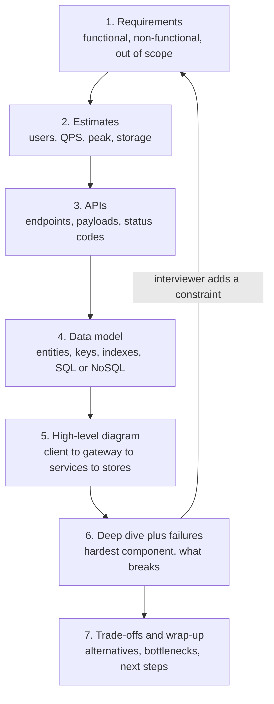

Notice the arrow back from step 6 to step 1. When the interviewer adds a requirement ("now the data comes from three tables", "now add team-level cooldowns"), go back to the requirements, state the change, and walk forward again. Don't rip up the whole design.

**Step 1: Requirements.** Split them into two lists:

- **Functional requirements** say what the system does: "users can create a short link", "users get notified when their order is picked up".
- **Non-functional requirements** say how well it must do it: latency (how fast), availability (what fraction of time it is up, such as 99.9%), consistency (must every reader see the latest write?), durability (data must not be lost), and scale.

Also say what you are leaving out: "I'll skip analytics and custom domains unless you want them." This shows judgment, and it protects your time.

**Step 2: Estimates.** Back-of-envelope numbers decide your design. 50 writes a second fits on one database. 50,000 writes a second needs sharding (splitting data across machines) or a write-optimized store. Use round numbers. A day has 86,400 seconds; call it 100,000 (10^5) to make division easy. Always estimate the peak, not just the average. Food delivery has sharp lunch and dinner peaks, and New Year's Eve is far above a normal dinner.

> **Real world — Zomato:** On New Year's Eve 2023 Zomato peaked at 8,400 orders per minute and 80.92 million requests per minute, across 300+ microservices. ([source](https://www.zomato.com/blog/a-tale-of-scale-behind-the-scenes-at-zomato-tech-for-nye-2023)) In FY24 Zomato averaged about 18M monthly transacting customers and 63M annual ones ordering 11.9 times a year ([source](https://b.zmtcdn.com/investor-relations/Zomato_overview_May-24.pdf)). That works out to roughly 750M orders a year, or about 2M a day. This is a derived figure, not one Zomato states. An average day is about 1,400 orders a minute, so the NYE peak is several times the average.

Notice what those two numbers say together. 8,400 orders a minute is only about 140 orders a second, but 80.92 million requests a minute is about 1.35 million requests a second. That is nearly 10,000 backend requests per order (derived). Most traffic is browsing, searching, menu loads, tracking pings and service-to-service calls. Placing the order is a tiny fraction. So in a Zomato-style design, the **read path** needs caching and the **write path** needs correctness.

**Step 3: APIs.** Write the contract between client and server before the internals. For each endpoint, give the method, path, request body, response body and status codes. Zomato interviewers ask for this explicitly (Z5, Z8). Mention authentication (who is calling?), pagination for lists, and an idempotency key for anything that creates money or orders.

**Step 4: Data model.** List the entities and their relationships, then pick storage per entity. Mark the primary key and the indexes you will need to serve each API. Justify SQL vs NoSQL from the access pattern, not from fashion. Orders and payments need transactions and relations, so SQL fits. Rider location pings are high-volume key lookups, so a key-value store or in-memory store fits.

**Step 5: High-level diagram.** Draw the boxes: clients, DNS/CDN, load balancer or API gateway, services, caches, databases, queues, external providers. Walk one request through it out loud: "The app calls POST /orders. The gateway checks the token and forwards to the order service, which writes to MySQL and publishes an OrderCreated event to Kafka..."

**Step 6: Deep dive plus failures.** Pick the hardest or most interesting component, or let the interviewer pick, and go deep. Then go around the diagram and ask of every arrow, "what if this fails or is slow?" This is where Z4 lost marks. Cover retries with exponential backoff and jitter (random spread), idempotency, timeouts, circuit breakers (stop calling a failing dependency for a while), dead-letter queues (DLQ: a holding queue for messages that keep failing), fallbacks, and what the user sees.

**Step 7: Trade-offs and wrap-up.** Summarize what you chose and what you gave up. Name the bottleneck you'd watch first. Say what you'd do with more time: monitoring, multi-region, analytics.

#### Time budgets

| Step | 45-minute round | 15-20 minute mini-design |
|---|---|---|
| 1. Requirements | 4-5 min | 2 min |
| 2. Estimates | 3 min | 1 min, or skip if not asked |
| 3. APIs | 5 min | 3 min |
| 4. Data model | 7 min | 4 min |
| 5. High-level diagram | 8 min | 4 min |
| 6. Deep dive and failures | 12-14 min | 4 min, one component |
| 7. Trade-offs, wrap-up | 3-5 min | 1 min |

The mini-design budget matters at Zomato. Many design questions are a 15-20 minute block after a DSA problem: "show a banner X times in Y hours" (Z6), or "a light design question, peer-to-peer chess matched by rating" where the interviewer "jumped straight to data modelling" (Z14). In a mini-design, follow the interviewer's lead. If they jump to the schema, go to the schema.

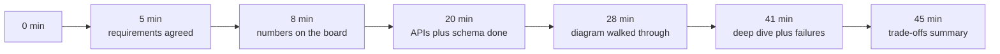

If you reach minute 20 and you are still on requirements, cut scope out loud: "Let me lock these three features and move on."

### 0.7 Worked example: design a URL shortener

This is the classic warm-up. It came up as "scaling a short-URL service" in a Blinkit intern round (B16) and as a Zepto SDE-3 HLD (P14). It is small enough to finish but touches every step. Below is roughly what you would *say*, step by step.

**Step 1, requirements.**

> "Let me check the scope. Users paste a long URL and get a short one, like zom.to/aB3xK9q. Anyone who opens the short link is redirected to the long URL. Do we need custom aliases? Expiry? Click analytics?"

Suppose the interviewer says: custom alias is optional, expiry yes, analytics later.

> "Then the functional requirements are create a short link with an optional expiry, and redirect. Non-functional: redirects must be very fast, say under 50 ms at p99 on our side, because they sit in front of every click. Availability matters more than strict consistency: a link created a second ago can take a moment to work everywhere. Short codes must be unique and not easy to guess in sequence. Analytics is out of scope for now."

**Step 2, estimates.** All of these are assumptions you state out loud.

> "Assume 100 million new links a month and a 100:1 read-to-write ratio. Writes are 10^8 / (30 × 10^5 s), roughly 40 per second, so about 400 per second at a 10x peak. Reads are about 4,000 per second, and 40,000 per second at peak. Each row is about 500 bytes. Over 5 years that is 100M × 12 × 5 = 6 billion links, times 500 bytes = 3 TB. That is big for one machine but small for a sharded store."

**Step 3, APIs.**

```
POST /api/v1/links
Headers: Authorization: Bearer <token>, Idempotency-Key: <uuid>
Body:    { "long_url": "https://www.zomato.com/ncr/some-restaurant/order", "custom_alias": null, "expires_at": "2026-12-31T23:59:59Z" }
201 Created  { "code": "aB3xK9q", "short_url": "https://zom.to/aB3xK9q" }
400 Bad Request (invalid URL), 409 Conflict (alias taken), 429 Too Many Requests

GET /{code}
301 Moved Permanently or 302 Found, with header  Location: <long_url>
404 Not Found (unknown code), 410 Gone (expired)
```

Then mention a real trade-off: "A 301 is permanent, so browsers cache it and stop asking us. That cuts our load, but we lose click counts and can't change the target. A 302 is temporary, so every click comes to us. If analytics is coming later, I'd use 302."

**Step 4, data model.**

> "One table, `links(code PK, long_url, user_id, created_at, expires_at)`. The only hot query is lookup by code, a pure key-value access. So a key-value store like DynamoDB works well, partitioned by code. MySQL with code as the primary key, sharded later, also works. I'll pick the KV store because we never join."

How do you generate the code? This is the interesting part.

- **Length.** Base62 uses 62 characters (a-z, A-Z, 0-9). 7 characters give 62^7, about 3.5 trillion codes, far more than our 6 billion.
- **Option A: hash the URL** (for example MD5) and take 7 characters. It is simple, but two URLs can collide, so you must check and retry on collision, and the same URL always maps to the same code.
- **Option B: a counter encoded in base62.** It never collides, but one global counter is a bottleneck and a single point of failure, and sequential codes are guessable.
- **Option C: counter ranges.** A small coordinator hands each app server a block of 1 million IDs. The server uses them locally with no network call, then fetches another block. There are no collisions and no hot spot. Shuffle or encrypt the number before encoding if guessability matters.

> "I'll go with counter ranges. If a server crashes, we lose the rest of its block. That only leaves gaps, which is harmless."

**Step 5, high-level diagram.**

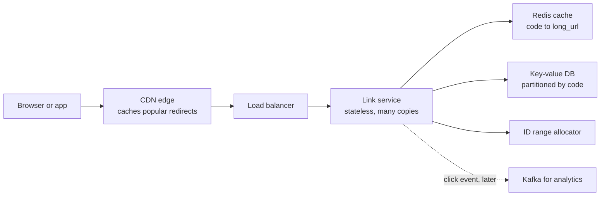

Walk the redirect path out loud: "GET /aB3xK9q reaches the CDN first. On a miss, it goes to a link service instance, which checks Redis. On a Redis miss it reads the DB, fills Redis with a TTL, and returns a 302."

**Step 6, deep dive and failures.**

- *Hot links.* A link in a Zomato push notification sent to millions of users gets hammered in the same minute. Cache it at the CDN and in Redis. Many requests for the same missing key at once can stampede the DB, so let only one request refill the cache while the others wait (request coalescing).
- *Redis down.* Fall back to the DB, and rate-limit so the DB is not flattened. Zomato itself tests this: it injects cache misses on purpose before NYE "to evaluate database reliability under stress" ([source](https://www.zomato.com/blog/a-tale-of-scale-behind-the-scenes-at-zomato-tech-for-nye-2023)).
- *Duplicate creates.* A client retries POST after a timeout. The idempotency key lets the server return the same code instead of making two.
- *Abuse.* Rate-limit creates per user, and check long URLs against a malware list.
- *Expiry.* Check `expires_at` on read and return 410. Delete expired rows lazily or with a background sweeper.

**Step 7, trade-offs.**

> "I chose a KV store over SQL because the access is pure key lookup. I gave up ad-hoc queries, which analytics will get from Kafka into a warehouse. I chose 302 over 301 to keep analytics possible, which costs more traffic. Counter ranges avoid collisions at the cost of a small coordinator. The first bottleneck I'd watch is the cache hit rate."

Notice how little of that answer is exotic. It is a disciplined walk through the seven steps with a reason at every choice.

### 0.8 How to communicate in the room

**Think aloud.** The interviewer can only score what they hear. Silence for two minutes followed by a perfect answer scores worse than a visible, slightly messy path to a good answer. Say what you're weighing: "I'm choosing between pushing updates and having the app poll. Polling is simpler, but at this scale most of those calls return nothing new..."

**Draw early and keep the diagram alive.** Zomato rounds use Google Docs (Z8), draw.io (B1, B2) or a shared whiteboard. Practise drawing boxes and arrows in draw.io quickly. Label every arrow with what flows over it (HTTP, event, SQL query). When you add a component, add it to the same diagram rather than starting a new one.

**Confirm the question once.** Because the Z2 candidate needed 2-3 attempts at a follow-up, this is a real risk. Paraphrase: "So the concern is a user getting two pushes for the same event if a worker crashes mid-send. Is that right?"

**Say "I don't have enough exposure" honestly, then reason.** This is the single clearest lesson in the research. The trick is to follow the admission with reasoning from first principles:

> "I haven't run PostgreSQL in production, so I can't compare them from experience. What I'd look at is: do we need features one has and the other lacks, like PostGIS for geo queries; what the team already operates; and how each handles our write pattern. For this design either works, and I'd pick whichever the team runs today."

Bluffing a detailed comparison you can't back up is worse than admitting the gap. Interviewers ask follow-ups until they hit the edge of your knowledge. Reaching that edge is expected. Being caught pretending you were past it is what hurts.

**Useful phrases:**

| Situation | Phrase |
|---|---|
| Starting | "Before I design, can I ask a few questions about scope and scale?" |
| Cutting scope | "I'll park analytics for now and come back if we have time." |
| Making an assumption | "I'll assume 10x peak over average. Tell me if Zomato's peak is different." |
| Choosing | "I'm picking X over Y because of Z. The cost is W." |
| Checking in | "Does this level of detail work, or should I go deeper on the queue?" |
| Inviting a pick | "The two hardest parts are dedupe and cooldowns. Which would you like me to go deep on?" |
| Not knowing | "I don't know that internal detail. Here's how I'd reason about it..." |
| After a new constraint | "That changes the requirements. Let me update step 1 and see what moves." |
| Spotting a failure | "What happens if this call times out? We'd retry, so this endpoint must be idempotent." |

#### Turning your resume project into an HLD

Your own project is the most common design question in the Eternal group, so prepare it like a design question. Draw its architecture before the interview, with real numbers, and rehearse the seven steps on it.

Take the candidate's Myntra ratings service as an example. You should be able to draw this from memory:

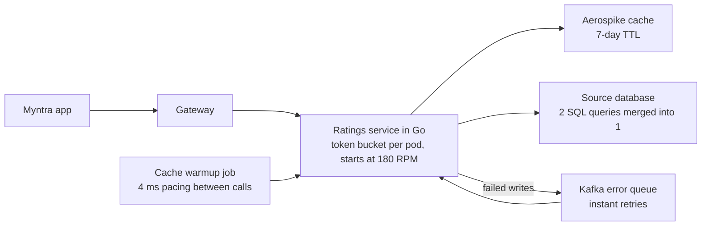

Then be ready for the questions interviewers actually asked about projects ("why X over Y", "how does it change with more users", "what were the failure modes", "what was your part vs the team's"):

- **Why Aerospike and why a 7-day TTL?** What data goes stale in 7 days, and does it matter for ratings?
- **Why a token bucket, and why 180 RPM per pod?** What happens to the total limit when the service autoscales from 10 pods to 20? (The total doubles. Is that what the downstream can take?)
- **The warmup bug.** Warming millions of keys with no delay tripped rate limits. A 4 ms pause fixed it. Do the arithmetic: 1,000 / 4 = at most 250 calls a second from one worker. Explain why that rate sat under the limit, and what you'd do with 10 workers.
- **Two caches out of sync.** What caused it, how you found it, and what pattern prevents it (one source of truth, invalidate-on-write, versioned keys).
- **Merging 2 SQL queries into 1.** What it saved: one fewer network round trip per request, and less connection-pool pressure.
- **Kafka error queue with instant retries.** What if the failure is permanent (a poison message)? Instant retries would loop forever. A DLQ and backoff are the next step.
- **"Phase 2": scale it 10x.** Which part breaks first?

The Atlassian work (Kotlin/Spring Boot, SQS with worker pools, idempotency, DLQ) maps directly onto the notification and order-tracking questions. "Why async? What if the consumer is down? How do you handle duplicates?" are exactly the questions that SQS + idempotency + DLQ answers. Use it as your example when those follow-ups come.

> **Real world — interview reports:** A Blinkit SDE-2 candidate's takeaway after rejection: "don't put a system on your resume for SDE-2 unless you can sketch its failure modes." ([source](https://leetcode.com/discuss/post/8359730/)) The same applies to SDE-1 when the system is your headline project.

### Check yourself

**Q: Is system design asked of freshers at Zomato?**
A: Yes. About 15 of 18 fresher and intern reports from the Eternal group had a design element: usually schema plus APIs, a small HLD (rate limiter, notifications), or a class to implement (LRU, LFU). On-campus rounds lean more on DSA and SQL.

**Q: What is the most common design question in the Eternal group?**
A: Your own past project as an HLD. Among named problems, the notification system is the most repeated single HLD for SDE-1, followed by schema/SQL modelling and the rate limiter.

**Q: How does Zomato's LLD differ from Swiggy's or Flipkart's machine coding?**
A: Zomato and Blinkit fold LLD into mixed rounds: implement a class, model a schema, write an API, or discuss UML on draw.io. Swiggy and Flipkart run machine coding rounds where a fully working program matters more than pretty design.

**Q: An interviewer asks "MySQL or PostgreSQL?" and you've only used one. What do you say?**
A: Say honestly that you don't have enough real-world exposure to compare them, then reason from what you know: feature needs (such as PostGIS), what the team already runs, and the access pattern. A Zomato candidate was rejected partly for bluffing here.

**Q: Name the 7 steps of the framework.**
A: Requirements, estimates, APIs, data model, high-level diagram, deep dive with failures, and trade-offs/wrap-up.

**Q: Why estimate the peak and not the average?**
A: Systems fail at peak. Zomato's NYE 2023 peak of 8,400 orders a minute is several times an average day's roughly 1,400 orders a minute (derived), so a design sized for the average would fall over that night.

**Q: What does 80.92M requests per minute vs 8,400 orders per minute tell you?**
A: There are roughly 10,000 backend requests per order (derived). The read path, meaning browsing, menus, search, tracking and internal fan-out, dominates traffic. It needs caching, while the order write path needs correctness.

**Q: In the URL shortener, why might you choose a 302 over a 301?**
A: Browsers cache a 301 permanently, so you lose visibility of clicks and can't change the target. A 302 keeps every click coming to you, which supports analytics and edits, at the cost of more traffic.

**Q: How many codes do 7 base62 characters give?**
A: 62^7, about 3.5 trillion.

**Q: What was the stated reason Z4 was rejected on a payments design?**
A: Strong happy path, but not enough depth on non-happy paths: orchestration failures, retries, cross-service consistency. The fix is to ask "what if this fails?" of every arrow.

**Q: You don't understand a follow-up. What should you do?**
A: Paraphrase it back once to confirm. Needing several attempts was recorded as a negative signal in one Zomato report.

**Q: What should you prepare about your own internship project?**
A: Its architecture diagram from memory, real numbers, why each technology was chosen over the alternatives, its failure modes, your own contribution vs the team's, and how you'd scale it 10x.

## Part 1: How a request travels

Every design in this guide sits on top of one basic event: a phone sends bytes to a computer far away, and that computer sends bytes back. If you understand that journey and where its time goes, half of system design becomes common sense. You'll see why caches matter, why connections are reused, and why Zomato stopped polling for rider locations. "What happens when you type zomato.com?" was asked directly in a Zomato round (Z7). Another round asked for the "full request lifecycle (DNS, gateway internals, CDN, cache types)" (Z19).

### 1.1 Clients, servers, IP addresses and ports

A **client** is the program that asks: the Zomato app on your phone, or a browser. A **server** is a program, usually on a machine in a data centre, that listens for requests and answers them. One machine can be a client and a server at once. The order service is a server to the app and a client to the payment service.

Computers find each other by **IP address**. IPv4 addresses look like `13.235.10.4` (4 bytes, about 4.3 billion possible addresses). IPv6 addresses look like `2406:da1a::1` (16 bytes, effectively unlimited). An IP address finds the machine. A **port** (a number from 0 to 65535) finds the program on that machine. HTTPS servers listen on port 443 by convention, and plain HTTP on port 80. So "talk to the Zomato API" really means "open a connection to IP X, port 443".

Your phone usually doesn't have a public IP of its own. Mobile carriers put thousands of phones behind shared public addresses using NAT (network address translation). That is why the Z9 follow-up "what if the attacker shares your IP?" matters. An IP address is a weak identity: many innocent users can share one, so blocking by IP alone can block a whole carrier's customers.

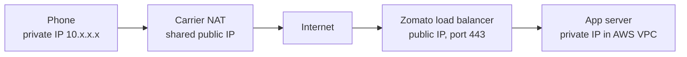

### 1.2 DNS: turning a name into an address

People remember `api.zomato.com`, but machines need an IP. **DNS** (Domain Name System) is the internet's phone book, a distributed hierarchy of servers that turns names into addresses.

When your phone needs `api.zomato.com`, it asks a **recursive resolver**, usually run by your carrier (Jio, Airtel) or a public one like 8.8.8.8. If the resolver doesn't have the answer cached, it walks the hierarchy:

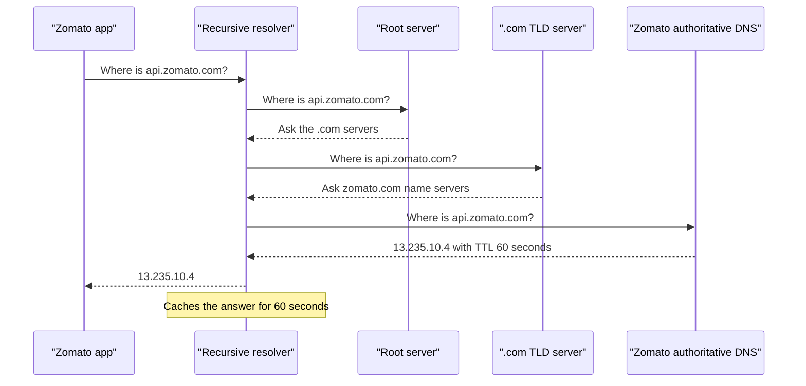

- The **root servers** know where each top-level domain lives.
- The **TLD servers** (TLD means top-level domain, such as `.com` or `.in`) know which name servers are authoritative for `zomato.com`.
- The **authoritative server** is the one Zomato controls (often a managed service such as AWS Route 53). It gives the final answer.

Every answer carries a **TTL** (time to live): how many seconds the answer may be cached. Caching happens at every layer: the resolver, the phone's OS and the app. Most lookups never leave the resolver, which is why DNS is fast in practice, typically a few milliseconds when cached and tens of milliseconds when not (approximate).

The TTL is a trade-off you should be able to state. A **long TTL** (hours) means fewer lookups and faster connections, but if you need to move traffic away from a broken data centre, clients keep using the old address until it expires. A **short TTL** (30-60 seconds) lets you fail over quickly, at the cost of more DNS queries. Services that may need fast failover use short TTLs.

DNS can also return *different* answers to different users. Section 2.7 covers how that is used for geo-routing.

> **Pause and think:** Zomato moves its API to new load balancer IPs. Its DNS TTL was 1 hour. How long might some users keep hitting the old IPs, and what should the team do in advance? (Up to an hour, sometimes longer with misbehaving caches. Lower the TTL to about 60 seconds a day before the move, keep the old IPs serving during the switch, then raise the TTL again.)

### 1.3 TCP and UDP: getting bytes there reliably

Once the app has an IP, it needs a **transport**. The internet itself (the IP layer) only promises "best effort": packets can be lost, duplicated or arrive out of order. Two transport protocols sit on top of it.

**TCP** (Transmission Control Protocol) gives you a reliable, ordered stream of bytes. It numbers every byte, the receiver acknowledges what it got, and the sender retransmits anything lost. Before any data flows, the two sides agree on starting sequence numbers in a **three-way handshake**:

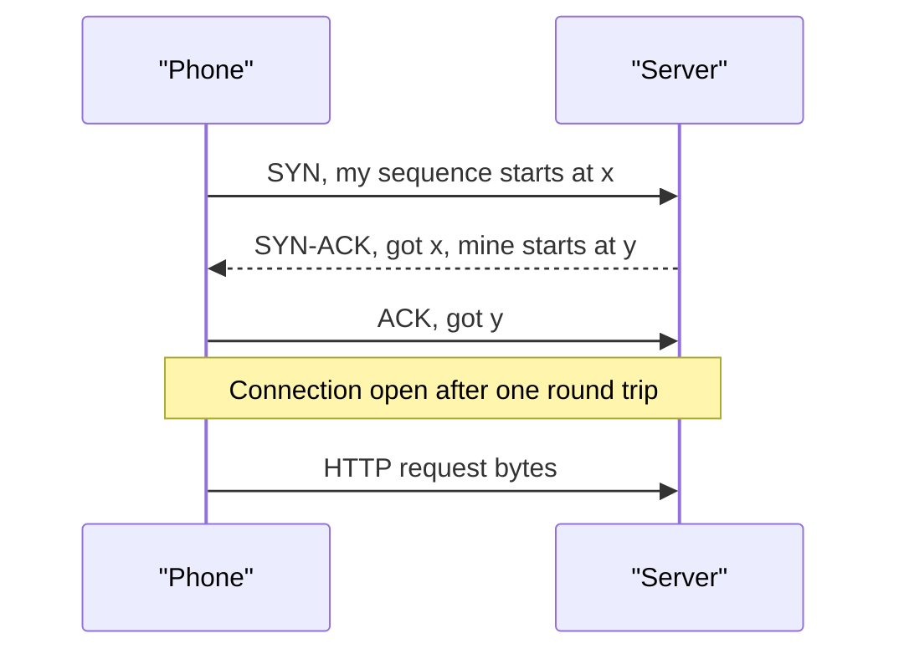

The handshake costs one full **round trip** (RTT: the time for a packet to go there and back) before any useful data is sent. From Delhi to a server in Mumbai that might be 30 ms on a good connection, and much more on a weak 4G signal (approximate). TCP also does **flow control** (don't overwhelm a slow receiver) and **congestion control** (slow down when the network is congested). A new connection starts slowly and speeds up, which is another reason to reuse connections.

**UDP** (User Datagram Protocol) just sends packets, with no handshake, no ordering and no retransmission. It is used where speed matters more than perfection, or where the application does its own reliability: DNS queries, voice and video calls, online games, and QUIC (the base of HTTP/3).

| | TCP | UDP |
|---|---|---|
| Connection setup | 3-way handshake | None |
| Reliability | Retransmits lost data | None built in |
| Ordering | Guaranteed | None |
| Overhead | Higher | Minimal |
| Used by | HTTP/1.1, HTTP/2, MQTT, database connections | DNS, video calls, QUIC/HTTP/3 |

### 1.4 TLS: making it private

Everything Zomato sends (your address, your token, payment details) must be encrypted, so HTTPS wraps HTTP inside **TLS** (Transport Layer Security). TLS does three things:

- It **authenticates** the server. The server presents a certificate signed by a trusted authority, proving it really is `api.zomato.com`.
- It **agrees on a shared secret key** without ever sending it, using a key exchange.
- It **encrypts** all data with that key.

With TLS 1.3, the handshake takes one extra round trip on top of TCP's:

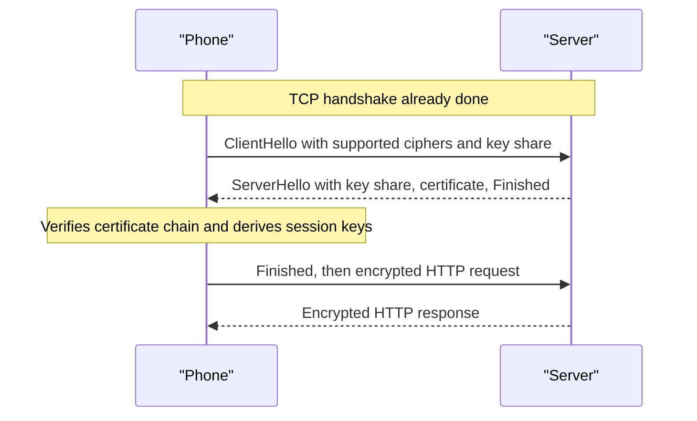

TLS 1.2 needed two round trips. TLS 1.3 also supports **resumption**: a returning client can reuse earlier key material, saving work, and can even send data in its first packet (0-RTT, with care around replayed requests).

Add it up for a brand-new connection over TCP + TLS 1.3: DNS (maybe 0 ms if cached) + 1 RTT for TCP + 1 RTT for TLS + 1 RTT for the actual request. That is 3 round trips before the first byte of the response. At 50 ms RTT on mobile that is 150 ms of pure waiting. **This is why every serious client and server reuses connections** (keep-alive and connection pools), and why Zomato's tracking moved to long-lived connections (section 1.7).

**mTLS** (mutual TLS) means both sides present certificates, so the server also knows which client is calling. Service meshes use it for service-to-service calls inside a company. TLS/mTLS was asked in a Zomato round (Z27).

### 1.5 HTTP: the language of requests

**HTTP** is the text-like protocol that rides on top. A request has a method, a path, headers and an optional body. A response has a status code, headers and an optional body.

```
POST /v2/orders HTTP/1.1
Host: api.zomato.com
Authorization: Bearer eyJhbGciOi...
Content-Type: application/json
Idempotency-Key: 7f1c2a9e-1b2c-4d5e-8f90-123456789abc

{"restaurant_id": 18234, "items": [{"dish_id": 991, "qty": 2}], "address_id": 55}

HTTP/1.1 201 Created
Content-Type: application/json
Location: /v2/orders/ORD8812

{"order_id": "ORD8812", "status": "PAYMENT_PENDING"}
```

**Methods** state intent. Interviewers ask about POST vs PUT and idempotency (Ph1):

| Method | Meaning | Safe (no change)? | Idempotent (repeat is harmless)? |
|---|---|---|---|
| GET | Read a resource | Yes | Yes |
| POST | Create, or trigger an action | No | **No**, unless you add an idempotency key |
| PUT | Replace a resource entirely | No | Yes |
| PATCH | Partially update | No | Not necessarily |
| DELETE | Remove | No | Yes |

**Status codes** come in families. Know these by heart, because Zomato asks you to put them in your API answers (Z8):

| Code | Meaning | When you'd use it |
|---|---|---|
| 200 OK | Success | GET menu |
| 201 Created | New resource made | POST order |
| 204 No Content | Success, empty body | DELETE address |
| 301 / 302 | Moved permanently / temporarily | Redirects, URL shortener |
| 304 Not Modified | Your cached copy is still valid | Conditional GET with ETag |
| 400 Bad Request | Malformed input | Missing restaurant_id |
| 401 Unauthorized | Not authenticated | Missing or expired token |
| 403 Forbidden | Authenticated but not allowed | User reading another user's order |
| 404 Not Found | No such resource | Unknown order ID |
| 409 Conflict | State conflict | Seat already booked, duplicate alias |
| 429 Too Many Requests | Rate limited | OTP requested too often |
| 500 Internal Server Error | Bug on server | Unhandled exception |
| 502 / 503 / 504 | Bad gateway / unavailable / gateway timeout | Upstream down or slow |

Status codes also drive retries, which came up in a Blinkit round (B4). It is safe to retry a 503 or 504, ideally with backoff and an idempotency key. Retrying a 400 is pointless, because the same bad input will fail again.

**Headers** you should know: `Authorization` (who you are), `Content-Type` (the body format), `Cache-Control` and `ETag` (caching, section 2.6), `Idempotency-Key` (dedupe retries), `X-Request-ID` (a trace ID passed through every service for debugging), and `Connection: keep-alive` / `Keep-Alive`.

**Keep-alive** means the TCP+TLS connection stays open after a response, so the next request skips the handshakes. HTTP/1.1 does this by default.

On large uploads (the Z5 trap): don't base64-encode an image into a JSON body. That inflates it by about 33%, ties up an app server for the whole upload, and holds the whole file in memory. Instead the server issues a **pre-signed URL**, a short-lived URL that grants permission to PUT one specific object into S3. The phone uploads directly to S3, then tells the server "done".

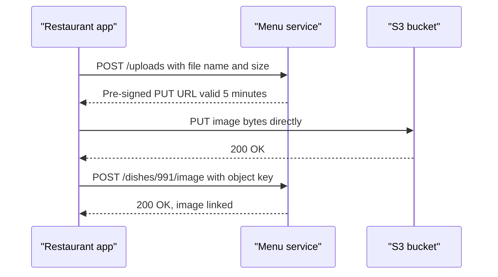

#### HTTP/1.1 vs HTTP/2 vs HTTP/3

This was a Zomato intern follow-up ("gRPC vs HTTP/1.1 vs HTTP/2", Z30).

| | HTTP/1.1 (1997) | HTTP/2 (2015) | HTTP/3 (2022) |
|---|---|---|---|
| Format | Text | Binary frames | Binary frames |
| Requests per connection | One at a time (pipelining rarely used) | Many in parallel (**multiplexing**) on one connection | Many in parallel |
| Head-of-line blocking | A slow response blocks the ones behind it | Fixed at HTTP level, but one lost TCP packet still stalls all streams | Fixed: each stream is independent |
| Header compression | None | HPACK | QPACK |
| Transport | TCP | TCP | **QUIC over UDP** |
| Handshake | TCP + TLS | TCP + TLS | Combined, 1 RTT, or 0-RTT on resume |
| Network change (Wi-Fi to 4G) | Connection breaks | Connection breaks | Survives (connection ID, not IP) |

HTTP/1.1 browsers work around one-request-at-a-time by opening about 6 connections per host. HTTP/2 multiplexes everything onto one connection, which is why **gRPC** (Google's RPC framework, which uses binary Protobuf messages) is built on HTTP/2. Apple's APNs push service also requires HTTP/2 ([source](https://developer.apple.com/documentation/usernotifications/sending-notification-requests-to-apns)). HTTP/3 helps most on flaky mobile networks: a dropped packet stalls only one stream, and a phone moving between Wi-Fi and 4G keeps its connection. For a delivery partner riding through Bengaluru traffic, that matters.

### 1.6 The full journey: opening the Zomato app

Now put it together. You open Zomato and the home feed of nearby restaurants appears. The exact internals of Zomato's edge are not public. The diagram uses the components Zomato is known to run (AWS, ECS services, a Kuma/Envoy mesh, Redis/ElastiCache, Solr search, Aurora MySQL and DynamoDB) in a typical arrangement.

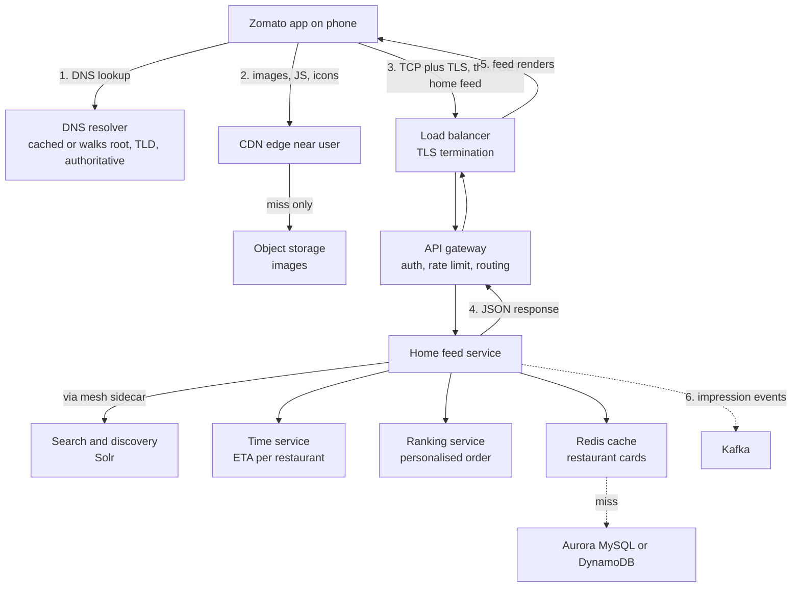

Step by step:

1. **DNS.** The app resolves `api.zomato.com`. It is usually cached, so this costs nothing.
2. **Static assets from the CDN.** Restaurant photos and icons come from an edge server near you, not from Zomato's origin in an AWS region.
3. **Connection.** The app reuses an open TCP+TLS connection if one exists. Otherwise it pays the handshakes. The load balancer terminates TLS (decrypts it) and forwards the request.
4. **Gateway.** The gateway checks your token, applies rate limits and routes `GET /home` to the home feed service.
5. **Fan-out.** The home service calls several others in parallel: search/discovery for restaurants that deliver to your location, the Time service for ETAs, and ranking for the order. Most of this is served from cache. One home screen can easily mean dozens of internal requests, which is how 8,400 orders a minute becomes 80 million requests a minute.
6. **Response and events.** JSON goes back up the chain. Asynchronously, "user saw these restaurants" events go to Kafka for analytics and ranking models.

> **Real world — Zomato:** Zomato's search handles 100M+ queries a day on Solr/Lucene, with some clusters in a master-slave setup where slaves serve reads behind a load balancer ([source](https://www.zomato.com/blog/explained-how-zomato-handles-100-million-daily-search-queries-p1/)). A dedicated Time microservice computes ETAs and distributes them to other services, with millisecond latency on CPU at "thousands of QPS" ([source](https://www.zomato.com/blog/the-accurate-eta-to-customer-satisfaction-part-one/)). How Zomato's gateway and edge are arranged is not public. The diagram above is a typical layout.

> **Pause and think:** The home service calls 5 services in parallel, and each answers within 50 ms 99% of the time. What fraction of home requests will see at least one call slower than 50 ms? (1 − 0.99^5 ≈ 4.9%. Fan-out multiplies tail latency, which is why section 1.9 makes so much of p99.)

### 1.7 Real-time on mobile: polling, WebSockets, SSE, MQTT and push

Order tracking needs the server to tell the phone things as they happen: "rider assigned", "rider is 2 minutes away", and the rider's position several times a minute. HTTP is request-response: the client asks, the server answers. There are several ways to get server-to-client updates.

| Technique | How it works | Good for | Weakness |
|---|---|---|---|
| **Short polling** | App asks "anything new?" every N seconds | Simple, low-frequency checks | Most calls return nothing, and each pays headers (and TLS if reconnecting). Updates arrive late. |
| **Long polling** | Server holds the request open until there is news or a timeout | Moderate real-time without new infrastructure | One hanging request per client, and reconnect churn |
| **SSE** (server-sent events) | One long HTTP response that streams events, server to client only | Live feeds, notifications | One direction only |
| **WebSocket** | HTTP connection upgraded to a two-way, persistent channel | Chat, live dashboards | You manage reconnects, heartbeats and fan-out yourself |
| **MQTT** | Lightweight publish/subscribe protocol over a persistent TCP connection, via a broker | Mobile and IoT: tiny messages, flaky networks, battery limits | Needs a broker, and topic design matters |
| **Push (FCM/APNs)** | OS-level notification channel run by Google or Apple | Waking an app that is closed | Rate-limited, not for high-frequency data |

**MQTT** deserves a closer look, because Zomato chose it. The client keeps one long-lived TCP connection to a **broker**. Clients **subscribe** to topics (for example `order/ORD8812/location`), and publishers **publish** to topics. The broker forwards each message to every subscriber. MQTT headers are tiny (a fixed header of 2 bytes), it supports a keep-alive heartbeat, and it has three delivery levels: QoS 0 (at most once), QoS 1 (at least once) and QoS 2 (exactly once between client and broker).

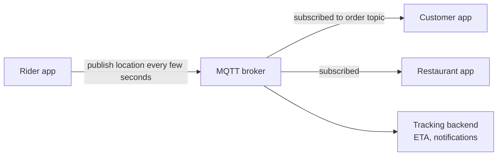

> **Real world — Zomato:** Zomato started with periodic HTTP polling for live tracking. It stopped scaling: TLS and header overhead often outweighed the tiny payloads, and rider markers jumped instead of moving smoothly. Zomato moved to MQTT (publish/subscribe over persistent connections) for live location and delivery lifecycle events, which feed live tracking, ETA, notifications and the merchant view. Its open-source Android library Pulse-MQTT, built on Eclipse Paho, handles auto-reconnect and re-subscribe, exponential retry and health checks, and runs in the delivery partner, consumer and Hyperpure apps. ([source](https://www.eternal.com/blog/pulse/)) Before NYE 2021, a team asked "Can MQTT handle the load?", and Zomato tested at 10x the expected load ([source](https://www.zomato.com/blog/our-learnings-from-nye/)). Zomato's server-side broker and how it stores rider locations are not public.

> **Real world — Uber:** Uber found that at one point 80% of its API-gateway requests were polling calls. It built a push platform (first SSE, later gRPC streams) with sequence numbers so a reconnecting client can say "I last saw message 812" and get the rest replayed. It runs a 4-second heartbeat and serves more than 1.5M concurrent connections. ([source](https://www.uber.com/blog/real-time-push-platform/))

The lessons carry into any tracking design. Persistent connections remove per-message handshake cost. Mobile networks drop constantly, so reconnect, re-subscribe and resume (sequence numbers) are first-class features, not afterthoughts. When the app is closed, use OS push. On iOS, Zomato uses a push-to-start token so the server can start a lock-screen Live Activity over APNs even when the app is terminated ([source](https://www.eternal.com/blog/live-activities-push-to-start-dynamic-images)).

A quick estimate of why polling hurts (assumptions): 500,000 orders being tracked at peak, polled every 5 seconds, is 100,000 requests a second, and most of them return "no change". With MQTT, those 500,000 clients hold idle connections and receive a message only when something actually moves.

### 1.8 Latency numbers every engineer should know

These are the widely quoted approximate numbers (popularised by Jeff Dean and Peter Norvig, updated over the years). Exact values vary by hardware. The *ratios* are what matter.

| Operation | Approx. time | If 1 ns were 1 second |
|---|---|---|
| L1 CPU cache reference | 0.5 ns | 0.5 s, a blink |
| L2 cache reference | 7 ns | 7 s |
| Mutex lock/unlock | 25 ns | 25 s |
| Main memory (RAM) reference | 100 ns | 1.7 minutes |
| Compress 1 KB (fast codec) | 2 µs | 33 minutes |
| Send 1 KB over a 1 Gbps network | 10 µs | 2.8 hours |
| Random 4 KB read from SSD | 150 µs | 1.7 days |
| Read 1 MB sequentially from RAM | 250 µs | 2.9 days |
| Round trip inside one data centre | 500 µs | 5.8 days |
| Read 1 MB sequentially from SSD | 1 ms | 11.6 days |
| Spinning disk seek | 10 ms | 3.8 months |
| Read 1 MB sequentially from spinning disk | 20 ms | 7.7 months |
| Delhi to Mumbai round trip (assumption, good network) | ~30 ms | ~11 months |
| California to Netherlands and back | 150 ms | 4.75 years |

What to take from this:

- **RAM is about 1,000x faster than an SSD random read**, and a network hop inside a data centre costs about as much as several SSD reads. That is why Redis (in RAM, one hop away) can answer in well under a millisecond, while a DB query that touches disk takes several milliseconds or more.
- **Crossing a continent costs more than almost anything you do inside a data centre.** Serve Indian users from an Indian region, and serve static files from a CDN edge.
- **Round trips dominate user-facing latency.** Cutting one round trip (reusing a connection, merging two queries into one as at Myntra) often beats optimising code.
- **Sequential beats random**, on disk and even in RAM. This is why logs and Kafka (append-only) are fast.

### 1.9 Latency, throughput, bandwidth, percentiles and Little's Law

**Latency** is how long one request takes. **Throughput** is how many requests the system completes per second. **Bandwidth** is the maximum data rate of a link (for example 1 Gbps). Throughput is how much of it you actually use.

They are related but different. Picture a Zomato kitchen. Latency is how long one biryani takes from order to pickup. Throughput is biryanis per hour. Adding a second chef raises throughput but doesn't make any single biryani faster. Batching orders raises throughput but makes each order wait longer for its batch.

**Percentiles.** Averages hide pain. Suppose 100 requests to the menu API took:

- 90 of them about 40 ms
- 8 of them about 120 ms
- 2 of them about 2,000 ms (a slow DB query, or a GC pause)

The **average** is (90×40 + 8×120 + 2×2000) / 100 = 85.6 ms, which looks fine. The **p50** (median: half of requests are faster) is 40 ms. The **p95** (95% are faster) is 120 ms. The **p99** (99% are faster) is 2,000 ms. One user in a hundred waits two seconds. A heavy user who makes 50 requests per session will almost certainly hit that tail at least once (1 − 0.99^50 ≈ 40%). That is why SLOs (service level objectives) are written as percentiles, like "p99 under 200 ms".

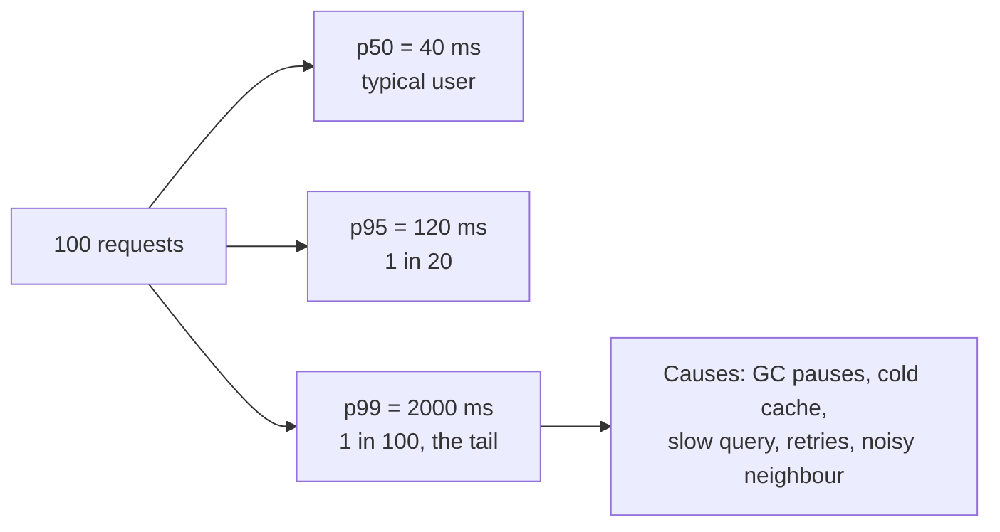

Fan-out makes tails worse, as the pause question in 1.6 showed. Swiggy reports that with an average fan-out of 3 to 5x, several of its services have a latency budget of about 50 ms at P99, which it uses to justify a caching layer ([source](https://bytes.swiggy.com/engineering-challenges-at-swiggy-430dea6c86a3), search snippet).

**Little's Law** links the three quantities for any stable system:

> L = λ × W
> L is the average number of requests in the system at once (concurrency), λ is the arrival rate (throughput), and W is the average time each spends inside (latency).

It is the most useful single formula for sizing. Two Zomato examples:

- **Whole platform (derived plus an assumption).** NYE 2023 peaked at 80.92M requests a minute, about 1.35M requests a second. *Assume* an average of 50 ms per request. Then L = 1,350,000 × 0.05 ≈ 67,000 requests in flight at any moment across the platform. If one service instance can safely handle 100 concurrent requests (assumption), you need about 675 instances' worth of concurrency for that traffic, before headroom.
- **Checkout.** 140 orders a second at peak (8,400 a minute). *Assume* checkout, including the payment gateway, takes 3 seconds end to end. Then L = 140 × 3 = 420 checkouts in progress at once. If the payment gateway slows to 10 seconds, L jumps to 1,400. The same traffic now needs more than three times the threads, connections and memory. **This is how a slow dependency takes down a healthy service**: latency rises, concurrency piles up, connection pools run dry. Timeouts and circuit breakers exist to cap W.

> **Pause and think:** Your service's connection pool to MySQL has 50 connections, and each query takes 5 ms. What is the most queries per second it can push through? If a bad index makes queries take 50 ms, what happens? (λ = L / W = 50 / 0.005 = 10,000 QPS. At 50 ms it drops to 1,000 QPS. With traffic still arriving at, say, 3,000 QPS, requests queue for connections and latency explodes. This is "how DBs make apps slow" from Z1, and exactly the Swiggy Instamart wrong-column-order index outage, where RDS CPU went above 90% ([source](https://bytes.swiggy.com/behindthebug-indexing-gone-wrong-6b4d682fd805), search snippet).)

### Check yourself

**Q: Walk through what happens when the Zomato app calls api.zomato.com for the first time.**
A: DNS resolution (resolver, then root, TLD and authoritative if not cached), then a TCP 3-way handshake, a TLS handshake, the HTTP request through the load balancer and gateway to a service, possible fan-out to other services, caches and DBs, and the response back. Later requests reuse the connection.

**Q: What does a DNS TTL control, and what is the trade-off?**
A: How long resolvers and clients cache the answer. Long TTLs mean fewer lookups but slow failover. Short TTLs allow fast traffic moves at the cost of more queries.

**Q: How many round trips before the first response byte on a new HTTPS connection with TLS 1.3?**
A: About three, ignoring DNS: one for TCP, one for TLS and one for the request itself. Hence keep-alive and connection pooling.

**Q: Which HTTP methods are idempotent, and how do you make POST safe to retry?**
A: GET, PUT and DELETE are idempotent. POST is made safe with an idempotency key: the server stores the key with the result and returns the stored result on a repeat.

**Q: What is the difference between 401 and 403?**
A: 401 means you are not authenticated (missing or invalid credentials). 403 means you are authenticated but not allowed to do this.

**Q: Why is base64 in JSON the wrong way to upload a large image, and what is right?**
A: It inflates the size by about 33%, ties up app servers and memory, and is slow. The right way is a server-issued pre-signed S3 URL, so the client uploads directly to storage and then confirms.

**Q: What problem does HTTP/2 solve over HTTP/1.1, and what does HTTP/3 add?**
A: HTTP/2 multiplexes many requests on one connection with header compression. HTTP/3 runs over QUIC (UDP), which removes TCP head-of-line blocking, speeds up the handshake and survives network changes.

**Q: Why did Zomato move live tracking from polling to MQTT?**
A: Polling's TLS and header overhead outweighed the tiny payloads, and markers jumped. MQTT keeps one persistent pub/sub connection with tiny headers and smooth updates. Reconnect and re-subscribe are handled by Zomato's Pulse library.

**Q: Roughly how much faster is a RAM read than a random SSD read?**
A: About 1,000x (100 ns vs about 150 µs).

**Q: The average latency is 85 ms. Why might users still complain?**
A: The average hides the tail. p99 could be 2 seconds, and users making many requests will often hit it. Fan-out makes this worse.

**Q: State Little's Law and use it on checkout.**
A: L = λW. At 140 orders/s and 3 s per checkout, 420 checkouts are in flight. If the gateway slows to 10 s, 1,400 are, so resources run out unless timeouts cap W.

## Part 2: Scaling compute

"Scaling" means handling more work without the system getting slow or falling over. This part is about compute: the machines that run your code, and how requests get spread across them. Databases and caches have their own parts later. The best way to learn this is to grow an imaginary Zomato from one laptop-sized server to the fleet that survived New Year's Eve.

### 2.1 Zomato from one server to thousands

**Stage 1: one box.** On day one, everything (the web app, the API and the MySQL database) runs on a single machine. That is the right choice. It is cheap, simple and easy to debug. But it is a **single point of failure** (SPOF: one part whose failure takes everything down), and the app and the database fight over the same CPU and RAM.

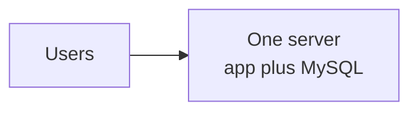

**Stage 2: separate the database.** Move MySQL to its own machine. Now each can be sized for its job: the database gets fast disks and lots of RAM, and the app gets CPU. You can also restart the app without touching the data.

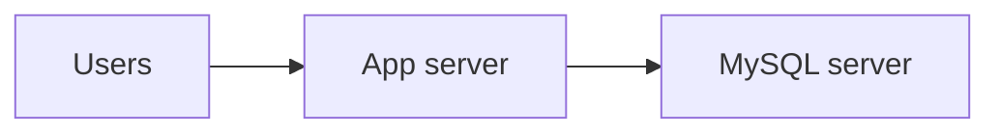

**Stage 3: load balancer plus many app servers.** Lunch traffic grows past what one app server can handle. Put a **load balancer** (LB) in front and run several identical app servers behind it. For this to work, the app servers must be **stateless**: no user data kept in local memory between requests (section 2.4). Now one app server can die and users don't notice.

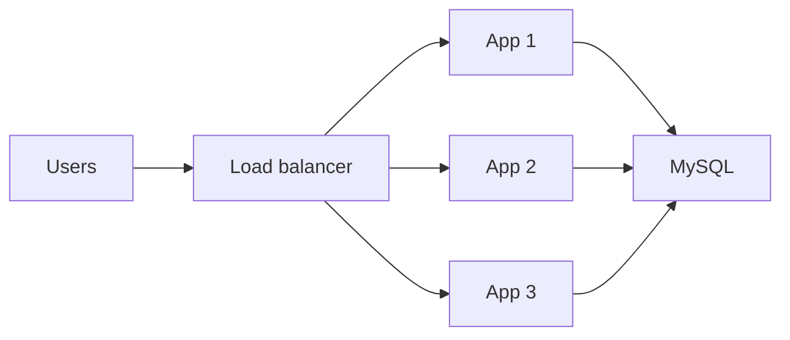

**Stage 4: add a cache.** Now the database is the bottleneck, and most queries are the same few reads: restaurant details, menus. Put **Redis** in front of it. Reads check Redis first and fall back to the DB only on a miss.

**Stage 5: read replicas.** Writes (orders) are far fewer than reads. Add **replicas**, copies of the primary database that receive its changes and serve read queries. The primary handles writes. The catch is **replication lag**: a replica may be a fraction of a second behind, so "read your own write" needs care.

**Stage 6: CDN.** Restaurant photos are the heaviest bytes, and they never change. Serve them from a **CDN** (content delivery network): servers spread across many cities that cache static files close to users.

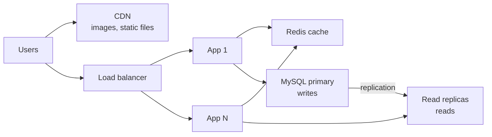

**Stage 7: microservices.** The single codebase now has 200 engineers committing to it. A bug in reviews crashes checkout. Deploys take hours. Split it by business domain: orders, menus, search, delivery, payments, notifications. Each **service** has its own codebase, its own database and its own scaling. Services talk over the network (REST/gRPC) and through events (Kafka). A gateway sits at the front, and a **service mesh** handles service-to-service traffic.

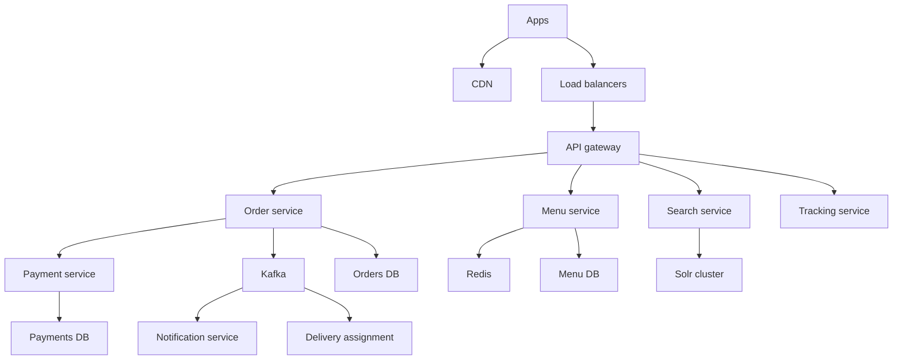

Zomato today is far past stage 7.

> **Real world — Zomato:** For NYE 2023, Zomato ran 300+ microservices on 11,000 EC2 instances with about 40,000 ECS tasks, and provisioned 5.5 PB of storage. That night the platform peaked at 80.92M requests per minute, Kafka at 450M+ messages per minute, and ElastiCache (Redis) at 35 TB in memory serving 1 billion GETs per minute. ([source](https://www.zomato.com/blog/a-tale-of-scale-behind-the-scenes-at-zomato-tech-for-nye-2023)) Services are largely written in Go. The PDF service Espresso was rewritten from a PHP library in Go, citing "performance and our team's familiarity with it", and handles 120K RPM at peak ([source](https://www.zomato.com/blog/espresso-brewing-pdfs-at-zomato-faster-than-you-can-say-cappuccino)). A monolith still exists alongside the microservices: the logging post refers to "our internal microservices and monolithic applications" ([source](https://www.zomato.com/blog/building-a-cost-effective-logging-platform-using-clickhouse-for-petabyte-scale)). No public post describes a PHP-to-Go migration, so don't claim one.

The point of the staged story for an interview: **each stage is a response to a specific bottleneck.** Don't start an answer at stage 7. Say what forces each step.

### 2.2 Vertical vs horizontal scaling

**Vertical scaling** (scale up) means a bigger machine: more CPU, more RAM, faster disk. **Horizontal scaling** (scale out) means more machines.

| | Vertical | Horizontal |
|---|---|---|
| How | Bigger instance | More instances behind a load balancer |
| Code changes | None | App must be stateless, data must be partitioned or replicated |
| Limit | The biggest machine you can buy, and price rises faster than capacity | Practically unlimited |
| Failure | Still one machine, a SPOF | One instance can die without an outage |
| Downtime to scale | Often a restart | None, add instances live |
| Good for | Databases early on, quick fixes | Stateless app tiers, caches, anything at scale |

In practice you do both. Stateless app servers scale out easily. Databases are often scaled up first, because scaling a database out (sharding) is hard, and only then split. "Vertical vs horizontal scaling" was asked directly in a Zomato SDE-1 round (Z19).

### 2.3 Load balancers

A load balancer receives client connections and spreads them across a pool of backend servers. It gives you three things: **scale** (more servers share the load), **availability** (it stops sending to dead servers), and a **single stable address** for clients while backends come and go.

#### Algorithms

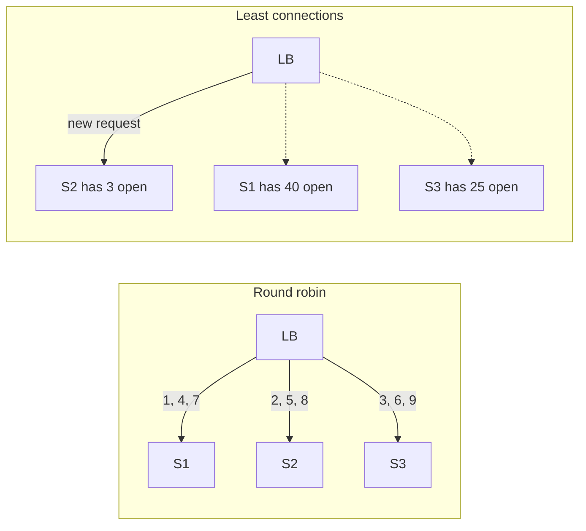

| Algorithm | How it picks | Use when |
|---|---|---|
| **Round robin** | Next server in turn | Servers are identical and requests are similar in cost |
| **Weighted round robin** | Bigger servers get proportionally more | Mixed instance sizes, canary releases (send 5% to the new version) |
| **Least connections** | Server with the fewest open connections | Requests vary a lot in duration (long polls, uploads) |
| **Least response time** | Fastest recent responder | Latency-sensitive traffic with uneven servers |
| **IP hash / consistent hash** | Hash of client IP or a key picks the server | You need the same client or key to keep reaching the same server (cache locality, stickiness) |
| **Power of two choices** | Pick 2 servers at random, send to the less loaded | Large fleets: close to least-connections without global state |

Round robin is a fine default. A trap: round robin with a slow server keeps feeding it its share, so its queue grows. Least connections adapts on its own.

#### L4 vs L7

The "L" refers to layers of the OSI network model (also asked at Zomato, Z27).

- An **L4 load balancer** works at the transport layer. It sees IPs and ports, and forwards TCP or UDP connections without reading their contents. It is very fast and cheap, and it handles any protocol, including MQTT and database connections. It cannot route by URL. **AWS NLB** (Network Load Balancer) is L4.
- An **L7 load balancer** works at the application layer. It terminates the connection, reads the HTTP request, and can route by path (`/orders` to the order service), header, or cookie. It can rewrite requests, retry, compress and terminate TLS. It costs more CPU per request. **AWS ALB** (Application Load Balancer), Nginx and Envoy are L7.

"ALB vs NLB vs Nginx" was asked in a Zomato SDE-1 round (Z27). A reasonable answer: NLB for raw TCP, very high connection counts, static IPs and non-HTTP protocols. ALB for managed HTTP routing to many services. Nginx or Envoy when you want a self-run, highly configurable L7 proxy, for example as a sidecar or gateway.

#### Health checks

The LB calls each backend's health endpoint (say `GET /health`) every few seconds. After N failures in a row it marks the backend unhealthy and stops sending traffic. After M successes it adds it back. Two kinds of check are worth separating:

- **Liveness**: is the process alive? If not, restart it.
- **Readiness**: can it serve traffic right now? A server warming its cache or waiting on a DB connection should report "not ready" so it gets no traffic yet.

A health check that calls the database can backfire. If the DB has a blip, *every* server fails its check at once, and the LB removes them all. DoorDash calls a related pattern a **death spiral**: pods fail readiness, and the survivors overload ([source](https://doordash.engineering/2023/03/14/failure-mitigation-for-microservices-an-intro-to-aperture/)). Keep health checks shallow, and make sure the LB doesn't drain the whole pool at once.

#### LB redundancy, TLS termination and connection draining

The LB itself must not be a SPOF. Managed cloud LBs (ALB/NLB) run across multiple availability zones (separate data centres in one region) automatically. Self-run LBs are deployed in pairs, active-passive with a floating IP that moves on failure, or active-active behind DNS.

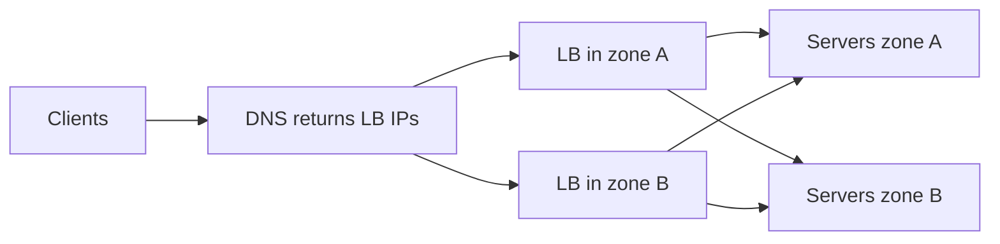

**TLS termination** means the LB decrypts HTTPS and talks to the backends either in plain HTTP inside a private network, or re-encrypted (often mTLS inside a mesh). It centralises certificate management and saves backend CPU, and an L7 LB has to decrypt anyway to read the paths it routes on.

**Connection draining** (also called deregistration delay) handles deploys and scale-in. When an instance is about to be removed, the LB stops sending it *new* requests but lets in-flight ones finish, for say 30 seconds, before the instance shuts down. Without it, every deploy cuts off a few hundred orders mid-checkout. The app side of this is a **graceful shutdown**: on SIGTERM, stop accepting new work, finish current work, then exit.

### 2.4 Stateless servers and sessions

A server is **stateless** if any instance can serve any request, because nothing about the user lives only in that instance's memory. Statelessness is what makes horizontal scaling and autoscaling easy. The obvious state that gets in the way is the **login session**. "Stateful vs stateless" was asked at District (Z15).

There are three ways to handle sessions:

```mermaid
flowchart TD
    subgraph A1["Sticky sessions"]
        C1["Client"] --> L1["LB pins user to S1"] --> X1["S1 holds session in memory"]
    end
    subgraph A2["Shared session store"]
        C2["Client with session id cookie"] --> L2["LB any server"] --> X2["Any server"] --> RS["Redis session store"]
    end
    subgraph A3["Stateless token JWT"]
        C3["Client sends signed JWT"] --> L3["LB any server"] --> X3["Any server verifies signature locally"]
    end
```

| Approach | How | Pros | Cons |
|---|---|---|---|
| **Sticky sessions** | LB sends a user's requests to the same server (by cookie or IP hash) | Simple | Uneven load. When that server dies, its users are logged out. Hurts autoscaling and deploys. |
| **Shared session store** | Session ID in a cookie, session data in Redis | Any server can serve. Easy to revoke (delete the key). | One Redis read per request. Redis must be highly available. |
| **JWT** (JSON Web Token) | Server signs a token holding user ID, roles and expiry. Client sends it each time, and any server verifies the signature with no lookup. | No shared store. Scales freely. Works across services. | **Hard to revoke** before expiry. Payload is readable (signed, not encrypted). Tokens can be large. |

The common production answer is short-lived access JWTs (say 15 minutes) plus a long-lived refresh token kept server-side, so revocation means refusing the next refresh. JWT came up in several rounds (Z7, P2, Z16).

The Z9 trap was "if someone steals your session ID, how do you stop them? What if they share your IP?" Good answers, in layers:

- Make theft harder: HTTPS only, `HttpOnly` and `Secure` cookies, short lifetimes.
- Rotate the session ID on login and privilege changes.
- Bind the session to signals beyond IP, because carrier NAT makes IP sharing normal (section 1.1). Use a device ID or fingerprint and watch for user-agent changes.
- Step up authentication (OTP) for sensitive actions such as changing the address or paying.
- Let users see active sessions and log out of all of them, which requires server-side revocation.

### 2.5 Reverse proxy, API gateway and service mesh

These three get confused, because they overlap.

A **reverse proxy** sits in front of servers and forwards client requests to them. The client only sees the proxy. (A *forward* proxy sits in front of clients, like a corporate web proxy.) Nginx is the classic one. It provides TLS termination, compression, caching of responses, buffering of slow clients and hiding of internal topology. A load balancer is a reverse proxy that spreads load.

An **API gateway** is a reverse proxy specialised for APIs at the edge of your system. On top of routing, it does cross-cutting work so that every service doesn't have to:

- Authentication: validate the JWT or session.
- Rate limiting per user, IP or API key.
- Request and response transformation, and API versioning.
- Aggregation, or a **BFF** (backend for frontend): one call from the app becomes several internal calls.
- Logging, metrics and request IDs.

A **service mesh** handles traffic *between* services (east-west traffic, as opposed to north-south traffic from clients). Each service instance gets a **sidecar proxy**, typically **Envoy**, running next to it. All the service's inbound and outbound calls go through its sidecar. A **control plane** pushes configuration to every sidecar: routes, retries, timeouts, mTLS certificates.

```mermaid
flowchart LR
    subgraph PodA["Order service task"]
        OA["Order app"] --> EA["Envoy sidecar"]
    end
    subgraph PodB["Payment service task"]
        EB["Envoy sidecar"] --> PB["Payment app"]
    end
    EA -->|"mTLS, retries, timeouts, metrics"| EB
    CP["Control plane<br/>Kuma"] -.->|"config and certificates"| EA
    CP -.-> EB
```

Why bother? Without a mesh, every team writes its own retry logic, timeouts, circuit breakers, metrics and TLS, in every language, slightly differently. With a mesh, the platform team sets them once, and the application code just makes a plain call to `payment-service`.

> **Real world — Zomato:** Zomato's chaos testing injects upstream latency "via our internal service mesh layer built using Kuma" ([source](https://www.zomato.com/blog/a-tale-of-scale-behind-the-scenes-at-zomato-tech-for-nye-2023)). Kuma is an Envoy-based mesh. A 2025 KubeCon India talk abstract by a Zomato engineer describes 500+ microservices with 10,000 dataplanes on Kuma, and plans for zone-aware routing to cut cross-AZ data transfer costs ([source](https://sessionize.com/arpit-mishra/), abstract only). Zomato's developer tooling uses a Kuma traffic-route policy plus a unique HTTP header to send staging traffic to a developer's laptop ([source](https://www.zomato.com/blog/embracing-shift-left-testing-with-local-preview/)).

> **Real world — DoorDash:** A more than 2-hour site-wide outage in mid-2021 pushed DoorDash to adopt an Envoy service mesh. The first features were adaptive concurrency, outlier detection and metrics, and the payment and notification services were onboarded first, by canary over 2 weeks. The mesh now covers more than 1,000 microservices and more than 80M requests per second at peak. ([source](https://careersatdoordash.com/blog/inside-doordashs-service-mesh-journey-part-1-migration-at-scale/))

| | Reverse proxy | API gateway | Service mesh |
|---|---|---|---|
| Where | In front of a set of servers | At the edge, in front of all APIs | Between every pair of services |
| Traffic | Client to server | Client to services (north-south) | Service to service (east-west) |
| Typical jobs | TLS, LB, caching, compression | Auth, rate limit, routing, versioning, BFF | mTLS, retries, timeouts, circuit breaking, traffic shifting, fault injection, metrics |
| Examples | Nginx, HAProxy | Kong, AWS API Gateway, Envoy-based gateways | Kuma, Istio, Linkerd (Envoy sidecars) |

### 2.6 CDN

A **CDN** is a network of caching servers (edges or PoPs, points of presence) in many cities. A user in Lucknow fetching a biryani photo gets it from a nearby edge instead of from Zomato's origin in an AWS region. That cuts latency, and it takes enormous load off the origin.

**Pull vs push.** In a **pull CDN**, the edge fetches from your origin on the first request (a cache miss), then caches it. It is zero effort, and it is the common default. In a **push CDN**, you upload content to the CDN ahead of time. That suits large files you know will be popular, like an app update or a campaign video for a big sale.

```mermaid
sequenceDiagram
    participant U as "User in Lucknow"
    participant E as "CDN edge"
    participant O as "Origin S3"
    U->>E: GET biryani.jpg
    E->>O: Cache miss, fetch from origin
    O-->>E: Image with Cache-Control max-age 86400
    E-->>U: Image
    U->>E: Another user, GET biryani.jpg
    E-->>U: Cache hit, served from edge
```

**Cache headers** tell browsers and CDNs what they may do:

- `Cache-Control: public, max-age=86400` means anyone may cache it for a day.
- `Cache-Control: private, no-store` means don't cache it (user-specific data such as your order history).
- `s-maxage` sets a separate TTL for shared caches like CDNs.
- `ETag` and `Last-Modified` let a client ask "has this changed?" and get a cheap `304 Not Modified`.
- `stale-while-revalidate` lets the cache serve a slightly stale copy while it fetches a fresh one in the background.

**Invalidation** is the hard part. If a restaurant changes its cover photo, there are two options. One is to **purge** the old URL on the CDN, which is slow to propagate and often rate-limited. The better one is **versioned URLs**: name the file by its content hash (`cover.3f9a1c.jpg`), so a new photo is a new URL and old caches simply age out. Then you can set very long TTLs safely.

What goes on a CDN: images, JS/CSS, app bundles, fonts, and sometimes public API responses that are identical for everyone (a city's list of cuisines). What doesn't: anything personalised or fast-changing, like your cart, prices with your coupons, or live order status.

### 2.7 DNS geo-routing

DNS can answer differently depending on who asks. **GeoDNS** or **latency-based routing** returns the IP of the region closest to, or fastest for, the user's resolver. "GeoDNS" was asked by name at Zomato (Z19). Combined with health checks, DNS can also **fail over**: if a region's health check fails, stop returning its IPs.

```mermaid
flowchart TD
    U1["User in Mumbai"] --> D["GeoDNS"]
    U2["User in Dubai"] --> D
    D -->|"nearest healthy region"| R1["Region A<br/>Mumbai"]
    D -->|"nearest healthy region"| R2["Region B<br/>elsewhere"]
    R1 -.->|"health check fails"| D
```

There are limits. DNS sees the resolver's location, not the user's, though the EDNS Client Subnet extension helps. Failover is only as fast as the TTL. Multi-region also means your *data* must be available in both regions, which is much harder than routing (later parts cover replication). Zomato's multi-region setup, if any, is not public. Most Indian food-delivery traffic is served from Indian regions, and that is a reasonable assumption to state.

### 2.8 Autoscaling, and why Zomato pre-scales

**Autoscaling** adds or removes instances automatically based on a metric: CPU, requests per instance, queue depth, or a schedule.

- **Reactive** autoscaling: "if average CPU stays above 60% for 3 minutes, add 20% more tasks." It is simple, but it lags. The metric has to rise, the alarm has to fire, new instances have to boot, pull images, warm caches and pass health checks. That can take minutes.
- **Scheduled / predictive** autoscaling: scale up before a known peak. Food delivery has extremely predictable peaks: lunch, dinner, weekends, IPL matches, New Year's Eve.
- Scale-in should be slower and more cautious than scale-out, to avoid flapping (repeatedly adding and removing instances).

Why does reactive autoscaling fail at a spike? Picture 8:00 pm on NYE. Traffic triples in ten minutes. Existing instances saturate, so latency rises. By Little's Law, concurrency piles up and connection pools exhaust. Health checks start timing out, so the LB removes "unhealthy" instances, and the survivors get even more load. Meanwhile new instances are still booting. That is the death spiral again. Also, scaling one tier often just moves the bottleneck to the next: 3x more app servers means 3x more DB connections.

> **Real world — Zomato:** For NYE 2023, Zomato's SRE team pre-scaled the infrastructure ahead of the night (to 11,000 EC2 instances) and staffed war rooms across the businesses. Its in-house benchmarking platform ramps load gradually "so autoscaling can react", aborts automatically on critical alerts, and ran 14,000 minutes of benchmarks across 100+ services, peaking at 50M RPM with 30B requests fired. ([source](https://www.zomato.com/blog/a-tale-of-scale-behind-the-scenes-at-zomato-tech-for-nye-2023)) For NYE 2021, SRE spent over 15 days load-testing every component above the expected load, with infrastructure pre-scaled, and teams added kill switches per feature ([source](https://www.zomato.com/blog/our-learnings-from-nye/)).

> **Real world — DoorDash and Swiggy:** DoorDash writes that autoscaling helps only if it is predictive, not reactive, and that adding capacity to one service often just moves the bottleneck ([source](https://doordash.engineering/2023/03/14/failure-mitigation-for-microservices-an-intro-to-aperture/)). Swiggy reportedly autoscales rather than provisioning for peak, with about 100K-300K rpm at lunch and about 500K rpm at dinner ([source](https://bytes.swiggy.com/engineering-challenges-at-swiggy-430dea6c86a3), search snippet). Swiggy also built a guard that caps runaway on-demand DynamoDB autoscaling cost ([source](https://bytes.swiggy.com/how-to-limit-autoscaling-in-on-demand-dynamodb-tables-c57e20cbbbcf), search snippet).

The interview answer: "Autoscale for everyday variation. Pre-scale for known peaks, because autoscaling lags a spike. Load-test above the expected peak. Put kill switches on non-critical features so they can be switched off to protect checkout."

There is a connection to the Myntra work here. A per-pod token bucket (180 RPM per pod) means the *total* allowed rate grows as pods are added. Autoscaling the caller can therefore overwhelm a downstream that has a fixed capacity. If you mention per-pod limits, also say how the global limit is kept safe.

> **Pause and think:** Your order service autoscales on CPU. During a payment-gateway slowdown, order service CPU is low but latency is high and requests are queuing. Does autoscaling help? (No. Threads are blocked waiting, not computing, so CPU stays low and nothing scales. Even if it did, more instances would just pile more waiting requests onto the slow gateway. The fixes are timeouts, a circuit breaker, failing over to another gateway, or scaling on concurrency or latency rather than CPU.)

### 2.9 Containers, Kubernetes and ECS, briefly

A **container** packages your service with its dependencies (the Go binary, config, OS libraries) into an image that runs the same on a laptop and in production. Containers are lighter than virtual machines because they share the host's OS kernel, so one EC2 instance can run many of them.

At hundreds of services and thousands of instances, you need a **container orchestrator** to decide which container runs on which machine, restart crashed ones, roll out new versions gradually, scale them, and connect them to load balancers. The two you'll hear about:

- **Kubernetes** (K8s): the open-source standard. You declare the desired state ("10 replicas of order-service v42"), and controllers make it so. Its unit is the **pod**: one or more containers that share a network, such as your app plus its Envoy sidecar.
- **AWS ECS**: Amazon's own orchestrator. Its unit is the **task**, and a service keeps N tasks running behind a load balancer.

> **Real world — Zomato:** Zomato's services run mostly on ECS on EC2 (about 40,000 ECS tasks on NYE 2023), while ML model serving runs on Kubernetes with spot instances ([source](https://www.zomato.com/blog/a-tale-of-scale-behind-the-scenes-at-zomato-tech-for-nye-2023), [source](https://www.zomato.com/blog/elements-of-scalable-machine-learning/)). Spot instances are spare cloud capacity sold cheaply that can be taken back at short notice. They suit work that tolerates interruption, like Zomato's log-ingestion workers ([source](https://www.zomato.com/blog/building-a-cost-effective-logging-platform-using-clickhouse-for-petabyte-scale)).

For an interview you rarely need more than: "Services run as containers on an orchestrator (ECS or Kubernetes), with rolling deploys, health checks and autoscaling per service."

### 2.10 Monolith, microservices and the modular monolith

A **monolith** is one codebase deployed as one unit. **Microservices** split the system into independently deployable services, each owning its own data. A **modular monolith** is one deployable with strong internal module boundaries (orders cannot reach into the payments tables, only call its interface), so it can be split later. "Monolith vs microservices, when to split" was asked at Nugget (Z5).

| | Monolith | Modular monolith | Microservices |
|---|---|---|---|
| Deploy | One unit | One unit | Each service separately |
| Calls between parts | In-process function calls (ns) | In-process | Network calls (ms), which can fail |
| Data | One DB | One DB, owned per module | DB per service |
| Scaling | All or nothing | All or nothing | Per service |
| Failure isolation | A bug can take down everything | Same | Better, if timeouts and breakers are in place |
| Team scaling | Hard past dozens of engineers | Better | Teams own services end to end |
| Operational cost | Low | Low | High: discovery, tracing, mesh, versioning, distributed consistency |
| Right for | Startups, small teams | Most mid-size products | Large orgs with clear domains and platform support |

> **Real world — DoorDash:** DoorDash began as a Django monolith in 2013. It showed strain by 2017: brittle code, slow test suites, costly rollbacks. After major reliability issues and a code freeze in 2018, in late 2019 DoorDash halted all new feature work to re-architect. Early "satellite" services still depended on the monolith's database, so a monolith failure took them down too. DoorDash standardised on Kotlin and gRPC and ended up with layers: frontend, BFF, backend (cart, feed, delivery), platform (identity, communication), infrastructure. It names the cost plainly: in-process calls became network calls, bringing latency, retries, circuit breaking, load shedding and API compatibility concerns. The migration ran from 2019 to 2023 and is what motivated its service mesh. ([migration post](https://doordash.engineering/2020/12/02/how-doordash-transitioned-from-a-monolith-to-microservices/), [mesh post](https://careersatdoordash.com/blog/inside-doordashs-service-mesh-journey-part-1-migration-at-scale/))

Two lessons from DoorDash to say in interviews:

- **A shared database defeats the point.** If services share one DB, they share its failures and must coordinate every schema change. Each service owns its data, and others go through its API or its events.
- **Split along domains, and extract what needs independent scaling first.** For a Zomato-like system the natural seams are order, menu/catalog, search, delivery/dispatch, payments, notifications and user/identity.

Gojek took a "Ship of Theseus" approach, replacing its legacy system piece by piece while it kept running ([source](https://blog.gojek.io/how-gojek-manages-1-million-drivers-with-12-engineers-part-2-2/), archived). Cutting traffic over gradually, rather than in one big-bang rewrite, is the usual safe path. It is often called the **strangler fig** pattern.

#### Service discovery

With thousands of tasks starting and stopping, how does the order service find a healthy payment instance? Through **service discovery**:

- A **registry** tracks live instances. Instances register on start, or the orchestrator registers them, and health checks remove dead ones. Examples: Consul, etcd, Kubernetes Services, AWS Cloud Map.
- **Client-side discovery**: the caller (or its sidecar) asks the registry and load-balances itself. Service meshes work this way: the control plane pushes the endpoint list to each Envoy.
- **Server-side discovery**: the caller hits a stable name or internal LB, which knows the instances.

```mermaid
sequenceDiagram
    participant P as "Payment task"
    participant Reg as "Registry or control plane"
    participant E as "Order service sidecar"
    P->>Reg: Register 10.0.3.7 port 8080, healthy
    Reg-->>E: Push updated endpoint list for payment
    E->>P: Call payment, load balanced across endpoints
    Note over Reg: Failed health check removes the endpoint
```

#### Sync vs async communication

**Synchronous** communication means the caller waits for the answer: REST over HTTP, or **gRPC**. gRPC uses Protobuf (a compact binary format with a schema), runs on HTTP/2, generates client code, and supports streaming. It is popular for internal calls (DoorDash standardised on it). REST/JSON is more universal and easier to debug, which suits public and mobile APIs.

**Asynchronous** communication means the caller drops a message on a queue or log (Kafka, SQS, RabbitMQ) and moves on. Consumers process it when they can.

```mermaid
flowchart LR
    subgraph Sync["Synchronous chain"]
        O1["Order"] -->|"wait"| P1["Payment"]
        P1 -->|"wait"| N1["Notification"]
    end
    subgraph Async["Event driven"]
        O2["Order"] -->|"OrderPlaced event"| K["Kafka"]
        K --> N2["Notification"]
        K --> D2["Delivery assignment"]
        K --> A2["Analytics"]
    end
```

| | Sync (REST/gRPC) | Async (Kafka/SQS) |
|---|---|---|
| Caller needs the answer now? | Yes: "is this payment authorised?" | No: "send a push", "update analytics" |
| Coupling | Caller fails if callee is down | Callee can be down, and messages wait |
| Latency added to the user | Sum of the chain | Only the publish |
| Load spikes | Passed straight through | Absorbed by the queue (buffering) |
| Complexity | Simple to reason about | Duplicates, ordering, eventual consistency, monitoring lag |

Blinkit asked exactly this: "Why asynchronous? What problem does it solve? What happens if the consumer is down? How would you handle duplicate events?" (B2). The answers, in order:

1. It decouples the services and keeps slow, non-critical work off the user's path.
2. It absorbs spikes.
3. If the consumer is down, messages accumulate (monitor consumer lag) and are processed when it recovers.
4. Queues deliver at least once, so consumers must be **idempotent**: dedupe by event ID, or make the update conditional on state ("set PICKED_UP only if currently ASSIGNED").

This is exactly the Atlassian SQS + worker pool + idempotency + DLQ pattern, so use it as the example.

> **Real world — Zomato:** Kafka is "the backbone of our event-driven architecture" at Zomato, handling 450M+ messages per minute on NYE 2023 ([source](https://www.zomato.com/blog/a-tale-of-scale-behind-the-scenes-at-zomato-tech-for-nye-2023)). The billing platform's services communicate over Kafka and handle about 10M events a day ([source](https://aws.amazon.com/blogs/database/unlocking-performance-scalability-and-cost-efficiency-of-zomatos-billing-platform-by-switching-from-tidb-to-dynamodb/)).

A rule of thumb for designs: **synchronous for the decision, asynchronous for the consequences.** Placing an order synchronously checks the cart, reserves, and starts payment. Everything that follows (notify the restaurant, assign a rider, send a push, update analytics) flows from an event.

### Check yourself

**Q: Walk through Zomato's growth from one server, naming the bottleneck each step fixes.**
A: One box (simple, but a SPOF and resource contention). Separate DB (independent sizing). LB plus stateless app servers (app CPU, availability). Cache (DB read load). Read replicas (more read load). CDN (heavy static bytes, latency). Microservices (team scale, deploy risk, independent scaling).

**Q: Why is vertical scaling usually tried first for databases but not for app servers?**
A: Scaling a database out means sharding and distributed consistency, which is hard. Stateless app servers scale out trivially behind a load balancer.

**Q: L4 vs L7 load balancer?**
A: L4 forwards TCP/UDP by IP and port without reading contents: fast, any protocol (NLB). L7 reads HTTP and can route by path or header, terminate TLS and retry (ALB, Nginx, Envoy).

**Q: When does least connections beat round robin?**
A: When request durations vary a lot, or one server is slower. Round robin keeps feeding the slow server its share, while least connections adapts.

**Q: What is connection draining and why does it matter for deploys?**
A: The LB stops sending new requests to an instance being removed but lets in-flight ones finish. Without it, deploys and scale-in cut off live requests, such as checkouts.

**Q: Compare sticky sessions, a Redis session store and JWTs.**
A: Sticky sessions are simple but cause uneven load and lose sessions when a server dies. A Redis store makes servers stateless and allows easy revocation, at the cost of a lookup per request. JWTs need no lookup and scale freely, but are hard to revoke. The usual answer is short-lived JWTs plus refresh tokens.

**Q: Reverse proxy vs API gateway vs service mesh?**
A: A reverse proxy fronts servers. An API gateway is an edge proxy for APIs with auth, rate limiting and routing (north-south). A service mesh puts sidecar proxies beside every service for mTLS, retries, timeouts and metrics between services (east-west). Zomato uses Kuma, which is Envoy-based.

**Q: How do you update a restaurant's photo on a CDN without waiting for TTLs?**
A: Use versioned, content-hashed URLs so the new photo is a new URL. Long TTLs are then safe, and purging is only a fallback.

**Q: Why did Zomato pre-scale for NYE instead of relying on autoscaling?**
A: Reactive autoscaling lags a sharp spike (metrics, alarms, boot, warmup). Meanwhile saturated instances fail health checks and can spiral. Zomato pre-scaled to about 11,000 EC2 instances and benchmarked to 50M RPM beforehand.

**Q: What made DoorDash's early microservices fail together with the monolith?**
A: "Satellite" services still used the monolith's database, so they shared its failures. Each service must own its data.

**Q: Your order service's CPU is low but latency is high during a gateway slowdown. Will CPU autoscaling help?**
A: No. Threads are waiting, not computing. Use timeouts, circuit breakers, failover to another gateway, or scale on concurrency or latency.

**Q: "Why async? What if the consumer is down? Duplicates?"**
A: Async decouples services, keeps slow work off the user path and absorbs spikes. If the consumer is down, messages queue up (watch the lag) and are processed later. Delivery is at least once, so consumers must be idempotent: dedupe by event ID or use conditional state transitions.

---

[← README](README.md) · [06b_SD_Databases.md →](06b_SD_Databases.md)
