# System Design Master — 2. Databases

> **Covers:** Part 3. **Reading time:** about 85 minutes of focused reading (diagrams and code extra).
> Built from research into Zomato's and Eternal's engineering blogs, Swiggy, Blinkit, Zepto, BookMyShow, Uber, DoorDash, Grab, Stripe, Razorpay, Cloudflare and ~100 interview reports. Company facts link to their source; anything not public is marked so — never claim more in the interview.
> Diagrams are Mermaid and render on GitHub. Report IDs like Z2 or B10 refer to `sources/interview_reports.md`; all research notes with links are in `sources/`.

[← 06a_SD_Interview_Requests_Scaling.md](06a_SD_Interview_Requests_Scaling.md) · [06c_SD_Caching_and_Async.md →](06c_SD_Caching_and_Async.md)

---

## Part 3: Databases

If you remember one thing from this Part, remember this: **in almost every system design interview, the database is where the hard decisions live.** Web servers are easy to scale. You add more of them behind a load balancer, because they hold no state. The database holds the state: the orders, the money, the menus. It cannot simply be copied ten times without thinking, because then you have to answer "which copy is correct?". Interview reports from Zomato say this directly. The research summary of about 100 reports calls databases and SQL "the most common source of rejections at Zomato", and "why SQL vs NoSQL for this?" was asked in almost every report.

So this Part goes slowly and goes deep. We start with what a database actually does. Then we build up through tables, indexes, transactions, replication, sharding and distributed transactions, using Zomato examples throughout.

### 3.1 What a database really does

Imagine Zomato with no database. The order service keeps orders in a Go map in memory. A customer places an order for biryani. The map now holds `order 101 -> biryani, PLACED`. Then the server restarts for a deploy, and the map is empty. The customer was charged and the restaurant never hears about the order.

A database exists to solve that problem and a few related ones. Strip away the marketing and every database does five jobs:

1. **Durability.** Once it says "saved", the data survives a crash or a power cut. It does this by writing to disk (and usually to other machines) before it replies.
2. **Querying.** It finds data quickly by more than one key: "this order", "all orders of user 42 this month", "all PLACED orders of restaurant 7". Without help, finding something means scanning everything.
3. **Concurrency control.** Thousands of requests touch the same data at once. Two riders accept the same order at the same moment. The database makes sure the result is sane, not a mix of both.
4. **Integrity.** It enforces rules: an order must point to a real restaurant, an email must be unique, a wallet balance must not go negative.
5. **Recovery.** After a crash it comes back in a consistent state. Half-finished work is either completed or undone.

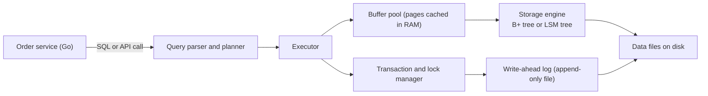

Read the diagram left to right. Your query arrives as text. The **planner** decides how to run it, for example "use the index on user_id". The **executor** runs that plan. Data is read in fixed-size chunks called **pages** (often 8 KB or 16 KB), and recently used pages stay in RAM in the **buffer pool**, so hot data is served from memory. The **storage engine** is the part that lays data out on disk. We cover the two big designs, B+ trees and LSM trees, in 3.5.

The most important box for durability is the **write-ahead log (WAL)**. Before the database changes any data page, it appends a description of the change ("order 101 status PLACED to ACCEPTED") to the end of a log file and flushes it to disk. Appending to the end of a file is fast, much faster than jumping around the disk to update pages in place. If the machine crashes, the database replays the log on restart and redoes any change the log says was committed. That is how "saved" can survive a power cut. Keep the WAL in mind, because it comes back several times. Replication ships the WAL to other machines (3.12). Change data capture tools like Debezium read the WAL to publish events (3.18).

> **Pause and think:** Your Myntra ratings service cached ratings in Aerospike with a 7-day TTL. Which of the five jobs above did Aerospike do for you, and which did it *not* guarantee the way the main database did? (Hint: a cache with a TTL is allowed to forget things.)

### 3.2 The relational model: tables, keys and joins

The **relational model** (from Edgar Codd, 1970) stores data in **tables**. A table has **columns** (fields, each with a type) and **rows** (records). SQL, the Structured Query Language, is how you ask questions of it. MySQL, PostgreSQL, Aurora, Oracle and SQL Server are all relational databases, usually called RDBMS.

Here is a tiny slice of Zomato:

```
users                         restaurants
+---------+---------+         +---------------+---------------+-----------+
| user_id | name    |         | restaurant_id | name          | city      |
+---------+---------+         +---------------+---------------+-----------+
| 1       | Vaideeka|         | 10            | Biryani Blues | Gurugram  |
| 2       | Rahul   |         | 11            | Burger Singh  | Delhi     |
+---------+---------+         +---------------+---------------+-----------+

orders
+----------+---------+---------------+--------+-----------+
| order_id | user_id | restaurant_id | amount | status    |
+----------+---------+---------------+--------+-----------+
| 501      | 1       | 10            | 450    | DELIVERED |
| 502      | 1       | 11            | 299    | PLACED    |
| 503      | 2       | 10            | 620    | PLACED    |
+----------+---------+---------------+--------+-----------+
```

**Keys** are how rows find each other.

- A **primary key (PK)** uniquely identifies a row in its table. `order_id` is the PK of `orders`. It cannot be null and cannot repeat.
- A **foreign key (FK)** is a column that points at another table's primary key. `orders.user_id` points at `users.user_id`. If you declare it as a foreign key, the database refuses to insert an order for user 99 if user 99 does not exist. That is integrity, job 4 from above.
- A **unique key** is any other column that must not repeat, for example `users.phone`.
- A **composite key** is a key made of more than one column. A `order_items` table might use `(order_id, item_id)` as its primary key, since one order can have many items but each item appears once per order.
- A **natural key** is a real-world value (phone number). A **surrogate key** is a made-up ID (`user_id = 1`). Prefer surrogate keys for primary keys, because real-world values change. People change phone numbers.

The relationships have names. One user has many orders: **one-to-many**, implemented with a foreign key on the "many" side. One order contains many dishes and one dish appears in many orders: **many-to-many**, implemented with a **join table** (`order_items`) holding two foreign keys.

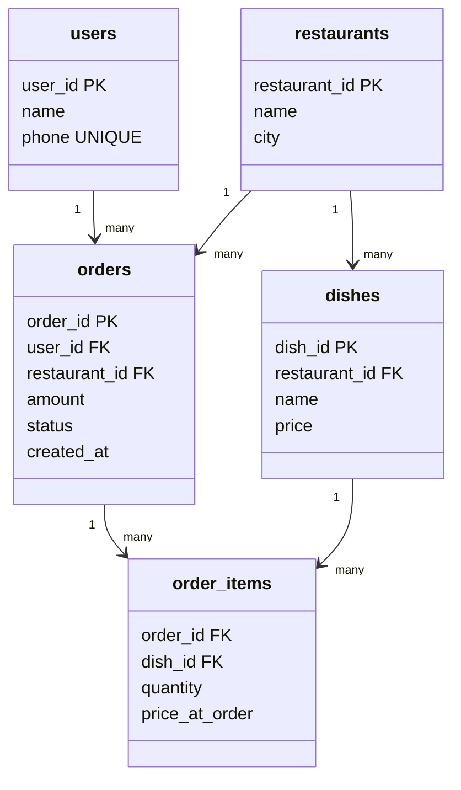

Notice `price_at_order` in `order_items`. That is deliberate. The dish price can change tomorrow, but the bill for yesterday's order must not. This is a small example of a real schema-design judgement, and interviewers at Zomato love schema questions. The interview summary lists schema-only modelling tasks as "very common at Zomato for SDE-1".

**Joins** combine rows from two tables where a condition matches. This is what makes relational databases powerful. You store each fact once and combine facts at read time.

```
INNER JOIN orders o ON o.restaurant_id = r.restaurant_id

restaurants                 orders
  10 Biryani Blues  <---->  501 (rest 10)
                    <---->  503 (rest 10)
  11 Burger Singh   <---->  502 (rest 11)
  12 Chai Point     (no orders: dropped by INNER JOIN, kept with NULLs by LEFT JOIN)
```

The four joins, visually, with R = restaurants (left) and O = orders (right):

```
INNER JOIN      LEFT JOIN       RIGHT JOIN      FULL OUTER JOIN
  (R)(O)          (R)(O)          (R)(O)          (R)(O)
   [##]          [####]            [####]         [######]
only matches   all R + matches  all O + matches   everything
```

A classic Zomato interview question (from a Zomato report, "restaurants with no cuisines, JOINs only") is solved with a LEFT JOIN and a null check:

```sql
SELECT r.restaurant_id, r.name
FROM restaurants r
LEFT JOIN restaurant_cuisines rc ON rc.restaurant_id = r.restaurant_id
WHERE rc.restaurant_id IS NULL;
```

The LEFT JOIN keeps every restaurant. Where there is no matching cuisine row, the right-hand columns are NULL, and the WHERE keeps only those.

Joins have a cost. Joining two big tables means the database must, for each row on one side, find matching rows on the other. With an index on the join column that is a fast lookup. Without one, it is a scan. And joins only work when both tables live in the same database. Once you split data across many machines (sharding, 3.13), a join across machines becomes expensive network work. That single fact drives a lot of NoSQL design, which comes next.

### 3.3 SQL vs NoSQL, and the four NoSQL families

**NoSQL** means "not only SQL". It is a loose label for databases that give up some relational features (joins, a fixed schema, multi-row transactions) in exchange for something else: easy horizontal scale, a flexible schema, or a data shape that fits a specific problem better. It is not one technology. It is four quite different families.

First, the honest big-picture comparison:

| Question | Relational (MySQL, Postgres, Aurora) | NoSQL (DynamoDB, MongoDB, Cassandra, Redis) |
|---|---|---|
| Data shape | Tables with a fixed schema | Depends on family: key-value, documents, wide rows, graphs |
| Relationships | Joins, foreign keys | Usually none. You denormalise or join in the app |
| Transactions | Multi-row, multi-table ACID is normal | Often per-item or per-partition. Some (DynamoDB, MongoDB) now offer multi-item transactions with limits |
| Scaling writes | One primary handles writes. Scaling past it means sharding, which you mostly build yourself | Built to partition across many nodes automatically |
| Query flexibility | Any ad-hoc query, the planner figures it out | You design tables around known access patterns. New queries may need new indexes or tables |
| Best for | Money, orders, anything where correctness and relations matter | Very high throughput on simple access patterns, flexible or nested data, special shapes |

The trap in the interview is to treat this as "SQL is old, NoSQL scales". A Blinkit interviewer (report B10, https://leetcode.com/discuss/post/4630366/) pushed exactly there: "why is NoSQL better for read-heavy? can't SQL scale?". The correct answer is yes, SQL scales, with read replicas, caching and sharding. Zomato's own Aurora MySQL served **610k selects per second and 16,000 write transactions per second** on NYE 2023. What NoSQL gives you is scaling that is *built in* for simple access patterns, so you do not have to hand-build sharding. The price is that you lose joins and flexible queries.

Now the four families.

#### Key-value stores

The simplest possible database: a giant distributed hash map. You `put(key, value)` and `get(key)`. The database does not look inside the value.

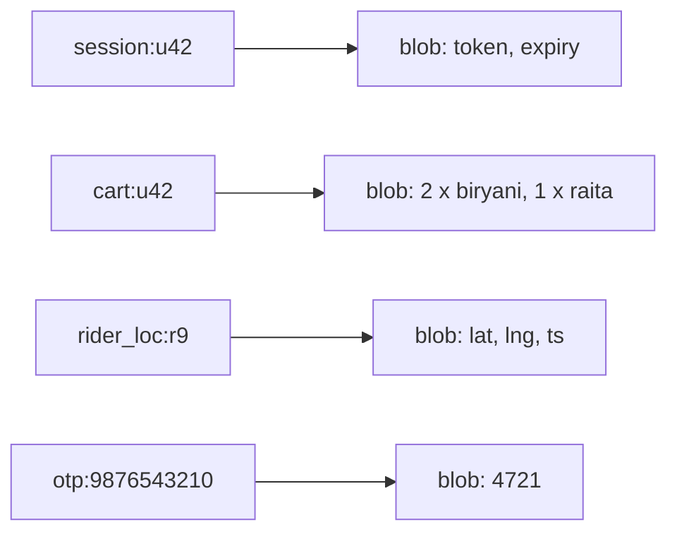

Examples: Redis, Memcached, Aerospike (your Myntra cache), DynamoDB in its simplest use. Lookups by key are O(1) and can be sub-millisecond. You cannot ask "all carts containing biryani" without scanning everything.

*Use it when* you always know the key: sessions, carts, OTPs, rate-limit counters, feature-store lookups, the latest rider location. *Zomato example:* on NYE 2023 Zomato's ElastiCache (Redis) fleet held 35 TB in memory, and its online ML feature store keeps real-time features in Redis Cluster, load-tested to about 18M requests per minute before NYE 2021.

> **Real world — Zomato:** The ML feature store keeps real-time features (computed from Kafka by Flink) in Redis Cluster, and batch features in DynamoDB with hot keys cached in Redis. It was load-tested to about 18M requests/min ahead of NYE 2021, a 3x improvement over the year before. ([source](https://www.zomato.com/blog/elements-of-scalable-machine-learning/), 18 Aug 2021)

DynamoDB deserves its own note because Zomato uses it heavily. It is a key-value store with a little more structure. Every item has a **partition key** (which decides which machine it lives on) and optionally a **sort key** (which orders items within that partition). That lets you ask "all items with partition key `merchant_7` whose sort key starts with `2026-10`", a range query inside one partition. A **GSI (global secondary index)** is a second copy of the data keyed differently, so you can query by another attribute. A Blinkit interview (B4) asked for "DynamoDB internals, index types, partition key and sort key per table", so be ready to name these.

#### Document stores

A document store keeps **documents**, usually JSON-like, each with its own nested structure. Unlike key-value, the database understands the inside of the document, so you can query and index fields within it.

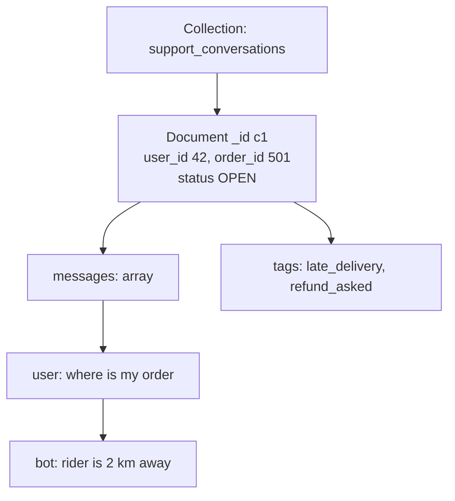

Examples: MongoDB, Couchbase, AWS DocumentDB. Each document can have different fields, so the schema is flexible. Data that is read together is stored together, which means one read instead of a five-table join.

*Use it when* the data is naturally nested and read as a whole, and the shape varies or changes often: support chats, restaurant menus with nested categories and add-ons, product catalogs where a phone and a shirt have different attributes. *Avoid it when* the core of the problem is many-to-many relations or multi-entity transactions.

> **Real world — Zomato:** Zomato has run MongoDB Atlas since 2017. For Nugget, its AI customer-support platform, Atlas beat DynamoDB and DocumentDB in Zomato's evaluation. Nugget handles 15M+ conversations a month. On NYE 2023 Zomato's MongoDB served 470k read ops/s and 180k write ops/s. ([MongoDB vendor blog](https://www.mongodb.com/company/blog/innovation/zomato-ai-solution-nugget-reduces-support-costs), vendor case study so numbers are self-reported; [NYE 2023 post](https://www.zomato.com/blog/a-tale-of-scale-behind-the-scenes-at-zomato-tech-for-nye-2023))

This matches an interview pattern: a Zomato intern report (Z5, https://leetcode.com/discuss/post/7407389/) asked to design real-time support chat, "why chat leans NoSQL", MongoDB indexing and the compound-index left-prefix rule.

#### Wide-column stores

A wide-column store (Cassandra, ScyllaDB, HBase, Bigtable) is easiest to picture as a two-level map: `partition key -> (sorted map of clustering key -> columns)`. All rows with the same partition key live together on the same nodes, sorted by the clustering key. That makes "give me the latest 50 events for this key" one fast sequential read.

```
Partition key: rider_id     Clustering key: ts (sorted, newest first)
+-------------+---------------------------------------------------+
| rider_r9    | 20:01:08 lat=28.45 lng=77.02 | 20:01:04 lat=... | ...
| rider_r12   | 20:01:07 lat=28.61 lng=77.20 | 20:01:03 lat=... | ...
+-------------+---------------------------------------------------+
  one partition = one row of many columns, can be millions wide
```

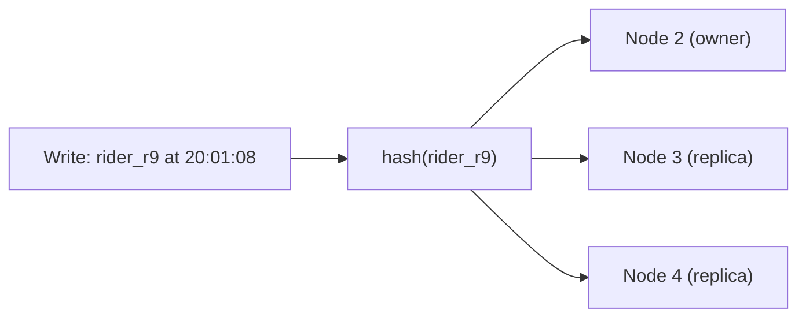

These databases are built on LSM trees (3.5), so writes are very cheap, and they are usually leaderless with tunable quorum (3.12). *Use them when* writes are enormous and reads follow the same key: time-series, event logs, chat messages per channel, location history. *Avoid them when* you need ad-hoc queries or transactions.

*Zomato example:* the research found **no evidence that Zomato uses Cassandra or ScyllaDB**, so do not claim it. If you propose one for rider location history, say "a store like Cassandra would fit", not "Zomato uses Cassandra".

> **Real world — Discord and DoorDash:** Discord moved its messages from 177 Cassandra nodes to 72 ScyllaDB nodes ([source](https://discord.com/blog/how-discord-stores-trillions-of-messages)). DoorDash moved some domains from its single Postgres primary to Cassandra as it outgrew the monolith ([source](https://doordash.engineering/2020/12/02/how-doordash-transitioned-from-a-monolith-to-microservices/)).

#### Graph databases

A graph database (Neo4j, Amazon Neptune) stores **nodes** (things) and **edges** (relationships), and makes following edges cheap. In SQL, "friends of friends who ordered from this restaurant" is several self-joins that get slower with each hop. In a graph database each hop is a pointer chase.

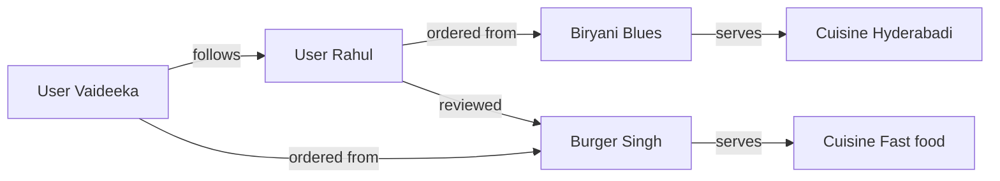

*Use it when* the question is about relationships several hops deep: fraud rings (many accounts sharing one device and one card), social recommendations, permission trees. *Zomato example:* none is public. A reasonable interview use is fraud detection ("these 40 accounts share 3 phones and 2 UPI handles"), but label it as your own proposal.

> **Pause and think:** For each of these, which family fits best, and why? (a) the OTP sent at login, (b) a restaurant's menu with categories, items, variants and add-ons, (c) every GPS ping a rider sends for 90 days, (d) "which accounts share a device with this flagged account". Answers: key-value with TTL, document, wide-column, graph.

### 3.4 How real companies chose, and a decision flowchart

The point of this section is that experienced teams almost never pick "one database". They pick per workload, and they change their minds when the workload changes. This is called **polyglot persistence**.

> **Real world — Zomato:** Zomato's primary databases are DynamoDB, Aurora RDS (MySQL) and MongoDB. NYE 2023 peaks: DynamoDB 12.3M read capacity units and 5.2M write capacity units per minute, RDS 610k selects/s and 16,000 write transactions/s, MongoDB 470k reads/s and 180k writes/s. ([source](https://www.zomato.com/blog/a-tale-of-scale-behind-the-scenes-at-zomato-tech-for-nye-2023))

> **Real world — Zomato billing, TiDB to DynamoDB:** Zomato's billing platform ran on TiDB (a distributed SQL database). The cluster grew from 5 to 25 nodes and was over-provisioned and manually scaled for peak days. After moving to DynamoDB, throughput went from 2,000 to 8,000 RPM (4x), average response time fell about 90% to around 75 ms, and monthly cost fell about 50%. The platform handles about 10M events a day and about 1M payments a week. The migration had zero downtime, using a phased rollout with dual writes, replication, sync and failover. The data model is a **single table using the adjacency-list pattern**: tables such as `payout_details`, `billing_ledger` and `payout_order_mapping` were merged into one, with partition key **merchant ID + payout cycle + business vertical** chosen for high cardinality, and a GSI whose keys are suffixed `_<division-number>` to avoid hot partitions. ([AWS Database Blog, 22 Dec 2023](https://aws.amazon.com/blogs/database/unlocking-performance-scalability-and-cost-efficiency-of-zomatos-billing-platform-by-switching-from-tidb-to-dynamodb/))

Read that billing story carefully, because it teaches three lessons at once. First, the access pattern was known and narrow (look up a merchant's ledger for a payout cycle), which is exactly where DynamoDB shines. Second, the partition key was designed for **high cardinality**, meaning many distinct values, so the load spreads across many partitions. Third, they still had to handle hot partitions with a suffix trick. We will see the same trick at Deliveroo.

> **Real world — Zomato Profile Store:** Zomato's ML Profile Store moved to DynamoDB in late 2020 from an unnamed NoSQL store that had no batch support and took about two weeks of analysis plus two days of provisioning to scale for a peak. It was benchmarked at 17.5M RPM and served 12M RPM on 31 Dec 2020, batching 500 requests per call. ([AWS-partner customer story](https://smeoncloud.in/zomato-handles-up-to-2-5x-more-transactions-after-migrating-non-relational-database-to-aws/), secondary/vendor source)

> **Real world — DoorDash:** DoorDash started as a single Django app on **one PostgreSQL primary**. It hit the limits of vertical scaling and read replicas, needed **PgBouncer** because the monolith's replicas exhausted database connections, and moved some domains to **Cassandra**. ([source](https://doordash.engineering/2020/12/02/how-doordash-transitioned-from-a-monolith-to-microservices/)) Later, its grocery inventory platform was built on **CockroachDB** (a distributed SQL database), where batching upserts at 1,000 rows per statement cut storage QPS by 99% and DB CPU by 50% ([source](https://doordash.engineering/2023/02/22/how-doordash-designed-a-successful-write-heavy-scalable-and-reliable-inventory-platform/)). Part of its ML feature store also moved from Redis to CockroachDB, cutting cost per stored value by 75% ([source](https://doordash.engineering/2023/03/21/using-cockroachdb-to-reduce-feature-store-costs-by-75/)).

That DoorDash arc, Postgres then Cassandra then CockroachDB, is a nice story to tell. Cassandra gave them scale but eventual consistency. CockroachDB gave them scale *and* SQL with transactions. The industry has partly swung back toward "distributed SQL" for exactly that reason.

> **Real world — Uber:** Uber built **Schemaless** (2014 to 2016) because it was running out of Postgres capacity for trip data. Schemaless is an append-only sparse 3-D hash map on **sharded MySQL**, with eventually consistent secondary indexes (lag typically under 20 ms) ([source](https://www.uber.com/blog/schemaless-part-one-mysql-datastore/)). Its successor **Docstore** runs partitions of 3 to 5 nodes using Raft across zones, on a MySQL engine, offers strict serializability per partition, and is explicitly "CP: favors consistency over availability". Uber moved on because Schemaless's append-only API was restrictive and Cassandra's eventual consistency complicated application code ([source](https://www.uber.com/blog/schemaless-sql-database/)).

> **Real world — Deliveroo:** Deliveroo moved its Dispatcher from RDS Postgres to DynamoDB because some tables had over 1B rows, schema and index changes were painful, and autovacuum needed constant tuning. It used a single-table design with type-prefixed keys (`o#` order, `r#` rider). A GSI keyed by **sub-area** was unbalanced, because busy areas got far more writes, so they added **random-suffix write sharding** with a shard count configurable per area. ([AWS Database Blog](https://aws.amazon.com/blogs/database/how-deliveroo-migrated-their-dispatcher-service-to-amazon-dynamodb/))

> **Real world — Zepto:** Zepto's Aurora PostgreSQL `Customer_Orders` table had billions of rows. Row locks on status updates caused write contention and autovacuum fell behind at peak. Zepto built a **Draft-Order service on DynamoDB** that accepts orders before payment, consumes payment events from Kafka (MSK), and on success calls an idempotent Create Order API. A sparse GSI holds only orders still awaiting payment, a job runs every 5 minutes to confirm or terminate stuck orders, and TTL deletes old drafts. Create Order became about 60% faster on average. One lesson: `TransactWriteItems` averaged about 18 ms, while two sequential `PutItem` calls were each under 10 ms and used half the write capacity. ([AWS Database Blog, 4 Nov 2025](https://aws.amazon.com/blogs/database/how-zepto-scales-to-millions-of-orders-per-day-using-amazon-dynamodb/))

Notice the pattern across Deliveroo and Zepto: **Postgres with a billion-row hot table, row-lock contention, autovacuum pain, then DynamoDB with a carefully designed key.** You do not need to memorise all of these. You need one or two to show the interviewer you know that real teams make these trade-offs for concrete reasons.

Here is a decision flowchart you can reason through out loud:

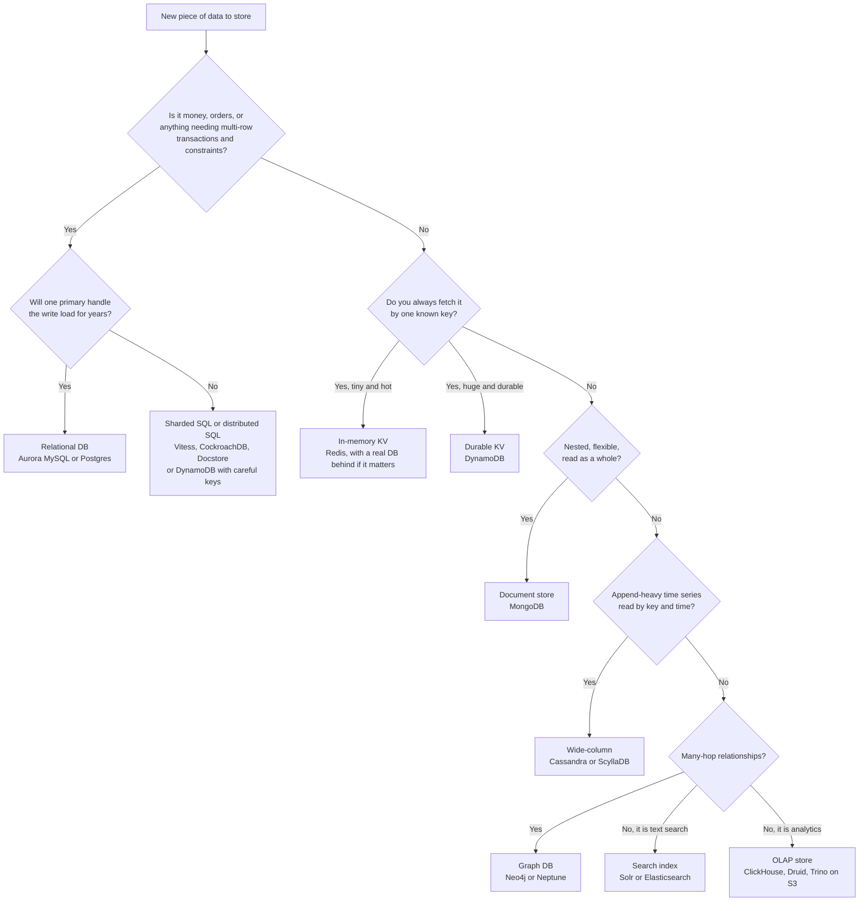

When you say this in an interview, the shape of the sentence matters more than the final pick: "Orders need transactions across order, items and payment status, and we query them in several ways, so I'd start with a relational database like Aurora MySQL, which Zomato uses. If write volume outgrows one primary, I'd shard by a key I'll discuss, or move the hottest narrow access pattern to DynamoDB, the way Zepto did for draft orders."

### 3.5 Storage engines: B+ trees vs LSM trees

Under every database sits a **storage engine**: the code that decides how bytes are laid out on disk. There are two dominant designs, and knowing them explains why some databases are read-friendly and others are write-friendly. A Zomato HLD round (Z30) asked "hash map vs B+ tree" for a key-value store, and several reports asked about "index internals", so this is fair game.

#### B+ tree: the read-optimised classic

A **B+ tree** is a wide, shallow, sorted tree. Each node is one disk page and holds hundreds of keys, so even a billion rows fit in a tree 3 or 4 levels deep. Internal nodes hold only keys and pointers for navigation. **Leaf nodes** hold the actual data (or pointers to it) and are linked to each other left to right, so range scans just walk along the leaves.

```
                         [ 500 | 1000 ]                      <- root (1 page)
                /              |              \
       [ 100 | 300 ]     [ 600 | 800 ]     [ 1200 | 1500 ]     <- internal pages
       /    |     \       /    |    \        /     |     \
     [..] [101..299] [..] [..] [601..799] [..]  [..]  [..]   <- leaf pages, sorted
      <->    <->      <->  <->     <->     <->   <->   <->   <- leaves linked for range scans

Find order_id 642: root (642 > 500, < 1000) -> middle -> [601..799] -> found.
3 page reads. With the top levels cached in RAM, often 1 disk read.
```

Updates happen **in place**: to change order 642's status, the engine finds its leaf page, modifies it in the buffer pool, writes a WAL record, and later flushes the page. If a leaf fills up, it **splits** into two and the parent gets a new key. MySQL's InnoDB, PostgreSQL's indexes, Oracle and SQL Server all use B-tree variants.

Strengths: predictable fast reads, excellent range queries ("orders between 8 pm and 9 pm"), mature locking. Weakness: writes are **random I/O**. Each update touches some page somewhere on disk, and page splits add more work. At very high write rates this becomes the bottleneck.

#### LSM tree: the write-optimised design

An **LSM tree** (log-structured merge tree) never updates in place. It turns all writes into sequential appends.

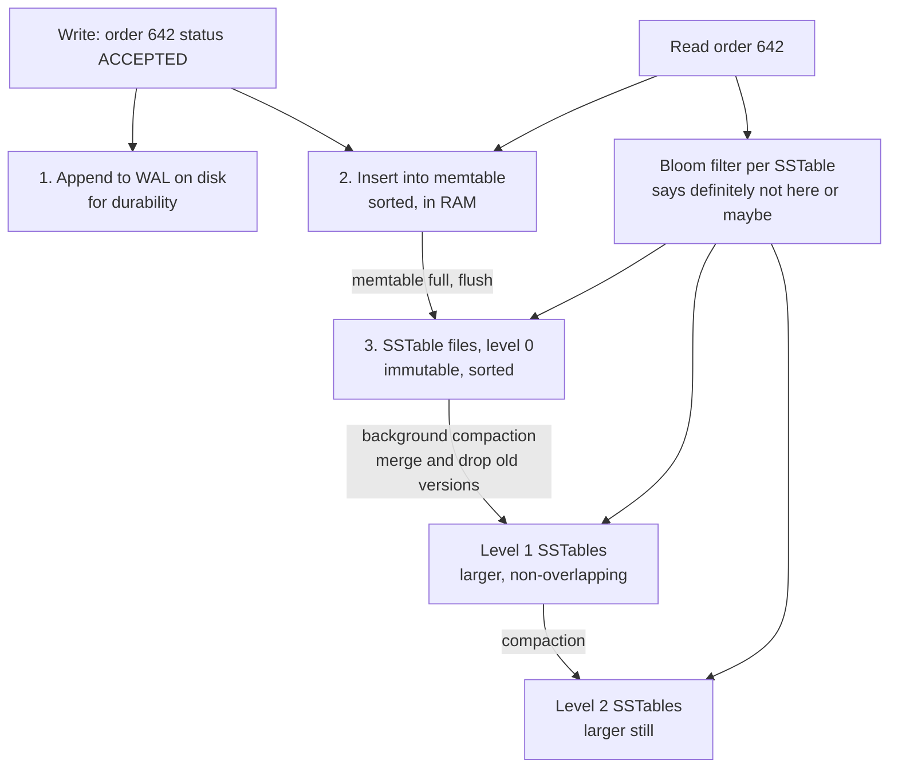

Step by step. A write goes to the WAL (sequential append) and into an in-memory sorted structure called the **memtable**. That is the whole write path, which is why writes are so fast. When the memtable fills (say 64 MB), it is written out to disk as an immutable sorted file called an **SSTable** (sorted string table). Over time you get many SSTables, and the same key can appear in several of them, with the newest version winning. A background process called **compaction** merges SSTables, keeps only the latest version of each key, and drops deleted ones.

Reads are the cost. To find order 642 the engine checks the memtable, then the newest SSTable, then older ones, until it finds the key. To avoid opening every file, each SSTable has a **Bloom filter**, a small bit array that can answer "this key is definitely not in this file" or "it might be". That skips most files.

LSM trees power Cassandra, ScyllaDB, RocksDB (inside CockroachDB, TiDB's TiKV and many others), LevelDB and HBase. DynamoDB's internals are not described in the research, so don't claim which engine it uses.

| | B+ tree | LSM tree |
|---|---|---|
| Write path | Find page, modify in place (random I/O) | Append to WAL and memtable (sequential) |
| Write throughput | Good | Excellent |
| Point read | 3 to 4 page reads, very predictable | Check memtable plus several SSTables, helped by Bloom filters |
| Range scan | Excellent (linked leaves) | Good, but must merge across files |
| Space | Some wasted space in half-full pages | Old versions use space until compaction |
| Background work | Page splits, vacuum (in Postgres) | Compaction, which uses CPU and disk and can cause latency spikes |
| Used by | MySQL InnoDB, Postgres, Oracle | Cassandra, ScyllaDB, RocksDB, CockroachDB, HBase |

Two terms interviewers sometimes use: **write amplification** (one logical write turning into many physical writes, for example compaction rewriting the same data several times) and **read amplification** (one logical read touching many files). B+ trees have lower read amplification. LSM trees trade higher read amplification and compaction cost for much cheaper writes. Uber's M3 post (research_global F50) is a real example of the cost: Uber moved its metrics platform off Cassandra partly because of compaction overhead at its scale ([source](https://www.uber.com/blog/m3/)).

> **Pause and think:** Rider GPS pings arrive constantly and are almost never updated, only appended. Order status is updated 6 to 8 times per order and read constantly. Which engine suits each? (LSM for pings, B+ tree for orders is the natural answer.)

### 3.6 Indexes, in depth

An **index** is a separate data structure that lets the database find rows without scanning the whole table. The everyday analogy is the index at the back of a textbook: instead of reading 800 pages to find "deadlock", you look it up and jump to page 412.

Without an index on `orders.user_id`, the query `SELECT * FROM orders WHERE user_id = 42` is a **full table scan**: read every row, check each one. On a table with 500 million orders that is minutes. With a B+ tree index on `user_id`, it is a handful of page reads.

#### Clustered vs secondary indexes

This distinction is asked directly (a Blinkit report B2 asked "clustered vs non-clustered indexes, when indexes hurt, composite index purpose"; B2 is https://leetcode.com/discuss/post/8515131/).

- A **clustered index** decides the physical order of the rows. The table *is* the index: the leaves of the B+ tree hold the full rows. There can be only one per table, because rows can only be stored in one order. In MySQL InnoDB, the primary key is always the clustered index.
- A **secondary (non-clustered) index** is a separate B+ tree whose leaves hold the indexed column plus a pointer back to the row. In InnoDB that pointer is the primary key value. In Postgres it is a physical row location (a "tuple ID"), because Postgres stores rows in an unordered **heap** and all its indexes are secondary.

```
Clustered index on order_id (InnoDB primary key)
  leaves: [501 | user 1 | rest 10 | 450 | DELIVERED] [502 | user 1 | rest 11 | ...] ...

Secondary index on user_id
  leaves: [user 1 -> PK 501] [user 1 -> PK 502] [user 2 -> PK 503] ...

Query WHERE user_id = 1:
  1. walk secondary index -> finds PKs 501, 502
  2. for each PK, walk clustered index -> fetch full row   ("bookmark lookup")
```

That second step is why secondary-index lookups cost more than primary-key lookups, and it motivates covering indexes below. It also explains a practical InnoDB rule: keep the primary key small (a BIGINT, not a 36-character UUID string), because every secondary index stores a copy of it. And it explains why random primary keys hurt InnoDB: inserts land in random leaf pages of the clustered index and cause page splits all over the table, while increasing keys always append to the rightmost leaf. We return to this in 3.17 on IDs.

#### Composite indexes and the leftmost prefix rule

A **composite index** is an index on more than one column, like `(restaurant_id, status, created_at)`. It is sorted by the first column, then by the second within equal first values, then by the third. A phone book is exactly this: sorted by surname, then first name.

```
Phone book = index on (surname, first_name)

  Kapoor, Aman
  Kapoor, Vaideeka
  Kapoor, Vedansh
  Mehta,  Aman
  Mehta,  Riya
  Sharma, Aman

"Find Kapoor, Vaideeka"   -> jump straight there              (uses both columns)
"Find all Kapoors"        -> jump to K, read the block         (uses the prefix)
"Find everyone named Aman"-> Amans are scattered on every page (index is useless)
```

That is the **leftmost prefix rule**: a composite index on `(A, B, C)` can serve queries filtering on `A`, on `A and B`, or on `A, B and C`. It cannot efficiently serve a query on `B` alone or `C` alone, because those values are not sorted globally. Some databases can do a "skip scan" in special cases, but don't rely on it.

A second rule: **once a column is used for a range, the columns after it can't be used for seeking.** With an index on `(restaurant_id, created_at, status)` and the query `WHERE restaurant_id = 10 AND created_at > '20:00' AND status = 'PLACED'`, the database seeks on restaurant_id, scans the created_at range, and then has to check status on each row. If you reorder the index to `(restaurant_id, status, created_at)`, it can seek to restaurant 10, status PLACED, and then read only the time range. The common guideline is **equality columns first, then the range column, then columns used only for sorting**.

> **Real world — Swiggy Instamart:** In November 2022, Instamart's picker master database hit over 90% CPU (normal was 20 to 30%) and Kafka consumer lag built up on the order topic. The cause was a composite index in the wrong column order, so it was used only intermittently. A feature-flag rollback did not reach the backend, so Swiggy shut Instamart down across India and killed long-running queries. One summary puts the outage at about 20 minutes. ([Swiggy Bytes, "Indexing Gone Wrong"](https://bytes.swiggy.com/behindthebug-indexing-gone-wrong-6b4d682fd805), search-snippet level detail)

#### The interview trap: separate indexes on A and B vs one composite index

A Zomato intern interview (Z9, https://leetcode.com/discuss/post/6023375/) asked: you have `WHERE A = 10 AND B = 20`. Is it better to have two separate indexes, one on A and one on B, or one composite index on (A, B)?

Think it through with numbers. Say the table has 10 million rows, 10,000 rows have A = 10, and 5,000 rows have B = 20, but only 3 rows have both.

- **Separate indexes.** The database usually picks the more selective single index, say B, fetches 5,000 rows, and filters each for A = 10 to find 3. That's 5,000 row lookups to return 3. Some databases can do an **index merge** (MySQL) or **bitmap AND** (Postgres): read both indexes, intersect the two lists of row pointers, then fetch only the 3 rows. That helps, but you still read 15,000 index entries and do extra intersection work, and the planner doesn't always choose it.
- **Composite index on (A, B).** The database seeks directly to the entries where A = 10 and B = 20, which are next to each other in the tree, and reads exactly 3 entries. Far less work.

So for this query the composite index wins. Then add the nuances that show depth. The composite (A, B) also serves `WHERE A = 10` alone (leftmost prefix), but not `WHERE B = 20` alone, so if that query also matters you may still want a separate index on B. Put the column used by more queries first, and remember that equality columns can go in either order for this query. Each extra index slows down writes, so you don't create both "just in case".

#### Covering indexes

If an index contains *every* column a query needs, the database can answer from the index alone and never visit the table. That is a **covering index**, and the plan shows "Using index" in MySQL or "Index Only Scan" in Postgres.

```sql
-- Restaurant dashboard: live orders for restaurant 10
SELECT order_id, status, created_at
FROM orders
WHERE restaurant_id = 10 AND status = 'PLACED'
ORDER BY created_at DESC;

-- Index on (restaurant_id, status, created_at) covers it in InnoDB,
-- because order_id is the primary key and is stored in every secondary index leaf.
```

The query seeks, reads entries already sorted by created_at, and returns. No bookmark lookups, no sort step.

#### Cardinality and selectivity

**Cardinality** is how many distinct values a column has. `user_id` has very high cardinality (millions). `status` has very low cardinality (maybe 8 values). **Selectivity** is the fraction of rows a condition matches. `user_id = 42` is very selective. `status = 'DELIVERED'` matches maybe 95% of rows, so it is not selective at all.

An index on a low-cardinality column alone is usually useless: if a condition matches 95% of rows, reading the index and then jumping to 95% of the rows is slower than just scanning the table, and the planner will ignore your index. Low-cardinality columns are still useful *inside* a composite index after a selective column, or when you look for the rare value (`status = 'PAYMENT_FAILED'` might be 0.1%). Postgres also supports **partial indexes** like `CREATE INDEX ... WHERE status = 'PLACED'`, which index only the rows you care about. DynamoDB's **sparse GSIs** do the same job; that is what Zepto used to track only orders still awaiting payment.

#### The write cost of indexes

Indexes are not free. Every insert into `orders` must also insert into every index on `orders`. Every update to an indexed column must update that index. With 8 indexes, one insert becomes 9 B+ tree writes. Indexes also take disk and buffer-pool memory, which pushes useful data out of RAM.

So "when do indexes hurt?" has a clear answer: on write-heavy tables with many indexes, on indexes nobody uses, on low-cardinality columns, and on very small tables where a scan is faster anyway. Good practice is to index for your real, frequent queries and to check periodically for unused indexes.

#### Reading EXPLAIN

`EXPLAIN` shows the plan the database will use. `EXPLAIN ANALYZE` (Postgres) actually runs the query and shows real times and row counts. A District SDE-1 round (Z15, https://leetcode.com/discuss/post/8550229/) asked about Postgres indexes and EXPLAIN ANALYZE directly.

```
EXPLAIN ANALYZE
SELECT * FROM orders WHERE user_id = 42 ORDER BY created_at DESC LIMIT 20;

Before (no useful index):
  Limit  (actual time=812.4..812.5 rows=20)
    ->  Sort  (Sort Key: created_at DESC)  Sort Method: top-N heapsort
          ->  Seq Scan on orders  (rows=1840 of 50000000 scanned)  Filter: (user_id = 42)

After CREATE INDEX idx_orders_user_created ON orders (user_id, created_at DESC):
  Limit  (actual time=0.05..0.09 rows=20)
    ->  Index Scan using idx_orders_user_created on orders  (rows=20)
          Index Cond: (user_id = 42)
```

(The numbers above are an illustration, not a real measurement.) What to look for: **Seq Scan** on a big table means no index was used. A separate **Sort** step means the index doesn't provide the order. A huge gap between estimated rows and actual rows means the planner's statistics are stale; running `ANALYZE` refreshes them. In MySQL, look at the `type` column (`ALL` means full scan, `ref` or `range` means index use), `key` (which index), `rows` (estimated rows examined) and `Extra` (`Using filesort`, `Using index`).

> **Connect to Myntra:** You merged two SQL queries into one in the ratings service. That is the same instinct as EXPLAIN tuning: each round trip and each scan costs time, so fewer, better-indexed queries win. If asked, say what the two queries did, why one query was faster (one round trip, one index walk), and how you verified it.

> **Pause and think:** A Zomato SDE-2 round (Z12, https://leetcode.com/discuss/post/7573378/) asked for SQL over an order-state-transition table: "latest state per order in the last hour, excluding delivered, and which indexes". Which composite index would you create on `order_events(order_id, state, created_at)`? One good answer: an index on `(created_at)` to find the last hour's events, plus `(order_id, created_at DESC)` so "latest event per order" is a quick seek per order. Then talk about how this behaves at scale: a materialised `orders.current_status` column is often better than computing "latest" every time.

### 3.7 Transactions and ACID

A **transaction** is a group of operations that the database treats as one unit. The textbook example at Zomato is wallet payment for an order:

```sql
BEGIN;
  UPDATE wallets SET balance = balance - 450 WHERE user_id = 1 AND balance >= 450;
  INSERT INTO orders (order_id, user_id, restaurant_id, amount, status)
       VALUES (504, 1, 10, 450, 'PAID');
  INSERT INTO wallet_ledger (user_id, order_id, delta) VALUES (1, 504, -450);
COMMIT;
```

If the server crashes after the wallet debit but before the order insert, the customer has lost ₹450 for nothing. Transactions prevent that. ACID is the four guarantees a transaction gives:

- **Atomicity: all or nothing.** Either all three statements take effect, or none do. If anything fails, `ROLLBACK` undoes the rest. The database uses its log (an undo log in InnoDB) to reverse partial work.
- **Consistency: rules hold before and after.** The database's constraints (foreign keys, unique keys, `CHECK (balance >= 0)`) are never violated by a committed transaction. Note this "C" is partly the application's job: the database cannot know that the ledger should sum to the balance unless you encode it.
- **Isolation: concurrent transactions don't step on each other.** If Vaideeka places two orders at the same moment from two phones, each transaction behaves as if it ran alone, to the degree the isolation level promises (next section).
- **Durability: committed means saved.** Once `COMMIT` returns, the change survives a crash, because the WAL (redo log in InnoDB) was flushed to disk first.

A useful interview line: "Atomicity is about failure, isolation is about concurrency." People mix them up. Atomicity handles a crash in the middle of *one* transaction. Isolation handles *two* transactions running at the same time.

A Zomato on-campus round (Z22, https://leetcode.com/discuss/post/4473000/) asked "ACID and how MySQL provides isolation". The short answer is MVCC plus locks, explained in 3.9.

### 3.8 Isolation levels and the anomalies they prevent

Perfect isolation (every transaction behaves as if transactions ran one after another) is called **serializable**, and it is expensive. So databases offer weaker levels that allow certain **anomalies**, meaning specific kinds of wrong results. You should be able to draw each anomaly as a timeline of two transactions, T1 and T2.

**Dirty read: reading data that is not committed yet.**

```
time   T1 (restaurant changes price)        T2 (customer views menu)
 1     BEGIN
 2     UPDATE dishes SET price=99 (was 199)
 3                                           SELECT price -> 99   <- dirty
 4     ROLLBACK  (owner made a mistake)
 5                                           customer checks out at 99, but 99 never existed
```

**Non-repeatable read: the same row read twice gives different values.**

```
time   T1 (generate invoice)                 T2 (support applies refund)
 1     BEGIN
 2     SELECT amount FROM orders WHERE id=504 -> 450
 3                                            UPDATE orders SET amount=300 WHERE id=504
 4                                            COMMIT
 5     SELECT amount ... id=504 -> 300       <- changed under T1
 6     invoice shows 450 in header, 300 in total
```

**Phantom read: the same query returns new rows the second time.**

```
time   T1 (count live orders for rest 10)    T2 (customer places order)
 1     BEGIN
 2     SELECT COUNT(*) WHERE rest=10 AND status='PLACED' -> 5
 3                                            INSERT order (rest 10, PLACED)
 4                                            COMMIT
 5     SELECT * WHERE rest=10 AND status='PLACED' -> 6 rows   <- a phantom appeared
```

The difference from non-repeatable read: there an existing row *changed*. Here a *new* row matching the condition appeared.

**Lost update: two read-modify-write cycles overwrite each other.**

```
time   T1 (add 1 to coupon usage)            T2 (add 1 to coupon usage)
 1     SELECT used FROM coupons -> 99
 2                                            SELECT used FROM coupons -> 99
 3     UPDATE coupons SET used=100
 4                                            UPDATE coupons SET used=100
 5     COMMIT                                 COMMIT
       Two uses recorded as one. A coupon limited to 100 uses gets 101.
```

**Write skew: two transactions each check a condition, then each write something different, and together they break the rule.**

```
Rule: at least one support agent must be on shift.
time   T1 (agent A goes off shift)           T2 (agent B goes off shift)
 1     SELECT COUNT(*) on shift -> 2
 2                                            SELECT COUNT(*) on shift -> 2
 3     UPDATE agents SET on_shift=false WHERE id=A
 4                                            UPDATE agents SET on_shift=false WHERE id=B
 5     COMMIT                                 COMMIT
       Zero agents on shift. Neither transaction touched the other's row.
```

Write skew is the sneakiest because no row is written twice, so row locks don't catch it. A Zomato flavoured version: two riders each check "is order 504 still unassigned?" and each insert an assignment row into a separate `assignments` table. Both succeed.

Now the standard levels (SQL standard names) and what each prevents:

| Isolation level | Dirty read | Non-repeatable read | Phantom | Lost update | Write skew |
|---|---|---|---|---|---|
| Read uncommitted | possible | possible | possible | possible | possible |
| Read committed (Postgres default) | prevented | possible | possible | possible | possible |
| Repeatable read (MySQL InnoDB default) | prevented | prevented | mostly prevented in InnoDB (snapshot plus gap locks for locking reads) | depends: see note | possible |
| Serializable | prevented | prevented | prevented | prevented | prevented |

Notes, because real databases differ from the standard. Postgres's repeatable read is **snapshot isolation**: it detects a lost update and aborts one transaction with a serialization error, but it allows write skew. Postgres's serializable level (SSI) detects write skew too. MySQL InnoDB's repeatable read gives each transaction a consistent snapshot for plain reads, but a plain `UPDATE ... SET used = 100` computed from an earlier read can still lose updates. That is why you fix lost updates in application code with one of these:

1. **Atomic update:** `UPDATE coupons SET used = used + 1 WHERE id = 7 AND used < 100;` then check rows affected. The database does read and write in one step. This is the best fix and is what the research suggests for inventory: `UPDATE ... SET avail = avail - n WHERE avail >= n`.
2. **Pessimistic lock:** `SELECT ... FOR UPDATE` locks the row, so the second transaction waits.
3. **Optimistic lock:** add a `version` column. `UPDATE ... SET used = 100, version = 8 WHERE id = 7 AND version = 7`. If another transaction changed it first, zero rows are updated and you retry.

For write skew, either use serializable isolation, lock the rows you *read* with `FOR UPDATE`, or turn the rule into a constraint (for rider assignment, a unique index on `assignments(order_id)` makes the second insert fail).

> **Pause and think:** "Two users buying the last unit of a product" came up in a Flipkart round and similar questions appear at Blinkit (seat booking). Which anomaly is it, and which fix is cheapest? (Lost update or write skew depending on the schema. The cheapest fix is a conditional atomic update on the stock row.)

### 3.9 MVCC, row locks and deadlocks

#### MVCC: readers don't block writers

How does a database let one transaction read order 504 while another is updating it, without either waiting? With **MVCC (multi-version concurrency control)**. The idea: instead of overwriting a row, the database keeps multiple **versions** of it, each tagged with the transaction that created it. Each transaction reads from a **snapshot**, the set of versions that were committed when it started (or when the statement started, under read committed).

```
order 504 versions:
  v1  amount=450  created by txn 100  (committed)
  v2  amount=300  created by txn 205  (committed at time 7)

T1 started at time 5  -> snapshot sees v1 (450), even after time 7
T3 started at time 9  -> snapshot sees v2 (300)
```

So readers never wait for writers, and writers never wait for readers. Writers still wait for other *writers* on the same row. Old versions are cleaned up later. In Postgres, old versions live in the table itself and are removed by **VACUUM** (that is the "autovacuum fell behind" pain Zepto and Deliveroo mentioned). In InnoDB, old versions live in the **undo log** and are purged in the background.

#### Row locks

When two transactions write the same row, one must wait. Databases use **row-level locks**: a **shared (S) lock** for reading with `FOR SHARE`, many allowed at once, and an **exclusive (X) lock** for writing, only one at a time and incompatible with any other lock. InnoDB also has **gap locks**, which lock the space between index entries so nobody can insert a phantom row into a range you are reading with `FOR UPDATE`. Locks are held until the transaction commits or rolls back. So keep transactions short. Never make a network call (like calling a payment gateway) while holding a row lock. The Airbnb payments pattern in the research says exactly this: no DB work during the external RPC.

#### Deadlocks

A **deadlock** is two transactions each holding a lock the other needs. Neither can proceed.

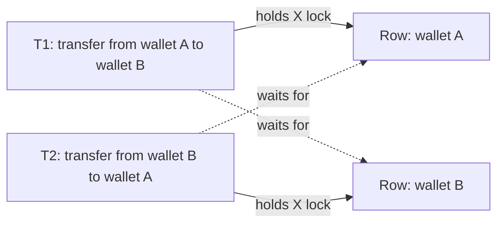

```
time   T1                                   T2
 1     UPDATE wallets ... WHERE id=A  (lock A)
 2                                           UPDATE wallets ... WHERE id=B  (lock B)
 3     UPDATE wallets ... WHERE id=B  waits for T2
 4                                           UPDATE wallets ... WHERE id=A  waits for T1
       cycle: T1 waits for T2 waits for T1
```

Databases detect the cycle (InnoDB builds a "waits-for" graph) and kill one transaction, the **victim**, which gets a deadlock error and must retry. To prevent deadlocks in the first place:

- **Lock in a consistent order.** Always update the lower wallet ID first. Then T2 would also try A first and simply wait, with no cycle.
- **Keep transactions short** and touch few rows.
- **Use good indexes**, because an `UPDATE` without an index on its WHERE column may lock far more rows than you expect.
- **Retry on deadlock errors** in application code, with a small backoff. This must be safe, so the transaction must be idempotent or fully rolled back.

A District SDE-1 round (Z11, https://leetcode.com/discuss/post/6647834/) included "a deadlock scenario to analyse", so practise drawing the timeline above and naming the fix.

### 3.10 Normalisation and denormalisation

**Normalisation** means organising tables so each fact is stored exactly once. It prevents **anomalies**: update anomalies (you change a value in one place and forget another), insert anomalies (you can't record a fact without an unrelated one) and delete anomalies (deleting one thing loses another).

Start with a messy table a fresher might design:

```
orders_flat
+----------+-----------+------------+---------------+------------+-------------------------+
| order_id | user_name | user_phone | rest_name     | rest_city  | items                   |
+----------+-----------+------------+---------------+------------+-------------------------+
| 501      | Vaideeka  | 98xxxx0001 | Biryani Blues | Gurugram   | Biryani x2, Raita x1    |
| 502      | Vaideeka  | 98xxxx0001 | Burger Singh  | Delhi      | Burger x1               |
| 503      | Rahul     | 98xxxx0002 | Biryani Blues | Gurugram   | Biryani x1              |
+----------+-----------+------------+---------------+------------+-------------------------+
```

Problems: Vaideeka changes her phone and you must update every one of her orders (update anomaly). You can't add a restaurant until someone orders from it (insert anomaly). You can't query "how many raitas sold" because items are a text blob.

- **First normal form (1NF):** every cell holds one atomic value. Split `items` into an `order_items` table with one row per item.
- **Second normal form (2NF):** every non-key column depends on the *whole* key. In `order_items(order_id, dish_id, quantity, dish_name)`, `dish_name` depends only on `dish_id`, so it moves to `dishes`.
- **Third normal form (3NF):** non-key columns depend only on the key, not on other non-key columns. `user_phone` depends on the user, not on the order, so it moves to `users`. `rest_city` depends on the restaurant, so it moves to `restaurants`.

The result is exactly the schema from 3.2: `users`, `restaurants`, `dishes`, `orders`, `order_items`. A quick memory hook: every column should depend on "the key, the whole key, and nothing but the key".

**Denormalisation** is deliberately duplicating data to make reads faster, accepting that writes get harder. Zomato-style examples:

- Storing `restaurant_name` on the order row, so the order-history screen needs no join. Fine, because the name at order time is what the receipt should show anyway.
- Keeping `orders.current_status` alongside an `order_events` history table, so "show me live orders" doesn't compute the latest event each time.
- Keeping `restaurants.avg_rating` and `rating_count` updated on each review, instead of `AVG()` over millions of reviews on every page view. Your Myntra ratings service effectively did this with a cache.
- DynamoDB single-table designs (Zomato billing, Deliveroo) are denormalisation taken to the extreme: data is shaped for the exact reads.

The cost is that the same fact now lives in two places that can drift apart. That is the "two caches out of sync" bug you hit at Myntra, in database form. The usual answers: update both in one transaction when they're in the same DB, or have one source of truth and update copies asynchronously from its change stream (CDC), accepting short staleness.

A rule of thumb for interviews: **normalise the source of truth (orders, payments), denormalise read models (feeds, dashboards, search documents).** A Zomato report (Z5) framed the ordering question as "SQL vs NoSQL for ordering (the candidate picked SQL; joins vs denormalization)", so be ready to discuss this trade-off.

### 3.11 Connection pooling

Opening a database connection is expensive. There is a TCP handshake, often TLS, authentication, and the server allocates memory for the session. In Postgres each connection is a whole operating-system process, often several MB of memory. So databases have a hard limit on connections, typically hundreds to a few thousand.

Now picture 400 app pods, each with 50 connections. That is 20,000 connections, far beyond what one Postgres primary can hold. A **connection pool** keeps a fixed set of open connections and lends them to requests, which return them when done.

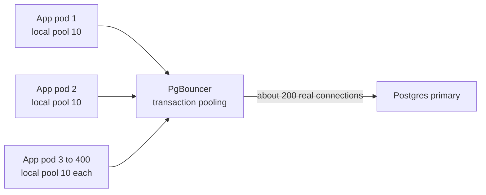

There are two layers. **In-app pools** (HikariCP in Spring Boot, `database/sql` in Go with `SetMaxOpenConns`) reuse connections within one process. A **proxy pooler** like PgBouncer (or AWS RDS Proxy) sits between thousands of client connections and a few hundred real server connections. In **transaction pooling** mode, a server connection is given to a client only for the length of one transaction, so many idle clients share few real connections.

> **Real world — DoorDash:** DoorDash's Django monolith ran on one Postgres primary with read replicas, and needed **PgBouncer** because the monolith's replicas exhausted DB connections. ([source](https://doordash.engineering/2020/12/02/how-doordash-transitioned-from-a-monolith-to-microservices/))

Pool sizing matters both ways. Too small and requests queue waiting for a connection, so latency rises even though the DB is idle. Too big and the DB thrashes under too many concurrent queries. Interviews ask "how can a DB make an app slow?" (Z1). Good answers: missing indexes (full scans), lock contention (long transactions holding row locks), connection pool exhaustion, N+1 queries (one query per item in a loop instead of one batched query), and replication lag making reads stale. DoorDash's 1,000-row batched upsert (99% fewer storage queries) is a strong real example of fixing the N+1 kind.

> **Connect to Atlassian:** In a Spring Boot service with SQS worker pools, the worker pool size and the HikariCP pool size must agree. If 64 workers share a pool of 10 connections, 54 of them spend their time waiting for a connection. That is a nice concrete thing to say if asked about pools.

### 3.12 Replication

**Replication** means keeping copies of the same data on several machines. Three reasons: **availability** (if one machine dies, another has the data), **read scaling** (spread reads across copies), and **latency** (a copy closer to the user).

#### Leader-follower

The most common setup: one **leader** (also called primary or master) takes all writes. It streams its changes (the WAL in Postgres, the binlog in MySQL) to **followers** (replicas, secondaries, slaves), which apply them in the same order. Reads can go to followers.

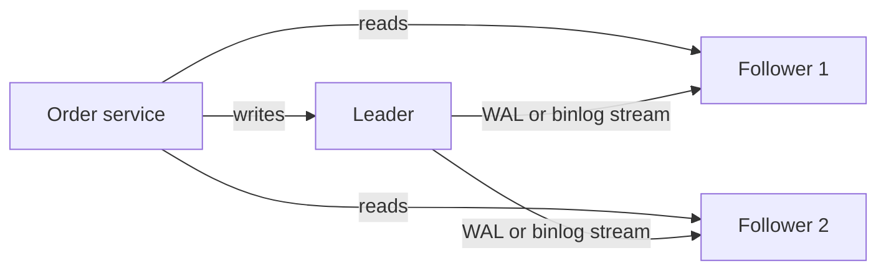

When does the leader tell the client "committed"? Three options:

- **Synchronous:** after every follower has the change. No data loss if the leader dies, but one slow follower slows every write, and one dead follower blocks writes.
- **Asynchronous:** immediately after writing locally. Fast, but if the leader crashes before the change reaches followers, the last few writes are lost on failover.
- **Semi-synchronous:** after *at least one* follower has it. A common middle ground (MySQL semi-sync, Postgres with one synchronous standby). Aurora takes a different route by writing to a quorum of storage copies across availability zones, but the details of Zomato's Aurora setup are not public.

#### Replication lag and its anomalies

With async replication, followers are behind by some milliseconds, sometimes seconds under load. That **replication lag** causes visible bugs.

**Read-your-writes violation:** a user updates something and then can't see their own change.

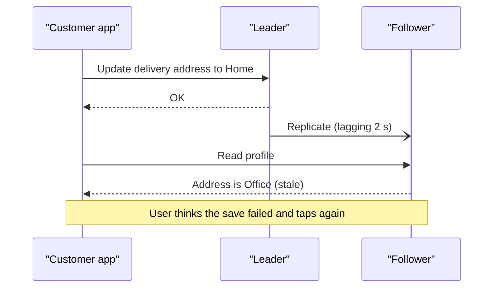

Fixes: read the user's own recently changed data from the leader (for example, for 10 seconds after any write by that user), or pass the write's log position and read from a follower that has caught up to it.

**Monotonic reads violation:** a user sees data go backwards in time because successive reads hit different followers.

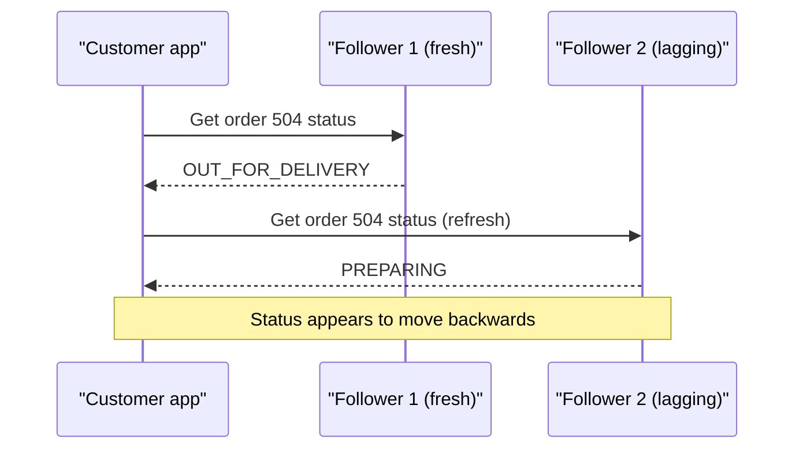

Fix: pin each user (or each order) to one follower, for example by hashing user_id to choose the replica.

The research has a sharp real example: in the Airbnb payments pattern, **all idempotency reads go to the master, not replicas, because replica lag can cause duplicate charges** ([summary](https://medium.com/airbnb-engineering/avoiding-double-payments-in-a-distributed-payments-system-2981f6b070bb), secondary source). If the "has this payment already happened?" check reads a lagging replica, it says "no" and you charge twice. The rule to state: **anything that decides money or state transitions reads from the leader.**

#### Failover and split brain

When the leader dies, a follower must be **promoted**. This is **failover**. Steps: detect the failure (usually missed heartbeats over a timeout), choose the most up-to-date follower, reconfigure clients to send writes to it.

What can go wrong:

- With async replication, the new leader may be missing the old leader's last writes. Those writes are lost, or worse, conflict with new ones if the old leader comes back.
- The timeout is a guess. Too short and a slow GC pause triggers a needless failover. Too long and you are down longer.
- **Split brain:** the old leader wasn't dead, only cut off by a network problem. Now two nodes both think they are leader and both accept writes. Two riders could be assigned the same order, one on each side.

```
       network partition
  [Old leader]   ||   [New leader]  <- promoted by followers
  accepts writes ||   accepts writes
  from region A  ||   from region B
       => two diverging histories
```

Prevention: **fencing** (once a new leader is chosen, the old one is cut off from storage or its writes are rejected using an increasing "epoch" or term number), and **consensus protocols** like Raft that need a majority to elect a leader, so at most one side of a partition can have a leader. Uber's Docstore runs Raft in partitions of 3 to 5 nodes across zones for exactly this reason. The research's Kleppmann note on distributed locks makes the same point about fencing tokens ([source](https://martin.kleppmann.com/2016/02/08/how-to-do-distributed-locking.html)).

#### Multi-leader

In **multi-leader** replication, several nodes accept writes (often one per region) and replicate to each other. This gives low write latency in every region and survives a region going down. The catch is **write conflicts**: the same row is changed in two regions at once. You need a resolution rule, such as last-write-wins by timestamp (simple, but silently drops one write), merging, or app-specific logic. Use it rarely, and mainly for data where conflicts are rare or harmless.

#### Leaderless and quorums

In **leaderless** replication (Dynamo-style: Cassandra, ScyllaDB, Riak), the client writes to several replicas and reads from several replicas directly. With **N** replicas, a write succeeds when **W** of them acknowledge, and a read asks **R** of them and takes the newest value. If **R + W > N**, every read set overlaps every write set in at least one replica, so a read sees the latest write.

```
N = 3 replicas:  [A] [B] [C]

Write W = 2:     [A: v2] [B: v2] [C: v1]   (C missed it)
Read  R = 2:     asks B and C -> gets v2 and v1 -> returns newest, v2
                 R + W = 4 > 3, so at least one of the replicas read has v2

Tuning:  W=3, R=1  fast reads, slow and fragile writes
         W=1, R=3  fast writes, slow reads
         W=2, R=2  balanced, tolerates 1 node down for both
```

Stale replicas are repaired by **read repair** (the reader writes the newer value back) and background **anti-entropy**. Quorums are not magic: with concurrent writes and sloppy quorums (writing to a stand-in node during failures) you can still see odd results. But R + W > N is the formula interviewers want.

### 3.13 Sharding (partitioning)

Replication copies the same data. **Sharding** splits *different* data across machines, so each machine holds a slice. You shard when one leader can no longer handle the writes or the data no longer fits. Each slice is a **shard** or **partition**, and the column that decides which shard a row goes to is the **shard key** (DynamoDB calls it the partition key).

#### Three strategies

**Range sharding:** each shard owns a contiguous range of the key.

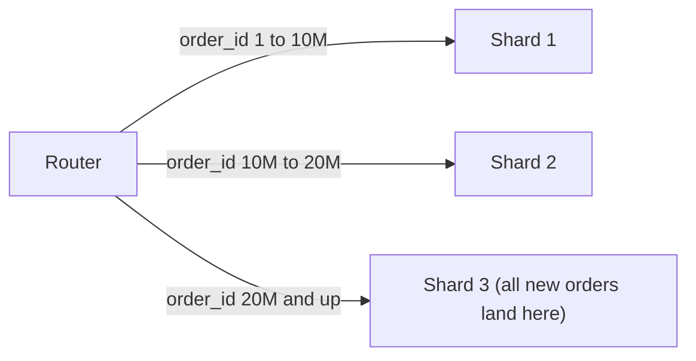

Range queries are easy ("orders 15M to 15.1M" hits one shard). But if the key increases over time, like an ID or a timestamp, all new writes hit the last shard: a **hot shard**.

**Hash sharding:** shard = hash(key) mod number of shards.

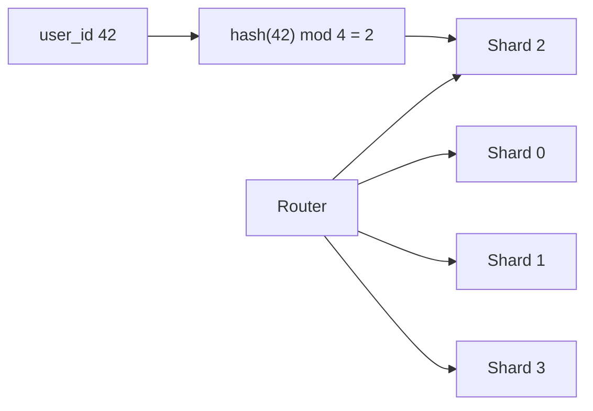

Load spreads evenly, but range queries across keys must hit every shard, and changing the shard count with plain `mod N` moves almost every key (fixed by consistent hashing, 3.14).

**Directory or geo sharding:** a lookup table maps each key (or each city) to a shard.

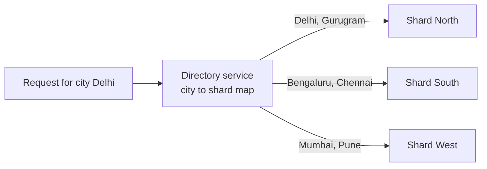

Flexible: you can move one big city to its own shard. Food delivery is naturally local, so geo sharding fits many workloads. The directory itself must be highly available and cached. Uber's early dispatch used **S2 level-12 cell IDs as the sharding key** (research F6, [source](http://highscalability.com/blog/2015/9/14/how-uber-scales-their-real-time-market-platform.html)), a geo-sharding example.

#### Choosing a shard key for orders: the user_id vs restaurant_id dilemma

This is the best sharding discussion for a Zomato interview. Orders have two main readers:

- the **customer**: "my order history", needs all orders for one `user_id`;
- the **restaurant**: "my live orders and today's sales", needs all orders for one `restaurant_id`.

If you shard by `user_id`, the customer query hits one shard, but the restaurant dashboard must ask every shard (**scatter-gather**) and merge. If you shard by `restaurant_id`, the reverse. And restaurant_id has a hot-key problem: a huge chain outlet or a cloud kitchen on NYE gets far more orders than an average restaurant, so its shard runs hot.

Solutions, in the order you'd propose them:

1. **Pick the key for the most critical, most frequent path, and build a secondary copy for the other.** Shard `orders` by `order_id` or `user_id`. Publish every order change through CDC or Kafka to a second store keyed by `restaurant_id` that serves the restaurant dashboard. That is a denormalised read model, eventually consistent by a second or so, which is fine for a dashboard. DynamoDB GSIs are this idea built in.
2. **Embed the shard in the ID.** If `order_id` contains the user's shard number (shard bits inside the ID, 3.17), then given just an order ID you know where to look, without a lookup.
3. **Handle hot keys explicitly** with key salting (below) for the few giant restaurants.

Saying "it depends on the access pattern, here are both, and here is how I'd serve the other query" is what interviewers want.

#### Hot partitions and key salting

A **hot partition** is one shard getting far more traffic than others because one key (or a few) is very popular. Fix by spreading one logical key over several physical keys with a suffix:

```
Logical key:  area_cp_gurugram           (one hot partition)
Salted keys:  area_cp_gurugram#0
              area_cp_gurugram#1   write: pick suffix = random(0..N-1)
              area_cp_gurugram#2   read:  query all N suffixes and merge
              area_cp_gurugram#3
```

That is exactly what both research stories did: **Deliveroo added random-suffix write sharding to its sub-area GSI, with a configurable shard count per area**, and **Zomato's billing GSI suffixes keys with `_<division-number>`** to avoid hot partitions. Only salt the hot keys, because reads now need N queries.

#### Cross-shard queries and resharding

Things that become hard once data is sharded:

- **Joins across shards:** avoid them by co-locating data that's queried together (an order and its items share the order's shard key), or denormalise.
- **Global queries** ("top 10 restaurants by orders today"): scatter-gather to all shards, or better, compute in an analytics store (3.18).
- **Unique constraints across shards:** a unique email can't be enforced by one shard. Use a separate lookup table keyed by email.
- **Transactions across shards:** need 2PC or a saga (3.16).

**Resharding** is moving data when you add shards. The safe pattern is: create new shards, copy existing data in the background, **dual-write** new changes to old and new locations (or stream changes via CDC), verify, switch reads, then switch writes, then retire the old. Zomato's TiDB-to-DynamoDB billing migration used this kind of phased rollout with dual writes, replication, sync and failover, with zero downtime. Many teams pre-split into many more logical shards than machines (say 1,024 logical shards on 8 machines) so that later "resharding" just moves whole logical shards between machines.

### 3.14 Consistent hashing

With `hash(key) mod N`, going from 4 shards to 5 changes the result for about 80% of keys, so almost all data must move. **Consistent hashing** fixes that. A Zomato intern HLD round (Z30) asked for exactly this: a distributed key-value store with addServer/removeServer and "smooth redistribution".

Picture the hash space (say 0 to 2^32 - 1) bent into a ring. Each server is hashed to a point on the ring. Each key is hashed to a point too, and belongs to the **first server clockwise** from it.

```
                    0
              . - ~ ~ ~ - .
          S1 *              * K1 -> goes clockwise -> S2
           /                  \
          |                    * S2
     K3 * |                    |
          |                    |
       S4 *                    * K2 -> S3
           \                  /
             ' - . _ _ . - * S3
```

Add a server S5 between S2 and S3: only the keys between S2 and S5 move (from S3 to S5). Everything else stays put. On average adding one server to N moves only about 1/(N+1) of the keys. Removing a server hands its keys to the next server clockwise.

Problem: with few servers, the points land unevenly, so one server might own 40% of the ring. And when a server dies, all its load lands on one neighbour. Fix: **virtual nodes**. Each physical server is placed on the ring many times (for example 100 to 200 points: S1#0, S1#1, ...). Load evens out statistically, a dead server's keys scatter over many servers, and a bigger machine can simply get more virtual nodes.

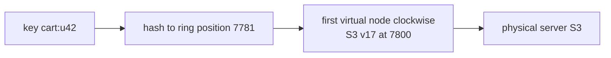

Where it is used: Dynamo-style databases (Cassandra, Riak, and the design in Amazon's original Dynamo paper), cache clusters (memcached clients, Redis client-side sharding), load balancers with sticky routing. Redis Cluster uses a related idea, 16,384 fixed **hash slots** assigned to nodes, which is "pre-split logical shards" from the previous section. A Zomato report (Z14) mentioned "moving from plain hashing to consistent hashing" for cache sharding, so practise explaining the 80%-moves problem first, then the ring.

### 3.15 CAP, PACELC and consistency models

**CAP** says that when a **network partition** happens (some nodes can't talk to others), a distributed database must choose between **Consistency** (every read sees the latest write, or gets an error) and **Availability** (every request gets a non-error answer, possibly stale). You can't have both *during the partition*. Partitions will happen, so "CA" is not a real option for a distributed system. The real choice is **CP** (refuse some requests to stay correct) or **AP** (answer everything, reconcile later).

**PACELC** adds the part CAP forgets: **if Partition, choose A or C; Else (normal operation), choose Latency or Consistency.** Even with no failure, waiting for replicas to confirm makes writes slower. Uber's Docstore is openly "CP: favors consistency over availability" ([source](https://www.uber.com/blog/schemaless-sql-database/)). Cassandra at low quorum settings is a typical PA/EL system.

The mature answer is per feature, not per company:

| Zomato feature | During a partition | Normal operation | Why |
|---|---|---|---|
| Payment and wallet balance | CP: reject or hold rather than double-charge | Consistency over latency | Money must never be wrong |
| Order placement and status transitions | CP | Consistency | Two riders must not both get the order |
| Coupon usage limits | CP for the counter | Consistency | Over-redemption costs real money |
| Restaurant menu and prices shown | AP: show cached menu | Latency | Re-validate price at checkout |
| Search results and ratings | AP | Latency | A rating that's a minute old is fine |
| Rider live location on the map | AP | Latency | A 4-second-old dot is fine, a blank map is not |
| Notifications and feeds | AP | Latency | Late is better than never |

**Consistency models**, from strongest to weakest, in plain words:

- **Linearizable (strong):** the system behaves like a single copy. Once a write completes, every later read anywhere sees it. Needed for "who holds this lock", "is this seat taken".
- **Sequential / causal:** everyone sees causally related events in the same order. A reply never appears before the message it answers.
- **Read-your-writes and monotonic reads** (from 3.12): per-user guarantees that fix the most visible lag bugs cheaply.
- **Eventual:** if writes stop, all replicas eventually agree. No promise about when. Fine for ratings, counts of likes, search indexes. Zepto accepts a 10-second search index lag because stock is re-checked against the inventory service afterwards ([source](https://aws.amazon.com/blogs/big-data/how-zepto-powers-sub-second-search-using-opensearch-service-or2-instances/)).

### 3.16 Distributed transactions: 2PC and sagas

In a microservice world, placing an order touches several services, each with its own database: Order service, Payment service, Restaurant service, maybe Wallet and Coupon. A single `BEGIN ... COMMIT` can't span them. Two approaches.

#### Two-phase commit (2PC)

A **coordinator** asks every participant to **prepare** (do the work, hold the locks, promise it can commit), and only if all say yes, tells them all to **commit**.

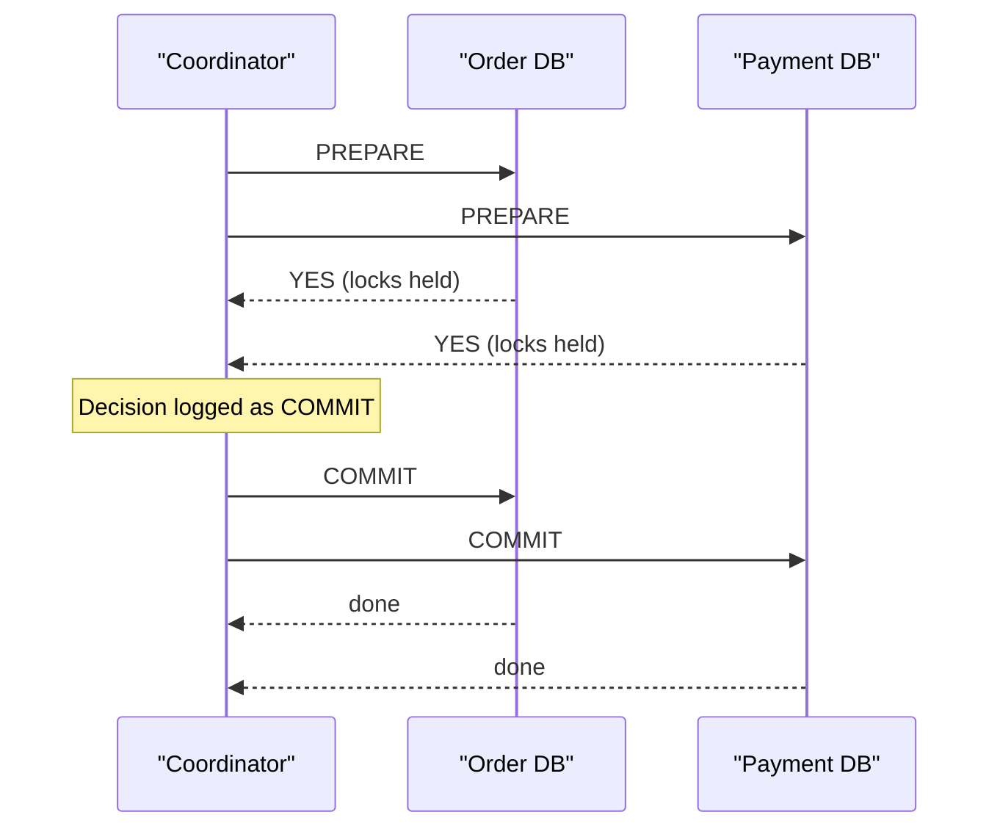

Why it **blocks**: after a participant votes YES it cannot decide on its own. It must hold its locks until it hears the decision. If the coordinator crashes right after collecting the votes, every participant sits with locked rows, unable to commit or abort, until the coordinator recovers. Meanwhile any other transaction touching those rows waits. Add the extra round trips on every transaction, and 2PC is used mostly *inside* one database system (distributed SQL databases do a version of it internally, made safer with consensus) rather than across independent microservices.

#### Sagas

A **saga** is a sequence of local transactions, one per service. Each step commits on its own. If a later step fails, the saga runs **compensating transactions** that undo the earlier steps in business terms (refund the payment, release the reserved stock). There is no global lock, so nothing blocks, but in-between states are visible: for a moment, the payment is captured and the restaurant hasn't accepted yet.

The Zomato order saga:

```
Step                          Compensation if a later step fails
1. Order: create (PENDING)    -> mark order CANCELLED
2. Payment: capture ₹450      -> refund ₹450
3. Coupon: mark used          -> un-mark coupon
4. Restaurant: accept order   -> (nothing to undo; this is the step that may fail)
5. Order: mark CONFIRMED
If the restaurant rejects or times out at step 4: run 3', 2', 1' in reverse.
```

**Choreography:** no central brain. Each service listens for events and reacts.

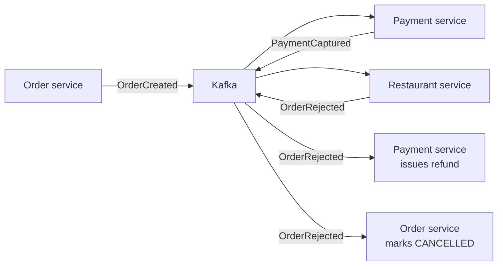

Simple to start and loosely coupled, but the overall flow lives in nobody's code, and with 8 steps it becomes hard to see or debug.

**Orchestration:** a central **orchestrator** tells each service what to do and tracks the state.

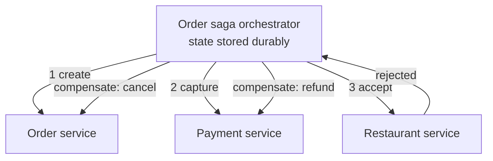

The flow is explicit and visible in one place, timeouts are easy ("if the restaurant doesn't respond in 3 minutes, compensate"), at the cost of a central component that must itself be reliable. Workflow engines like Cadence and Temporal make the orchestrator durable.

> **Real world — Uber and DoorDash:** Uber's **Cadence** workflow engine provides durable timers and persistent workflow state (on a Cassandra backend), and Uber Eats used it to coordinate the 8 standard steps of an Eats order ([source](https://www.uber.com/blog/open-source-orchestration-tool-cadence-overview/)). DoorDash Drive used Cadence as a fallback behind its delivery-creation flow. Its main challenge was that **not all downstream calls were idempotent**, so they considered idempotency keys or saving a context of completed steps and skipping them on retry ([source](https://doordash.engineering/2020/08/14/workflows-cadence-event-driven-processing/)).

Three rules make sagas work, and they map straight to your Atlassian work: **every step and every compensation must be idempotent** (retries will happen), **use a transactional outbox** so "update my DB" and "publish the event" can't half-happen (write the event row in the same local transaction, and let a relay or Debezium publish it), and **send what keeps failing to a DLQ** for a human to look at. Zepto's draft-order design (accept before payment, idempotent Create Order on payment success, a sweeper every 5 minutes for stuck orders) is a saga in practice.

A Zomato SWE1 rejection (Z4, https://leetcode.com/discuss/post/7609011/) gave feedback that the candidate "needed more depth on non-happy paths: microservice orchestration failures, retries, cross-service consistency". This section is that depth.

### 3.17 Generating unique IDs

Every order needs an ID. Options:

- **Auto-increment** (`BIGINT AUTO_INCREMENT`): small, sorted, perfect for one database. Problems: it doesn't work across shards (two shards both produce order 1001), the single counter is a bottleneck, and sequential IDs leak business data (a competitor places two orders a day apart and subtracts the IDs to learn your daily volume), and they are guessable in URLs.
- **UUID v4:** 128 random bits, generated anywhere with no coordination, collisions practically impossible. Problems: 16 bytes (36 as text), not sortable by time, and random inserts scatter across the B+ tree, causing page splits in InnoDB's clustered index (3.6). **UUID v7** and ULID put a timestamp in the high bits, fixing the ordering problem.
- **Snowflake-style IDs (a design popularised by Twitter):** a 64-bit integer built from time, machine and a counter.

```
 1 bit   41 bits                       10 bits         12 bits
+---+-----------------------------+---------------+--------------+
| 0 | milliseconds since epoch    | machine id    | sequence     |
+---+-----------------------------+---------------+--------------+
      ~69 years of timestamps       1,024 machines  4,096 IDs per ms
                                                    per machine
```

Each generator only needs a unique machine ID; no coordination per ID. IDs are roughly time-sorted, so B+ tree inserts append at the right edge, and they fit in a BIGINT. Risk: if a machine's clock jumps backwards, it could repeat IDs, so generators refuse to issue IDs until the clock catches up. A common variant replaces machine bits with a **logical shard ID**, so an ID tells you which shard holds the row.

- **Ticket server:** a dedicated database whose only job is handing out increasing numbers (a well-known trick is to run two such servers, one handing out odd numbers and one even, so either can fail). Apps often grab a **block** of 1,000 IDs at a time to avoid a round trip per ID. Simple, but it is a central dependency.

For Zomato orders: Snowflake-style 64-bit IDs are a strong default. Mention that customer-facing order numbers can be a separate, shorter display code.

### 3.18 OLTP vs OLAP: why analytics stays off the orders DB

**OLTP** (online transaction processing) is the live app: many small, fast reads and writes touching a few rows each. "Place order 504", "get order 504". **OLAP** (online analytical processing) is analysis: few huge queries scanning millions of rows. "Revenue per city per hour for last month", "which dishes are trending in Bengaluru".

| | OLTP (orders DB) | OLAP (warehouse or lake) |
|---|---|---|
| Query shape | Point lookups, small updates | Big scans, aggregations, joins of huge tables |
| Storage layout | Row-oriented (whole row together) | **Column-oriented** (each column stored together, compresses well, scans only needed columns) |
| Latency target | Milliseconds | Seconds to minutes is fine |
| Freshness | Live | Minutes to hours behind |
| Examples | Aurora MySQL, Postgres, DynamoDB | ClickHouse, Druid, Trino over Iceberg on S3, Snowflake, Redshift, BigQuery |

Running a month-long revenue report on the live orders database scans hundreds of millions of rows, fills the buffer pool with old data (evicting the hot pages live orders need), holds resources for minutes, and can slow down order placement for every customer. So you copy data out, usually through **CDC** (change data capture: reading the database's log and streaming each change).

> **Real world — Zomato:** Aurora MySQL changes are captured by **Debezium** and published to **Kafka**. **Flink** writes them into **Iceberg** tables on S3, and DynamoDB Streams also land in S3. Analytics run on **Trino** (over 250K queries scanning 2 PB) and **Druid** (over 20B events ingested and 8M queries a week) ([source](https://aws.amazon.com/blogs/opensource/how-zomato-boosted-performance-25-and-cut-compute-cost-30-migrating-trino-and-druid-workloads-to-aws-graviton/)). Logs go to **ClickHouse** (up to 150M logs/min, over 50 TB/day uncompressed), which replaced self-hosted Elasticsearch and is expected to save over $1M a year ([source](https://www.zomato.com/blog/building-a-cost-effective-logging-platform-using-clickhouse-for-petabyte-scale)).

```mermaid
flowchart LR
    OLTP["Aurora MySQL<br/>orders, live"] -->|"binlog"| DBZ["Debezium CDC"]
    DBZ --> KF["Kafka"]
    KF --> FL["Flink"]
    FL --> ICE["Iceberg tables on S3"]
    DDB["DynamoDB"] -->|"Streams"| S3["S3"]
    S3 --> ICE
    ICE --> TR["Trino: ad-hoc SQL"]
    KF --> DR["Druid: real-time dashboards"]
    APPS["Service logs"] --> CH["ClickHouse LogStore"]
```

(The Kafka-to-Druid arrow is a typical arrangement; the research confirms Druid ingests events but not its exact feed.)

### 3.19 Interview traps, answered honestly

**"Why MySQL and not PostgreSQL?"** A Zomato SDE-1 candidate (Z2, https://leetcode.com/discuss/post/8377019/) was rejected partly for this: they could not justify it, and the interviewer said they should have said "I don't have enough real-world exposure to make that trade-off" instead of over-explaining. So: if you haven't run both in production, say so, then offer what you do know, clearly labelled as general knowledge.

| | MySQL (InnoDB) | PostgreSQL |
|---|---|---|
| Storage | Clustered on primary key; secondary indexes point to PK | Heap table; all indexes point to row locations |
| Old row versions | Undo log, purged in background | In the table; needs VACUUM |
| Default isolation | Repeatable read | Read committed |
| Strengths often cited | Simple, fast primary-key access, huge operational ecosystem (Vitess for sharding, Aurora MySQL) | Richer SQL and types (JSONB, arrays), partial and expression indexes, PostGIS for geo, extensions |
| Connections | Thread per connection | Process per connection, so poolers like PgBouncer are common |

An honest sentence: "In my projects I used X because the team already ran it. I know the textbook differences, like InnoDB clustering on the primary key and Postgres's richer indexing and PostGIS, but I haven't operated both at scale, so I'd lean on the team's existing expertise. Zomato runs Aurora MySQL, so I'd default to that here."

**"Assume infinite money. Why not replace the database with a cache?"** A Blinkit SDE-2 candidate (B12, https://leetcode.com/discuss/post/7083108/) could not answer this. Money buys RAM, not guarantees. A cache like Redis is designed to be allowed to lose data: eviction policies drop keys under memory pressure, TTLs expire them, and persistence (RDB snapshots, AOF) is asynchronous by default, so a crash loses recent writes. Replication is asynchronous, so failover can lose acknowledged writes. You also lose rich querying (no ad-hoc "all PLACED orders for restaurant 10 in the last hour" without building every index yourself), multi-key ACID transactions with rollback, constraints and foreign keys, and the whole ecosystem of backups, point-in-time recovery, auditing and CDC. The right framing: "a cache is a copy optimised for speed; a database is the source of truth optimised for correctness. Infinite money lets me cache more, not stop needing a source of truth."

**"What if we use only Redis and no database?"** (Blinkit SDE-1, B3, https://leetcode.com/discuss/post/8331559/.) Same core answer, plus nuance: for some data, Redis alone is fine. OTPs, rate-limit counters, sessions and live rider locations are short-lived and cheap to lose or recreate. Orders, payments and wallet balances are not. Say which is which.

**"Can't SQL scale?"** Yes: read replicas, caching, partitioning, sharding (Vitess) and distributed SQL (CockroachDB, TiDB, Docstore). Zomato's Aurora served 610k selects/s on NYE 2023. NoSQL makes horizontal scaling the default for narrow access patterns.

**"Nearby restaurants in SQL."** A Zomato report (Z5) said a bounding-box query alone didn't satisfy the interviewer. Mention a geospatial index (PostGIS GiST index, MySQL spatial index) or a precomputed geohash/H3 cell column with a normal B+ tree index, querying the cell and its neighbours, then refining by actual distance.

### 3.20 Cheat table: which database for which Zomato component

| Component | Suggested store | Why | Real-world anchor |
|---|---|---|---|
| Orders, order items, status | Relational (Aurora MySQL), shard by order/user when needed | Transactions, constraints, many query shapes | Zomato uses Aurora MySQL. Zepto moved draft orders to DynamoDB |
| Payments, wallet, ledger | Relational with strict transactions, or DynamoDB with careful keys and conditional writes | Money must be exact, idempotent | Zomato billing on DynamoDB (4x throughput, ~50% cost) |
| Users and auth | Relational | Unique phone/email constraints | General practice |
| Menus and catalog | Document store (MongoDB) or relational plus a cache | Nested, varied, read-heavy | General practice; Zepto uses MongoDB |
| Restaurant and dish search | Search index (Solr) | Full-text, ranking, filters | Zomato uses Solr |
| Carts, sessions, OTPs, rate limits | Redis with TTL | Key access, short-lived | Zomato's 35 TB ElastiCache fleet |
| Rider live location | Redis (in-memory, geo or cell index), history to Kafka | Very write-heavy, latest value only | Not public at Zomato; Uber shards by cell |
| ML features | Redis (real-time) plus DynamoDB (batch) | Key lookups at huge RPM | Zomato's feature store and Profile Store |
| Support chats | MongoDB | Flexible nested conversations | Zomato Nugget on MongoDB Atlas |
| Workflow state for sagas | Durable workflow engine (Cadence or Temporal) or an orchestrator table | Retries, timers, compensations | Uber Cadence, DoorDash |
| Analytics | Iceberg on S3 with Trino, Druid | Columnar, cheap scans, off the OLTP path | Zomato |
| Logs | ClickHouse | Append-only, columnar, cheap | Zomato LogStore |
| Fraud graphs | Graph DB (proposal) | Multi-hop relations | Not public |

### Check yourself

**Q: What does the write-ahead log give a database, and what else uses it?**
A: Durability. Changes are appended to the log and flushed before data pages change, so after a crash the database replays the log. Replication ships the same log to followers, and CDC tools like Debezium read it to publish change events.

**Q: Why might a database ignore an index on `orders.status`?**
A: Low cardinality. If the condition matches most rows, reading the index and then fetching most rows is slower than a full scan, so the planner skips it. It's still useful in a composite index, or as a partial index for a rare value.

**Q: Separate indexes on A and B, or a composite on (A, B), for `WHERE A = 10 AND B = 20`?**
A: Composite. It seeks directly to the matching entries. With separate indexes the DB either uses one and filters many rows, or merges two index scans, which costs more. Composite (A, B) also serves `A` alone but not `B` alone.

**Q: An index on `(restaurant_id, created_at, status)` is slow for `restaurant_id = ? AND status = ? AND created_at > ?`. Why, and what's the fix?**
A: The range on created_at stops the seek, so status is checked row by row. Reorder to `(restaurant_id, status, created_at)`: equality columns first, range last.

**Q: Draw lost update and name two fixes.**
A: Two transactions read 99, both write 100. Fix with an atomic `SET used = used + 1 WHERE used < 100`, or with optimistic locking on a version column (or `SELECT ... FOR UPDATE`).

**Q: Which isolation anomaly can row locks alone not stop, and how do you stop it?**
A: Write skew, because each transaction writes a different row. Use serializable isolation, lock the rows you read with `FOR UPDATE`, or turn the rule into a unique constraint.

**Q: A user saves a new address and then sees the old one. What happened, and what's the fix?**
A: A read-your-writes violation from replication lag: the read hit a lagging follower. Read that user's recent writes from the leader, or wait until a follower has caught up to the write's log position.

**Q: With N = 3, which R and W give strong reads, and what does each choice cost?**
A: Any R + W > N, for example R = 2 and W = 2. W = 3 makes writes slow and fragile, R = 3 does the same to reads, and 2 and 2 tolerates one node down for both.

**Q: Should orders be sharded by user_id or restaurant_id?**
A: Pick the key for the critical path, usually user or order for customers. Serve the restaurant view from a second, CDC-fed copy keyed by restaurant_id, and salt the keys of very hot restaurants. Explain scatter-gather as the cost of the other choice.

**Q: Why does 2PC block, and why do microservices prefer sagas?**
A: After voting yes, a participant holds its locks until the coordinator says commit or abort. If the coordinator dies, they wait indefinitely. Sagas commit locally at each step and undo with compensations, so nothing blocks, at the cost of visible intermediate states and the need for idempotent steps.

**Q: Why are random UUID v4 primary keys bad in InnoDB, and what's better?**
A: The primary key is the clustered index, so random keys insert into random pages, causing page splits and poor caching. Every secondary index also stores the 16-byte key. Time-ordered IDs (Snowflake, UUID v7) append at the right edge.

**Q: With infinite money, why not replace the DB with a cache?**
A: Money buys memory, not guarantees. Caches evict, expire and persist asynchronously, so they lose data. They also lack ad-hoc queries, multi-key ACID and constraints. A cache is a fast copy, and you still need a source of truth.

---

[← 06a_SD_Interview_Requests_Scaling.md](06a_SD_Interview_Requests_Scaling.md) · [06c_SD_Caching_and_Async.md →](06c_SD_Caching_and_Async.md)
