# System Design Master — 3. Caching and Asynchronous Processing

> **Covers:** Parts 4–5. **Reading time:** about 110 minutes of focused reading (diagrams and code extra).
> Built from research into Zomato's and Eternal's engineering blogs, Swiggy, Blinkit, Zepto, BookMyShow, Uber, DoorDash, Grab, Stripe, Razorpay, Cloudflare and ~100 interview reports. Company facts link to their source; anything not public is marked so — never claim more in the interview.
> Diagrams are Mermaid and render on GitHub. Report IDs like Z2 or B10 refer to `sources/interview_reports.md`; all research notes with links are in `sources/`.

[← 06b_SD_Databases.md](06b_SD_Databases.md) · [06d_SD_APIs_Reliability_Concurrency.md →](06d_SD_APIs_Reliability_Concurrency.md)

---

## Part 4: Caching

Almost every system design answer ends up with a box labelled "Redis" somewhere in the middle. Interviewers know this, so they rarely ask "would you add a cache?" They ask the next question: what exactly goes in it, how long it lives, what happens when it is wrong, and what happens when it dies. This part builds the full picture from zero, so you can answer those follow-ups without guessing.

### 4.1 Why we cache at all

A **cache** is a small, fast store that keeps copies of data that lives somewhere slower. The "somewhere slower" is usually a database on disk, but it can also be another service, a computation, or a third-party API. The whole idea rests on one observation: in most products, a small set of data is read far more often than it changes.

Think of a popular biryani restaurant in Bangalore at 8 pm. Its menu might be viewed tens of thousands of times in an hour, and it changes maybe twice a day when the owner marks an item out of stock. Fetching that menu from MySQL every single time means running the same query, joining the same tables, and serialising the same JSON thousands of times, all to produce an answer we already had a second ago. A cache lets us do that work once and hand out the copy.

The second reason is **latency**, which is the time one request takes. Here are rough numbers to keep in your head. These are assumptions for back-of-the-envelope maths, not measurements from any company:

| Where the data comes from | Typical time (assumption) |
|---|---|
| A variable already in the process's memory | under 1 microsecond |
| Redis or Memcached in the same data centre | about 0.5 to 1 ms (mostly network) |
| A simple indexed lookup in MySQL or PostgreSQL | about 2 to 10 ms |
| A heavy query with joins and sorting | 20 to 200 ms or more |
| Calling another microservice that itself hits a DB | 10 to 50 ms |

The third reason is **protecting the database**. A database has a hard ceiling on how many queries per second it can serve before latency explodes. A cache absorbs most of the reads so the database only sees the small leftover share.

> **Real world — Zomato:** On New Year's Eve 2023, Zomato's ElastiCache (managed Redis) fleet was scaled to **35 TB of memory**, carried **20 Gbps**, and served about **1 billion GETs per minute** against about **100 million SETs per minute**. That is roughly 10 reads for every write, and about 16.7 million cache reads per second at peak. ([source](https://www.zomato.com/blog/a-tale-of-scale-behind-the-scenes-at-zomato-tech-for-nye-2023))

> **Real world — Swiggy:** Swiggy's engineering blog says several services have a latency budget of about **50 ms at P99**, and since one user request fans out to 3 to 5 downstream calls, a caching layer is needed to fit inside that budget. (Seen through a search excerpt of the post, so treat the exact wording as reported.) ([source](https://bytes.swiggy.com/engineering-challenges-at-swiggy-430dea6c86a3))

#### Hit ratio: the one formula you must be able to do on a whiteboard

The **hit ratio** is the fraction of reads the cache answers by itself. A **hit** means the data was in the cache. A **miss** means it was not, so we had to go to the database, and usually we then put the result into the cache for next time.

On a miss you pay for both trips: you asked the cache first, it said "no", and then you asked the database. So:

```
effective latency = hit_ratio × cache_time + (1 − hit_ratio) × (cache_time + db_time)
```

Let us plug in assumed numbers: cache = 1 ms, DB = 20 ms.

```
hit ratio 0%   :  0     + 1.00 × 21  = 21.0 ms   (cache is pure overhead)
hit ratio 50%  :  0.5   + 0.50 × 21  = 11.0 ms
hit ratio 90%  :  0.9   + 0.10 × 21  =  3.0 ms
hit ratio 99%  :  0.99  + 0.01 × 21  =  1.2 ms
```

Now do the same for database load. Suppose the menu API receives 100,000 reads per second (assumption):

```
hit ratio 90%  → 10,000 reads/s reach the DB
hit ratio 99%  →  1,000 reads/s reach the DB
hit ratio 99.9%→    100 reads/s reach the DB
```

Read that again, because it is the most useful insight in this whole chapter. Going from 90% to 99% looks like a small 9-point improvement, but it cuts database load by **10 times**. The database does not care about your hit ratio. It cares about your **miss ratio**, and the miss ratio went from 10% to 1%. This is why large companies obsess over the last few percent.

> **Real world — Twitter:** A study of 153 of Twitter's in-memory cache clusters (about 700 billion requests) found that **8 of the top 10 clusters had a miss ratio below 5%**, and six were around 1%. ([source](https://junchengyang.com/publication/osdi20-twemcache.pdf))

**Pause and think:** A cache has a 0% hit ratio for a type of data (say, every user's search results are unique). Is it helping, hurting, or neutral? *It is hurting: every request pays the cache round trip and still goes to the DB, and you also pay to write each result into a cache that nobody reads.*

### 4.2 Where caches live: the layers

"Add a cache" is vague, because there are caches at almost every hop between the user's phone and the database's disk. A strong answer names the layer.

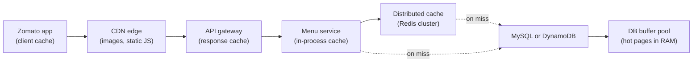

Here is what each layer is good for, from closest-to-user to closest-to-disk.

**Client cache.** The phone or browser keeps data it already downloaded. HTTP headers like `Cache-Control: max-age=300` tell the browser it may reuse a response for 300 seconds. The Zomato app could keep the list of cuisines, the user's saved addresses, or a restaurant's photos locally. This is the fastest cache of all because there is no network trip. The catch is that you cannot reach into a user's phone and delete a stale entry, so you only put data here that is safe to be a bit old.

**CDN (content delivery network).** A CDN is a network of servers spread across many cities that keep copies of files close to users. Dish photos, restaurant banners, and the app's JavaScript bundles belong here. A user in Chennai fetches a photo from a server in Chennai instead of from a data centre in Mumbai. CDNs are mostly for static content; you would not put "my current order status" on a CDN.

**Gateway or reverse-proxy cache.** The API gateway (or Nginx, or Envoy) can store whole HTTP responses for public, non-personalised endpoints, such as "list of cities we serve". The request never reaches your service.

**In-process cache (also called local cache or L1).** This is a hash map inside your service's own memory, often with a size limit and expiry (Caffeine in Java, `ristretto` or `bigcache` in Go). Reads take nanoseconds. The downside: if you run 200 pods of the menu service, you have 200 separate copies, each filled and expired on its own schedule. They can disagree with each other, which we will come back to in section 4.9.

**Distributed cache (L2).** A separate fleet like Redis, Memcached or Aerospike that every pod shares. One copy of each key, reachable over the network in about a millisecond. This is what most people mean by "the cache".

**Database buffer pool.** Even the database caches. MySQL's InnoDB keeps recently used pages (16 KB blocks of table and index data) in RAM in the **buffer pool**. If your hot data fits in the buffer pool, queries skip the disk. This is why a database "warms up" after a restart and is slower in its first few minutes.

A typical read in a well-designed Zomato-like system checks L1, then L2, then the DB, and fills each level on the way back.

### 4.3 Read and write patterns

There are five patterns people name in interviews. They differ in two things: **who talks to the database** (your application code, or the cache itself) and **when the cache is updated relative to the database**. Learn them with a picture each.

#### Cache-aside (lazy loading)

This is the default. The application owns all the logic. On a read, it checks the cache; on a miss, it reads the DB and puts the result in the cache. On a write, it writes the DB and deletes the cache key. The cache is just a dumb key-value store sitting "to the side" of the main path, which is where the name comes from.

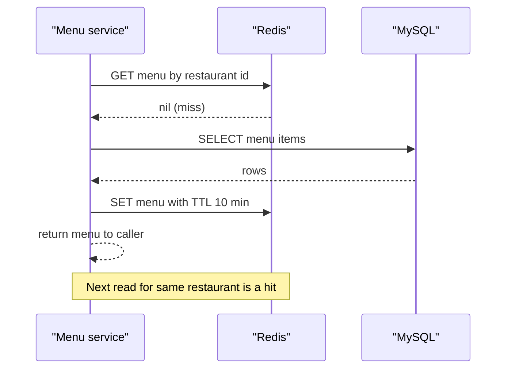

Why it is popular: it is simple, the cache only ever holds data someone actually asked for, and if Redis dies the service still works (it just gets slower, as every read goes to the DB). Its weaknesses: the first read of every key is slow (a **cold miss**), and there is a window where the cache can hold stale data.

> **Real world — Facebook:** Facebook's memcache paper describes their system as a **"demand-filled look-aside cache"**, which is exactly cache-aside, running at billions of requests per second. ([source](https://www.usenix.org/system/files/conference/nsdi13/nsdi13-final170_update.pdf))

#### Read-through

Same idea, but the cache library (or cache service) does the loading for you. The application only ever talks to the cache. On a miss, the cache itself calls a loader function you registered, stores the result and returns it.

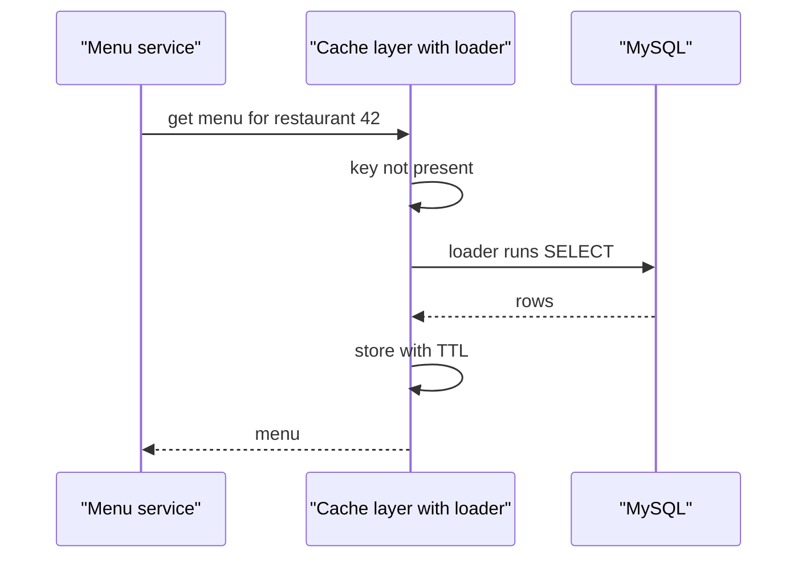

The application code becomes cleaner because there is one call instead of three. Java's Caffeine `LoadingCache` and Spring's `@Cacheable` work this way. Plain Redis does not do read-through by itself; you build it into a library that wraps Redis.

#### Write-through

On every write, the application writes to the cache, and the cache (or the same code path) synchronously writes to the database before saying "done". The cache is always up to date with the DB, because both are written in the same request.

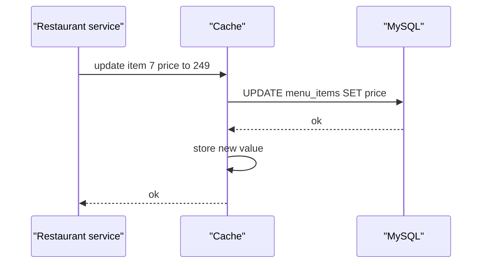

Good: reads after a write always see fresh data. Bad: every write pays two writes of latency, and you fill the cache with data that might never be read (a restaurant that updates its menu 50 times while nobody looks at it). Also, if the DB write succeeds and the cache write fails, you are back to stale data, so in practice teams still pair it with a TTL.

#### Write-behind (write-back)

The application writes only to the cache and returns immediately. The cache flushes changes to the database later, in the background, often in batches.

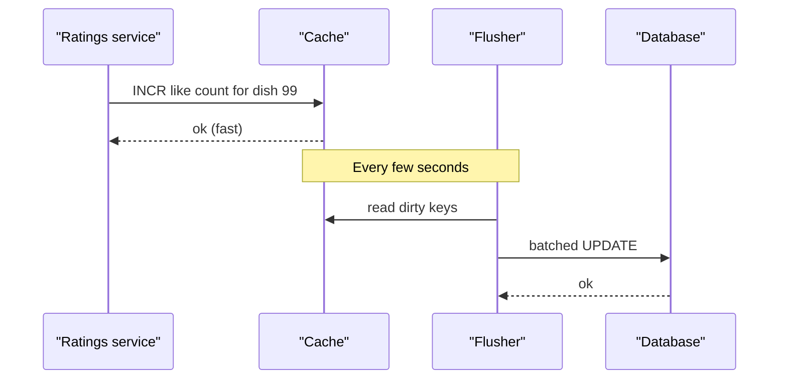

This gives the fastest writes and turns thousands of small writes into a few big ones. It is great for counters such as "number of views on a restaurant page" where losing a few seconds of data is acceptable. It is dangerous for anything important: if the cache node dies before flushing, those writes are gone. You would never use write-behind for an order or a payment.

#### Write-around

Writes go straight to the database and skip the cache entirely. The cache is filled only on reads (cache-aside style). This is the right choice for data that is written once and rarely read back soon, such as an order's audit log, a delivery partner's GPS history, or a support chat transcript.

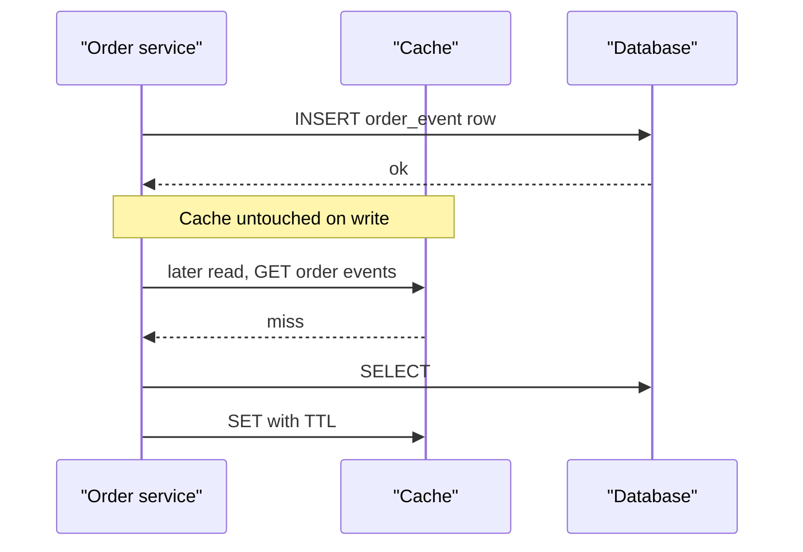

#### Picking one

| Pattern | Who loads the cache | Freshness after write | Write latency | Risk | Zomato-style fit |
|---|---|---|---|---|---|
| Cache-aside | App, on miss | Stale until delete or TTL | DB only | Brief staleness | Menus, restaurant pages, user profile |
| Read-through | Cache library, on miss | Same as cache-aside | DB only | Same | Same, with cleaner code |
| Write-through | App or cache, on every write | Fresh | DB + cache | Wasted cache space | Small, hot, read-after-write data, like a cart |
| Write-behind | Cache, flushed later | Fresh in cache, DB lags | Cache only | Data loss on crash | View counters, analytics counts |
| Write-around | App, on read only | Stale until read | DB only | First read slow | Logs, GPS history, order audit trail |

In an interview, say "cache-aside with delete-on-write and a TTL as a safety net" for most read-heavy data, and only reach for the others when you can explain why.

### 4.4 Delete or update on writes? The race that decides it

When a restaurant changes a price, the app writes the new price to the DB. What should it do to the cache: **set** the new value, or **delete** the key so the next read reloads it? Setting looks smarter because the next read is a hit. It is actually the more dangerous choice. Here is why, with two requests racing.

Two admins update the same dish almost at the same time. A changes the price to 200, B changes it to 250. B's DB write lands last, so the DB says 250, which is correct.

```
time →   t1            t2            t3            t4
A:       DB price=200                              cache SET 200
B:                     DB price=250  cache SET 250

DB final:    250   (correct)
Cache final: 200   (WRONG, and it stays wrong until TTL)
```

A was slow between its DB write and its cache write (a GC pause, a network blip, anything). Its stale SET landed after B's fresh one. The cache now disagrees with the database, and every reader gets the wrong price until the key expires.

Now the same race with **delete**:

```
time →   t1            t2            t3            t4
A:       DB price=200                              cache DEL
B:                     DB price=250  cache DEL

DB final:    250
Cache final: (empty) → next read loads 250 from DB   (correct)
```

It does not matter which DEL lands last; deleting twice is the same as deleting once. That property has a name: **idempotent**. An operation is idempotent if doing it many times has the same effect as doing it once.

> **Real world — Facebook:** The memcache paper says that on a write, Facebook updates the database and then **deletes** the key rather than setting it, **"because deletes are idempotent"**. ([source](https://www.usenix.org/system/files/conference/nsdi13/nsdi13-final170_update.pdf))

Delete is not perfect either. There is a subtler race between a reader and a writer:

```
time →   t1                 t2               t3          t4
Reader:  cache miss,                                     cache SET 200 (old!)
         reads DB → 200
Writer:                     DB price=250     cache DEL

Cache final: 200 (stale)
```

The reader fetched the old value, the writer then changed the DB and deleted the key, and only then did the slow reader put its old value back. This window is small (the reader has to be slower than a full write plus delete), but at billions of requests it happens. Three fixes:

1. **Always set a TTL**, so any stale entry heals itself. This is the bare minimum.
2. **Leases** (Facebook's fix). On a miss, the cache gives the reader a token. When the reader later tries to SET, the cache only accepts it if the token is still valid. A DEL in between invalidates the token, so the stale SET is rejected. Facebook's paper says leases prevent these **stale sets**.
3. **Delayed double delete.** The writer deletes, waits a short time (say 500 ms, an assumption to tune), and deletes again, catching any reader that slipped in. Cheap and common in Indian companies, though less rigorous than leases.

**Pause and think:** Should the writer delete the cache key *before* or *after* writing the DB? *After. If you delete first, a reader can miss, read the old DB value, and refill the cache before your DB write lands, leaving stale data with a full TTL ahead of it.*

### 4.5 TTL: how long each kind of data should live

A **TTL** (time to live) is an expiry time on a key. After it passes, the cache acts as if the key does not exist. TTL is your safety net against every bug in your invalidation logic: whatever goes wrong, the damage is limited to one TTL.

The right TTL depends on two questions: how often does the data change, and how bad is it if a user sees an old copy? Here is how you might set TTLs for a food delivery app. These are reasoned assumptions to defend in an interview, not Zomato's real settings, which are not public.

| Data | Changes how often | Cost of staleness | Suggested TTL (assumption) | Notes |
|---|---|---|---|---|
| City list, cuisine list | Rarely | Tiny | 24 hours, plus client cache | Can also live on CDN |
| Restaurant static info (name, address, photos) | Days | Low | 1 to 6 hours | Delete on edit |
| Menu items and prices | Several times a day | Medium (wrong price at checkout) | 5 to 15 minutes | Delete on edit; checkout re-validates price from DB |
| Item in or out of stock | Minutes | Medium | 30 to 60 seconds | Or skip cache and push updates |
| Restaurant open or closed | Minutes | High (orders to a shut kitchen) | 30 seconds | Re-check at order placement |
| Search results for a query and location | Minutes | Low | 1 to 5 minutes | Key must include location |
| Ratings and review counts | Hours | Very low | 1 hour or more | Fine to be eventually consistent |
| User session or auth token lookup | On logout | High (security) | Equal to token life | Delete on logout |
| Delivery ETA shown on menu | Seconds | Medium | 30 to 60 seconds | Computed per area, not per user |
| Live rider location | Every few seconds | High | 10 to 30 seconds | Latest value only, overwritten each ping |
| Order status | Seconds | High | Don't cache, or very short | Push updates instead |
| Wallet balance, payment status | On every transaction | Very high | Don't cache for decisions | Always read the DB for money |

> **Real world — Twitter:** In Twitter's cache study, **more than 25% of workloads had a mean TTL under 20 minutes**, and **only 20% used a single TTL** for everything. Short and varied TTLs are normal, not a sign of a mistake. ([source](https://junchengyang.com/publication/osdi20-twemcache.pdf))

A pattern worth naming: **the cache is for browsing, the database is for deciding**. Showing a slightly stale price on the menu page is fine. Charging that stale price at checkout is not. So the checkout path re-reads price, availability and restaurant status from the source of truth, even though the menu page used the cache.

**Connect to your work (Myntra):** At Myntra the ratings service used Aerospike with a 7-day TTL. That is a defensible choice for ratings: they change slowly, staleness costs very little, and a long TTL keeps the hit ratio high. Be ready to say why 7 days was fine there but would be terrible for, say, product price.

### 4.6 Eviction: what to throw out when memory is full

TTL removes data that is too old. **Eviction** removes data when memory is full, even if it has not expired. A cache is always smaller than the data behind it, so at some point it must choose a victim. The rule it uses is the **eviction policy**.

- **LRU (least recently used):** throw out the key that has gone longest without being read. Bet: what was used recently will be used again soon. Good default.
- **LFU (least frequently used):** throw out the key read the fewest times. Bet: popular stays popular. Better when a few items are permanently hot (Domino's menu), but it is slow to forget items that *were* popular (last week's IPL promo).
- **FIFO (first in, first out):** throw out the oldest inserted key regardless of use. Simplest, and surprisingly good.

> **Real world — Twitter:** The same OSDI 2020 study found that **FIFO performs as well as LRU** for many of Twitter's cache workloads, mainly because TTLs already remove most old data. ([source](https://junchengyang.com/publication/osdi20-twemcache.pdf))

#### How an LRU cache is built (a favourite interview coding question)

Interview reports from Blinkit and Zomato SDE-1 rounds repeatedly ask candidates to implement an LRU or LFU cache with O(1) `get` and `put` (see `sources/interview_reports.md`, reports Z1, B1, B2). The trick is to combine two data structures:

- A **hash map** from key to node, so you can find any key in O(1).
- A **doubly linked list** ordered by recency, so you can move a node to the front and remove from the back in O(1). "Doubly" means each node points to both its previous and next node, so you can unlink a node without walking the list.

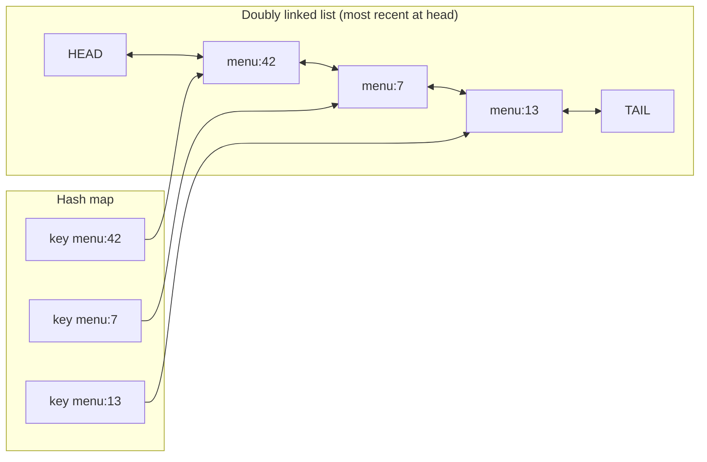

The operations:

```
get(key):
    node = map.get(key)          # O(1)
    if node is null: return miss
    unlink node; insert after HEAD   # mark as most recently used, O(1)
    return node.value

put(key, value):
    if key in map:
        update node.value; move node to front
    else:
        if size == capacity:
            victim = TAIL.prev       # least recently used
            unlink victim; map.remove(victim.key)
        create node; insert after HEAD; map.put(key, node)
```

Use dummy HEAD and TAIL nodes (sentinels) so you never have to handle "list is empty" as a special case. In Java, `LinkedHashMap` with `accessOrder=true` and an overridden `removeEldestEntry` gives you LRU in a few lines, and saying so shows you know the library, but interviewers usually want you to write the hand-built version.

**LFU** adds one more level: a map from frequency to a doubly linked list of keys with that frequency, plus a `minFreq` variable. On `get`, a key moves from list `f` to list `f+1`. On eviction, you remove the least recently used key from the `minFreq` list. All operations stay O(1).

A thread-safety follow-up is common: a single lock around get and put is correct but becomes a bottleneck. Real caches split the key space into segments, each with its own lock (lock striping).

**Redis does not run exact LRU.** Keeping a linked list across millions of keys costs memory, so Redis samples a few random keys (5 by default, setting `maxmemory-samples`) and evicts the least recently used among the sample. This approximate LRU is close enough in practice and much cheaper. Its LFU mode is also approximate, using a small logarithmic counter per key that decays over time.

### 4.7 Invalidation strategies

There is an old joke that the two hard problems in computer science are cache invalidation and naming things. **Invalidation** means making sure the cache stops serving a value once the source data changes. Here are the tools, from crude to sophisticated.

**1. TTL only.** Never delete explicitly, just let entries expire. Simple, and the staleness is bounded by the TTL. Fine for ratings, search results, and anything where "up to 5 minutes old" is acceptable.

**2. Explicit delete in application code.** The service that writes the DB also deletes the key. This is what most teams do. The weakness: every code path that writes that table must remember to delete, including scripts, admin tools and other services. Someone will forget.

**3. Invalidate from the database's change log (CDC).** Instead of trusting every writer, a separate process reads the database's own log of committed changes (MySQL's binlog, PostgreSQL's WAL) and deletes cache keys for every row that changed. Nobody can forget, because the database itself is the trigger. This is called **change data capture**, and we cover it in Part 5.

> **Real world — Facebook:** Facebook built **mcsqueal**, a daemon that tails the MySQL commit log and broadcasts cache deletes, so invalidation does not depend on application code remembering to do it. ([source](https://www.usenix.org/system/files/conference/nsdi13/nsdi13-final170_update.pdf))

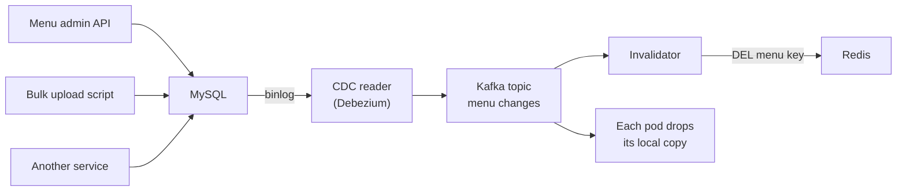

**4. Versioned keys.** Put a version number in the key: `menu:42:v17`. When the menu changes, bump the version stored in a small, rarely-cached place (or in the restaurant row itself). Readers build the key from the current version, so old entries are never read again and simply age out. No delete race is possible, because you never overwrite a key. The cost is an extra lookup for the version.

**5. Broadcast for in-process caches.** Local L1 caches in 200 pods cannot be deleted by one DEL to Redis. You publish an invalidation message (Redis pub/sub or a Kafka topic) and every pod drops the key from its local map. Keep L1 TTLs short (seconds) as a backstop in case a pod misses the message.

In an interview, a good layered answer is: "Delete on write in the owning service, a TTL on every key as a safety net, and if many writers touch the table, CDC-based invalidation so nobody can forget."

### 4.8 Failure modes: how caches hurt you

A cache makes the normal case fast. It also creates new ways to fail, and these are exactly what interviewers probe ("what about thundering herd?" appears in Zomato SDE-1 and SDE-2 reports Z1 and Z12). Each failure below has a name, a picture and standard fixes.

#### Cache stampede (thundering herd, dog-piling)

A hot key expires. In the next few milliseconds, thousands of requests miss at the same time, and **all of them** go to the database to rebuild the same value. The database, which was comfortably serving 1% of traffic, suddenly gets a wall of identical queries, slows down, and every one of those requests waits longer, which lets even more requests pile up.

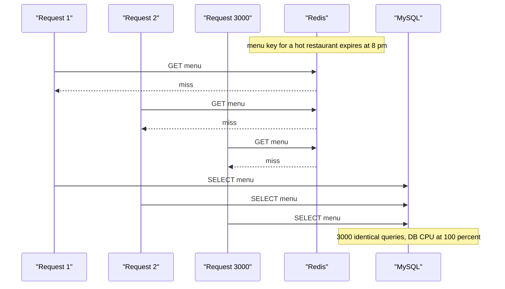

**Fix 1: let only one request rebuild (leases, locks, single-flight).** The first request that misses takes a short lock on that key, such as `SET lock:menu:42 1 NX PX 3000` in Redis (NX means "only if it does not exist", PX is expiry in milliseconds). It goes to the DB. Everyone else either waits a few milliseconds and retries the cache, or is served the old value.

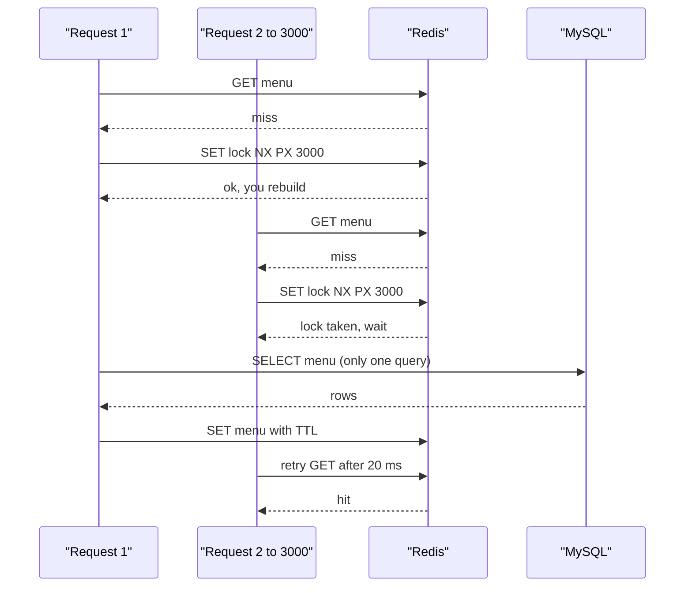

> **Real world — Facebook:** Facebook's lease mechanism hands out a rebuild token for a key **only once every 10 seconds**; other clients wait and retry or get a slightly stale value. In a one-week test on keys prone to herds, **peak database query rate fell from 17,000/s to 1,300/s**. ([source](https://www.usenix.org/system/files/conference/nsdi13/nsdi13-final170_update.pdf))

Inside a single process the same idea is called **single-flight** or **request coalescing**: concurrent callers asking for the same key share one in-flight fetch. Go's `golang.org/x/sync/singleflight` package does exactly this, which is handy given Zomato's services are largely Go.

> **Real world — Discord:** Discord's Rust data services perform **request coalescing**: many concurrent requests for the same row become one database query. They also route requests by channel ID with consistent hashing, so identical requests land on the same instance and can be merged. ([source](https://discord.com/blog/how-discord-stores-trillions-of-messages))

> **Real world — Instagram:** When a new cluster starts with an empty cache, Instagram caches a **promise** (a future) of the value rather than the value, so concurrent misses all wait on the one in-flight fetch. (From a search excerpt of the post.) ([source](https://instagram-engineering.com/thundering-herds-promises-82191c8af57d))

**Fix 2: refresh before expiry (probabilistic early expiration, XFetch).** Instead of everyone missing at the exact expiry moment, each reader that gets a hit rolls a die. The closer the key is to expiry, and the more expensive it is to recompute, the more likely the reader is to refresh it early, in the background, while still serving the cached value. One lucky request refreshes; nobody ever sees a miss.

```
store with the value:  delta = how long the last recompute took
                       expiry = when the key expires
on every read:
    if now − delta × beta × ln(random()) ≥ expiry:
        recompute and reset the key          # early refresh
    else:
        return cached value
```

`ln(random())` is negative, so the left side is "now, pushed forward by a random amount". `beta` (default 1.0) tunes how eager it is. This rule comes from Vattani, Chierichetti and Lowenstein's VLDB 2015 paper "Optimal Probabilistic Cache Stampede Prevention" (DOI 10.14778/2757807.2757813). The research for this guide confirmed the formula's variables against an implementation's docs rather than the paper text itself.

**Fix 3: serve stale while revalidating.** Keep two times on each entry: a "soft" expiry after which you refresh in the background, and a "hard" expiry after which you truly must reload. Between them, you return the old value instantly. Users get a menu that is a few seconds stale; the DB sees one query.

**Fix 4: TTL jitter.** If you load 50,000 restaurant menus at 7 am with TTL exactly 1 hour, they all expire at 8 am, which is a self-made stampede. Add randomness: `TTL = 3600 + random(0, 600)` seconds. Expiries spread over 10 minutes.

**Fix 5: warm the cache before traffic arrives.** A cold cache (after a deploy, a new cluster, or a flush) means a 0% hit ratio and the full load on the DB. **Warmup** means pre-loading the keys you know will be hot before users show up: top restaurants per city before lunch, all menus before New Year's Eve.

**Connect to your work (Myntra):** At Myntra you warmed about 5.7 million keys. The first attempt fired requests so fast that the downstream service's rate limiter started rejecting them. Adding a 4 ms pacing delay between calls fixed it. This is a great story because it shows warmup is itself a load event: you must pace it so warming the cache does not take down the thing behind it. Quick maths to show you understand it: 5.7M keys at one call every 4 ms per worker is 250 calls/s per worker, so one worker takes about 6.3 hours, and 10 parallel workers about 38 minutes. Pick the worker count from the downstream limit, not from how fast you want to finish.

> **Real world — Zomato:** Before NYE 2023 Zomato **cached frequently used queries** to take load off databases, and in chaos tests it **injected cache misses on purpose** to check that databases survive if the cache layer fails. ([source](https://www.zomato.com/blog/a-tale-of-scale-behind-the-scenes-at-zomato-tech-for-nye-2023))

#### Cache penetration (missing keys)

A request asks for something that does not exist, such as `restaurant_id = 99999999`. The cache misses (nothing to cache), the DB returns nothing, and so nothing is stored. The next identical request does the same thing. An attacker or a buggy client looping through random IDs bypasses the cache entirely and hammers the DB.

**Fix 1: cache the "not found".** Store a special null marker, `SET restaurant:99999999 "__NULL__" EX 60`, with a short TTL. Repeated lookups now hit the cache. Keep the TTL short in case that ID gets created.

**Fix 2: a Bloom filter in front.** A **Bloom filter** is a compact structure that answers "is this key definitely absent, or possibly present?" It is an array of bits plus a few hash functions. To add a key, hash it with each function and set those bits to 1. To check a key, hash it the same way: if **any** of those bits is 0, the key was never added, so you can reject the request without touching the cache or DB.

```
Bit array of 16 bits, 3 hash functions (h1, h2, h3)

add "rest:101":  h1=2, h2=7, h3=11
add "rest:205":  h1=4, h2=7, h3=14

index:  0 1 2 3 4 5 6 7 8 9 10 11 12 13 14 15
bits:   0 0 1 0 1 0 0 1 0 0  0  1  0  0  1  0

check "rest:999": h1=3, h2=7, h3=11 → bit 3 is 0 → DEFINITELY ABSENT, reject
check "rest:101": h1=2, h2=7, h3=11 → all 1     → maybe present, go to cache
check "rest:333": h1=2, h2=4, h3=14 → all 1     → maybe present (false positive!)
```

A Bloom filter never gives a false "absent", but it can give a false "maybe present" when other keys happen to set the same bits. The false-positive rate depends on bits per key; about 10 bits per key with 7 hash functions gives roughly 1% false positives (standard result). For 1 million restaurant IDs that is about 1.2 MB, small enough for every pod's memory. A basic Bloom filter cannot delete keys; counting Bloom filters or periodic rebuilds handle that.

> **Real world — Zomato:** Zomato's ClickHouse logging platform uses a `tokenbf_v1` index, which is a token Bloom filter, to make `LIKE` searches skip data blocks that cannot contain the search word. Same idea, different use. ([source](https://www.zomato.com/blog/building-a-cost-effective-logging-platform-using-clickhouse-for-petabyte-scale))

#### Cache avalanche

A stampede is one hot key. An **avalanche** is many keys at once, or the whole cache disappearing. Two causes:

1. **Mass expiry:** many keys were set together with the same TTL (the 7 am bulk load). Fix: TTL jitter.
2. **Cache cluster failure:** a Redis node or the whole cluster goes down, and 100% of reads fall through to the DB, which was sized for 1%.

```
DB load (reads/s), assumed 100k reads/s total, 99% hit ratio

normal:          ▇ 1,000
cache node lost: ▇▇▇▇▇▇▇▇▇▇▇▇▇▇▇▇▇▇▇▇▇▇▇▇▇ 25,000   (1 of 4 shards gone)
cluster down:    ▇▇▇▇▇▇▇▇▇▇▇▇▇▇▇▇▇▇▇▇▇▇▇▇▇▇▇▇▇▇▇▇▇▇▇▇▇▇▇▇... 100,000
```

Fixes for cluster failure: replicas with automatic failover so one node dying does not empty a shard; an L1 in-process cache that keeps serving the hottest keys for a few seconds; a **circuit breaker** that sheds non-critical reads instead of letting them all hit the DB; and rate limits on the DB path.

> **Real world — Facebook:** Facebook keeps a **gutter pool**, about **1% of memcached servers**, that takes over for failed servers with short TTLs, instead of rehashing keys onto healthy servers. Rehashing is risky because one hot key can be **20% of a server's requests** and could overload its new home. The gutter pool **cut client-visible failures by 99%**. ([source](https://www.usenix.org/system/files/conference/nsdi13/nsdi13-final170_update.pdf))

#### Hot keys (the celebrity problem)

Redis spreads keys across shards. But if one key is extremely popular, say a viral promo banner or the menu of the one restaurant everyone orders from during a cricket final, all its traffic lands on **one shard**, regardless of how many shards you have. That one node maxes out its CPU or network while the rest sit idle.

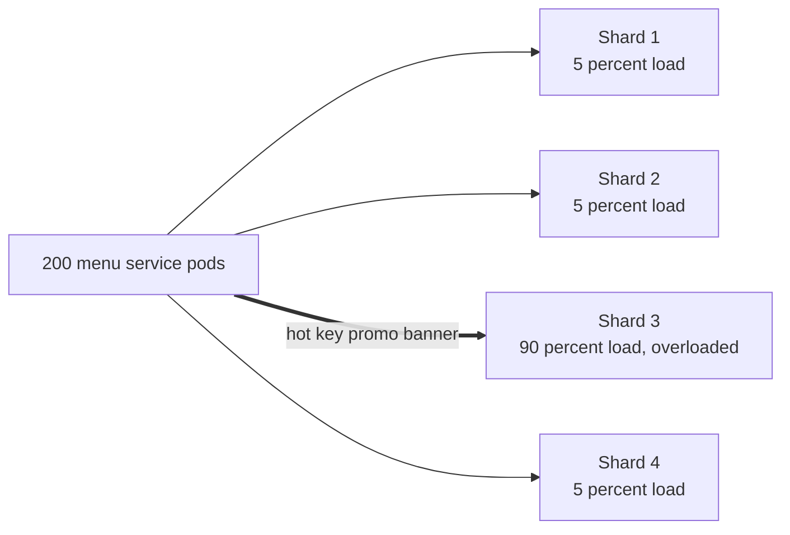

Fixes:

- **Local L1 cache for hot keys.** Keep the hot key in each pod's memory for a few seconds. 200 pods each asking Redis once every 5 seconds is 40 reads/s instead of 100,000.
- **Key replication (salting).** Store copies as `banner:1#0`, `banner:1#1`, ... `banner:1#9`; the hash spreads them over different shards. Readers pick a random suffix. Writers must update all copies.
- **Read replicas.** Let reads for that shard go to its replicas too.
- **Detect them.** Redis has `redis-cli --hotkeys` (needs an LFU eviction policy) and client-side counters. You cannot fix what you cannot see.

### 4.9 Cache and database consistency, and the two-cache drift

Once you have a cache, you have two copies of the truth, and they can disagree. You have to decide how much disagreement is acceptable. There are three levels:

- **Eventual consistency (the normal case):** the cache may be stale for up to one TTL or until invalidation arrives. Fine for menus and ratings.
- **Read-your-writes:** the user who just changed something must see it, even if others see the old version briefly. Example: a restaurant owner edits a dish and reloads; they should see their change. Fix: after a write, read that user's next request from the DB, or write-through for that user's own data.
- **Strong consistency:** nobody ever sees stale data. A cache cannot give you this cheaply. If you truly need it (wallet balance, payment status, seat inventory at the moment of booking), read the database.

There is no way to update a database and a cache atomically, because they are separate systems with no shared transaction. Every cache design accepts some window of inconsistency and then limits it with TTLs, deletes and CDC.

#### Two caches out of sync

Things get worse when you have two caches. A common setup is an in-process L1 plus a shared L2, or two separate caches maintained by two different services that each cache the same underlying data.

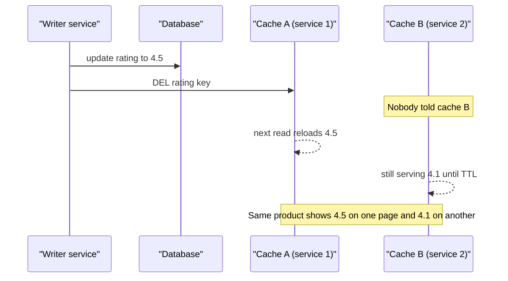

**Connect to your work (Myntra):** You hit exactly this bug at Myntra: two caches holding the same data drifted apart, so users could see different values depending on which path served them. In an interview, tell it as: what the symptom was, why it happened (one write path invalidated only one cache, or the two caches had different TTLs and refresh triggers), and the fix. The standard fixes are:

1. **One owner.** Only one service caches a given piece of data. Others call that service instead of building their own copy.
2. **Invalidate both from one event.** Publish a "rating changed" event (Kafka, or CDC from the DB) that both caches consume.
3. **Same TTL and same key scheme**, so drift is at least bounded by the same window.
4. **Short L1 TTL.** If one cache is a local L1 in front of the other, keep its TTL much shorter (seconds) than L2's.

Don't invent details of the real Myntra fix that you don't remember; describe what you actually did and use the list above to show you know the general solutions.

### 4.10 Redis deep dive

Redis (REmote DIctionary Server) is an in-memory data store. "In-memory" means all data lives in RAM, which is why reads take microseconds on the server. It is the most common cache in interviews, and Zomato runs it at 35 TB through AWS ElastiCache, so it is worth knowing well. Interview reports ask "why is Redis single-threaded and still fast?" and "how does it scale?" (Z1, Z12).

#### Data structures and where a food delivery app would use them

Redis is much more than a key-value store. Each key holds one of several types, and the type determines which commands work.

| Type | What it is | Food delivery use | Key commands |
|---|---|---|---|
| String | A blob up to 512 MB, or a number | Cached menu JSON, counters, locks, rate-limit counters | `GET`, `SET key val EX 600 NX`, `INCR`, `MGET` |
| Hash | A map of field to value under one key | Restaurant profile fields, a cart (item id to quantity) | `HSET`, `HGET`, `HGETALL`, `HINCRBY` |
| List | Ordered list, push and pop at either end | Simple job queue, recent searches per user | `LPUSH`, `RPOP`, `BRPOP`, `LRANGE`, `LTRIM` |
| Set | Unordered unique members | Users who already got a promo push (dedupe), dishes a user liked | `SADD`, `SISMEMBER`, `SINTER` |
| Sorted set (ZSET) | Unique members each with a numeric score, kept sorted | Leaderboards, top restaurants by orders, delay queues (score = run time), sliding-window rate limiting | `ZADD`, `ZRANGE`, `ZRANGEBYSCORE`, `ZINCRBY`, `ZREM` |
| Geo | A sorted set with geohash scores | "Riders within 3 km of this restaurant" | `GEOADD`, `GEOSEARCH` |
| Bitmap | String used as a bit array | Daily active users, feature flags per user id | `SETBIT`, `GETBIT`, `BITCOUNT` |
| HyperLogLog | Approximate unique count in 12 KB | Unique visitors to a restaurant page | `PFADD`, `PFCOUNT` |
| Stream | Append-only log with consumer groups | Lightweight event log or queue | `XADD`, `XREADGROUP`, `XACK` |
| Pub/Sub | Fire-and-forget broadcast channel | Cache invalidation broadcast to pods | `PUBLISH`, `SUBSCRIBE` |

Note that how Zomato stores live rider locations is **not public**. Redis GEO is one typical way to do it; say "one common approach" rather than "Zomato does this".

#### Why single-threaded and still fast

Redis executes commands on **one main thread**, one command at a time. That sounds slow, but:

- Everything is in RAM, so each command takes microseconds. The bottleneck is network and memory, not CPU.
- There are **no locks**. Multi-threaded stores spend a lot of time acquiring and releasing locks and fighting over CPU caches; Redis does not.
- It uses **I/O multiplexing** (`epoll` on Linux): one thread watches thousands of client sockets and handles whichever is ready, so it never sits idle waiting for one slow client.
- Since Redis 6, separate **I/O threads** can read and write network sockets, while command execution stays on the main thread.

A single Redis node can do on the order of 100,000+ simple operations per second (a commonly quoted rough figure; it depends on hardware and command mix). To go beyond one core, you run more nodes (Redis Cluster).

The big benefit of one thread: **every command is atomic**. `INCR` cannot be interrupted halfway by another client. Two users clicking "claim the last coupon" at the same time are processed one after the other.

The big danger: **one slow command blocks everyone**. `KEYS *` on 50 million keys, `HGETALL` on a giant hash, or `DEL` on a huge set will freeze the server for every client. Use `SCAN` instead of `KEYS`, keep values small, and use `UNLINK` (background delete) for big keys.

#### Lua scripts and transactions

What if you need several commands to run as one atomic unit, such as "check the token count and, if positive, decrement it"? Doing `GET` then `DECR` from your app has a gap where another client can sneak in. Redis lets you send a **Lua script** that runs on the server; because of the single thread, nothing else runs until the script finishes.

```lua
-- Atomic "take one token if available" for a rate limiter
local tokens = tonumber(redis.call('GET', KEYS[1]) or '0')
if tokens > 0 then
  redis.call('DECR', KEYS[1])
  return 1   -- allowed
end
return 0     -- rejected
```

> **Real world — GitHub:** GitHub's API rate limiter runs on Redis and uses **Lua scripts** to keep each check-and-increment atomic. They also moved rate-limit counters off a shared Memcached because cache memory pressure was **evicting live rate-limit counters**. ([source](https://github.blog/2021-04-05-how-we-scaled-github-api-sharded-replicated-rate-limiter-redis/))

The lesson from GitHub is worth repeating in interviews: do not put important counters (rate limits, locks) in the same cache that evicts menus under memory pressure. Give them their own Redis with `noeviction`.

**Connect to your work (Myntra):** You ran a token bucket per pod, starting at 180 requests per minute. A per-pod limiter needs no shared store, so no Redis round trip, but the global limit becomes "180 × number of pods" and changes as pods scale. A shared Redis token bucket with a Lua script gives an exact global limit at the cost of a network hop. Be ready to explain why per-pod was good enough for your case.

`MULTI`/`EXEC` is Redis's other transaction tool: it queues commands and runs them together, but it cannot make decisions based on values read inside the transaction (you need `WATCH` for optimistic locking, or Lua).

#### Persistence: RDB and AOF

Redis lives in RAM, so what happens on restart? Two options, often combined:

- **RDB snapshots:** every N minutes (or after M writes), Redis forks a child process that writes the whole dataset to a compact file. Fast restarts, small files. You lose everything since the last snapshot on a crash.
- **AOF (append-only file):** every write command is appended to a log. With `appendfsync everysec`, you lose at most about one second of writes. Files are bigger and restarts slower (replaying the log), so Redis periodically rewrites the AOF to compact it.

For a pure cache, you might turn persistence off entirely; a restart just means a cold cache (warm it). For a Redis that holds state you care about (sessions, rate-limit counters, delay queues), use AOF plus replicas. But remember: even with AOF, Redis is not a replacement for a real database (see 4.13).

#### Replication and Sentinel

A Redis **primary** accepts writes and streams them to one or more **replicas**. Replication is **asynchronous**: the primary replies "OK" to the client before the replica has the write. If the primary dies right then, that write is lost.

**Redis Sentinel** is a set of watcher processes (run at least three) that monitor the primary. If a majority agrees the primary is down, they promote a replica and tell clients the new address. ElastiCache offers the same thing as "Multi-AZ with automatic failover".

> **Real world — Redis docs:** The official Redis distributed-lock docs warn that failover setups are unsafe for locks **because replication is asynchronous**: a primary can crash before the lock key reaches the replica, so two clients both get the lock. They recommend **fencing tokens** for correctness. ([source](https://redis.io/docs/latest/develop/clients/patterns/distributed-locks/))

#### Redis Cluster: 16,384 hash slots

One Redis node holds what fits in one machine's RAM and uses roughly one core for commands. To scale out, **Redis Cluster** splits the key space into **16,384 hash slots**. Each key maps to a slot with `slot = CRC16(key) mod 16384`, and each primary node owns a range of slots.

```
                 CRC16("menu:42") mod 16384 = 9,173   → Node B
                 CRC16("cart:u77") mod 16384 = 2,051  → Node A

   slots 0 ─────────── 5460 | 5461 ────────── 10922 | 10923 ────────── 16383
        ┌────────────────┐  ┌──────────────────┐   ┌──────────────────┐
        │ Node A primary │  │  Node B primary  │   │  Node C primary  │
        │  + replica A1  │  │   + replica B1   │   │   + replica C1   │
        └────────────────┘  └──────────────────┘   └──────────────────┘
```

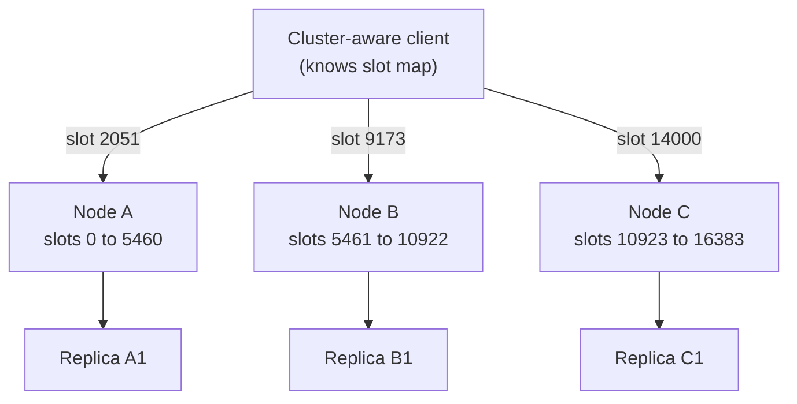

Important details:

- **Clients are cluster-aware.** They cache the slot-to-node map. If they ask the wrong node, it replies `MOVED 9173 10.0.0.5:6379`, and the client updates its map.
- **Adding a node** moves some slots (and their keys) to it. Only those keys move, not everything, which is the same benefit consistent hashing gives.
- **Multi-key commands** (`MGET`, Lua scripts touching several keys) only work if all keys are in the same slot. **Hash tags** force that: only the part inside `{}` is hashed, so `{order:123}:items` and `{order:123}:status` land in the same slot.
- **Each primary has replicas**, and if a primary fails the cluster promotes its replica automatically.

> **Real world — Zomato:** Zomato's online ML feature store keeps real-time features, computed from Kafka by Flink, in **Redis Cluster**. Batch features live in DynamoDB, with hot keys cached in Redis. It was load-tested to about **18 million requests/min** before NYE 2021. ([source](https://www.zomato.com/blog/elements-of-scalable-machine-learning/))

#### Eviction policies (`maxmemory-policy`)

When Redis hits its `maxmemory` limit, this setting decides what happens:

| Policy | Evicts | Use when |
|---|---|---|
| `noeviction` | Nothing, writes return errors | Redis holds data you must not lose (locks, rate limits, queues) |
| `allkeys-lru` | Approximately least recently used, any key | General-purpose cache (common default choice) |
| `allkeys-lfu` | Approximately least frequently used, any key | A few keys stay hot for a long time |
| `volatile-lru` | LRU, only among keys with a TTL | Mixed: cache keys have TTLs, permanent keys do not |
| `volatile-lfu` | LFU, only among keys with a TTL | Same, with frequency |
| `allkeys-random` | Random key | Uniform access |
| `volatile-random` | Random key with a TTL | Rare |
| `volatile-ttl` | Key with the shortest remaining TTL | You want soonest-to-expire gone first |

### 4.11 Redis vs Memcached vs Aerospike

| | Redis | Memcached | Aerospike |
|---|---|---|---|
| Data model | Rich types (hash, list, ZSET, geo, stream) | Plain key to blob | Records with bins (named fields) in namespaces and sets |
| Threads | One command thread (I/O threads optional) | Multi-threaded | Multi-threaded |
| Storage | RAM, optional RDB/AOF to disk | RAM only | Index in RAM, data in RAM or on SSD (hybrid) |
| Persistence | Yes, optional | None | Yes, built in |
| Replication and failover | Primary-replica, Sentinel, Cluster | None built in (client-side sharding) | Built in, with automatic rebalancing |
| Scaling | Redis Cluster, 16,384 slots | Client-side consistent hashing | Automatic partitioning (4,096 partitions) |
| Best for | Caching plus data-structure tricks (leaderboards, locks, queues, rate limits) | Simple, huge, multi-core look-aside caching | Large datasets with low latency at lower cost than all-RAM |
| Who uses it (from research) | Zomato ElastiCache 35 TB, GitHub rate limiter | Facebook memcache, Netflix EVCache, Twitter Twemcache | Myntra ratings cache (your project) |

The short version for an interview: "Memcached if I only need a fast, simple blob cache and want multi-threading. Redis if I also need data structures, atomic scripts, persistence or replication. Aerospike when the dataset is too big to keep all in RAM economically and I want SSD-backed low latency."

**Connect to your work (Myntra):** Be ready for "why Aerospike and not Redis?" A fair answer (if true for your team): ratings data for every product is large, Aerospike keeps the index in RAM but data on SSD so it costs less per GB, and it has replication built in. If you don't know the original reason, say "the choice predates me; here's how I'd reason about it" rather than inventing one.

### 4.12 Caching at real scale

> **Real world — Zomato:** NYE 2023: **35 TB** ElastiCache, **20 Gbps**, about **1 billion GETs/min** and about **100 million SETs/min**. That is roughly 16.7M GETs per second, at a 10:1 read-write ratio. ([source](https://www.zomato.com/blog/a-tale-of-scale-behind-the-scenes-at-zomato-tech-for-nye-2023))

> **Real world — Netflix:** EVCache, Netflix's Memcached-based cache, runs in **4 regions** on **200 Memcached clusters** and **22,000 servers**, serving about **400 million operations per second** over about **2 trillion items (14.3 PB)**, using extstore to spill to SSD. For cross-region replication, the writing client sends **only metadata (key, TTL, timestamp) to Kafka**; a reader service then re-reads the value locally and ships it to remote regions, with an SQS retry queue for failures. (Reported in an InfoQ article written by Netflix engineers.) ([source](https://infoq.com/articles/netflix-global-cache))

> **Real world — Twitter:** Across 153 Twemcache clusters (about **700 billion requests, 80 TB** traced), **more than 35% of clusters were write-heavy** (more than 30% writes). Not every cache is read-heavy. ([source](https://junchengyang.com/publication/osdi20-twemcache.pdf))

> **Real world — Facebook:** Memcache at Facebook handles **billions of requests per second** over **trillions of items**, with mcrouter as the routing proxy. ([source](https://www.usenix.org/system/files/conference/nsdi13/nsdi13-final170_update.pdf))

The Twitter finding is a useful interview point: before saying "add a cache", check the read-write ratio. If 40% of operations are writes and you delete on every write, most reads will miss and the cache gives little.

### 4.13 The trap: "With infinite money, why not replace the database with a cache?"

This exact question was asked in a Blinkit SDE-2 round, and the candidate could not answer (report B12). A Blinkit SDE-1 round asked a variant: "what happens if we use only Redis and no database?" (B3). Money solves RAM size. It does not solve these:

1. **Durability.** RAM is lost on power failure or crash. Redis AOF with `everysec` can lose about a second of writes, and asynchronous replication can lose acknowledged writes on failover. A database with a write-ahead log fsynced on commit and synchronous replication is designed not to lose a committed order.
2. **Querying.** A cache answers "give me key X". A database answers "all orders for restaurant 42 in the last hour, not yet delivered, sorted by time" with indexes, joins and aggregations. In a key-value store you would have to hand-build and maintain every index yourself.
3. **Transactions and constraints.** Placing an order touches the order, the payment attempt, the coupon usage and inventory. A database gives you ACID transactions, foreign keys, unique constraints ("one coupon per user") and isolation levels. Redis Lua scripts are atomic on one node and one slot, not across a cluster, and there is no rollback.
4. **Consistency guarantees.** Caches are designed to be allowed to lose or evict data. Eviction is a feature for a cache and a disaster for a system of record.
5. **Operations.** Backups, point-in-time recovery, schema migrations, auditing, access control, and tooling for analysts all exist around databases.

A crisp answer: "Speed isn't the only reason we have a database. We need durability, rich queries, multi-row transactions and constraints. A cache is a copy optimised for speed that is allowed to be lost. With infinite money I'd make the database faster and give it more RAM so its buffer pool holds everything, which gets most of the speed while keeping all the guarantees." That last sentence shows real understanding: a database with everything in its buffer pool *is* an in-memory system with durability attached.

### 4.14 What not to cache

- **Money and decisions.** Wallet balances, payment status, the final price at checkout, coupon redemption counts. Read the source of truth when you act.
- **Data that changes faster than it is read.** A write-heavy key with delete-on-write just churns.
- **Unique, one-off results.** Personalised search results with random parameters; nobody reads them twice.
- **Large blobs.** A 5 MB value in Redis blocks the single thread while it is sent. Put large files in S3 and cache only a pointer or use a CDN.
- **Sensitive data without thought.** Card details, OTPs in plain form, personal data in a shared cache that many services can read.
- **Things that need strong consistency across users,** such as the last seat for a show or the last unit of an item at a dark store. Use a database row with a conditional update.
- **Anything you have not measured.** A cache adds a dependency, a consistency problem and an operational cost. Add it where profiling shows the hot path.

### Check yourself

**Q: Cache read is 1 ms, DB read is 30 ms. What is the effective latency at a 95% hit ratio?**
A: 0.95 × 1 + 0.05 × (1 + 30) = 0.95 + 1.55 = 2.5 ms.

**Q: Why does going from a 90% to a 99% hit ratio matter so much?**
A: DB load depends on the miss ratio, which drops from 10% to 1%, a 10x reduction in queries reaching the database.

**Q: On a write, why delete the cache key instead of setting the new value?**
A: Two concurrent writers can apply their SETs in the wrong order and leave a stale value in the cache. Deletes are idempotent, so their order doesn't matter, and the next read loads the correct value. Facebook does this for that reason.

**Q: What is the difference between a cache stampede and a cache avalanche?**
A: A stampede is many requests missing on one hot key at once and all hitting the DB. An avalanche is many keys expiring together or the cache cluster failing, so a large share of all traffic falls through to the DB.

**Q: Name four fixes for a stampede.**
A: Leases or a rebuild lock (single-flight or request coalescing), probabilistic early refresh (XFetch), serve-stale-while-revalidate, and TTL jitter, plus warming the cache before peaks.

**Q: How does a Bloom filter prevent cache penetration, and what error can it make?**
A: It rejects keys whose hashed bits aren't all set, which means they definitely don't exist, before the cache or DB is touched. It can give false positives ("maybe present" for an absent key) but never false negatives.

**Q: Why is Redis fast even though it executes commands on one thread?**
A: Data is in RAM, there are no locks, and epoll-based I/O multiplexing serves many sockets from one thread. Every command is atomic as a side effect. Redis 6+ can also offload socket I/O to extra threads.

**Q: How does Redis Cluster decide which node holds a key, and how do you keep two keys together?**
A: slot = CRC16(key) mod 16384, and each primary owns a slot range. Hash tags, such as {order:123}, make only the braced part get hashed, so related keys share a slot.

**Q: What is a hot key, and two ways to handle it?**
A: One key so popular that its single shard overloads. Cache it in each pod's local memory for a few seconds, or replicate it under salted keys spread across shards.

**Q: Why shouldn't rate-limit counters live in the same Redis as your menu cache?**
A: Under memory pressure an LRU policy can evict live counters, which resets limits. GitHub hit exactly this with a shared Memcached. Use a separate Redis with noeviction.

**Q: The interviewer asks "With infinite money, why not just use a cache instead of the database?" Answer in two sentences.**
A: A cache trades durability, rich queries, multi-row transactions and constraints for speed, and is designed to be allowed to lose data. With infinite money I'd give the database enough RAM for its buffer pool to hold everything, keeping the guarantees and getting most of the speed.

**Q: What TTL would you give a restaurant's open/closed status, and is the cache enough at checkout?**
A: Something short like 30 seconds for browsing. At order placement you re-check the DB, because the cache is for browsing and the database is for deciding.

## Part 5: Asynchronous processing

Caching makes reads cheap. Asynchronous processing makes writes and side effects survivable. When a user taps "Place order", a dozen things must happen: the restaurant must be told, a rider found, a push sent, the billing ledger updated, analytics recorded. This part is about which of those must happen *before* the user sees "Order placed", which can happen *after*, and how to make the "after" part reliable when servers crash, networks fail and messages arrive twice.

### 5.1 Synchronous vs asynchronous: placing an order

**Synchronous** means the caller waits for the answer before continuing. **Asynchronous** means the caller hands off the work and continues; the work finishes later.

Here is a naive synchronous order placement. The order service calls every downstream service in sequence and only replies to the user at the end.

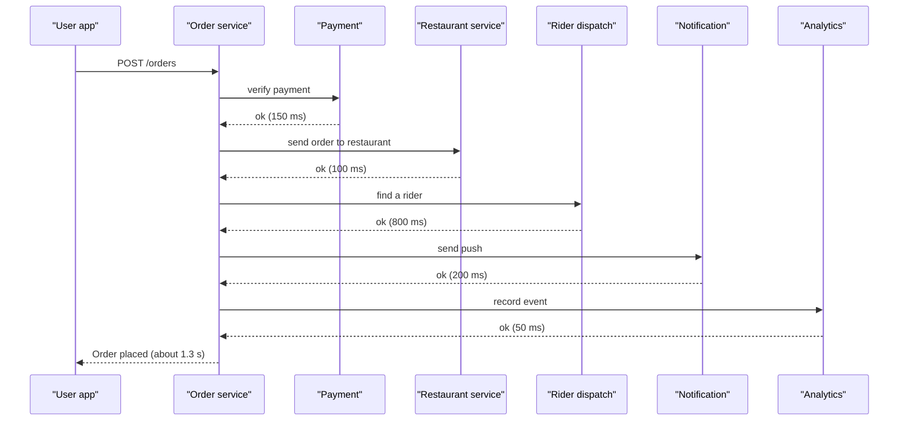

Three problems (latencies here are assumptions):

1. **Latency adds up.** The user waits for the slowest chain, about 1.3 s.
2. **Availability multiplies down.** If each of five services is up 99.9% of the time, the chance all five are up is 0.999^5 ≈ 99.5%. Analytics being down should never stop someone ordering dinner.
3. **Coupling.** The order service must know about every downstream service. Adding a new consumer (say, a loyalty points service) means changing and redeploying the order service.

Now the asynchronous version. The order service does only what the user must wait for (save the order, confirm payment) and publishes one event. Everyone else reacts to the event on their own time.

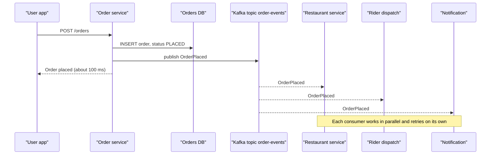

The user gets a reply in about 100 ms. If notifications are down, events wait in Kafka and are delivered when the service recovers. A new loyalty service just subscribes to the topic; the order service never changes.

The rule of thumb for deciding: **do synchronously what the user needs to see the result of right now, and what decides whether the request succeeds. Do asynchronously everything that can be retried later without the user noticing.** Payment authorisation and "is the restaurant open?" are synchronous. Push notifications, analytics, emails, invoices and ledger updates are asynchronous. Rider assignment sits in between: the user does not need to wait for it, but it must happen soon, so it is async with tight monitoring.

> **Real world — Zomato:** Zomato's NYE 2023 post calls Kafka **"the backbone of our event-driven architecture"**, handling **450+ million messages per minute** at a cluster peak of **5.6 GBps**. ([source](https://www.zomato.com/blog/a-tale-of-scale-behind-the-scenes-at-zomato-tech-for-nye-2023)) The billing platform's services also communicate over Kafka. ([source](https://aws.amazon.com/blogs/database/unlocking-performance-scalability-and-cost-efficiency-of-zomatos-billing-platform-by-switching-from-tidb-to-dynamodb/))

Interviewers test whether you actually understand this. A Blinkit SDE-1 round on order tracking asked exactly: **"Why asynchronous? What problem does it solve? What happens if the consumer is down? How would you handle duplicate events?"** (report B2). By the end of this part you will have crisp answers to all four (summarised in 5.20).

### 5.2 What a queue gives you

A **message queue** (or broker) is a service that stores messages from **producers** until **consumers** take them. It provides three things.

**1. Decoupling.** The producer does not know who consumes, how many consumers there are, or whether they are up. It only knows the topic name. Teams can deploy, scale and fail independently.

**2. Load levelling (buffering).** Traffic is spiky. At 8:06 pm on New Year's Eve, orders spike far above the average. Without a queue, every downstream service must be sized for the peak. With a queue, the spike piles up in the queue and consumers drain it at their steady rate.

```
Incoming events per second (assumed numbers)

  6000 |            ▇▇
  5000 |           ▇▇▇▇
  4000 |          ▇▇▇▇▇▇
  3000 | ---------▇▇▇▇▇▇▇▇--------- consumer capacity 3000/s
  2000 |       ▇▇▇▇▇▇▇▇▇▇▇▇
  1000 |▇▇▇▇▇▇▇▇▇▇▇▇▇▇▇▇▇▇▇▇▇▇▇▇▇▇
       +-------------------------------- time
              ^ spike above the line piles up in the queue (backlog),
                then drains after the peak. Nothing is dropped,
                consumers never see more than 3000/s.
```

The cost is delay: messages that arrive during the spike wait in the backlog. That is fine for analytics and invoices; for rider dispatch you watch the backlog closely (see 5.14).

**3. Retries and durability.** If a consumer crashes halfway, the message is still in the queue and will be delivered again. Work is not lost just because one process died.

There is also a fourth, quieter benefit: **fan-out**. One event can feed ten consumers without the producer doing ten calls.

**Connect to your work (Atlassian):** Your SQS queues with worker pools are a textbook example. The API accepts the job, puts a message on SQS and returns; a pool of workers pulls messages at a controlled rate. That is decoupling, load levelling and retry in one design.

### 5.3 Point-to-point vs publish/subscribe

Two delivery models:

- **Point-to-point (work queue):** each message is processed by **exactly one** consumer out of many workers. Use it to share work: "generate this invoice PDF". SQS standard queues and RabbitMQ queues work this way.
- **Publish/subscribe (pub/sub):** each message is delivered to **every** subscriber. Use it to broadcast facts: "order 123 was placed", which the restaurant, dispatch and notification services all need.

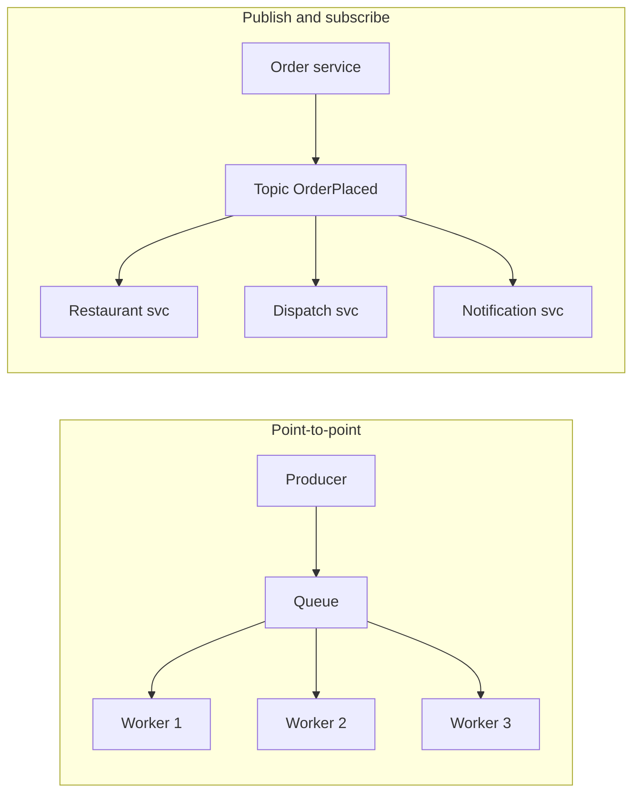

In the point-to-point box, each message goes to one of W1, W2 or W3. In the pub/sub box, each message goes to all three services.

Kafka does both at once through **consumer groups**: every group gets every message (pub/sub between groups), and within a group each message goes to one member (point-to-point within a group). On AWS, the usual combination is **SNS** (pub/sub fan-out) feeding several **SQS** queues (one work queue per subscriber).

### 5.4 Kafka deep dive

Kafka comes up in about 12 of the Zomato-group interview reports, nearly always as a follow-up on queues, consumer lag, idempotency or "Kafka vs SQS/RabbitMQ" (`sources/interview_reports.md`). One Zomato round reportedly spent **about 40 minutes on Kafka**. So this section goes deep.

#### The core idea: a log, not a queue

Kafka was built at LinkedIn for high-volume log collection. Its central data structure is a **log**: an append-only, ordered sequence of records on disk. Producers append to the end. Consumers read from any position and remember how far they got. **Reading does not delete anything.** Messages stay until a retention time passes, so many consumers can read the same data, and a consumer can rewind and re-read.

> **Real world — LinkedIn:** Kafka was introduced in a 2011 LinkedIn paper for high-volume, low-latency log collection serving both offline and online consumers. ([source](https://classpages.cselabs.umn.edu/Spring-2018/csci8980/Papers/PublishSubscribe/Kafka.pdf))

#### Brokers, topics, partitions, offsets

- A **broker** is one Kafka server. A **cluster** is several brokers.
- A **topic** is a named stream of related messages, such as `order-events`.
- A topic is split into **partitions**. Each partition is its own ordered log, stored on one broker (plus replicas). Partitions are how Kafka scales: different partitions live on different brokers and are read by different consumers in parallel.
- Each message in a partition gets an **offset**: its position number, 0, 1, 2, and so on, which only ever grows.

```
Topic: order-events  (3 partitions)

Partition 0:  | 0: ord-11 PLACED | 1: ord-14 PLACED | 2: ord-11 ACCEPTED | 3: ord-11 PICKED | → new writes
Partition 1:  | 0: ord-12 PLACED | 1: ord-12 ACCEPTED | 2: ord-17 PLACED |                   → new writes
Partition 2:  | 0: ord-13 PLACED | 1: ord-15 PLACED | 2: ord-13 CANCELLED | 3: ord-15 ACCEPTED | 4: ... →

Consumer group "notifications" committed offsets:  P0 → 2,  P1 → 3,  P2 → 4
   (meaning: next message to read in P0 is offset 2)
Consumer group "analytics" committed offsets:      P0 → 4,  P1 → 1,  P2 → 0
   (each group tracks its own position independently)
```

#### Keys and per-key ordering

When a producer sends a message, it can give a **key**. Kafka picks the partition by hashing the key: `partition = hash(key) mod number_of_partitions`. All messages with the same key go to the same partition, and **within one partition, order is guaranteed**. Across partitions there is no ordering.

So for order events, use `order_id` as the key. Every event for order 11 (PLACED, ACCEPTED, PICKED) lands in partition 0, in order, and a consumer never sees PICKED before PLACED. Events for different orders can be processed in any order relative to each other, which is fine.

Two warnings. First, if you **add partitions** later, `hash(key) mod N` changes and a key's new messages may go to a different partition than its old ones, briefly breaking ordering. Choose a partition count with headroom. Second, a **skewed key** (one restaurant with a huge share of events if you key by `restaurant_id`) creates a hot partition, the Kafka version of a hot key.

#### Consumer groups

A **consumer group** is a set of consumer processes that share the work of reading a topic. Kafka assigns each partition to **exactly one** consumer in the group at a time. One consumer may own several partitions.

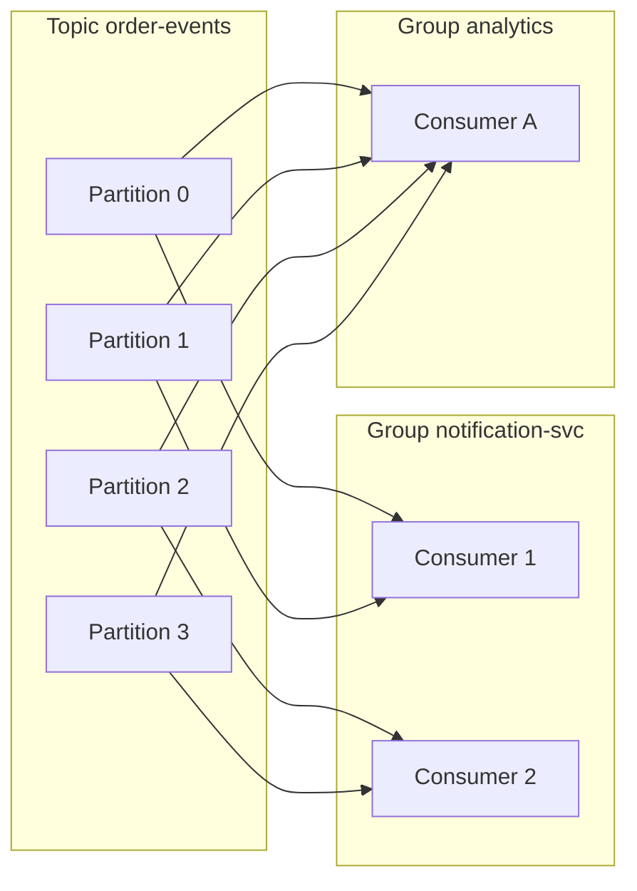

Consequences you must be able to say out loud:

- **Max parallelism in a group = number of partitions.** With 4 partitions, a 5th consumer in the same group sits idle. To scale consumers, you need enough partitions up front.
- **Different groups are independent.** Notifications and analytics each get every message and keep separate offsets.
- **Ordering is per partition**, and since one consumer owns a partition, it sees that partition's messages in order.

> **Real world — Grab:** Grab's campaign platform notes that **Kafka partition count must be at least the number of consumer servers**, and uses separate topics per action type and country so small urgent campaigns don't wait behind large ones. ([source](https://engineering.grab.com/supporting-large-campaigns-at-scale))

#### Offsets and committing

The consumer tells Kafka "I have processed up to offset N in partition P" by **committing** the offset (stored in an internal topic, `__consumer_offsets`). If the consumer crashes, its replacement starts from the last committed offset.

When you commit relative to processing decides your delivery guarantee (5.9). Commit **after** processing, and a crash between processing and commit means the message is processed again (at-least-once). Commit **before**, and a crash means the message is skipped (at-most-once). Kafka's default auto-commit commits periodically in the background, which can do either; serious consumers commit manually after processing.

#### Rebalancing

When a consumer joins, leaves or is considered dead (it stopped sending heartbeats or took too long between polls, controlled by `session.timeout.ms` and `max.poll.interval.ms`), the group **rebalances**: partitions are reassigned among the remaining members.

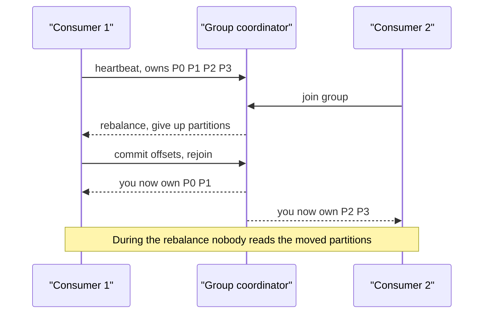

Rebalances pause consumption, so frequent rebalances (from consumers that run long processing without polling, or autoscaling that flaps) cause lag spikes. Newer Kafka versions use **cooperative (incremental) rebalancing**, which moves only the partitions that need to move instead of stopping the whole group. A classic bug: processing a batch takes longer than `max.poll.interval.ms`, Kafka thinks the consumer died, rebalances, another consumer re-reads the uncommitted batch, and you get duplicates and an endless loop.

#### Replication: leaders, followers and the ISR

Each partition has a **replication factor**, typically 3: one **leader** replica and two **followers** on different brokers. Producers and consumers talk to the leader; followers copy from it.

The **ISR (in-sync replicas)** is the set of replicas that are caught up with the leader. If the leader's broker dies, Kafka elects a new leader from the ISR, so no committed data is lost.

```
Partition 0 of order-events, replication factor 3

  Broker 1: [Leader]    offsets 0..1050
  Broker 2: [Follower]  offsets 0..1050   ← in ISR
  Broker 3: [Follower]  offsets 0..1020   ← fell behind, dropped from ISR until it catches up

  ISR = {Broker 1, Broker 2}
```

#### Producer acks

The producer's `acks` setting chooses how safe a write is before Kafka says "OK":

| `acks` | Kafka replies after | Can lose data if | Speed |
|---|---|---|---|
| `0` | Nothing, fire and forget | Anything goes wrong | Fastest |
| `1` | Leader wrote it | Leader dies before followers copy | Fast |
| `all` (or `-1`) | All in-sync replicas wrote it | Only if all ISR replicas fail | Slower, safest |

`acks=all` is only as strong as the ISR. Pair it with **`min.insync.replicas=2`** (with replication factor 3): if fewer than 2 replicas are in sync, the write is rejected instead of silently going to one copy. For order events: `acks=all`, RF=3, `min.insync.replicas=2`. For click analytics you might accept `acks=1`.

Set **`enable.idempotence=true`** on the producer too. Producers retry on network errors, and without this a retry can write the same message twice. With it, each producer batch carries a sequence number and the broker drops duplicates.

> **Real world — Confluent:** The **idempotent producer** and **transactions** arrived in Kafka 0.11. Transactions give atomic writes across partitions plus consumer offset commits (consumers read with `isolation.level=read_committed`). Overhead measured about **3% lower throughput** versus `acks=all` with one in-flight request. Crucially, **exactly-once covers only Kafka-to-Kafka processing**; side effects like sending a push or calling an API still need idempotency. ([source](https://www.confluent.io/blog/exactly-once-semantics-are-possible-heres-how-apache-kafka-does-it/))

#### Retention, replay and compaction

Kafka deletes old data by time or size, not when it is read. The default retention is 7 days (`log.retention.hours=168`); teams set it per topic. Because data stays, you can **replay**: reset a consumer group's offsets to yesterday and re-process, which is how you recover from a consumer bug or backfill a new service.

> **Real world — Zomato:** Zomato's backend services **record live requests into Kafka and replay them** later for load testing; this traffic-replay pipeline averages about **52 million messages/min** during a backfill (from a WarpStream vendor case study). ([source](https://www.warpstream.com/blog/eternal-case-study))

**Log compaction** is the other retention mode. Instead of deleting by time, Kafka keeps **at least the latest message for each key** and removes older ones. A compacted topic of `restaurant_id → current status` acts like a durable table: a new consumer reads it from the beginning and ends up with the latest state of every restaurant. Sending a message with a key and a null value (a **tombstone**) deletes that key.

```
Before compaction:  k1=OPEN  k2=OPEN  k1=CLOSED  k3=OPEN  k2=BUSY  k1=OPEN
After compaction:                              k3=OPEN  k2=BUSY  k1=OPEN
```

#### Why Kafka is fast

Kafka moves millions of messages per second on ordinary hardware because of a few design choices:

- **Sequential disk I/O.** Appending to the end of a file and reading forward are the fastest things a disk can do, much faster than random access.
- **The OS page cache.** Kafka leans on the operating system to keep recent log data in RAM. Consumers reading recent messages usually never touch the disk.
- **Zero-copy.** Using the `sendfile` system call, data goes from the page cache to the network socket without being copied into the Kafka process.
- **Batching and compression.** Producers send many messages per request, compressed together (`linger.ms`, `batch.size`, `compression.type`). Fewer, bigger requests.
- **Dumb broker, smart consumer.** The broker doesn't track per-message acknowledgements; each consumer group stores one offset per partition. That is far cheaper than RabbitMQ-style per-message state.
- **Partitions.** Throughput scales horizontally by adding partitions and brokers.

### 5.5 Kafka at real scale

> **Real world — Zomato:** **450M+ messages/min** (about 7.5 million per second) at a **5.6 GBps** cluster peak on NYE 2023. ([source](https://www.zomato.com/blog/a-tale-of-scale-behind-the-scenes-at-zomato-tech-for-nye-2023))

> **Real world — Zomato logging on WarpStream:** Per a WarpStream vendor case study, Zomato/Eternal moved logging and observability Kafka from a self-hosted cluster (kept in one availability zone with replication factor 1 to avoid inter-AZ fees) to **WarpStream**, a "diskless" Kafka-compatible system that stores data in S3, cutting cost by **60%**. Log throughput ranges from **2.3 GiB/s at the daily low to 25 GiB/s at peak**. Latency-sensitive topics stay on **Confluent Cloud**. This shows a mature idea: different Kafka workloads get different trade-offs (logs tolerate higher latency in exchange for cost). ([source](https://www.warpstream.com/blog/eternal-case-study))

> **Real world — LinkedIn:** **More than 7 trillion messages per day** in 2019, across **100+ clusters, 4,000+ brokers, 100,000+ topics and 7 million partitions**. ([source](https://www.linkedin.com/blog/engineering/open-source/apache-kafka-trillion-messages))

> **Real world — Uber uForwarder:** Uber processes **trillions of messages and multiple petabytes per day** on Kafka. Its standard consumers suffered **head-of-line blocking**: one message that takes about 10 minutes blocks its whole partition, and at 100 ms per message a partition manages only 10 messages per second. Uber built a **push-based consumer proxy** (open-sourced as uForwarder, with 1,000+ consumer services onboarded) that fetches from Kafka and pushes messages to services over gRPC. It uses **out-of-order commits**: messages are processed in parallel, and the proxy tracks per-partition offsets and commits an offset only once every earlier message is acked or nacked. Permanent failures (poison pills) go to a **DLQ**. ([2021 post](https://www.uber.com/blog/kafka-async-queuing-with-consumer-proxy/), [2026 post](https://www.uber.com/en-AU/blog/introducing-ufowarder/))

> **Real world — DoorDash:** DoorDash ran **900+ async task types** (checkout, sending orders to merchants, Dasher location processing) on **Celery + RabbitMQ**. RabbitMQ went down at peak load, HA failover took **more than 20 minutes** and lost messages, and Celery's delayed tasks overloaded the broker. They moved to **Kafka**, which brought head-of-line blocking on slow messages. Their fix was a **non-blocking worker**: one Kafka-consumer process fills a bounded local queue, read by many task-executor processes. The outages stopped almost immediately. ([source](https://doordash.engineering/2020/09/03/eliminating-task-processing-outages-with-kafka/))

Head-of-line blocking deserves a picture, because both DoorDash and Uber hit it:

```
Partition 3, one consumer, processes in order:

offset:   100        101            102   103   104   105 ...
          [fast]     [SLOW: 10 min  ]
                      ↑ calls a timed-out restaurant API
          done       stuck..........  waiting waiting waiting

Every order behind offset 101 waits 10 minutes, even though they are
unrelated orders. The fix: hand messages to a pool of workers (keeping
per-key order if needed), commit offsets only up to the lowest unfinished
one, and move permanently failing messages to a retry topic or DLQ.
```

### 5.6 Amazon SQS deep dive

**SQS** (Simple Queue Service) is AWS's fully managed queue. You don't run brokers or pick partitions; you create a queue and send messages. It is point-to-point: each message is meant for one consumer.

#### The visibility timeout

SQS does not push messages. Consumers **poll**: "give me up to 10 messages". When SQS hands a message to a consumer, it does not delete it; it hides it from other consumers for the **visibility timeout** (default 30 seconds, configurable up to 12 hours, per AWS docs). If the consumer finishes, it calls `DeleteMessage`. If it crashes or is too slow, the timeout expires and the message becomes visible again for another consumer.

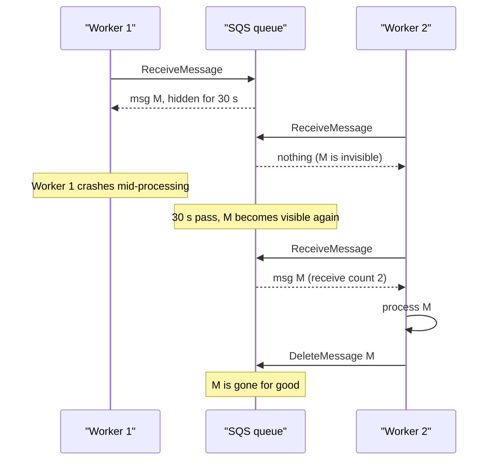

Things to say about it:

- Set the timeout longer than your worst normal processing time. If processing can run long, call `ChangeMessageVisibility` periodically to extend it (a heartbeat).
- If the timeout is too short, a slow but healthy worker's message reappears and a second worker processes it too. That is a duplicate, which is why consumers must be idempotent.
- SQS counts how many times each message was received (`ApproximateReceiveCount`).

#### Dead-letter queues

A **redrive policy** says: after `maxReceiveCount` receives (say 5) without a delete, move the message to a separate **dead-letter queue** (DLQ). A message that always crashes the worker (a **poison message**, such as malformed JSON) stops being retried forever and lands somewhere a human can inspect it and later redrive it back.

#### Standard vs FIFO queues

| | Standard | FIFO |
|---|---|---|
| Ordering | Best effort, may reorder | Strict order within a **message group ID** |
| Delivery | At least once, occasional duplicates | Exactly-once *processing* within a 5-minute deduplication window (using a dedup ID) |
| Throughput | Nearly unlimited | Limited per queue (AWS documents per-API-action limits; higher with batching and high-throughput mode) |
| Use | Most background jobs | Things that must stay in order per entity, such as status changes per order |

A FIFO **message group ID** plays the same role as a Kafka key: messages in one group are processed in order, one at a time, while different groups proceed in parallel.

#### Long polling

With **short polling**, `ReceiveMessage` returns immediately, often empty, so idle workers burn API calls (and money). With **long polling** (`WaitTimeSeconds` up to 20 seconds), SQS holds the request open until a message arrives or the wait ends. Fewer empty responses, lower cost, lower latency when a message does arrive. Always use long polling.

Other details: messages are retained for 4 days by default (configurable up to 14), and there is a `DelaySeconds` option (up to 15 minutes) to delay delivery.

**Connect to your work (Atlassian):** Your SQS + worker pool design maps directly onto this. Be ready to explain: how you chose the visibility timeout relative to job time, how many workers per pod and why, how idempotency protected you against a message processed twice after a timeout, and what your DLQ threshold was and who looked at the DLQ. If an interviewer asks "what happens if a worker crashes mid-job?", the visibility timeout sequence above is your answer.

> **Real world — Razorpay:** Razorpay's notification service (SMS, email, webhooks) originally ran API pods → SQS → workers → DB, with a scheduler for retries. Bottlenecks were database inserts and connections and **a single queue for all request types**, so there was no prioritisation. Secondary write-ups say the fix added **P0/P1 priority queues** and a **separate retry SQS queue**. (Primary post seen as a search excerpt; the fix is from secondary sources.) ([source](https://engineering.razorpay.com/how-razorpays-notification-service-handles-increasing-load-f787623a490f), [secondary](https://arpit.substack.com/p/how-razorpay-scaled-their-notification))

### 5.7 RabbitMQ, briefly

**RabbitMQ** is a traditional message broker (implementing the AMQP protocol). Producers publish to an **exchange**, which routes messages to **queues** based on rules: **direct** (exact routing key), **topic** (wildcard patterns like `order.*.cancelled`), **fanout** (every bound queue) and **headers**. Consumers receive messages pushed from queues and **ack** each one; unacked messages are redelivered.

Its strengths are flexible routing, per-message acknowledgements, priorities and low latency for task queues. Its weaknesses compared with Kafka: messages are usually deleted once consumed (no replay), per-message bookkeeping limits throughput, and very large backlogs hurt performance, as DoorDash found at peak load.

### 5.8 Comparing Kafka, SQS, RabbitMQ and Redis Streams

| | Kafka | SQS | RabbitMQ | Redis Streams |
|---|---|---|---|---|
| Model | Partitioned, replicated log | Managed queue | Broker with exchanges and queues | Append-only log in Redis |
| After consumption | Kept until retention | Deleted on `DeleteMessage` | Deleted on ack | Kept until trimmed (`XTRIM`) |
| Replay | Yes, reset offsets | No | No (without extra plugins) | Yes, by ID |
| Ordering | Per partition (by key) | None (standard), per group (FIFO) | Per queue, weakened by redelivery and multiple consumers | Per stream |
| Fan-out to many consumers | Consumer groups, cheap | Needs SNS in front | Exchanges | Consumer groups |
| Throughput | Very high (millions/s per cluster) | High, managed | Moderate to high | High, bounded by RAM |
| Ops burden | High self-hosted, lower managed (MSK, Confluent) | None | Medium | Low if you already run Redis |
| Delayed messages | No native (use retry topics) | Yes, up to 15 min | Via plugin or TTL plus DLX | Build with sorted sets |
| Pick it when | Event streams, many consumers, replay, ordering per key, huge volume | Simple background jobs on AWS with no ops | Complex routing, task queues, priorities | Light streaming when Redis is already there |

A good spoken answer to "Kafka vs SQS?": "Kafka is a log: many consumer groups read the same events, I get per-key ordering and replay, and it handles enormous throughput, but I need to manage partitions and consumer lag. SQS is a managed work queue: no ops, built-in visibility timeout and DLQ, great for 'do this job once', but no replay, and fan-out needs SNS. For Zomato's order events consumed by many services I'd use Kafka; for 'generate this invoice PDF' jobs, SQS is simpler."

### 5.9 Delivery semantics: at-most-once, at-least-once, exactly-once

Every queue makes one of three promises about how many times a message is processed when something crashes. The difference is entirely about **when the consumer acknowledges** (commits the offset, or deletes the SQS message) relative to doing the work.

**At-most-once: ack first, then process.**

```
consumer:  receive M → ACK M → start processing → CRASH
restart:   M was already acked → skipped forever
result:    M processed 0 times   (lost, never duplicated)
```

Acceptable for things like click analytics or "user is typing" indicators, where losing one is harmless.

**At-least-once: process first, then ack.**

```
consumer:  receive M → process (push sent!) → CRASH before ACK
restart:   M not acked → delivered again → process (push sent again!) → ACK
result:    M processed 2 times   (never lost, sometimes duplicated)
```

This is the default for nearly everything important, because losing an "order placed" event is much worse than seeing it twice, and duplicates can be neutralised with idempotency.

**Exactly-once.** Truly exactly-once *delivery* across a network is impossible in general, because the ack itself can be lost. What systems actually offer is **exactly-once processing**, or **effectively-once**: at-least-once delivery plus a way to make duplicates harmless. Kafka's transactions give it inside Kafka (read from a topic, write to a topic, commit offsets, all atomically), but as Confluent says, as soon as you call an external API or send a push, you are back to needing idempotency.

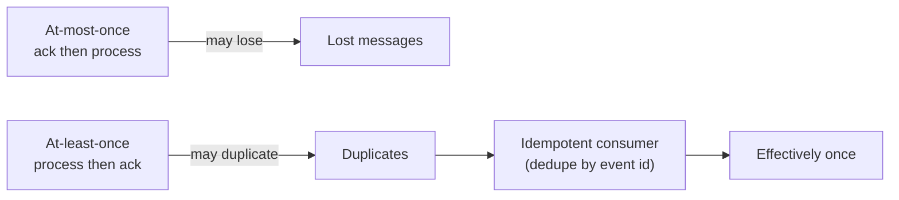

The sentence to say in interviews: **"I'll use at-least-once delivery and make every consumer idempotent, which gives effectively-once behaviour."**

### 5.10 Idempotency techniques

A consumer is **idempotent** if processing the same message twice has the same effect as processing it once. Here are the standard ways to get there, from simplest to most general.

**1. Naturally idempotent operations.** "Set order 123 status to DELIVERED" is idempotent; "add ₹50 to wallet" is not. Prefer setting absolute values over applying deltas. Zomato's ads team took this lesson the other way round: they switched a Flink job to emit **incremental counts** but added an **hourly reconciliation job** as a fail-safe, so a lost stream state cannot silently corrupt billing totals. ([source](https://www.zomato.com/blog/eliminating-bottlenecks-in-real-time-data-streaming-a-zomato-ads-flink-journey/))

**2. Processed-event table (dedupe store).** Every event carries a unique ID (the outbox row's UUID, or a producer-generated ID). The consumer records the IDs it has processed and skips repeats. The key trick: record the ID **in the same database transaction** as the side effect.

```sql
BEGIN;
  INSERT INTO processed_events (event_id) VALUES ('evt-8f2a');   -- unique key; fails if seen
  UPDATE loyalty_points SET points = points + 50 WHERE user_id = 77;
COMMIT;
-- A duplicate event hits the unique-key violation, the transaction rolls back,
-- and the consumer just acks and moves on.
```

**3. Unique constraints on business keys.** "One payment attempt per (order_id, attempt_no)", "one invoice per order_id". A duplicate insert fails and you treat it as success.

**4. Conditional updates (state machines).** Only move forward: `UPDATE orders SET status='PICKED_UP' WHERE id=123 AND status='RIDER_ASSIGNED'`. A duplicate or out-of-order event matches zero rows and does nothing. A version column (`WHERE version = 7`) does the same for general updates.

**5. Redis `SET NX` for short-lived dedupe.** `SET dedupe:evt-8f2a 1 NX EX 86400` returns OK only the first time. Fast, good for things like "don't send the same push twice in 24 hours", but Redis can lose keys on failover, so for money use the database.

**6. Idempotency keys on APIs.** For external calls, pass a key so the other side dedupes too. Stripe stores the first response for a key (including 500s) and returns it on retries, and keys can be pruned after 24 hours. ([source](https://docs.stripe.com/api/idempotent_requests)) Razorpay webhooks are at-least-once and **out of order**, and Razorpay tells you to dedupe on the `x-razorpay-event-id` header. ([source](https://razorpay.com/docs/webhooks/best-practices/))

**Connect to your work (Atlassian):** You built idempotent SQS consumers. Know which technique you used (dedupe table, unique constraint, conditional update) and why. An interviewer will push: "what if the worker crashes after the side effect but before recording the ID?" The answer is to put the ID record and the side effect in one transaction, or, if the side effect is external, pass an idempotency key to the external system.

### 5.11 Retries, exponential backoff, jitter and retry storms

Transient failures (a timeout, a 503, a brief network blip) usually succeed on retry. But *how* you retry decides whether you recover or make things worse.

- **Immediate retries** hammer a struggling service exactly when it is weakest.
- **Exponential backoff** waits longer each time: 100 ms, 200 ms, 400 ms, 800 ms... (`base × 2^attempt`, capped at a maximum).
- **Jitter** adds randomness so that 10,000 clients that failed at the same moment don't all retry at the same moment. "Full jitter" picks a random wait between 0 and the backoff value.

```
Without jitter: 10,000 clients fail at t=0
  retries at  t=100ms ████████████ (all 10,000)
              t=300ms ████████████ (all 10,000 again)
With full jitter:
  retries spread  t=0..100ms ▂▃▂▃▂▃▂▃  then t=0..200ms ▁▂▁▂▁▂▁▂▁▂  ...
```

> **Real world — Stripe:** Stripe's client libraries retry with **exponential backoff plus random jitter** to avoid a thundering herd of synchronised retries. ([source](https://stripe.com/blog/idempotency))

Also: **retry only what is retryable.** 5xx and timeouts, yes. 4xx (bad request, invalid coupon) means retrying will never help. Airbnb's payments system uses this rule. ([source](https://biweekly-engineering.beehiiv.com/p/handling-double-payments-airbnb-biweekly-engineering-episode-32)) And **always pair retries with idempotency**, or each retry may repeat a side effect.

#### Retry storms and death spirals

When each layer of a call chain retries 3 times, a single failing call at the bottom of a 3-layer chain can become 3 × 3 × 3 = 27 calls. Under stress, retries multiply load on exactly the service that is failing, which makes it fail harder, which causes more retries.

```mermaid
flowchart LR
    App["Rider app<br/>retries 3x"] --> GW["Gateway<br/>retries 3x"]
    GW --> OS["Order service<br/>retries 3x"]
    OS --> PAY["Payment service<br/>slow"]
    PAY -.->|"latency rises"| OS
    OS -.->|"timeouts, more retries"| GW
    GW -.->|"27x load on payment"| PAY
```

> **Real world — DoorDash:** DoorDash names these failure modes explicitly: **retry storms**, where payment-service latency led Dasher-app retries to amplify load, and **death spirals**, where pods fail readiness checks, are removed, and the survivors overload and fail too. ([source](https://doordash.engineering/2023/03/14/failure-mitigation-for-microservices-an-intro-to-aperture/))

Fixes: retry at **one layer only** (usually the edge or the queue consumer), use a **retry budget** (for example, retries may be at most 10% of normal traffic, an assumption to tune), add **circuit breakers** that stop calling a failing service for a cooldown, and **shed load** by priority so checkout survives while recommendations are dropped. Zomato's own version of this is kill switches and degraded modes, reviewed before NYE so that low-tier dependencies cannot take down critical services. ([source](https://www.zomato.com/blog/a-tale-of-scale-behind-the-scenes-at-zomato-tech-for-nye-2023))

### 5.12 DLQs and poison messages

A **poison message** is one that will fail every time, no matter how often you retry: malformed JSON, a reference to a deleted restaurant, a message bigger than the consumer can accept, or a bug triggered by a specific value. In a Kafka partition, a poison message processed in order blocks every message behind it forever. In SQS, it burns worker time on endless redeliveries.

The fix is to retry a bounded number of times, then move it aside to a **dead-letter queue**, commit past it, and alert.

```mermaid
flowchart LR
    M["order-events"] --> C["Consumer"]
    C -->|"ok"| D["Done, commit"]
    C -->|"transient error"| R1["retry-1m topic"]
    R1 -->|"after 1 min"| C2["Retry consumer"]
    C2 -->|"fails again"| R2["retry-10m topic"]
    R2 -->|"after 10 min"| C3["Retry consumer"]
    C3 -->|"still fails"| DLQ["DLQ plus alert"]
    C -->|"bug or bad data"| DLQ
    DLQ -.->|"after fix, redrive"| R1
```

> **Real world — Uber:** Uber's "Reliable Reprocessing" pattern sends failures to a chain of **retry topics with increasing delays**, then to a **DLQ**, and **commits the original offset so the partition is not blocked**. Transient errors are retried; code bugs (such as a null pointer exception) go straight to the DLQ, which can be merged back into the first retry topic after a fix. ([source](https://www.uber.com/blog/reliable-reprocessing/)) uForwarder also notes that messages over the **4 MB gRPC default** cannot reach handlers, another way to get a poison pill. ([source](https://www.uber.com/en-AU/blog/introducing-ufowarder/))

**Connect to your work (Myntra):** You had a Kafka error queue with instant retries. Expect the follow-up: "what if the downstream is down for 10 minutes?" Instant retries would all fail and could add load to the struggling service. The improvement is delayed retry tiers (1 minute, 10 minutes) with jitter, then a DLQ, and separating "retry later" errors from "will never work" errors. Saying this shows you learned from your own design.

A DLQ is only useful if someone watches it: alert on DLQ depth, build a tool to inspect and redrive, and record why each message failed.

### 5.13 Ordering pitfalls

Ordering is where many async designs quietly break.

- **Kafka orders within a partition only.** If you don't key by `order_id`, ORDER_CANCELLED can be processed before ORDER_PLACED.
- **Retries break ordering.** Message 5 fails and goes to a retry topic; message 6 succeeds. Now 6 was applied before 5. If order matters per key, either block that key while it retries (keep a "this order is in retry" marker and route its later events to the same retry path), or design consumers to tolerate it.
- **Parallel workers break ordering.** DoorDash's and Uber's fixes for head-of-line blocking process messages concurrently. To keep per-key order, hash the key to a fixed worker so one order's events always go to the same worker thread.
- **Multiple producers.** Two services publishing about the same order have no common clock. Include a **version or sequence number** in each event, and have consumers ignore anything older than what they have already applied.
- **External sources don't promise order.** Razorpay explicitly says webhook event order is not guaranteed. ([source](https://razorpay.com/docs/webhooks/best-practices/))

The most robust approach is to make consumers **order-tolerant**: the conditional update `WHERE status = 'RIDER_ASSIGNED'` from 5.10, or "apply only if event.version > stored.version", means a late or duplicate event simply does nothing.

### 5.14 Backpressure and consumer lag

**Consumer lag** is how far behind a consumer group is: for each partition, `lag = latest offset − committed offset`. Lag of zero means consumers keep up. Growing lag means producers are faster than consumers.

```
Partition 2:  latest offset 98,500   committed offset 91,000   lag = 7,500
At 500 msgs/s consumption this partition is about 15 s behind.
```

Lag is the single most important Kafka metric. Alert on lag in **time** (how old is the oldest unprocessed message), not just count, because 10,000 messages of lag is nothing for analytics and a disaster for rider dispatch.

How to fix lag, roughly in order:

1. **Find the slow part.** Usually the consumer waits on a DB or an API, not Kafka.
2. **Add consumers**, up to the number of partitions.
3. **Add partitions** if consumers are capped (remember this reshuffles keys).
4. **Process in parallel inside a consumer** (a worker pool with per-key ordering, as DoorDash did).
5. **Batch** downstream writes (one DB insert of 500 rows instead of 500 inserts).
6. **Shed or degrade:** skip non-critical work during peaks, separate urgent and bulk topics.

**Backpressure** is the general idea that a slow consumer should be able to slow down the producer, instead of being overwhelmed. With a queue, the queue itself absorbs pressure (the backlog grows). Without one, you need explicit signals: bounded in-memory queues that block when full, 429 responses, or rate limiters at the producer.

**Connect to your work (Myntra):** Your cache warmup with a 4 ms pacing delay was manual backpressure: you slowed the producer to match what the downstream rate limiter would accept.

> **Real world — Zomato interview:** A Zomato SDE-2 report asked "how do you raise consumer throughput?" and "what happens when consumption lags production?" (report Z12). The list above is the answer.

### 5.15 The dual-write problem and the transactional outbox

Here is the subtle bug in the async order flow from 5.1. The order service does two writes: insert into MySQL, then publish to Kafka. They are two different systems, so there is no single transaction across both.

```
Case 1:  INSERT order ✔   →  CRASH  →  publish ✘
         Order exists, but restaurant, dispatch and user are never told.

Case 2:  publish ✔        →  INSERT order ✘ (constraint fails)
         Restaurant starts cooking an order that doesn't exist.
```

This is the **dual-write problem**. You can't fix it with 2PC because Kafka doesn't support XA distributed transactions.

> **Real world — Debezium:** Gunnar Morling's Debezium post explains that dual writes to a DB and Kafka cannot share a transaction because Kafka doesn't support XA, so one can succeed while the other fails. ([source](https://debezium.io/blog/2019/02/19/reliable-microservices-data-exchange-with-the-outbox-pattern/))

**The transactional outbox** fixes it by turning two writes into one. In the **same database transaction** as the order insert, also insert the event into an `outbox` table. A separate **relay** reads the outbox and publishes to Kafka. Either both the order and its event are committed, or neither is.

```mermaid
sequenceDiagram
    participant OS as "Order service"
    participant DB as "MySQL"
    participant RL as "Relay (Debezium or poller)"
    participant K as "Kafka"
    participant C as "Consumers"
    OS->>DB: BEGIN
    OS->>DB: INSERT INTO orders
    OS->>DB: INSERT INTO outbox (OrderPlaced)
    OS->>DB: COMMIT
    Note over OS,DB: One transaction, both rows or neither
    RL->>DB: read new outbox rows (binlog or poll)
    RL->>K: publish, key = order id
    K-->>C: OrderPlaced
    Note over RL,K: If relay crashes it republishes, so consumers dedupe by event id
```

A table design, following Debezium's outbox format:

```sql
CREATE TABLE outbox (
  id            CHAR(36) PRIMARY KEY,      -- UUID; consumers dedupe on it
  aggregatetype VARCHAR(64) NOT NULL,      -- e.g. 'Order' → picks the topic (OrderEvents)
  aggregateid   VARCHAR(64) NOT NULL,      -- e.g. order id → becomes the Kafka key (per-order ordering)
  type          VARCHAR(64) NOT NULL,      -- e.g. 'OrderPlaced', 'OrderCancelled'
  payload       JSON NOT NULL,             -- the event body
  created_at    TIMESTAMP NOT NULL DEFAULT CURRENT_TIMESTAMP
);
```

Two ways to run the relay:

- **Log tailing (CDC):** Debezium reads the binlog and publishes each outbox insert. Low latency, no polling load. Debezium notes you can even **insert and delete the outbox row in the same transaction**: the log still records the insert, so the table never grows.
- **Polling publisher:** a job runs `SELECT ... FROM outbox WHERE published = false ORDER BY created_at LIMIT 100`, publishes, marks them published. Simpler, slightly higher latency, adds DB load.

Either way the relay can publish a row twice (crash after publish, before marking), so delivery is **at-least-once** and consumers must be idempotent, using the outbox `id`. ([source](https://microservices.io/patterns/data/transactional-outbox.html))

### 5.16 Change data capture (CDC)

**CDC** means reading a database's change log and turning every committed insert, update and delete into an event stream. The outbox relay is one use; there are many others.

```mermaid
flowchart LR
    APP["Order service"] --> DB["Aurora MySQL"]
    DB -->|"binlog"| DBZ["Debezium connector"]
    DBZ --> K["Kafka topics<br/>one per table"]
    K --> F["Flink"]
    F --> ICE["Iceberg on S3<br/>(analytics)"]
    K --> INV["Cache invalidator"]
    INV --> R["Redis"]
    K --> SR["Search indexer"]
    SR --> SOLR["Solr index"]
```

Why it is powerful: the database is already the source of truth, and its log already records every change in commit order. CDC means no application code has to remember to publish, so nothing is missed (the same argument as Facebook's mcsqueal in 4.7).

> **Real world — Zomato:** Zomato's data platform captures **Aurora MySQL changes with Debezium**, publishes them to **Kafka in Avro**, and uses **Flink** to write them as ORC into **Iceberg** tables on S3; DynamoDB Streams also land in S3. ([source](https://aws.amazon.com/blogs/opensource/how-zomato-boosted-performance-25-and-cut-compute-cost-30-migrating-trino-and-druid-workloads-to-aws-graviton/)) Blinkit reportedly runs a Debezium-based CDC "Source Replication System" too (from search snippets only).

> **Real world — Uber:** Uber uses Kafka to ship **database changelogs to downstream subscribers**. ([source](https://www.uber.com/en-NL/blog/presto-on-apache-kafka-at-uber-scale/))

Raw CDC vs outbox: raw CDC exposes your table schema to other teams (rename a column and you break them). The outbox lets you publish deliberate, stable **domain events** while still getting CDC's reliability. Use raw CDC for analytics and cache invalidation; use the outbox for events other services depend on.

### 5.17 Choreography vs orchestration

When an order flows through many services, who is in charge?

**Choreography:** no one. Each service listens for events and emits its own. Payment emits PaymentSucceeded, the restaurant service hears it and emits OrderAccepted, dispatch hears that and emits RiderAssigned.

```mermaid
flowchart LR
    O["Order svc"] -->|"OrderPlaced"| PAY["Payment svc"]
    PAY -->|"PaymentSucceeded"| RS["Restaurant svc"]
    RS -->|"OrderAccepted"| RD["Dispatch svc"]
    RD -->|"RiderAssigned"| NS["Notification svc"]
```

Loose coupling and easy to add listeners. But the flow exists only implicitly across many codebases: "where is order 123 stuck?" is hard to answer, and compensations (refund if the restaurant rejects) are scattered.

**Orchestration:** one workflow component tells each service what to do, waits for the answer and decides the next step, including timeouts and compensations.

```mermaid
flowchart TD
    WF["Order workflow<br/>(orchestrator)"] -->|"1 charge"| PAY["Payment"]
    WF -->|"2 notify kitchen"| RS["Restaurant"]
    WF -->|"3 assign rider"| RD["Dispatch"]
    WF -->|"4 push status"| NS["Notification"]
    WF -->|"on reject, refund"| PAY
```

The flow is visible in one place and easy to change and monitor, at the cost of a central component that must be highly available.

> **Real world — Uber Cadence:** Uber's open-source **Cadence** workflow engine provides its own persistence, task queues and **durable timers**; workers can be killed and restarted without losing workflow state. Uber Eats used it to coordinate the **8 standard steps of an Eats order workflow**. ([source](https://www.uber.com/blog/open-source-orchestration-tool-cadence-overview/)) DoorDash used Cadence as a fallback for delivery creation, and the main challenge was that **not all downstream calls were idempotent**, so they considered idempotency keys or saving completed steps and skipping them on retry. ([source](https://doordash.engineering/2020/08/14/workflows-cadence-event-driven-processing/))

A **durable timer** is what makes orchestration attractive for food delivery: "if the restaurant hasn't accepted in 3 minutes, auto-cancel and refund" becomes one line of workflow code that survives server restarts. Temporal is the widely used successor to Cadence. Zomato's own workflow tooling is **not public**; say "one typical approach".

A practical interview answer: choreography for broadcast facts (OrderPlaced fans out to analytics, notifications), orchestration for the core money-and-fulfilment flow where you need timeouts and compensation (a **saga**: a sequence of local transactions, each with an undo step).

### 5.18 Event sourcing and CQRS, intuitively

**Event sourcing** stores the history of what happened, not just the current state. Instead of an `orders` row with `status = DELIVERED`, you store the events PLACED, PAID, ACCEPTED, PICKED_UP, DELIVERED, and derive the current state by replaying them. Benefits: a full audit trail, the ability to answer "what did this look like at 8:05 pm?", and the ability to build new views from old events. Costs: replay complexity, event schema evolution and harder queries. A bank statement is the everyday example: your balance is derived from the list of transactions.

> **Real world — Stripe:** Stripe's Ledger is an **immutable, append-only log** of about **5 billion events per day** built on double-entry bookkeeping; corrections are made by reverting and reprocessing, never by editing records. ([source](https://stripe.dev/blog/ledger-stripe-system-for-tracking-and-validating-money-movement))

**CQRS** (command query responsibility segregation) means using **different models for writes and reads**. Writes go to a normalised, transactional store; events update one or more **read models** shaped for specific screens.

```mermaid
flowchart LR
    CMD["Place or update order<br/>(commands)"] --> WDB["Orders DB<br/>(write model)"]
    WDB -->|"events or CDC"| K["Kafka"]
    K --> RM1["Order tracking view<br/>(Redis or DynamoDB)"]
    K --> RM2["Restaurant dashboard view"]
    K --> RM3["Search index"]
    Q["App reads"] --> RM1
    Q2["Restaurant reads"] --> RM2
```

You already use CQRS whenever a search index or a cache is fed from the main database. The trade-off is eventual consistency: the read view lags the write by however long the pipeline takes.

> **Real world — Uber LedgerStore:** Uber uses **strongly consistent indexes** (via a two-phase commit) for card authorisation holds and **eventually consistent indexes** built as materialised views for the payment-history page. Same data, different read models with different guarantees. ([source](https://www.uber.com/blog/how-ledgerstore-supports-trillions-of-indexes/))

### 5.19 Delayed and scheduled jobs

Food delivery is full of "do this later" work: auto-cancel if the restaurant doesn't accept in 3 minutes, send "rate your meal" 45 minutes after delivery, release a held coupon after 10 minutes, retry a failed payout tomorrow. Kafka has no native "deliver at time T". Common options:

**1. Database poller with `SKIP LOCKED`.**

```sql
CREATE TABLE scheduled_jobs (
  id BIGINT PRIMARY KEY, run_at TIMESTAMP, status VARCHAR(16), payload JSON,
  INDEX (status, run_at)
);

-- Each worker, every second:
BEGIN;
SELECT id, payload FROM scheduled_jobs
 WHERE status = 'PENDING' AND run_at <= NOW()
 ORDER BY run_at LIMIT 50
 FOR UPDATE SKIP LOCKED;          -- rows locked by another worker are skipped, not waited on
-- process, then:
UPDATE scheduled_jobs SET status = 'DONE' WHERE id IN (...);
COMMIT;
```

`FOR UPDATE SKIP LOCKED` (MySQL 8+, PostgreSQL 9.5+) lets many workers poll the same table without picking the same rows or blocking each other. Durable, transactional and simple; fine up to thousands of jobs per second.

**2. Redis sorted-set delay queue.** Score = run time as a Unix timestamp.

```
ZADD delayed_jobs 1735660800 "cancel-if-not-accepted:order-123"
# poller, every 100 ms:
ZRANGEBYSCORE delayed_jobs -inf <now> LIMIT 0 100
# for each job: ZREM it (only the worker whose ZREM returns 1 owns it), then enqueue it
```

Fast and good for huge numbers of short timers, but Redis durability caveats apply; for important timers keep the source of truth in the DB and treat Redis as an accelerator. A Lua script can make "fetch due and remove" atomic.

**3. Retry topics with fixed delays.** As in Uber's pattern: `retry-1m`, `retry-10m`, `retry-1h`. A consumer of `retry-10m` checks the message's timestamp and sleeps (or pauses the partition) until it is due. Works well for a small set of fixed delays.

**4. Managed or workflow timers.** SQS `DelaySeconds` (up to 15 minutes), a scheduler service (EventBridge Scheduler), or Cadence/Temporal durable timers for long, stateful waits.

> **Real world — DoorDash:** Celery countdowns (delayed tasks) were one of the things that **overloaded RabbitMQ** at peak, part of why DoorDash moved off it. Keep large numbers of delayed tasks out of an in-memory broker. ([source](https://doordash.engineering/2020/09/03/eliminating-task-processing-outages-with-kafka/))

### 5.20 Kafka follow-ups interviewers actually ask

These come straight from the interview reports (B2, Z4, Z12, Z13, Z15, B17). Practise saying the answers aloud.

**"Why asynchronous? What problem does it solve?"** It removes slow and non-critical work from the user's request path, so latency drops (1.3 s to about 100 ms in our example). It keeps a failure in analytics or notifications from failing an order. It decouples teams, and the queue absorbs spikes such as NYE.

**"What happens if the consumer is down?"** Nothing is lost. Messages stay in Kafka (within retention, 7 days by default) and the group's committed offset stays where it was. When the consumer returns, it resumes from that offset and works through the backlog. Meanwhile lag grows, so we alert on lag in time. If one consumer of a group dies, a rebalance gives its partitions to the others. In SQS, unacked messages reappear after the visibility timeout.

**"How would you handle duplicate events?"** Assume at-least-once delivery. Give every event a unique ID (the outbox UUID). Make consumers idempotent with a processed-events table written in the same transaction as the effect, unique constraints, or conditional state-machine updates. For external side effects, pass idempotency keys. Enable the idempotent producer to cut duplicates at the source.

**"Consumption is lagging. What do you do?"** Measure where time goes. Add consumers up to the partition count, then add partitions. Parallelise inside the consumer with per-key ordering. Batch DB writes. Split urgent and bulk topics. Shed non-critical work at peak.

**"How do you guarantee order?"** Key by the entity (order_id) so its events share a partition. Use one consumer per partition, or hash keys to fixed worker threads. Carry version numbers and make consumers ignore stale events. Be careful with retries and adding partitions.

**"Kafka vs SQS vs RabbitMQ?"** Use the 5.8 table: Kafka for replayable, high-volume event streams with many consumers and per-key ordering; SQS for managed, no-ops work queues with visibility timeouts and DLQs; RabbitMQ for flexible routing and task queues at moderate scale. Then pick one for the problem at hand and say why.

**"What if one message keeps failing?"** Bounded retries with backoff in retry topics, then a DLQ. Commit past it so the partition isn't blocked. Alert, fix, redrive.

**"Why Kafka and not just a database table as a queue?"** (asked in one HM round). A DB table works at small scale (with SKIP LOCKED) and gives transactions. Kafka gives far higher throughput, cheap fan-out to many consumer groups, retention and replay, and per-key ordering across partitions, without polling load on your primary DB.

If you're asked about a Kafka internal you don't know (for example, KRaft vs ZooKeeper details), say so and reason from first principles. Interview reports say bluffing hurts and honest reasoning is accepted.

### Check yourself

**Q: In placing an order, what should be synchronous and what asynchronous?**
A: Synchronous: validating the cart, checking the restaurant is open, payment authorisation, saving the order. Asynchronous: notifying the restaurant and rider dispatch (fast, but via events), push notifications, invoices, ledger and analytics.

**Q: A topic has 6 partitions and the consumer group has 10 consumers. What happens?**
A: Only 6 consumers get partitions; 4 sit idle. Parallelism within a group is capped by the partition count.

**Q: How do you make sure all events for one order are processed in order?**
A: Use order_id as the message key so all its events go to the same partition, which one consumer reads in order. Also add version numbers, and use conditional updates so out-of-order or duplicate events are harmless.

**Q: What does acks=all with min.insync.replicas=2 and replication factor 3 give you?**
A: A write is acknowledged only once at least 2 in-sync replicas have it. One broker can fail without losing acknowledged data. If only one replica is in sync, writes are rejected instead of going to a single copy.

**Q: Explain at-least-once delivery with a crash timeline.**
A: The consumer processes the message, then crashes before committing or acking. On restart the message is redelivered and processed again. Nothing is lost, but there may be duplicates.

**Q: Why is "exactly-once" in Kafka not enough to avoid sending a duplicate push notification?**
A: Kafka's exactly-once covers reads and writes within Kafka plus offset commits. Sending a push is an external side effect outside the transaction, so it needs its own idempotency (for example, a dedupe key per event).

**Q: What is the dual-write problem and how does the outbox fix it?**
A: Writing to the DB and publishing to Kafka are two separate operations, so a crash between them leaves them inconsistent. The outbox writes the event into a table in the same DB transaction as the business change, and a relay (CDC or a poller) publishes it later, with consumers deduping on the event ID.

**Q: In SQS, a worker takes 45 s per job but the visibility timeout is 30 s. What goes wrong?**
A: The message becomes visible again at 30 s and another worker picks it up, so the job runs twice. Raise the timeout, or extend it with ChangeMessageVisibility while working, and keep consumers idempotent.

**Q: What is a retry storm and how do you prevent it?**
A: Retries at every layer multiply load on a struggling service (3 layers × 3 retries = 27x), pushing it further down. Prevent it with retries at one layer only, exponential backoff with jitter, retry budgets, circuit breakers and load shedding.

**Q: One malformed message is blocking a Kafka partition. Fix it.**
A: After bounded retries, publish it to a DLQ (or a retry-topic chain, then a DLQ), commit its offset so the partition moves on, alert, then fix and redrive. This is Uber's reliable reprocessing pattern.

**Q: How would you auto-cancel an order if the restaurant doesn't accept within 3 minutes?**
A: Create a scheduled job (a DB row with run_at = now + 3 min, polled with SKIP LOCKED, a Redis sorted-set entry, or a durable workflow timer in Cadence or Temporal). When it fires, it runs a conditional update: cancel only WHERE status = 'PLACED'. That makes it a no-op if the restaurant has already accepted.

**Q: Choreography or orchestration for the core order flow?**
A: Orchestration (a workflow or saga) for the payment-and-fulfilment path, because it needs timeouts, compensations such as refunds, and visibility into where an order is stuck. Choreography (pub/sub events) for broadcasting facts to analytics, notifications and other listeners.

---

[← 06b_SD_Databases.md](06b_SD_Databases.md) · [06d_SD_APIs_Reliability_Concurrency.md →](06d_SD_APIs_Reliability_Concurrency.md)
