# System Design Master — 4. APIs, Real-time, Reliability, Concurrency

> **Covers:** Parts 6–8. **Reading time:** about 135 minutes of focused reading (diagrams and code extra).
> Built from research into Zomato's and Eternal's engineering blogs, Swiggy, Blinkit, Zepto, BookMyShow, Uber, DoorDash, Grab, Stripe, Razorpay, Cloudflare and ~100 interview reports. Company facts link to their source; anything not public is marked so — never claim more in the interview.
> Diagrams are Mermaid and render on GitHub. Report IDs like Z2 or B10 refer to `sources/interview_reports.md`; all research notes with links are in `sources/`.

[← 06c_SD_Caching_and_Async.md](06c_SD_Caching_and_Async.md) · [06e_SD_Geo_Search_Media_Estimation_LLD.md →](06e_SD_Geo_Search_Media_Estimation_LLD.md)

---

## Part 6: APIs and real-time communication

Up to now we have mostly talked about what happens inside the backend: databases, caches, queues. This part is about the edges, where one program talks to another. The customer app talks to Zomato's servers. The order service talks to the payment gateway. Razorpay calls Zomato back to say a payment went through. Zomato's servers push a rider's moving dot to your phone. Every one of these conversations needs an agreed format and agreed rules, and that agreement is called an **API** (Application Programming Interface). An API is a contract: "if you send me this, I promise to reply with that."

Interviewers at Zomato care about this more than you might expect. In the interview reports, candidates were asked to "write every API with sample request/response payloads" (an Eternal Nugget-team round), to "write code for the CRUD APIs: status codes, request/response payloads, headers, authentication" (a Zomato SDE-1 image-upload round), and to build "a paginated API to fetch a user's District Money transaction history" with working SQL. So we will go slowly and get the basics exactly right before we get to the fancy real-time parts.

### 6.1 REST from zero

**REST** (Representational State Transfer) is the most common style of web API. You don't need to remember the long name. The idea is simple: your system is made of **resources** (nouns), each resource has an address called a **URL**, and you act on it with a small, fixed set of **HTTP methods** (verbs).

For Zomato, the nouns are things like restaurants, menus, carts, orders, payments and riders. A good REST design reads almost like English:

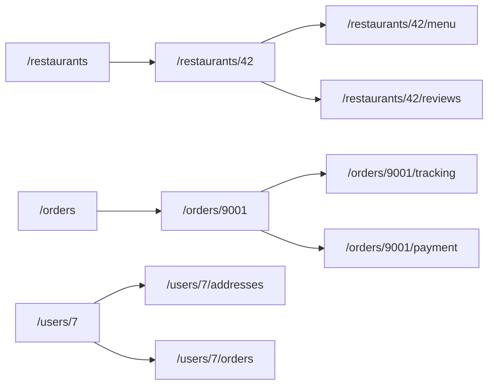

Notice three habits. URLs use plural nouns (`/orders`, not `/getOrder`). A specific item is identified by its ID in the path (`/orders/9001`). Children hang under parents (`/restaurants/42/menu`). The verb lives in the HTTP method, never in the URL. `POST /createOrder` is a classic beginner smell; `POST /orders` says the same thing the REST way.

#### The methods, and which ones are safe to repeat

Here is the table you should be able to draw from memory. Two words need defining first:

- **Safe** means the call doesn't change anything on the server. Reading a menu is safe.
- **Idempotent** means doing the call once or doing it ten times leaves the server in the same final state. "Set my default address to Home" is idempotent: after the first call it's Home, and after the tenth call it's still Home. "Add one Butter Chicken to my cart" is not: ten calls give you ten Butter Chickens.

| Method | Meaning | Zomato example | Safe? | Idempotent? |
|---|---|---|---|---|
| GET | Read a resource | `GET /restaurants/42/menu` | Yes | Yes |
| POST | Create something new, or trigger an action | `POST /orders` (place an order) | No | **No** |
| PUT | Replace the whole resource with what I send | `PUT /users/7/addresses/3` with the full address | No | Yes |
| PATCH | Change some fields | `PATCH /orders/9001` with `{"instructions": "no onion"}` | No | Not guaranteed |
| DELETE | Remove it | `DELETE /cart/items/55` | No | Yes |

Why does idempotency matter so much? Because networks fail in a nasty way. Your phone sends `POST /orders`, the server creates the order, and then the reply gets lost in a tunnel. The app sees a timeout. It has no idea whether the order was created. If it retries, it might create a second order and charge the customer twice. GET, PUT and DELETE are fine to retry blindly, because repeating them changes nothing. POST is the dangerous one, and we will fix it properly with idempotency keys in section 6.4.

> **Pause and think:** Is `DELETE /cart/items/55` really idempotent if the second call returns 404 Not Found instead of 200? Yes. Idempotency is about the server's *state*, not the response. After one call or ten, item 55 is gone. The response code can differ; the world doesn't.

#### Status codes: the server's one-word answer

Every HTTP response carries a three-digit **status code**. The first digit tells you the family: 2xx means success, 4xx means *you* (the client) did something wrong, and 5xx means *I* (the server) failed. That 4xx-vs-5xx split is not trivia. It decides whether a client should retry. Airbnb's payment library uses exactly this rule: 5xx errors are retryable, 4xx are not (more in 6.4). If the card number is invalid (400), retrying won't fix it. If the server crashed (500 or 503), a retry a moment later might work.

| Code | Name | When Zomato would return it |
|---|---|---|
| 200 | OK | Menu fetched, order status read |
| 201 | Created | `POST /orders` created order 9001. Include a `Location: /orders/9001` header |
| 202 | Accepted | "We've queued your refund, it'll finish later." Used for async work |
| 204 | No Content | Item removed from cart, nothing to send back |
| 400 | Bad Request | Quantity is -3, or a required field is missing |
| 401 | Unauthorized | No login token, or it expired. Really means "unauthenticated" |
| 403 | Forbidden | You're logged in, but this is someone else's order |
| 404 | Not Found | No restaurant with ID 42 |
| 409 | Conflict | The seat you're booking was just taken, or a request with the same idempotency key is still running |
| 422 | Unprocessable Entity | The request is well-formed but breaks a business rule, like a coupon that has expired |
| 429 | Too Many Requests | Rate limit hit. Send a `Retry-After` header |
| 500 | Internal Server Error | A bug or unexpected crash |
| 502 / 504 | Bad Gateway / Gateway Timeout | A proxy couldn't get an answer from the service behind it |
| 503 | Service Unavailable | Overloaded or shedding load on purpose |

Two pairs trip people up. **401 vs 403**: 401 is "I don't know who you are", 403 is "I know who you are, and the answer is no." **429 vs 503**: 429 says "*you* are sending too much", 503 says "*I* am overloaded right now, regardless of who you are". Stripe's engineers specifically recommend returning clear 429s for rate limiting and 503s for load shedding so clients can tell them apart ([source](https://stripe.com/blog/rate-limiters)).

#### Versioning: changing the contract without breaking old apps

Here is a problem web developers often forget and mobile developers never do: **old app versions live forever**. Some customer is still running the Zomato app from eight months ago and will never update. If you rename the field `eta_minutes` to `eta` in your response, that old app breaks.

The rules that keep you safe:

1. **Additive changes are safe.** Adding a new optional field is fine; old clients ignore fields they don't know.
2. **Removing or renaming a field, or changing its type or meaning, is a breaking change.** For those you need a new version.
3. **Put the version somewhere explicit.** The common choices are the URL (`/v1/orders`, `/v2/orders`), a header (`Accept: application/vnd.zomato.v2+json`), or a date-based version header, which is what Stripe does. URL versioning is the easiest to explain in an interview and the easiest to route at a gateway.
4. **Run old and new side by side**, measure who still calls v1, and retire it only when traffic is near zero.

A Blinkit SDE-2 candidate's takeaway after a rejection was about exactly this sort of thing: the interviewer probed "backward compatibility" on their resume project. If you mention an API you built, be ready to say how you'd change it without breaking existing callers.

### 6.2 Writing an API contract the way interviewers want it

When an interviewer says "design the APIs", they want you to write something like this, not just "there's an orders API". Let's do the most important one: placing an order.

```http
POST /v1/orders
Authorization: Bearer eyJhbGciOi...
Idempotency-Key: 6f1c2b7e-4a51-4d0e-9a8f-0b5d3c2e9f11
Content-Type: application/json

{
  "restaurant_id": 42,
  "items": [
    {"menu_item_id": 1201, "quantity": 2, "options": [{"group": "size", "choice": "large"}]},
    {"menu_item_id": 1307, "quantity": 1}
  ],
  "address_id": 3,
  "coupon_code": "WELCOME50",
  "payment_method": "UPI",
  "client_total_paise": 64900
}
```

```http
HTTP/1.1 201 Created
Location: /v1/orders/9001

{
  "order_id": 9001,
  "status": "PAYMENT_PENDING",
  "amount_paise": 64900,
  "payment": {"gateway_order_id": "order_Nx81...", "expires_at": "2026-10-23T20:15:00Z"},
  "eta_minutes": 32
}
```

A few details show maturity, and each is worth one sentence out loud:

- **Money is in paise as an integer**, never a float. Floats can't represent 0.1 exactly, and rounding errors in money become accounting bugs.
- **The client sends what it thinks the total is** (`client_total_paise`). The server recomputes the real total from the database and returns 409 or 422 if prices changed since the menu was loaded. Never trust a price the client calculated; it could be stale or tampered with.
- **The Idempotency-Key header** makes the POST safe to retry (section 6.4).
- **The response gives a status**, not just "success", because an order is a state machine (PAYMENT_PENDING, then CONFIRMED, PREPARING and so on).
- **The auth token goes in the `Authorization` header**, not in the URL. URLs end up in logs.

Then list the errors: 400 for a malformed body, 401 for a missing token, 404 for an unknown restaurant, 409 if a request with the same idempotency key is still in flight, 422 if the restaurant is closed or the coupon is invalid, 429 if this user is placing orders suspiciously fast.

#### The pre-signed URL trap

Two separate Zomato-group reports hit the same trap. One candidate designing restaurant menu image upload proposed sending the image as base64 inside the JSON body. The interviewer asked "what about big images?" and wanted **pre-signed S3 URLs**, which the candidate didn't know. A District candidate designing a voice-transcription platform (about 10 MB files, 100K uploads a day) was expected to use pre-signed uploads plus a queue of async workers.

The idea: your API server should never carry big file bytes. It's expensive (base64 makes the file about a third larger), it ties up your server's memory and connections, and object storage like S3 is built for exactly this. Instead the server hands the client a temporary, signed permission slip to upload straight to S3.

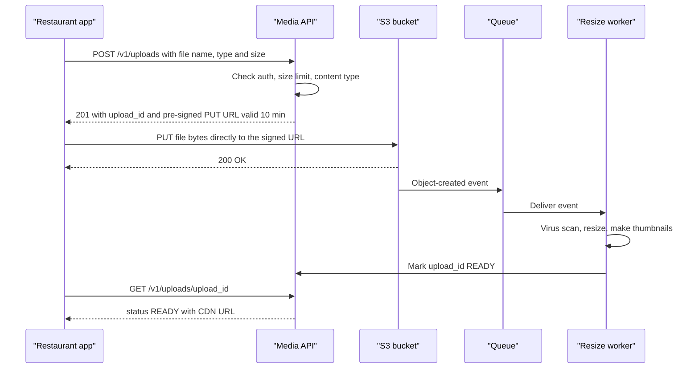

The signed URL works only for that one object, only for a PUT, and only for a few minutes, so leaking it is low risk. The API server's job shrinks to checking permissions and tracking status. The same shape (upload directly, process asynchronously, poll or get notified for status) answers the voice-transcription question too.

### 6.3 gRPC and GraphQL: the other two styles

REST over HTTP with JSON is the default for public and mobile APIs. Two other styles come up, and you should know when each wins.

**gRPC** is a framework from Google for one service calling another as if it were calling a local function. You write the contract in a `.proto` file (Protocol Buffers), and the tool generates client and server code in Go, Java, Kotlin and so on. Messages are encoded in compact binary instead of text JSON, and it runs over **HTTP/2**, which lets many requests share one TCP connection at the same time (multiplexing) and supports **streaming**: the server can keep sending messages on one call. That makes gRPC fast and strongly typed, which is why it's popular *inside* a company's backend. DoorDash standardized its microservices on Kotlin plus gRPC during its move off the monolith ([source](https://doordash.engineering/2020/12/02/how-doordash-transitioned-from-a-monolith-to-microservices/)). Uber's push platform moved from SSE to gRPC bidirectional streams ([source](https://www.uber.com/en/blog/real-time-push-platform/)).

```protobuf
service OrderService {
  rpc GetOrder (GetOrderRequest) returns (Order);
  rpc StreamOrderUpdates (GetOrderRequest) returns (stream OrderUpdate);
}
message GetOrderRequest { int64 order_id = 1; }
```

**GraphQL** is a query language from Facebook. Instead of many endpoints, there's one, and the client sends a query describing exactly the shape of data it wants. A home screen that needs a user's name, their last three orders, and for each order only the restaurant name and status can get all of it in one round trip, with no unused fields. It shines when many different screens need different slices of a rich, connected data graph. Its costs are real: caching is harder (every request is a POST to one URL, so CDN caching by URL doesn't work), one innocent-looking query can fan out into hundreds of database calls, and rate limiting has to be by query cost, not request count.

| | REST | gRPC | GraphQL |
|---|---|---|---|
| Best for | Public and mobile APIs, simple CRUD | Service-to-service inside the backend | Many client screens needing different data shapes |
| Format | JSON text | Protobuf binary | JSON |
| Transport | HTTP/1.1 or 2 | HTTP/2 | Usually HTTP POST |
| Streaming | No (use SSE or WebSocket) | Yes, built in | Subscriptions, add-on |
| HTTP caching | Easy, by URL | Hard | Hard |
| Typing | Optional (OpenAPI) | Strict, generated code | Strict schema |

A Zomato intern candidate was asked "gRPC vs HTTP/1.1 vs HTTP/2" in a distributed key-value store round. The one-line answer: HTTP/1.1 handles one request at a time per connection, so clients open many connections; HTTP/2 multiplexes many requests over one connection and compresses headers; gRPC is an RPC framework built on HTTP/2 with protobuf and streaming. A safe interview position: "REST for the apps, gRPC between internal services, and I'd consider GraphQL or a BFF (section 6.10) if the app screens need very different data."

### 6.4 Idempotency keys: making POST safe to retry

This is one of the most important ideas in the whole guide. It came up in Zomato payment rounds ("idempotent payment APIs, what if payment fails midway"), in Blinkit's order-tracking round ("how would you handle duplicate events?"), and in District's round on consumer idempotency.

The problem again: a client sends "charge ₹649", the server does it, the reply is lost, and the client doesn't know what happened. We want the client to be able to retry *safely*. The solution is that the **client generates a unique ID for the operation** and sends it with every attempt. The server remembers which IDs it has already processed and, on a repeat, returns the saved answer instead of doing the work again.

> **Real world — Stripe:** Stripe's clients send a unique ID in an `Idempotency-Key` header on mutating (POST) requests and retry with the same key. If the first attempt already succeeded, Stripe returns the cached result. Stripe's client library retries with exponential backoff plus random jitter so that many clients don't retry in sync ([source](https://stripe.com/blog/idempotency)). Per Stripe's current API docs, keys can be up to **255 characters** (V4 UUIDs suggested) and may be pruned once they're **at least 24 hours old**. Stripe saves the status code and body of the first request once execution begins, **including 500 errors**, returns an error if a retry's parameters differ from the original, and saves nothing if validation fails or the request **conflicts with a concurrently executing request**, so those can be retried ([source](https://docs.stripe.com/api/idempotent_requests)).

Read that last part again, because each rule solves a specific bug:

- **Store the response, including errors.** If the first attempt ended in a 500 after half-doing something, replaying "500" tells the client to investigate rather than blindly re-running the half-done work.
- **Compare parameters.** If a buggy client reuses key K for "charge ₹649" and then "charge ₹6,490", that's a client bug, and the server should refuse loudly rather than return the wrong cached answer.
- **Handle two concurrent attempts with the same key.** If attempt 1 is still running when attempt 2 arrives, attempt 2 must not start the work too. It gets a 409 Conflict and retries later.
- **Retention window.** You can't store keys forever. 24 hours covers any realistic retry.

Here's the full flow, including the lost reply:

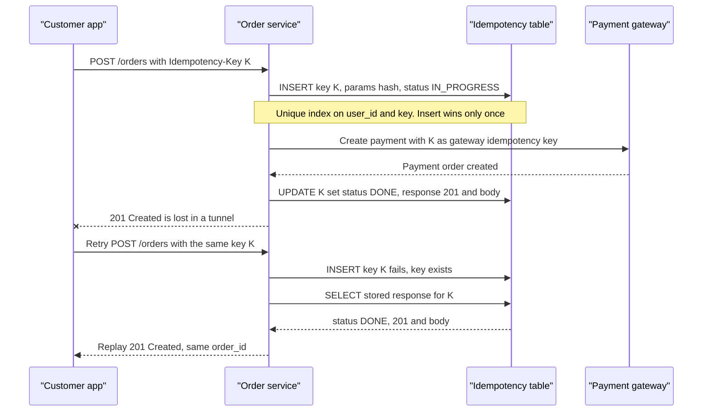

The unique index is what makes this correct under concurrency. Two retries arriving at the same millisecond both try to INSERT the key; the database lets exactly one succeed. The loser reads the row, sees IN_PROGRESS, and returns 409. We will come back to this combination of idempotency and concurrency in Part 8.

A minimal table:

```sql
CREATE TABLE idempotency_keys (
  user_id          BIGINT       NOT NULL,
  idempotency_key  VARCHAR(255) NOT NULL,
  request_hash     CHAR(64)     NOT NULL,   -- SHA-256 of the request body
  status           VARCHAR(16)  NOT NULL,   -- IN_PROGRESS / DONE
  recovery_point   VARCHAR(32)  NOT NULL DEFAULT 'started',
  response_code    INT,
  response_body    JSON,
  locked_at        TIMESTAMP,
  created_at       TIMESTAMP    NOT NULL DEFAULT CURRENT_TIMESTAMP,
  PRIMARY KEY (user_id, idempotency_key)
);
```

#### Recovery points: what if the server crashes halfway?

The simple version above has a hole. Suppose the server creates the payment at the gateway and then crashes before recording DONE. The key is stuck at IN_PROGRESS forever. Brandur Leach, who built this at Stripe, wrote up the fix.

> **Real world — Brandur Leach (Stripe):** In "Implementing Stripe-like Idempotency Keys in Postgres", the `idempotency_keys` table holds `locked_at`, `request_params`, `response_code`, `response_body` and a `recovery_point`, with a unique index on `(user_id, idempotency_key)`. The request is split into **atomic phases**, each committed in its own transaction and each advancing the recovery point (`started → ride_created → charge_created → finished`). A call to an outside system (a Stripe charge, an email, a Kafka publish), which he calls a **foreign state mutation**, happens between phases and must be treated as something that can fail. A **completer** process finishes abandoned requests, and a **reaper** deletes keys after about 72 hours ([source](https://brandur.org/idempotency-keys)).

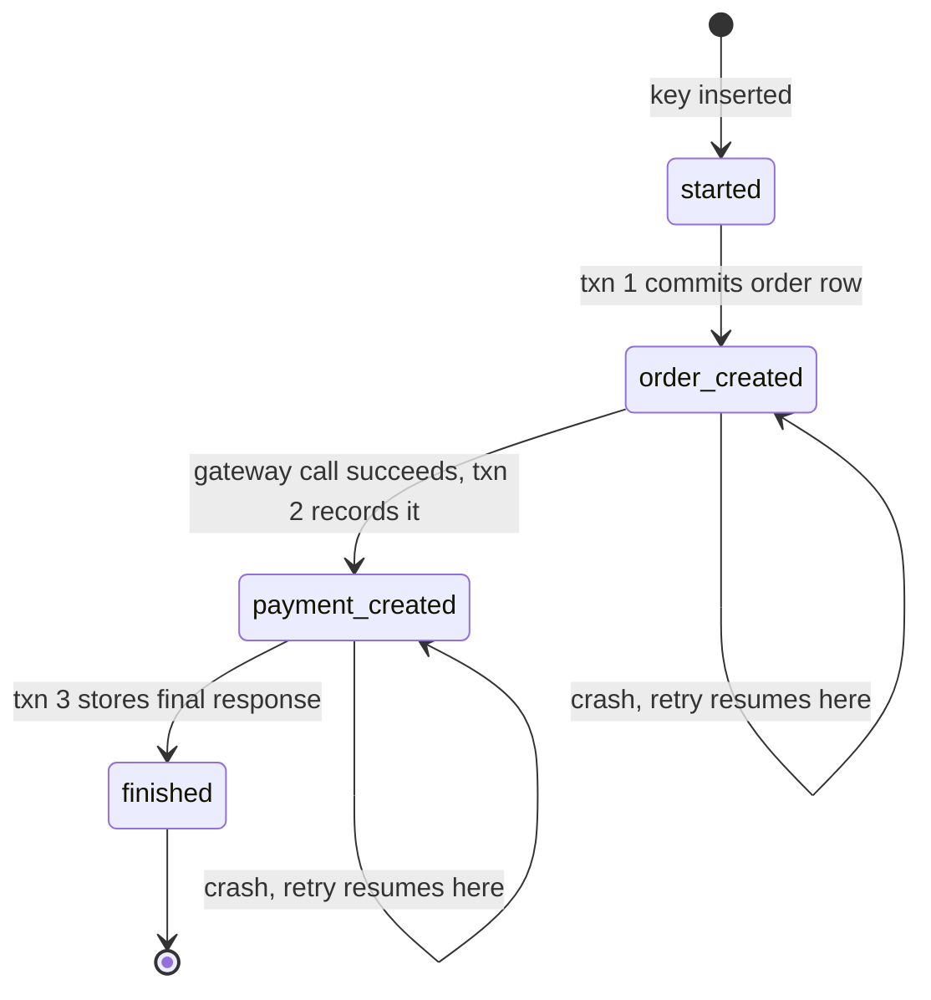

On a retry (or when the completer sweeps up stuck keys), the server reads the recovery point and *resumes from there* rather than starting over. Because the gateway call itself also carries an idempotency key, re-making it after a crash can't double-charge.

> **Real world — Airbnb:** Airbnb's payments team built a library called **Orpheus** that splits each request into three phases: **Pre-RPC** (record the idempotency key in the DB), **RPC** (call the payment provider), and **Post-RPC** (record the response). Rules: no service calls during the pre- and post-RPC phases, and **no database work during the RPC**. All idempotency reads go to the **primary, not replicas**, because replica lag could make a key look absent and cause a duplicate charge. **5xx errors are retryable; 4xx are not.** (Secondary summary of the original Medium post, which was not directly readable: [summary](https://biweekly-engineering.beehiiv.com/p/handling-double-payments-airbnb-biweekly-engineering-episode-32), [original](https://medium.com/airbnb-engineering/avoiding-double-payments-in-a-distributed-payments-system-2981f6b070bb).)

The "no DB transaction open across the network call" rule deserves its own sentence. If you begin a transaction, lock the order row, and then wait 3 seconds for Razorpay, you hold that lock and a database connection for 3 seconds. At NYE traffic, connections run out and everything stalls. Commit before calling out; record the result in a new transaction after.

> **Your own work:** At Atlassian you built SQS consumers with worker pools, idempotency and a DLQ. That's the consumer side of the same idea: SQS can deliver a message twice, so the worker checks "have I already processed message ID X?" before acting. Say it in those words: "the producer side uses idempotency keys, the consumer side dedupes on message ID, and both exist because every network hop can duplicate."

> **Pause and think:** Who should generate the idempotency key, the client or the server? The client. The whole point is that the *same* key travels with every retry of the *same* user intent. If the server generated it, a retry would arrive without knowing the first attempt's key. The app should create the key when the user taps "Place order", store it with the pending cart, and reuse it on every retry of that tap.

### 6.5 Pagination: offset vs cursor

Your order history might have 800 orders. The app can't download all of them at once, so the API returns them a page at a time. This sounds trivial, and it's exactly where a District SDE-1 candidate got grilled: "API to fetch a user's District Money transaction history, paginated", then offset vs cursor, then the cursor design and the composite index, then writing the SQL and backend code by hand, then a twist where the data comes from three separate tables. They were rejected after this round. Let's make sure that doesn't happen to you.

#### Offset pagination

The simplest scheme: "give me 20 rows, skipping the first 40."

```http
GET /v1/users/7/transactions?limit=20&offset=40
```

```sql
SELECT id, amount_paise, type, created_at
FROM transactions
WHERE user_id = 7
ORDER BY created_at DESC, id DESC
LIMIT 20 OFFSET 40;
```

It's easy to build and lets users jump to "page 37". It has two real problems.

**Problem 1: it gets slower the deeper you go.** To return rows 100,001 to 100,020, the database still has to walk past the first 100,000 rows and throw them away. OFFSET is not a "jump"; it's "read and discard".

**Problem 2: rows shift under you.** Suppose you've read page 1 (the 20 newest transactions). While you're reading, a new cashback is credited. Now everything shifts down by one, and page 2 (OFFSET 20) starts with the row that was the last row of page 1. You see a duplicate. If a row is deleted instead, you silently skip one.

```
Page 1 read at 10:00          New row arrives 10:01         Page 2 read at 10:02 (OFFSET 20)
 pos 1  T100                   pos 1  T101  <- new           pos 21 T81   <- you already saw this
 ...                           pos 2  T100                   pos 22 T80
 pos 20 T81                    ...                           ...
                               pos 21 T81
```

#### Cursor (keyset) pagination

Instead of "skip N rows", say "give me 20 rows that come *after the last one I saw*". The last row's sort key becomes a bookmark, called a **cursor**.

```http
GET /v1/users/7/transactions?limit=20
-> { "items": [...], "next_cursor": "eyJ0IjoiMjAyNi0xMC0yMlQxOTo0MDowMFoiLCJpZCI6ODgxfQ" }

GET /v1/users/7/transactions?limit=20&cursor=eyJ0IjoiMjAyNi0xMC0yMlQxOTo0MDowMFoiLCJpZCI6ODgxfQ
```

The cursor is just the last row's `(created_at, id)` encoded in base64 so clients treat it as opaque and don't try to build it themselves. Why both columns? Because `created_at` alone isn't unique; two transactions can share a timestamp. Adding `id` as a tie-breaker gives a strict, total order, so no row can be skipped or repeated at a page boundary.

```sql
SELECT id, amount_paise, type, created_at
FROM transactions
WHERE user_id = 7
  AND (created_at, id) < ('2026-10-22 19:40:00', 881)   -- the decoded cursor
ORDER BY created_at DESC, id DESC
LIMIT 21;   -- fetch one extra to know whether there is a next page
```

And the index that makes it fast:

```sql
CREATE INDEX idx_txn_user_time ON transactions (user_id, created_at DESC, id DESC);
```

With this index, the database jumps straight to user 7's entries at the cursor position and reads 21 rows forward. Page 1 and page 5,000 cost the same. (Row-value comparison `(a, b) < (x, y)` works in PostgreSQL and MySQL 8; if you're unsure, write it out: `created_at < x OR (created_at = x AND id < y)`.) New rows arriving at the top don't affect a cursor pointing further down, so the shifting problem is gone.

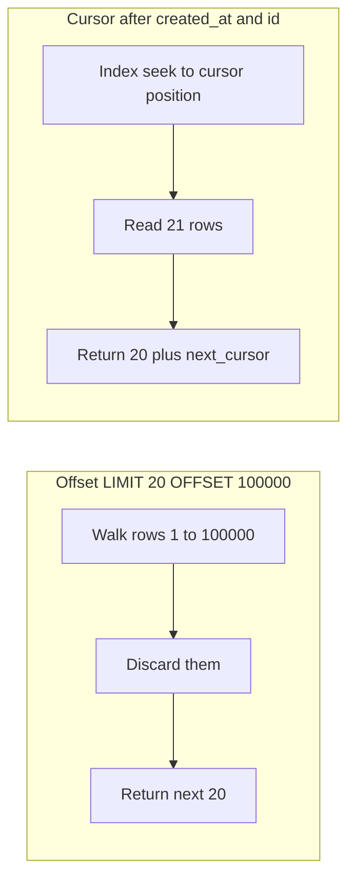

The trade-off: with cursors you can't jump to "page 37", and you can only page in the direction of the sort. For an infinite-scroll order history, transaction list or restaurant feed, that's fine. For an admin table where someone wants page 37, offset is acceptable as long as the table is small.

The trap from the District report, "what other pagination is there besides offset and cursor?", has a simple answer: **page-number pagination** (`?page=3&size=20`), which is just offset in friendlier clothes (offset = (page − 1) × size), and **time-range** pagination (`?from=...&to=...`), common for logs and analytics.

#### The multi-table trap

Now the follow-up that sank the District candidate. District Money transactions live in three independent tables: `cashback_credits`, `ticket_payments` and `refunds`. The screen shows one merged list, newest first, paginated. How?

Option A: **JOIN** is wrong. These rows aren't related to each other; a join would multiply them.

Option B: **UNION ALL in SQL**, if all three tables are in the same database. The key trick is that *each branch* must apply the cursor and the limit, otherwise the database pulls every row from all three tables before sorting.

```sql
SELECT * FROM (
  (SELECT 'CASHBACK' AS src, id, amount_paise, created_at FROM cashback_credits
     WHERE user_id = 7 AND (created_at, id) < (:c_time, :c_id)
     ORDER BY created_at DESC, id DESC LIMIT 21)
  UNION ALL
  (SELECT 'TICKET' AS src, id, -amount_paise, created_at FROM ticket_payments
     WHERE user_id = 7 AND (created_at, id) < (:c_time, :c_id)
     ORDER BY created_at DESC, id DESC LIMIT 21)
  UNION ALL
  (SELECT 'REFUND' AS src, id, amount_paise, created_at FROM refunds
     WHERE user_id = 7 AND (created_at, id) < (:c_time, :c_id)
     ORDER BY created_at DESC, id DESC LIMIT 21)
) merged
ORDER BY created_at DESC, src, id DESC
LIMIT 21;
```

Why 21 from each branch? Because in the worst case all 20 rows of the page could come from one table. Taking 21 from each and merging guarantees the true top 21 is present.

There's a subtle bug hiding here. IDs from different tables can collide: cashback 881 and refund 881 are different rows. So the cursor must include the source, and the tie-break must be consistent: the cursor becomes `(created_at, src, id)` and the WHERE clause compares that whole tuple per branch. The exact tuple comparison per branch gets fiddly; the clean way to say it in an interview is "the cursor must be a unique, totally ordered key across *all* sources, so I include the source name in it."

Option C: **query separately and merge in the application.** If the tables live in different services or databases, you fetch up to 21 from each source with the same cursor (in parallel), then do a k-way merge in memory (like the merge step of merge sort, or a heap of size 3), take 20, and build the next cursor from the 20th row.

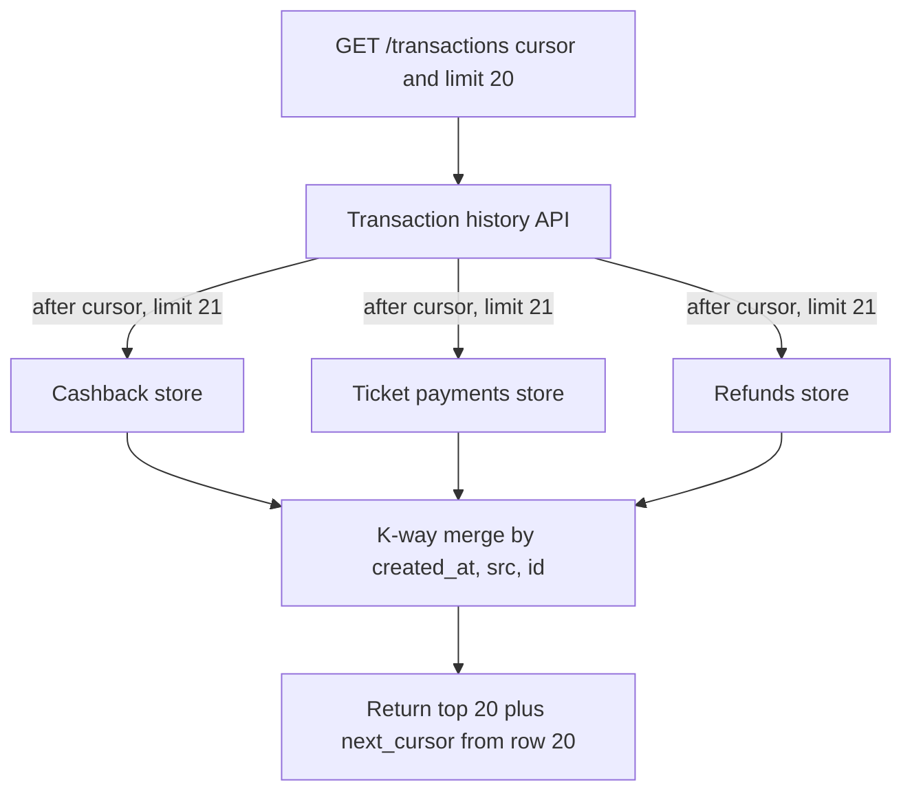

Option D, the one to mention for scale: **build a read model.** Every source publishes events to Kafka, and a consumer writes a single denormalized `user_wallet_feed` table keyed by `(user_id, created_at, src, id)`. Pagination becomes the simple single-table cursor query again. You pay with eventual consistency (a refund might appear a second later) and an extra pipeline. That's the same CQRS idea from earlier parts: shape a read table for the screen.

### 6.6 Webhooks: when the other company calls you

So far the client calls the server. Sometimes the direction flips. When a customer pays by UPI, Zomato can't know the instant the money moved; the customer is in their UPI app, not in Zomato's. The payment gateway knows, so the gateway calls *Zomato's* server with an HTTP POST: "payment pay_X for order order_Y has been captured." That reverse call is a **webhook**: you give the provider a URL, and they POST events to it.

Webhooks are simple to describe and easy to get wrong. The provider's rules tell you exactly what can go wrong.

> **Real world — Razorpay:** Your webhook endpoint must respond within **5 seconds**, otherwise Razorpay treats it as a timeout and resends; **any non-2xx counts as a failure**. Retries use exponential backoff for **24 hours** from event creation, after which the **webhook is disabled** and an alert email is sent. Delivery is **at-least-once**, so you should dedupe on the **`x-razorpay-event-id`** header, and **event order is not guaranteed** ([source](https://razorpay.com/docs/webhooks/best-practices/)). Razorpay also says the browser `callback_url` redirect is **not** a substitute for webhooks, and that if a webhook hasn't arrived within your time window you should call the fetch APIs to check status ([source](https://razorpay.com/docs/webhooks/)).

Each rule forces a design decision:

| Rule | What it forces you to build |
|---|---|
| 5 second timeout | **Ack fast, process later.** Verify, store the raw event, enqueue, return 200. Never call the restaurant service or send notifications inside the webhook handler |
| At-least-once | **Dedupe** on the event ID with a unique index. The same event will sometimes arrive twice |
| Order not guaranteed | **A state machine that ignores backwards moves.** A late "payment.authorized" must not overwrite "payment.captured" |
| 24h of retries, then disabled | **Alert on failures** well before 24 hours, or you silently stop receiving payment events |
| Redirect isn't enough | **Never confirm an order just because the browser came back** to your success page; the user may close the tab, or fake the redirect |
| Fetch APIs exist | **A reconciliation poller** that checks orders stuck in PAYMENT_PENDING for more than a few minutes |

And one rule that's universal: **verify the signature.** Your webhook URL is public. Anyone could POST `{"event": "payment.captured"}` to it and get free biryani. Providers sign each webhook: they compute an HMAC (a keyed hash, here HMAC-SHA256) of the raw request body using a secret only you and they share, and send it in a header. You recompute it and compare. If it doesn't match, reject with 400 and don't process.

```python
import hmac, hashlib

def verify(raw_body: bytes, signature_header: str, secret: str) -> bool:
    expected = hmac.new(secret.encode(), raw_body, hashlib.sha256).hexdigest()
    return hmac.compare_digest(expected, signature_header)   # constant-time compare
```

Two details here are classic mistakes: compute the HMAC over the **raw bytes** as received (if you parse the JSON and re-serialize it, spacing changes and the hash won't match), and use a **constant-time compare** so attackers can't guess the signature byte by byte from response timing.

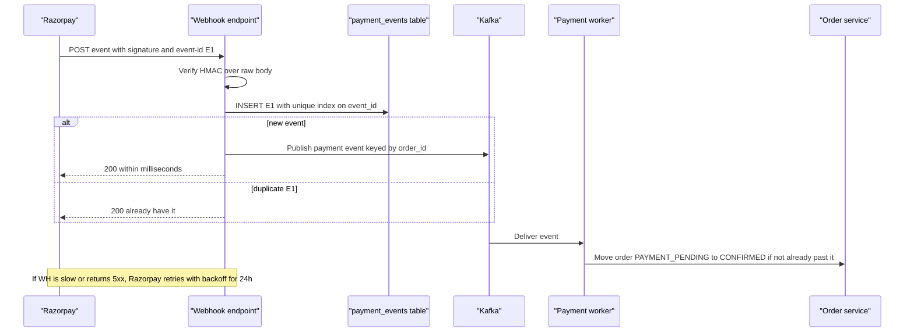

Why return 200 on a duplicate? Because you *have* successfully handled it, the first time. Returning an error would make the provider keep retrying something you've already done.

> **Pause and think:** The webhook endpoint stores the event, then crashes before publishing to Kafka. What happens? The provider never got a 200, so it retries. On retry, the INSERT hits the unique index. If your duplicate branch just returns 200, the event is stored but never published, and the order is stuck. Fix: either insert-and-publish via the transactional outbox pattern (the event row *is* the outbox, and a relay publishes it), or have the duplicate branch check whether the stored event was ever processed. This is the "non-happy path depth" that a Zomato payments interviewer said a rejected candidate lacked.

### 6.7 Real-time updates: polling, long polling, SSE, WebSocket, MQTT

Now the fun part. You've placed an order. The screen shows "Preparing", then "Rider assigned", then a little bike moving across the map. How does the server tell your phone that something changed?

The fundamental problem is that HTTP is **request-response**: the client asks, the server answers. The server can't speak first. Every technique below is a way around that.

#### Short polling

The client just asks over and over: "anything new?" every few seconds.

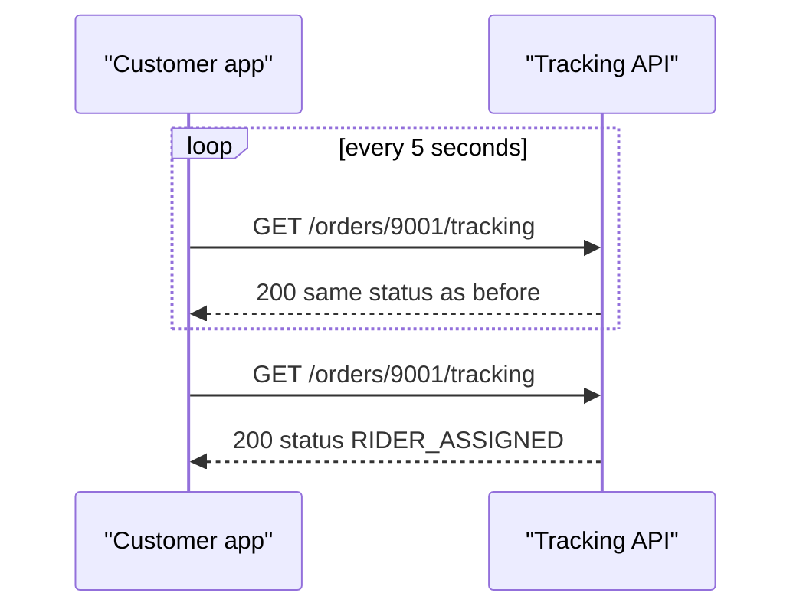

It's dead simple and works through every firewall and proxy. It's also wasteful. Most responses say "nothing changed", every request pays full price (a TLS connection or at least HTTP headers, authentication, a database or cache read), and updates are late by up to one interval. Making the interval shorter makes it more wasteful; making it longer makes it laggier.

> **Real world — Uber:** Before Uber built its push platform, **80% of API gateway requests were polling calls**. Uber replaced polling with server push, first using SSE (the system was called RAMEN), later gRPC bidirectional streams ([source](https://www.uber.com/en/blog/real-time-push-platform/)).

> **Real world — Zomato:** Zomato started live tracking with periodic HTTP polling. It stopped scaling: TLS and header overhead often outweighed the tiny payloads, and rider markers jumped instead of moving smoothly. Zomato moved to **MQTT** (publish/subscribe over persistent connections) for live location and delivery lifecycle events, which feed live tracking, ETA, notifications and the merchant view. Its open-source Android library **Pulse-MQTT** (built on Eclipse Paho) handles auto-reconnect and re-subscribe, exponential retry, and health checks ([source](https://www.eternal.com/blog/pulse/)).

#### Long polling

A clever tweak: the client asks, and the server *doesn't answer until there's something to say* (or until a timeout, say 30 seconds). As soon as the client gets an answer, it immediately asks again.

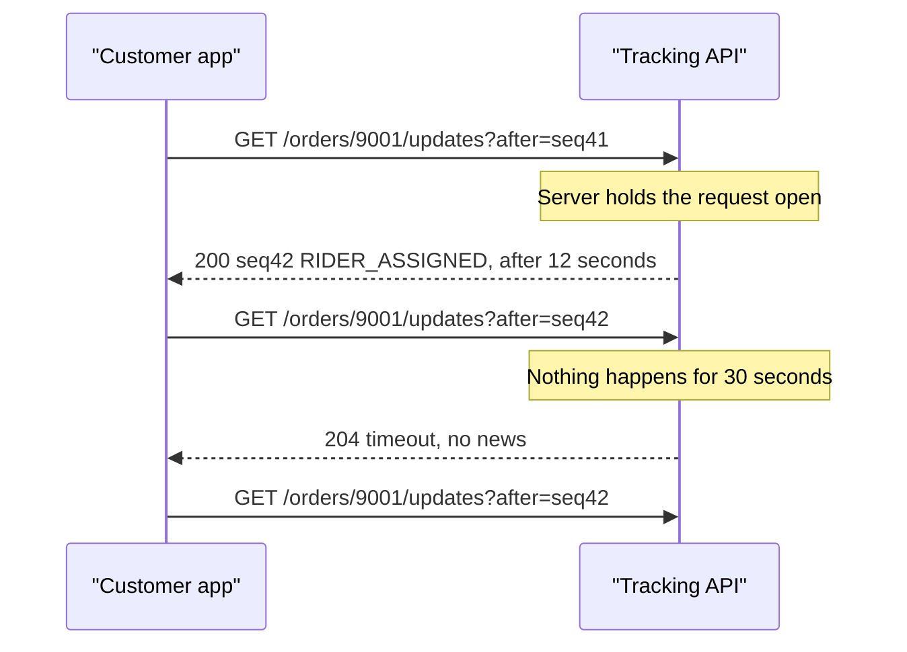

Updates now arrive almost instantly and empty responses are rarer. But each waiting client still holds a server connection, and every update costs a full new request. It's a good fallback when nothing better is available. A Blinkit SDE-1 candidate was asked "long vs short polling" in a rider-onboarding round, so be ready to draw both.

#### Server-Sent Events (SSE)

SSE is a standard way for a server to keep one HTTP response open and *stream* events down it, as text lines, for as long as it wants. It's one-directional: server to client only. The browser's `EventSource` API even reconnects automatically and sends a `Last-Event-ID` header so the server can resume where it left off.

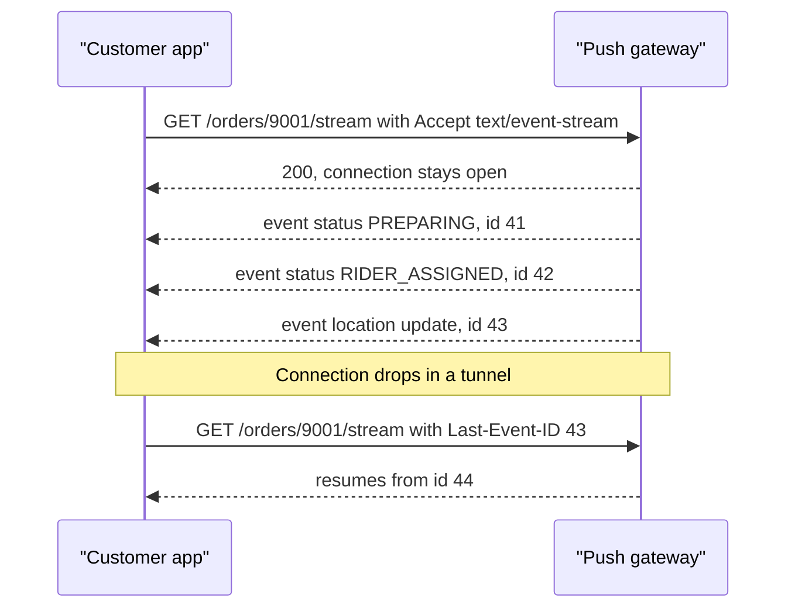

SSE is a great fit when the server talks and the client mostly listens, like order status, live scores, or a stock ticker. It's plain HTTP, so it works with existing load balancers and auth. Its limits: one direction only (the client sends anything back with normal requests), and text only.

#### WebSocket

A **WebSocket** starts as an HTTP request with an `Upgrade: websocket` header. If the server agrees (status 101 Switching Protocols), the same TCP connection turns into a full two-way pipe. Either side can send a message at any time, with only a couple of bytes of framing overhead per message.

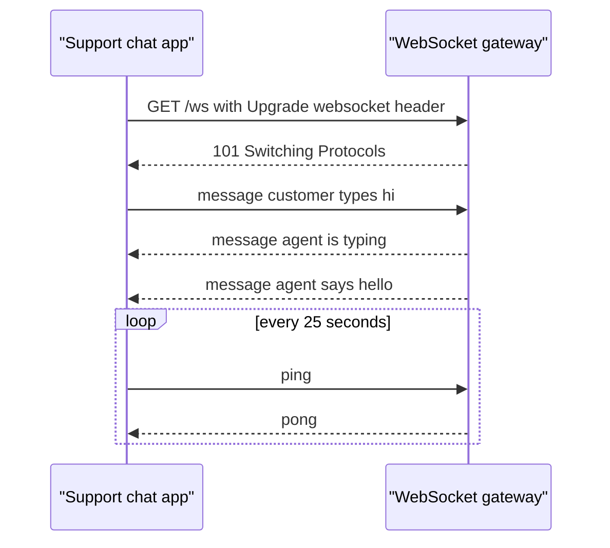

This is what you want for chat (Zomato's customer support chat, which handled **19,500 concurrent sessions and 51,400 messages per minute** on NYE 2023, per Zomato's [NYE post](https://www.zomato.com/blog/a-tale-of-scale-behind-the-scenes-at-zomato-tech-for-nye-2023)), multiplayer games, collaborative editing, anything genuinely two-way. The cost is that the connection is **stateful**: a specific server holds it, so you can't just round-robin messages across servers anymore (section 6.8).

#### MQTT

**MQTT** is a lightweight publish/subscribe protocol designed for small devices on bad networks, originally for sensors and oil pipelines. Instead of "client talks to server", there's a central **broker**. Clients **publish** messages to **topics** (named channels like `riders/881/location`) and **subscribe** to topics they care about. The broker routes each message to every subscriber. Its features map almost perfectly onto a delivery app:

- **Tiny overhead.** The fixed header is 2 bytes. That matters for a rider's phone sending a location every few seconds on a weak 4G connection all day.
- **Quality of Service levels.** QoS 0 is "at most once" (fire and forget; fine for a location ping, since a newer one is coming anyway). QoS 1 is "at least once" (retry until acked; good for "order picked up"). QoS 2 is "exactly once" (a heavier four-step handshake).
- **Keepalive** pings, so both sides notice a dead connection.
- **Retained messages**: the broker keeps the last message on a topic, so a new subscriber immediately gets the current state (the rider's last position) instead of waiting for the next ping.
- **Last Will**: a message the broker publishes on the client's behalf if it disconnects uncleanly, like "rider 881 went offline".
- **Persistent sessions**: a client reconnecting with the same ID can get the QoS 1 messages it missed.

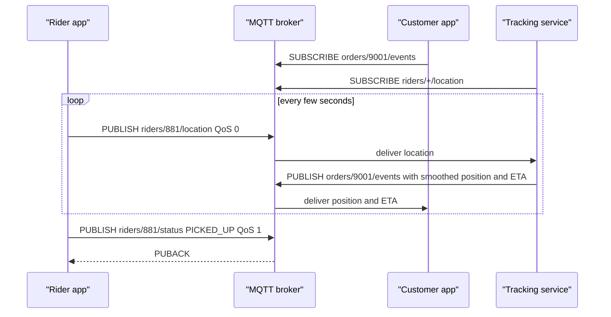

Note what Zomato's research does and doesn't say. Zomato says it moved to MQTT and published its *client* library. The server-side broker technology and how rider locations are stored on the server are **not public**. In an interview, say "Zomato uses MQTT for tracking; on the server side I'd run a clustered MQTT broker or an equivalent pub/sub gateway", and don't claim a specific product.

#### Comparison

| | Short polling | Long polling | SSE | WebSocket | MQTT |
|---|---|---|---|---|---|
| Direction | Client asks | Client asks, server delays | Server to client | Both ways | Both ways via broker |
| Latency | Up to one interval | Near instant | Near instant | Near instant | Near instant |
| Overhead per update | Full HTTP request | Full HTTP request | A few bytes | 2 to 14 bytes framing | 2 byte header |
| Server state | None | Held request | Open connection | Open connection | Broker session |
| Delivery guarantees | Whatever you build | Whatever you build | Resume with Last-Event-ID | Whatever you build | QoS 0, 1, 2, retained, last will |
| Works through proxies | Always | Mostly | Mostly (plain HTTP) | Usually, needs upgrade support | Needs its port or MQTT over WebSocket |
| Good for | Rare checks, admin pages | Fallback | Order status, live scores | Chat, games, collaboration | Rider location, IoT, flaky mobile networks |

How to choose in one breath: "If updates are rare, poll. If the server talks and the client listens, SSE. If both talk a lot, WebSocket. If it's lots of small messages from phones on bad networks with fan-out to many listeners, MQTT, which is what Zomato chose for tracking."

### 6.8 Scaling persistent connections

With polling, any server can answer any request, because nothing is remembered between requests. Persistent connections break that. Customer A's WebSocket is physically attached to gateway server 3. When the tracking service wants to send A an update, it has to get the message to *server 3* specifically. This is the core problem, and there are two standard answers.

**Answer 1: a connection registry.** When a client connects, its gateway writes `user:A -> gateway-3` into a fast shared store (Redis, with a TTL refreshed by heartbeats). To send to A, a service looks up A's gateway and sends the message there directly.

**Answer 2: pub/sub fan-out.** Each gateway subscribes to channels for the users or topics its clients care about (for example in Redis Pub/Sub, Kafka, or an MQTT broker cluster). The tracking service just publishes to `order:9001`; whichever gateway holds a subscriber gets it. The publisher doesn't need to know where anyone is connected. This is what an MQTT broker does internally.

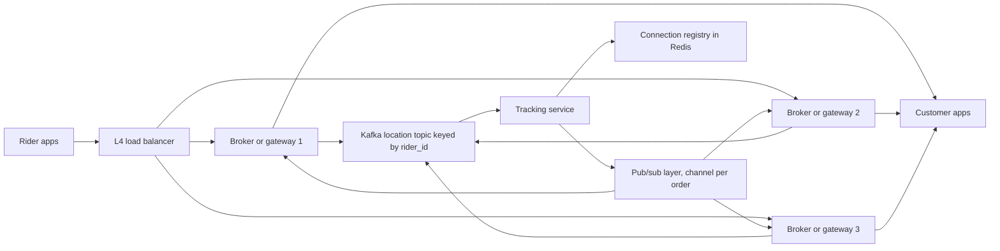

A few practical points interviewers like:

**Size it out loud.** These are assumptions, not Zomato's numbers: say 500,000 riders online at peak, each sending a location every 4 seconds (Uber's drivers historically sent one every 4 seconds, per a [2015 talk write-up](http://highscalability.com/blog/2015/9/14/how-uber-scales-their-real-time-market-platform.html)). That's 125,000 location messages per second in. If 1.5 million customers are watching a live map, that's 1.5 million open connections. A well-tuned gateway server can hold on the order of tens to a hundred thousand idle connections (an assumption; it depends on memory and the framework), so you need tens of gateway servers. Connections are cheap when idle; the real cost is message throughput.

> **Real world — Uber:** Uber's push platform grew from 70K messages per second with 600K connections to **more than 1.5M concurrent connections and 250K+ messages per second**, at 99.99% server-side reliability. Delivery is **at-least-once with per-session sequence numbers**: on reconnect the client sends the highest sequence it has seen and the server resends from there. Heartbeats go every 4 seconds and the client declares the connection dead after 7 seconds. Messages go into **High, Medium and Low priority** buckets with TTLs from seconds up to 30 minutes ([source](https://www.uber.com/en/blog/real-time-push-platform/)).

**Use an L4 load balancer and sticky routing.** A layer-4 load balancer just forwards TCP connections, which suits long-lived connections. Keep the connection on one server for its life.

**Plan for the reconnect storm.** If gateway 2 dies or is redeployed, its 100,000 clients all reconnect within the same second and hammer the others. Clients must reconnect with **exponential backoff and random jitter** (exactly what Zomato's Pulse-MQTT library does with its exponential retry), and deploys must drain connections gradually.

**Make the stream resumable.** Use sequence numbers like Uber, so a client that drops in a tunnel can say "I last saw 43" and get 44 onwards, and give location messages a short TTL, because a 2-minute-old rider position is worse than useless.

**Fall back gracefully.** If the persistent connection can't be established (corporate Wi-Fi blocking the port), fall back to long polling. The user should get slower updates, not a broken screen.

### 6.9 Push notifications: FCM and APNs and their real limits

A WebSocket or MQTT connection only works while the app is open. When the app is in the background or killed, phones don't let it keep connections alive (that would drain the battery). To reach a closed app, you go through the phone platform's own push service: **FCM** (Firebase Cloud Messaging) for Android and **APNs** (Apple Push Notification service) for iOS. Your server sends a message to Google or Apple with the device's **push token**, and they deliver it over the single connection the operating system keeps open.

The key mental model: **push notifications are best-effort, rate-limited, and may be collapsed or dropped.** They are not a reliable message queue. The real limits make this concrete.

> **Real world — FCM:** The default quota is **600k messages per minute per project**; over-quota requests get 429. There are **1,000 concurrent fan-outs per project**, and topic subscription changes are capped at **3,000 QPS**. Collapsible messages are limited to a **burst of 20 per app per device, refilling 1 every 3 minutes**. On Android, one device can receive up to **240 messages per minute and 5,000 per hour** ([source](https://firebase.google.com/docs/cloud-messaging/throttling-and-quotas)). FCM stores at most **4 distinct collapse keys per device**; Android stores up to **100 non-collapsible messages** for an offline device, and past that **all stored messages are discarded** and the app gets `onDeletedMessages()`. TTL ranges from 0 to 28 days, where TTL=0 means "deliver now or drop" ([source](https://firebase.google.com/docs/cloud-messaging/customize-messages/collapsible-message-types), [source](https://firebase.google.com/docs/cloud-messaging/customize-messages/setting-message-lifespan)).

> **Real world — APNs:** Apple requires HTTP/2 and TLS 1.2+, with a **4 KB payload limit** (5 KB for VoIP). `apns-priority` is 10 (immediate), 5 (power-aware, required for background pushes) or 1. `apns-collapse-id` can be at most 64 bytes. For an offline device, APNs **stores only one notification per app** (usually the latest) for up to 30 days, and **may reorder** notifications ([source](https://developer.apple.com/documentation/usernotifications/sending-notification-requests-to-apns)).

What these limits mean for Zomato-style design:

- **Use collapse keys for order status.** "Preparing", "Rider assigned", "Out for delivery" for the same order should share a collapse key like `order_9001`, so an offline phone wakes up to just the latest status, not a pile of stale ones. APNs storing only one notification anyway makes this natural.
- **Push carries a hint, not the truth.** Keep the payload small (under 4 KB) and make the app fetch the real state from your API when opened. If a push is dropped, nothing is lost.
- **Promo blasts take time.** At 600k per minute, sending to 10 million users takes at least about 17 minutes. Stagger campaigns, and remember each tap generates backend traffic. Duolingo learned that the downstream click load multiplies when it built a system to send about 4 million pushes in about 5 seconds for a Super Bowl ad (secondary, [InfoQ talk](https://www.infoq.com/presentations/duolingo-high-scale-notification/)).
- **Transactional before promotional.** Never let "your rider is arriving" queue behind "50% off pizza". Separate priority lanes.
- **Short TTL for live things.** A "rider is 2 minutes away" push delivered 20 minutes late is harmful. Use a short TTL or TTL=0.

> **Real world — Zomato:** Zomato's iOS app uses **PushToStartToken** (iOS 17.2+) so the server can start a lock-screen Live Activity over APNs even when the app is terminated ([source](https://www.eternal.com/blog/live-activities-push-to-start-dynamic-images)).

The full notification system design (dedupe, cooldowns, multi-channel fallback) is one of the most repeated Zomato SDE-1 questions and gets its own treatment in the case studies; here, just remember that the provider is the last, unreliable hop.

### 6.10 The BFF pattern: one backend per frontend

Zomato has at least three very different apps: the customer app, the restaurant partner app, and the delivery partner app, plus the website. The customer home screen needs banners, restaurant cards with ratings and ETAs, and personalized collections. The rider app needs the current task, navigation, and earnings. If all of them call the same generic microservices directly, each app makes 10 to 20 calls per screen over a slow mobile network, and every app team waits on every service team.

A **BFF** (Backend for Frontend) is a thin server layer built for one specific client. It takes one request from the app, fans out to the internal services in parallel over the fast data-centre network, stitches the results into exactly the shape that screen needs, and returns one response.

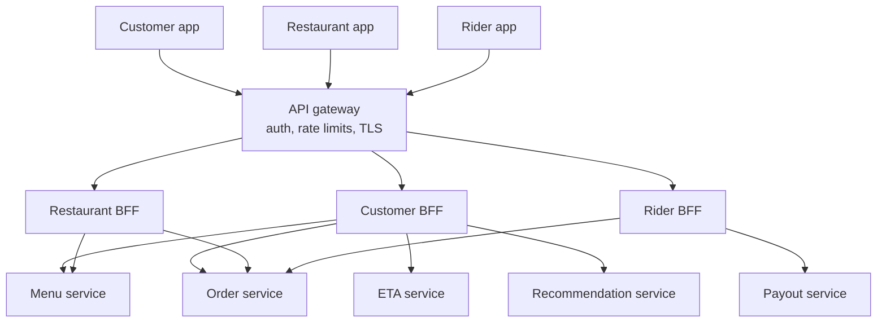

> **Real world — DoorDash:** After its move off the Django monolith, DoorDash's final layering was **Frontend, then BFF, then Backend** (cart, feed, delivery services), **then Platform** (identity, communication), **then Infrastructure** ([source](https://doordash.engineering/2020/12/02/how-doordash-transitioned-from-a-monolith-to-microservices/)).

BFF wins: fewer round trips for the phone, each app team owns its own BFF and can move fast, and the BFF can degrade gracefully (if recommendations time out, return the home screen without that row). It's closely related to **server-driven UI**, where the backend sends not just data but a description of the layout; Zomato's search uses server-driven UI through its **Sushi** design system ([source](https://www.zomato.com/blog/all-new-search-and-discovery-on-zomato/)).

BFF risks: duplicated logic across BFFs (keep business rules in the core services, not the BFF), and one more hop to run and monitor. The **API gateway** in front is different from a BFF: the gateway does cross-cutting, app-agnostic work (TLS, authentication, rate limiting, routing); the BFF does app-specific composition.

### Check yourself

**Q: Which HTTP methods are idempotent, and why does it matter?**
A: GET, PUT and DELETE are idempotent (and GET is also safe); POST is not, and PATCH isn't guaranteed. It matters because clients retry after timeouts without knowing whether the first attempt worked. Idempotent calls can be retried blindly; POST needs an idempotency key.

**Q: What's the difference between 401 and 403, and between 429 and 503?**
A: 401 means "I don't know who you are" (missing or expired credentials); 403 means "I know you, and you're not allowed". 429 means "you're sending too much" (rate limited, with Retry-After); 503 means "I'm overloaded or unavailable" regardless of who you are.

**Q: Walk through Stripe-style idempotency keys.**
A: The client generates a unique key (up to 255 characters, a UUID) per user action and sends it in an Idempotency-Key header on every retry. The server inserts the key under a unique index before doing work, stores the response (including 500s) when done, and on a repeat replays the stored response. Different parameters with the same key get an error; a retry while the original is still running gets a conflict. Keys can be pruned after about 24 hours.

**Q: The server crashes after charging the card but before saving the response. How do you avoid a stuck or double-charged order?**
A: Split the request into atomic phases with a recovery point (Brandur's design), commit each phase separately, pass an idempotency key to the gateway too, and run a completer that resumes stuck keys from their recovery point. Don't hold a DB transaction open across the gateway call (Airbnb's Orpheus rule).

**Q: Why is offset pagination a problem at scale, and what does a good cursor look like?**
A: OFFSET makes the database read and discard all skipped rows, so deep pages are slow, and inserts or deletes shift rows so pages duplicate or skip items. A good cursor is the last row's unique sort key, like (created_at, id), opaque-encoded, with a matching composite index (user_id, created_at, id).

**Q: Transactions come from three tables. How do you paginate the merged list?**
A: Use one cursor that's unique across all sources, like (created_at, source, id). Either UNION ALL with each branch applying the cursor and LIMIT N+1, then sort and limit, or fetch N+1 from each source in parallel and k-way merge in the application. At scale, build a single denormalized feed table from events.

**Q: Razorpay sends a webhook. List what your handler must do.**
A: Verify the HMAC signature over the raw body, insert the event ID under a unique index (dedupe, since delivery is at-least-once), enqueue it and return 200 within 5 seconds, then process asynchronously with a state machine that ignores out-of-order backwards transitions. Alert on failures well before Razorpay's 24-hour retry window disables the webhook, and run a reconciliation poller for orders stuck in PENDING.

**Q: When would you choose SSE over WebSocket?**
A: When updates flow mostly from server to client (order status, live scores). SSE is plain HTTP, works with existing infrastructure, and has built-in reconnect with Last-Event-ID. Choose WebSocket when both sides send frequently, like chat.

**Q: Why did Zomato move tracking from polling to MQTT, and what does MQTT give you?**
A: Polling's TLS and header overhead outweighed the tiny location payloads, and rider markers jumped instead of moving smoothly. MQTT keeps a persistent connection with a 2-byte header, publish/subscribe topics, QoS levels, keepalive, retained messages and last-will, which suits phones on flaky networks.

**Q: A user's WebSocket lives on gateway 3. How does the tracking service reach them?**
A: Either a connection registry (user to gateway in Redis with heartbeat TTL, then send directly) or pub/sub (gateways subscribe to channels like order:9001 and the service just publishes). Add sequence numbers for resume, jittered reconnects to avoid storms, and a long-polling fallback.

**Q: Can you rely on FCM/APNs to deliver every order update?**
A: No. They're best-effort and rate-limited: FCM defaults to 600k messages per minute per project and keeps at most 4 collapse keys per device, and APNs stores only one notification per app for an offline device and may reorder. Use collapse keys, small payloads that tell the app to fetch real state, short TTLs for live updates, and a priority lane for transactional messages.

**Q: What's a BFF and how is it different from an API gateway?**
A: A BFF is a per-client backend (customer, restaurant, rider) that aggregates several internal service calls into one response shaped for that app's screens. The gateway is app-agnostic and handles TLS, auth, rate limiting and routing in front of all BFFs.

## Part 7: Reliability

Zomato runs 300+ microservices. On NYE 2023 it served **80.92 million requests per minute** across **11,000 EC2 instances** ([source](https://www.zomato.com/blog/a-tale-of-scale-behind-the-scenes-at-zomato-tech-for-nye-2023)). At that size, something is *always* broken: a disk somewhere is failing, a pod is restarting, a third-party SMS provider is slow. Reliability engineering is not about preventing all failures. It's about making sure a small failure stays small, so that a slow ratings service doesn't stop people from ordering dinner.

This is also where interviewers separate "happy-path" designs from real ones. One Zomato payments candidate was rejected at "~80% close" specifically for lacking depth on "non-happy paths: microservice orchestration failures, retries, cross-service consistency". This Part is your non-happy-path toolkit.

### 7.1 How things fail

It helps to name failure types, because each has a different defence.

| Failure type | What it looks like | Main defence |
|---|---|---|
| **Crash** | A process or machine dies. Requests to it fail fast | Redundancy, health checks, automatic replacement |
| **Slowness (gray failure)** | The service is up but answers in 8 seconds instead of 80 ms | Timeouts, circuit breakers, bulkheads. This is the most dangerous kind |
| **Overload** | Too much traffic; latency climbs, then errors | Rate limiting, load shedding, autoscaling, pre-scaling |
| **Dependency outage** | A third party (payment gateway, SMS provider, maps API) is down | Fallback provider, graceful degradation, kill switch |
| **Bad deploy or config** | A new release or a flag flip breaks things | Canary rollouts, fast rollback, kill switches that really work |
| **Data problem** | A bad index pins DB CPU, a model returns impossible values | Query review, validation of outputs, fallbacks |
| **Zone or region loss** | An AWS availability zone goes dark | Multi-AZ deployment, multi-region for the most critical paths |

Why is slowness worse than a crash? A crashed service returns an error immediately and the caller moves on. A slow service holds the caller's threads, connections and memory while it thinks. The caller then becomes slow, and *its* callers become slow, and the slowness spreads backwards through the whole system. That's the next section.

> **Real world — Swiggy:** Swiggy's "#BehindTheBug" posts describe real failures of several of these types: a composite index in the wrong column order pinned the Instamart picker DB's CPU above 90% and, because a feature-flag rollback didn't reach the backend, Instamart was shut down pan-India (one summary says about 20 minutes); a few Kafka partitions offline for 4 minutes took down 18 internal services due to a client metadata bug; a model shipped that predicted *negative* delivery times and broke serviceability for about 3 hours, with no fallback for impossible values ([index post](https://bytes.swiggy.com/behindthebug-indexing-gone-wrong-6b4d682fd805), [Kafka post](https://bytes.swiggy.com/behindthebug-kafka-under-the-water-288c3d05b202), [PSLA post](https://bytes.swiggy.com/behindthebug-unpacking-the-effects-of-negative-psla-predictions-on-serviceability-6e1712eceb56); all read from search extracts, not full text).

### 7.2 Timeouts and cascading failure

A **timeout** is the maximum time you're willing to wait for an answer before giving up. It sounds too simple to matter. It's the single most important reliability setting, because without it one slow dependency can take down everything upstream of it.

Here's how a cascade happens. Say the Order service calls the Coupon service, and Coupon's database gets slow.

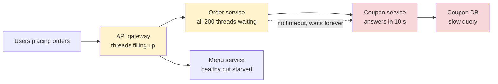

1. Coupon DB gets slow. Coupon requests take 10 seconds.
2. Order service has, say, 200 worker threads (assumption). Each one calls Coupon and waits. Within seconds all 200 are stuck waiting.
3. New order requests queue up behind them. Order service is now "slow" too, even though its own code is fine.
4. The API gateway's connections to Order service fill up and wait. The gateway starts failing requests for *everything*, including menu browsing, which never touched Coupon.

A coupon is a nice-to-have, and it just took down ordering and browsing. With a 300 ms timeout on the Coupon call, step 2 never happens: Order service gives up quickly, places the order without the coupon discount (or asks the user to retry the coupon), and threads are freed.

How to choose a timeout: look at the dependency's normal latency distribution and set the timeout a bit above its p99 (the latency that 99% of requests beat). If Coupon's p99 is 120 ms, 300 ms is reasonable. Setting it to 30 seconds "to be safe" is the opposite of safe.

**Deadlines propagate.** If the user's request has a total budget of 2 seconds and 1.5 seconds have already been spent, the next downstream call should get at most 0.5 seconds, not its own fresh 2 seconds. Passing the remaining deadline down the call chain stops services from doing work whose answer nobody is waiting for anymore. A Swiggy engineering post proposes exactly this: gRPC deadlines propagated through Go contexts, and it warns that "misconfigured retries can turn a brownout into a blackout" ([source](https://bytes.swiggy.com/designing-resilient-microservices-part-1-6a72fe964759), search extract). In Go, it's `ctx, cancel := context.WithTimeout(parentCtx, 300*time.Millisecond)`, and every downstream call takes `ctx`.

### 7.3 Retries, backoff, jitter, and retry storms

Many failures are **transient**: a packet was dropped, a pod was restarting, a lock was briefly held. Retrying a moment later often works. But retries are also the most common way engineers accidentally DDoS their own systems.

**Rule 1: only retry what's safe and might succeed.** Retry 5xx, timeouts and connection errors. Don't retry 4xx (a bad request stays bad). Only retry non-idempotent operations if you have an idempotency key (6.4).

**Rule 2: back off exponentially.** Wait 100 ms, then 200, then 400, then 800. Each retry gives the struggling service more breathing room.

**Rule 3: add jitter.** If 10,000 clients all failed at the same moment and all wait exactly 100 ms, they all retry at the same moment, and the service gets a synchronized wave. **Jitter** means randomizing the wait. The common "full jitter" form is `sleep = random(0, min(cap, base * 2^attempt))`. Stripe's client libraries use exponential backoff with jitter for exactly this reason ([source](https://stripe.com/blog/idempotency)).

```
Without jitter (everyone retries together)        With full jitter (retries spread out)
t=0     XXXXXXXXXXXXXXXXXXXX  fail                  t=0     XXXXXXXXXXXXXXXXXXXX  fail
t=100   XXXXXXXXXXXXXXXXXXXX  fail again            t=0-100   X  X XX  X   X X  XX
t=300   XXXXXXXXXXXXXXXXXXXX  fail again            t=0-200     X   X  X  X    X  X
t=700   XXXXXXXXXXXXXXXXXXXX  ...                   t=0-400  X     X      X    X     X   recovers
```

**Rule 4: cap retries, and retry at one layer only.** This is where retry storms come from. Suppose a request passes through three layers (app → gateway → order service → payment service) and each layer retries 3 times (4 attempts total). If payment is down, one user tap produces 4 × 4 × 4 = **64 calls** to payment. The service that's already failing gets 64 times its normal load, and it can never recover.

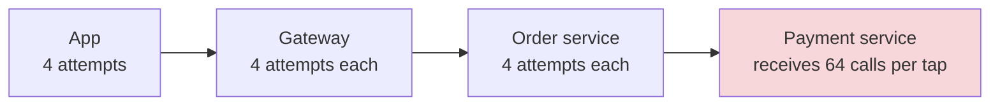

**Rule 5: use a retry budget.** Instead of "each request may retry 3 times", say "retries may be at most 10% of this client's total traffic" (10% is a common choice, an assumption here). When things are healthy, the few failures get retried. When the dependency is broadly down, retries hit the budget and stop, so they can't multiply the load.

> **Real world — DoorDash:** DoorDash's write-up on failure modes names **retry storms** (payment-service latency led Dasher-app retries to amplify the load), **death spirals** (pods fail their readiness checks and get pulled out, so the surviving pods take more load and fail too), **metastable failures** (the system stays broken even after the trigger goes away, because retries keep it overloaded), and a misconfigured **circuit breaker** that cut traffic between unrelated services and caused a wide outage ([source](https://doordash.engineering/2023/03/14/failure-mitigation-for-microservices-an-intro-to-aperture/)).

The death spiral is worth drawing because it's counterintuitive: the *health check* makes things worse.

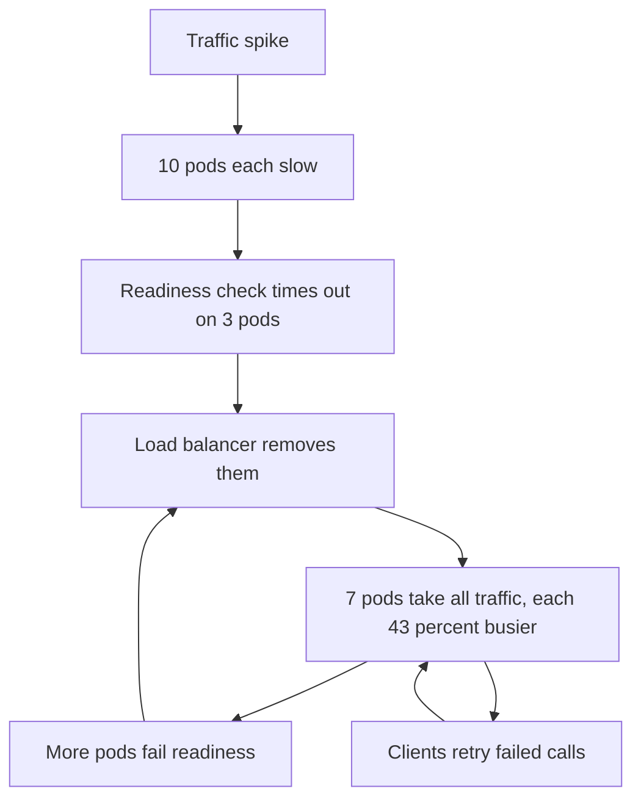

Defences: keep readiness checks cheap and separate from "am I overloaded" (an overloaded pod should shed load, not disappear), shed load early (7.6), and never let retries exceed a budget.

> **Your own work:** At Myntra the ratings service had a Kafka error queue with instant retries. Instant retries are fine for a one-off glitch, but if the downstream (say the DB) is down for a minute, instant retries just spin and add load. In an interview, say how you'd improve it: retry topics with increasing delays, then a DLQ, which is exactly Uber's "reliable reprocessing" pattern of retry topics with increasing delays before a DLQ ([source](https://www.uber.com/blog/reliable-reprocessing/)). Your Myntra cache warmup story is also a retry-and-pacing story: blasting millions of keys hit rate limits, and adding a 4 ms pacing delay smoothed the request rate below the limit. That's client-side rate limiting, the polite cousin of jitter.

### 7.4 Circuit breakers

Timeouts limit how long you wait for each call. But if Coupon service is clearly down, why keep calling it at all, paying 300 ms per order to learn the same bad news? A **circuit breaker** is a small state machine wrapped around calls to a dependency. When too many recent calls fail, it "trips" and fails calls *instantly* without trying, giving the dependency a break. After a cool-down, it lets a few test calls through to see if it's healed.

The name comes from the electrical breaker in your house: when there's a fault, it cuts the circuit to stop a fire, and you flip it back once the fault is fixed.

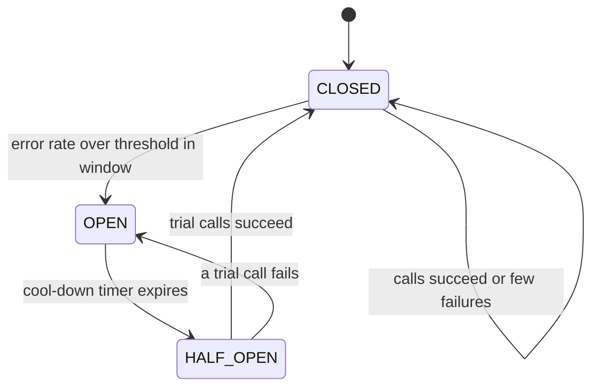

- **CLOSED** (normal): calls go through. The breaker counts failures over a sliding window, for example the last 10 seconds or last 100 calls.
- **OPEN** (tripped): calls fail immediately with a fallback (no coupon applied, cached ratings, "temporarily unavailable"). No load reaches the sick service.
- **HALF_OPEN** (testing): after, say, 30 seconds, allow a small number of trial calls. If they succeed, close the breaker. If any fails, open it again.

Settings to discuss: the failure threshold, the minimum number of calls before tripping (so 2 failures out of 3 calls at 4 AM don't trip it), the window, the cool-down, and what counts as failure (timeouts and 5xx yes, 404 no).

> **Real world — DoorDash:** DoorDash notes that "50% error rate" is a common rule of thumb for tripping a breaker but doesn't fit every service, and that a misconfigured breaker once cut traffic between unrelated services and caused a wide outage ([source](https://doordash.engineering/2023/03/14/failure-mitigation-for-microservices-an-intro-to-aperture/)). Zomato's NYE 2021 learnings include teams tuning circuit breakers and adding kill switches for each feature ([source](https://www.zomato.com/blog/our-learnings-from-nye/)).

A Blinkit SDE-1 candidate was asked for the "HLD then LLD of a Circuit Breaker service" that detects when a backend is down and up, and *stores user requests while it's down*. That last part is a twist: for writes that must not be lost (say, a rating submission), the fallback when OPEN isn't "fail" but "enqueue durably and replay when the breaker closes". For reads, the fallback is usually a cached or default value. For payments, it might be routing to a different gateway, as Zomato does on NYE.

```python
class CircuitBreaker:
    def __init__(self, threshold=0.5, min_calls=20, cooldown_s=30):
        self.state, self.opened_at = "CLOSED", 0
        self.window = deque(maxlen=100)          # True = success, False = failure
        self.threshold, self.min_calls, self.cooldown = threshold, min_calls, cooldown_s

    def call(self, fn, fallback):
        if self.state == "OPEN":
            if time.time() - self.opened_at < self.cooldown:
                return fallback()                # fail fast
            self.state = "HALF_OPEN"
        try:
            result = fn()
            self._record(True)
            if self.state == "HALF_OPEN":
                self.state = "CLOSED"; self.window.clear()
            return result
        except Exception:
            self._record(False)
            if self.state == "HALF_OPEN" or self._should_trip():
                self.state, self.opened_at = "OPEN", time.time()
            return fallback()

    def _record(self, ok): self.window.append(ok)
    def _should_trip(self):
        n = len(self.window)
        return n >= self.min_calls and self.window.count(False) / n >= self.threshold
```

(For real code, HALF_OPEN should allow only a limited number of trial calls at once, and the whole thing needs a lock for thread safety; mention both.)

### 7.5 Bulkheads

Ships are divided into watertight compartments called bulkheads, so one hole floods one compartment, not the whole ship. In software, a **bulkhead** gives each dependency (or each type of work) its own separate pool of resources, so one dependency going bad can only exhaust *its* pool.

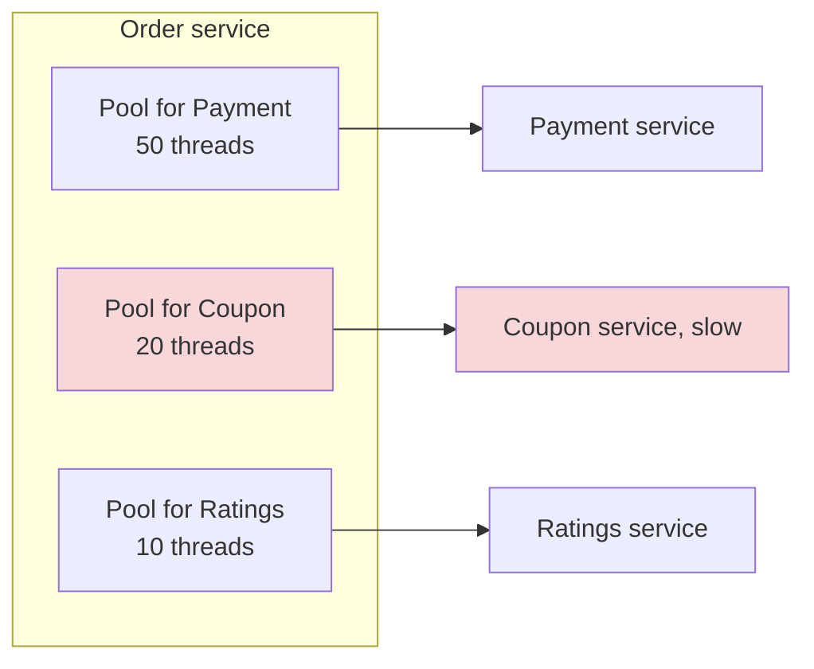

If Coupon gets slow, only its 20 threads fill up; the 50 payment threads keep working. Bulkheads also apply at bigger scales: separate Kafka topics or queues per priority (Razorpay split its notification traffic into P0 and P1 queues after a single queue for all request types meant no prioritization, per [Razorpay Engineering](https://engineering.razorpay.com/how-razorpays-notification-service-handles-increasing-load-f787623a490f), search extract plus secondary write-ups), separate database connection pools for the API and for background jobs, and even separate clusters for critical and non-critical services. Grab keeps separate Kafka topics per action type and per country so small urgent campaigns don't wait behind large ones ([source](https://engineering.grab.com/supporting-large-campaigns-at-scale)).

### 7.6 Load shedding and adaptive concurrency

When demand exceeds capacity, something has to give. **Load shedding** means deliberately rejecting some requests early and cheaply (with a fast 503) so the rest can be served well, instead of trying to serve everyone and serving everyone badly. A restaurant kitchen that takes 200 orders when it can cook 100 delivers 200 cold, late meals. One that takes 100 and says "sorry, busy" to the rest delivers 100 good ones.

The key word is **priority**. Not all requests are equal. On NYE, "place order" and "pay" matter far more than "load restaurant reviews" or "fetch recommendations".

> **Real world — Stripe:** Of Stripe's four limiters (more in 7.8), two are load shedders. The **fleet usage load shedder** reserves capacity for critical methods (their example: **20% reserved for critical, 80% for non-critical**; excess non-critical requests get 503). The **worker utilization load shedder** sheds by priority: critical methods last, then POSTs, then GETs, with **test-mode traffic shed first**, ramping slowly to avoid flapping ([source](https://stripe.com/blog/rate-limiters)).

**Adaptive concurrency** answers the question "how many requests should I handle at once?" automatically. Every service has a point beyond which accepting more concurrent requests only adds queueing delay. The idea (borrowed from TCP congestion control) is to watch latency: while latency stays flat, slowly allow more in-flight requests; when latency rises, cut the limit. Requests beyond the limit are rejected immediately.

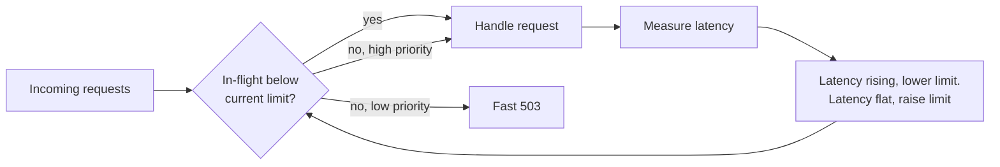

> **Real world — DoorDash:** DoorDash's load shedding uses **Netflix's adaptive concurrency limit** as a gRPC interceptor that lowers the in-flight limit as latency rises, and it can **prioritise requests by header**, keeping only high-priority calls during overload. Its limitation: shedding is local to each service and hard to tune (one service started with too high a limit and overloaded at startup), which led to a proposed central controller, Aperture ([source](https://doordash.engineering/2023/03/14/failure-mitigation-for-microservices-an-intro-to-aperture/)). After a **2-hour-plus site-wide outage in mid-2021**, DoorDash adopted an Envoy service mesh whose first features were adaptive concurrency, outlier detection and metrics ([source](https://careersatdoordash.com/blog/inside-doordashs-service-mesh-journey-part-1-migration-at-scale/)).

Load shedding can also be *geographic*. Grab's "Spampede" counts unallocated bookings per (service, coarse geohash, time bucket) in Redis with INCR and EXPIRE, and when the count passes a threshold, rejects new bookings from that area before any downstream calls, so one rainy hotspot doesn't slow the app everywhere ([source](https://engineering.grab.com/preventing-app-performance-degradation-due-to-sudden-ride-demand-spikes)). Zomato does a business-level version: on NYE 2021 it **throttled demand** where delivery partners or kitchen capacity were running out, using an automated demand-management system plus manual control ([source](https://www.zomato.com/blog/our-learnings-from-nye/)). That's why you sometimes see "high demand in your area" instead of a menu.

### 7.7 Graceful degradation and kill switches

**Graceful degradation** means that when part of the system fails, the product gets *worse* but keeps *working*. The trick is deciding in advance what "worse" looks like for each dependency, writing that fallback code, and testing it.

| If this fails | Degraded mode |
|---|---|
| Recommendations | Show a generic "popular near you" list from cache |
| Ratings and reviews | Show cached ratings, hide the reviews tab |
| ETA model | Fall back to a simple distance-based formula, with sanity bounds |
| Road-distance service | Fall back to straight-line (Haversine) distance. Swiggy's distance lookup falls back from cache to real-time routing to Haversine ([source](https://bytes.swiggy.com/designing-the-serviceability-platform-at-swiggy-for-high-scale-part-1-751a631f0379), search extract) |
| Coupon service | Allow ordering without coupons, show "offers temporarily unavailable" |
| One payment gateway | Route to another gateway |
| SMS or calling provider | Switch to an alternate provider |
| Live tracking stream | Fall back to polling every 30 seconds |

A **kill switch** is a runtime flag that turns off a feature or dependency instantly, without a deploy. When the reviews service starts melting on NYE, someone flips `reviews.enabled=false`, and the BFF stops calling it and returns the degraded response.

> **Real world — Zomato:** Before NYE 2023, Zomato reviewed **kill switches and degraded modes** so that **lower-tier dependencies cannot take down critical services**. Its chaos tests **flipped kill switches to test degraded mode**, **injected upstream latency through the Kuma service mesh**, and **injected cache misses** to see how databases cope ([source](https://www.zomato.com/blog/a-tale-of-scale-behind-the-scenes-at-zomato-tech-for-nye-2023)). On NYE 2021, when a third-party calling provider failed, Zomato switched to an alternate provider, and payments routed traffic around downtime at individual payment gateways ([source](https://www.zomato.com/blog/our-learnings-from-nye/)).

Notice the idea of **tiers**. Every service is labelled by how critical it is (tier 0: login, menu, cart, order, payment; tier 2 or 3: reviews, recommendations, analytics). The rule is that a tier-0 path must never *hard-depend* on a lower-tier service; every such call has a timeout, a breaker and a fallback. Then kill switches give humans a big red button for each lower-tier dependency.

And test the switches. Swiggy's Instamart outage got worse because a feature-flag rollback **didn't reach the backend**. A kill switch you've never flipped is a hope, not a control. That's why Zomato flips them in chaos tests before NYE.

```mermaid
flowchart TD
    REQ["Home screen request"] --> BFF["Customer BFF"]
    BFF --> KS{"Kill switch<br/>recommendations on?"}
    KS -->|"off"| FB["Use cached popular list"]
    KS -->|"on"| CB{"Breaker closed?"}
    CB -->|"open"| FB
    CB -->|"closed"| REC["Call recommendations<br/>with 150 ms timeout"]
    REC -->|"ok"| RES["Full home screen"]
    REC -->|"timeout or error"| FB
    FB --> RES2["Home screen without personalised row"]
```

### 7.8 Rate limiting in depth

Rate limiting came up in **7 of roughly 100 interview reports, 6 of them in the Zomato group**, usually with *code*: "implement token bucket and fixed window in code" (Zomato SDE-1; the candidate couldn't finish sliding window), "fixed and sliding window using Redis, plus leaky vs token bucket trade-off" (Zomato SDE), "fixed-window boundary burst, why naive sliding-window counting is O(N), leaky bucket" (District SDE-1). Treat this section as must-know.

A **rate limiter** caps how many requests a given key (a user, an IP, an API key, a phone number for OTPs) can make in some time period. Requests over the limit get **429 Too Many Requests** with a `Retry-After` header. It protects you from abuse (OTP spam, coupon brute-forcing, scrapers), from buggy clients stuck in a loop, and from one customer starving others.

Rate limiting is *per-client fairness*. Load shedding (7.6) is *whole-service self-protection*. You need both, and they answer different questions.

> **Your own work:** At Myntra you used a token bucket per pod starting at 180 RPM. That's a real rate limiter. Expect the follow-ups: "Per pod means the global limit changes as you scale pods. How would you make it global?" (a shared Redis counter, or divide the global limit by the pod count, or Uber-style aggregation, below.) "Why token bucket rather than a window?" (it allows short bursts while holding the average.)

#### Algorithm 1: Token bucket

Imagine a bucket that holds up to **C** tokens. Tokens drip in at **R** per second, and once it's full, extra tokens overflow and are lost. Every request must take one token. If the bucket is empty, the request is rejected.

```mermaid
flowchart LR
    REF["Refill R tokens per second"] --> BKT["Bucket, capacity C"]
    REQ["Request"] --> CHK{"Token available?"}
    BKT --> CHK
    CHK -->|"yes, take one"| OK["Allow"]
    CHK -->|"no"| NO["429 Retry-After"]
```

With C = 10 and R = 1/s, a user who's been idle can fire 10 requests instantly (a burst), then is held to 1 per second on average. That's usually what you want: real users are bursty (open app, five calls at once, then nothing). You don't need a background process to add tokens; you just store `tokens` and `last_refill_time`, and on each request compute how many tokens *would* have been added since then.

```python
class TokenBucket:
    def __init__(self, capacity, refill_per_sec):
        self.capacity, self.rate = capacity, refill_per_sec
        self.tokens, self.last = capacity, time.monotonic()
        self.lock = threading.Lock()

    def allow(self, cost=1):
        with self.lock:
            now = time.monotonic()
            self.tokens = min(self.capacity, self.tokens + (now - self.last) * self.rate)
            self.last = now
            if self.tokens >= cost:
                self.tokens -= cost
                return True
            return False
```

Memory: two numbers per key. Stripe uses a token bucket in Redis for its main request limiter ([source](https://stripe.com/blog/rate-limiters)).

#### Algorithm 2: Leaky bucket

Requests pour into a bucket (a queue) of fixed size, and they *leak out* at a constant rate to be processed. If the bucket is full, new requests are dropped. The output is perfectly smooth no matter how bursty the input is.

```mermaid
flowchart TD
    IN["Bursty incoming requests"] --> Q{"Queue full?"}
    Q -->|"yes"| DROP["Reject 429"]
    Q -->|"no"| BQ["Queue of size N"]
    BQ --> LEAK["Leak out at fixed rate R"]
    LEAK --> PROC["Process"]
```

Token bucket vs leaky bucket, the trade-off interviewers ask for: **token bucket allows bursts** up to C and limits the average; **leaky bucket smooths output** to a constant rate, adding queueing delay instead of allowing bursts. Use leaky when the thing behind you needs a steady rate (a partner API, an SMS provider with a fixed TPS); use token when you want to be friendly to bursty users. (Many people also use "leaky bucket" for a meter-style counter that drains at a fixed rate with no real queue, which behaves much like a token bucket. Shopify's API is described this way.)

> **Real world — Shopify:** Shopify's REST Admin API uses a **leaky bucket of 40 requests per app per store, leaking 2 requests per second** on standard plans (400 at 20 per second on Plus). The `X-Shopify-Shop-Api-Call-Limit` header shows usage like `32/40`, and over-limit requests get **429 with Retry-After** ([source](https://shopify.dev/docs/api/admin-rest/usage/rate-limits)).

#### Algorithm 3: Fixed window counter

Split time into fixed windows (say each clock minute) and keep a counter per key per window. Increment on each request; reject when it passes the limit. The counter key includes the window, like `rl:user7:2026-10-23T20:05`, and expires after the window.

```
redis> INCR rl:user7:202610232005      -> 1, 2, 3 ... reject when > 100
redis> EXPIRE rl:user7:202610232005 60
```

It's the cheapest possible: one counter, one INCR. Its famous flaw is the **boundary burst**. With a limit of 100 per minute, a client can send 100 requests at 20:05:59 and another 100 at 20:06:00. Both windows are within their limit, but the server just took 200 requests in 2 seconds.

```
Limit 100 per minute
window 20:05                          | window 20:06
......................... 100 reqs in |  100 reqs in .........................
                    last second ->  ##|## <- first second
                                 200 requests in ~2 seconds, both windows "OK"
```

Lyft's open-source Envoy ratelimit service uses fixed windows of second, minute, hour or day ([source](https://github.com/envoyproxy/ratelimit)). For many purposes, the boundary burst is acceptable.

#### Algorithm 4: Sliding window log

Keep a log of the timestamp of every request per key (in Redis, a sorted set). On each request, delete timestamps older than one window, count what's left, and allow if under the limit.

```
ZREMRANGEBYSCORE rl:user7 0 (now - 60000)
ZCARD rl:user7                      -> if < limit:
ZADD rl:user7 now now               ->   allow
PEXPIRE rl:user7 60000
```

It's exact: there's no boundary problem. But it stores one entry per request, so memory grows with the limit. This is what the District candidate meant by "naive sliding-window counting is O(N)": cost grows with the number of requests in the window.

> **Real world — Figma:** For 500 requests per day across 10K users, a sliding **log** needs about 5M stored values (**about 20 MB**), while sliding window **counters** need about 600K values (**about 2.4 MB**). Figma chose counters, using buckets of 1/60 of the window in a Redis hash per user ([source](https://www.figma.com/blog/an-alternative-approach-to-rate-limiting/)).

#### Algorithm 5: Sliding window counter

The clever middle ground: keep just two fixed-window counters (current and previous), and *estimate* how many requests fall in the sliding window by assuming the previous window's requests were spread evenly.

`estimated = prev_count × (time left in the sliding window that overlaps prev window / window) + curr_count`

```
          previous minute (42 requests)    current minute (18 so far)
|---------------------------------------|-------------------------|
                  [===== sliding 60 s window, 15 s into current =====]
overlap with previous = 45 s of 60 s
estimate = 42 × 45/60 + 18 = 31.5 + 18 = 49.5   (limit 50 -> allow)
```

> **Real world — Cloudflare:** Cloudflare uses exactly this formula, with the worked example 42 × (45/60) + 18 = **49.5** against a limit of 50. Tested on **400 million requests from 270,000 sources**, only **0.003%** of requests were wrongly allowed or limited. It runs on memcache per point of presence using only GET, SET and INCR, and once a client is being limited, servers cache that decision locally ([source](https://blog.cloudflare.com/counting-things-a-lot-of-different-things/)).

Two counters per key, O(1) work, and 99.997% accuracy in Cloudflare's test. This is usually the best default answer when an interviewer asks for a sliding window.

```python
def allow(key, limit, window_s, now):
    cur_win = int(now // window_s)
    elapsed = now - cur_win * window_s
    cur  = redis.incr(f"rl:{key}:{cur_win}")          # count this request
    if cur == 1: redis.expire(f"rl:{key}:{cur_win}", window_s * 2)
    prev = int(redis.get(f"rl:{key}:{cur_win - 1}") or 0)
    estimate = prev * (window_s - elapsed) / window_s + cur
    return estimate <= limit
```

(This version counts rejected requests too, which punishes clients that keep hammering. If you don't want that, check first and increment only on allow, inside a Lua script so check-and-increment is atomic.)

#### Algorithm 6: GCRA (Generic Cell Rate Algorithm)

GCRA is a neat trick from telecom networks that gives token-bucket behaviour while storing **a single timestamp** per key. Define the emission interval **T** = window / limit (for 60 per minute, T = 1 s). Store the **theoretical arrival time (TAT)**: when the next request would be "on schedule". A burst tolerance τ allows some requests early.

- A request at time `now` is allowed if `TAT − τ ≤ now`.
- If allowed, set `TAT = max(TAT, now) + T`.

```
T = 1 s, burst tolerance τ = 4 s  (allows a burst of 5)
now=0   TAT=0   -> allowed, TAT=1
now=0   TAT=1   -> 1-4 <= 0 allowed, TAT=2
now=0   ... three more allowed, TAT=5
now=0   TAT=5   -> 5-4=1 > 0  REJECT (come back at t=1)
now=1   TAT=5   -> 1 <= 1 allowed, TAT=6
```

> **Real world — Brandur Leach:** GCRA tracks a single TAT per key; a request is allowed if `TAT − burst_tolerance ≤ now`, and the TAT then advances by T. There's no background "drip" process, which makes it stable, and you should use the store's clock (Redis `TIME`) to avoid clock skew between app servers ([source](https://brandur.org/rate-limiting)).

#### Picking one

| Algorithm | Memory per key | Bursts | Accuracy | Use when |
|---|---|---|---|---|
| Token bucket | 2 numbers | Allows up to C | Exact average | Default for user-facing APIs |
| Leaky bucket (queue) | Queue | Smoothed out | Exact rate | Protecting a fixed-rate downstream |
| Fixed window | 1 counter | Up to 2x at boundary | Rough | Cheap coarse limits (per day, per hour) |
| Sliding log | 1 entry per request | No | Exact | Low limits needing precision, like 5 OTPs per hour |
| Sliding window counter | 2 counters | Mostly no | About 99.997% in Cloudflare's test | Default for "sliding window" at scale |
| GCRA | 1 timestamp | Configurable | Exact | Same as token bucket, with less state |

#### A distributed rate limiter in Redis

An in-process limiter only sees one server's traffic. With 50 pods behind a load balancer, a "100 per minute" limit per pod is really 5,000 per minute. To enforce one global limit, every pod checks a shared counter, usually in Redis. Two engineering rules matter here.

**Make check-and-update atomic.** If a pod does `GET tokens`, decides "ok", then `SET tokens-1`, two pods can read the same value at the same time and both allow the last token. Redis runs a **Lua script** atomically (no other command runs in the middle), so put the whole read-decide-write in one script.

```lua
-- Token bucket. KEYS[1] = bucket key. ARGV[1] = capacity, ARGV[2] = refill per second, ARGV[3] = cost
local capacity = tonumber(ARGV[1])
local rate     = tonumber(ARGV[2])
local cost     = tonumber(ARGV[3])

local t   = redis.call('TIME')                         -- Redis clock, not app clock
local now = tonumber(t[1]) + tonumber(t[2]) / 1e6

local state  = redis.call('HMGET', KEYS[1], 'tokens', 'ts')
local tokens = tonumber(state[1]) or capacity
local ts     = tonumber(state[2]) or now

tokens = math.min(capacity, tokens + math.max(0, now - ts) * rate)

local allowed = 0
if tokens >= cost then
  tokens  = tokens - cost
  allowed = 1
end

redis.call('HSET', KEYS[1], 'tokens', tokens, 'ts', now)
redis.call('EXPIRE', KEYS[1], math.ceil(capacity / rate) * 2)   -- idle keys clean themselves up

local retry_after = 0
if allowed == 0 then retry_after = math.ceil((cost - tokens) / rate) end
return { allowed, math.floor(tokens), retry_after }
```

The app calls it with `EVALSHA <sha> 1 rl:user:7 10 1 1` and turns `retry_after` into the `Retry-After` header. (Calling `TIME` inside a script is fine in Redis 5 and later. On older setups, pass `now` in from the app, accepting a little clock skew.)

**Keep limiter state in a dedicated Redis, not the shared cache.**

> **Real world — GitHub:** GitHub moved its API rate limiter off a **shared Memcached** because memory pressure in the cache **evicted live rate-limit counters**, silently resetting people's limits. The new design uses Redis **sharded by key in the application**, with one primary for writes and replicas for reads, and **Lua scripts** to keep each operation atomic. Bugs they hit: the reset time "wobbled" when computed from a Redis TTL, fixed by storing the reset time explicitly; and stale replicas reported "Remaining: 5000" on a rejection, fixed by ignoring expired windows read from replicas ([source](https://github.blog/2021-04-05-how-we-scaled-github-api-sharded-replicated-rate-limiter-redis/)).

```mermaid
flowchart LR
    C["Clients"] --> GW["API gateway or Envoy sidecar"]
    GW --> LC{"Local cache says<br/>key already blocked?"}
    LC -->|"yes"| R429["429 without Redis call"]
    LC -->|"no"| RLS["Rate limit check"]
    RLS -->|"EVALSHA Lua"| RS1["Redis shard 1"]
    RLS -->|"EVALSHA Lua"| RS2["Redis shard 2"]
    RLS -->|"EVALSHA Lua"| RS3["Redis shard 3"]
    RLS -->|"allowed"| SVC["Backend service"]
    RLS -->|"denied"| R429
    RLS -.->|"Redis down, fail open"| SVC
```

**Decide what happens when Redis is down.** If the limiter can't reach Redis, do you allow everything (fail open) or block everything (fail closed)?

> **Real world — Stripe:** Stripe runs four limiters: (1) a **request rate limiter** (N requests per second per user with a burst allowance; the most important one, rejecting "millions" of requests in a month), (2) a **concurrent requests limiter** for CPU-heavy endpoints (12,000 rejections that month), and the two load shedders from 7.6. The algorithm is a **token bucket in Redis**. The rollout advice: **fail open** if Redis is down, return clear 429 vs 503 errors, keep kill switches, and **dark-launch** limiters first (log what you *would* have blocked before blocking) ([source](https://stripe.com/blog/rate-limiters)).

Fail open is right for most traffic: a limiter outage shouldn't become a site outage. But fail closed is right where abuse is expensive: OTP sends (each SMS costs money and can be used to spam someone), login attempts, and coupon redemption. Say it per endpoint.

**At very large scale, stop checking a central counter on every request.**

> **Real world — Uber:** Uber's Global Rate Limiter replaced per-service Redis-backed limiters, because a central counter "can't scale to hundreds of millions of RPS". It has three tiers: mesh-proxy clients enforce locally, zone **aggregators** sum usage, and regional or global **controllers** push **drop ratios** every second. Instead of token buckets it uses probabilistic **drop-by-ratio**: drop = (actual − limit) / actual, so traffic at 1.5x the limit drops about 33%. It **fails open** if the control plane is down, lags real traffic by 2 to 3 seconds, and runs at **about 80M RPS across more than 1,100 services**; removing the Redis hop cut P99.5 latency by up to 90% ([source](https://www.uber.com/blog/ubers-rate-limiting-system/)).

> **Real world — Lyft:** Lyft's open-source ratelimit service (Go and gRPC, called by Envoy) decides per **domain plus descriptors** (for example per IP or per user), configured in YAML, with Redis storing fixed-window counters. It has an optional **local cache of over-limit keys** that skips Redis for clients already over the limit, and a per-rule `shadow_mode` that allows the request but records what would have been blocked ([source](https://github.com/envoyproxy/ratelimit)).

Zomato's own internal rate limiting is **not public** (the only first-party number is the public developer API's 1,000 calls per day). In an interview, present it as generic design: "a token bucket or sliding window per user and per IP at the gateway or mesh layer, in a dedicated Redis, with Lua for atomicity, fail-open for browsing and fail-closed for OTP and login."

> **Pause and think:** A Nugget interviewer asked for an "ad pacing service": Domino's pays ₹10,000 at ₹10 per click, so 1,000 clicks, which must last all day rather than run out by noon. Which algorithm is this? It's a token bucket whose refill rate varies by hour, weighted by expected traffic, so more tokens drip in at peak hours and fewer at 4 AM. Recognizing "this is rate limiting in disguise" is the whole trick. The same goes for "show a banner X times in Y hours" (a Zomato SDE-1 question): a per-user sliding window counter.

### 7.9 Redundancy: multi-AZ, multi-region, RPO and RTO

The basic defence against crashes is **redundancy**: run more than one copy of everything so that losing one doesn't matter. Stateless services are easy (run many pods behind a load balancer). Stateful things (databases, caches, brokers) need **replication**, which earlier Parts covered.

AWS regions (like Mumbai, `ap-south-1`) contain several **availability zones** (AZs): separate data centres with their own power and networking, a few kilometres apart, linked by fast connections. Spreading across AZs protects you from a single data centre failing.

```mermaid
flowchart TB
    DNS["DNS and global load balancing"] --> R1
    DNS -.->|"failover"| R2
    subgraph R1["Region Mumbai, active"]
        LB["Load balancer"] --> AZA["AZ a<br/>app pods"]
        LB --> AZB["AZ b<br/>app pods"]
        LB --> AZC["AZ c<br/>app pods"]
        AZA --> DBP["DB primary in AZ a"]
        DBP -->|"sync or semi-sync"| DBS["DB standby in AZ b"]
    end
    subgraph R2["Region Hyderabad, standby"]
        DR["App pods, scaled down"] --> DBR["DB replica"]
    end
    DBP -->|"async replication"| DBR
```

**Multi-AZ** is the baseline for anything serious: app servers in at least 2 to 3 AZs, a database with a synchronous standby in another AZ that takes over automatically in a minute or two. The cost is cross-AZ data transfer. Zomato has talked about **zone-aware routing in its Kuma mesh to cut cross-AZ data transfer costs** (KubeCon India 2025 talk abstract, [source](https://sessionize.com/arpit-mishra/)), and its log Kafka was kept in a single AZ with replication factor 1 to avoid inter-AZ fees before moving to WarpStream on S3 ([source](https://www.warpstream.com/blog/eternal-case-study), vendor case study). That's a deliberate trade: logs can tolerate loss; orders can't.

**Multi-region** protects against a whole region failing, and is much harder, because cross-region replication is usually asynchronous (a write in Mumbai reaches Hyderabad some milliseconds to seconds later). Options:

- **Active-passive**: one region serves traffic, the other has replicas and can be promoted. Simpler; some data loss and minutes of downtime on failover.
- **Active-active**: both regions serve traffic. Lowest downtime, but you must handle conflicting writes in two regions, usually by giving each user or each city a "home" region.

Two numbers define what you're promising:

- **RPO (Recovery Point Objective)**: how much data you can afford to lose, measured in time. "RPO 5 minutes" means after a disaster you might lose the last 5 minutes of writes. With async cross-region replication, RPO is roughly the replication lag.
- **RTO (Recovery Time Objective)**: how long until service is back. "RTO 15 minutes" means you'll be up again within 15 minutes.

| System | Reasonable RPO | Reasonable RTO | How (assumptions) |
|---|---|---|---|
| Orders and payments | Near 0 | Minutes | Synchronous standby in another AZ, ledger reconciliation |
| Menus and catalog | Minutes | Minutes | Rebuildable from the source DB, cached |
| Rider live location | Don't care | Seconds | Next ping repopulates it within seconds |
| Logs and analytics | Hours | Hours | Batch backfill from S3 |

The rider-location row shows a neat idea: some state doesn't need to be backed up at all because it regenerates itself. Uber took this further: dispatch periodically sent an **encrypted state digest to the driver's phone**, so after a data-centre failover the phone's next update restored the trip state, and the backup didn't need replicated trip data ([source](http://highscalability.com/blog/2015/9/14/how-uber-scales-their-real-time-market-platform.html), a 2015 talk; treat as historical).

### 7.10 Availability math

**Availability** is the fraction of time a system works. It's quoted in "nines".

| Availability | Downtime per year | Downtime per month (30 days) | Downtime per day |
|---|---|---|---|
| 99% (two nines) | 3.65 days | 7.2 hours | 14.4 min |
| 99.9% (three nines) | 8.76 hours | 43.2 min | 1.44 min |
| 99.95% | 4.38 hours | 21.6 min | 43 s |
| 99.99% (four nines) | 52.6 min | 4.32 min | 8.6 s |
| 99.999% (five nines) | 5.26 min | 26 s | 0.86 s |

Each extra nine is ten times harder and usually much more expensive. Food delivery has a special twist: downtime at 4 AM costs almost nothing, while 10 minutes down at 8 PM on NYE (Zomato's peak minute was around 8:06 PM in 2023, per [press](https://www.theweek.in/news/biz-tech/2024/01/01/zomato-received-140-orders-every-second-on-new-years-eve-swiggy-says-broke-all-records.html)) is a disaster. So availability during peak matters more than the yearly average.

**Components in series multiply.** If a request needs the gateway AND the order service AND the database, and each is 99.9% available, the chain is only as good as the product:

`0.999 × 0.999 × 0.999 = 0.997` → **99.7%**, about 26 hours of downtime a year instead of 8.8.

Every hard dependency you add to a request path lowers its availability. A request that touches 10 services each at 99.9% is at 0.999^10 ≈ **99.0%**. That's the mathematical argument for timeouts, fallbacks and making non-critical calls optional: a dependency with a fallback no longer counts in the product.

**Redundant components in parallel combine the other way.** If you have two independent copies and need only one, the system fails only when *both* fail:

`1 − (1 − 0.99) × (1 − 0.99) = 1 − 0.0001 = 0.9999` → two 99% servers make **99.99%**.

```mermaid
flowchart LR
    subgraph SERIAL["Series, all needed, 99.7 percent"]
        S1["Gateway 99.9"] --> S2["Order svc 99.9"] --> S3["DB 99.9"]
    end
    subgraph PARALLEL["Parallel, any one is enough, 99.99 percent"]
        PIN["Load balancer"] --> PA["Server A 99"]
        PIN --> PB["Server B 99"]
    end
```

Combine them. Suppose the order path is gateway (99.99%) → order service (two pods in parallel, each 99%) → database (99.95%). Order service: 1 − 0.01² = 99.99%. Total: 0.9999 × 0.9999 × 0.9995 ≈ **99.93%**. The weakest link, the database, dominates, so that's where to spend effort (a multi-AZ standby).

One honest caveat to say out loud: the parallel formula assumes failures are **independent**. Two pods in the same AZ, running the same buggy release, reading the same bad config, are not independent. That's why redundancy must also be spread across AZs and why deploys go out gradually.

### 7.11 Observability: logs, metrics, traces, SLOs

You can't fix what you can't see. **Observability** is your ability to understand what's happening inside the system from the outside. It rests on three kinds of data.

**Logs** are timestamped records of individual events: "order 9001 payment failed: gateway timeout". Great for "what happened to this specific request?" Expensive at scale. Structure them as JSON with fields like `order_id`, `user_id` and `trace_id` so you can filter.

**Metrics** are numbers aggregated over time: requests per second, error rate, p99 latency, Kafka consumer lag, DB CPU. Cheap to store and great for dashboards and alerts. The trap is **cardinality**: a metric labelled by `user_id` creates one time series per user, and your metrics system explodes. (A District candidate was asked about Prometheus high-cardinality labels. Labels should be things with few values, like endpoint, status code, region; never user or order IDs.)

**Traces** follow one request across every service it touches. The gateway creates a trace ID, every service passes it along in a header, and each service records a **span** (start time, end time, service, operation). A trace viewer then shows a timeline: the order request spent 40 ms in the order service, 900 ms waiting on coupon, 30 ms in payment. That's how you find the slow dependency in a 300-service system.

```mermaid
flowchart LR
    SVC["300 plus services"] -->|"structured logs"| LP["Log pipeline<br/>Kafka then batch writers"]
    SVC -->|"metrics"| MP["Metrics store"]
    SVC -->|"spans with trace_id"| TP["Tracing backend"]
    LP --> LS["Log store, ClickHouse"]
    MP --> AL["Alerting on SLOs"]
    MP --> DSH["Dashboards"]
    TP --> TV["Trace viewer"]
    AL --> ONC["On-call engineer"]
```

> **Real world — Zomato:** Zomato built **LogStore on ClickHouse** to replace self-hosted Elasticsearch/ELK. It handles **up to 150M logs per minute** and **over 50 TB per day** uncompressed. Custom **Go workers on spot instances** batch **20k messages per table** with **at most 5 seconds of lag**; data moves from hot to cold after 24 hours and is deleted after 3 months; there's no replication or ZooKeeper, with durability coming from S3 and EBS backups; and it's expected to save **more than $1M a year** ([source](https://www.zomato.com/blog/building-a-cost-effective-logging-platform-using-clickhouse-for-petabyte-scale)). On NYE 2023 the metrics platform held **2.2 billion active time series** (peak 17.8M per second), and LogStore took **60 TB** in a day ([source](https://www.zomato.com/blog/a-tale-of-scale-behind-the-scenes-at-zomato-tech-for-nye-2023)).

Why ClickHouse over Elasticsearch for logs? Logs are append-only and queried by time range plus filters. A columnar store with batched inserts compresses well and scans fast, while Elasticsearch builds a full-text inverted index on everything, which costs a lot of memory and disk at 50 TB a day. Notice also the reliability trade-off: no replication for logs, because losing a few logs is acceptable.

#### SLI, SLO, SLA and error budgets

These three acronyms get mixed up constantly.

- **SLI (Service Level Indicator)**: a measurement. "Percentage of `POST /orders` requests that succeed within 1 second."
- **SLO (Service Level Objective)**: your internal target for that SLI. "99.9% over 30 days."
- **SLA (Service Level Agreement)**: a contract with customers, with penalties if you miss it. It's usually looser than the SLO so you have a safety margin.

The **error budget** is what's left over: 100% − SLO. With a 99.9% SLO over a 30-day month, you're *allowed* 0.1% bad requests, about 43 minutes of full downtime equivalent. That budget is a tool. If you've barely used it, ship features fast and take risks. If you've burned most of it, freeze risky deploys and work on reliability. It turns "reliability vs speed" from an argument into a number.

#### Alert on p99 and on symptoms

**Average latency lies.** If 99 requests take 50 ms and 1 takes 5 seconds, the average is about 100 ms and looks fine, but 1 in 100 users waited 5 seconds. And with fan-out it gets worse: if a home screen calls 5 services in parallel and waits for all of them, the chance that *at least one* is in its slow 1% is 1 − 0.99^5 ≈ 5%. So alert on **percentiles** (p95, p99), not averages. Swiggy, for example, cites a latency budget of about **50 ms at P99** for several services because of an average fan-out of 3 to 5x ([source](https://bytes.swiggy.com/engineering-challenges-at-swiggy-430dea6c86a3), search extract).

**Alert on symptoms users feel**, like "order success rate dropped" or "p99 checkout latency over 2 s", rather than on causes like "CPU over 80%" (high CPU might be fine). And add a few business-level alerts, because they catch bugs that technical metrics miss: orders per minute versus the same time last week, payment success rate per gateway. Swiggy's Klaxon business monitoring system fires more than 1.5M alerts a day from business events on Kafka (press summary, [source](https://www.cxodigitalpulse.com/swiggys-klaxon-fires-1-5-million-daily-alerts-to-power-real-time-operations/)). Kafka **consumer lag** is another excellent early-warning signal: in Swiggy's index incident, consumer lag on the order topic was the first symptom.

A Zomato SDE-1 candidate was shown "a real DB spike graph from about 10 days earlier" and asked what caused it, how to investigate, and how to flatten it *without adding latency or scaling up*. A good investigation path: correlate the spike's timing with deploys, cron jobs and traffic; check slow-query logs and which queries' counts jumped; look at cache hit rate (a cache flush or mass expiry sends everything to the DB); then flatten with TTL jitter, request coalescing, rescheduling batch jobs off-peak, and fixing the offending query or index.

### 7.12 Load testing and chaos engineering

**Load testing** is sending fake traffic at your system at or above expected peak to find bottlenecks *before* real users do. **Chaos engineering** is deliberately breaking things in a controlled way (killing pods, adding latency, failing dependencies) to verify that your timeouts, breakers, fallbacks and kill switches actually work.

> **Real world — Zomato:** Zomato's SRE team built an in-house **Benchmarking Platform** with strict safety rules: read-only or safe-write traffic only, isolated from production load, load **ramped gradually so autoscaling can react**, and **automatic abort on critical alerts or rising upstream errors**. Before NYE 2023 it ran **14,000 minutes** of benchmarking across **100+ services**, peaking at **50M requests per minute**, firing **30B requests** from **400 TB** of stored requests, with no service outage ([source](https://www.zomato.com/blog/a-tale-of-scale-behind-the-scenes-at-zomato-tech-for-nye-2023)). Backend services record live requests into Kafka and replay them later for these tests; that replay pipeline moved to WarpStream, saving 80%, and averages 52M messages per minute during a backfill ([source](https://www.warpstream.com/blog/eternal-case-study), vendor case study). For NYE 2021, Zomato tested MQTT at **10x the expected NYE load** by replaying amplified, randomized production traffic against a production clone ([source](https://www.zomato.com/blog/our-learnings-from-nye/)).

```mermaid
flowchart LR
    PROD["Production services"] -->|"record real requests"| KAF["Kafka replay topics"]
    KAF --> STORE["Stored request corpus<br/>400 TB"]
    STORE --> BP["Benchmarking platform"]
    BP -->|"ramp gradually"| TGT["Target services<br/>safe reads and writes only"]
    TGT --> MON["Alerts and upstream error rates"]
    MON -->|"critical alert"| ABORT["Auto abort"]
    ABORT --> BP
```

Why replay real traffic instead of a synthetic script? Because real traffic has the real mix: the hot restaurants, the long-tail menus, the weird query shapes, the cache-hit pattern. Synthetic scripts that hit the same 10 restaurants make the cache look perfect and hide the real bottleneck.

Zomato's chaos tests (latency injection through the mesh, cache-miss injection, flipping kill switches) are a nice small-scale model of what Netflix made famous with Chaos Monkey. The mesh is the right place to inject faults because it sits between every pair of services: you can say "add 2 seconds to 10% of calls from order to coupon" without touching application code.

> **Pause and think:** Why ramp load gradually instead of hitting 50M RPM instantly? Two reasons. Autoscaling needs minutes to add capacity, so an instant spike tests your autoscaler's lag, not your service's capacity. And a gradual ramp shows you *where* the latency curve bends, which tells you the real capacity limit. That's also why Zomato pre-scales before NYE rather than trusting autoscaling: real traffic at 8 PM on NYE doesn't ramp politely. DoorDash makes the same point: autoscaling helps only if it's **predictive, not reactive** ([source](https://doordash.engineering/2023/03/14/failure-mitigation-for-microservices-an-intro-to-aperture/)).

### 7.13 Peak readiness checklist (NYE, IPL finals, rain)

Swiggy's engineers list the classic Indian demand shocks: **IPL weekends, rain, New Year's Eve, and a competitor going down** ([talk listing](https://hasgeek.com/fifthelephant/2018/sub/serviceability-under-high-demand-Pat71efxNFnLmGAqJNv2Fi)). Here's a checklist built from what Zomato says it did for NYE 2021 and 2023 plus the patterns above. If an interviewer asks "how would you prepare for NYE?", walk through it.

**Weeks before**
1. Forecast the peak from last year plus growth. Zomato's peaks went from over 4,000 orders per minute (NYE 2020) to 8,400 (NYE 2023).
2. Hold **service design reviews**; review past incidents; fix slow queries; cache hot queries ([Zomato NYE 2023](https://www.zomato.com/blog/a-tale-of-scale-behind-the-scenes-at-zomato-tech-for-nye-2023)).
3. **Load-test every service above expected peak** with replayed production traffic. Find each database's bottleneck (Zomato's SRE spent over 15 days load-testing every component before NYE 2021, [source](https://www.zomato.com/blog/our-learnings-from-nye/)).
4. **Chaos-test**: inject latency via the mesh, inject cache misses, flip every kill switch and confirm the degraded mode works.
5. Review and tune **timeouts, retry budgets and circuit breakers** on every tier-0 path.
6. Make sure every lower-tier dependency has a **kill switch and a degraded mode**.
7. Line up **alternate providers** for SMS, calling and payment gateways, with health-based routing.
8. Fill **monitoring gaps**, tune alerts, and add business alerts (orders per minute, payment success by gateway).

**Day before and day of**
9. **Pre-scale** infrastructure (Zomato pre-scaled to 11,000 EC2 instances and about 40,000 ECS tasks) instead of trusting reactive autoscaling. Pre-warm caches.
10. **Freeze deploys** and risky config changes.
11. Staff **war rooms** with on-call engineers from each team.
12. Configure **load shedding priorities**: protect login, menu, cart, order and payment; shed recommendations, reviews and analytics first.
13. Enable **demand throttling** for areas where riders or kitchens are saturated.
14. Schedule promotional push campaigns *away* from the peak, and remember the click-back traffic.

**After**
15. Hold a blameless review: what nearly broke, what to automate next year.

### Check yourself

**Q: Why is a slow dependency more dangerous than a dead one?**
A: A dead service fails fast, so callers move on. A slow one holds callers' threads and connections while they wait, so the callers become slow too, and the slowness cascades upstream until unrelated features fail. Timeouts, bulkheads and circuit breakers contain it.

**Q: Three layers each retry 3 times. Payment is down. What happens, and what are the fixes?**
A: Each user action becomes 4 × 4 × 4 = 64 calls to payment, a retry storm that keeps it down. Fixes: retry at one layer only, exponential backoff with jitter, a retry budget (say retries at most 10% of traffic), circuit breakers, and only retrying idempotent or idempotency-keyed operations.

**Q: Draw the circuit breaker states.**
A: CLOSED (calls pass, failures counted) → OPEN when the error rate over a window crosses a threshold (calls fail fast with a fallback) → HALF_OPEN after a cool-down (a few trial calls) → CLOSED if they succeed, back to OPEN if one fails.

**Q: What's the difference between rate limiting and load shedding?**
A: Rate limiting is per-client fairness: each key gets at most N requests per period, and violators get 429. Load shedding is service self-protection: when the whole service is overloaded, it drops low-priority work with 503 regardless of who sent it. Stripe runs both.

**Q: Explain the fixed-window boundary problem and the sliding window counter fix.**
A: With a 100 per minute fixed window, a client can send 100 at 0:59 and 100 at 1:00, which is 200 in two seconds. The sliding window counter estimates prev_count × overlap fraction + curr_count using just two counters. Cloudflare measured only 0.003% wrong decisions over 400M requests.

**Q: Token bucket vs leaky bucket?**
A: Token bucket allows bursts up to its capacity while enforcing an average rate, which suits bursty users. Leaky bucket queues requests and releases them at a constant rate, smoothing output, which suits protecting a fixed-rate downstream.

**Q: How do you build a global rate limiter across 50 pods?**
A: A shared Redis (dedicated, not the shared cache, given GitHub's eviction story) with the check-and-update done atomically in a Lua script, keys sharded across Redis nodes, a local cache of already-blocked keys, and a fail-open or fail-closed choice per endpoint. At very large scale, aggregate locally and push down drop ratios like Uber's GRL.

**Q: Four services in series at 99.9% each. What's the availability? Two 99% servers in parallel?**
A: Series: 0.999^4 ≈ 99.6%. Parallel: 1 − 0.01² = 99.99%, assuming independent failures.

**Q: Define RPO and RTO and give values for orders vs rider location.**
A: RPO is how much data you can lose (in time); RTO is how fast you must recover. Orders need RPO near zero and RTO of minutes. Rider location can have effectively unlimited RPO because the next ping regenerates it, and RTO of seconds.

**Q: Why alert on p99 rather than average latency?**
A: Averages hide the slow tail, and with fan-out the tail dominates: if a page waits on 5 services, about 5% of page loads hit at least one service's slowest 1%. Alert on user-facing symptoms (success rate, p99) rather than causes like CPU.

**Q: What did Zomato do to prepare for NYE 2023?**
A: Design reviews, slow-query fixes and caching of hot queries; 14,000 minutes of benchmarking across 100+ services peaking at 50M RPM with replayed traffic, gradual ramps and auto-abort; chaos tests (mesh latency injection, cache-miss injection, kill switch flips); kill switches and degraded modes for lower-tier dependencies; pre-scaling to 11,000 EC2 instances; and war rooms.

**Q: An interviewer says "assume infinite money, why not just replace the database with a cache?" What do you say?**
A: Money doesn't buy durability semantics. A cache is designed to lose data (eviction, restarts, async replication), usually lacks rich queries, transactions and constraints, and GitHub's limiter shows a cache will evict data you thought was safe. You'd also lose the ability to recover to a point in time. A cache sits in front of a source of truth; it isn't one.

## Part 8: Concurrency and correctness

Concurrency questions are the most reliable trap in the whole interview loop. The reports show "two users selecting the same seat at the same time" (Blinkit SDE-1, BookMyShow round), "prevention of double booking" (Blinkit SDE-2), "two threads buying the last unit" (Flipkart), "two patients booking the same slot, like BookMyShow with 1000s of users" (Meesho), "concurrent booking handled fairly" (Zepto IRCTC), and "concurrency at the driver's end" (Zepto Uber schema). Nearly every booking, inventory or wallet question ends here. The good news is that a small number of techniques answer all of them, and once you see the pattern you'll recognize it everywhere.

### 8.1 What a race condition is

A **race condition** is a bug where the result depends on the exact timing of two or more operations that run at the same time. The classic shape is **read, then decide, then write**: two requests both read the same old value, both decide based on it, and both write, and one of them was deciding on information that was already out of date.

Here are four Zomato-world races drawn as timelines. Time flows downward. Each column is one request.

**The last seat (District concert)**

```
        Request A (Riya)                       Request B (Kabir)
t1      SELECT status FROM seats
        WHERE id='F12'  -> AVAILABLE
t2                                             SELECT status FROM seats
                                               WHERE id='F12'  -> AVAILABLE
t3      UPDATE seats SET status='BOOKED',
        user='Riya' WHERE id='F12'
t4                                             UPDATE seats SET status='BOOKED',
                                               user='Kabir' WHERE id='F12'
t5      "Booked!"  (but overwritten)           "Booked!"
        Both paid. One seat. Two angry fans at the gate.
```

**Rider double-assignment**

```
        Dispatcher run for order 501           Dispatcher run for order 502
t1      rider 881 status -> IDLE
t2                                             rider 881 status -> IDLE
t3      assign 881 to 501, status=BUSY
t4                                             assign 881 to 502, status=BUSY
        Rider 881 now has two pickups at opposite ends of the city.
```

**Coupon over-redemption** ("first 1,000 users get ₹100 off")

```
        Request A                              Request B
t1      SELECT used FROM coupons -> 999
t2                                             SELECT used FROM coupons -> 999
t3      999 < 1000, apply discount
t4                                             999 < 1000, apply discount
t5      UPDATE coupons SET used = 1000
t6                                             UPDATE coupons SET used = 1000
        1,001 redemptions, counter says 1000. Lost update.
```

**Stock going negative** (Blinkit dark store, 1 packet of milk left)

```
        Order A                                Order B
t1      read stock = 1
t2                                             read stock = 1
t3      1 >= 1, write stock = 0
t4                                             1 >= 1, write stock = 0   (or 1-1 computed from stale read)
        Two orders confirmed, one packet. Someone gets "item unavailable" after paying.
```

All four are the same bug. The fix is always one of: make the read-decide-write a **single atomic step**, **lock** the thing so only one request can be in the read-decide-write window at a time, or **detect** the conflict at write time and retry. Let's take them in that order.

> **Your own work:** The "two caches out of sync" bug you saw at Myntra is a cousin of this. Two writers updating two copies in different orders, with nothing making the pair atomic, can leave the copies disagreeing. The mental model is the same: when two operations interleave, ask "what if the other one runs between my read and my write?"

### 8.2 Atomic conditional updates: the simplest fix

Most races disappear if you stop reading in your application and let the database do the check and the write in one statement. A single SQL `UPDATE` is atomic on its row: the database locks the row while it evaluates the WHERE clause and applies the change, so two concurrent updates on the same row run one after the other.

```sql
-- Last seat: only succeeds if the seat is still available
UPDATE seats
SET status = 'HELD', held_by = :user_id, hold_expires_at = NOW() + INTERVAL 10 MINUTE
WHERE show_id = :show AND seat_id = 'F12' AND status = 'AVAILABLE';
-- rows affected = 1 -> you got it.  rows affected = 0 -> someone else did.

-- Coupon cap
UPDATE coupons SET used = used + 1
WHERE code = 'FIRST1000' AND used < max_uses;

-- Stock never goes negative
UPDATE inventory SET available = available - :qty
WHERE sku_id = :sku AND store_id = :store AND available >= :qty;

-- Rider assignment: only an idle rider can be assigned
UPDATE riders SET status = 'BUSY', current_order = :order_id
WHERE rider_id = 881 AND status = 'IDLE';
```

Replay the seat race with this: A's UPDATE runs first and changes status to HELD, so it affects 1 row. B's UPDATE waits for A's row lock, then re-evaluates `status = 'AVAILABLE'`, finds HELD, and affects **0 rows**. B's app sees 0 and tells Kabir "sorry, that seat was just taken" with a 409. No race, no explicit lock, one round trip.

The pattern is **compare-and-set**: "change it to X, but only if it's still Y." It's the first thing to say in any concurrency interview, because it's simple, fast, and correct for a single row. The research on quick commerce points the same way: the common pattern for oversell prevention is "available and reserved counts per (sku, store) row, with an atomic conditional decrement and a TTL hold" (that's an interview-prep pattern, not something any Indian company has published as its practice, [source](https://www.designgurus.io/answers/detail/what-to-expect-in-the-zepto-system-design-interview)).

Two more database tools in the same family:

- **Unique constraints.** `UNIQUE (show_id, seat_id)` on a `bookings` table means a second insert for the same seat simply fails. The database enforces "at most one" for you. Idempotency keys (6.4) rely on exactly this.
- **Redis atomic operations.** `DECRBY`, `INCR`, and Lua scripts give the same single-step guarantee for counters in Redis, for example a flash-sale stock counter in front of the DB.

The limitation: conditional updates work on one row (or one key) at a time. When the decision involves several rows (book seats F12, F13 and F14 together, all or nothing; or move money from wallet A to wallet B), you need transactions and locks.

### 8.3 Pessimistic locking: SELECT ... FOR UPDATE

**Pessimistic locking** assumes conflicts are likely, so it locks first and asks questions later. Inside a transaction, `SELECT ... FOR UPDATE` reads rows *and* takes an exclusive lock on them. Any other transaction that tries to lock or update the same rows waits until the first one commits or rolls back.

```sql
BEGIN;
SELECT seat_id, status FROM seats
WHERE show_id = 77 AND seat_id IN ('F12','F13','F14')
ORDER BY seat_id            -- always lock in the same order to avoid deadlocks
FOR UPDATE;
-- app checks: all three AVAILABLE?  If not, ROLLBACK and return 409.
UPDATE seats SET status = 'HELD', held_by = 42, hold_expires_at = NOW() + INTERVAL 10 MINUTE
WHERE show_id = 77 AND seat_id IN ('F12','F13','F14');
COMMIT;
```

```mermaid
sequenceDiagram
    participant A as "Riya request"
    participant DB as "Seats DB"
    participant B as "Kabir request"
    A->>DB: BEGIN, SELECT F12 to F14 FOR UPDATE
    DB-->>A: rows locked, all AVAILABLE
    B->>DB: BEGIN, SELECT F13 FOR UPDATE
    Note over B,DB: B blocks, waiting for A's lock
    A->>DB: UPDATE three seats to HELD
    A->>DB: COMMIT, locks released
    DB-->>B: F13 status HELD
    B->>DB: ROLLBACK
    B-->>B: Return 409 seat taken
```

**Deadlocks** are the classic danger. If A locks F12 then wants F13, while B locks F13 then wants F12, each waits for the other forever. Databases detect this and kill one transaction, but you avoid it by always locking rows in a consistent order (the `ORDER BY seat_id` above). A District SDE-1 candidate was given "a deadlock scenario to analyse", so be ready to draw this two-transaction cycle.

Rules for using pessimistic locks well:

- **Keep the locked section tiny.** Lock, check, update, commit. Never call a payment gateway or another service while holding the lock (the same rule as Airbnb's "no DB work during the RPC", in reverse).
- **Lock as little as possible.** Lock the specific seat rows, not the whole show.
- **Set a lock wait timeout** so a request doesn't hang forever.

### 8.4 Optimistic locking: the version column

**Optimistic locking** assumes conflicts are rare, so it doesn't lock at all while reading. Each row carries a `version` number. You read the row (and its version), do your work, and then write *only if the version hasn't changed*, bumping it at the same time. If someone else wrote in between, your update affects 0 rows, and you re-read and retry (or give up).

```sql
-- Read
SELECT id, menu_json, version FROM restaurant_menus WHERE id = 42;   -- version = 17

-- ... restaurant owner edits the menu in the app for 2 minutes ...

-- Write only if nobody else changed it
UPDATE restaurant_menus
SET menu_json = :new_menu, version = version + 1
WHERE id = 42 AND version = 17;
-- 1 row -> saved.  0 rows -> someone else saved first; reload and merge.
```

```mermaid
sequenceDiagram
    participant M1 as "Manager on phone"
    participant DB as "Menus DB"
    participant M2 as "Manager on laptop"
    M1->>DB: SELECT menu 42
    DB-->>M1: version 17
    M2->>DB: SELECT menu 42
    DB-->>M2: version 17
    M2->>DB: UPDATE where version 17, set version 18
    DB-->>M2: 1 row updated
    M1->>DB: UPDATE where version 17, set version 18
    DB-->>M1: 0 rows updated
    M1-->>M1: Show conflict, reload version 18 and retry
```

Notice that the version check *is* a conditional update (8.2). Optimistic locking is just compare-and-set generalized to "has anything about this row changed?"

#### Which one when

| | Atomic conditional update | Pessimistic (FOR UPDATE) | Optimistic (version) |
|---|---|---|---|
| Idea | Check and write in one statement | Lock, then read and write | Read freely, write only if unchanged |
| Contention it suits | Any, for single-row checks | High (many fighting over the same rows) | Low (conflicts rare) |
| Cost under contention | Losers fail fast | Losers wait in line | Losers redo work and retry, which can spiral |
| Multi-row logic | No | Yes | Yes, with one version per row |
| Holding locks across user think time | n/a | Never do it | Fine, no lock is held |
| Zomato example | Seat hold, stock decrement, coupon cap, rider assign | Booking 3 adjacent seats together, wallet transfer | Restaurant editing a menu, user editing profile |

A useful way to say it in an interview: "For the hot path of grabbing a seat, I'd use an atomic conditional update; it's one round trip and the loser just gets 409. If the booking touches several rows that must change together, I'd use a short `SELECT ... FOR UPDATE` transaction with consistent lock ordering. For low-contention edits like a menu, optimistic locking with a version column, because nobody should hold a lock while a human is typing." If the interviewer asks "which is better?", the honest answer is "it depends on contention", and then say which way this scenario leans.

> **Pause and think:** On a Coldplay sale, 100,000 people try to grab seats in the same few sections in the same second. Why is optimistic locking a poor fit there? Because conflicts aren't rare, they're the norm. Most optimistic writers would fail, re-read, and retry, multiplying load at exactly the worst moment. Under heavy contention you want losers to fail fast and cheaply (conditional update), or you want to stop most of them from reaching the database at all (a waiting room, 8.7).

### 8.5 Distributed locks in Redis

Database locks only protect data inside that database. Sometimes you need mutual exclusion *across services or machines* for work that isn't a single DB write: "only one worker should run tonight's payout batch", "only one dispatcher instance should be solving zone 14 right now", "hold this seat for 10 minutes while the user pays". That's a **distributed lock**, and Redis is the common tool.

**Acquire:**

```
SET lock:seat:77:F12 <random-token> NX PX 600000
```

- `NX` means "only set if the key does not exist", so only one client can win.
- `PX 600000` gives it a 10-minute expiry (**TTL**), so if the holder crashes, the lock frees itself.
- The value is a random token unique to this holder, for safe release.

This must be one command. The old pattern of `SETNX` followed by a separate `EXPIRE` has a gap: crash between the two and the lock lives forever.

**Release safely:** you must only delete the lock if *you* still hold it. Imagine your lock expired while you were slow, someone else acquired it, and then you finish and blindly `DEL` it. You've just deleted *their* lock. So compare the token and delete in one atomic step with Lua:

```lua
-- KEYS[1] = lock key, ARGV[1] = my token
if redis.call('GET', KEYS[1]) == ARGV[1] then
  return redis.call('DEL', KEYS[1])
else
  return 0
end
```

> **Real world — Redis docs:** The single-instance lock is `SET resource random_value NX PX 30000`, released with a compare-and-delete (a Lua script, or `DELEX key IFEQ` in Redis 8.4+) so you never delete someone else's lock. The docs warn that setups relying on failover are unsafe because **replication is asynchronous**: a primary can crash before the lock key reaches its replica, the replica is promoted, and a second client acquires the same lock. The docs themselves recommend **fencing tokens** and note that Redis TTLs don't use a monotonic clock ([source](https://redis.io/docs/latest/develop/clients/patterns/distributed-locks/)).

That warning leads straight into one of the best-known debates in distributed systems.

### 8.6 Redlock, the Kleppmann vs antirez debate, and fencing tokens

**Redlock** is an algorithm proposed by Redis's creator, Salvatore Sanfilippo (antirez), to make Redis locks survive a node failure. You run N = 5 independent Redis primaries (no replication between them). To acquire, you try `SET NX PX` on all five; the lock counts only if you got it on a **majority (at least 3)** within the lock's validity time, where validity = TTL − time spent acquiring − allowance for clock drift.

In 2016, Martin Kleppmann (author of *Designing Data-Intensive Applications*) argued that Redlock isn't safe for correctness, and the argument is worth understanding because it applies to *every* lease-based lock, not just Redlock.

> **Real world — Martin Kleppmann:** Distinguish **efficiency locks** (a lock that just avoids doing the same work twice, where an occasional double is harmless; a single Redis is fine) from **correctness locks** (where two holders at once corrupts data). For correctness, a lease isn't enough: a **stop-the-world GC pause** (or a page fault, or a network delay) can outlast the lease, so the lock expires and another client takes it while the first still believes it holds it. The fix is **fencing tokens**: a monotonically increasing number issued with each lock grant, with the *storage layer* rejecting writes carrying an older token. Redlock's random values can't provide this; for correctness he recommends ZooKeeper (whose zxid or znode version can serve as the token) or a transactional database ([source](https://martin.kleppmann.com/2016/02/08/how-to-do-distributed-locking.html)).

> **Real world — antirez:** In "Is Redlock safe?", antirez replied that Redlock needs only bounded clock *rate* drift, not synchronized clocks, and that if a system can enforce fencing tokens it barely needs a strong lock in the first place. He did concede that Redis should use monotonic time ([source](http://antirez.com/news/101)).

Here's the failure Kleppmann describes, and how a fencing token saves you:

```mermaid
sequenceDiagram
    participant C1 as "Worker 1"
    participant L as "Lock service"
    participant C2 as "Worker 2"
    participant S as "Storage"
    C1->>L: acquire lock
    L-->>C1: granted with token 33
    Note over C1: Long GC pause, lease expires
    C2->>L: acquire lock
    L-->>C2: granted with token 34
    C2->>S: write with token 34
    S-->>C2: ok, highest token now 34
    Note over C1: Wakes up, still thinks it holds the lock
    C1->>S: write with token 33
    S-->>C1: rejected, 33 is older than 34
```

Without the token check at the storage layer, worker 1's stale write would silently overwrite worker 2's. The lock service alone can't prevent this, because worker 1 was paused and didn't *know* its lease had expired. Only the resource being protected can reject the stale writer.

Now connect this to booking. You don't need ZooKeeper to get fencing for a seat. The database row *is* the fence:

```sql
UPDATE seats
SET status = 'BOOKED', booking_id = :b, version = version + 1
WHERE show_id = 77 AND seat_id = 'F12'
  AND status = 'HELD' AND held_by = :user_id AND version = :version_seen_at_hold;
```

If the Redis hold expired and someone else grabbed the seat, `held_by` and `version` no longer match, and this update affects 0 rows. That's exactly the design the research recommends: hold with Redis `SET NX PX` for speed, but make the database the source of truth with a conditional write that acts like a fencing token, so even if the Redis lock is lost to a GC pause or a failover, the DB rejects the stale writer.

**The takeaway to say in an interview:** "A Redis lock is fine as an efficiency lock, to stop most duplicate work cheaply. For correctness, I don't trust any lease alone, because a pause can outlive it. I make the final write conditional (a version or fencing token) so the storage itself rejects stale holders. Kleppmann and the Redis docs both recommend fencing."

### 8.7 Double-booking prevention, end to end

Let's put everything together for the scenario that shows up most: District or BookMyShow selling seats for a huge concert. District's seat locking and queueing internals are **not public**; what follows is how it's typically done, grounded in the public incidents.

Start from the seat's life as a state machine:

```mermaid
stateDiagram-v2
    [*] --> AVAILABLE
    AVAILABLE --> HELD: user selects, conditional update wins
    HELD --> AVAILABLE: hold expires or user cancels or payment fails
    HELD --> BOOKED: payment confirmed and hold still valid
    BOOKED --> AVAILABLE: refund or cancellation policy
    BOOKED --> [*]
```

And the full flow:

```mermaid
sequenceDiagram
    participant U as "User app"
    participant WR as "Waiting room"
    participant BS as "Booking service"
    participant R as "Redis holds"
    participant DB as "Seats DB"
    participant PG as "Payment gateway"
    U->>WR: Join queue before sale starts
    WR-->>U: Random position assigned at T0, admitted when capacity frees
    U->>BS: POST /holds seats F12 F13 with Idempotency-Key
    BS->>R: SET hold keys NX PX 600000
    BS->>DB: UPDATE seats to HELD where status AVAILABLE
    DB-->>BS: 2 rows updated
    BS-->>U: 201 hold_id, expires in 10 min
    U->>PG: Pay for hold_id
    PG->>BS: Webhook payment captured, event-id E9
    BS->>DB: UPDATE to BOOKED where HELD by this hold and version matches
    DB-->>BS: 2 rows updated
    BS-->>U: Booking confirmed
    Note over BS,DB: A sweeper returns expired HELD seats to AVAILABLE
```

Each layer has a job:

1. **Waiting room (protect the system).** Most of the traffic never reaches the booking service. Admit users at the rate the booking path can handle.
2. **Per-user caps (fairness and anti-bot).** Limit tickets per transaction, rate-limit per account and device.
3. **Hold with a TTL (the user's checkout window).** Atomic conditional update to HELD, with `hold_expires_at`. Optionally mirror it in Redis with `SET NX PX` so the seat map can show "held" cheaply and most duplicate clicks are stopped before they touch the DB.
4. **Payment, idempotently.** An idempotency key on the hold and on the payment; dedupe webhooks on event ID (6.6).
5. **Confirm with a fenced write.** HELD → BOOKED only if the hold is still this user's and the version matches.
6. **Expiry sweeper.** A job returns expired holds to AVAILABLE. Careful: the sweeper's update must also be conditional (`WHERE status='HELD' AND hold_expires_at < NOW()`) so it can't free a seat that was just booked.
7. **The awkward edge: payment succeeds after the hold expired.** The confirm update affects 0 rows. Don't silently drop it: either auto-refund, or try to re-hold the same seat and confirm if it's still free. Mention this edge; it's exactly the "non-happy path" depth interviewers look for.

> **Pause and think:** Why not put the seat lock *only* in Redis and skip the database update until payment? Because Redis is the cache, not the source of truth. With async replication a failover can lose the lock (the Redis docs warn about exactly this), and a GC pause can outlive a lease (Kleppmann). If the DB is never told about the hold, two users can both reach payment for the same seat. Redis can make the common case fast; the DB's conditional write has to make it *correct*.

### 8.8 Idempotency and concurrency together

These two ideas are often taught separately, but in real systems they show up together, and interviewers like to see that you connect them.

**Duplicate requests are a concurrency problem.** A user double-taps "Pay". Two identical requests arrive 50 ms apart. They are two concurrent writers racing on the same logical operation. The idempotency key table (6.4) resolves the race with a **unique index**: both try to insert key K, exactly one succeeds, and the other sees the existing row. If the first is still IN_PROGRESS, the second gets **409 Conflict**. This matches Stripe's documented behaviour: a request that **conflicts with a concurrently executing request** isn't saved and can be retried ([source](https://docs.stripe.com/api/idempotent_requests)).

**Retried events are a concurrency problem too.** A Kafka consumer processing "payment captured for order 9001" may get the same event twice (at-least-once delivery), maybe on two consumer instances during a rebalance. Two defences, often both:

- **Dedupe table:** `INSERT INTO processed_events (event_id) ...` with a unique index, in the same transaction as the business update. If the insert fails, it's a duplicate; skip it.
- **State-machine guard:** `UPDATE orders SET status='CONFIRMED' WHERE id=9001 AND status='PAYMENT_PENDING'`. A duplicate or out-of-order event finds the order already past that state and affects 0 rows.

The state-machine guard is the same atomic conditional update from 8.2, and it also handles out-of-order delivery for free: a late "payment.authorized" event can't drag a CAPTURED order backwards, because its WHERE clause doesn't match.

**Ordering helps.** If all events for one order are published with `order_id` as the Kafka key, they land on the same partition and are processed in order by one consumer at a time, which removes a whole class of races. Swiggy's COD pipeline uses the order ID as the idempotency key for an exactly-once *effect* ([source](https://bytes.swiggy.com/curbing-cod-loss-with-technology-ecf554c759a3), search extract). And Confluent's point applies: Kafka's exactly-once covers Kafka-to-Kafka processing only, so any external side effect (a DB write, an RPC, a push) still needs idempotency ([source](https://www.confluent.io/blog/exactly-once-semantics-are-possible-heres-how-apache-kafka-does-it/)).

> **Real world — Zomato:** Zomato's ads team found that keeping running totals in streaming state was fragile: losing Flink state reset campaign counters, which over-delivered ads and broke billing. The fix was to emit **incremental counts** instead of daily totals, plus an hourly **reconciliation job** as a fail-safe ([source](https://www.zomato.com/blog/eliminating-bottlenecks-in-real-time-data-streaming-a-zomato-ads-flink-journey/)). That's a correctness lesson that applies to every counter in this Part: prefer `+1` events that can be deduped and re-summed over overwriting a total, and always have something that checks the totals independently.

### 8.9 The "two users book the same seat" answer, as you'd say it

This was asked almost word for word in a Blinkit SDE-1 round ("two users selecting the same seat at the same time. Pessimistic vs optimistic locking, Redis"). Here's a 90-second answer structure:

1. **Name the race.** "Without protection, both read AVAILABLE, both write BOOKED, and one booking is silently lost. It's a read-check-write race."
2. **Simplest correct fix.** "Make the check and the write one atomic statement: `UPDATE seats SET status='HELD', held_by=? WHERE id=? AND status='AVAILABLE'`. If rows affected is 0, return 409. Back it with a unique constraint on (show, seat) in the bookings table."
3. **Hold, then pay.** "Selection moves the seat to HELD with an expiry of a few minutes; payment confirms HELD → BOOKED with a conditional write; a sweeper releases expired holds."
4. **Locking choice.** "For multi-seat selections I'd lock the rows with `SELECT ... FOR UPDATE` in a consistent order, briefly. Optimistic locking with a version column fits low-contention edits, but a hot concert has heavy contention, so optimistic retries would spiral."
5. **Redis.** "I'd add a Redis `SET NX PX` hold to absorb most clicks cheaply and power the seat map, but the DB's conditional write stays the source of truth, because Redis locks can be lost to failover or outlived by a GC pause. That's the fencing-token argument."
6. **Protect the system.** "In front of all this, a waiting room with randomized positions at sale start, per-user ticket caps, bot detection, and rate limits at the edge."
7. **Idempotency.** "The hold and payment APIs take idempotency keys, and the payment webhook is deduped on event ID."

That covers correctness, contention, the Redis question, and the system-level view, which is what the interviewer is fishing for.

### 8.10 Real ticketing incidents: what contention looks like at scale

Concurrency control keeps the data correct. But on a massive on-sale, the bigger danger is that the system falls over before the locks even matter. Two real stories show the scale.

> **Real world — Ticketmaster, Eras Tour (Nov 2022):** **3.5M** people registered for Verified Fan, about **1.5M got codes** and 2M were waitlisted. The site took **3.5 billion system requests, about 4x its previous peak**, and sold more than **2M tickets on 15 Nov**, a single-day record for an artist. About **15% of interactions had issues**, including passcode-validation errors that made fans lose tickets already in their carts, and Ticketmaster slowed or postponed some sales to stabilize the system ([source](https://business.ticketmaster.com/press-release/taylor-swift-the-eras-tour-onsale-explained/)). In later Senate testimony, Live Nation said bot traffic was **3x anything seen before** and, for the first time, targeted the **Verified Fan access-code servers** (secondary reporting, [source](https://www.semafor.com/article/01/24/2023/heres-how-ticketmaster-explained-the-taylor-swift-tour-debacle-to-congress)).

> **Real world — BookMyShow, Coldplay India (Sep 2024):** BookMyShow's CEO said "we were underprepared for **10 million instances** that hit our site", largely bots, and the site was **down for about 9.5 minutes**. The original queue was **linear (FIFO)**; later shows moved to **randomised token IDs**, and the per-transaction limit was cut **from 8 to 4 tickets** ([source](https://www.businesstoday.in/amp/india/story/we-were-underprepared-for-the-bots-bookmyshow-ceo-on-coldplay-ticketing-row-462362-2025-01-29)). Press reports put queues at 7 to 10 lakh users after the site came back. For the **Ahmedabad sale (16 Nov 2024)**, users entered a waiting room between 11:00 and 11:59 where arriving early gave no advantage, got a **random position at 12:00**, and had **4 minutes to pick up to 4 tickets** when their turn came ([source](https://embed.wionews.com/entertainment/coldplay-fans-upset-once-again-as-ahmedabad-concert-queues-go-in-lakhs-776663)). The aftermath included resale at 30 to 50x face value and a police complaint, which shows that fairness is a product requirement, not a nice-to-have.

What these teach about designing for contention:

- **Most of the load isn't buyers.** Bots and refreshers dominate. Protect the *upstream* services (auth, code validation, queue entry), since that's where Ticketmaster broke, not just the seat table.
- **Randomize at T0.** A strict FIFO queue rewards whoever (or whatever bot) hits the server first. Queue-it's documented model and BookMyShow's later approach both put early arrivals in a pre-queue and randomize them at start time ([Queue-it](https://queue-it.com/blog/first-in-first-out-randomization)).
- **Admit by capacity, not by arrival.** Cloudflare's Waiting Room computes free slots as the active-user limit minus current active users, and hands slots to the oldest buckets first, with each edge worker deciding locally from its share ([source](https://blog.cloudflare.com/building-waiting-room-on-workers-and-durable-objects)).
- **Bound each user's work.** A 4-minute window and a 4-ticket cap keep holds short and stop one buyer from locking a whole row.
- **Everything else in this Part still applies** once a user is admitted: atomic holds, fenced confirms, idempotent payments, expiry sweepers.

```mermaid
flowchart LR
    T["Millions of clients, many bots"] --> EDGE["Edge: bot detection, per-IP and per-account limits"]
    EDGE --> WR["Waiting room<br/>random order at T0, then FIFO"]
    WR -->|"admit N per minute by free capacity"| BK["Booking service"]
    BK --> HOLD["Atomic seat hold with TTL"]
    HOLD --> PAY["Idempotent payment"]
    PAY --> CONF["Fenced confirm HELD to BOOKED"]
    HOLD -.->|"expired"| SWEEP["Sweeper releases seat"]
```

The same shape applies to Zomato-group flash events: a Blinkit "₹1 deal for the first 500 orders", a limited-quantity District drop, a Zomato coupon with a hard cap. Filter and queue at the edge, decrement atomically at the core, and make every confirm conditional.

### Check yourself

**Q: What is a race condition? Give the general shape.**
A: A bug where the outcome depends on the timing of concurrent operations. The usual shape is read-check-write: two requests read the same old value, both decide based on it, and both write, so one decision was based on stale data (lost update, double booking, negative stock).

**Q: How do you stop stock going negative with one SQL statement?**
A: `UPDATE inventory SET available = available - :qty WHERE sku_id = :sku AND store_id = :store AND available >= :qty`, then check rows affected: 1 means reserved, 0 means not enough stock. The row lock during the update serializes concurrent decrements.

**Q: When do you use SELECT ... FOR UPDATE, and what's the main risk?**
A: When a decision involves several rows that must change together under high contention, like booking three adjacent seats or a wallet transfer. The risks are deadlocks (avoid them by locking in a consistent order) and long lock holds (keep the transaction tiny and never call external services inside it).

**Q: How does optimistic locking work, and when does it break down?**
A: Each row has a version; you update with `WHERE id = ? AND version = ?` and bump the version, so 0 rows affected means someone else changed it and you reload and retry. It suits low contention, like menu edits. Under heavy contention most writers fail and retry, which multiplies load.

**Q: Write the Redis commands to acquire and safely release a lock.**
A: Acquire with `SET lock:key <random-token> NX PX <ttl_ms>`, one atomic command. Release with a Lua script that deletes the key only if its value still equals your token, so you never delete a lock someone else now holds.

**Q: What's a fencing token and why do you need one?**
A: A monotonically increasing number issued with each lock grant, which the protected storage checks, rejecting writes with an older token. You need it because a GC pause or network delay can outlast a lock's lease, so a stale holder can wake up and write after someone else got the lock. Only the storage can reject it.

**Q: Summarize the Kleppmann vs antirez Redlock debate.**
A: Kleppmann: leases can't guarantee mutual exclusion under pauses and clock issues, Redlock can't produce fencing tokens, so use it only for efficiency and use ZooKeeper or a transactional DB for correctness. antirez: Redlock needs only bounded clock drift, and if you can fence you barely need a strong lock; he conceded Redis should use monotonic time. In practice: Redis lock for efficiency, a conditional DB write as the fence for correctness.

**Q: Payment succeeds but the seat hold expired a minute earlier. What happens in your design?**
A: The confirm update (HELD → BOOKED where held by this hold and version matches) affects 0 rows. Don't drop it silently: try to re-hold the seat if it's still free and confirm, otherwise auto-refund and tell the user. The sweeper's release must also be a conditional update so it can't free a just-booked seat.

**Q: A user double-taps Pay. Walk through what happens.**
A: Both requests carry the same idempotency key. Both try to insert it under a unique index; one wins and proceeds, the other finds the row. If the winner is still in progress it gets 409 and retries; once done, it gets the stored response replayed. Only one payment is created.

**Q: How do you make a Kafka consumer safe against duplicate and out-of-order events?**
A: Partition by order_id so one order's events are in order; dedupe with a processed-event-ID table under a unique index in the same transaction as the update; and guard state transitions with conditional updates (`WHERE status = 'PAYMENT_PENDING'`) so duplicates and stale events affect 0 rows.

**Q: What did BookMyShow change after the Coldplay sale, and why does it matter for design?**
A: It moved from a linear FIFO queue to randomized token positions (early arrival gives no advantage) and cut the per-transaction cap from 8 to 4 tickets; the Ahmedabad sale gave each admitted user 4 minutes for up to 4 tickets. It shows that at extreme contention the main problems are admission, bots and fairness, handled before the seat-locking logic ever runs.

**Q: Interviewer: "Just use a Redis lock for seat booking, that's enough, right?"**
A: It's enough to make the common case fast, not to make it correct. Redis replication is asynchronous, so a failover can lose a lock, and a pause can outlive a TTL. I'd keep the Redis hold for speed but make the database's conditional update the source of truth, so a stale holder's write is rejected.

---

[← 06c_SD_Caching_and_Async.md](06c_SD_Caching_and_Async.md) · [06e_SD_Geo_Search_Media_Estimation_LLD.md →](06e_SD_Geo_Search_Media_Estimation_LLD.md)
