# System Design Master — 5. Location, Search, Media, Estimation, Security and LLD

> **Covers:** Parts 9–13. **Reading time:** about 95 minutes of focused reading (diagrams and code extra).
> Built from research into Zomato's and Eternal's engineering blogs, Swiggy, Blinkit, Zepto, BookMyShow, Uber, DoorDash, Grab, Stripe, Razorpay, Cloudflare and ~100 interview reports. Company facts link to their source; anything not public is marked so — never claim more in the interview.
> Diagrams are Mermaid and render on GitHub. Report IDs like Z2 or B10 refer to `sources/interview_reports.md`; all research notes with links are in `sources/`.

[← 06d_SD_APIs_Reliability_Concurrency.md](06d_SD_APIs_Reliability_Concurrency.md) · [06f_SD_How_Zomato_Is_Built_and_Final_Exam.md →](06f_SD_How_Zomato_Is_Built_and_Final_Exam.md)

---

## Part 9: Location and maps

Almost every screen in a food delivery app depends on location. The home feed shows restaurants near you. The cart page asks whether this restaurant can deliver to you right now. The order page shows an arrival time. Behind the scenes someone has to pick a delivery partner, and that partner's phone is sending GPS points every few seconds. None of this works with plain SQL and a `WHERE` clause. This part builds the toolkit from zero: why the naive approach breaks, the grid systems that fix it (geohash, quadtree, S2, H3), Redis GEO, why road distance is different from straight-line distance, serviceability, ETA, and dispatch.

### 9.1 The naive approach and why it fails

Say we store restaurants in a table:

```sql
CREATE TABLE restaurants (
  id         BIGINT PRIMARY KEY,
  name       VARCHAR(200),
  lat        DOUBLE,   -- latitude, -90 to 90
  lng        DOUBLE    -- longitude, -180 to 180
);
```

A user opens the app at (28.4595, 77.0266), somewhere in Gurugram. The obvious query is "give me every restaurant within 5 km". To get the distance between two points on a sphere you use the **haversine formula**. It is just trigonometry that gives the straight-line ("as the crow flies") distance along the Earth's surface. So you write:

```sql
SELECT id, name
FROM restaurants
WHERE haversine(lat, lng, 28.4595, 77.0266) < 5.0;
```

This is correct and it is a disaster at scale. The database cannot use any index here. An index helps when the database can jump to a range of values ("all `lat` between X and Y"). Here the condition is the output of a function computed from two columns, so the database has to compute haversine for **every row in the table**. That is a **full table scan**. If Zomato has a few lakh restaurants (the investor deck says about 247k active restaurant partners on average in FY24), every home-feed load does a few lakh trigonometry calls. Multiply that by the number of people opening the app at 8 pm on a Saturday and the database melts.

> **Real world — Swiggy:** Swiggy estimated about 100K app visits per minute at peak, and about 2,000 nearby pickup locations per customer. That makes about **200 million serviceability evaluations per minute**, with a target of P99 < 200 ms. ([source](https://bytes.swiggy.com/designing-the-serviceability-platform-at-swiggy-for-high-scale-part-1-751a631f0379), read from search extracts)

The lesson is that you need a way to turn "near me" into something an index can answer, which in practice means a lookup by key or a range scan. Every technique in this part does that one trick: **turn 2D space into keys**.

### 9.2 The bounding box, and why interviewers push past it

The first improvement most people find is the **bounding box**. Draw a square around the user. 5 km north and south is about 0.045 degrees of latitude (1 degree of latitude is about 111 km). East and west, a degree of longitude shrinks as you move away from the equator (it is 111 km × cos(latitude)), so at Gurugram's latitude 5 km is about 0.051 degrees. Now:

```sql
CREATE INDEX idx_lat_lng ON restaurants(lat, lng);

SELECT id, name, lat, lng
FROM restaurants
WHERE lat BETWEEN 28.4145 AND 28.5045
  AND lng BETWEEN 76.9756 AND 77.0776;
-- then compute exact haversine in the app and drop the corners
```

```
         lng 76.97 ............................ lng 77.08
lat 28.50  +------------------------------------+
           |  x  corner: inside box,            |
           |     outside the 5 km circle        |
           |          .-----------.             |
           |       .'               '.          |
           |      /        U          \         |
           |      \     (user)        /         |
           |       '.               .'          |
           |          '-----------'             |
           |                               x    |
lat 28.41  +------------------------------------+
```

This is better than a full scan, and it is a fine first answer. But it has a real weakness, and that is why interviewers push. A B-tree index on `(lat, lng)` only helps with the **first** column's range. The database finds every row with latitude in the band, which is a horizontal strip across the **entire country** at that latitude. Then it filters those rows by longitude. Gurugram's latitude strip also goes through Rajasthan and far beyond. You have cut the scan from "all of India" to "a strip", but a strip can still be large. Separate indexes on `lat` and `lng` are no better: the database picks one, or intersects two large sets.

> **Real world — interview trap (Zomato/Eternal, Dec 2025):** In an Eternal Nugget-team SDE interview, the candidate was asked for nearby restaurants in SQL. **The bounding box was not enough.** The interviewer pushed for geo-indexing or PostGIS and "was not satisfied". The same candidate still got the offer. ([source](https://leetcode.com/discuss/post/7407389/))

So the good answer goes in layers. "First a bounding box with a haversine filter in the app. The problem is that a B-tree can only range-scan one dimension. So I'd use a real spatial index: PostGIS (a PostgreSQL extension with R-tree style GiST indexes and `ST_DWithin`), MySQL's spatial index, or encode location as a geohash or H3 cell and index that string or integer. Then nearby becomes an equality lookup on a handful of cells."

> **Pause and think:** Why does the database pick only one range column efficiently from a composite index `(lat, lng)`? (Answer: the index is sorted by `lat` first, and by `lng` only within equal `lat` values. Inside a `lat` range, the `lng` values are not in one contiguous run, so the second range cannot be a single seek. It is the same left-prefix rule that applies to `WHERE A=10 AND B>20` vs `WHERE A>10 AND B=20`.)

### 9.3 Geohash: turning a point into a string

A **geohash** turns a (lat, lng) pair into a short string such as `ttnfv2u`. The construction is simple enough to explain on a whiteboard.

1. Start with the whole world: longitude -180 to 180, latitude -90 to 90.
2. Split the longitude range in half. If the point is in the right half, write bit 1, otherwise bit 0.
3. Split the latitude range in half. Upper half is 1, lower half is 0.
4. Keep alternating (lng, lat, lng, lat...), halving the remaining range each time.
5. Group the bits into 5s and map each group to one of 32 characters (`0-9` and `b-z` minus `a, i, l, o`). This is "base32".

So every character adds 5 bits, which means each cell splits into **32 children**. The longer the string, the smaller the cell.

```
One geohash cell split into its 32 children (the next character)

+----+----+----+----+----+----+----+----+
| b  | c  | f  | g  | u  | v  | y  | z  |
+----+----+----+----+----+----+----+----+
| 8  | 9  | d  | e  | s  | t  | w  | x  |
+----+----+----+----+----+----+----+----+
| 2  | 3  | 6  | 7  | k  | m  | q  | r  |
+----+----+----+----+----+----+----+----+
| 0  | 1  | 4  | 5  | h  | j  | n  | p  |
+----+----+----+----+----+----+----+----+

Example:  "ttnf"  ->  its children are "ttnf0", "ttnf1", ... "ttnfz"
```

Approximate cell sizes (standard geohash figures; cells are narrower in width away from the equator):

| Length | Cell size (approx.) | What it is good for |
|---|---|---|
| 4 | 39 km × 19.5 km | A whole metro area |
| 5 | 4.9 km × 4.9 km | A large neighbourhood, a city zone |
| 6 | 1.2 km × 0.6 km | A few city blocks; nearby search |
| 7 | 153 m × 153 m | A street, a building complex |
| 8 | 38 m × 19 m | A building |
| 9 | 4.8 m × 4.8 m | A shop front |

**The prefix property.** Every point inside cell `ttnf` has a geohash that **starts with** `ttnf`. That one property is what makes geohash so useful. "All restaurants in this 1.2 km cell" becomes:

```sql
ALTER TABLE restaurants ADD COLUMN geohash CHAR(9);
CREATE INDEX idx_geohash ON restaurants(geohash);

SELECT id, name FROM restaurants WHERE geohash LIKE 'ttnfv2%';
```

A `LIKE 'prefix%'` on a B-tree is a range scan: the database jumps to the first key starting with `ttnfv2` and reads forward until the prefix stops matching. One string column does the job of two numeric ones. It also works in Redis, DynamoDB (geohash prefix as partition key) and Cassandra, because every store can do "key equals X".

> **Real world — Grab:** Grab uses geohash to locate drivers and passengers and to compute distance, ETA and fare. It notes that each cell subdivides into 32 children, and calls out a weakness: buildings across a street can fall into different geohashes and get different fares. ([source](https://www.grab.com/inside-grab/stories/grab-geohashing-location-grid/))

> **Real world — Lyft:** Lyft's marketplace reportedly uses geohash-6 cells ("a few city blocks") as the unit for pricing and supply signals, and later limited them to drivable geohashes after its map showed demand over water. (search-summary level; [source](https://eng.lyft.com/refreshing-the-travel-time-map-behind-lyfts-marketplace-rebuilding-neighborhood-reachability-5be3efbc82ea))

#### The edge problem and the 8-neighbour search

Here is the catch Grab hinted at. Two points can be 5 metres apart and have completely different geohashes, if a cell boundary runs between them. The worst case is the equator or the prime meridian, where neighbouring cells can share no prefix at all. Even inside a city, a user standing near the right edge of cell `ttnfv2` has many nearby restaurants in the cell to the east, and a prefix search on her own cell misses all of them.

The standard fix is to **search your cell plus its 8 neighbours**:

```
+-----------+-----------+-----------+
|  NW       |  N        |  NE       |
|  ttnfv0   |  ttnfv1   |  ttnfv4   |
+-----------+-----------+-----------+
|  W        |  YOU      |  E        |
|  ttnfuz   |  ttnfv2 * |  ttnfv3   |
+-----------+-----------+-----------+
|  SW       |  S        |  SE       |
|  ttnfux   |  ttnfv8   |  ttnfv9   |
+-----------+-----------+-----------+
  (cell names here are illustrative; a geohash library
   computes the real neighbours for you)

Query:  geohash LIKE 'ttnfv0%' OR ... (9 prefixes)
Then:   compute exact distance for each candidate, drop those > radius,
        sort by distance.
```

The recipe is:

1. Choose a precision whose cell is at least as big as your search radius. For a 1 km radius, length 6 (1.2 km × 0.6 km) is too thin in one direction; length 5 (about 4.9 km) is safe but returns more candidates. Many systems pick length 6 and accept a slightly smaller effective radius, or take 2 rings of neighbours.
2. Compute the 9 cells (a library does this).
3. Fetch candidates from all 9 with 9 prefix lookups, or one `IN` over 9 keys.
4. Filter by exact haversine distance and sort.

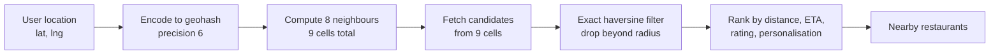

Other geohash edge cases worth naming:

- **Cells are rectangles, not squares**, and their width shrinks towards the poles. India sits between about 8 and 37 degrees north, so this matters little in practice, but say you know.
- **Density varies hugely.** A geohash-6 cell in Koramangala may hold 400 restaurants while one on the outskirts holds none. Fixed-size cells give uneven buckets. Quadtrees (next) fix this.
- **Moving objects change cells.** A rider crossing a boundary must be removed from the old cell's set and added to the new one. If you keep riders in per-cell sets, do the move atomically or tolerate a brief duplicate.

### 9.4 Quadtree: cells that adapt to density

A **quadtree** is a tree where every node is a rectangle of the map. A node holds points until it gets too full (say more than 100 restaurants). Then it splits into 4 equal children (NW, NE, SW, SE) and pushes its points down. Busy areas end up with many small cells. Empty areas stay as one big cell.

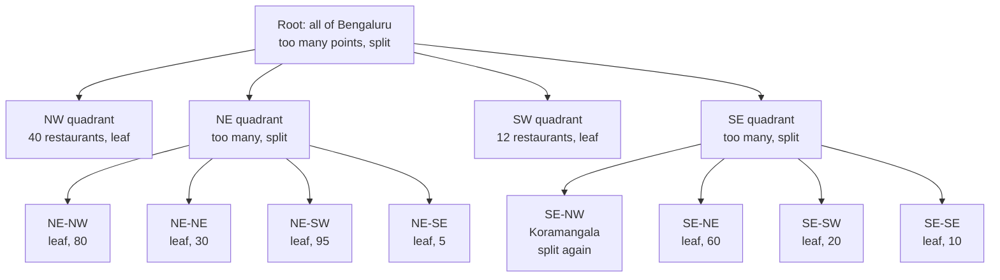

```
The same idea drawn as a map: dense areas are subdivided more.

+-----------------+--------+--------+
|                 |   80   |   30   |
|      40         +--------+--------+
|                 |   95   |   5    |
+--------+--------+--+--+--+--------+
|                 |..|..|  |        |
|      12         +--+--+60|        |
|                 |..|..|  |        |
|                 +--+--+--+--------+
|                 |  20   |   10    |
+-----------------+-------+---------+
   ".." = Koramangala, split twice because it is dense
```

To find nearby restaurants you walk down from the root to the leaf containing the user (about log4(N) steps), then check that leaf and the neighbouring leaves until you have enough results. This gives you "the nearest 50 restaurants" in a natural way, which fixed grids do clumsily.

The trade-offs:

- **Good:** adapts to density, great for "k nearest" queries, simple to build in memory.
- **Bad:** it is a tree in memory, so it is awkward to store in a key-value database or to shard. Updates for moving objects cause splits and merges. It suits **static-ish data** like restaurants, which change rarely and can be rebuilt every few minutes, much better than riders who move every few seconds.

A typical design keeps a quadtree in the memory of each "nearby" service instance, built at startup from the restaurants table and rebuilt periodically. A few lakh restaurants with id and coordinates is a few tens of MB (assumption: about 50 bytes per entry), which fits comfortably in RAM.

### 9.5 Google S2: squares on a cube, numbered along a curve

**S2** is Google's open-source library for dividing the sphere into cells. The idea in three steps:

1. Put the Earth inside a cube and project the surface onto the cube's 6 faces.
2. On each face build a quadtree: split into 4, then 4 again, down to **30 levels**.
3. Number the cells along a **Hilbert curve**, a space-filling curve that snakes through the grid so that cells close in number are almost always close in space.

```
A Hilbert curve on a 4x4 grid: the numbers follow the snake.
Consecutive numbers are always neighbours.

  5 --- 6     9 --- 10
  |     |     |     |
  4     7 --- 8     11
  |                 |
  3 --- 2    13 --- 12
        |     |
  0 --- 1    14 --- 15
```

Because each cell has a 64-bit integer ID and nearby cells have nearby IDs, "all cells in this area" turns into a few **integer ranges**, which any sorted index can scan. S2 also gives you a **region coverer**: hand it a circle or polygon (a delivery zone) and it returns a small set of cells, at mixed levels, that cover it.

> **Real world — Blinkit (Grofers):** Blinkit's merchant discovery service "Iris" (June 2016) used S2. The earth is projected onto a cube, a quadtree is built per face, and cells are enumerated along a Hilbert curve. Each merchant is mapped to its cell plus neighbours. A cache keyed by cell ID holds the set of visible merchants, precomputed from seed data, so "no computation happens in real time". (search extracts; [source](https://lambda.blinkit.com/iris-359b5dfd589b))

> **Real world — Uber (historical, 2015):** Before H3, Uber's dispatch used **S2 level-12 cells (3.31 to 6.38 km² each)**, and the **cell ID was the sharding key** for the location data. ([source](http://highscalability.com/blog/2015/9/14/how-uber-scales-their-real-time-market-platform.html))

The Iris pattern is worth stealing for any interview: **precompute the answer per cell**. If the question is "which stores serve this point?", the answer is the same for everyone standing in the same small cell. Compute it in the background, store `cell_id -> [store_ids]`, and the request path becomes one cache lookup.

### 9.6 H3: Uber's hexagons

**H3** is Uber's open-source hexagonal grid. It is the most common answer today when an interviewer says "how would you divide the city into areas?".

The facts to remember, all from Uber's H3 post and the H3 docs:

- The world is split into **122 base cells**, built on an icosahedron (a 20-sided solid). There are **12 pentagons**, one at each icosahedron vertex, because you cannot tile a sphere with only hexagons. They sit mostly in oceans.
- There are **16 resolutions, 0 to 15**. Each step down makes cells about **1/7 the area** of their parent (each hexagon has roughly 7 children).
- Each cell index is a **64-bit integer**, so it stores and indexes cheaply.

| Resolution | Avg area | Avg edge | Cells worldwide | Typical use |
|---|---|---|---|---|
| 7 | 5.16 km² | 1.41 km | 98.8M | City zones, surge regions |
| 8 | 0.737 km² | 0.53 km | 692M | Neighbourhood demand and supply |
| 9 | 0.105 km² | 0.20 km | 4.84B | Rider and restaurant "nearby" |
| 10 | 0.015 km² | 0.076 km | — | Very fine positioning |

([source: H3 resolution table](https://h3geo.org/docs/core-library/restable/))

**Why hexagons?** With squares, a cell has two kinds of neighbours: 4 that share an edge (centre-to-centre distance d) and 4 that touch only at a corner (distance d × 1.41). With hexagons every one of the 6 neighbours is at the same distance. So when you smooth data ("average demand over this cell and its neighbours") or compute gradients, every neighbour counts equally.

```
Squares: two kinds of neighbour       Hexagons: one kind of neighbour

+---+---+---+                              __    __
| c | e | c |   e = edge neighbour       __/  \__/  \__
+---+---+---+       distance d          /  \__/  \__/  \
| e | X | e |   c = corner neighbour    \__/ N\__/ N\__/
+---+---+---+       distance 1.41 d     /  \__/  \__/  \
| c | e | c |                           \__/ N\__/ N\__/
+---+---+---+                              \__/ X\__/
                                           /  \__/  \
                                           \__/ N\__/ N
                                              \__/  \__/
                                        all 6 N at equal distance
```

> **Real world — Uber:** Uber chose hexagons because they "minimize the quantization error introduced when users move through a city", and because a hexagon has a single centre-to-neighbour distance. **Uber calculates surge pricing by measuring supply and demand in hexagons in each city.** ([source](https://www.uber.com/blog/h3/))

**kRing (also called gridDisk in newer versions).** `kRing(cell, k)` returns every cell within k steps. k = 0 is the cell itself, k = 1 adds the 6 neighbours (7 total), k = 2 adds the next ring (19 total). This is the H3 version of geohash's "cell plus 8 neighbours", but rounder and with no special corner cases.

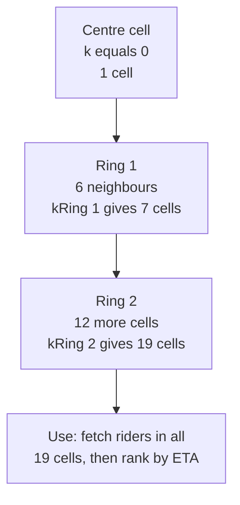

**Compaction.** A delivery zone drawn as a polygon can be stored as the set of H3 cells that cover it. Inside the zone, groups of 7 children can be replaced by their parent. In Uber's example, **10,633 resolution-6 cells compact to 901 cells** of mixed resolution. ([source](https://www.uber.com/blog/h3/))

**Surge per hexagon, step by step** (the general pattern; Uber states surge is computed per hexagon, the exact formula is not public):

1. Every ride request and every idle driver ping is tagged with its res-8 cell.
2. A stream job (Flink, say) counts demand and supply per cell per minute.
3. Ratio = demand / supply, smoothed with the kRing-1 neighbours so one cell does not flicker.
4. Map the ratio to a multiplier, cap it, and publish `cell -> multiplier` to a cache.
5. The price service looks up the user's cell at quote time.

For Zomato, the equivalent is a "rain surge" or "high demand" fee, or shrinking the delivery radius in cells where riders are scarce.

**Choosing a grid in an interview.** You do not need to pick a winner. A good sentence: "Geohash is simplest and works as a string prefix in any database. S2 is great for covering polygons and range scans on integer IDs. H3 gives equal-distance neighbours, which is nicer for surge and smoothing. For a food app I'd use H3 res 9 for nearby lookups and res 7 or 8 for zone-level aggregates. Any of them is fine if I handle neighbour cells."

| | Geohash | Quadtree | S2 | H3 |
|---|---|---|---|---|
| Cell shape | Rectangle | Rectangle, variable size | Quad on a cube face | Hexagon |
| Key | Base32 string | Tree path / node | 64-bit int | 64-bit int |
| Neighbours | 8, uneven distance | Walk the tree | Library call | kRing, equal distance |
| Adapts to density | No | Yes | Via mixed levels | Via compaction |
| Best at | Simple prefix lookups in any DB | k-nearest on static data in memory | Polygon covering, range scans | Surge, smoothing, zones |
| Who (per research) | Grab, Lyft, Swiggy cache keys | Common textbook design | Blinkit Iris, early Uber | Uber |

### 9.7 Redis GEO: the shortcut

Redis has built-in geo commands. Under the hood it computes a 52-bit geohash-like integer for each point and stores it as the score in a **sorted set** (a set where every member has a numeric score and is kept in score order). Because nearby points have nearby scores, a radius query becomes a few range scans of the sorted set.

```
GEOADD riders:blr 77.6245 12.9352 rider:9001
GEOADD riders:blr 77.6101 12.9279 rider:9002

GEOSEARCH riders:blr FROMLONLAT 77.62 12.93 BYRADIUS 3 km ASC COUNT 20 WITHDIST
-> rider:9001  0.55 km
-> rider:9002  1.20 km

GEODIST riders:blr rider:9001 rider:9002 km
```

(`GEOSEARCH` is the newer command; older code uses `GEORADIUS`. Note that Redis takes **longitude first**, which trips people up.)

How you would use it for live riders:

- One sorted set per city (or per H3 res-5 or res-6 area if a city is too big), so that each key stays on one Redis shard and a hot city does not overload one node.
- Each rider ping does `GEOADD` with the latest position. Old positions are simply overwritten because the member name is the rider ID.
- Store a separate `rider:9001:last_seen` key with a TTL (say 30 s). When you search, drop riders whose heartbeat has expired. Sorted-set members have no TTL of their own, so a periodic sweeper also removes stale riders from the set.
- Stream every ping to Kafka too, for history, analytics and ETA model training.

> **Real world — Zomato:** Zomato has **not** published how rider pings are stored on the server (Redis GEO, geohash or otherwise). Write-ups that claim "Zomato uses Redis plus WebSockets" are third-party and unverified. What is public: Zomato moved tracking from HTTP polling to **MQTT** because TLS and header overhead outweighed the tiny payloads and rider markers jumped instead of moving smoothly. ([MQTT source](https://www.eternal.com/blog/pulse/)) So in an interview say "Zomato hasn't published this; here's how it's typically done", then describe Redis GEO or an H3 cell index.

> **Real world — Uber (2015):** Uber drivers sent a **location update every 4 seconds**, and the geospatial index was designed for "**a million writes per second**", with reads far exceeding writes. ([source](http://highscalability.com/blog/2015/9/14/how-uber-scales-their-real-time-market-platform.html)) Treat it as historical.

> **Pause and think:** You put all Bengaluru riders in one Redis sorted set. At peak, 60,000 riders ping every 4 seconds. What is the write rate on that one key, and is it a problem? (Assumption-based answer: 60,000 / 4 = 15,000 GEOADDs per second on one key. A single Redis node can usually handle that, but it is one hot key on one shard with no headroom for a bigger city or a 2 s ping interval. Splitting by H3 res-6 cells spreads the load, at the cost of querying several keys near cell borders.)

### 9.8 Straight-line distance vs road distance

Everything so far finds things that are close **as the crow flies**. Riders do not fly. A restaurant 800 m away across a railway line, a river or a highway with no U-turn may be a 4 km ride. Indian cities are full of these: flyovers, one-ways, gated societies, the Yamuna.

```
Restaurant R and customer C are 0.8 km apart in a straight line,
but the rider must go around the railway line to the bridge.

   R *                                   haversine:  0.8 km
     |                                   road:       3.9 km
  ===|===========  railway  =======+=====
     |                             |  bridge
     |                             |
   C *  <-------- 3.1 km ----------+
```

So production systems use the grid only for **candidate generation** ("roughly near"), then compute **road distance or travel time** for the short list. Road distance comes from a **routing engine**: a program that holds the road network as a graph (intersections are nodes, road segments are edges weighted by length or travel time) and runs a shortest-path algorithm. **Dijkstra** explores outward from the start in order of distance. **A\*** ("A-star") is Dijkstra plus a hint: it prefers to explore nodes whose straight-line distance to the goal is small, so it explores far fewer nodes. Open-source engines like OSRM and GraphHopper run on OpenStreetMap (OSM) data; Google's Distance Matrix API is the paid option.

> **Real world — Grab Pharos:** Grab replaced "Sextant", which used haversine and could pick drivers close as the crow flies but far by road, with **Pharos**, an in-memory K-nearest-driver search by **road** distance or ETA. Driver locations sit in Adaptive Radix Trees, indexed both by driver ID and by **road segment**. A search expands along the road graph up to a range such as 3 km. Production P99 is **10 ms per driver update and 50 ms per nearby query**. Data is partitioned by city and vehicle type, and it "favors high throughput over strong consistency". ([source](https://engineering.grab.com/pharos-searching-nearby-drivers-on-road-network-at-scale))

Routing is expensive, and Swiggy's numbers show why you cannot call it naively: about 2,000 candidate restaurants per customer, and 200M evaluations a minute. The answer is a **cache keyed by grid cells, with a fallback chain**.

> **Real world — Swiggy serviceability:** Swiggy caches distances with a geohash as the key, and found **geohash level 8** gave the best accuracy trade-off. Caching every level-8 origin-destination pair would need hundreds of billions of keys, so the cache has a high-water mark for eviction and a stricter stop-write threshold. **On a miss, it falls back to a real-time A\* search on OpenStreetMap, then to haversine distance.** ([source](https://bytes.swiggy.com/designing-the-serviceability-platform-at-swiggy-for-high-scale-part-1-751a631f0379), search extracts) Swiggy also built a central **Distance Service** in front of the Google Distance Matrix API after teams kept hitting usage limits with a shared key. ([source](https://biweekly-engineering.beehiiv.com/p/biweekly-engineering-blog-reading-list-issue-6), newsletter summary)

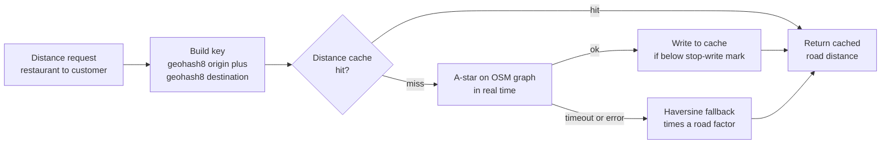

This is a pattern you can reuse in any answer: **cache, then compute, then a cheap approximation**. Each step down is cheaper and less accurate, and the system never fails outright. Your Myntra work fits here too. The Aerospike cache in front of the ratings store was the same idea, a fast lookup that saves the expensive path, and the cache warmup, where a 4 ms pacing delay stopped rate-limit rejections, is the kind of care a precomputed distance cache needs when you fill it.

### 9.9 Serviceability and delivery zones

"Serviceable" is the yes/no answer to "can restaurant R deliver to customer C right now?". It decides what appears on the home feed and whether "Place order" is enabled.

> **Real world — Swiggy:** Swiggy calls an order serviceable when the customer and restaurant are "nearby" by **road distance and travel time, not radial distance**, AND there is **enough delivery capacity around the restaurant**. ([source](https://bytes.swiggy.com/engineering-challenges-at-swiggy-430dea6c86a3), search extracts)

So serviceability has a static part and a live part:

- **Static:** is C inside R's delivery zone? A zone is usually a polygon drawn by the ops team, or a road-distance radius. Store it as a set of H3 or S2 cells (compacted), so the check is "is the customer's cell in this set?".
- **Live:** are there enough riders near R? Is R's kitchen overloaded? Is it raining? These change minute to minute and shrink the effective zone.

The fast way to serve it is to flip the question around: instead of "for each of 2,000 restaurants, is this customer serviceable?", precompute "for each customer cell, which restaurants serve it?", like Blinkit's Iris.

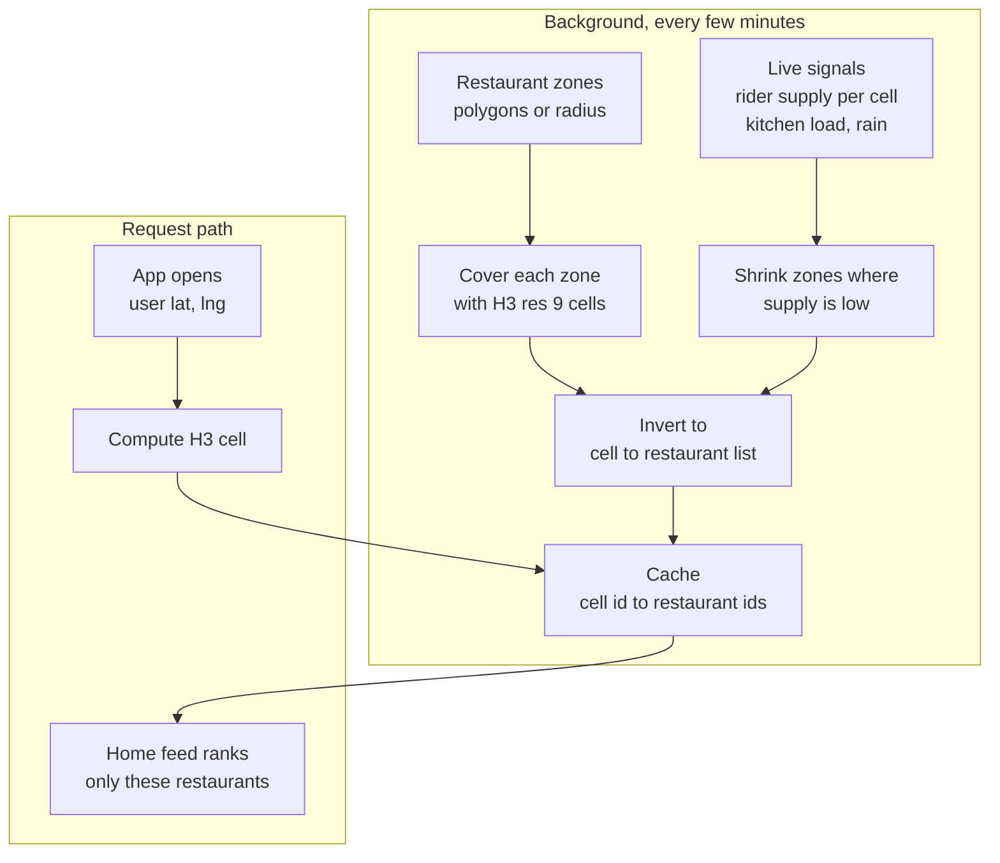

> **Real world — Zomato:** On NYE 2021, Zomato **throttled demand** where delivery partners or kitchen capacity were running out, using an automated demand-management system plus manual control at times. ([source](https://www.zomato.com/blog/our-learnings-from-nye/)) That is the live part of serviceability in action.

> **Real world — Grab Spampede:** Grab counts unallocated bookings per (service, geohash bucket at reduced precision, time bucket) with Redis `INCR` plus `EXPIRE`. Above a threshold it rejects new bookings from that area **before any downstream calls**, so one hotspot (rain at rush hour, a concert ending) does not slow the app everywhere. ([source](https://engineering.grab.com/preventing-app-performance-degradation-due-to-sudden-ride-demand-spikes))

For quick commerce the zone question becomes "which dark store serves me?". Swiggy Instamart assigns the customer to the nearest dark store ("pod"), and inventory is tracked per SKU per pod. ([source](https://bytes.swiggy.com/adaptive-metric-alignment-for-demand-forecasting-in-instamart-9aa5d2fca308)) Blinkit's Iris did exactly this cell-to-merchant mapping. Once the store is known, every later query (search, stock, price) is scoped to that store.

One more real-world wrinkle is that the customer's location itself is noisy.

> **Real world — Zomato POI mapping:** Zomato found phone GPS accuracy is **60 to 150 m** on mid to high-end phones and can be off by **2 to 3 km**. It tokenized customer addresses, clustered them per city, and produced GeoJSON building footprints that go through moderation and an A/B test, which cut partner-to-customer calls and handshake time. ([source](https://www.zomato.com/blog/to-help-us-locate-you-better/))

### 9.10 ETA: predicting "arriving in 32 minutes"

The ETA (estimated time of arrival) is the most visible number in the app. It shows on the restaurant card while browsing, on the cart, and on the tracking screen. It also feeds dispatch, because you want the rider to reach the restaurant just as the food is ready. A late ETA makes customers angry. An ETA that is padded too much makes them pick another restaurant.

The key idea is to **break the total into legs** and predict each leg with its own model:

```
Order placed                                                   Delivered
    |----------|------------------|--------------|----------------|
     assignment   rider to          wait at         restaurant to
     (find a      restaurant        restaurant      customer
      rider)      (first mile)      (prep time      (last mile)
                                     remaining)
    |<--------------- food preparation time ------>|
                 (runs in parallel with assignment and first mile)
```

> **Real world — Zomato's Time service:** A **Time microservice** owns ETA. It computes the ETA and distributes it to other services, and the ETA is used in menu browsing, restaurant selection, assignment, tracking and delay communication. The total is delivery-partner travel time (DP-ETA) + kitchen prep time (KPT) + real-time dynamic buffers (demand, traffic, weather, supply, system stress) + the partner's arrival time at the restaurant. Zomato moved from a map-graph-based model to a **tree-based model**, because Indian map data is sparse, and needed millisecond latency on CPU at "thousands of QPS". ([source](https://www.zomato.com/blog/the-accurate-eta-to-customer-satisfaction-part-one/))

> **Real world — Zomato DP-ETA model:** The travel model is **LightGBM** with a Tweedie loss, with **per-city models**. The prediction is split into pickup-to-drop-zone-geofence and geofence-to-handover, and features include polar coordinates centred on the restaurant. Moving serving from MLflow to **FastAPI** gave 3x throughput per pod and cut per-request latency from about 7 to 8 ms to about 2 to 3 ms. Serving millions of calls cost **under $10/day**. Zomato does **not** show the ETA to delivery partners, to avoid rash driving. ([source](https://www.zomato.com/blog/the-accurate-eta-to-customer-satisfaction-part-two/))

A few terms. **LightGBM** is a library for **gradient-boosted trees**: many small decision trees, each one trained to correct the errors of the ones before it. Tree models are fast on CPU, handle mixed features well (distance, hour of day, city, rain flag) and do not need a road graph, which is why they suit sparse map data. **Per-city models** means Bengaluru traffic and Lucknow traffic each get their own model.

The prep-time leg is the hardest, because the platform cannot see inside the kitchen.

> **Real world — Zomato food preparation time:** The original training label was "restaurant accepted" to "partner picked up", which mixes prep time with rider wait. Zomato added a **Food Order Ready (FOR) button** to the restaurant app to capture true prep time, which gave a **9% improvement in 5-minute accuracy**. Dishes are represented as Word2Vec embeddings (about **3.5M distinct dishes**), restaurants as entity embeddings, and a **stacked LSTM** reads the restaurant's last 5 running and last 5 completed orders. That cut MAE (mean absolute error) from **4.64 to 4.13 minutes**. ([source](https://www.zomato.com/blog/food-preparation-time/)) A later version trained the embeddings separately, making the model one-tenth the size, used per-city models and an asymmetric loss to avoid underestimation. ([source](https://www.zomato.com/blog/predicting-fpt-optimally/))

An **LSTM** is a neural network that reads a sequence and remembers what matters. Here the sequence is the kitchen's recent orders: if the last five orders are all taking 25 minutes, the kitchen is slammed. The FOR button is a great interview story because it shows that **the label matters more than the model**. Uber Eats and DoorDash had the same problem.

> **Real world — Uber Eats and DoorDash labels:** Uber Eats has **no ground truth for "food ready"** because restaurants do not report it, so Uber infers labels from each completed order. ([source](https://www.infoq.com/articles/uber-eats-time-predictions)) DoorDash treats prep time as a **censored-data** problem: when the Dasher arrives after the food is ready, the true ready time is never observed. ([source](https://doordash.engineering/2020/10/14/solving-for-unobserved-data-in-a-regression-model/))

A second strong idea is the **residual model**. Do not ask ML to predict the whole travel time from scratch. Let a routing engine give a base estimate, then let ML predict the correction.

> **Real world — Uber DeepETA:** The routing engine sums segment travel times, and an ML model predicts the **residual** ("ETA post-processing"). Uber chose an encoder-decoder with linear-transformer self-attention because a full transformer was too slow; latency must be "a few milliseconds at most", and it is Uber's highest-QPS model. It uses an **asymmetric Huber loss**, penalising under- and over-prediction differently, and encodes origin and destination on multi-resolution geo grids. ([source](https://www.uber.com/blog/deepeta-how-uber-predicts-arrival-times/))

ETA is not computed once. It is predicted at the cart and then refreshed as events arrive (rider assigned, food ready, picked up) and as pings show the rider's actual speed.

> **Real world — Swiggy 4-leg ETA:** Swiggy's tracking-screen ETA starts from the checkout prediction and is refreshed at fixed intervals using live signals (restaurant stress, rider pings). It is modelled as four legs: **order-to-assignment, first mile, wait at the restaurant, and last mile**. Last-mile speed is computed from rider pings after grouping them into time windows and removing outliers. ([source](https://bytes.swiggy.com/how-ml-powers-when-is-my-order-coming-part-i-4ef24eae70da), search extracts)

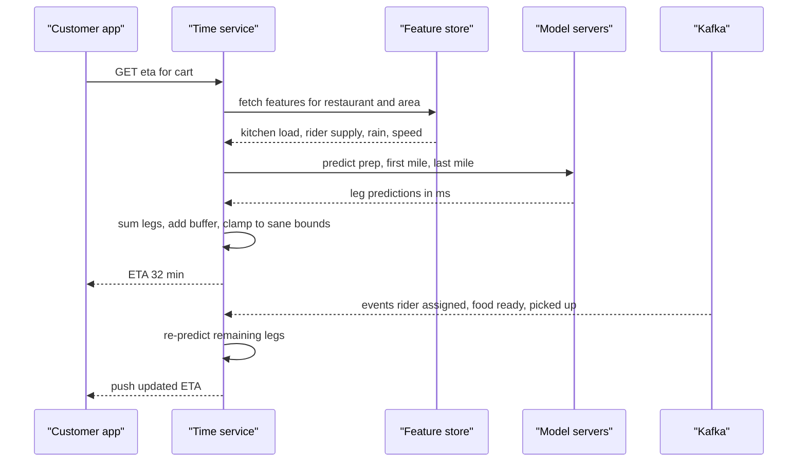

Notice the "clamp to sane bounds" step. That line exists because of real incidents.

> **Real world — Swiggy negative ETA outage:** A new serviceability model (PSLA, predicted delivery time) produced **negative predictions** after rollout. Swiggy rolled back and restored service within about 3 hours; the post-mortem noted **there was no fallback for negative predictions**. ([source](https://bytes.swiggy.com/behindthebug-unpacking-the-effects-of-negative-psla-predictions-on-serviceability-6e1712eceb56), from the series listing) Swiggy also caps prep-time inputs at 60 minutes because the model behaves erratically on long outliers. ([source](https://bytes.swiggy.com/building-rock-solid-ml-systems-bb775f8a7126))

So the robust ETA design has guardrails around the model:

- **Validate outputs.** If a prediction is negative, NaN, or outside [min, max] for that city, ignore it.
- **Fall back.** Use the previous model version, a simple per-restaurant historical average, or distance divided by average city speed plus a fixed prep time.
- **Canary new models.** Roll out to a small slice of cities or traffic and compare against the old one before going wide.
- **Use asymmetric loss.** Being 5 minutes late hurts more than being 5 minutes early, so the model should lean slightly pessimistic.

> **Pause and think:** The ETA service is called on every restaurant card in the home feed. A feed shows 20 cards, and 1 lakh people open the app per minute. Is a few milliseconds per prediction good enough? (Assumption: 20 × 100,000 / 60 is about 33,000 predictions per second. At 2 to 3 ms each on one core, you need about 100 cores busy, which is fine. Batch the 20 cards in one call, and cache per (restaurant, customer cell, 1-minute bucket).)

### 9.11 Dispatch and batching: who delivers this order?

**Dispatch** (or assignment) is choosing which delivery partner takes which order. The simple version is **greedy**: when an order comes in, give it to the nearest free rider. It is easy and it is wrong, and a tiny example shows why.

```
Two orders (O1, O2) and two riders (R1, R2). Travel minutes to each pickup:

            O1     O2
     R1      2      3
     R2      5     10

Greedy, in order of arrival:
  O1 arrives first -> nearest is R1 (2 min)
  O2 gets the only rider left, R2 (10 min)       total = 12 min

Global (look at both together):
  R1 -> O2 (3 min),  R2 -> O1 (5 min)            total =  8 min
```

Greedy optimises each decision alone. **Global matching** collects the orders and riders that are waiting during a short window (a few seconds) and finds the assignment with the lowest total cost.

> **Real world — Uber Eats:** Uber Eats dispatch "launched with a **greedy** matching algorithm" and later moved to **global matching**. In the article's example greedy gave 6 minutes of total travel and global gave 4. Global matching "couldn't live without accurate time predictions". ([source](https://www.infoq.com/articles/uber-eats-time-predictions))

#### Bipartite matching, simply

A **bipartite graph** has two groups of nodes, and edges only go between the groups, never inside one. Here one group is riders, the other is orders. Each edge has a **cost**, for example predicted minutes until that rider can pick up that order. The **assignment problem** is to pick edges so each order gets at most one rider, each rider gets at most one order, and the total cost is as small as possible.

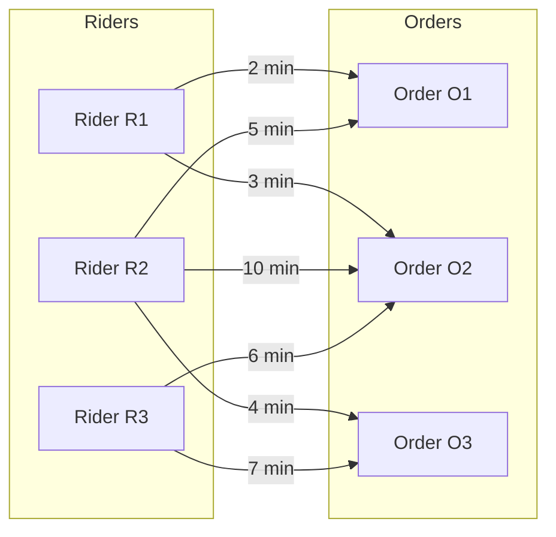

You can write the same thing as a **cost matrix**, with riders as rows and orders as columns. The **Hungarian algorithm** (also called **Kuhn-Munkres**) finds the minimum-cost assignment exactly in O(n³) time. You do not need to code it in an interview. Say what it solves, its complexity, and its limitation: it handles **1 rider to 1 order** only. It cannot express "this rider takes two orders from the same restaurant".

> **Real world — Grab:** Grab models matching as **minimum-weight bipartite matching (Kuhn-Munkres, O(m³))**, batching bookings over a window of W seconds and recomputing "every X seconds". The **cost matrix (Dijkstra on a road graph of about 400k nodes in Singapore) dominates runtime for m < 1,500**; assignment time only overtakes it above about 2,500. Their Incremental KM uses the fact that the best match is usually one of the nearest, computes only the costs it needs, and cuts runtime by more than an order of magnitude with the same optimum. ([source](https://engineering.grab.com/using-real-world-patterns-to-improve-matching))

That Grab finding is a strong interview point. **The expensive part is not the matching maths, it is building the cost matrix**, because every cell is a road-network ETA call. So you prune first: only consider riders in the order's kRing-2, or the 10 nearest by straight line, and compute real ETAs just for those.

#### Batching

**Batching** means one rider carries two or more orders, usually from the same or a nearby restaurant to customers close to each other. It can greatly improve fleet efficiency.

> **Real world — Swiggy:** Swiggy describes batching as a restaurant getting two orders at about the same time from customers who live near each other, says batching "could double the capacity of the entire delivery fleet", and notes optimal batching is **NP-hard** (no known fast exact algorithm). A wider wait window gives more chances to batch, but the first order waits longer. ([source](https://bytes.swiggy.com/the-swiggy-delivery-challenge-part-one-6a2abb4f82f6), search extracts)

> **Real world — Uber Eats:** "Triple batching" lets one courier carry **up to 3 orders from 1 or 2 restaurants**. It is more likely at lunch and dinner peaks and limited when delivery times would be extensive. ([source](https://www.uber.com/en-AU/blog/triple-batching-for-restaurants))

Because Hungarian cannot express batches, the big players moved to more general solvers. An **integer linear program (ILP)** or **mixed-integer program (MIP)** describes the problem as variables that are 0 or 1 ("does rider r take batch b?"), linear constraints ("each order in exactly one batch", "each rider at most one batch") and an objective ("minimise total delay plus cost"). A solver such as Gurobi searches for the best answer.

> **Real world — DoorDash:** DoorDash's first dispatcher was bipartite matching with the **Hungarian algorithm**, which was too slow for large real-time instances and could not handle routes with 2 or more deliveries. It was reformulated as a **MIP** solved with Gurobi, "up to 10 times faster" than Hungarian, run "on several instances distributed based on regional boundaries multiple times a minute". The new optimizer ran in shadow beside the old one and matched it **more than 99% of the time** before cutover. ([source](https://doordash.engineering/2020/02/28/next-generation-optimization-for-dasher-dispatch-at-doordash/)) **DeepRed**, DoorDash's dispatch system, has three layers: candidate generation, an ML layer (prep time, travel time, **Dasher acceptance probability**), and a MIP layer that scores offers, batches orders and decides whether to **delay dispatch** so the Dasher does not wait at the store. ([source](https://doordash.engineering/2021/08/17/using-ml-and-optimization-to-solve-doordashs-dispatch-problem/))

> **Real world — Swiggy:** Swiggy's assignment is an **integer linear program** that runs over all active batches and delivery partners in a city at short, regular intervals (micro-batch, not per order). City-wide runs were slow, so Swiggy split cities into **logistic zones** (restaurant clusters) so the solver works on smaller sub-problems. ([ILP source](https://bytes.swiggy.com/the-swiggy-delivery-challenge-part-two-f095930816e3), [zones source](https://bytes.swiggy.com/logistic-zones-for-assignment-48d9ce06c4a8), search extracts) City-level jobs score every (order × delivery executive) edge with an ML model before the optimiser runs. ([source](https://bytes.swiggy.com/2x-improvement-in-latency-in-swiggy-data-science-platform-6101b7607530))

> **Real world — Zomato:** Zomato's actual matching algorithm (cost function, solver) is **not public**. What is public: **Active Dispatch**, a Deep Q-Network multi-agent **reinforcement learning** model that recommends where **idle** partners should move based on predicted demand and supply. Partners who followed it got a higher share of orders and shorter gaps until their next order. ([source](https://www.zomato.com/blog/elements-of-scalable-machine-learning/)) A fast equation-based ETA fed into assignment and raised the compliance of its predictions by 4%. ([source](https://www.zomato.com/blog/the-accurate-eta-to-customer-satisfaction-part-two/)) Zomato was also experimenting with POI-based order clubbing and multi-drop deliveries. ([source](https://www.zomato.com/blog/to-help-us-locate-you-better/))

Active Dispatch solves a different problem from matching. Matching decides who takes the orders that exist **now**. Repositioning moves idle riders to where orders **will be** in ten minutes, so that the next round of matching has good options. Reinforcement learning fits because a move pays off later, not immediately.

Putting it all together, a defensible dispatch design for an interview:

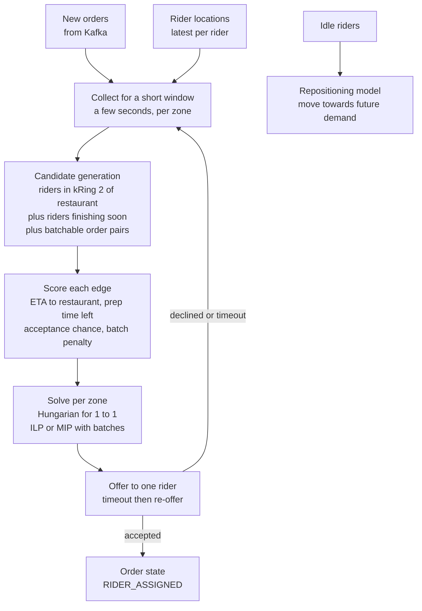

Points to say out loud:

- **Do not broadcast** an order to every rider and let the fastest phone win. Gojek moved away from this because it was unfair, gave no accountability and created huge concurrency load. ([source](https://blog.gojek.io/how-gojek-manages-1-million-drivers-with-12-engineers-part-2-2/)) Offer to one rider at a time, with a timeout.
- **Just-in-time assignment:** do not send the rider the moment the order is placed if prep takes 20 minutes. Swiggy assigns so the rider does not wait at the restaurant. ([source](https://bytes.swiggy.com/the-swiggy-delivery-challenge-part-one-6a2abb4f82f6))
- **Shard by zone.** Each solver instance owns a region. Bigger regions give better answers but cost more compute, and riders near zone borders are a known edge effect (DoorDash says a faster solver lets you solve larger regions).
- **Concurrency:** two solver runs must not assign the same rider. Use a conditional update (`UPDATE riders SET state='ASSIGNED', order_id=? WHERE id=? AND state='IDLE'`) so only one wins.
- **Roll out safely:** shadow-run a new matcher and compare, as DoorDash did.

> **Real world — Swiggy interview:** A Swiggy SDE-1 LLD round asked to "assign drivers to orders" with VIP/non-VIP orders, driver ratings and matching conditions: design, choose data structures, write code and dry-run. ([source](https://leetcode.com/discuss/post/7642548/)) For that, priority queues (VIP first, then by wait time) plus a pluggable `MatchingStrategy` interface is the expected shape.

### Check yourself

**Q: Why is `WHERE haversine(lat, lng, ...) < 5` slow even with an index on lat and lng?**
A: The condition is a function of both columns, so no index can narrow the rows. The database computes the distance for every row, which is a full table scan.

**Q: What is wrong with a bounding box on a composite index (lat, lng)?**
A: A B-tree range-scans efficiently only on the first column, so it reads a whole latitude strip across the country and then filters longitude. Better: a spatial index (PostGIS GiST, MySQL spatial) or a geohash/H3 cell column with equality or prefix lookups.

**Q: State the geohash prefix property and why it matters.**
A: Every point inside a cell has a geohash starting with that cell's string. So "all points in this cell" is a prefix range scan on a single indexed string column, in any database.

**Q: Why search 9 geohash cells and not just one?**
A: A user near a cell edge has close neighbours in the adjacent cells, which can have different prefixes. Searching the cell plus 8 neighbours, then filtering by exact distance, avoids missing them.

**Q: When is a quadtree better than a fixed grid?**
A: When density varies a lot, for k-nearest queries, and when the data is fairly static (restaurants), so the tree can sit in memory and be rebuilt periodically.

**Q: Give three H3 facts and the reason Uber chose hexagons.**
A: 16 resolutions (0 to 15), each about 1/7 the area of its parent; res 7 is about 5.16 km², res 9 about 0.105 km²; 64-bit cell IDs. Hexagons have one neighbour distance, which reduces quantization error and simplifies smoothing; Uber computes surge from supply and demand per hexagon.

**Q: What did Blinkit's Iris precompute and why?**
A: For each S2 cell, the set of merchants visible there. Everyone in a small cell gets the same answer, so the request path is one cache lookup with no real-time computation.

**Q: Describe Swiggy's distance fallback chain.**
A: Cache keyed by geohash-8 origin and destination, then real-time A* on OpenStreetMap, then haversine. Each step is cheaper and less accurate, so the system never fails outright.

**Q: What are the parts of Zomato's ETA, and what did the Food Order Ready button fix?**
A: Rider travel (LightGBM, per city), kitchen prep time (LSTM over recent orders), rider arrival at the restaurant, and dynamic buffers. The button gave a true "food ready" label instead of "accepted to picked up", improving 5-minute accuracy by 9%.

**Q: What guardrails should an ETA model have, and what incident motivates them?**
A: Output bounds, a fallback model or heuristic, canary rollouts, and capped inputs. Swiggy's serviceability model produced negative predictions with no fallback and needed about 3 hours to roll back.

**Q: Why is greedy nearest-rider dispatch suboptimal, and why did DoorDash leave Hungarian?**
A: Greedy fixes each order alone and can force a later order onto a far rider; global matching minimises total cost over a window. Hungarian only does 1:1 and was too slow at scale; MIP handles batches and ran faster with Gurobi.

**Q: In Grab's matcher, what dominates runtime, and how do you reduce it?**
A: Building the cost matrix with road-network shortest paths. Prune candidates spatially (nearest riders, kRing) and compute costs only where needed, as Incremental KM does.

---

## Part 10: Search

When a user types "paneer tikka" or "burger 150rs wala", the app must return relevant, nearby, open restaurants and dishes in about 100 ms. A SQL `LIKE '%paneer%'` cannot do this: a leading wildcard cannot use a B-tree index, so it scans every row, and it has no idea of relevance. Search engines solve both problems.

### 10.1 The inverted index

A normal ("forward") index maps a document to its words. An **inverted index** flips it: it maps each **word** (a "term") to the list of documents that contain it. That list is called a **postings list**.

```
Documents (dishes)                     Inverted index
1: "Paneer Tikka Masala"               term       -> postings (doc ids)
2: "Chicken Tikka"                     paneer     -> 1, 3
3: "Paneer Butter Masala"              tikka      -> 1, 2
4: "Butter Chicken"                    masala     -> 1, 3
                                       chicken    -> 2, 4
                                       butter     -> 3, 4

Query "paneer masala":  postings(paneer) AND postings(masala)
                        {1,3} intersect {1,3} = {1,3}
```

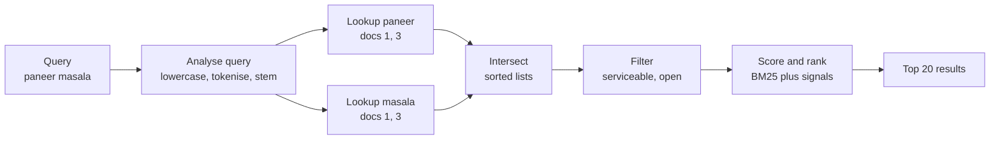

Postings lists are kept sorted by doc ID, so intersecting two lists is a fast merge, like merging two sorted arrays.

### 10.2 Analysis: tokenising, normalising, stemming

Before words go into the index (and before a query is looked up), text goes through an **analyser**:

1. **Tokenise:** split "Paneer-Tikka, Masala!" into `Paneer`, `Tikka`, `Masala`.
2. **Lowercase** and strip accents.
3. **Remove stop words** like "the", "and" (optional; in food search "with" might matter).
4. **Stem or lemmatise:** reduce "burgers" and "burger" to `burger`, "fried" to `fri`. Stemming chops suffixes by rules; lemmatising uses a dictionary.
5. **Synonyms:** map "cold drink" to "soft drink", "dahi" to "curd".
6. **N-grams** for partial matches: "pan", "pane", "panee" so typeahead works.

Indian food search adds its own problems: Hinglish ("chiken", "biriyani", "biryani"), price in the query, and transliteration. That is where query understanding (10.4) comes in.

### 10.3 Ranking: TF-IDF and BM25 in plain words

Finding matching documents is half the job. Ordering them is the other half. The classic text score rests on two intuitions:

- **Term frequency (TF):** a document that mentions "paneer" five times is probably more about paneer than one that mentions it once.
- **Inverse document frequency (IDF):** a word that appears in almost every document ("masala") tells you little. A rare word ("laphing") is very informative. So rare words get more weight.

**TF-IDF** multiplies the two. **BM25**, the default in Lucene (and therefore Solr and Elasticsearch), improves it in two ways: TF **saturates** (the 10th mention adds much less than the 2nd), and it **normalises by length**, so a short dish name matching "paneer" beats a long description that happens to mention it once.

Text score alone is never enough for food. A perfect text match 9 km away that is closed is useless. Real ranking blends signals.

> **Real world — Zomato unified scoring:** Zomato's relevance was described as **text score + popularity score + intent score**, where intent comes from location, time and day. If one result crosses a threshold it becomes the "leader", which happened in about 65% of queries. Every tap is tracked with `search_id` and `previous_search_id`. ([source](https://www.zomato.com/blog/all-new-search-and-discovery-on-zomato/))

### 10.4 Learn-to-Rank and query understanding

**Learn-to-Rank (LTR)** means training an ML model to order results, using logged behaviour (what users clicked and ordered) as labels. The usual set-up is two stages: the search engine **retrieves** a few hundred candidates cheaply with BM25 and filters, then the LTR model **re-ranks** them with richer features (distance, ETA, rating, price, the user's history).

> **Real world — Zomato:** Zomato's Learn-to-Rank is a **pairwise, gradient-boosted model** with features such as regional dish popularity, historical orders and keyword match. Autocorrect uses a phonetic-weighted edit distance plus a Siamese network, and auto-suggest removes outlets outside the delivery radius. ([source](https://www.zomato.com/blog/rethinking-zomato-search-pt-1)) For natural-language queries, a **BiLSTM-CRF tagger** over Word2Vec and BPE embeddings tags dish, restaurant and intent in Hinglish queries like "Burger 150rs wala"; it runs fast on CPU and won an A/B test on CTR. ([source](https://www.zomato.com/blog/how-we-make-our-search-more-conversational-and-inclusive/))

"Pairwise" means the model learns from pairs: "for this query, result A should rank above B". A **BiLSTM-CRF** reads the query left-to-right and right-to-left (bidirectional LSTM) and then a CRF layer picks the most consistent sequence of tags:

```
Query:   burger    150rs     wala     near   me
Tags:    DISH      PRICE     O        LOC    LOC
Result:  dish = burger, max_price = 150, sort by distance
```

Query understanding turns free text into structured filters, so the search engine gets `dish:burger AND price<=150` instead of five fuzzy words.

### 10.5 Solr vs Elasticsearch

Both are built on **Lucene**, the Java library that implements inverted indexes, BM25 and segment files. They differ in packaging.

| | Solr | Elasticsearch / OpenSearch |
|---|---|---|
| Base | Lucene | Lucene |
| Clustering | Classic master-slave replication, or SolrCloud with ZooKeeper | Built-in clustering, shards and replicas from day one |
| API | HTTP, XML/JSON config | JSON REST API, very developer-friendly |
| Typical strength | Mature, highly tunable text search | Easy scaling, logs and analytics, big ecosystem |
| Who (per research) | Zomato | Swiggy food search (earlier), Zepto (OpenSearch) |

> **Real world — Zomato runs Solr:** Zomato search handles **100M+ queries/day**, and "Solr-Lucene is the base of all search functions". Some clusters ran master-slave (the master indexes, slaves sync and serve reads behind a load balancer). An unbounded FieldCache caused out-of-memory errors; switching to **DocValues** (column-oriented, memory-mapped storage for sort and facet fields) gave **10x throughput per slave** and cut cost by about **80% (about ₹30L/month)**. Zomato upgraded Solr 6.x to 7.6.0 and then 8.7.0, moved some clusters to SolrCloud, and forked Lucene for fixes. ([source](https://www.zomato.com/blog/explained-how-zomato-handles-100-million-daily-search-queries-p1/))

Why DocValues helped so much: an inverted index is great for "which docs contain X?" but bad for "what is the rating of doc 123?", which sorting and faceting need for every matching doc. FieldCache built that doc-to-value map on the heap at query time, which blew up memory. DocValues store it on disk in columns, built at index time and memory-mapped, so the OS page cache serves it. It is the same row vs column storage idea from analytics databases.

> **Interview tip:** Don't say "Zomato uses Elasticsearch for search". Per the research, Zomato used Elasticsearch only for logs, before moving those to ClickHouse.

### 10.6 Keeping the index in sync

The source of truth (menus, prices, restaurant open/closed, stock) lives in a database. The index is a **derived copy**. How do you keep it fresh?

- **Dual writes** (the app writes the DB and the index): simple, but if the second write fails they drift apart, and there is no ordering guarantee. Your Myntra "two caches out of sync" bug is exactly this failure.
- **Events / CDC (change data capture):** the app writes only the DB. A tool like **Debezium** reads the database's change log (MySQL binlog, Postgres WAL) and publishes each change to Kafka. An indexer consumes it and updates the search engine. If the indexer crashes, it resumes from its Kafka offset.

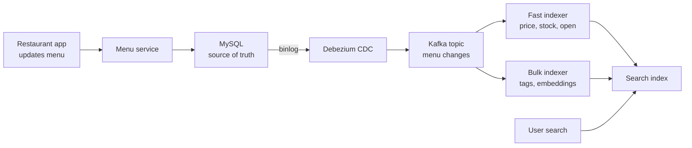

> **Real world — Zepto:** Catalog, Inventory, Pricing and Offers services emit events to MSK (Kafka). Two Flink indexing jobs run: **P0** for near-real-time updates (inventory, price) and **P1** for bulk updates (tags, embeddings, offers). Zepto raised the OpenSearch refresh interval from 1 s to 10 s, which was acceptable because stock status is only "a tiebreaker" in ranking, and **final availability is re-checked against the real-time inventory service after retrieval**. p90 search latency went from 187 ms to 89 ms. ([source](https://aws.amazon.com/blogs/big-data/how-zepto-powers-sub-second-search-using-opensearch-service-or2-instances/))

The Zepto design teaches the key principle: **the index may be a little stale; the decision point must not be**. Each of Zepto's hubs has its own inventory, pricing and assortment, so search is resolved against the customer's hub(s), not a global catalog. Retrieval is allowed to be eventually consistent, and the add-to-cart or checkout step checks live stock.

> **Real world — Zomato data platform:** Aurora MySQL changes are captured by **Debezium** and published to Kafka in Avro, then Flink writes them into Iceberg tables on S3. ([source](https://aws.amazon.com/blogs/opensource/how-zomato-boosted-performance-25-and-cut-compute-cost-30-migrating-trino-and-druid-workloads-to-aws-graviton/)) That post is about analytics, not search, but it shows Zomato already runs a CDC pipeline.

### 10.7 Typeahead with a trie

Typeahead (autocomplete) runs on **every keystroke**, so the budget is tiny.

> **Real world — Swiggy:** Swiggy's autocomplete runs learning-to-rank **inside OpenSearch** with a **sub-10 ms ranking budget**, to avoid extra network hops. ([source](https://bytes.swiggy.com/real-time-ml-ranking-in-autocomplete-part-1-3cdbbd44f85a), search extracts)

The classic data structure is a **trie** (prefix tree). Each node is a character; a path from the root spells a prefix. To make it fast, each node **stores its top-k completions** precomputed, so a lookup is just "walk down the prefix, return the stored list". No subtree search at query time.

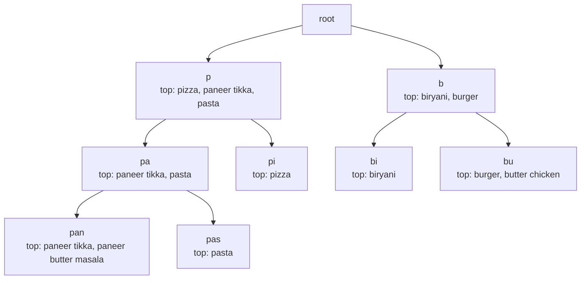

How it is built and served:

- A daily or hourly job counts popular queries and dish names (per city, since "vada pav" ranks differently in Mumbai and Chennai), builds the trie with top-k at every node, and ships it to typeahead servers that hold it in memory.
- The client **debounces** (waits about 100 to 200 ms after the last key) and caches results per prefix.
- Filter against the user's serviceable restaurants, as Zomato's auto-suggest drops outlets outside the delivery radius.
- In practice many teams use a search engine's completion or edge-n-gram features instead of a hand-built trie.

> **Real world — interview:** A Zomato interview asked for OOP code for a Ctrl+R reverse command search, and **a trie optimisation was expected**. ([source](https://www.geeksforgeeks.org/interview-experiences/zomato-interview-experience-for-sde1-1-year-experienced/), attribution of that page is slightly uncertain) A Zomato SDE-2 round asked for "a search algorithm returning products with the highest matching frequency" over name, tags and description; the expected answer was an inverted index / Elasticsearch. ([source](https://leetcode.com/discuss/post/7478818/)) The same round also had a bipartite matching DSA question, which links back to dispatch in Part 9.

### 10.8 Putting it together: per-store search for quick commerce

For Blinkit or Zepto, search must answer "items available at **my** dark store". The flow:

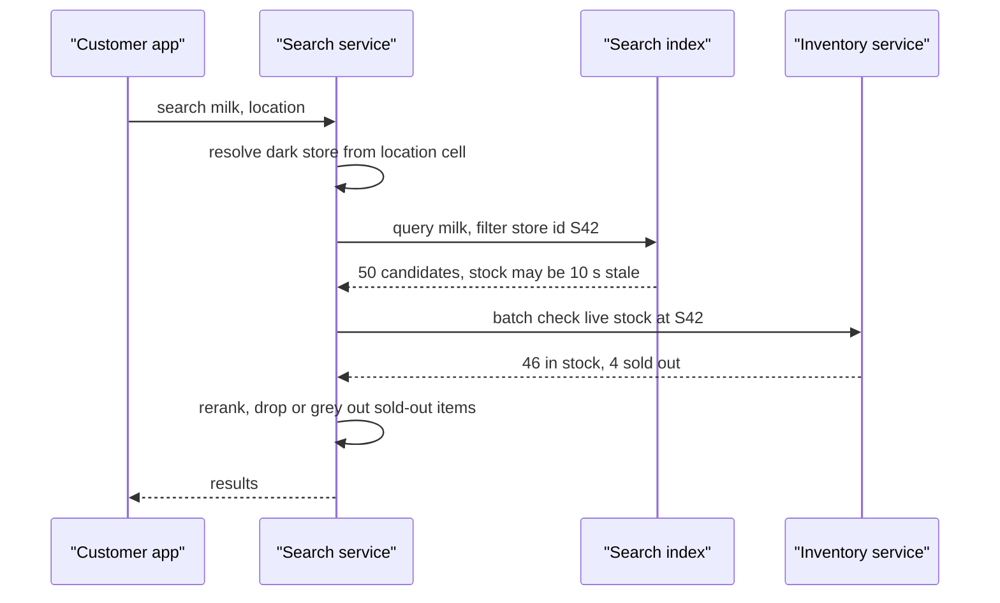

### Check yourself

**Q: Why can't `LIKE '%paneer%'` use a B-tree index?**
A: The leading wildcard means the match can start anywhere, so the sorted order of the index cannot narrow the search. The database scans every row, and it has no relevance score either.

**Q: What is an inverted index and a postings list?**
A: A map from each term to the sorted list of document IDs containing it. Multi-word queries intersect (AND) or union (OR) those lists.

**Q: Explain TF and IDF in one line each, and what BM25 adds.**
A: TF: more mentions of a term means more relevance. IDF: rare terms carry more weight. BM25 saturates TF and normalises for document length.

**Q: Which search engine does Zomato use, and what single change gave 10x throughput?**
A: Solr on Lucene, at 100M+ queries/day. Switching sort and facet fields from FieldCache to DocValues gave 10x throughput per slave and about 80% cost reduction.

**Q: What did Zomato's BiLSTM-CRF tagger do?**
A: It tagged parts of Hinglish queries (dish, restaurant, price, intent), so "Burger 150rs wala" becomes structured filters.

**Q: Why prefer CDC over dual writes for keeping the index in sync?**
A: Dual writes drift when one write fails and give no ordering. CDC reads the DB's own change log into Kafka, so the indexer gets every committed change in order and can resume after a crash.

**Q: Why could Zepto accept a 10-second index refresh interval?**
A: Stock is only a tiebreaker in ranking, and availability is re-checked against the live inventory service after retrieval. The index can be stale; the decision point cannot.

**Q: How does a trie make typeahead fast?**
A: Walk down the prefix in O(length) and return the top-k completions precomputed at that node, with no subtree search at query time.

**Q: Two-stage ranking: what happens in each stage?**
A: Retrieval cheaply gets a few hundred candidates (BM25 plus filters like serviceability). Re-ranking applies an LTR model with rich features to order them.

---

## Part 11: Files, media and CDNs

Restaurant photos, dish images, menu scans, review photos, invoices, delivery proof photos, support voice notes: a food platform moves a lot of files. Files do not belong in your SQL database or in your API servers' memory. This part covers where they go and how they flow.

### 11.1 Object storage

**Object storage** (Amazon S3, Google Cloud Storage) stores files as **objects** in **buckets**, each addressed by a key like `menus/rest_123/2026-10-23/page1.jpg`. It is not a file system (no real folders, no editing in place) and it is not a database (no queries). In exchange you get practically unlimited capacity, very high durability (S3 advertises eleven nines), cheap storage tiers, and an HTTP API.

The rule: **store the bytes in S3, store the metadata in your database.**

```sql
CREATE TABLE media (
  id           BIGINT PRIMARY KEY,
  owner_type   VARCHAR(20),   -- 'restaurant', 'review', 'order'
  owner_id     BIGINT,
  s3_key       VARCHAR(500),
  content_type VARCHAR(50),
  size_bytes   BIGINT,
  status       VARCHAR(20),   -- PENDING_UPLOAD, UPLOADED, PROCESSED, REJECTED
  created_at   TIMESTAMP
);
```

### 11.2 Pre-signed upload: the reported trap

The naive design: the app sends the image to your API server (as base64 inside JSON, or multipart), and the server forwards it to S3. This is wrong for anything but tiny files. Base64 inflates size by about 33%. Each upload ties up an API server thread and its memory for the whole transfer, on slow mobile networks. Your servers become an expensive, fragile proxy.

> **Real world — interview trap (Eternal, Dec 2025):** For image upload the candidate proposed base64; the interviewer asked "what about big images?" and wanted **pre-signed S3 URLs**, which the candidate did not know. ([source](https://leetcode.com/discuss/post/7407389/)) A District SDE-1 HLD round (voice transcription, about 10 MB files, 100K uploads/day) also expected **pre-signed S3 uploads plus a queue and async workers**, with job status tracking. ([source](https://medium.com/@samarth.bhutani/district-zomato-sde-1-interview-experience-off-campus-56-lpa-ctc-7806143fa708)) Zomato SDE-1 "Design an image upload system" asked for CRUD API code with status codes, payloads, headers and auth. ([source](https://leetcode.com/discuss/post/4068294/))

A **pre-signed URL** is an S3 URL with a signature in its query string. Your server creates it using its own AWS credentials, and it grants **one specific permission** (PUT this key, with this content type, for the next 5 minutes) to whoever holds it. The client uploads **directly to S3**. Your server never touches the bytes.

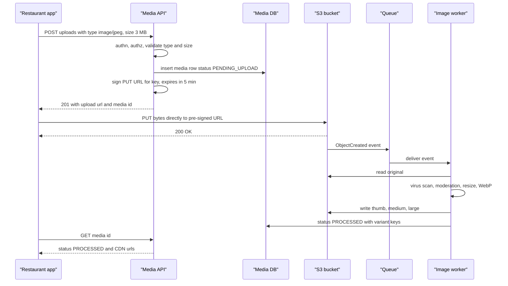

Details that earn points:

- **The client cannot choose the key.** The server generates it (`uploads/{media_id}`), so users cannot overwrite each other's files.
- **Constrain the upload:** short expiry, exact content type, and a size limit (a pre-signed POST policy can enforce `content-length-range`).
- **Confirm completion** using the S3 event, not by trusting the client to say "done". Rows stuck in `PENDING_UPLOAD` past expiry get cleaned up by a sweeper.
- **Large files** (video, long audio): use **multipart upload**, where the file is split into parts (S3 requires at least 5 MB per part except the last), each part gets its own pre-signed URL, parts upload in parallel and retry individually, and a final "complete" call stitches them.
- **Downloads of private files** (invoices, KYC documents) also use pre-signed GET URLs with short expiry. Public images go through the CDN.

### 11.3 The async processing pipeline

Uploads trigger work that is slow and can fail: resizing into several sizes, converting to WebP or AVIF, stripping EXIF location data (privacy), moderation (no inappropriate photos on review pages), OCR.

> **Real world — Zomato menu digitisation:** Menu images go through text detection, OCR, section detection and a dish classifier, so no human input is needed. It powers dish search and speeds up menu creation. ([source](https://www.zomato.com/blog/elements-of-scalable-machine-learning/))

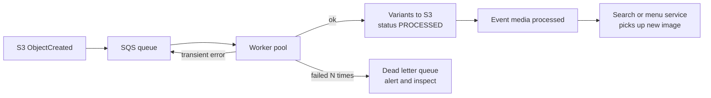

This is the same shape as your Atlassian work: SQS plus worker pools, idempotent processing (processing the same S3 event twice must not create duplicate variants, so key outputs deterministically, for example `processed/{media_id}/thumb.webp`), and a DLQ for poison messages. Expose **job status** so the client can poll or get a push, which the District interviewer explicitly asked about.

### 11.4 CDN delivery

A **CDN** (content delivery network: CloudFront, Cloudflare, Akamai) is a set of cache servers in many cities. The user's request goes to the nearest **edge**. On a hit, the edge serves the file. On a miss it fetches from the **origin** (your S3 bucket), caches it and serves it.

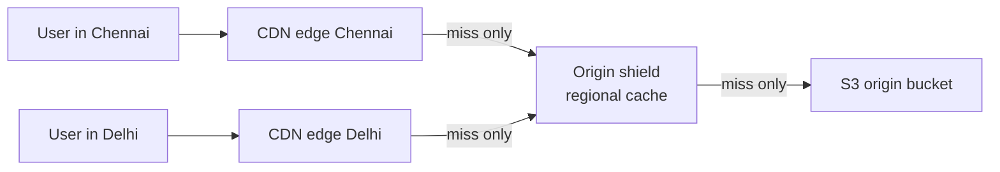

Practical points:

- **Immutable, versioned URLs.** Put a version or content hash in the path (`/img/rest_123/v7/thumb.webp`) and cache for a year. To change an image, publish a new URL instead of invalidating the cache.
- **Serve the right size.** Mobile list views need a 200 px thumbnail, not a 4 MB original. Either pre-generate sizes (11.3) or use an on-the-fly image service at the edge.
- **Private content** uses signed CDN URLs or cookies.
- An **origin shield** (a middle cache layer) stops a cold image from causing a miss storm on S3 from every edge at once.

### 11.5 Video and audio: chunking and adaptive bitrate

Food apps mostly deal in images, but short videos (dish reels, restaurant stories) and audio (voice notes, support calls) appear too. You never stream a 200 MB MP4 as one file. The standard approach (generic, as used by HLS and DASH):

1. **Transcode** the upload into several **renditions** (for example 240p, 480p, 720p, 1080p) at different bitrates.
2. **Chunk** each rendition into short segments (2 to 6 seconds).
3. Write a **manifest** (an `.m3u8` playlist for HLS) listing renditions and segment URLs.
4. The player downloads the manifest, starts at a low bitrate, measures download speed, and **switches rendition at segment boundaries**. This is **adaptive bitrate (ABR)**.

```
master.m3u8
 |-- 240p/index.m3u8  -> seg0.ts seg1.ts seg2.ts ...   (about 400 kbps)
 |-- 480p/index.m3u8  -> seg0.ts seg1.ts seg2.ts ...   (about 1 Mbps)
 |-- 720p/index.m3u8  -> seg0.ts seg1.ts seg2.ts ...   (about 3 Mbps)

Player on a train in a tunnel:  720p 720p 480p 240p 240p 480p 720p
                                 (bandwidth drops, then recovers)
```

Segments are just small static files, so they cache perfectly on a CDN. Transcoding is a CPU-heavy async job: a queue plus a worker fleet (spot instances are fine, because a killed job can be retried). For audio transcription (the District question), chunk long audio into pieces so workers can process in parallel and a failure only retries one chunk.

### Check yourself

**Q: Why not send images as base64 through your API?**
A: 33% size bloat, server threads and memory held for the whole slow upload, and your servers become a costly proxy. Upload directly to object storage.

**Q: What is a pre-signed URL and what should the server constrain?**
A: A URL carrying a signature that grants one action on one key for a short time. Constrain the key (server-chosen), expiry, content type and size.

**Q: How does the server know an upload finished?**
A: An S3 ObjectCreated event to a queue, not the client's word. A sweeper cleans rows stuck in PENDING_UPLOAD.

**Q: How do you make the image-processing worker idempotent?**
A: Derive output keys deterministically from the media ID and variant, and use conditional status updates, so reprocessing the same event overwrites the same objects.

**Q: How do you update a cached image without CDN invalidation?**
A: Use versioned or content-hashed URLs, cache them as immutable, and point the metadata to the new URL.

**Q: What is adaptive bitrate streaming?**
A: The video is transcoded into several bitrates, chunked into short segments with a manifest, and the player switches bitrate per segment based on measured bandwidth.

**Q: How do you upload a 2 GB video reliably on mobile?**
A: Multipart upload with a pre-signed URL per part, parallel parts, per-part retry, and a final complete call.

**Q: Where does file metadata live, and where do bytes live?**
A: Metadata (owner, key, type, size, status) in the database; bytes in object storage; delivery through a CDN.

---

## Part 12: Back-of-the-envelope estimation

Interviewers ask for estimates to see whether you can tell a design that needs one database from one that needs a hundred. Nobody checks your arithmetic to the decimal. They check that you state assumptions, round sensibly, and draw a design conclusion from the number.

### 12.1 The method

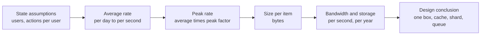

Say each assumption out loud and label it as one. Use round numbers. **Always finish with "so this means..."**.

### 12.2 Cheat numbers

| Quantity | Handy value |
|---|---|
| Seconds in a day | 86,400, round to **100,000 (1e5)** |
| 1 million per day | about **12 per second** |
| 1 billion per day | about **12,000 per second** |
| Peak vs average | **2x to 10x**; food has sharp lunch and dinner peaks |
| Read from RAM | about 100 ns |
| Read 1 MB sequentially from RAM | about 10 µs to 0.25 ms (varies by source) |
| SSD random read | about 100 µs |
| Round trip within a datacenter | about 0.5 ms |
| Round trip India to US | about 200 to 250 ms |
| One well-tuned Redis node | order of 100k simple ops/s (assumption, rule of thumb) |
| One MySQL primary | a few thousand writes/s comfortable (assumption, depends heavily on hardware and schema) |
| 1 KB × 1 million | 1 GB |

(These are generic rules of thumb, not measurements. Quote them as "roughly".)

Real anchors you can quote:

> **Real world — Zomato NYE 2023:** Peak **8,400 orders per minute** (Goyal cited 8,422 at 8:06 pm, about **140 orders/sec**), **80.92 million requests per minute**, 3 million orders in the day, 300+ microservices, Kafka at 450M+ messages/min, Redis serving 1 billion GETs per minute. ([source](https://www.zomato.com/blog/a-tale-of-scale-behind-the-scenes-at-zomato-tech-for-nye-2023), [140/s source](https://www.theweek.in/news/biz-tech/2024/01/01/zomato-received-140-orders-every-second-on-new-years-eve-swiggy-says-broke-all-records.html)) FY24 average: about 2M food orders a day (derived from 63M annual customers × 11.9 orders per year). ([source](https://b.zmtcdn.com/investor-relations/Zomato_overview_May-24.pdf))

### 12.3 Worked example 1: orders

**Question:** How many orders per second must the order service handle?

- Average: 2M orders/day (derived from investor data). 2,000,000 / 86,400 ≈ **23 orders/s**.
- Peak (sourced): 8,400 orders/min ÷ 60 = **140 orders/s**. That is about **6x** the daily average, which fits the "2x to 10x" rule.
- Design for headroom: **assume 3x the known peak** for growth and safety, about **420 orders/s**.
- Each order creates several writes (assumption): order row, items, payment attempt, status changes (about 6 over its life), outbox events. Say **10 writes per order** → about 4,200 writes/s at the design peak.

**So this means:** 4,200 writes/s is high for one MySQL primary but not crazy. Options: a well-sized primary with batching, or shard orders by `order_id` / `city`. The order count itself is small. What makes Zomato big is the **read** traffic around each order (menus, ETAs, tracking polls), as the next number shows.

- Requests: 80.92M/min ÷ 60 ≈ **1.35M requests/s** at peak.
- Requests per order at peak: 1.35M / 140 ≈ **9,600 requests per order placed**. Most are browsing, search, tracking and internal service-to-service calls.

**So this means:** the read path is where scale lives. Cache menus and restaurant data (Zomato's Redis did 1B GETs/min, about 16.7M/s), and keep the write path lean and idempotent.

### 12.4 Worked example 2: rider location pings

**Question:** How many location writes per second, and how much data per day?

- Active riders at peak: Zomato reports about 400k active delivery partners as a monthly average (FY24). **Assume 2 lakh (200k) are online at the dinner peak.** (Assumption.)
- Ping interval: Uber used **4 seconds** (historical, 2015). Use 4 s.
- Writes/s = 200,000 / 4 = **50,000 pings/s**.
- Size per ping (assumption): rider_id 8 B, lat 8 B, lng 8 B, timestamp 8 B, speed and heading 8 B, accuracy and battery 8 B, plus overhead → round to **100 bytes**.
- Bandwidth in: 50,000 × 100 B = **5 MB/s**. Easy.
- Per day: riders are not online 24 hours. Assume an average of 1 lakh online across 16 hours → 100,000 / 4 × 57,600 s ≈ **1.44 billion pings/day** × 100 B ≈ **144 GB/day** raw.

**So this means:**

- **Latest position** only: 200k riders × 100 B = 20 MB. It fits in memory on one Redis node, but 50k writes/s on one hot key is risky, so split by city or H3 area.
- **History**: 144 GB/day → about 52 TB/year raw. Do not keep it in the OLTP database. Stream to Kafka and land it in S3 (Parquet, compressed perhaps 5 to 10x) for ETA model training. Keep per-order trails for, say, 90 days for disputes.
- **Fan-out to customers**: each active order's customer wants the rider's position. If 1 lakh orders are in flight and each customer gets an update every 4 s, that is 25k pushes/s over persistent connections (MQTT, as Zomato uses), not polling.

### 12.5 Worked example 3: storage for images and orders

**Question:** How much storage do restaurant images and order history need?

- Restaurants: about 250k active (FY24 average 247k). **Assume 50 images each** (menu, dishes, ambience), and 4 stored sizes per image (original 2 MB, large 300 KB, medium 100 KB, thumb 20 KB) ≈ **2.4 MB per image**.
- 250,000 × 50 × 2.4 MB = **30 TB**. Add review photos: assume 1 lakh review photos/day × 2.4 MB ≈ 240 GB/day ≈ **88 TB/year**.
- Orders: 2M/day × (assume) 2 KB per order including items and status history = **4 GB/day ≈ 1.5 TB/year**.

**So this means:** order data is small enough for a relational store with partitioning by time (archive old months to cheaper storage). Images are 100x bigger and belong in S3 behind a CDN. The hot dataset for the CDN is thumbnails of popular restaurants, a tiny fraction of the total.

> **Pause and think:** Your interviewer says "assume 10x growth". Which of the three examples changes the design first? (Rider pings: 500k writes/s needs a sharded in-memory location tier and a bigger Kafka cluster, while order writes at 10x are still tractable with sharding.)

### Check yourself

**Q: Convert 1 million per day to per second.**
A: About 12 per second (1e6 / 86,400).

**Q: What was Zomato's NYE 2023 order peak per second and request peak per second?**
A: About 140 orders/s (8,400/min) and about 1.35M requests/s (80.92M/min).

**Q: Why design for peak and not average?**
A: Systems fail at the peak. Zomato's NYE peak was about 6x the daily average, and autoscaling lags a spike, so Zomato pre-scales.

**Q: 200k riders pinging every 4 s: writes per second?**
A: 50,000 per second.

**Q: Why not store all ping history in MySQL?**
A: Over 100 GB/day of append-only data that is rarely read by key. Stream it to Kafka and S3 in a columnar format; keep only the latest position in memory.

**Q: What should every estimate end with?**
A: A design conclusion, such as "fits on one node", "needs a cache", "needs sharding", or "needs a queue".

**Q: Which is bigger for Zomato, order writes or reads around orders, and by how much at peak?**
A: Reads. Roughly 9,600 requests per order placed at peak, from 1.35M requests/s over 140 orders/s.

**Q: Why are images stored in S3 but orders in a database?**
A: Images are large, immutable blobs read by URL, cheap in object storage and cacheable on a CDN. Orders are small, structured, transactional and queried by fields.

---

## Part 13: Security and low-level design

The first half of this part covers the security basics every backend answer should mention without being asked. The second half is **low-level design (LLD)**: designing classes and code rather than boxes and arrows.

### 13.1 Authentication vs authorisation

- **Authentication (authn)** answers "**who** are you?". Login with OTP, password, Google.
- **Authorisation (authz)** answers "**what** are you allowed to do?". A customer can view **their** orders. A restaurant manager can edit menus of **their** restaurants only. A support agent can see an order but not the full card number.

The classic bug is doing authn and forgetting authz. `GET /orders/9876` checks the user is logged in, but not that order 9876 belongs to them. Anyone can then read anyone's orders by changing the number. This is called **IDOR** (insecure direct object reference). Fix it by always scoping the query: `WHERE id = ? AND customer_id = :caller`.

### 13.2 Sessions, JWT and OAuth

After login the server must recognise the user on every later request. Two approaches:

- **Session ID:** the server stores `session_id -> user_id` in Redis and gives the client a random session ID (a cookie). Every request looks it up. Easy to revoke (delete the key), but every request needs a lookup.
- **JWT (JSON Web Token):** the server gives the client a signed token that **contains** the claims. Any service can verify the signature without a lookup.

```
JWT  =  base64url(header) . base64url(payload) . signature

header:    {"alg":"RS256","typ":"JWT"}
payload:   {"sub":"user_42","role":"customer","exp":1761200000}
signature: sign(header + "." + payload, private_key)
```

Key points interviewers probe (JWT internals came up in several Zomato and Zepto reports, for example [Z7](https://leetcode.com/discuss/post/6493240/)):

- The payload is **encoded, not encrypted**. Anyone can read it. Never put secrets or PII in it.
- **Verification:** recompute the signature with the key and compare; check `exp` (expiry). With RS256 the auth service signs with a private key and every other service verifies with the public key.
- **Revocation is hard**, because the token is valid until it expires. So use a **short-lived access token** (say 15 minutes) plus a **long-lived refresh token** stored server-side, which can be revoked. Logout deletes the refresh token.
- On mobile, store tokens in the Keychain / Keystore, not plain storage.

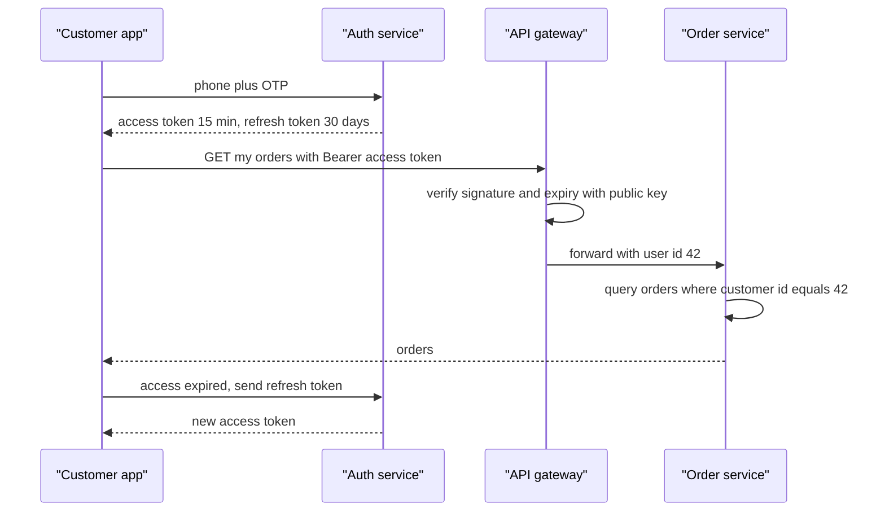

**OAuth 2.0**, briefly, is a protocol for letting one app act on your behalf at another **without giving it your password**. "Sign in with Google" uses OAuth plus **OpenID Connect** (the identity layer on top). The flow: the app redirects you to Google, you approve, Google redirects back with a short-lived **code**, and the app's backend exchanges that code for tokens. Mobile apps add **PKCE** so a stolen code is useless. In an interview, one or two sentences are enough unless asked.

> **Real world — interview:** A Zomato intern interview asked **hashing vs encryption** and a login design. ([source](https://leetcode.com/discuss/post/6023375/)) Hashing is one-way (store passwords as a slow salted hash with bcrypt or Argon2, never decrypted). Encryption is two-way with a key (encrypt PII at rest, decrypt when needed).

### 13.3 HTTPS and TLS

**TLS** (Transport Layer Security) is what puts the S in HTTPS. It gives you **encryption** (eavesdroppers on café Wi-Fi see noise), **integrity** (nobody can alter data in transit) and **server authentication** (the certificate proves you are talking to the real zomato.com).

The handshake, simply: the client says hello and lists ciphers; the server sends its **certificate** (its public key signed by a certificate authority the client trusts); they run a key exchange (ECDHE) to agree on a shared **session key**; from then on everything is encrypted with fast symmetric encryption. TLS 1.3 does this in one round trip.

Where it ends: usually TLS terminates at the load balancer or edge. Inside the network, a service mesh can add **mTLS** (both sides present certificates), so services authenticate each other. Zomato runs a Kuma (Envoy-based) mesh ([source](https://www.zomato.com/blog/a-tale-of-scale-behind-the-scenes-at-zomato-tech-for-nye-2023)); Zomato has not published whether it uses mTLS, but meshes like Kuma typically offer it.

Payment gateways and push providers require it: Razorpay webhooks require TLS 1.2 or later ([source](https://razorpay.com/docs/webhooks/best-practices/)), and APNs requires HTTP/2 and TLS 1.2+ ([source](https://developer.apple.com/documentation/usernotifications/sending-notification-requests-to-apns)).

### 13.4 Secrets, PII and masking

**Secrets** (DB passwords, API keys, signing keys) never go into code or Git. Keep them in a secrets manager (AWS Secrets Manager, Vault), inject at runtime, rotate regularly, and give each service only the secrets it needs.

**PII** (personally identifiable information) in a food app includes phone numbers, addresses, names and order history. Practices:

- **Number masking:** the rider and customer call each other through a proxy number, so neither sees the other's real phone. (Common industry practice; Zomato's NYE post mentions a third-party calling provider and failing over to an alternate, which is consistent with this. [source](https://www.zomato.com/blog/our-learnings-from-nye/))
- **Mask in logs:** log `+91******3210`, never a full phone, card or OTP. Logs go to big shared systems (Zomato's LogStore takes 50+ TB/day), so a leak there is wide.
- **Minimise:** the rider app needs the drop location and a masked contact, not the customer's order history.
- **Encrypt at rest** and restrict access with audit logs.
- **Cards:** never store raw card numbers; the payment gateway tokenises them.

### 13.5 Webhook signatures with HMAC

A **webhook** is the gateway calling **your** endpoint, for example "payment pay_123 succeeded". Anyone on the internet can POST to that URL, so you must verify the call is genuine. The standard method is an **HMAC signature**. HMAC (hash-based message authentication code) mixes a **shared secret** with the message and hashes it (usually SHA-256). Only someone with the secret can produce the right value.

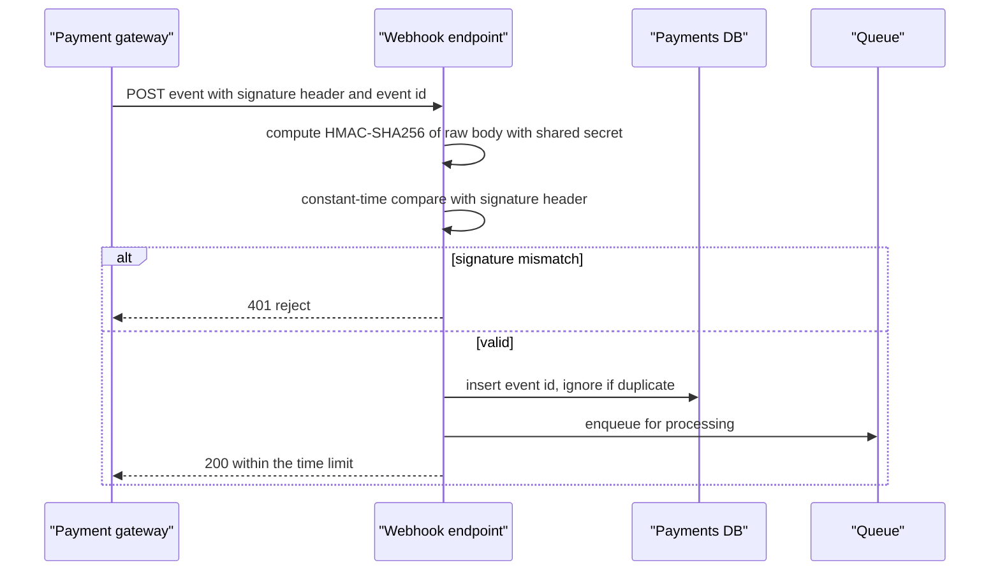

Rules that matter:

- Compute the HMAC over the **raw body bytes**, before JSON parsing reorders anything.
- Use a **constant-time comparison**, so attackers cannot guess the signature byte by byte from timing.
- Reject old timestamps if the provider signs one, to stop **replay**.
- **Dedupe on the event ID**, ack fast, and process asynchronously.

> **Real world — Razorpay webhooks:** Your endpoint must respond within **5 seconds** or the delivery counts as a timeout and is resent; any non-2xx is a failure. Retries use exponential backoff for 24 hours, after which the webhook is disabled. Delivery is **at-least-once**, so dedupe on the `x-razorpay-event-id` header, and **event order is not guaranteed**. ([source](https://razorpay.com/docs/webhooks/best-practices/)) (The research did not verify Razorpay's exact signature scheme; check the provider's docs. HMAC-SHA256 over the body is the common pattern.)

### 13.6 How to answer an LLD question

LLD rounds ask you to design classes for something concrete: a parking lot, Splitwise, a rate limiter, a food ordering module, a coupon engine. A repeatable process stops you from freezing.

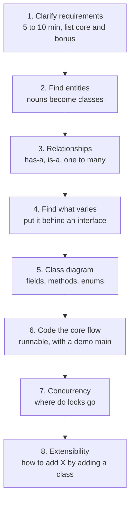

The research's synthesis of what reports reward: state requirements first, because interviewers add requirements later; show interfaces for the parts that vary (Strategy for pricing or assignment, Factory for payment processors, Observer for notifications); for Zepto, Zomato and Blinkit add DB schema and REST APIs with payloads; for Swiggy, Flipkart, Meesho and PhonePe deliver **runnable in-memory code**; and be ready to say exactly where the lock goes. (This is a synthesis across many interview reports, not one source.)

### 13.7 OOP pillars in one Zomato example each

- **Encapsulation:** `Order` keeps `status` private. The only way to change it is `order.markPickedUp()`, which checks the current state. Nobody can set `status = DELIVERED` from outside.
- **Abstraction:** the checkout code calls `paymentProcessor.charge(amount)` without knowing whether it is UPI, card or wallet.
- **Inheritance:** `DeliveryPartner` and `Customer` both extend `User` with shared `id`, `name`, `phone`. Use sparingly; prefer composition.
- **Polymorphism:** `List<Notifier>` holds `SmsNotifier`, `PushNotifier`, `EmailNotifier`; calling `send()` on each runs the right code.

### 13.8 SOLID with Zomato code

**S, Single responsibility:** a class should have one reason to change.

```java
// Bad: one class prices, saves and notifies
class OrderManager { double price(Cart c){...} void save(Order o){...} void sms(Order o){...} }

// Good: each class changes for one reason
class PriceCalculator   { Money price(Cart c) { ... } }
class OrderRepository   { void save(Order o) { ... } }
class OrderNotifier     { void notifyPlaced(Order o) { ... } }
```

**O, Open/closed:** open for extension, closed for modification. Adding a new discount should mean adding a class, not editing a giant `if/else`.

```java
interface Discount { Money apply(Cart cart, Money subtotal); }
class FlatOff implements Discount { ... }        // Rs 100 off
class PercentOff implements Discount { ... }     // 20 percent up to Rs 120
class FreeDelivery implements Discount { ... }   // new: just add this class
```

**L, Liskov substitution:** a subclass must work anywhere the parent works. If `Vehicle.carry(Order)` is expected for every vehicle, a `Bicycle` subclass that throws for orders over 5 kg breaks callers. Model capacity explicitly (`canCarry(weight)`) instead of surprising them.

**I, Interface segregation:** do not force classes to implement methods they do not need.

```java
// Bad: a cloud kitchen with no dine-in must implement bookTable()
interface Restaurant { void acceptOrder(Order o); void bookTable(Booking b); }

// Good
interface DeliveryCapable { void acceptOrder(Order o); }
interface DiningCapable   { void bookTable(Booking b); }
class CloudKitchen implements DeliveryCapable { ... }
class FineDine implements DeliveryCapable, DiningCapable { ... }
```

**D, Dependency inversion:** high-level code depends on interfaces, not concrete classes. Pass dependencies in through the constructor.

```java
class CheckoutService {
  private final PaymentProcessor payments;   // interface
  private final OrderRepository orders;      // interface
  CheckoutService(PaymentProcessor p, OrderRepository r) { this.payments = p; this.orders = r; }
}
// In tests, pass a FakePaymentProcessor. In prod, a RazorpayProcessor.
```

### 13.9 Design patterns you will actually use

#### Strategy: pricing and discounts

**Strategy** puts a family of interchangeable algorithms behind one interface and picks one at runtime. It appears constantly in reports: "Strategy for pricing" in a Zepto vehicle-rental LLD ([source](https://leetcode.com/discuss/post/8402132/)), pluggable restaurant selection in Flipkart's FoodKart, assignment strategies at PhonePe.

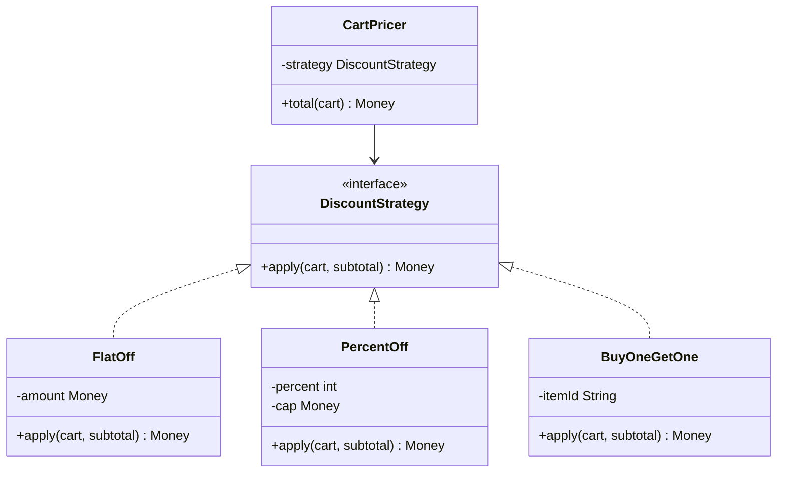

```java
class PercentOff implements DiscountStrategy {
  private final int percent; private final Money cap;
  public Money apply(Cart c, Money subtotal) {
    Money off = subtotal.times(percent).dividedBy(100);
    return subtotal.minus(off.min(cap));
  }
}
```

#### Factory: notifications and payment processors

**Factory** hides object creation behind a method, so callers ask for "a notifier for PUSH" without knowing the class. A Zepto interviewer "dug into **Factory for payment processors**" and had the candidate implement it in Java. ([source](https://leetcode.com/discuss/post/5796357/))

```mermaid
classDiagram
  class Notifier {
    <<interface>>
    +send(userId, message) boolean
  }
  class PushNotifier
  class SmsNotifier
  class WhatsAppNotifier
  class NotifierFactory {
    +create(channel) Notifier
  }
  Notifier <|.. PushNotifier
  Notifier <|.. SmsNotifier
  Notifier <|.. WhatsAppNotifier
  NotifierFactory ..> Notifier : creates
```

```java
class NotifierFactory {
  private final Map<Channel, Notifier> registry = new EnumMap<>(Channel.class);
  NotifierFactory(PushNotifier p, SmsNotifier s, WhatsAppNotifier w) {
    registry.put(Channel.PUSH, p); registry.put(Channel.SMS, s); registry.put(Channel.WHATSAPP, w);
  }
  Notifier create(Channel c) {
    Notifier n = registry.get(c);
    if (n == null) throw new IllegalArgumentException("No notifier for " + c);
    return n;
  }
}
```

A map-based registry beats a `switch` because adding a channel does not edit existing logic (open/closed).

#### Observer: order status updates

**Observer** lets many objects react to an event without the publisher knowing them. When an order's status changes, the customer app, the restaurant dashboard, analytics and the notification service all need to know. In-process this is the Observer pattern. Across services, Kafka is the same idea at scale.

```mermaid
classDiagram
  class OrderEventPublisher {
    -listeners List
    +subscribe(listener)
    +publish(event)
  }
  class OrderStatusListener {
    <<interface>>
    +onStatusChanged(event)
  }
  class CustomerPushListener
  class RestaurantDashboardListener
  class AnalyticsListener
  OrderEventPublisher --> OrderStatusListener : notifies
  OrderStatusListener <|.. CustomerPushListener
  OrderStatusListener <|.. RestaurantDashboardListener
  OrderStatusListener <|.. AnalyticsListener
```

```java
class OrderEventPublisher {
  private final List<OrderStatusListener> listeners = new CopyOnWriteArrayList<>();
  void subscribe(OrderStatusListener l) { listeners.add(l); }
  void publish(OrderEvent e) {
    for (OrderStatusListener l : listeners) {
      try { l.onStatusChanged(e); } catch (Exception ex) { log.warn("listener failed", ex); }
    }
  }
}
```

One failing listener must not stop the others, hence the try/catch per listener. `CopyOnWriteArrayList` lets threads subscribe while another thread is publishing.

#### State: the order lifecycle

**State** models an object whose allowed actions depend on its current state. An order cannot be picked up before it is accepted, or cancelled after delivery. Writing it as a state machine stops illegal jumps, which also protects you when an event is retried or arrives twice.

```mermaid
stateDiagram-v2
  [*] --> PAYMENT_PENDING
  PAYMENT_PENDING --> PLACED: payment success
  PAYMENT_PENDING --> CANCELLED: payment failed or timeout
  PLACED --> ACCEPTED: restaurant accepts
  PLACED --> CANCELLED: restaurant rejects
  ACCEPTED --> RIDER_ASSIGNED: dispatch
  RIDER_ASSIGNED --> FOOD_READY: food order ready
  ACCEPTED --> FOOD_READY: food order ready
  FOOD_READY --> PICKED_UP: rider picks up
  RIDER_ASSIGNED --> PICKED_UP: rider picks up
  PICKED_UP --> DELIVERED: handover
  DELIVERED --> [*]
  CANCELLED --> [*]
```

```java
enum OrderStatus {
  PAYMENT_PENDING, PLACED, ACCEPTED, RIDER_ASSIGNED, FOOD_READY, PICKED_UP, DELIVERED, CANCELLED;

  private static final Map<OrderStatus, Set<OrderStatus>> NEXT = Map.of(
    PAYMENT_PENDING, Set.of(PLACED, CANCELLED),
    PLACED,          Set.of(ACCEPTED, CANCELLED),
    ACCEPTED,        Set.of(RIDER_ASSIGNED, FOOD_READY),
    RIDER_ASSIGNED,  Set.of(FOOD_READY, PICKED_UP),
    FOOD_READY,      Set.of(PICKED_UP),
    PICKED_UP,       Set.of(DELIVERED),
    DELIVERED,       Set.of(),
    CANCELLED,       Set.of());

  boolean canMoveTo(OrderStatus next) { return NEXT.get(this).contains(next); }
}
```

In the database, enforce the same rule with a conditional update: `UPDATE orders SET status='PICKED_UP' WHERE id=? AND status IN ('FOOD_READY','RIDER_ASSIGNED')`. If zero rows change, the transition was illegal or already happened. The full State pattern (one class per state with its own `next()` methods) is worth it when each state has a lot of behaviour; for most interviews, an enum with a transition table is cleaner. The Swiggy delivery partner app is described as event-driven with **a finite state machine per delivery flow**. ([source](https://bytes.swiggy.com/architecture-and-design-principles-behind-the-swiggys-delivery-partners-app-4db1d87a048a))

#### Decorator: pizza toppings

**Decorator** wraps an object to add behaviour, and wrappers can stack. The textbook case is a pizza with toppings, and it maps directly onto a real Zomato question.

> **Real world — interview:** A Zomato SDE-1 (Aug 2025, offer) was asked an LLD of a **restaurant menu with configurable options** (size, crust, toppings; the Domino's case), as a schema. ([source](https://leetcode.com/discuss/post/7206483/))

```mermaid
classDiagram
  class MenuItem {
    <<interface>>
    +price() Money
    +description() String
  }
  class BasePizza {
    +price() Money
    +description() String
  }
  class ToppingDecorator {
    <<abstract>>
    -inner MenuItem
  }
  class ExtraCheese
  class Jalapeno
  MenuItem <|.. BasePizza
  MenuItem <|.. ToppingDecorator
  ToppingDecorator <|-- ExtraCheese
  ToppingDecorator <|-- Jalapeno
  ToppingDecorator o-- MenuItem
```

```java
MenuItem order = new Jalapeno(new ExtraCheese(new BasePizza("Margherita", Size.MEDIUM)));
order.price();        // base + cheese + jalapeno
order.description();  // "Margherita (M), extra cheese, jalapeno"
```

Say the trade-off: Decorator is elegant in code, but for a **real** menu the data-driven model is better, because restaurants add options without a code deploy. Item → option groups (Size: pick exactly 1; Toppings: pick 0 to 5) → options with price deltas, stored as rows:

```sql
CREATE TABLE option_groups (id BIGINT PRIMARY KEY, item_id BIGINT, name VARCHAR(50),
                            min_select INT, max_select INT);
CREATE TABLE options (id BIGINT PRIMARY KEY, group_id BIGINT, name VARCHAR(50),
                      price_delta_paise INT, is_available BOOLEAN);
```

#### Singleton

**Singleton** guarantees one instance of a class, for example a config holder or a connection pool. In Java the safest form is an enum or a holder class:

```java
enum AppConfig { INSTANCE; private final Properties props = load(); String get(String k) { return props.getProperty(k); } }
```

Mention the downside: singletons are global state, which makes testing harder. Modern code prefers a dependency-injection container creating one instance and passing it in. The Zepto bookstore LLD report lists singleton, abstract factory and strategy as expected patterns. ([source](https://leetcode.com/discuss/post/5760479/))

#### Builder

**Builder** constructs a complex object step by step, avoiding a constructor with 12 parameters. Orders and notifications are good examples.

```java
Order order = Order.builder()
    .customerId(42).restaurantId(7)
    .addItem("paneer_tikka", 2)
    .deliveryAddress(addr)
    .paymentMode(PaymentMode.UPI)
    .couponCode("ZOMATO50")
    .build();   // build() validates required fields and returns an immutable Order
```

### 13.10 Concurrency in LLD

Almost every LLD evaluation ends with "what if two threads do this at the same time?". The research calls concurrency **the standard trap in every LLD or machine coding evaluation**: two users booking the same seat, two threads buying the last unit, credit limits under concurrent orders. (for example a Flipkart SDE-2 evaluation on two threads buying the last unit: [source](https://leetcode.com/discuss/post/8567797/))

Be ready to say where the lock goes and why:

- **Lock the smallest thing.** One lock per SKU or per seat, not one global lock. `ConcurrentHashMap<String, ReentrantLock>` or `computeIfAbsent` per key.
- **Prefer atomic operations** where they exist: `AtomicInteger.compareAndSet`, `ConcurrentHashMap.merge`.
- **In the database:** a conditional update (`UPDATE stock SET avail = avail - 1 WHERE sku=? AND store=? AND avail >= 1`), `SELECT ... FOR UPDATE` (pessimistic), or a version column (optimistic). A unique constraint for "one booking per seat per show".

```java
class InventoryService {
  private final ConcurrentHashMap<String, AtomicInteger> stock = new ConcurrentHashMap<>();

  boolean reserve(String skuAtStore, int qty) {
    AtomicInteger avail = stock.get(skuAtStore);
    if (avail == null) return false;
    while (true) {
      int cur = avail.get();
      if (cur < qty) return false;                  // not enough, fail fast
      if (avail.compareAndSet(cur, cur - qty)) return true;  // retry if another thread won
    }
  }
}
```

> **Real world — Zomato interview:** For "number of orders in the last X minutes (X up to 30)", a Zomato candidate who got the offer used a **ring of 30 one-minute buckets** with timestamps to reset stale buckets, and **ReentrantLock** for thread safety. ([source](https://leetcode.com/discuss/post/6493240/))

Your Myntra token bucket per pod (180 RPM) is a perfect concurrency talking point: the refill-and-take step must be atomic, either with a lock in-process or a Redis Lua script when shared across pods.

### 13.11 What Zomato vs Swiggy vs Flipkart expect

| Company | Format (from reports) | What wins |
|---|---|---|
| **Zomato / Blinkit** | No formal machine-coding round for backend SDE-1. LLD appears inside mixed rounds: implement a class (LRU/LFU, rate limiter, browser history, Ctrl+R, snake), model a schema (menu configs, banner caps), or write a working API. Blinkit SDE-1 rounds in 2026 were draw.io UML discussions | Data-structure choice and complexity, clean code, correct schema |
| **Swiggy** | 60-min LLD: design and implement live in your IDE, then dry run | **Working code in time.** A Swiggy SDE-1 was rejected for a partial Splitwise. Data-structure choices get cross-questioned |
| **Flipkart** | 30-min brief, 90-min code (in-memory, no DB/UI), zip upload, separate evaluation | **"Prioritize correct running code over neat OOP/SOLID"**; bonus features count; concurrency and "what if a DB is added" in evaluation |
| **Zepto** | 60-min LLD via BarRaiser, mostly discussion | Entities, DB schema, APIs with payloads, Factory/Strategy/Observer, SQL vs NoSQL per component |
| **PhonePe / Meesho** | Long solo machine coding, then discussion | Modularity, extensible strategies, **thread safety** in the follow-up |

(Source: research synthesis of interview reports, for example [Swiggy S1](https://leetcode.com/discuss/post/7278246/), [Flipkart F4](https://leetcode.com/discuss/post/6667785/).)

The practical advice: for Zomato, practise implementing small classes cleanly (LRU cache, rate limiter, a sliding-window counter, a trie) and writing a schema plus APIs for a feature. For Swiggy and Flipkart, practise building a complete in-memory app (Splitwise, parking lot, food ordering) in 60 to 90 minutes with a `main` that demonstrates it, then add patterns. Running code first, polish second.

### Check yourself

**Q: Authentication vs authorisation, with a Zomato example of an authz bug?**
A: Authn is who you are; authz is what you may do. `GET /orders/{id}` that checks login but not ownership lets any user read any order (IDOR). Scope every query by the caller's ID.

**Q: Is a JWT payload secret? How do you handle logout?**
A: No, it is only base64-encoded and anyone can read it. Use short-lived access tokens plus revocable server-side refresh tokens; logout deletes the refresh token.

**Q: Hashing vs encryption?**
A: Hashing is one-way (passwords, with salted bcrypt or Argon2). Encryption is reversible with a key (PII at rest).

**Q: How do you verify a payment webhook?**
A: Compute HMAC-SHA256 over the raw body with the shared secret, constant-time compare with the signature header, reject stale timestamps, dedupe on event ID, ack within the provider's limit (Razorpay: 5 s), process asynchronously.

**Q: What should never appear in logs?**
A: Full phone numbers, OTPs, tokens, card data, passwords. Mask them.

**Q: Which pattern for "add a new discount type without touching existing code"?**
A: Strategy behind a `DiscountStrategy` interface, which also satisfies open/closed.

**Q: Which pattern for creating the right payment processor or notifier from a type?**
A: Factory, ideally a map-based registry so a new type does not edit a switch.

**Q: Why model the order lifecycle as a state machine?**
A: To forbid illegal transitions and make retried or duplicate events harmless. Enforce it in code and in the DB with a conditional update on the current status.

**Q: Decorator vs a data-driven menu for pizza toppings?**
A: Decorator is neat in code, but a real menu should be data (item, option groups with min/max, options with price deltas) so restaurants change options without a deploy.

**Q: Two threads buy the last unit. What do you do?**
A: Make the check-and-decrement atomic: a per-SKU lock, a CAS loop on an AtomicInteger, or in the DB `UPDATE ... SET avail = avail - 1 WHERE avail >= 1` and check rows affected.

**Q: What does Flipkart's machine coding round reward most?**
A: Correct running code over neat OOP, then extensibility and concurrency in the evaluation.

**Q: How is LLD at Zomato different from Swiggy?**
A: Zomato embeds LLD in mixed rounds (implement a class, model a schema, write an API). Swiggy runs a 60-minute live design-and-implement round where working code is the bar.

---

[← 06d_SD_APIs_Reliability_Concurrency.md](06d_SD_APIs_Reliability_Concurrency.md) · [06f_SD_How_Zomato_Is_Built_and_Final_Exam.md →](06f_SD_How_Zomato_Is_Built_and_Final_Exam.md)
