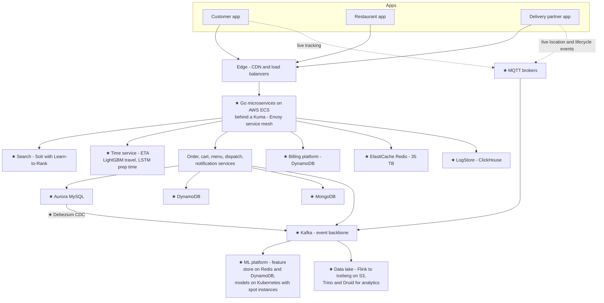
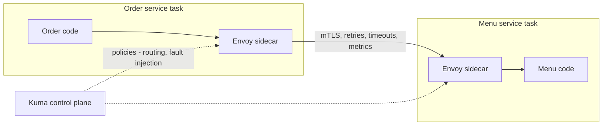
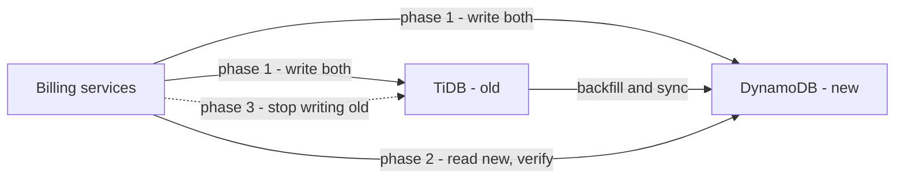
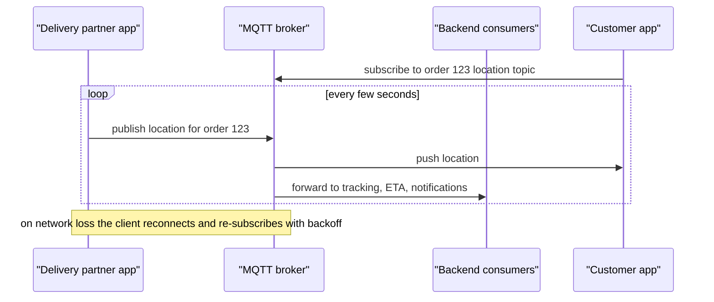
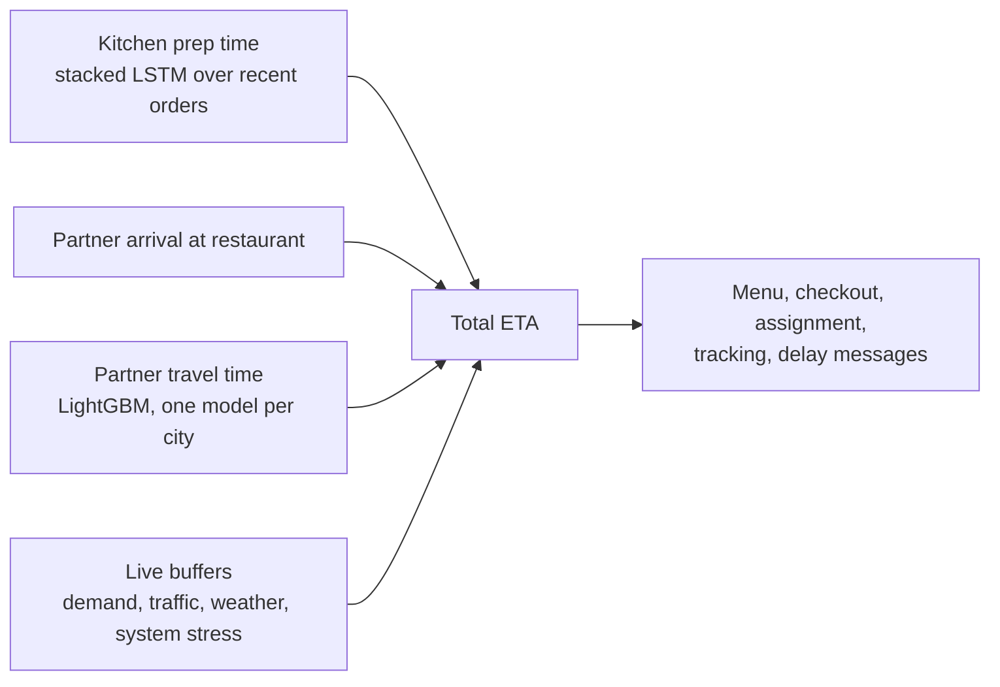
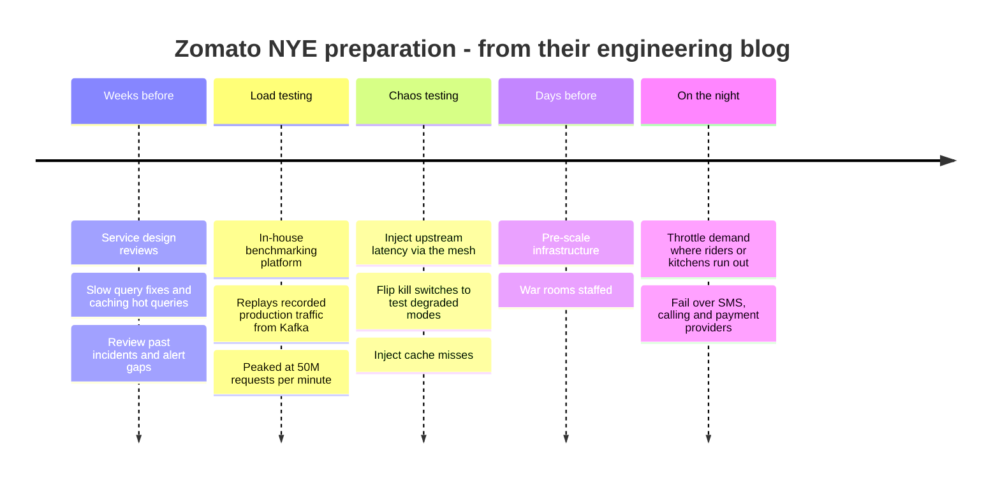
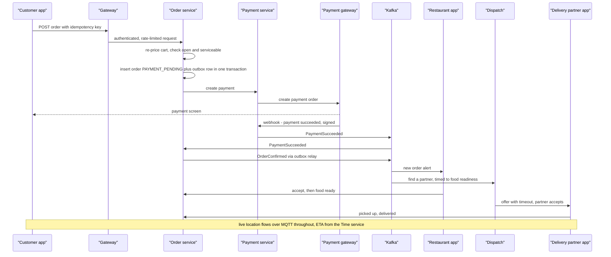

# System Design Master — 6. How Zomato Is Actually Built, and the Final Exam

> **Covers:** Parts 14–15. **Reading time:** about 20 minutes of focused reading (diagrams and code extra).
> Built from research into Zomato's and Eternal's engineering blogs, Swiggy, Blinkit, Zepto, BookMyShow, Uber, DoorDash, Grab, Stripe, Razorpay, Cloudflare and ~100 interview reports. Company facts link to their source; anything not public is marked so — never claim more in the interview.
> Diagrams are Mermaid and render on GitHub. Report IDs like Z2 or B10 refer to `sources/interview_reports.md`; all research notes with links are in `sources/`.

[← 06e_SD_Geo_Search_Media_Estimation_LLD.md](06e_SD_Geo_Search_Media_Estimation_LLD.md) · [07a_SD_QA_Core_Zomato_Designs.md →](07a_SD_QA_Core_Zomato_Designs.md)

---

## Part 14: How Zomato is actually built, from public sources

Everything in this part comes from Zomato's and Eternal's own engineering blogs, AWS posts co-written with Zomato engineers, and investor letters. Where something isn't public, it's marked **not public**, followed by how it's typically done. Use this part to make your answers sound like someone who has done their homework: "Zomato has written that they…" is a strong sentence in an interview. Never claim more than what's here.

### 14.1 The scale, in one table

| What | Number | When / source |
|---|---|---|
| Peak orders per minute | **8,400** (≈ 140 orders/s) | NYE 2023 — [Zomato blog](https://www.zomato.com/blog/a-tale-of-scale-behind-the-scenes-at-zomato-tech-for-nye-2023) |
| Peak requests per minute | **80.92 million** (≈ 1.35M requests/s) | NYE 2023 — same |
| Microservices | **300+** (NYE 2023); **500+** with ~10,000 mesh dataplanes (KubeCon India 2025 talk abstract) | [blog](https://www.zomato.com/blog/a-tale-of-scale-behind-the-scenes-at-zomato-tech-for-nye-2023), [talk abstract](https://sessionize.com/arpit-mishra/) |
| Compute on the night | **11,000 EC2 instances**, ~**40,000 ECS tasks** | NYE 2023 |
| Kafka | **450M+ messages/min**, 5.6 GBps peak | NYE 2023 |
| Redis (ElastiCache) | **35 TB** in memory, **~1B GETs/min**, ~100M SETs/min | NYE 2023 |
| MySQL (Aurora) | **610k selects/s**, 16k write transactions/s | NYE 2023 |
| DynamoDB | 12.3M read units and 5.2M write units per minute | NYE 2023 |
| Search | **100M+ queries/day** on Solr | [blog, 2023](https://www.zomato.com/blog/explained-how-zomato-handles-100-million-daily-search-queries-p1/) |
| Logs | up to **150M logs/min**, 50+ TB/day, in ClickHouse | [blog, 2023](https://www.zomato.com/blog/building-a-cost-effective-logging-platform-using-clickhouse-for-petabyte-scale) |
| Food delivery, FY24 | 18M monthly customers, 247k restaurants, 400k delivery partners; ≈ 750M orders/year (≈ 2M/day, derived) | [investor overview, May 2024](https://b.zmtcdn.com/investor-relations/Zomato_overview_May-24.pdf) |
| Blinkit | 2,751 dark stores (Q2 FY27), avg delivery 12.5 min (Mar 2024) | [Q2FY27 letter](https://www.eternal.com/blog/q2fy27), investor overview |

Two numbers to do quick maths with in the room:
- **Average vs peak:** ~2M orders a day ÷ 1,440 minutes ≈ 1,400 orders/min on average, against 8,400 at the NYE peak — about **6×**. Always design for the peak.
- **Reads vs writes:** ~1B cache GETs vs ~100M SETs per minute ≈ **10 : 1**. Zomato is read-heavy, which is why caching matters so much.

### 14.2 The big picture

The diagram below puts the public pieces together. Boxes with a ★ are confirmed in Zomato's own writing; the rest are the standard pieces any food-delivery system needs, where Zomato hasn't published the internals.

How to talk about it: *"Publicly, Zomato runs hundreds of Go microservices on ECS behind an Envoy-based service mesh, with Aurora MySQL, DynamoDB and MongoDB as primary stores, a very large Redis cache, Kafka as the event backbone, Solr for search, and a separate Time service for ETAs. For the pieces they haven't published, like dispatch, I'll describe the standard approach."*

### 14.3 Services and the mesh

- **Language and runtime.** Zomato's newer services are written in **Go**; there's still PHP legacy (their old PDF generator was PHP and was rewritten in Go as *Espresso*, which signs PDFs in under 200 ms and handles 120K requests per minute at peak — [blog](https://www.zomato.com/blog/espresso-brewing-pdfs-at-zomato-faster-than-you-can-say-cappuccino)). Services run on **AWS ECS**; ML models run separately on **Kubernetes with spot instances** (cheaper machines that AWS can reclaim — fine for stateless model servers).
- **Service mesh.** Every service has an **Envoy** sidecar managed by **Kuma**. A mesh moves cross-cutting network concerns — retries, timeouts, routing, mTLS, metrics — out of application code into the sidecar. Zomato uses it for two things they've written about: **chaos testing** (injecting latency into upstream calls to see what breaks) and **header-based routing** so a developer's laptop can receive staging traffic ("Local Preview", [blog](https://www.zomato.com/blog/embracing-shift-left-testing-with-local-preview/)).
- **Not public:** a story of breaking a PHP monolith into microservices. Don't invent one; their logging post mentions "microservices and monolithic applications" coexisting.

### 14.4 Databases: right tool per job

| Store | What Zomato uses it for (public) | Why it fits |
|---|---|---|
| **Aurora MySQL** | Core relational data; 610k selects/s at NYE peak | Transactions, joins, constraints |
| **DynamoDB** | Billing platform, ML profile/feature store, high-throughput key-value | Scales by partition key, predictable latency, no manual sharding |
| **MongoDB Atlas** | Flexible-schema data, e.g. Nugget AI support conversations (15M+/month) | Documents with varying shape |
| **Redis (ElastiCache)** | Cache (35 TB), online feature store | Sub-millisecond reads |
| **Solr** | Search over restaurants and dishes | Inverted index, ranking |
| **ClickHouse** | Logs (LogStore) | Columnar, cheap for append-only time-range queries |
| **Iceberg on S3 + Trino + Druid** | Analytics data lake | Keeps analytics off production databases |

**The billing migration — a great story to tell** ([AWS blog, Dec 2023](https://aws.amazon.com/blogs/database/unlocking-performance-scalability-and-cost-efficiency-of-zomatos-billing-platform-by-switching-from-tidb-to-dynamodb/)). Billing ran on TiDB (a distributed SQL database) that grew from 5 to 25 nodes and had to be manually scaled before peaks. They moved it to **one DynamoDB table** using the *adjacency-list* pattern (several entity types in one table, distinguished by key prefixes). The partition key combines **merchant ID + payout cycle + business vertical**, chosen for high cardinality so load spreads evenly, and a secondary index uses key suffixes (`_<division-number>`) to avoid hot partitions. Results: **4× throughput** (2,000 → 8,000 requests per minute), **~90% lower latency** (~75 ms), **~50% lower cost**, migrated with **zero downtime** using dual writes and a phased rollout.

What this teaches you to say: *"Pick the partition key for even spread, not just convenience; migrate with dual writes, backfill, verify, then cut over."*

### 14.5 Caching and Kafka

- **Cache:** On NYE 2023 Redis held 35 TB and served ~1B GETs per minute. Before NYE, Zomato **caches frequently used queries** and runs **chaos tests that inject cache misses** to check the databases survive if the cache fails. That's the honest answer to the trap *"why not just put everything in cache?"* — because caches fail, and the database must survive without it.
- **Kafka** is, in their words, "the backbone of our event-driven architecture" — 450M+ messages per minute at peak. They split Kafka by workload: **latency-sensitive topics on Confluent Cloud**, logging and traffic-replay on **WarpStream** (Kafka on S3) for 60–80% savings ([case study](https://www.warpstream.com/blog/eternal-case-study), vendor-reported).
- **Exactly-once lesson from Zomato Ads** ([blog](https://www.zomato.com/blog/eliminating-bottlenecks-in-real-time-data-streaming-a-zomato-ads-flink-journey/)): their old Flink job kept running totals in a 150 GB state; losing state reset counters, which over-delivered ads and broke billing. The fix: emit **incremental counts** (not totals), plus an **hourly reconciliation job** as a safety net. State shrank 99%. Lesson for any counting or money question: *send deltas, make them idempotent, and reconcile periodically.*

### 14.6 Real-time tracking: from polling to MQTT

Zomato started with **HTTP polling** for live location. It stopped scaling: for tiny payloads, the TLS and header overhead of each request outweighed the data, and rider markers **jumped** instead of moving smoothly. They moved to **MQTT** — a lightweight publish/subscribe protocol over persistent connections, designed for mobile devices on flaky networks — for live location and delivery lifecycle events, which then feed tracking, ETA, notifications and the restaurant view. Their Android client library, **Pulse-MQTT**, handles auto-reconnect, re-subscribe, exponential retry and health checks, and is open source ([Eternal blog, Jun 2026](https://www.eternal.com/blog/pulse/)).

**Not public:** how rider locations are stored on the server (Redis GEO? geohash index?). Say: *"Zomato hasn't published that; the typical approach is latest position in an in-memory geo index like Redis GEO, and the stream into Kafka for history."*

### 14.7 ETA: a dedicated Time service

ETA appears everywhere — on the restaurant list, at checkout, in assignment, on the tracking screen — so Zomato built a **Time microservice** that owns it ([ETA part 1](https://www.zomato.com/blog/the-accurate-eta-to-customer-satisfaction-part-one/), [part 2](https://www.zomato.com/blog/the-accurate-eta-to-customer-satisfaction-part-two/)).

- **Travel time:** LightGBM (gradient-boosted trees) with one model per city; they moved away from a map-graph approach because Indian map data is sparse. Served on FastAPI at **~2–3 ms per request**, costing under $10/day for millions of calls.
- **Food preparation time:** the label problem was the key insight — they only knew when the rider picked food up, not when it was actually ready. They added a **"Food Order Ready" button** to the restaurant app, improving 5-minute accuracy by 9% ([blog](https://www.zomato.com/blog/food-preparation-time/)). A stacked LSTM looks at the restaurant's last few running and completed orders.
- **Design lesson:** split a hard prediction into parts, give each its own model and data, and put it behind one service with a strict latency budget.

### 14.8 Dispatch: what's public and what isn't

- **Public:** *Active Dispatch*, a reinforcement-learning model that recommends where **idle** delivery partners should move based on predicted demand — repositioning supply before orders arrive. A fast ETA improved the assignment system's prediction compliance by 4%. At peak, Zomato **throttles demand** in areas where riders or kitchens run out. It has experimented with **order clubbing** (multi-drop deliveries).
- **Not public:** the assignment algorithm itself. Use what others have published: Swiggy assigns in short city-wide batches using integer programming split into zones; DoorDash moved from the Hungarian algorithm to a mixed-integer program; Uber Eats and Grab batch orders and match them globally rather than greedily (see Part 9).

### 14.9 Search

Search runs on **Solr/Lucene** (not Elasticsearch — a detail worth getting right), handling 100M+ queries a day. Switching sort/facet fields from an unbounded in-memory FieldCache to **DocValues** (column-oriented, memory-mapped) gave **10× throughput per node and ~80% lower cost**. Ranking uses **Learn-to-Rank** (a gradient-boosted model over features like regional dish popularity, order history and keyword match); queries like *"Burger 150rs wala"* are understood with a **BiLSTM-CRF** tagger that labels dish, restaurant and intent; autocorrect uses a phonetic-weighted edit distance. The homepage uses LambdaMART ranking plus a contextual bandit that lifted GMV per app open by ₹3.

### 14.10 Surviving New Year's Eve: Zomato's playbook

This is your single best Zomato-specific story ([NYE 2023](https://www.zomato.com/blog/a-tale-of-scale-behind-the-scenes-at-zomato-tech-for-nye-2023), [NYE 2021 learnings](https://www.zomato.com/blog/our-learnings-from-nye/)).

- **Benchmarking platform:** replays recorded production traffic, safe reads/writes only, ramps up gradually so autoscaling can react, aborts automatically on critical alerts. Totals for NYE 2023 prep: 14,000 minutes of testing across 100+ services, peak 50M requests per minute, 30B requests, no outage.
- **Kill switches and degraded modes:** every lower-tier dependency can be switched off so it can't take down a critical service.
- **Pre-scaling:** infrastructure is scaled up **before** the night, because autoscaling reacts too slowly to a sudden spike.
- **Multi-provider:** when their calling provider failed in 2021, they switched to an alternate; payments route around gateways that are down.

### 14.11 One order, end to end

Here's the full journey, combining the public pieces with the standard design (which Part 1–13 taught you and `07` details). In the interview, this is your 3-minute answer to "design Zomato".

And the failures to say before they ask: duplicate taps (idempotency key), payment succeeded but we crashed (webhook retries plus reconciliation), restaurant rejects (saga: refund), Kafka consumer down (events wait; consumers idempotent), no partner nearby (widen radius, incentive, throttle demand), peak traffic (pre-scale, kill switches, degraded modes).

### Check yourself

**Q: What are Zomato's primary databases, publicly?**
A: Aurora MySQL, DynamoDB and MongoDB, with Redis (ElastiCache) as a large cache, Solr for search and ClickHouse for logs.

**Q: Why did Zomato move billing from TiDB to DynamoDB, and what did they gain?**
A: TiDB had grown to 25 nodes and needed manual scaling before peaks. A single-table DynamoDB design with a high-cardinality partition key gave 4× throughput, ~90% lower latency and ~50% lower cost, migrated with dual writes and zero downtime.

**Q: Why did Zomato replace polling with MQTT for tracking?**
A: For tiny location payloads, the per-request TLS and header overhead of polling outweighed the data, and markers jumped. MQTT keeps a persistent publish/subscribe connection built for mobile networks, so updates are cheap and smooth.

**Q: What's in Zomato's ETA, and who owns it?**
A: A dedicated Time service. ETA = kitchen prep time + partner arrival at the restaurant + travel time + live buffers. Travel uses per-city LightGBM models; prep time uses an LSTM trained with labels from a "Food Order Ready" button.

**Q: Zomato's search engine?**
A: Solr/Lucene, ~100M+ queries a day, with Learn-to-Rank ranking. Switching to DocValues gave 10× throughput per node.

**Q: Name four things Zomato does to survive New Year's Eve.**
A: Load tests with replayed production traffic on an in-house benchmarking platform; chaos tests (latency injection, kill switches, cache misses); pre-scaling before the night; kill switches and degraded modes plus multi-provider failover and demand throttling.

**Q: How does Zomato dispatch riders?**
A: The assignment algorithm isn't public. What's public is Active Dispatch (RL-based repositioning of idle partners), ETA feeding assignment, demand throttling at peak, and order clubbing experiments. For the algorithm, describe batch matching as Swiggy, DoorDash and Grab have published.

**Q: What's the lesson from Zomato Ads' Flink fix that applies to payments or counters?**
A: Emit incremental counts (deltas) rather than running totals, keep processing idempotent, and run a periodic reconciliation job so a lost state can't silently corrupt totals.

**Q: What's a service mesh and what does Zomato use theirs for?**
A: A sidecar proxy (Envoy) next to every service that handles networking concerns — retries, timeouts, mTLS, metrics — managed by a control plane (Kuma). Zomato uses it for chaos testing (latency injection) and header-based routing for developer previews.

**Q: Roughly how much bigger is Zomato's NYE peak than an average minute?**
A: About 6×: ~1,400 orders per minute on an average day (~2M/day) versus 8,400 at the NYE 2023 peak.

---

## Part 15: The final exam — 50 questions

Cover the answers. Say yours out loud. If you get 45+, you're ready for `07`.

**Foundations and scaling**
1. **What does DNS do?** Turns names like api.zomato.com into IP addresses; answers are cached for their TTL.
2. **Vertical vs horizontal scaling?** Bigger machine vs more machines; horizontal has no ceiling and survives machine failure.
3. **Why stateless app servers?** So any server can handle any request and servers can be added, removed or crash without losing user state.
4. **L4 vs L7 load balancer?** L4 routes by IP/port (fast); L7 understands HTTP and can route by path or header.
5. **What does an API gateway do?** Auth, rate limiting, routing, logging at one entry point.
6. **What's a service mesh?** A sidecar proxy beside every service handling retries, timeouts, mTLS and metrics, managed centrally.
7. **What's a CDN for?** Serving static content (images, bundles) from servers close to users.
8. **p99 latency means?** 99% of requests are faster than this; it shows the slow tail that averages hide.
9. **Little's Law?** Items in the system = arrival rate × time each spends there.

**Databases**
10. **When SQL, when NoSQL?** SQL for transactions and relations (orders, payments); NoSQL for massive simple key access, flexible schemas, easy scale-out.
11. **B+ tree vs LSM tree?** B+ tree: fast reads and ranges, in-place updates. LSM: append-only writes, very fast writes, background compaction.
12. **Composite index (a, b) — which queries does it help?** Filters on a, or a and b; not b alone (leftmost prefix).
13. **Separate indexes on A and B, query `A=10 AND B=20` — best index?** One composite index on (A, B); separate indexes force the DB to pick one or merge them.
14. **What isolation level prevents dirty reads but allows non-repeatable reads?** Read Committed.
15. **Replication vs sharding?** Copies of the same data vs splitting data into parts.
16. **Fix for reading stale data right after your own write?** Read-your-writes: route that user's reads to the leader briefly.
17. **Shard key for orders — user_id or restaurant_id?** Depends on the dominant query; usually user_id for customer history, with a second copy or index for restaurant views.
18. **Why consistent hashing?** Adding/removing a node moves only ~1/N of the keys.
19. **CAP in one line?** During a partition, choose consistency or availability.
20. **Saga vs 2PC?** Saga: local steps with compensating undo actions, eventually consistent; 2PC: coordinator-driven atomic commit that blocks if the coordinator fails.
21. **Snowflake ID?** 64-bit: timestamp + machine ID + sequence — unique and roughly time-ordered without coordination.

**Caching**
22. **Cache-aside on write?** Update the DB, then delete the cache key.
23. **Why delete instead of update?** Deletes are idempotent and avoid racing writers leaving an older value cached.
24. **Cache stampede fix?** Let one request rebuild (lease/lock/coalescing), serve stale meanwhile, jitter TTLs, warm up.
25. **Cache penetration fix?** Cache "not found" briefly, or a Bloom filter of valid keys.
26. **"With infinite money, replace the database with a cache?"** No — caches are volatile, lack durable transactions and constraints, and fail; the DB is the source of truth. Zomato even injects cache misses to test DBs survive without cache.
27. **Redis structure for a leaderboard?** Sorted set (ZINCRBY, ZREVRANGE).
28. **Redis command for a simple lock?** `SET key value NX PX ttl`, released only by its owner.

**Async**
29. **Queue vs pub/sub?** One consumer per message vs every subscriber group gets every message.
30. **How does Kafka keep order?** Per partition; same key → same partition.
31. **Consumer group parallelism limit?** Number of partitions.
32. **At-least-once delivery requires…?** Idempotent consumers.
33. **What is the outbox pattern?** Save the business change and an event row in one DB transaction; a relay publishes the event.
34. **Kafka vs SQS?** Kafka: replayable log, many consumer groups, per-key ordering. SQS: managed job queue, each message handled once and deleted.
35. **Kafka consumer is down for an hour — what happens?** Messages wait (retention); it resumes from its committed offset; watch consumer lag; handlers must be idempotent.
36. **What's a DLQ?** Where messages go after repeated failures so they don't block the rest.

**APIs and real-time**
37. **Make POST /orders safe to retry?** Idempotency key + unique constraint; return the stored result on repeat.
38. **Offset vs cursor pagination?** Cursor is fast at any depth and stable while data changes.
39. **How do you verify a payment webhook?** HMAC signature with the shared secret (and dedupe by event ID; expect out-of-order, at-least-once delivery).
40. **Polling vs MQTT for tracking?** MQTT keeps one persistent pub/sub connection — far less overhead than repeated requests; Zomato made this move.

**Reliability and concurrency**
41. **Circuit breaker states?** Closed → open (fail fast) → half-open (test) → closed.
42. **Why jitter in retries?** So clients don't retry in sync and overload a recovering service.
43. **Token bucket?** Tokens refill at rate R up to capacity B; each request takes one; allows bursts, caps the average.
44. **Fail open or fail closed if the rate limiter's Redis dies?** Usually fail open (availability); fail closed for login/OTP.
45. **Two users, last seat — how do you guarantee one winner?** Atomic conditional update `... WHERE status='AVAILABLE'`; only one matches.
46. **Optimistic locking?** Version column; update only if the version is unchanged.
47. **Why fencing tokens with distributed locks?** A paused lock holder may wake after its lock expired; the storage rejects writes with an older token.

**Location, search, estimation**
48. **Find restaurants within 3 km efficiently?** Geohash/H3 cells — user's cell plus neighbours — then exact distance; not a full SQL scan or plain bounding box.
49. **Why an inverted index for search?** Maps each word to the documents containing it, so text queries don't scan everything; handles stemming, typos and ranking.
50. **20 lakh orders/day — per second at peak?** 2×10⁶ ÷ 10⁵ ≈ 20/s average; × ~5–6 for peak ≈ 100–120/s.

Done? Go to `07a_SD_QA_Core_Zomato_Designs.md` and work through the designs, one a day.

---

[← 06e_SD_Geo_Search_Media_Estimation_LLD.md](06e_SD_Geo_Search_Media_Estimation_LLD.md) · [07a_SD_QA_Core_Zomato_Designs.md →](07a_SD_QA_Core_Zomato_Designs.md)
