# System Design Solutions — 1. Core Zomato Designs (Q1–Q7)

> **Covers:** Food delivery, tracking, dispatch, search, ETA, notifications, rate limiter. **Reading time:** about 55 minutes of focused reading (diagrams and code extra).
> Built from research into Zomato's and Eternal's engineering blogs, Swiggy, Blinkit, Zepto, BookMyShow, Uber, DoorDash, Grab, Stripe, Razorpay, Cloudflare and ~100 interview reports. Company facts link to their source; anything not public is marked so — never claim more in the interview.
> Diagrams are Mermaid and render on GitHub. Report IDs like Z2 or B10 refer to `sources/interview_reports.md`; all research notes with links are in `sources/`.

[← 06_System_Design_Master.md](06_System_Design_Master.md) · [07b_SD_QA_Payments_Booking_and_More.md →](07b_SD_QA_Payments_Booking_and_More.md)

---

## Q1. Design a food delivery app end to end (Zomato)

**Why they ask it.** The home-ground question (12 of ~100 reports, 6 in the Zomato group), usually as a slice: schema (Z2), APIs with payloads (Z5), order lifecycle (Z4), tracking (B2). Two things decide it. **Failure depth**: Z4 was rejected at "about 80%" for lacking depth on "orchestration failures, retries, cross-service consistency". **SQL**: Z23 was rejected on a query; Z12 got "latest state per order in the last hour, excluding delivered". Plan: happy path in 15 minutes, then state machine, outbox, saga, failures.

**Clarify:** food only; customer, restaurant, rider; external gateway; all India but each order local to one city (a design gift); design for NYE.

### Requirements

**Functional:** browse serviceable restaurants and menus; cart, order, pay (UPI, card, COD); restaurant accepts/rejects/ready; rider assigned and delivers; live tracking and notifications; cancel with auto-refunds. **Out:** ratings, ads, coupons, support.

**Non-functional:** never charge twice or lose a paid order; stay up at dinner peak (degraded beats down); p99 ~200 ms browse, place-order under 1-2 s. **Consistency split:** orders and payments strongly consistent; menus, ratings, search may be seconds stale. That one sentence tells the interviewer where you will spend complexity.

### Estimates

> **Real world — Zomato:** NYE 2023 peaked at **8,400 orders/min** and **80.92M requests/min** across 300+ microservices; Kafka carried 450M+ messages/min. ([source](https://www.zomato.com/blog/a-tale-of-scale-behind-the-scenes-at-zomato-tech-for-nye-2023)) FY24 figures imply roughly **2M orders a day** (derived, not stated). ([source](https://b.zmtcdn.com/investor-relations/Zomato_overview_May-24.pdf))

| Quantity | Working | Result |
|---|---|---|
| Average orders | 2M ÷ 86,400 | ~23/s |
| Peak orders | 8,400 ÷ 60 | ~140/s |
| Requests per order at peak | 80.92M ÷ 8,400 | ~9,600 |
| Order storage (assumed ~3 KB) | 2M × 3 KB | ~6 GB/day, ~2.2 TB/year |
| Rider pings (assumed 3 lakh riders, 1 per 4 s) | | ~75,000 writes/s |

Lesson: **writes are small** (140/s is nothing for one MySQL primary), **reads and pings are huge** (caches, replicas and a search index carry the system; pings never touch the orders DB).

### APIs

```
GET  /v1/restaurants?lat=&lng=&cursor=  |  GET /v1/restaurants/{id}/menu  |  PUT /v1/carts/me
POST /v1/orders   Headers: Authorization: Bearer <JWT>, Idempotency-Key: <uuid>
     Body: {cart_id, address_id, payment_method:"UPI"}
     -> 201 {order_id, status:"PAYMENT_PENDING", total, payment:{gateway_order_id, upi_intent_url}}
     -> 409 same key still processing, 422 cart stale (price or stock changed)
GET  /v1/orders/{id}                        -> {status, eta_min, rider:{name,lat,lng}, timeline:[...]}
POST /v1/orders/{id}/cancel  |  POST /v1/merchant/orders/{id}/accept | /reject | /ready
POST /v1/deliveries/{id}/picked_up | /delivered {otp}
POST /v1/payments/webhook   (signature verified, 200 within 5 s)
```

Say aloud: one idempotency key per checkout tap, reused on retries; the server **re-prices** and never trusts a client total.

### Data model

Orders and payments relational (transactions, constraints); menus relational plus Redis; search in Solr (Q4); rider location in memory; events in Kafka. Zomato's billing moved to DynamoDB for 4x throughput ([source](https://aws.amazon.com/blogs/database/unlocking-performance-scalability-and-cost-efficiency-of-zomatos-billing-platform-by-switching-from-tidb-to-dynamodb/)), but the orders store is **not public**: say "a relational store like Aurora MySQL".

```sql
CREATE TABLE orders (
  id BIGINT PRIMARY KEY,                    -- Snowflake-style, time-ordered
  user_id BIGINT, restaurant_id BIGINT, rider_id BIGINT NULL, status VARCHAR(24),
  total_paise INT,                          -- integer paise, never FLOAT
  idempotency_key CHAR(36), version INT DEFAULT 0, created_at DATETIME(3),
  UNIQUE KEY uq_user_idem (user_id, idempotency_key),
  INDEX idx_user_created (user_id, created_at),
  INDEX idx_rest_status_created (restaurant_id, status, created_at)
);
CREATE TABLE order_items (
  order_id BIGINT, menu_item_id BIGINT,
  name_snapshot VARCHAR(200), unit_price_paise INT, qty SMALLINT,   -- what the customer saw and paid
  PRIMARY KEY (order_id, menu_item_id)
);
CREATE TABLE order_status_history (
  order_id BIGINT, seq SMALLINT, to_status VARCHAR(24), actor VARCHAR(16), at DATETIME(3),
  PRIMARY KEY (order_id, seq), INDEX idx_to_status_at (to_status, at)
);
CREATE TABLE payments (id BIGINT PRIMARY KEY, order_id BIGINT, attempt_no SMALLINT,
  gateway_payment_id VARCHAR(64), amount_paise INT, status VARCHAR(16),  -- CREATED..CAPTURED, REFUNDED
  UNIQUE KEY (order_id, attempt_no), UNIQUE KEY (gateway, gateway_payment_id));
CREATE TABLE outbox (id CHAR(36) PRIMARY KEY,      -- event id, consumers dedupe on it
  aggregate_id BIGINT, event_type VARCHAR(48), payload JSON, published_at DATETIME(3) NULL);
-- Each consumer also keeps processed_events(consumer, event_id) PRIMARY KEY for dedupe.
```

Why: floats cannot represent 0.1 exactly; menus change, so snapshot; the unique key makes Place Order safe to retry; `version` makes status changes conditional. **Z12's query:** with status denormalised onto `orders`, `SELECT id, status FROM orders WHERE created_at > NOW() - INTERVAL 1 HOUR AND status <> 'DELIVERED'` with an index on `(created_at, status)`; from history alone, take each order's max `seq` in the last hour and keep those not DELIVERED. Say both.

### Architecture

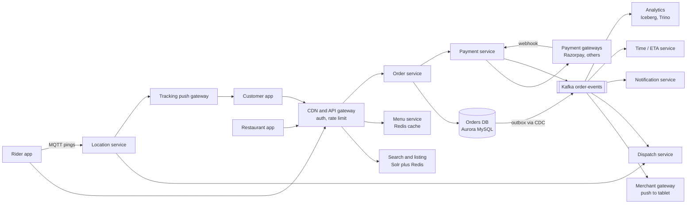

The **synchronous path** is short: gateway, order service, orders DB, payment service. Everything that happens *because* an order changed hangs off Kafka, so the customer waits only for what must succeed. That split is the key idea.

> **Real world — Zomato:** Kafka is "the backbone of our event-driven architecture"; services are mostly Go on ECS behind a Kuma mesh. ([source](https://www.zomato.com/blog/a-tale-of-scale-behind-the-scenes-at-zomato-tech-for-nye-2023))

### Main flow: placing and paying

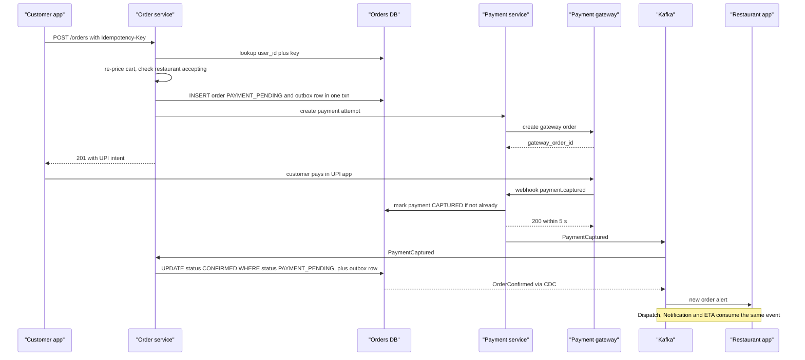

Two details beyond the diagram: the payment service writes its `payments` row *before* calling the gateway (Airbnb's "pre-RPC" phase), and the webhook is signature-verified and acked within 5 s.

> **Real world — Zepto:** Orders start as payment-pending *drafts*; payment events trigger an **idempotent** Create Order, and a 5-minute job resolves stuck drafts. ([source](https://aws.amazon.com/blogs/database/how-zepto-scales-to-millions-of-orders-per-day-using-amazon-dynamodb/)) Exactly the PAYMENT_PENDING plus sweeper pattern.

### Deep dive 1: the order state machine

A **state machine** is a fixed set of states and allowed moves. It makes impossible situations (rider "picks up" a cancelled order) unrepresentable.

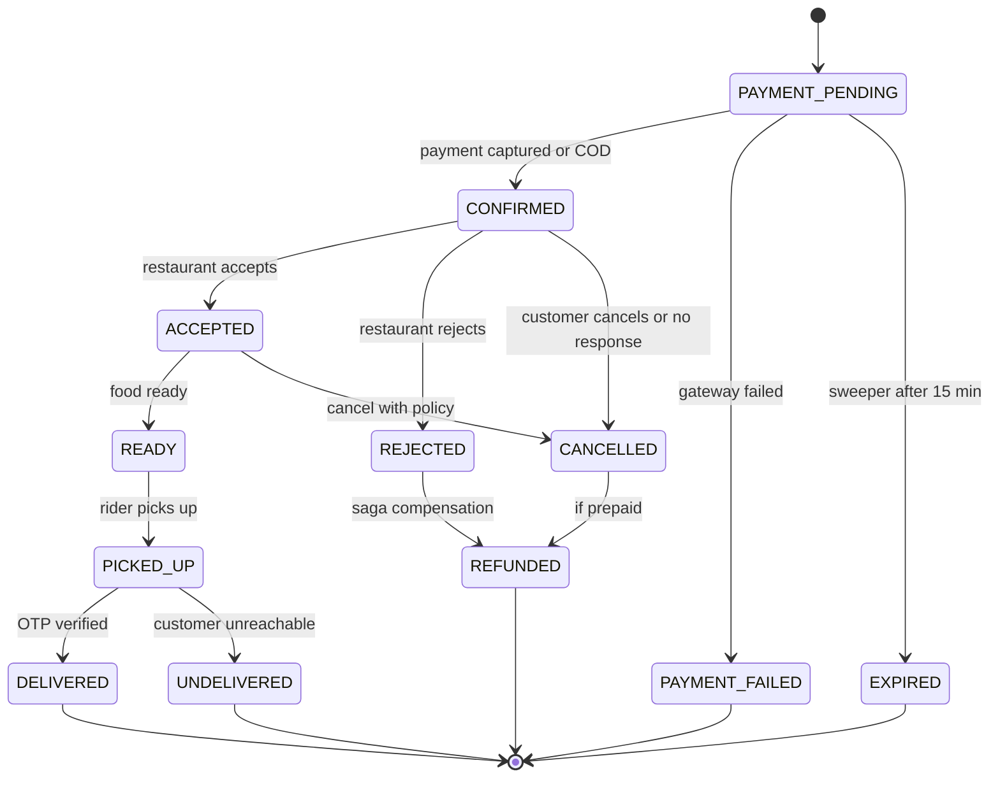

Rider assignment is a separate state machine on the delivery (Q3). Enforce transitions in **one function** with a conditional update:

```sql
UPDATE orders SET status='ACCEPTED', version=version+1
WHERE id=9001 AND status='CONFIRMED' AND version=3;
-- 1 row: we won (write history + outbox in same txn). 0 rows: illegal move or lost race, re-read.
```

This is **optimistic concurrency** (no lock, just a conditional write). Cancel vs Accept in the same second: one wins. A late duplicate PaymentCaptured matches 0 rows, so **the state machine is itself a dedupe mechanism**.

### Deep dive 2: the outbox

The **dual-write problem**: commit the order, crash before `kafka.publish`, and no restaurant ever hears (publishing first is worse). The **transactional outbox** writes the change and the event in the same transaction; a relay publishes it: **CDC** (Debezium tails the binlog, low latency) or a **polling publisher** (simpler, adds DB load). Either can publish twice, so **every consumer is idempotent**, recording event ids in `processed_events` in the same transaction as its side effect.

> **Real world — Debezium / Kafka:** Dual writes "can't share one transaction, because Kafka doesn't support XA". ([Debezium](https://debezium.io/blog/2019/02/19/reliable-microservices-data-exchange-with-the-outbox-pattern/)) Kafka exactly-once covers only Kafka-to-Kafka; external side effects "still need idempotency". ([Confluent](https://www.confluent.io/blog/exactly-once-semantics-are-possible-heres-how-apache-kafka-does-it/)) Your Atlassian idempotent SQS consumers are the consumer half of this story.

### Deep dive 3: the saga

A **saga** is a multi-step business transaction across services; each step has a **compensating action** (you refund, not roll back). **Paid, then restaurant rejects:** CONFIRMED to REJECTED with an OrderRejected outbox row; the payment service refunds with key `refund-<order_id>`, so a replay cannot refund twice. **Restaurant never answers:** a durable timer at +5 minutes (delayed queue, sweeper-scanned jobs table, or workflow engine) cancels conditionally and runs the same compensation. Use **orchestration in the order service** (it owns the state machine); choreography suits side effects like analytics.

> **Real world — Uber:** Cadence gives durable timers and coordinated Uber Eats' order workflow. ([Uber](https://www.uber.com/blog/open-source-orchestration-tool-cadence-overview/))

### Deep dive 4: Kafka fan-out, sharding, NYE

**Fan-out.** Each **consumer group** gets its own copy of every event. **Key by order_id** so an order's events stay ordered in one partition. Size partitions for consumer parallelism (active consumers per group ≤ partitions): 64-128. Alert on **consumer lag**. **Poison messages** go to delayed retry topics, then a DLQ, committing the offset ([Uber](https://www.uber.com/blog/reliable-reprocessing/)).

**Sharding, in stages** (data size and blast radius force it, not throughput): replicas, with idempotency checks on the primary; archive orders past ~90 days; then shard by `user_id` and build restaurant and rider views as Kafka-fed read models (**CQRS**). `restaurant_id` makes hot shards.

**NYE.** Pre-scale (autoscaling is too late), load-test with replayed traffic, **kill switches**, **priority load shedding**, **demand throttling**, multiple providers. Zomato's NYE 2023 SRE did exactly this, keeping degraded modes "so that lower-tier dependencies cannot take down critical services". ([source](https://www.zomato.com/blog/a-tale-of-scale-behind-the-scenes-at-zomato-tech-for-nye-2023))

### Failure cases (say these unprompted)

| What breaks | Fix |
|---|---|
| Double tap or network retry | Idempotency key, `UNIQUE (user_id, key)`, return stored response |
| Captured, but we crashed before recording | Gateway retries webhook (Razorpay: backoff for 24 h); reconciler polls gateway for PENDING attempts |
| Webhook twice or out of order | Dedupe on gateway event id; status only moves forward |
| Customer never pays | Sweeper expires PAYMENT_PENDING at ~15 min; late capture auto-refunds |
| Restaurant rejects or silent | Saga: 5-min timer, conditional cancel, idempotent refund |
| Cancel vs Accept race | Conditional update on `version` |
| Consumer down / poison message | Events wait, alert on lag / retry topic then DLQ |
| Gateway down on NYE | Route by recent success rate |

Razorpay webhooks are at-least-once (dedupe on `x-razorpay-event-id`) and **event order is not guaranteed**. ([source](https://razorpay.com/docs/webhooks/best-practices/))

### 60-second spoken summary

"I split a short synchronous path from a wide asynchronous one. Place-order is idempotent on a client key, re-prices on the server, and writes the order as PAYMENT_PENDING plus an outbox row in one transaction. The deduped payment webhook moves it to CONFIRMED by a conditional update, so the state machine rejects duplicates and races. CDC publishes the outbox to Kafka keyed by order id; restaurant, dispatch, notifications, ETA and analytics consume idempotently. A saga refunds on rejection or a five-minute timeout; sweepers and reconcilers clean up stuck payments. Reads dominate, about 9,600 requests per order at NYE, so Redis and a search index carry them; for NYE I pre-scale, load-test and keep kill switches."

### Follow-ups they ask

**Q: Why async? What if the consumer is down? Duplicates?** (B2)
A: Checkout no longer waits on the slowest downstream; bursts buffer in Kafka. A down consumer resumes from its committed offset (alert on lag). At-least-once delivery, so consumers dedupe on event id.

**Q: SQL or NoSQL for orders and payments? Can't SQL scale?** (B10)
A: SQL: order and payment change together, the unique idempotency key, ad-hoc support queries. It scales via replicas, caching, archiving, sharding. NoSQL wins when you know the read key, not "for reads" in general.

**Q: Kafka vs direct calls, and Kafka vs SQS?** (B1, Z4, Z15)
A: Direct calls couple checkout to every downstream's uptime. Kafka gives buffering, replay, per-key order and many consumer groups; SQS deletes on consume and needs SNS for fan-out, fine for one worker pool. Direct calls are right when you need the answer, like a payment intent.

**Q: Top 5 riders in an area by count of an order type.** (Z2)
```sql
SELECT d.rider_id, COUNT(*) AS cnt
FROM deliveries d JOIN orders o ON o.id = d.order_id JOIN riders r ON r.id = d.rider_id
WHERE r.zone_id = 17 AND o.order_type = 'GOURMET' AND d.delivered_at >= NOW() - INTERVAL 30 DAY
GROUP BY d.rider_id ORDER BY cnt DESC LIMIT 5;
```
Index `deliveries(rider_id, delivered_at)`; run on a replica.

---

## Q2. Live order tracking (rider location to customer)

**Why they ask it.** Blinkit SDE-1 (B2), and Q1's natural follow-up. It tests whether you separate a **high-rate, loss-tolerant** stream (GPS pings) from **low-rate, must-not-lose** events (status), and whether you know why polling breaks.

### Requirements and estimates

Customer sees the rider move and status changes; ~2 s freshness; flaky 4G; battery friendly; history kept.

Assume **3 lakh riders online**, one ping per 4 s: **75,000 pings/s**, ~100 B each; history ~100 GB/day raw.

### APIs and data

```
Rider -> MQTT rider/{rider_id}/loc    {pings:[{lat,lng,ts,acc,spd}]}   QoS 0
Rider -> MQTT rider/{rider_id}/event  {delivery_id, type:"PICKED_UP", ts}  QoS 1
Customer -> GET /v1/orders/{id}/tracking -> {status, rider:{lat,lng,ts}, eta_min, seq}   (snapshot)
Customer -> subscribe track/order/{order_id}  (MQTT, or SSE /v1/orders/{id}/stream?from_seq=)
```

Hot state in memory: `rider:{id}:loc` with TTL 60 s. History via Kafka to a columnar table `rider_location_history(rider_id, ts, lat, lng)`, partitioned by day, kept ~90 days. On open or reconnect, draw the snapshot first, then stream.

### Architecture

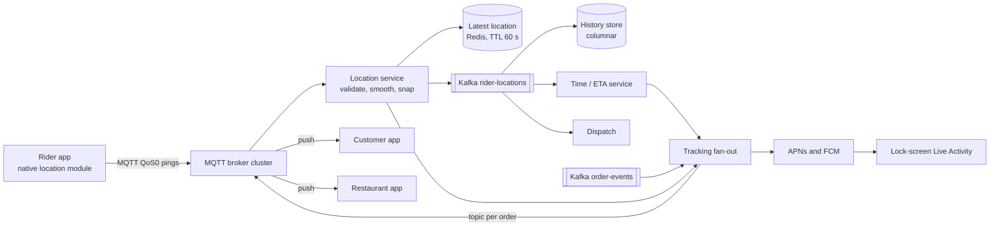

Key idea: **keep only the latest position hot**; history goes off the critical path.

> **Real world — Zomato:** Zomato started with HTTP polling, which stopped scaling because "TLS and header overhead often outweighed the tiny payloads" and markers jumped. It moved to **MQTT** for location and lifecycle events. ([source](https://www.eternal.com/blog/pulse/)) **Not public:** how pings are stored server-side; say "here is how it is typically done".

### Main flow

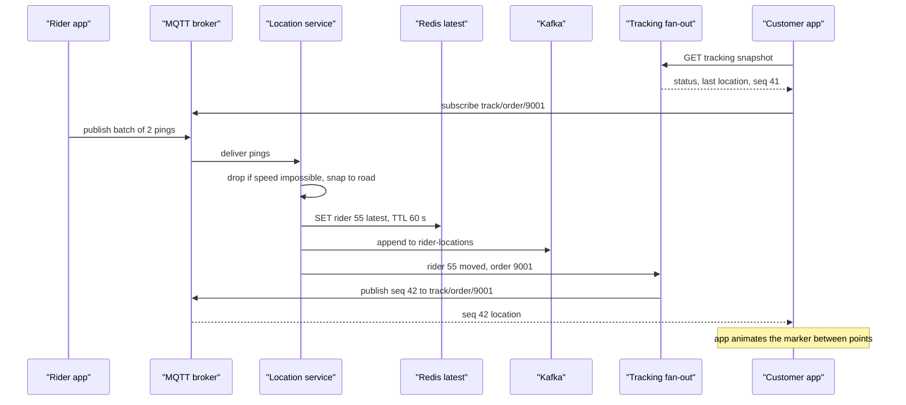

### Deep dives

- **MQTT QoS.** QoS 0 (fire and forget) for pings, QoS 1 (at least once) for status, persistent sessions; brokers route by topic (own WebSocket gateways need an order-to-node map or Redis pub/sub).
- **Sequence numbers.** On reconnect the client sends the last it saw; missed status is replayed or covered by the snapshot.
- **Cleaning GPS.** Phone accuracy is 60-150 m, sometimes 2-3 km off ([Zomato](https://www.zomato.com/blog/to-help-us-locate-you-better/)). Drop impossible speeds, snap to roads (map matching).
- **Battery and lifecycle.** Batch 2-3 pings, ping faster when moving, buffer offline. Client: snapshot, stream, reconnect after 7 s silence, poll after 3 failures.

### Failure cases

| Failure | Handling |
|---|---|
| Rider loses network | Show "last updated 40 s ago"; app buffers and flushes; ETA uses last speed |
| Broker node dies | Clients reconnect elsewhere, re-subscribe, re-snapshot |
| Status event lost | QoS 1 plus sequence numbers; snapshot on reconnect |
| Out-of-order pings | Drop any ping older than stored ts |
| GPS spoofing | Speed checks, OTP at handover, server-side geofence on PICKED_UP and DELIVERED |

### 60-second spoken summary

"Two streams, two rules. GPS pings are high rate and loss tolerant, about 75,000 a second: over MQTT, validated and snapped, latest position overwritten in Redis with a TTL, full stream to Kafka for history, ETA and dispatch. Status events must not be lost: at-least-once with sequence numbers. Customers never poll: snapshot on open, subscribe to the order's topic, resend the last sequence on reconnect. Zomato moved from polling to MQTT because per-request overhead dominated tiny payloads. The app animates between points, shows 'last updated' when stale, and polls only as a fallback."

### Follow-ups they ask

**Q: Why not poll?** Each poll pays TLS and headers bigger than the payload and most return nothing; Uber once found **80% of gateway requests were polling** ([source](https://www.uber.com/blog/real-time-push-platform/)). Polling is fallback only.

**Q: WebSocket, SSE or MQTT?** The customer only receives, so SSE suffices on web. On mobile MQTT is built for it (small headers, QoS, sessions). WebSocket when you need two-way, like chat. Zomato chose MQTT.

**Q: Latest location in MySQL?** No: it is overwritten every 4 s and only the latest matters; 75k writes/s would crush a relational DB for nothing. Redis with TTL is common, and Redis GEO lets dispatch query by radius (Zomato's choice is not public).

---

## Q3. Rider assignment (dispatch) and order batching

**Why they ask it.** Swiggy S2 (VIP orders and ratings, in code), Zepto P5 (driver-side concurrency), and inside Q1 as "how do you pick the rider?". **The trap is answering "nearest rider" and stopping.**

### Requirements and estimates

Pick and offer a rider per order (accept, decline, timeout), batch compatible orders, re-assign dark riders; never double-assign; decide in seconds.

A big city sees maybe 20-30 orders/s at peak; each 10-30 s zone run matches a few hundred orders to a few hundred riders. **Building the cost matrix (each cell needs an ETA) is the expensive part, not the matching.**

### The algorithms in plain words

Picture a table: rows are orders, columns are riders, each cell is "how bad is this pairing" (customer wait plus rider waste).
- **Greedy:** each order takes the cheapest free rider in turn. Fast, but an early order can steal the rider perfect for a later one.
- **Global matching (Hungarian / Kuhn-Munkres):** one rider per order minimising *total* cost; bipartite matching, about O(n³).
- **MIP / ILP:** 0/1 variables "rider r takes order o", minimise total cost under rules (each order once, each rider at most k, no promise broken), solved by a solver. Handles batching, which 1:1 matching cannot.

> **Real world — DoorDash and Swiggy:** DoorDash moved from Hungarian (no multi-order routes) to a **MIP**, "up to 10 times faster". ([source](https://doordash.engineering/2020/02/28/next-generation-optimization-for-dasher-dispatch-at-doordash/)) Swiggy runs an **integer linear program** per **logistic zone** in micro-batches, with **just-in-time assignment** (rider arrives as food is ready). ([part 2](https://bytes.swiggy.com/the-swiggy-delivery-challenge-part-two-f095930816e3), search-snippet source)

> **Real world — Zomato:** The assignment algorithm is **not public**. Published: **Active Dispatch**, a multi-agent RL model recommending where idle partners should move. ([source](https://www.zomato.com/blog/elements-of-scalable-machine-learning/)) Say "here is how the industry does it."

### Architecture and main flow

A **planner per zone** consumes order events, generates candidates, scores them with the Time service, solves, reserves and offers:

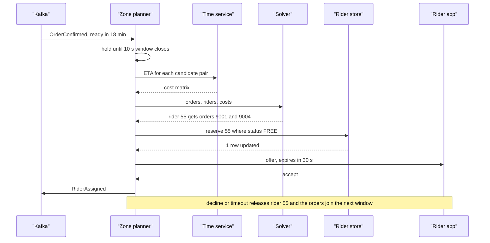

Rider states: OFFLINE, FREE, RESERVED, TO_RESTAURANT, AT_RESTAURANT, TO_CUSTOMER, FREE; RESERVED returns to FREE on decline or timeout.

### Deep dives

- **Candidates.** Never score the whole city. Take the restaurant's H3 cell plus a ring (Q4), keep riders FREE or about to finish, cap at 20-30.
- **Cost function.** Rider arrival vs food-ready time (early wastes rider time, late makes food cold), last mile, acceptance probability, fairness. E.g. `cost = customer_wait + 0.5 × rider_idle + penalty_if_late`.
- **Batching.** Add candidate *pairs* (same or nearby restaurants, customers in the same direction), penalise the first customer's extra delay, cap at 2-3. Swiggy says batching "could double the capacity of the entire delivery fleet" ([source](https://bytes.swiggy.com/the-swiggy-delivery-challenge-part-one-6a2abb4f82f6), search-snippet source).
- **Never double-assign.** One planner per zone (single writer), and still a conditional reserve: `UPDATE riders SET state='RESERVED', offer_id=? WHERE id=55 AND state='FREE'`. Zero rows means someone else won.
- **Don't broadcast.** Offer one order to one rider at a time; Gojek's broadcast model caused "fastest phone wins" races and switched to 1:1 ([source](https://blog.gojek.io/how-gojek-manages-1-million-drivers-with-12-engineers-part-2-2/)).

### Failure cases

| Failure | Handling |
|---|---|
| Rider declines or ignores | 30 s timeout, release, order joins next window |
| Planner crashes mid-run | Reservations expire; sweeper frees stale RESERVED riders; standby takes the zone lease |
| Rider accepts then goes dark | No movement in N minutes: re-assign, notify customer |
| No riders in range | Widen ring, incentive, raise ETA, throttle demand |
| ETA service down | Haversine × city-hour average speed |

### 60-second spoken summary

"Not greedy nearest-rider. Each zone's planner collects orders for about 10 seconds, takes candidates from an H3 ring, and builds a cost matrix from the ETA service: rider arrival vs food-ready time, last mile, acceptance probability, fairness. A solver minimises total cost, Hungarian for one-to-one or an integer program for batches of two or three. The rider is reserved by conditional update, offered with a 30-second timeout, and on decline the order rejoins the next window. That matches Swiggy and DoorDash; Zomato's algorithm isn't public, but it has published RL repositioning of idle riders."

### Follow-ups they ask

**Q: Straight-line nearest is good enough?** No: a river or one-way street can make a 500 m rider 15 minutes away. Use road travel time for shortlisted candidates.

**Q: Code it: VIP first, then rider rating.** (S2) A priority queue of pending orders by (is_vip desc, created_at asc) and per zone a max-heap of free riders by rating. Pop the top order, pick the best eligible rider, reserve, offer; on decline push back. O(log n) per operation; say production uses the batch solver.

**Q: Riders waiting at the restaurant?** Delay dispatch: food ready in 18 min, rider 6 min away, assign at minute 10-12.

---

## Q4. Nearby restaurants, serviceability and search

**Why they ask it.** Nugget (Z5) asked for "nearby restaurants in SQL"; the candidate gave a bounding box and the interviewer "pushed for geo-indexing / PostGIS and was not satisfied". Z17 wanted an inverted index. The home feed is the highest-traffic screen.

**Clarify:** "nearby" really means "delivers to me": **serviceability**, not distance.

### Requirements and estimates

Ranked, paginated serviceable restaurants; typo-tolerant search; filters; closed restaurants vanish fast; p99 100-200 ms; staleness fine except open/closed.

> **Real world — Zomato:** Search handles **100M+ queries a day**, and "Solr-Lucene is the base of all search functions". ([source](https://www.zomato.com/blog/explained-how-zomato-handles-100-million-daily-search-queries-p1/))

That is ~5,000 queries/s at dinner; the index is small (247k restaurants). Swiggy computes ~100K visits/min × ~2,000 nearby locations = **200M serviceability evaluations a minute** ([source](https://bytes.swiggy.com/designing-the-serviceability-platform-at-swiggy-for-high-scale-part-1-751a631f0379), search-snippet source): you cannot call a routing engine that often, so **precompute and cache**.

### The SQL trap, answered properly

A **bounding box** (`lat BETWEEN ... AND lng BETWEEN ...`) is weak: a B-tree uses only one range column well, so it scans a whole latitude strip, and it is still straight-line. Better, in order:
1. **Geo cell column.** Index each restaurant's geohash or H3 cell and query the user's cell plus neighbours:
```sql
SELECT id, name, lat, lng FROM restaurants
WHERE city_id = 4 AND h3_res9 IN (/* user cell + neighbour ring, computed in app */)
  AND is_accepting = TRUE;   -- index (city_id, h3_res9); exact distance and sort in code
```
2. **Spatial index.** PostGIS `geography` with a GiST index and `ST_DWithin(location, user_point, 5000)`, or MySQL R-tree spatial indexes. This is the phrase Z5 wanted.
3. **Serviceability.** Each restaurant has a delivery area; precompute **cell → serviceable restaurants**, and at request time look up the user's cell.

**Geohash, H3, S2** all cut the map into cells with ids, so "near" becomes "same or adjacent cell", which an index finds fast. **Geohash**: rectangles named by a string, longer means smaller; neighbours across a border can have different prefixes. **H3** (Uber): hexagons, all neighbours equidistant (res 9 ≈ 0.105 km²; [H3 docs](https://h3geo.org/docs/core-library/restable/)). **S2** (Google): squares on a cube; Blinkit's "Iris" uses S2 with a per-cell cache where "No computation happens in real time" ([source](https://lambda.blinkit.com/iris-359b5dfd589b), search-snippet source). Swiggy defines serviceable as **road distance and time** *and* delivery capacity.

### APIs and data

```
GET /v1/feed?lat=&lng=&filters=veg&cursor=  |  GET /v1/search?q=&lat=&lng=  |  GET /v1/suggest?q=bir
```
```sql
CREATE TABLE serviceability (        -- precomputed, rebuilt on zone or capacity change
  city_id INT, h3_res8 BIGINT, restaurant_id BIGINT, road_eta_min SMALLINT,
  PRIMARY KEY (city_id, h3_res8, restaurant_id)
);
-- Solr doc: {id, name, cuisines[], dish_names[], rating, popularity, serviceable_cells[]}
```

### Architecture

Feed service calls serviceability (cell lists in Redis), Solr, live flags (Redis) and a ranker; catalog changes flow DB, CDC, Kafka to the indexer and a serviceability builder that also reads rider supply.

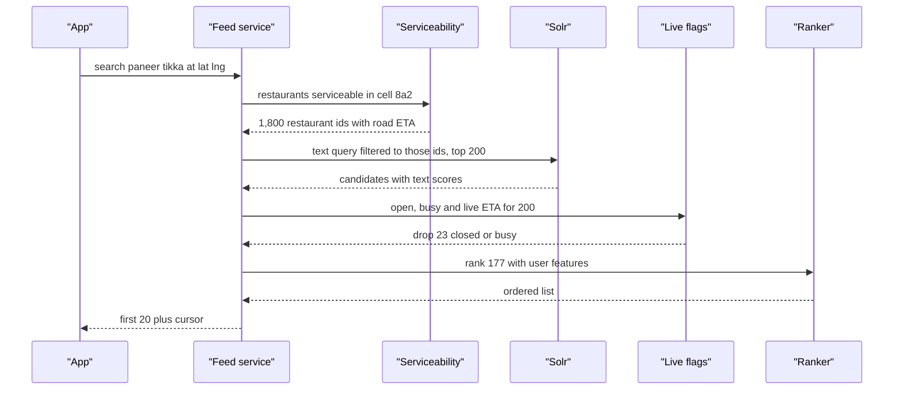

The pattern is **retrieve, filter, rank**: cheap retrieval narrows thousands to hundreds, a live filter drops closed ones, an expensive ranker orders a small list.

> **Real world — Zomato:** Ranking is **Learn-to-Rank** (pairwise gradient boosting on dish popularity, order history, keyword match); autocorrect uses phonetic-weighted edit distance plus a Siamese network. ([source](https://www.zomato.com/blog/rethinking-zomato-search-pt-1)) Switching Solr sort and facet fields from FieldCache to **DocValues** gave **10x throughput per replica** and cut cost ~80%. ([source](https://www.zomato.com/blog/explained-how-zomato-handles-100-million-daily-search-queries-p1/))

### Failure cases

| Failure | Handling |
|---|---|
| Restaurant closes suddenly | Index may lag, so check the Redis live flag at serve time |
| Solr slow or down | Serve cached per-cell default feed; circuit breaker |
| Routing quota hit | Cached distance, then OSM routing, then haversine |
| Rider shortage | Builder shrinks radius; serviceability is distance AND capacity |
| Hot cell at dinner | Cache cell feed 30-60 s with TTL jitter; single-flight on misses |

### 60-second spoken summary

"'Near me' means 'delivers to me': road distance plus rider capacity, so I precompute it. A builder computes for each H3 cell the restaurants that can deliver there, cached in Redis. A request maps location to cell, fetches those ids, runs the text query in Solr restricted to them, drops closed or busy ones via live flags, and ranks the rest with learning-to-rank. Catalog changes flow by CDC and Kafka to the indexer. In plain SQL I'd index a cell-id column and query the cell plus neighbours, or use PostGIS; a bounding box alone isn't enough."

### Follow-ups they ask

**Q: Separate indexes on A and B, or composite (A, B), for `WHERE A=10 AND B=20`?** (Z9) Composite: one seek. Separate indexes mean the DB picks one and filters, or merges two scans. (A, B) also serves `WHERE A=10` (left-prefix rule) but not `WHERE B=20` alone. `(city_id, h3_res9)` is exactly this.

**Q: Why not `LIKE '%paneer%'`?** A leading wildcard can't use a B-tree, so it scans every row, with no typo tolerance or ranking. An inverted index maps each word to its documents, with fuzzy matching and scoring.

**Q: Stable pagination?** Cursor, not offset: compute the ranked list once, cache the ordered ids for a minute under a search id, return (search_id, position). No shuffling, no deep OFFSET scans.

---

## Q5. ETA prediction service

**Why they ask it.** Reported once as "predict the time taken for food delivery" (Z34, search snippet only, unconfirmed), and it appears in nearly every Q1 as "how do you compute ETA?". For SDE-1, the *serving system* matters as much as the model.

**Requirements.** One service for browse, checkout and live ETA, plus per-leg times for dispatch; late is worse than early; a few ms per prediction on CPU at thousands of QPS; always sane outputs with a fallback.

### How ETA breaks down

```
ETA = time to assign a rider + rider to restaurant (first mile)
    + wait for food = max(0, food_ready - rider_arrival)
    + restaurant to customer (last mile) + handover (parking, gate, stairs)
    + dynamic buffer (rain, demand, supply stress)
```

> **Real world — Zomato:** A **Time microservice** owns ETA for browsing, assignment, tracking and delay messages, It moved to a **tree-based model** because Indian map data is sparse. ([part 1](https://www.zomato.com/blog/the-accurate-eta-to-customer-satisfaction-part-one/)) Travel is **LightGBM**, **per city**, served via FastAPI in ~2-3 ms; ETA is not shown to riders, to avoid rash driving. ([part 2](https://www.zomato.com/blog/the-accurate-eta-to-customer-satisfaction-part-two/)) For prep time, a **Food Order Ready button** fixed bad labels and a stacked LSTM cut MAE from 4.64 to 4.13 min. ([source](https://www.zomato.com/blog/food-preparation-time/))

> **Real world — Swiggy:** A new model once produced **negative predictions**, and the post-mortem noted **there was no fallback for negative predictions**. ([source](https://bytes.swiggy.com/behindthebug-unpacking-the-effects-of-negative-psla-predictions-on-serviceability-6e1712eceb56), search-snippet source)

### Architecture

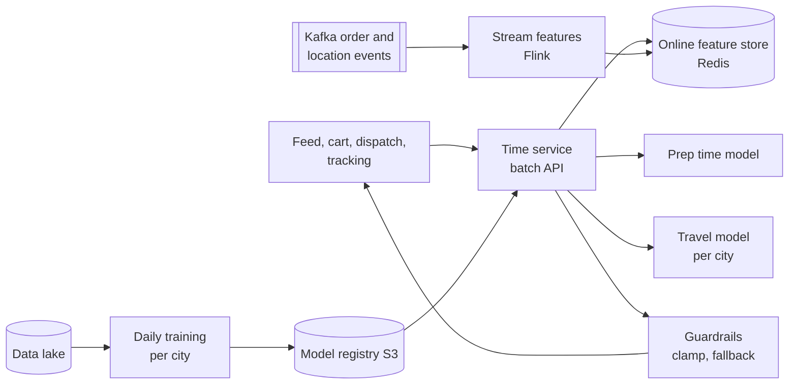

**Checkout flow:** the cart asks for restaurant 42 to address 7; the Time service reads restaurant load and rider supply, gets prep 16 + first mile 6 + last mile 11, adds a rain buffer, clamps to 10-90, and returns 35 shown as 30-40; on model failure, city-hour average plus distance over speed.

### Deep dives

- **Batch API:** one call with 200 rows for a feed page, not 200 calls.
- **Guardrails:** clamp to a sane range, reject NaN or negative, fall back to distance ÷ city-hour speed + restaurant's average prep. The Swiggy lesson.
- **Asymmetric loss:** penalise under-prediction more, then show a range ("30-40 min").
- **Re-prediction** on every event and every 30-60 s from pings, smoothed; **safe rollout** by shadow, canary per city, old model hot.

### Failure cases

| Failure | Handling |
|---|---|
| Negative or huge output | Clamp, fallback formula, alert, auto-rollback on error spike |
| New restaurant | Cuisine and city averages (cold start) |
| Rain or NYE | Dynamic buffer from demand and supply stress |
| "Ready" not pressed | Treat label as missing, not as a long prep time |

### 60-second spoken summary

"One Time service that everyone calls in batches. ETA is a sum of legs: assign, rider to restaurant, wait for food, last mile, handover, plus a dynamic buffer. Each leg has a per-city model on features Flink writes from Kafka into an online store; Zomato uses LightGBM for travel and an LSTM-based prep model, in a couple of milliseconds on CPU. Late is worse than early, so an asymmetric loss and a displayed range. Every output is clamped with a distance-over-speed fallback, because Swiggy had an outage from negative ETAs with no fallback. ETA is recomputed on every event and from pings."

### Follow-ups they ask

**Q: How do you know the model is good?** Share of orders within the promised window (±3 or ±5 min), breach rate, MAE, per city, plus A/B tests.

**Q: Checkout said 30 minutes and it's running late?** The live ETA is recomputed and smoothed; when it crosses the promised window, send a delay message, flag for ops, and let dispatch prioritise the handover.

**Q: Cold start for a new restaurant?** Averages for similar restaurants and dishes, shifting weight to its own history as orders accumulate; dish embeddings make its "paneer tikka" look like everyone else's.

---

## Q6. Notification system

**Why they ask it.** **The most repeated SDE-1 HLD in the Zomato group**: Z2 (no duplicates, crash resilience), Z3 (team integration, **user-level and team-level cooldowns**), District Z13 (deep Kafka), Z29 (notify on reopen **only if riders are available**), Blinkit B1. Prepare it fully.

### Requirements and estimates

**Functional:** one API and topic for all teams (transactional and promo); push, SMS, email, WhatsApp; templates, fallback, preferences, quiet hours; dedupe; **user cooldown** (max N promos a day, minimum gap); **team quota** (a buggy producer cannot spam everyone). **Non-functional:** OTPs within seconds even during a 1-crore campaign; no loss or duplicates on crash. Load: ~12M transactional a day (~800/s at NYE) plus promo bursts.

> **Real world — FCM and APNs:** FCM defaults to **600k messages/min per project**, so a 1-crore push campaign takes at least **~17 minutes**; ([source](https://firebase.google.com/docs/cloud-messaging/throttling-and-quotas)) APNs has a 4 KB payload and stores **only one notification per app** for an offline device. ([source](https://developer.apple.com/documentation/usernotifications/sending-notification-requests-to-apns)) So: **collapse keys** for order status (only the latest matters), short TTLs, paced campaigns.

### API and data

```
POST /v1/notifications
Headers: X-Team-Id: offers-team, Idempotency-Key: order:9001:OUT_FOR_DELIVERY
{ "user_id": 991, "template_id": "order_out_for_delivery", "params": {"eta_min": 7},
  "category": "TRANSACTIONAL", "priority": "P1",      (P0 OTP, P1 status, P2 promo)
  "channels": ["PUSH","SMS"], "collapse_key": "order:9001:status",
  "expires_at": "2026-10-23T20:15:00Z", "send_at": null }
-> 202 {notification_id, status:"ACCEPTED"} | 409 duplicate key | 429 team quota, Retry-After: 30
```

```sql
CREATE TABLE notifications (
  id CHAR(26) PRIMARY KEY, team_id VARCHAR(32), dedupe_key VARCHAR(128), user_id BIGINT,
  template_id VARCHAR(64), params JSON, priority CHAR(2), status VARCHAR(16),
  suppress_reason VARCHAR(32), expires_at DATETIME,
  UNIQUE KEY uq_team_dedupe (team_id, dedupe_key)
);
-- Also: delivery_attempts, user_preferences, device_tokens, team_quotas(team_id, per_minute).
-- Redis: dedupe:{team}:{key} SET NX EX 86400, cooldown:user:{id}:promo:day, quota:team:{id}:{minute}
```

### Architecture

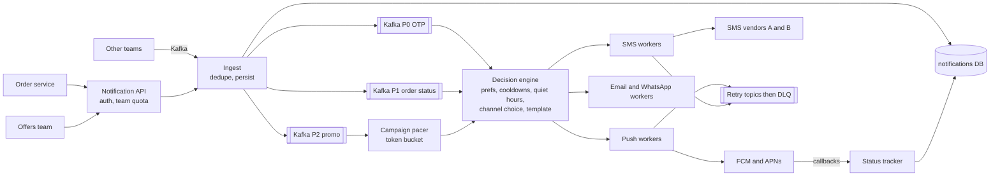

**Priority lanes are the heart of it:** P0 and P1 have their own topics and reserved workers, so a 1-crore promo backlog cannot delay an OTP.

### Main flow

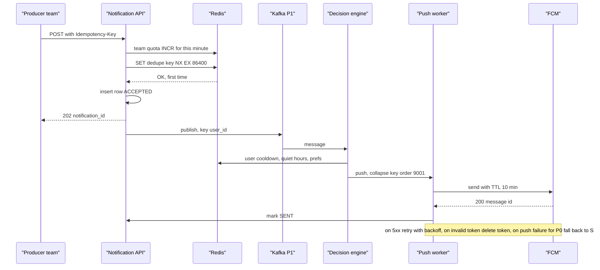

**Crash resilience** comes from the persisted per-message state (ACCEPTED, SCHEDULED, SENDING, RETRYING, FALLBACK, SENT, DELIVERED, FAILED, EXPIRED, SUPPRESSED): a sweeper re-drives messages stuck in SENDING or RETRYING, and dedupe makes that safe.

> **Real world — Swiggy and LinkedIn:** Swiggy's Kabootar keeps a **persisted state machine per message so one stuck in a non-final state can be reprocessed**. ([source](https://bytes.swiggy.com/kabootar-swiggys-communication-platform-e5a43cc25629), search-snippet source) LinkedIn's Air Traffic Controller **rate-limits upstream apps** to prevent accidental spam: exactly Z3's team cooldown. ([source](https://www.linkedin.com/blog/engineering/messaging-notifications/air-traffic-controller-member-first-notifications-at-linkedin)) **Not public:** Zomato's notification architecture.

### Deep dives

- **Dedupe, two layers.** At ingest, `UNIQUE (team_id, dedupe_key)` plus a Redis `SET NX` fast path; the producer picks a deterministic key so a replayed event gives the same key. At send, the worker checks state first and passes a provider idempotency id where supported. Exactly-once to a phone is impossible; at-least-once plus dedupe is "effectively once".
- **User cooldown** (promos only, never OTPs): Redis `INCR` per user per day expiring at midnight, plus a last-push key with an 8 h TTL (Uber's CCG uses caps like 2 a day and 8 h gaps, [source](https://www.uber.com/en-CA/blog/how-uber-optimizes-push-notifications-using-ml)). Over the cap: SUPPRESSED with a reason, or deferred.
- **Team quota** at the API: per-minute counter (Q7's limiter), 429 with Retry-After; optionally one push per campaign per user.
- **Routing and fallback.** OTP via SMS first; order status via push with collapse key, SMS fallback for "rider arriving"; promos push or email only. Circuit breaker per provider; vendor A failing routes to vendor B.
- **Z29 twist.** Subscriptions keyed by restaurant; on REOPENED, check rider supply in the zone from dispatch's cache, delay if low, then fan out in waves sized to kitchen and rider capacity.

### Failure cases

| Failure | Handling |
|---|---|
| Worker crashes after provider accepted, before SENT | Re-drive; state check plus provider idempotency id; collapse keys hide a rare duplicate |
| Provider 5xx or timeout | Retry topics with backoff and jitter, then fallback channel, then DLQ |
| Promo blast | Separate topics and workers plus pacer; P0/P1 unaffected |
| Redis down | Dedupe falls back to DB unique key; cooldowns fail open for transactional, closed for promo |
| Stale message | Check `expires_at` before every send |

### 60-second spoken summary

"One platform every team calls by API or Kafka, with a team id and idempotency key. Ingest enforces team quota, dedupes in Redis with a DB unique key as backstop, persists as ACCEPTED, and publishes by priority: P0 OTP, P1 order status, P2 promos, each with reserved workers so a campaign never delays an OTP. A decision engine applies preferences, quiet hours and user cooldowns, picks channels and renders templates. Workers call FCM, APNs and multiple SMS vendors with collapse keys and TTLs, retry 5xx through retry topics, fall back to SMS for critical messages, and end in a DLQ. Persisted state lets a sweeper safely re-drive stuck messages. Campaigns are paced under FCM's 600k-per-minute quota."

### Follow-ups they ask

**Q: How do other teams integrate?** (Z3) One versioned API and Kafka schema (the request above), self-serve templates, per-team quotas, and a status API back.

**Q: Duplicates when Kafka redelivers?** (Z2, Z13) Deterministic producer key hits `SET NX` or the unique constraint; workers check stored state before sending; re-drive touches only non-final messages.

**Q: User vs team cooldown, where?** (Z3) Team quotas at ingest (stop a buggy producer at the door with 429). User cooldowns in the decision engine, since they depend on what the user got from all teams.

**Q: Kafka vs direct API calls?** (B1) Kafka buffers campaign bursts, replays after crashes and scales channels and lanes independently. Direct calls suit only an OTP where the caller wants an immediate answer, and even then the platform owns retries.

**Q: Notify 1 crore users about a sale?** Batch the audience and pace it through a token bucket under quota (≥17 min at 600k/min), staggered because every tap hits your feed and menus.

---

## Q7. Rate limiter, with working code

**Why they ask it.** Z2 had to **implement token bucket and fixed window in code**; Z19 token vs leaky bucket; District Z31 asked about the **fixed-window boundary burst** and **why naive sliding window is O(N)**; Nugget's "ad pacing" (Z14) is rate limiting in disguise. Expect to write code.

**Requirements.** N requests per window per key with per-endpoint rules (OTP 5 per 10 min per phone, browse 100/min per user); reject with **429** and `Retry-After`; under ~1 ms added; correct across servers; never the outage itself.

### The algorithms

| Algorithm | Idea | Memory | Good | Bad |
|---|---|---|---|---|
| **Token bucket** | Up to B tokens, refill R/s, a request spends one | 2 numbers | Bursts up to B, smooth average | Two knobs |
| **Leaky bucket** | Queue drains at a fixed rate | queue | Perfectly smooth output | Adds delay |
| **Fixed window** | Count per key per clock minute | 1 counter | INCR plus EXPIRE | Up to **2x** across a boundary |
| **Sliding log** | Store every timestamp in the last 60 s | per request | Exact | O(N) memory and work |
| **Sliding counter** | prev × fraction still inside + current | 2 counters | Nearly exact, O(1) | Small approximation |

> **Real world — Cloudflare:** `rate = prev × ((window − elapsed)/window) + curr`; e.g. 42 × (45/60) + 18 = **49.5** against 50. On 400M requests only **0.003%** were wrongly allowed or limited. ([source](https://blog.cloudflare.com/counting-things-a-lot-of-different-things/))

### Code: token bucket in Go

Thread-safe, lazy refill (no background goroutine), `now` passed in for testability.

```go
package ratelimit

import ("math"; "sync"; "time")

type bucket struct { tokens float64; last time.Time }

type TokenBucket struct {
	mu       sync.Mutex
	capacity float64 // max burst
	rate     float64 // tokens per second
	buckets  map[string]*bucket
}

func NewTokenBucket(capacity, rate float64) *TokenBucket {
	return &TokenBucket{capacity: capacity, rate: rate, buckets: map[string]*bucket{}}
}

func (l *TokenBucket) Allow(key string, now time.Time) bool {
	l.mu.Lock()
	defer l.mu.Unlock()
	b, ok := l.buckets[key]
	if !ok {
		b = &bucket{tokens: l.capacity, last: now}
		l.buckets[key] = b
	}
	if elapsed := now.Sub(b.last).Seconds(); elapsed > 0 {
		b.tokens = math.Min(l.capacity, b.tokens+elapsed*l.rate) // lazy refill
		b.last = now
	}
	if b.tokens >= 1 {
		b.tokens--
		return true
	}
	return false
}
```

**Fixed window, briefly:** keep `(window = now / size, count)` per key; if the window changed, reset count to 0; allow while `count < limit`. In Redis it is `INCR key` plus `EXPIRE key 60`, but as two commands a crash between them leaves a key that never expires and blocks the user forever, so do both in one Lua script or `MULTI`, or `SET key 0 EX 60 NX` then `INCR`.

Probed points: shard the global mutex in production; evict idle keys or the map leaks.

### Distributed: Redis plus Lua

With 50 servers keeping local counters, a user spraying requests gets 50x the limit. Put state in **Redis** and make check-and-update **atomic**: Redis runs a Lua script without interleaving, so two servers cannot both take the last token.

```lua
-- KEYS[1] = "rl:tb:{user:991}:place_order"; ARGV = capacity, refill per second, cost
local capacity = tonumber(ARGV[1])
local rate     = tonumber(ARGV[2])
local cost     = tonumber(ARGV[3])

local t   = redis.call('TIME')                     -- Redis's clock, not each app server's
local now = tonumber(t[1]) * 1000 + math.floor(tonumber(t[2]) / 1000)

local state  = redis.call('HMGET', KEYS[1], 'tokens', 'ts')
local tokens = tonumber(state[1]) or capacity
local ts     = tonumber(state[2]) or now
tokens = math.min(capacity, tokens + math.max(0, now - ts) / 1000 * rate)

local allowed, retry_ms = 0, 0
if tokens >= cost then
  tokens = tokens - cost
  allowed = 1
else
  retry_ms = math.ceil((cost - tokens) / rate * 1000)
end
redis.call('HSET', KEYS[1], 'tokens', tokens, 'ts', now)
redis.call('PEXPIRE', KEYS[1], math.ceil(capacity / rate * 1000) + 1000)  -- idle keys vanish
return {allowed, retry_ms}
```

The Go caller runs it via `EVALSHA` with a ~5 ms timeout and **fails open** on error (emit a metric). **Use the store's clock** so skewed app servers agree ([Brandur](https://brandur.org/rate-limiting)); **hash tags** `{user:991}` keep a user's keys on one Redis Cluster shard.

### Main flow

Layers: CDN and WAF for IP floods, then the gateway (Envoy) with a local over-limit cache calling a dedicated Redis, then services with a load shedder.

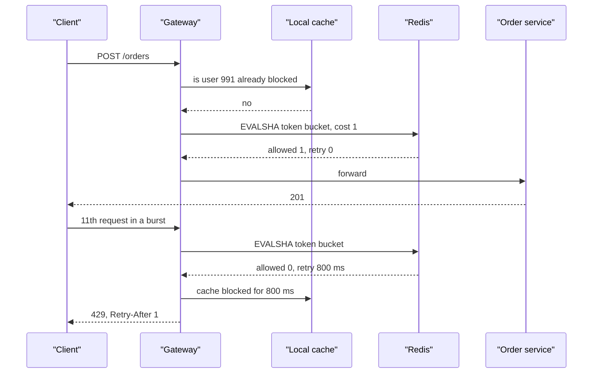

> **Real world — Stripe and GitHub:** Stripe runs **four limiters**: a Redis token-bucket request limiter, a concurrent-requests limiter, and two load shedders that reserve capacity for critical traffic; advice is to **fail open** if Redis is down and dark-launch limiters first. ([source](https://stripe.com/blog/rate-limiters)) GitHub moved counters off shared Memcached because memory pressure **evicted live counters**. ([source](https://github.blog/2021-04-05-how-we-scaled-github-api-sharded-replicated-rate-limiter-redis/)) Zomato's only published limit is its public API's **1,000 calls a day** ([source](https://www.zomato.com/policies/api-policy/)); don't attribute an internal design.

Myntra link: "My per-pod token bucket at 180 requests/min rejected a 5.7M-key cache warmup; a 4 ms pacing delay so the producer matched the refill rate fixed it." That is the client-side half: respect `Retry-After` and pace yourself.

### Failure cases

| Failure | Handling |
|---|---|
| Redis down or slow | Few-ms timeout; **fail open** for browse and orders, **fail closed** for login, OTP, payment attempts; optional local fallback limiter |
| Counters evicted | Dedicated Redis with `noeviction` |
| Limit too tight at launch | Shadow mode: log would-be rejections first |
| DDoS | CDN and WAF, IP reputation, captcha, load shedding; a limiter alone is not enough |

### 60-second spoken summary

"Rate limiting at the gateway or mesh, keyed by user, or by IP or phone for login and OTP, with per-endpoint rules. Token bucket: allows short bursts, two numbers per key; a sliding window counter is the strict-window alternative that avoids the fixed window's boundary double burst in O(1) memory. Across the fleet, state lives in a dedicated Redis and check-and-decrement is one Lua script using Redis's clock. Rejections get 429 with Retry-After; gateways cache blocked keys. If Redis fails, browse and orders fail open, OTP and login fail closed. Stripe pairs this with concurrency limits and priority load shedding."

### Follow-ups they ask

**Q: Fixed-window boundary burst?** (Z31) With 100/min, 100 at 10:00:59 and 100 at 10:01:00 both pass: 200 in 2 seconds. Sliding windows and token buckets fix it.

**Q: Why is naive sliding window O(N)?** (Z31) The log stores every timestamp and counts those in the window on each request. A Redis sorted set (`ZREMRANGEBYSCORE` then `ZCARD`) makes each call O(log N) plus removals, but memory stays O(N). The sliding counter approximates it with two counters.

**Q: Token vs leaky bucket?** (Z7, Z19) Token bucket limits the average but lets a full bucket burst, fine for APIs. Leaky bucket queues to a fixed output rate, good for protecting a fragile downstream (Shopify uses it), but adds delay.

**Q: Ad pacing: Rs 10,000 at Rs 10 a click, evenly over the day.** (Z14) 1,000 tokens a day in a per-campaign bucket whose refill follows the traffic curve (more at dinner, less at 4 am), with hourly spend reconciliation.

**Q: Where does the limiter live?** Edge for IP floods, gateway for per-user limits, services for concurrency limits and shedding. At Uber scale, a central Redis can't keep up, so proxies enforce locally with drop ratios pushed every second ([source](https://www.uber.com/blog/ubers-rate-limiting-system/)).

---

[← 06_System_Design_Master.md](06_System_Design_Master.md) · [07b_SD_QA_Payments_Booking_and_More.md →](07b_SD_QA_Payments_Booking_and_More.md)
