# System Design Solutions — 1. Core Zomato Designs (Q1–Q7)

> **Covers:** Food delivery, tracking, dispatch, search, ETA, notifications, rate limiter. **Reading time:** about 105 minutes of focused reading (diagrams and code extra).
> Built from research into Zomato's and Eternal's engineering blogs, Swiggy, Blinkit, Zepto, BookMyShow, Uber, DoorDash, Grab, Stripe, Razorpay, Cloudflare and ~100 interview reports. Company facts link to their source; anything not public is marked so — never claim more in the interview.
> Diagrams are Mermaid and render on GitHub. Report IDs like Z2 or B10 refer to `sources/interview_reports.md`; all research notes with links are in `sources/`.

[← 06f_SD_How_Zomato_Is_Built_and_Final_Exam.md](06f_SD_How_Zomato_Is_Built_and_Final_Exam.md) · [07b_SD_QA_Payments_Booking_and_More.md →](07b_SD_QA_Payments_Booking_and_More.md)

---

## Q1. Design a food delivery app end to end (Zomato)

### Why they ask it, and how often

This is the home-ground question. In the roughly 100 interview reports we collected, "order flow / food ordering / order tracking" shows up 12 times, 6 of them inside the Zomato group (Zomato, Blinkit, Nugget, District). It rarely arrives as the full "design Zomato" prompt. More often it is a slice: "schema for delivery partners and orders" (Z2), "online ordering flow with every API and payload" (Nugget, Z5), "database design for a food delivery app" (Z33), "Zomato Enterprise order lifecycle" (Z4), or "food delivery order tracking system" at Blinkit (B2). If you can do the whole thing end to end, you can do any slice of it.

Two things decide the result. First, **failure depth**. The Z4 candidate was rejected at "about 80%" because they "handled happy paths well but needed more depth on non-happy paths: microservice orchestration failures, retries, cross-service consistency". Second, **schema and SQL**. At Zomato, more rejections come from the database part than from the boxes-and-arrows part (Z23 was rejected purely on a SQL query; Z12 was asked to write "latest state per order in the last hour, excluding delivered" and which indexes it needs).

So the plan for this answer: a clean happy path in the first 15 minutes, then spend the rest on the state machine, the outbox, the saga and what breaks.

### Clarifying questions to ask first

Spend two to three minutes here. It shows you think before drawing, and interviewers add requirements later anyway (B6, Z15, Z5).

- "Is this food delivery only, or should it also cover Blinkit-style grocery?" (Assume food only. Grocery adds per-store inventory.)
- "Which actors do we design for? Customer, restaurant, delivery partner, and support?" (Yes to the first three. Support is out.)
- "Do we include payments, or treat the payment gateway as a black box?" (Include the order-payment interaction, treat the gateway as external.)
- "Is cash on delivery in scope?" (Mention it, keep it short.)
- "One city or all of India?" (All of India, 800+ cities, but each order is local to one city. That locality is a design gift.)
- "Do we need to handle New Year's Eve scale?" (Yes. Say you will design for the peak, not the average.)

### Requirements

**Functional (agree on these out loud):**
1. A customer sees restaurants that deliver to their address, searches, and opens a menu.
2. The customer builds a cart, places an order and pays (UPI, card, wallet, COD).
3. The restaurant gets the order, accepts or rejects it, and marks it ready.
4. A delivery partner (rider) is assigned, picks up and delivers.
5. The customer tracks the order live and gets notifications.
6. The customer can cancel; failed or rejected orders are refunded automatically.

**Out of scope (say it):** ratings, recommendations, ads, coupons engine, restaurant onboarding, support chat.

**Non-functional:**
- **Correctness of money and orders above everything.** Never charge twice, never lose a paid order, never show "delivered" for an order that was cancelled.
- **Availability.** Browsing and ordering must stay up through the dinner peak. A degraded app (no recommendations) is far better than a down app.
- **Latency.** Home page and menu under about 200 ms at p99 on the server. Place-order under 1 to 2 seconds before the payment screen.
- **Consistency split.** Orders and payments need strong consistency (a single source of truth with transactions). Menus, ratings and search can be a few seconds stale. This one sentence earns a lot of credit because it tells the interviewer where you will spend complexity.
- **Scale for the peak.** Lunch, dinner, rain, cricket finals, NYE.

### Estimates (with real anchors)

> **Real world — Zomato:** On New Year's Eve 2023 Zomato peaked at **8,400 orders per minute** and **80.92 million requests per minute**, across **300+ microservices** on about **11,000 EC2 instances** and **40,000 ECS tasks**. Kafka carried **450M+ messages per minute**. Aurora RDS peaked at **610k selects/s and 16,000 write transactions/s**, and ElastiCache held **35 TB** serving **1 billion GETs per minute**. ([source](https://www.zomato.com/blog/a-tale-of-scale-behind-the-scenes-at-zomato-tech-for-nye-2023))

> **Real world — Zomato:** FY24 averaged 18M monthly transacting customers, 247k active restaurants and 400k active delivery partners, with 63M annual customers ordering 11.9 times a year. That works out to roughly **750M orders a year, about 2M a day** (a derived figure, not a stated one). ([source](https://b.zmtcdn.com/investor-relations/Zomato_overview_May-24.pdf))

Now do the arithmetic out loud. Everything not from the callouts is an assumption:

| Quantity | Working | Result |
|---|---|---|
| Average orders | 2M/day ÷ 86,400 s | about **23 orders/s** |
| Peak orders (NYE) | 8,400 / 60 | about **140 orders/s** (about 6x average) |
| Peak total requests | 80.92M / 60 | about **1.35M requests/s** |
| Requests per order at peak | 80.92M ÷ 8,400 | about **9,600 requests for every order placed**, which is browsing, menus, tracking polls, everything |
| Order storage (assumption) | 2 KB order + items, plus 10 status rows of 100 B, so about 3 KB | 2M × 3 KB ≈ **6 GB/day, about 2.2 TB/year** |
| Rider location writes (assumption) | 3 lakh riders online at peak, one ping every 4 s | about **75,000 writes/s** |

The two lessons from this table are what the interviewer wants to hear:
1. **Writes are small.** 140 orders a second is nothing for one MySQL primary. Order writes do not force sharding for throughput. History volume and blast radius do.
2. **Reads and pings are huge.** About 9,600 requests per order means caching, read replicas and a search index carry the system. 75k pings a second must never touch the orders database.

### APIs

Write them with payloads. Nugget (Z5) wanted "every API with sample request/response payloads"; Z8 wanted status codes and headers.

```
# Customer app
GET  /v1/restaurants?lat=12.97&lng=77.59&cursor=abc     -> 200 {restaurants:[{id,name,eta_min,rating,is_open}], next_cursor}
GET  /v1/restaurants/{id}/menu                          -> 200 {sections:[{name, items:[{id,name,price,is_veg,in_stock}]}]}
PUT  /v1/carts/me   {restaurant_id, items:[{item_id, qty, option_ids:[]}]}  -> 200 {cart_id, item_total, fees, total}
POST /v1/orders
     Headers: Authorization: Bearer <JWT>, Idempotency-Key: 6f1c...uuid
     Body:    {cart_id, address_id, payment_method:"UPI"}
     -> 201 {order_id:"ord_9xk", status:"PAYMENT_PENDING", total:412.00, payment:{gateway_order_id, upi_intent_url}}
     -> 409 if the same Idempotency-Key is still being processed; 422 if the cart is stale (price or stock changed)
GET  /v1/orders/{id}                                     -> 200 {status, eta_min, rider:{name, lat, lng}, timeline:[...]}
POST /v1/orders/{id}/cancel  {reason}                    -> 200 {status:"CANCELLED", refund:{amount, status}}

# Restaurant app
POST /v1/merchant/orders/{id}/accept  {prep_time_min:18}
POST /v1/merchant/orders/{id}/reject  {reason:"ITEM_OUT_OF_STOCK"}
POST /v1/merchant/orders/{id}/ready

# Rider app
POST /v1/riders/me/location  {pings:[{lat,lng,ts,accuracy_m}]}   (batched every few seconds)
POST /v1/deliveries/{id}/accept | /picked_up | /delivered {otp}

# Payment gateway calls us
POST /v1/payments/webhook   (signature header verified, 200 within 5 s)
```

Three details worth saying aloud. The client generates the `Idempotency-Key` once per checkout tap and reuses it on every retry. The server **re-prices** the cart and never trusts a client total. And `GET /orders/{id}` returns the timeline, which is the fallback when the live stream fails.

### Data model

Choose stores per data shape, and say why for each:
- **Orders, payments, order history:** relational (Aurora MySQL). Transactions, constraints, joins for support tools.
- **Menus and restaurants:** relational source of truth, cached heavily in Redis.
- **Search:** an inverted index (Zomato uses Solr; see Q4).
- **Rider live location:** in memory (Redis or a location service), never the orders DB.
- **Events:** Kafka.

> **Real world — Zomato:** Zomato's primary databases are DynamoDB, Aurora MySQL and MongoDB. Its billing platform moved from TiDB to DynamoDB with a single-table design keyed on merchant ID + payout cycle + business vertical, and got 4x throughput at about half the cost. ([source](https://aws.amazon.com/blogs/database/unlocking-performance-scalability-and-cost-efficiency-of-zomatos-billing-platform-by-switching-from-tidb-to-dynamodb/)) Zomato has not published which store holds orders, so say "a relational store like Aurora MySQL" rather than claiming it.

```sql
CREATE TABLE restaurants (
  id            BIGINT PRIMARY KEY,
  name          VARCHAR(200) NOT NULL,
  city_id       INT NOT NULL,
  lat           DECIMAL(9,6) NOT NULL,
  lng           DECIMAL(9,6) NOT NULL,
  h3_res9       BIGINT NOT NULL,               -- geo cell, see Q4
  is_accepting  BOOLEAN NOT NULL DEFAULT TRUE, -- the "busy / closed" switch
  avg_prep_min  SMALLINT,
  INDEX idx_city_cell (city_id, h3_res9)
);

CREATE TABLE menu_items (
  id            BIGINT PRIMARY KEY,
  restaurant_id BIGINT NOT NULL,
  name          VARCHAR(200) NOT NULL,
  price_paise   INT NOT NULL,                  -- money as integer paise, never FLOAT
  is_veg        BOOLEAN NOT NULL,
  in_stock      BOOLEAN NOT NULL DEFAULT TRUE,
  INDEX idx_rest (restaurant_id)
);

CREATE TABLE orders (
  id              BIGINT PRIMARY KEY,          -- Snowflake-style id, time-ordered
  user_id         BIGINT NOT NULL,
  restaurant_id   BIGINT NOT NULL,
  address_id      BIGINT NOT NULL,
  rider_id        BIGINT NULL,
  status          VARCHAR(24) NOT NULL,
  item_total_paise INT NOT NULL,
  fees_paise      INT NOT NULL,
  discount_paise  INT NOT NULL DEFAULT 0,
  total_paise     INT NOT NULL,
  payment_method  VARCHAR(12) NOT NULL,
  idempotency_key CHAR(36) NOT NULL,
  version         INT NOT NULL DEFAULT 0,      -- optimistic concurrency
  created_at      DATETIME(3) NOT NULL,
  updated_at      DATETIME(3) NOT NULL,
  UNIQUE KEY uq_user_idem (user_id, idempotency_key),
  INDEX idx_user_created (user_id, created_at),
  INDEX idx_rest_status_created (restaurant_id, status, created_at)
);

CREATE TABLE order_items (
  order_id          BIGINT NOT NULL,
  menu_item_id      BIGINT NOT NULL,
  name_snapshot     VARCHAR(200) NOT NULL,     -- what the customer saw
  unit_price_paise  INT NOT NULL,              -- price at order time
  qty               SMALLINT NOT NULL,
  options_json      JSON,
  PRIMARY KEY (order_id, menu_item_id)
);

CREATE TABLE order_status_history (
  order_id    BIGINT NOT NULL,
  seq         SMALLINT NOT NULL,
  from_status VARCHAR(24),
  to_status   VARCHAR(24) NOT NULL,
  actor       VARCHAR(16) NOT NULL,           -- CUSTOMER, MERCHANT, RIDER, SYSTEM
  reason      VARCHAR(64),
  at          DATETIME(3) NOT NULL,
  PRIMARY KEY (order_id, seq),
  INDEX idx_to_status_at (to_status, at)
);

CREATE TABLE payments (
  id               BIGINT PRIMARY KEY,
  order_id         BIGINT NOT NULL,
  attempt_no       SMALLINT NOT NULL,
  gateway          VARCHAR(16) NOT NULL,
  gateway_order_id VARCHAR(64),
  gateway_payment_id VARCHAR(64),
  amount_paise     INT NOT NULL,
  status           VARCHAR(16) NOT NULL,      -- CREATED, PENDING, CAPTURED, FAILED, REFUNDED
  UNIQUE KEY uq_order_attempt (order_id, attempt_no),
  UNIQUE KEY uq_gateway_payment (gateway, gateway_payment_id)
);

CREATE TABLE outbox (
  id            CHAR(36) PRIMARY KEY,         -- event id, consumers dedupe on it
  aggregate_type VARCHAR(32) NOT NULL,        -- 'Order' -> topic order-events
  aggregate_id  BIGINT NOT NULL,              -- order_id -> Kafka message key
  event_type    VARCHAR(48) NOT NULL,         -- OrderConfirmed, OrderCancelled ...
  payload       JSON NOT NULL,
  created_at    DATETIME(3) NOT NULL,
  published_at  DATETIME(3) NULL,
  INDEX idx_unpublished (published_at, created_at)
);

CREATE TABLE processed_events (                -- one per consumer service
  consumer      VARCHAR(32) NOT NULL,
  event_id      CHAR(36) NOT NULL,
  processed_at  DATETIME(3) NOT NULL,
  PRIMARY KEY (consumer, event_id)
);
```

Why these choices, in plain words:
- **Money in integer paise.** Floats cannot represent 0.1 exactly, and rounding errors in money become support tickets.
- **Snapshot price and name in `order_items`.** Menus change. The order must remember what the customer actually paid for.
- **`UNIQUE (user_id, idempotency_key)`.** This is what makes "Place order" safe to retry. The database itself refuses the duplicate.
- **`version` column.** Every status change is a conditional update, so two writers cannot both win.
- **`order_status_history` with `(to_status, at)` index.** This answers the Z12 question. "Latest state per order in the last hour, not delivered" becomes: take each order's max `seq` among rows with `at > now() - 1 hour`, and keep those whose latest status is not DELIVERED. If `orders.status` is kept current, the simpler and faster form is `SELECT id, status FROM orders WHERE created_at > NOW() - INTERVAL 1 HOUR AND status <> 'DELIVERED'` backed by an index on `(created_at, status)`. Say both, and say the second is why we denormalise the current status onto `orders`.

### High-level architecture

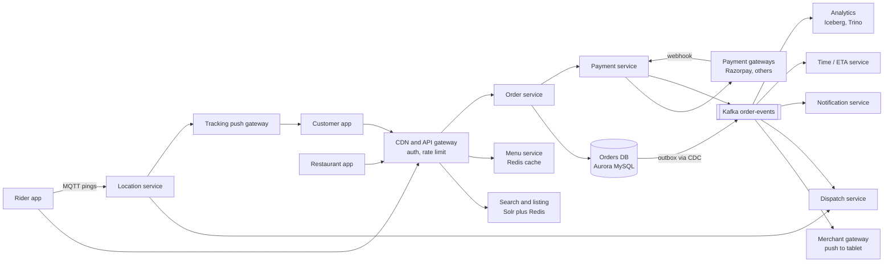

Read it left to right. Clients enter through one edge layer. The **synchronous path** is short: gateway, order service, orders DB, payment service. Everything that happens *because* an order changed (telling the restaurant, finding a rider, sending notifications, updating ETA, analytics) hangs off Kafka. That split is the single most important idea in this design: the customer waits only for the parts that must succeed before we can say "order placed".

> **Real world — Zomato:** Zomato's engineering blog calls Kafka "the backbone of our event-driven architecture". Its services are mostly Go on AWS ECS behind a Kuma (Envoy-based) service mesh. Aurora MySQL changes are captured by Debezium into Kafka and land in Iceberg tables for Trino and Druid. ([NYE 2023](https://www.zomato.com/blog/a-tale-of-scale-behind-the-scenes-at-zomato-tech-for-nye-2023), [data platform](https://aws.amazon.com/blogs/opensource/how-zomato-boosted-performance-25-and-cut-compute-cost-30-migrating-trino-and-druid-workloads-to-aws-graviton/))

### The main flow: placing and paying for an order

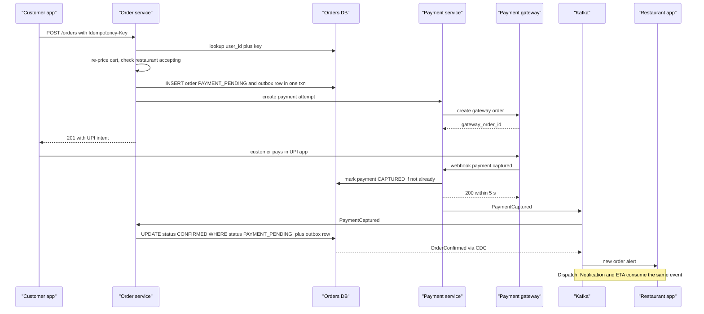

Walk through it like a story:
1. The app sends `POST /orders` with an idempotency key it generated once.
2. The order service checks whether it has seen `(user_id, key)` before. If yes, it returns the stored response. No second order.
3. It re-prices the cart from the menu service, checks the restaurant is still accepting and the address is serviceable, and applies any discount.
4. In **one database transaction** it inserts the order as `PAYMENT_PENDING` and an outbox row (`OrderCreated`). Either both exist or neither does.
5. It asks the payment service to create a payment attempt. The payment service writes the `payments` row *first* (Airbnb's "pre-RPC" phase), then calls the gateway, then records the gateway's reference.
6. The app gets a UPI intent and the customer pays in their UPI app.
7. The gateway calls our webhook. The payment service verifies the signature, updates the payment to `CAPTURED` only if it is not already captured, acks within 5 seconds, and publishes `PaymentCaptured`.
8. The order service consumes it and does a **conditional** move to `CONFIRMED`, writing another outbox row in the same transaction.
9. The CDC relay publishes `OrderConfirmed`. The restaurant tablet rings, dispatch starts planning a rider, the customer gets "order placed", and the ETA service starts its clock.

> **Real world — Zepto:** Zepto accepts an order as a *draft* before payment in a DynamoDB Draft-Order service, consumes payment events from Kafka (MSK), and on success calls an **idempotent** Create Order API. A sparse index holds only orders still awaiting payment, and a job runs every 5 minutes to confirm or terminate stuck ones. Create Order got about 60% faster on average. ([source](https://aws.amazon.com/blogs/database/how-zepto-scales-to-millions-of-orders-per-day-using-amazon-dynamodb/)) This is exactly the PAYMENT_PENDING plus sweeper pattern above.

### Deep dive 1: the order state machine

An order is a **state machine**: a fixed set of states and a fixed set of allowed moves between them. Writing it down protects you from impossible situations such as a rider marking "picked up" on an order the customer already cancelled.

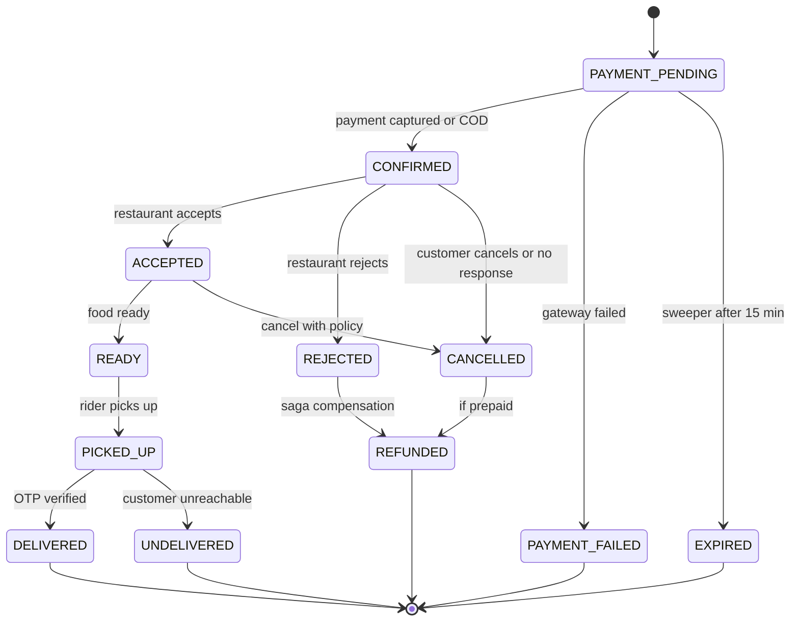

Rider assignment is tracked as a *separate* small state machine on the delivery (see Q3), not as an order status. That keeps a rider re-assignment from looking like the order going backwards.

**Enforce it in one place.** There is exactly one function that changes status, and it uses a conditional update:

```sql
UPDATE orders
SET status = 'ACCEPTED', version = version + 1, updated_at = NOW(3)
WHERE id = 9001 AND status = 'CONFIRMED' AND version = 3;
-- 1 row  -> we won, insert history row and outbox row in the same transaction
-- 0 rows -> illegal move or someone else moved it first, re-read and decide
```

This is called **optimistic concurrency**: we do not lock the row while thinking, we just make the write conditional on nothing having changed. It handles the classic race where a customer taps Cancel at the same second the restaurant taps Accept. Exactly one of them gets 1 row; the other gets 0 and the app shows "the restaurant has already started preparing; cancellation fee applies".

*Pause and think:* a duplicate `PaymentCaptured` event arrives an hour later, after the order is DELIVERED. What happens? The conditional update `WHERE status = 'PAYMENT_PENDING'` matches 0 rows, so nothing changes. The state machine is itself a dedupe mechanism.

### Deep dive 2: the outbox, or how not to lose an event

Here is the bug the outbox prevents. The order service commits the order to MySQL, then calls `kafka.publish(OrderConfirmed)`, and crashes between the two. The customer has paid, the order says CONFIRMED, and *no restaurant ever hears about it*. The reverse order (publish then commit) is worse: the restaurant cooks an order that does not exist. This is the **dual-write problem**: two systems, no shared transaction.

The **transactional outbox** fixes it. Write the business change and the event into the *same* database, in the *same* transaction. A separate relay reads the outbox and publishes to Kafka. If the service crashes after commit, the event is safe in the table and the relay publishes it later.

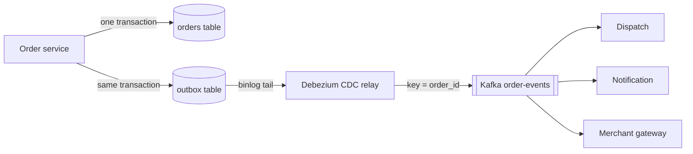

Two ways to run the relay:
- **Log tailing (CDC).** Debezium reads the MySQL binlog and publishes each new outbox row. Low latency, no polling load. A neat trick: insert and delete the outbox row in the same transaction; the binlog still has the insert, so the table never grows.
- **Polling publisher.** A job runs `SELECT ... FROM outbox WHERE published_at IS NULL ORDER BY created_at LIMIT 500`, publishes, then sets `published_at`. Simpler to build, adds some DB load and a second or so of delay.

Either way the relay can publish the same event twice (it publishes, crashes before marking it done, and publishes again on restart). So **every consumer must be idempotent**, usually by inserting the event id into `processed_events` in the same transaction as its own side effect, and skipping if the insert hits a duplicate key.

> **Real world — Debezium and microservices.io:** Dual writes to a database and Kafka "can't share one transaction, because Kafka doesn't support XA", so one can succeed while the other fails. The outbox's `aggregateid` becomes the Kafka key so all events for one order stay in order, and delivery is at-least-once, so consumers keep a processed-ID table. ([Debezium](https://debezium.io/blog/2019/02/19/reliable-microservices-data-exchange-with-the-outbox-pattern/), [microservices.io](https://microservices.io/patterns/data/transactional-outbox.html))

> **Real world — Kafka exactly-once:** Kafka's idempotent producer and transactions give exactly-once only for Kafka-to-Kafka processing. "Side effects in external systems (an RPC, or sending a push) still need idempotency." ([Confluent](https://www.confluent.io/blog/exactly-once-semantics-are-possible-heres-how-apache-kafka-does-it/)) If someone says "just turn on exactly-once", this is your answer.

Connect it to your own work: at Atlassian you built SQS consumers with idempotency and a DLQ. The same thinking applies; the outbox is the producer-side half of that story.

### Deep dive 3: the saga for payment and restaurant rejection

A **saga** is how you do a multi-step business transaction across services that cannot share one database transaction. Each step has a **compensating action** that undoes it in business terms. You do not roll back a payment; you refund it.

The food-order saga:

| Step | Action | Compensation if a later step fails |
|---|---|---|
| 1 | Create order PAYMENT_PENDING | Mark EXPIRED or PAYMENT_FAILED |
| 2 | Capture payment | Refund |
| 3 | Restaurant accepts | Cancel at restaurant (and possibly pay the restaurant for food already cooked) |
| 4 | Assign rider | Release rider, re-assign |
| 5 | Deliver | Terminal |

The case every interviewer asks: **payment succeeded, restaurant rejected.**

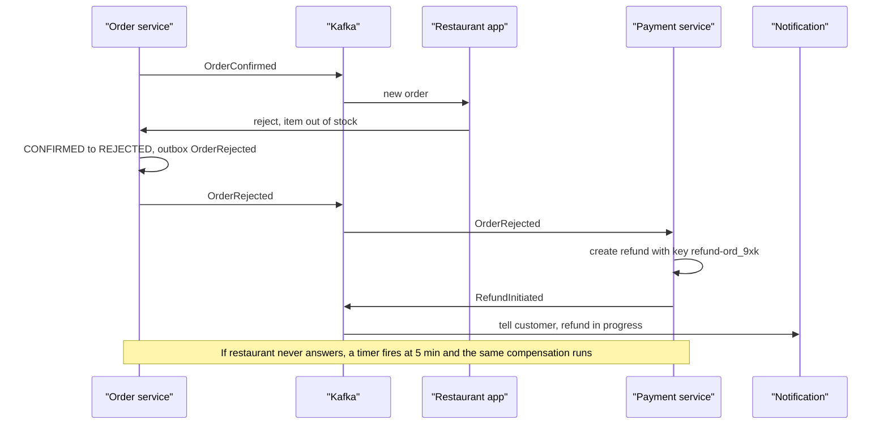

Two ways to run a saga:
- **Choreography.** Each service listens and reacts. Simple for 2-3 steps, but the flow is scattered and hard to see.
- **Orchestration.** One component (here, the order service, or a workflow engine) owns the flow and tells others what to do. Easier to reason about, retry and debug.

For orders, say **orchestration in the order service**: it already owns the state machine, so it is the natural owner of "what happens next".

The **restaurant-never-responds** case needs a durable timer. When an order becomes CONFIRMED, schedule "check at +5 minutes". Options: a delayed-message queue, a scheduled-jobs table that a sweeper scans (`WHERE fire_at < NOW() AND done = 0`), or a workflow engine with durable timers. If it fires and the order is still CONFIRMED, move to CANCELLED and refund. The conditional update makes it safe even if the restaurant accepts at the same instant.

> **Real world — Uber and DoorDash:** Uber's Cadence workflow engine provides durable timers and lets workers be killed and restarted without losing state; Uber Eats used it to coordinate the 8 standard steps of an order workflow. ([Uber](https://www.uber.com/blog/open-source-orchestration-tool-cadence-overview/)) DoorDash Drive ran into the hard part: "not all downstream calls were idempotent, and duplicate deliveries per order would be very bad", so they saved a context of completed steps and skipped them on retry. ([DoorDash](https://doordash.engineering/2020/08/14/workflows-cadence-event-driven-processing/))

**Refunds are idempotent too.** The refund key is derived from the order (`refund-<order_id>`), so a replayed OrderRejected event cannot refund twice.

### Deep dive 4: Kafka fan-out and partitioning

One `OrderConfirmed` event is read by five or six independent consumer groups: merchant gateway, dispatch, notification, ETA, analytics, fraud. A **consumer group** is a set of instances that share the work of one topic; each group gets its own copy of every message. Adding a new consumer means adding a group, with no change to the order service.

- **Key by `order_id`.** Kafka keeps order only within a partition, so all events for one order (Confirmed, Accepted, Ready, PickedUp) go to the same partition and are processed in sequence.
- **Partition count.** At 140 orders/s and maybe 8 events per order, that is about 1,100 events/s, which is tiny. Choose partitions for consumer parallelism instead: if the dispatch consumer can do 50 events/s per instance and you want 40 instances, you need at least 40 partitions (you can never have more active consumers in a group than partitions). Assume 64 to 128.
- **Slow consumers.** If notification falls behind, events wait in Kafka. That is the point of a log: a down consumer catches up on recovery and nothing upstream notices. Alert on **consumer lag** (how far behind the latest offset a group is).
- **Poison messages.** A message that always fails must not block its partition. Retry a few times, then move it to a retry topic with a delay, then to a dead-letter queue (DLQ), and commit the offset so the partition moves on.

> **Real world — Swiggy and Uber:** Swiggy's COD pipeline uses the order ID as the idempotency key for exactly-once effect, and sends a message to a retry queue after 3 retries. ([Swiggy](https://bytes.swiggy.com/curbing-cod-loss-with-technology-ecf554c759a3), search-snippet source) Uber's "Reliable Reprocessing" chains retry topics with increasing delays into a DLQ, committing the original offset so the partition isn't blocked. ([Uber](https://www.uber.com/blog/reliable-reprocessing/))

> **Real world — DoorDash:** DoorDash replaced Celery + RabbitMQ (900+ async task types) with Kafka after RabbitMQ went down at peak and HA failover took over 20 minutes and lost messages. ([DoorDash](https://doordash.engineering/2020/09/03/eliminating-task-processing-outages-with-kafka/))

### Deep dive 5: sharding the orders data

Be honest first: at 140 orders per second, **write throughput does not force sharding**. A single Aurora MySQL primary does thousands of write transactions per second. What grows is **data**: 750M orders a year, several billion status rows, and indexes that stop fitting in memory. And a single primary is a single blast radius.

So the plan has stages, and saying them in order impresses more than jumping to "shard by user_id":
1. **One primary plus read replicas.** Customer history and support tools read from replicas; the order write path and idempotency checks read from the primary (replica lag could make a retry look new).
2. **Hot/cold split.** Orders older than about 90 days move to an archive store (S3 plus a query engine, or a separate cheap DB). The live table stays small.
3. **Shard when you must.** Pick the key by the most common query.
   - **`user_id`**: "my orders" is one shard. But the restaurant dashboard ("all orders at restaurant 42 right now") becomes a scatter-gather across every shard.
   - **`restaurant_id`**: the reverse problem, and a hot shard for a popular chain kitchen on NYE.
   - **`order_id`**: spreads writes evenly, but "my orders" is scatter-gather.
   - **Common answer:** shard the source of truth by `user_id` (or embed a shard id inside a Snowflake-style `order_id` so the id alone routes), and build the restaurant's and rider's views as **separate read models** fed from Kafka. This is called CQRS (command query responsibility segregation): the write model and the read models are different tables shaped for different queries.
4. **Or city.** Orders are local. Sharding by city gives natural isolation (a Mumbai problem does not hurt Delhi), but Bengaluru is far bigger than Bhopal, so you would still split big cities.

> **Real world — Zepto and Deliveroo:** Zepto's Aurora PostgreSQL `Customer_Orders` table reached billions of rows; row locks on status updates caused write contention and autovacuum fell behind at peak, which drove the move of the draft-order path to DynamoDB. ([Zepto](https://aws.amazon.com/blogs/database/how-zepto-scales-to-millions-of-orders-per-day-using-amazon-dynamodb/)) Deliveroo moved its Dispatcher from Postgres to DynamoDB because some tables passed 1B rows, and fixed unbalanced sub-area partition keys with random-suffix write sharding. ([Deliveroo](https://aws.amazon.com/blogs/database/how-deliveroo-migrated-their-dispatcher-service-to-amazon-dynamodb/))

### Deep dive 6: NYE scale

Lunch and dinner are daily peaks. NYE, IPL finals and heavy rain are the rare ones. The interviewer wants to hear that you plan for them instead of trusting autoscaling.

- **Pre-scale.** Autoscaling reacts after load arrives, and booting capacity takes minutes. Scale up the day before.
- **Load-test above the peak with real traffic shape.** Record production requests and replay them amplified.
- **Kill switches and degraded modes.** Every non-critical feature (recommendations, ratings widgets, banners) has a switch. When things heat up, turn them off and give their capacity to checkout and tracking.
- **Load shedding by priority.** Place-order and payment webhooks first, browsing second, analytics last.
- **Demand throttling.** If riders or kitchens run out in an area, accepting more orders only creates late, cancelled orders. Temporarily shrink the delivery radius or mark restaurants busy.
- **Multiple providers.** Payment gateways, SMS and calling vendors all fail on big nights. Route around the failing one.

> **Real world — Zomato:** For NYE 2023, SRE ran 14,000 minutes of benchmarking across 100+ services peaking at 50M requests/min, pre-scaled the fleet, staffed war rooms, reviewed kill switches and degraded modes "so that lower-tier dependencies cannot take down critical services", and ran chaos tests that injected latency through the Kuma mesh and injected cache misses. ([source](https://www.zomato.com/blog/a-tale-of-scale-behind-the-scenes-at-zomato-tech-for-nye-2023)) On NYE 2021 Zomato throttled demand where riders or kitchen capacity ran out, switched to an alternate provider when the calling provider failed, and routed payments around gateway downtime. ([source](https://www.zomato.com/blog/our-learnings-from-nye/))

> **Real world — Stripe and Grab:** Stripe's fleet load shedder reserves capacity for critical methods (their example: 20% critical, 80% non-critical) and returns 503 to excess non-critical traffic. ([Stripe](https://stripe.com/blog/rate-limiters)) Grab's "Spampede" counts unallocated bookings per geohash bucket with Redis INCR and EXPIRE and rejects new bookings from a hotspot before any downstream calls. ([Grab](https://engineering.grab.com/preventing-app-performance-degradation-due-to-sudden-ride-demand-spikes))

### Failure cases (say these without being asked)

| What breaks | What the user would see without a fix | Fix |
|---|---|---|
| Double tap on Place Order, or network retry | Two orders, two charges | Idempotency key with `UNIQUE (user_id, key)`; return the stored response |
| Payment captured, our server crashed before recording it | Money taken, order stuck in PAYMENT_PENDING | Gateway retries the webhook (Razorpay: exponential backoff for 24 h); a reconciler polls the gateway for PENDING attempts every few minutes |
| Webhook arrives twice or out of order | Double processing, or FAILED overwriting CAPTURED | Dedupe on the gateway event id; status only moves forward (CAPTURED never goes back to PENDING) |
| Customer never completes payment | Ghost orders block nothing but clutter | Sweeper expires PAYMENT_PENDING after about 15 min; late capture triggers auto-refund |
| Order committed, crash before event published | Restaurant never told | Outbox plus CDC relay |
| Restaurant rejects or never responds | Paid order going nowhere | Saga: 5-minute timer, conditional cancel, idempotent refund |
| Cancel and Accept at the same second | Inconsistent state | Conditional update with `version`; one wins |
| Notification consumer down | No pushes | Events wait in Kafka; consumer catches up; alert on lag |
| Poison message | One partition stuck | Retry topic, then DLQ, commit offset |
| Menu service slow | Checkout hangs | Timeouts, circuit breaker, serve cached menu; re-price at checkout and return 422 if changed |
| No riders in area | Late orders, cancellations | Demand throttling, shrink radius, show higher ETA (see Q3) |
| Redis cache cluster loses a node | Stampede on DB | Request coalescing, TTL jitter, replicas; Zomato tests this with injected cache misses |
| Primary DB failover | 30-60 s of write errors | Clients retry with backoff and the same idempotency key; nothing duplicates |
| A gateway goes down on NYE | Payment failures | Route to a healthy gateway by recent success rate |

> **Real world — Razorpay:** Webhooks must be answered within 5 seconds, any non-2xx counts as failure, retries use exponential backoff for 24 hours, delivery is at-least-once (dedupe on `x-razorpay-event-id`), and **event order is not guaranteed**. The browser `callback_url` is not a substitute for webhooks. ([source](https://razorpay.com/docs/webhooks/best-practices/))

### Trade-offs to say out loud

- **Microservices vs monolith.** Separate services let search scale apart from orders and isolate failures, but turn function calls into network calls with timeouts, retries and sagas. Start modular; split when teams or scaling force it.
- **Sync vs async.** Only order creation and payment initiation are synchronous. Everything else is async because the customer does not need to wait for it, and a slow consumer must not slow checkout.
- **Strong vs eventual consistency.** Strong for order status and money; eventual for menus, search, ratings, analytics.
- **Orchestration vs choreography.** Orchestration for the order saga (one owner, easy to debug); choreography for side effects like analytics.
- **CDC relay vs polling relay.** CDC is faster and lighter on the DB but adds Debezium to operate; polling is simple but adds load.
- **SQL vs NoSQL for orders.** SQL for transactions, constraints and ad-hoc support queries. NoSQL (DynamoDB) becomes attractive when the table reaches billions of rows and access patterns are known, as Zepto and Deliveroo found.

### 60-second spoken summary

"I would split the system into a short synchronous path and a wide asynchronous one. The synchronous path is the API gateway, the order service, a relational orders database and the payment service. Placing an order is idempotent on a client key, re-prices the cart on the server, and creates the order as PAYMENT_PENDING together with an outbox row in one transaction. The gateway's webhook, deduped on its event id, moves the order to CONFIRMED through a conditional update, so the state machine itself rejects duplicates and races. A CDC relay publishes the outbox to Kafka keyed by order id, and the restaurant gateway, dispatch, notifications, ETA and analytics consume it independently with idempotent handlers. Failures are handled by a saga: restaurant rejection or a five-minute timeout triggers an idempotent refund, and a sweeper and reconciler clean up stuck payments. Reads dominate, about 9,600 requests per order at Zomato's NYE peak, so menus and listings sit behind Redis and a search index. For peaks like NYE I would pre-scale, load-test with replayed traffic, and keep kill switches so non-critical features can be turned off to protect checkout."

### Follow-ups they ask

**Q: Why asynchronous? What problem does it solve? What happens if the consumer is down? How do you handle duplicate events?** (Blinkit B2, near verbatim)

A: Async decouples the order service from everything that reacts to an order. Checkout latency no longer depends on the slowest downstream service, a dinner burst is buffered in Kafka instead of overloading notification or dispatch, and new consumers can be added without touching the order service. If a consumer is down, its events stay in Kafka at its last committed offset; when it comes back it resumes from there, and we alert on consumer lag in the meantime. Duplicates are expected because delivery is at-least-once, so each consumer records processed event ids (or uses an idempotent upsert keyed on order id plus event type) in the same transaction as its side effect, and skips anything it has seen.

**Q: If a Zomato order table is read for order and payment details, SQL or NoSQL and why? Can't SQL scale?** (Blinkit B10)

A: SQL for the source of truth: the order and its payment must change together, we need constraints like the unique idempotency key, and support needs ad-hoc queries. SQL can scale: read replicas for reads, caching for hot order status, archiving old orders, and sharding by user id when one primary is not enough. NoSQL is a good fit for specific read models where access patterns are fixed (for example "orders for restaurant X today" in DynamoDB), and Zomato itself moved billing to DynamoDB for 4x throughput at half the cost. I would not claim NoSQL is "better for reads" in general; it is better when you know the key you will read by.

**Q: Why Kafka and not direct API calls from the order service?** (Blinkit B1, Zomato Z4)

A: With direct calls, the order service must know every downstream service, wait for each one, and handle each one being down. One slow notification vendor would slow checkout. Kafka gives buffering, replay (a bug in the ETA consumer can be fixed and the events reprocessed), per-order ordering via the key, and independent scaling. Direct calls are still right when the caller needs the answer to continue, such as asking the payment service for a payment intent.

**Q: Kafka vs SQS (or SNS + SQS) for this?** (Z4, Z15)

A: Kafka is a replayable log with ordering per partition and many independent consumer groups reading the same data, which fits one order event feeding five services and analytics. SQS is a queue: a message is consumed and deleted, ordering needs FIFO queues with lower throughput, and fan-out needs SNS in front. SQS is simpler to operate and great for a single worker pool (as at Atlassian). For order events with replay and fan-out, Kafka; for a simple job queue, SQS is fine.

**Q: The payment succeeded but the customer's app shows failure. What do you do?**

A: The app's view is not the source of truth; the webhook and the gateway's status API are. The app polls `GET /orders/{id}` after returning from the UPI app. If the webhook arrives late, the order still becomes CONFIRMED and the app updates. If the order had already expired by then, the late capture triggers an automatic refund. A reconciler compares our PENDING attempts with the gateway's records every few minutes so nothing stays ambiguous for long.

**Q: Write SQL for the top 5 delivery partners in an area by count of a given order type.** (Z2)

A: Assuming `deliveries(order_id, rider_id, delivered_at)`, `orders(id, order_type, ...)` and `riders(id, zone_id)`:
```sql
SELECT d.rider_id, COUNT(*) AS cnt
FROM deliveries d
JOIN orders o ON o.id = d.order_id
JOIN riders r ON r.id = d.rider_id
WHERE r.zone_id = 17 AND o.order_type = 'GOURMET'
  AND d.delivered_at >= NOW() - INTERVAL 30 DAY
GROUP BY d.rider_id
ORDER BY cnt DESC
LIMIT 5;
```
Indexes: `riders(zone_id)`, `deliveries(rider_id, delivered_at)`, and `orders(id)` is the primary key. At scale this is an analytics query and should run on a replica or the warehouse, not the primary.

**Q: How does the restaurant tablet hear about a new order instantly, even on bad Wi-Fi?**

A: A persistent connection (MQTT or WebSocket) from the tablet to a merchant gateway that consumes OrderConfirmed from Kafka, plus a push notification as backup, plus a loud repeating alarm in the app until someone acknowledges. If the restaurant does not acknowledge within a minute or two, an automated call or an ops alert; if it does not accept in about five, the saga cancels and refunds. The tablet also fetches pending orders on reconnect so a missed push is recovered.

**Q: How do you handle COD?**

A: COD skips the payment step: the order goes from creation straight to CONFIRMED. Risk controls limit COD for new or high-cancellation users and for large carts. Cash collected is recorded against the rider and reconciled at settlement. Everything else (state machine, outbox, saga) is unchanged, except that the compensation for rejection is just cancellation, with no refund.

**Q: What would you change if this were Blinkit instead of Zomato?**

A: Inventory becomes the hard part: stock is per item per dark store, so placing an order must reserve stock atomically (`UPDATE stock SET reserved = reserved + n WHERE sku = ? AND store = ? AND available - reserved >= n`) and release it on payment failure or timeout. The delivery window is about 10 minutes, so dispatch, picking and packing are tightly coupled and nearly real time, and search must only show items in stock at the customer's store.

---

## Q2. Live order tracking (rider location to customer)

### Why they ask it, and how often

Blinkit asked "Design a Food Delivery Order Tracking System" on draw.io for SDE-1 in Sep 2026 (B2), and it is the natural follow-up inside Q1. It tests whether you can tell a **high-rate, loss-tolerant** data stream (GPS pings) from **low-rate, must-not-lose** events (status changes), and whether you know why polling breaks at scale.

### Clarifying questions

- "Who watches? Only the customer, or also the restaurant and support?" (Customer and restaurant.)
- "How fresh must the dot be?" (Assume under 2-3 seconds behind reality.)
- "Do we need the full route history?" (Yes, for disputes, payouts and ETA training, but not in real time.)
- "Is losing an occasional ping acceptable?" (Yes. Losing a status change is not.)

### Requirements

**Functional:** riders send location while on duty; the customer sees the rider moving on a map plus status changes (assigned, at restaurant, picked up, arriving); history is stored.
**Non-functional:** about 2 s end-to-end freshness; huge write rate; works on flaky 4G and when the app is backgrounded; battery friendly; status events delivered at least once.

### Estimates (assumptions labelled)

| Quantity | Working | Result |
|---|---|---|
| Riders online at peak (assumption) | Zomato had 400k monthly active partners in FY24; NYE 2025 used 4.5 lakh across Zomato and Blinkit | assume **3 lakh online** |
| Ping rate | one every 4 s (Uber's historical figure) | **75,000 pings/s** |
| Ping size | rider id, lat, lng, ts, accuracy, speed, about 100 B | about **7.5 MB/s** inbound |
| Watchers | about 1-2 per active order (customer, restaurant) | fan-out roughly equal to inbound |
| History | 75k/s × 100 B × 4 peak hours | about **100 GB/day** raw, less after downsampling |

### APIs

```
Rider app -> MQTT publish  topic: rider/{rider_id}/loc   payload: {pings:[{lat,lng,ts,acc,spd}]}  (QoS 0)
Rider app -> MQTT publish  topic: rider/{rider_id}/event payload: {delivery_id, type:"PICKED_UP", ts}  (QoS 1)
Customer  -> GET  /v1/orders/{id}/tracking  -> {status, rider:{lat,lng,ts}, eta_min, seq}   (snapshot on open)
Customer  -> subscribe  track/order/{order_id}   (MQTT, or SSE /v1/orders/{id}/stream?from_seq=)
```

The snapshot GET matters: on every open or reconnect the app first draws the current state, then streams changes.

### Data model

```sql
-- Hot, in memory (Redis or the location service), not SQL:
--   rider:{id}:loc  -> {lat,lng,ts,order_id}    TTL 60 s
--   order:{id}:watchers -> set of gateway node ids
CREATE TABLE rider_location_history (      -- columnar / time-series store, fed from Kafka
  rider_id    BIGINT,
  delivery_id BIGINT,
  ts          DATETIME(3),
  lat         DECIMAL(9,6),
  lng         DECIMAL(9,6),
  accuracy_m  SMALLINT,
  PRIMARY KEY (rider_id, ts)
) /* partitioned by day, kept about 90 days */;
```

### Architecture

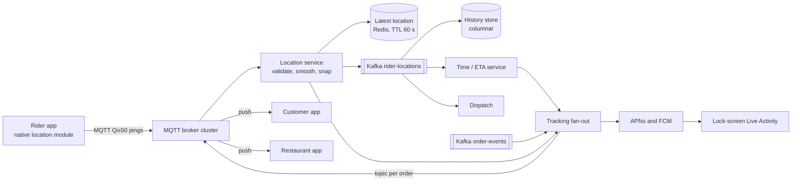

The key idea: **keep only the latest position hot**. Overwriting one key per rider is cheap. The full history goes to Kafka and then to a cheap store, off the critical path.

> **Real world — Zomato:** Zomato started with periodic HTTP polling. It stopped scaling because "TLS and header overhead often outweighed the tiny payloads", and rider markers jumped instead of moving smoothly. Zomato moved to **MQTT** (publish/subscribe over persistent connections) for live location and delivery lifecycle events, which feed tracking, ETA, notifications and the merchant view. Its open-source Android library Pulse-MQTT handles auto-reconnect, re-subscribe and exponential retry. ([source](https://www.eternal.com/blog/pulse/)) MQTT was load-tested at 10x expected NYE 2021 load. ([source](https://www.zomato.com/blog/our-learnings-from-nye/))

> **Caveat — not public:** Zomato has not published how pings are stored server-side (Redis GEO, geohash or otherwise). Third-party claims of "Redis plus WebSockets" are unverified. Say "here is how it is typically done" for the storage part.

### Main flow

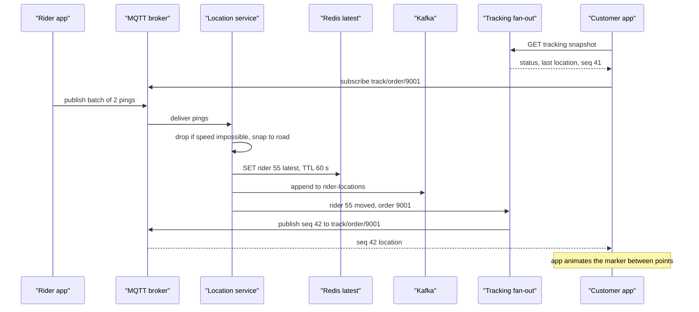

### Deep dives

**1. Why push, and which protocol.** Polling every 4 s with a few million watchers is millions of mostly-empty requests a minute, each paying TLS and headers. Push sends only real changes.
- **MQTT**: tiny headers, built for mobile, QoS levels (0 = fire and forget for pings, 1 = at least once for status), persistent sessions. Zomato's choice.
- **WebSocket**: two-way, general purpose; you build topics and acks yourself.
- **SSE** (server-sent events): one-way server to client over plain HTTP; enough for a customer who only receives.
- **gRPC streams**: what Uber moved to.

> **Real world — Uber RAMEN:** At one point **80% of Uber's API-gateway requests were polling**. Its push platform started on SSE and moved to gRPC streams. Messages carry **sequence numbers**; on reconnect the client sends the highest one it saw and the server replays the rest. A 4 s heartbeat, reconnect after 7 s of silence, 3 priority levels, TTLs from seconds to 30 minutes, at-least-once delivery. Scale: **1.5M+ concurrent connections, 250k+ messages/s, 99.99% server-side reliability**. ([source](https://www.uber.com/blog/real-time-push-platform/))

**2. Routing a message to the right connection.** A customer is connected to one of many broker or gateway nodes. With MQTT the broker cluster solves this: the customer subscribes to `track/order/9001`, and the fan-out service just publishes there. With your own WebSocket gateways, keep a "which node holds which order's watchers" map (or use Redis pub/sub channels per order) so the fan-out publishes to the right node.

**3. Cleaning GPS.** Phone GPS is noisy. Zomato notes device accuracy of 60-150 m on mid to high-end phones, and up to 2-3 km off at times ([source](https://www.zomato.com/blog/to-help-us-locate-you-better/)). Drop points that imply impossible speed, prefer points with good accuracy, and snap to the road network (map matching). Lyft uses a marginalized particle filter for this ([source](https://eng.lyft.com/a-new-real-time-map-matching-algorithm-at-lyft-da593ab7b006), search-snippet source).

**4. Battery and bad networks.** Batch 2-3 pings per publish, ping faster when moving and near the customer, slower while waiting at the restaurant, and buffer offline and flush on reconnect. Swiggy's partner app runs location in native modules and uses a finite state machine per delivery flow, with sessions of 4-5 hours in the background ([source](https://bytes.swiggy.com/architecture-and-design-principles-behind-the-swiggys-delivery-partners-app-4db1d87a048a), search-snippet source).

**5. Lock screen.** Status can also go to an iOS Live Activity through APNs, even with the app closed.

> **Real world — Zomato iOS:** The iOS app uses **PushToStartToken** (iOS 17.2+) so the server can start a lock-screen Live Activity over APNs even when the app is terminated. ([source](https://www.eternal.com/blog/live-activities-push-to-start-dynamic-images))

> **Real world — Uber and Grab:** Uber drivers historically sent a location update **every 4 seconds**, and the geospatial index was designed for about a million writes per second (2015 figures). ([source](http://highscalability.com/blog/2015/9/14/how-uber-scales-their-real-time-market-platform.html)) Grab's Pharos keeps driver locations in memory, expects updates around once per second, partitions by city and vehicle type with 2 replicas, and "favors high throughput over strong consistency"; failed replica updates are not retried. ([source](https://engineering.grab.com/pharos-searching-nearby-drivers-on-road-network-at-scale))

### Connection lifecycle (client side)

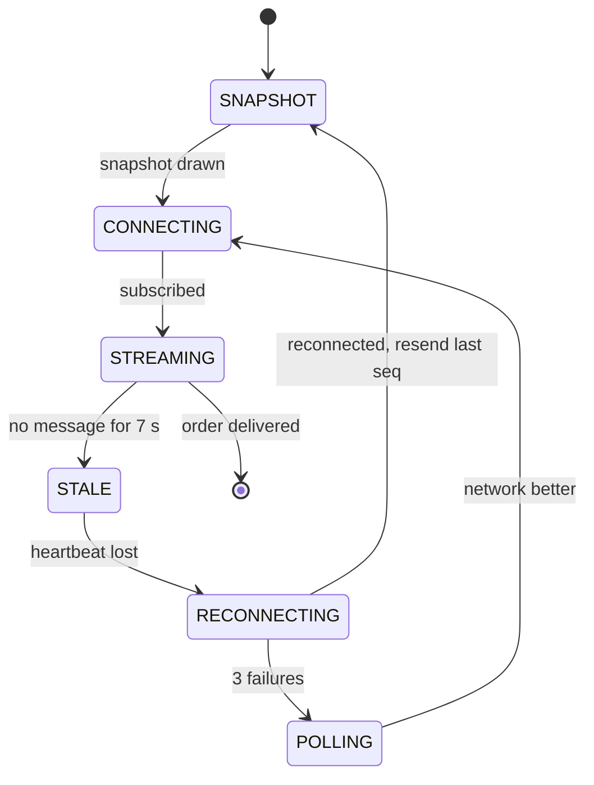

### Failure cases

| Failure | Effect | Handling |
|---|---|---|
| Rider loses network | Dot freezes | Show "last updated 40 s ago"; app buffers pings and flushes later; ETA service uses last speed |
| Broker node dies | Clients disconnected | Clients reconnect to another node, re-subscribe, fetch snapshot; Pulse-style auto re-subscribe |
| Redis latest-location node dies | A few seconds of missing dots | Replica promotes; next ping repopulates in 4 s. Acceptable because location is loss-tolerant |
| Kafka slow | History and ETA lag | Live dot unaffected because fan-out does not wait on Kafka |
| Status event lost | Customer stuck on "preparing" | Status uses QoS 1 plus sequence numbers; snapshot on reconnect closes gaps |
| Out-of-order pings | Marker jumps back | Drop any ping older than the stored ts |
| GPS spoofing | Fake "arrived" | Speed checks, OTP at handover, server-side geofence on PICKED_UP and DELIVERED |

### Trade-offs

- **Freshness vs cost and battery**: 4 s pings are a middle ground; adapt per state.
- **Availability over consistency** for location (AP); the opposite for status.
- **Managed broker vs own gateways**: MQTT brokers give topics and QoS for free; own WebSocket gateways give control.

### 60-second spoken summary

"Tracking has two streams with different rules. GPS pings are high rate and loss tolerant: about 75,000 a second if 3 lakh riders ping every 4 seconds. They come over MQTT, are validated and snapped to the road, the latest position per rider is overwritten in Redis with a short TTL, and the full stream goes to Kafka for history, ETA and dispatch. Status events are low rate and must not be lost, so they use at-least-once delivery with sequence numbers. Customers never poll: on opening the screen they fetch a snapshot, subscribe to a topic for their order, and get pushed updates, and on reconnect they resend the last sequence they saw. Zomato moved from HTTP polling to MQTT exactly because per-request overhead dominated tiny payloads and markers jumped. The app animates between points, shows 'last updated' when stale, and falls back to polling only if push fails."

### Follow-ups they ask

**Q: Why not just poll `GET /orders/{id}` every few seconds?**
A: Each poll pays a TLS and header cost bigger than the payload, most polls return nothing new, and millions of watchers turn into millions of requests a minute. Uber found 80% of gateway traffic was polling. Push sends only real updates. Keep polling as a fallback only.

**Q: WebSocket, SSE or MQTT?**
A: The customer only receives, so SSE is enough on the web. On mobile, MQTT is built for it: small headers, QoS levels, persistent sessions, good client libraries. WebSocket if you need two-way messages like chat. Zomato chose MQTT.

**Q: Where do you store the latest location and why not MySQL?**
A: In memory (Redis or the location service) because it is overwritten every 4 seconds and only the latest value matters; 75k updates a second would crush a relational DB for no benefit. Zomato hasn't published its choice; Redis with a TTL is the common one, and Redis GEO additionally lets dispatch query riders by radius.

**Q: How many connections can one gateway or broker node hold?**
A: Tens of thousands to a few hundred thousand idle connections per node with an async server, limited by memory and file descriptors. Scale horizontally; Uber's push platform held over 1.5M concurrent connections in total.

**Q: The customer opens the app after 10 minutes in the background. What happens?**
A: The app fetches the snapshot (status, last location, ETA, sequence number), draws it, then subscribes from that sequence. No replay of 150 stale pings; only the latest location matters, while missed status events are covered by the snapshot.

**Q: How would you store history cheaply?**
A: Kafka into a columnar or time-series store, partitioned by day, downsampled to one point every 15-30 s after a few days, and deleted after about 90 days unless tied to a dispute.

---

## Q3. Rider assignment (dispatch) and order batching

### Why they ask it, and how often

Swiggy asked SDE-1s to "assign drivers to orders" with VIP orders and ratings, and to write code and dry-run it (S2). Zepto asked about "concurrency at the driver's end" (P5) and Blinkit about rider onboarding (B4). At Zomato it usually comes inside Q1 as "how do you pick the rider?". The trap is answering "nearest rider" and stopping.

### Clarifying questions

- "Optimise for what: delivery time, rider cost, fairness to riders?" (All three, weighted.)
- "May one rider carry two orders?" (Yes, batching is in scope.)
- "Do riders accept or decline offers?" (Yes, with a timeout.)
- "How fast must assignment happen?" (Within seconds, but ideally *timed* so the rider arrives when food is ready.)

### Requirements

**Functional:** pick a rider for each confirmed order; batch compatible orders; offer to the rider and handle accept, decline and timeout; re-assign if a rider goes dark.
**Non-functional:** one rider never gets two conflicting orders by accident; decisions within seconds; per-city isolation; works at NYE peak.

### Estimates (assumptions)

At 140 orders/s nationally, a big city might see 20-30 new orders/s at peak, with a few thousand free riders. If dispatch runs every 10-30 seconds per zone, each run matches a few hundred orders against a few hundred riders. The cost of building the order-by-rider matrix (each cell needs an ETA) is the expensive part, not the matching.

### Simple explanation of the algorithms

Think of a table: rows are orders, columns are riders, each cell is "how bad is this pairing" (minutes the customer waits plus minutes the rider wastes).

- **Greedy:** take orders one at a time and give each the cheapest free rider. Fast, but an early order can grab the rider who was perfect for a later one.
- **Global matching (Hungarian / Kuhn-Munkres):** look at the whole table and pick one rider per order so the *total* cost is lowest. Classic bipartite matching, roughly O(n³).
- **MIP / ILP (mixed-integer / integer linear programming):** describe the problem as "variables are 0 or 1 (does rider r take order o), minimise total cost, subject to rules (each order once, each rider at most k orders, no promise broken)" and let a solver find the best answer. This handles batching, which 1:1 matching cannot.
- **Reinforcement learning for repositioning:** not matching, but telling idle riders where to wait for future demand.

> **Real world — Uber Eats:** Dispatch "launched with a greedy matching algorithm" and later moved to global matching. In the article's example, greedy gave 6 minutes of total travel and global gave 4. Global matching "couldn't live without accurate time predictions". ([source](https://www.infoq.com/articles/uber-eats-time-predictions))

> **Real world — DoorDash:** The first dispatcher solved one-delivery-at-a-time bipartite matching with the Hungarian algorithm; it was too slow for large instances and could not do multi-order routes. DoorDash reformulated it as a **MIP** solved with Gurobi ("up to 10 times faster" than Hungarian), run per region multiple times a minute. They shadow-ran new against old: results matched over 99% of the time, and every mismatch was a tie. ([source](https://doordash.engineering/2020/02/28/next-generation-optimization-for-dasher-dispatch-at-doordash/)) **DeepRed** has three layers: candidate generation, ML predictions (prep time, travel, parking, Dasher acceptance probability), and MIP optimisation that batches and can delay dispatch so the Dasher doesn't wait. ([source](https://doordash.engineering/2021/08/17/using-ml-and-optimization-to-solve-doordashs-dispatch-problem/))

> **Real world — Swiggy:** Assignment is an **integer linear program** over all active batches and delivery partners in a city, run at short regular intervals (micro-batch, not per order). City-wide runs were slow, so Swiggy split cities into **logistic zones** of restaurant clusters. It uses **just-in-time assignment** (rider arrives as food is ready) and **next-order assignment** (consider riders about to finish). ML scores every order-by-rider edge; a batch prediction API cut P99 from 144 ms to 71 ms for a batch of 30. ([part 2](https://bytes.swiggy.com/the-swiggy-delivery-challenge-part-two-f095930816e3), [zones](https://bytes.swiggy.com/logistic-zones-for-assignment-48d9ce06c4a8), [latency](https://bytes.swiggy.com/2x-improvement-in-latency-in-swiggy-data-science-platform-6101b7607530); search-snippet sources)

> **Real world — Grab:** Matching is minimum-weight bipartite matching with **Kuhn-Munkres**, batched over a window and recomputed every few seconds. The **cost matrix (Dijkstra on a 400k-node road graph) dominates runtime** below about 1,500 bookings. "Incremental KM" computes only the costs it needs, because the best match is usually among the nearest, cutting runtime by over 10x with the same optimum. ([source](https://engineering.grab.com/using-real-world-patterns-to-improve-matching)) Grab "doesn't always assign the nearest driver"; it weighs 40+ factors. ([source](https://www.grab.com/inside-grab/stories/matching-driver-partners-and-riders-allocation/))

> **Real world — Zomato:** Zomato has **not published its assignment algorithm**. What it has published: **Active Dispatch**, a Deep Q-Network multi-agent reinforcement learning model that recommends where idle partners should move based on predicted demand and supply (partners who followed it got more orders and shorter idle gaps) ([source](https://www.zomato.com/blog/elements-of-scalable-machine-learning/)); a fast ETA that raised assignment compliance by 4% ([source](https://www.zomato.com/blog/the-accurate-eta-to-customer-satisfaction-part-two/)); experiments with POI-based order clubbing ([source](https://www.zomato.com/blog/to-help-us-locate-you-better/)); and demand throttling at NYE. Say "Zomato's exact method isn't public; here is how the industry does it."

### Architecture

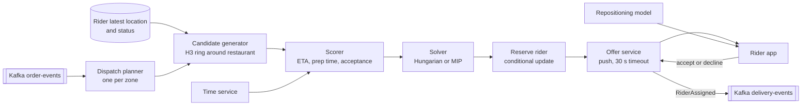

### Main flow

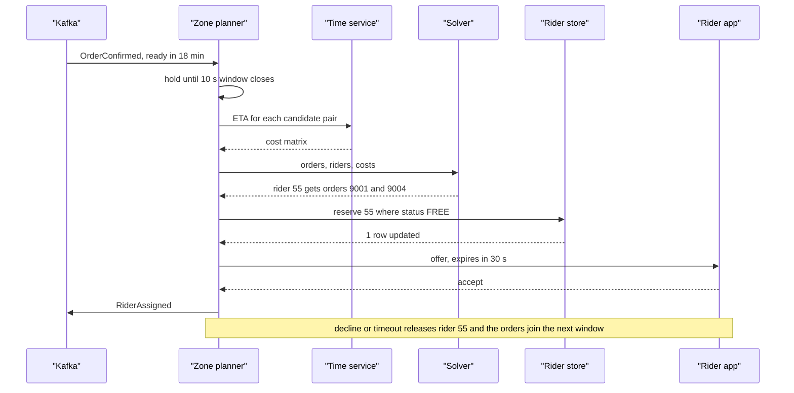

### Rider and offer lifecycle

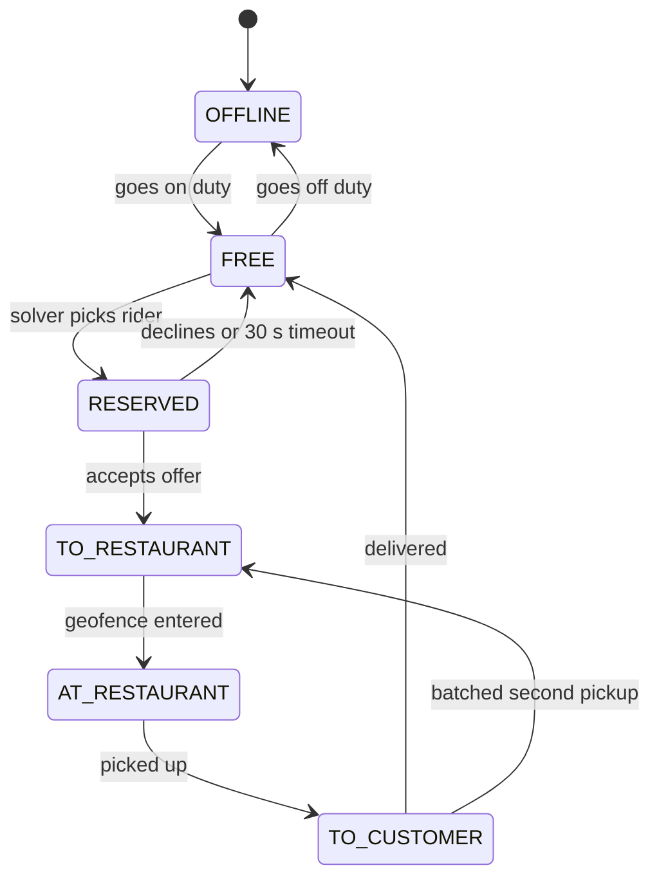

### Deep dives

**Candidate generation.** Never score every rider in the city. Take the restaurant's H3 cell and a ring of neighbours (Q4 explains H3), keep riders that are FREE or about to finish, cap at about 20-30. That keeps the cost matrix small.

**Cost function.** For each order-rider pair: rider's ETA to restaurant versus food-ready time (arriving early wastes rider time, arriving late makes food cold), last-mile ETA, acceptance probability, fairness (riders idle longest), vehicle fit. Example: `cost = customer_wait + 0.5 × rider_idle + penalty_if_late`.

**Batching.** Add candidate *pairs* of orders: same restaurant, or nearby restaurants with customers in the same direction. Score a batch with a penalty for the extra delay to the first customer, cap at 2-3 orders, and only allow it if no promised time breaks. Batching is more valuable at peak when riders are scarce.

> **Real world — batching:** Swiggy says batching "could double the capacity of the entire delivery fleet" and that optimal batching is NP-hard; a wider wait window gives more batching chances but makes the first order wait. ([source](https://bytes.swiggy.com/the-swiggy-delivery-challenge-part-one-6a2abb4f82f6), search-snippet source) Uber Eats "triple batching" lets one courier carry up to 3 orders from 1 or 2 restaurants. ([source](https://www.uber.com/en-AU/blog/triple-batching-for-restaurants)) DoorDash adds a variance penalty that grows with route complexity because errors cascade across batched legs.

**Concurrency: never double-assign.** Each zone has one planner (partitioning by zone gives a single writer), and reserving still uses a conditional update: `UPDATE riders SET state='RESERVED', offer_id=? WHERE id=55 AND state='FREE'`. One row means reserved; zero means someone else got there.

**Do not broadcast.** Offer each order to one rider at a time.

> **Real world — Gojek:** In Gojek's old broadcast model every nearby driver saw every order, causing "fastest phone wins" races, no accountability and high concurrency load. It switched to 1:1 allocation. ([source](https://blog.gojek.io/how-gojek-manages-1-million-drivers-with-12-engineers-part-2-2/))

### Failure cases

| Failure | Handling |
|---|---|
| Rider declines or ignores offer | 30 s timeout, release, order joins next window; track decline rate |
| Planner crashes mid-run | Reservations carry an expiry; a sweeper frees RESERVED riders with no accepted offer; a standby planner takes the zone lease |
| Duplicate OrderConfirmed | Idempotent: skip if an active delivery exists for the order |
| Rider accepts then goes dark | No movement towards restaurant in N minutes, re-assign and notify customer |
| No riders in range | Widen ring, add incentive, raise displayed ETA, throttle demand in that zone |
| ETA service down | Fall back to haversine distance times average speed for that city and hour |
| Zone boundary | Riders near the edge appear in both zones' candidate sets but can be reserved only once thanks to the conditional update |

### Trade-offs

- **Wait window**: longer gives better matches and more batching, shorter gives faster assignment.
- **Zone size**: bigger zones give better optima, but cost more compute (DoorDash's faster solver let them solve larger regions).
- **Optimal vs simple**: Hungarian for 1:1, MIP when batching; greedy is a fine v1 and fallback.
- **Rolling out a new matcher**: shadow-compare against the old one, then switchback experiments by region and time window (DoorDash).

### 60-second spoken summary

"I would not assign each order greedily to the nearest rider. Each zone has a planner that collects confirmed orders for a short window, say 10 seconds, generates candidate riders from an H3 ring around each restaurant, and builds a cost matrix using the ETA service: rider time to the restaurant against food-ready time, last-mile time, acceptance probability and fairness. A solver picks the lowest total cost: Hungarian for one-to-one, or an integer program when batching two or three orders per rider. The chosen rider is reserved with a conditional update so no rider is double-booked, offered the order with a 30-second timeout, and on decline the order rejoins the next window. This matches what Swiggy and DoorDash have published: micro-batched integer programs per zone, just-in-time arrival, and ML predictions feeding the cost. Zomato's own algorithm isn't public, but it has published repositioning of idle riders with reinforcement learning, which complements matching."

### Follow-ups they ask

**Q: Nearest rider by straight line, good enough?**
A: No. A river, a flyover or a one-way street can make a rider who is 500 m away 15 minutes away. Use road travel time from the ETA service for the shortlisted candidates. Grab replaced haversine search with road-network search for this reason.

**Q: Code it: VIP orders first, then by rider rating.** (Swiggy S2)
A: Keep a priority queue of pending orders ordered by (is_vip desc, created_at asc), and per zone a max-heap of free riders by rating (or a sorted structure that supports removal). Pop the top order, pick the best eligible rider by cost, reserve, offer; on decline push the order back. Complexity O(log n) per operation. Mention the production version is the batch solver above.

**Q: How is this a DSA problem?**
A: K-nearest neighbours for candidates (grid cells, heaps), and minimum-cost bipartite matching for the assignment (Hungarian, O(n³)). With batching it becomes an NP-hard routing problem, handled with integer programming or heuristics.

**Q: Two planners pick the same rider at once?**
A: The reserve step is a conditional update on the rider's state (or a Redis `SET NX` with a short TTL). Only one succeeds; the loser takes its next-best rider.

**Q: How do you avoid riders waiting at the restaurant?**
A: Delay dispatch. If the food is ready in 18 minutes and the best rider is 6 minutes away, assign around minute 10-12. Swiggy calls this just-in-time assignment; DeepRed's optimiser decides whether to delay.

**Q: What does Zomato use at peak when riders run out?**
A: Published levers are Active Dispatch (moving idle riders towards predicted demand) and demand throttling where partners or kitchen capacity run out (NYE 2021).

---

## Q4. Nearby restaurants, serviceability and search

### Why they ask it, and how often

The Nugget interviewer (Z5) asked for **"nearby restaurants in SQL"**: the candidate gave a bounding box, and the interviewer "pushed for geo-indexing / PostGIS and was not satisfied". A Zomato SDE-2 round (Z17) wanted an inverted index for "products with the highest matching frequency". Every food-delivery HLD reaches this: the home page is the highest-traffic screen in the app.

### Clarifying questions

- "'Nearby' or 'delivers to me'?" (Delivers to me. That is **serviceability**, and it is not the same as distance.)
- "Text search for dishes and restaurants, with typos and Hinglish?" (Yes.)
- "Filters: veg, rating, cuisine, offers, open now?" (Yes.)
- "Personalised ranking?" (Yes, but simple first.)

### Requirements

**Functional:** list serviceable restaurants for a location, ranked, paginated; text search with typo tolerance; filters; hide closed or busy restaurants quickly.
**Non-functional:** p99 around 100-200 ms; very read-heavy; results may be a few seconds stale except for open/closed status.

### Estimates

> **Real world — Zomato:** Search handles **100M+ queries a day**, and "Solr-Lucene is the base of all search functions". ([source](https://www.zomato.com/blog/explained-how-zomato-handles-100-million-daily-search-queries-p1/))

100M/day ÷ 86,400 ≈ 1,160 queries/s average, assume 4-5x at dinner, so about **5,000 queries/s** for search alone, plus the home listing. Index size is small: 247k active restaurants and about 3.5M distinct dishes fit comfortably in memory on a handful of nodes.

> **Real world — Swiggy:** About 100K app visits per minute at peak, times about 2,000 nearby pickup locations per customer, gives about **200 million serviceability evaluations per minute**, with a P99 target under 200 ms. ([source](https://bytes.swiggy.com/designing-the-serviceability-platform-at-swiggy-for-high-scale-part-1-751a631f0379), search-snippet source)

That number explains the design: you cannot call a routing engine 200M times a minute. Precompute and cache.

### The SQL trap, answered properly

A **bounding box** (`WHERE lat BETWEEN a AND b AND lng BETWEEN c AND d`) is a start, but a B-tree index can use only one range column well, so it scans a whole latitude strip. And a box is still a straight-line idea. Three better answers, in increasing order of quality:

1. **Geo cell column.** Store each restaurant's geohash or H3 cell id, index it, and query the user's cell plus neighbours:
```sql
SELECT id, name, lat, lng
FROM restaurants
WHERE city_id = 4 AND h3_res9 IN (/* user cell + ring of neighbours, computed in app */)
  AND is_accepting = TRUE;
-- then compute exact distance in code, sort, cut at radius
```
2. **A spatial index.** PostGIS (`geography` column, GiST index, `ST_DWithin(location, user_point, 5000)`) or MySQL spatial indexes (R-trees). This is what Z5's interviewer wanted to hear named.
3. **Serviceability, not distance.** Each restaurant has a delivery area (a polygon, or a set of cells). Precompute **cell → list of serviceable restaurants**, and at request time just look up the user's cell.

**What is a geohash, H3, S2?** All three cut the map into cells with ids, so "near" becomes "same or adjacent cell id", which an index can find quickly.
- **Geohash**: rectangles named by a string; longer string, smaller cell; each cell has 32 children. Weakness: two points across a cell border can have very different prefixes.
- **H3** (Uber): hexagons, 16 resolutions, each about 1/7 the area of its parent; every neighbour is the same distance away; `kRing(k)` returns the neighbours.
- **S2** (Google): squares on a cube projected onto the earth, numbered along a Hilbert curve.

> **Real world — H3 and Grab:** H3 resolution 9 cells average 0.105 km² (about 200 m edge), resolution 8 about 0.74 km², resolution 7 about 5.2 km². ([H3 docs](https://h3geo.org/docs/core-library/restable/), [Uber](https://www.uber.com/blog/h3/)) Grab uses geohash and notes that buildings across a street can fall in different geohashes. ([Grab](https://www.grab.com/inside-grab/stories/grab-geohashing-location-grid/))

> **Real world — Blinkit:** Grofers' (now Blinkit) "Iris" merchant discovery uses **S2**. Merchants map to their cell plus neighbours, and a cache keyed by cell id holds the visible merchants, precomputed from seed data: "No computation happens in real time." ([source](https://lambda.blinkit.com/iris-359b5dfd589b), search-snippet source)

> **Real world — Swiggy:** Serviceable means near by **road distance and travel time**, not radial distance, *and* enough delivery capacity around the restaurant. Distances are cached keyed by geohash (level 8 gave the best trade-off); on a miss it falls back to real-time A* on OpenStreetMap, then to haversine. ([source](https://bytes.swiggy.com/designing-the-serviceability-platform-at-swiggy-for-high-scale-part-1-751a631f0379), search-snippet source)

### APIs and data

```
GET /v1/feed?lat=&lng=&filters=veg,rating4&cursor=      -> ranked serviceable restaurants
GET /v1/search?q=paneer%20tikka&lat=&lng=&cursor=       -> restaurants and dishes
GET /v1/suggest?q=bir&lat=&lng=                         -> autocomplete, under 50 ms
```

```sql
CREATE TABLE serviceability (               -- precomputed, rebuilt on zone or capacity change
  city_id       INT,
  h3_res8       BIGINT,
  restaurant_id BIGINT,
  road_eta_min  SMALLINT,
  PRIMARY KEY (city_id, h3_res8, restaurant_id)
);
-- Search document (Solr), one per restaurant:
-- {id, name, cuisines[], dish_names[], rating, cost_for_two, is_veg_only,
--  popularity, location, serviceable_cells[]}
```

### Architecture

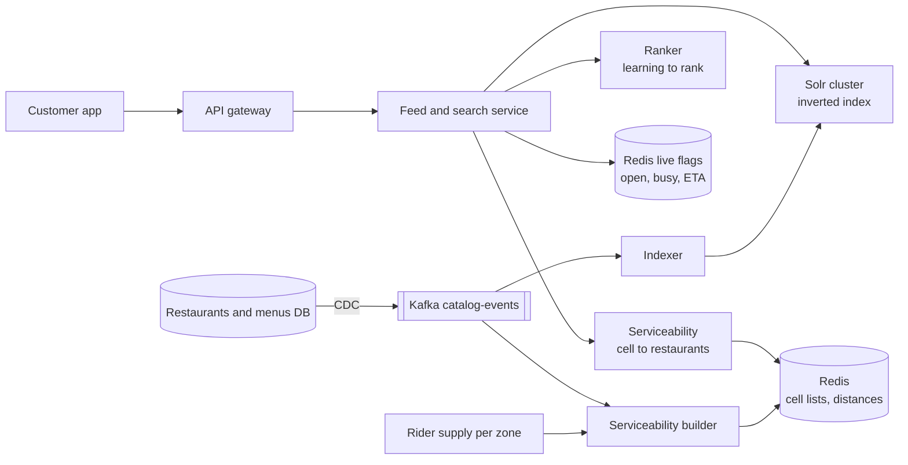

### Main flow

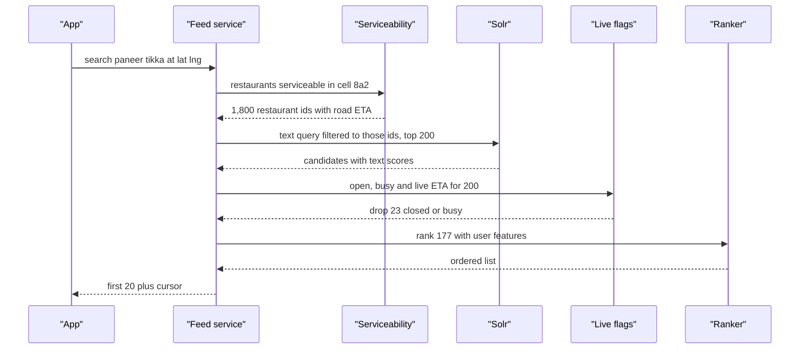

The pattern is **retrieve, filter, rank**: cheap retrieval narrows thousands to hundreds, a live filter removes closed ones, and an expensive ranker orders a small list.

> **Real world — Zomato ranking:** Ranking uses **Learn-to-Rank**, a pairwise gradient-boosted model with features like regional dish popularity, historical orders and keyword match; autocorrect uses phonetic-weighted edit distance plus a Siamese network; auto-suggest removes outlets outside the delivery radius. ([source](https://www.zomato.com/blog/rethinking-zomato-search-pt-1)) Hinglish queries like "Burger 150rs wala" are tagged by a BiLSTM-CRF into dish, restaurant and intent. ([source](https://www.zomato.com/blog/how-we-make-our-search-more-conversational-and-inclusive/))

> **Real world — Zomato Solr tuning:** An unbounded FieldCache caused out-of-memory errors; switching sort and facet fields to **DocValues** (column-oriented, memory-mapped) gave **10x throughput per replica** and cut cost about 80%. ([source](https://www.zomato.com/blog/explained-how-zomato-handles-100-million-daily-search-queries-p1/))

> **Real world — Zepto:** Search runs against the customer's hub, not a global catalog. Zepto raised the OpenSearch refresh interval from 1 s to 10 s because stock is only a tiebreaker in ranking and availability is **re-checked against the live inventory service after retrieval**. ([source](https://aws.amazon.com/blogs/big-data/how-zepto-powers-sub-second-search-using-opensearch-service-or2-instances/))

### Failure cases

| Failure | Handling |
|---|---|
| Restaurant closes suddenly | Index can lag, so check the Redis live flag at serve time; closed restaurants vanish instantly |
| Solr slow or down | Serve the cached per-cell default feed (same for everyone in a cell); circuit breaker |
| Routing engine quota hit | Fall back: cached distance, then OSM routing, then haversine (Swiggy's chain) |
| Rider shortage in a zone | Serviceability builder shrinks radius or marks "high demand"; serviceability is distance AND capacity |
| Indexer lag after a menu change | Re-price and stock-check at cart; prioritise price and stock updates over enrichment updates |
| Hot cell at dinner | Cache cell feed in Redis for 30-60 s with TTL jitter; single-flight on misses |

### Trade-offs

- **Precompute vs compute on request**: precomputed cell lists are fast and cheap but stale until rebuilt; compute live only the last filter (open/busy).
- **Cell size**: small cells are precise but many keys; large cells are cheap but less accurate at borders.
- **Solr vs Elasticsearch**: both are Lucene; Zomato uses Solr, Swiggy used Elasticsearch, Zepto OpenSearch.

### 60-second spoken summary

"'Near me' at Zomato really means 'delivers to me', which is road distance plus rider capacity, so I would precompute it. The city is cut into H3 or geohash cells, and a builder job computes for each cell the list of restaurants that can deliver there with a road ETA, refreshed when zones or capacity change, and cached in Redis. A request maps the user's location to a cell, fetches those few thousand ids, runs the text query and filters in an inverted index like Solr restricted to them, removes anything closed or busy using live flags, and ranks the remaining couple of hundred with a learning-to-rank model. Catalog changes flow by CDC and Kafka into the indexer. If the interviewer wants plain SQL, I would index a cell-id column and query the user's cell plus neighbours, or use PostGIS with a spatial index; a bounding box alone is not enough."

### Follow-ups they ask

**Q: Separate indexes on A and B, or a composite (A, B), for `WHERE A = 10 AND B = 20`?** (Z9)
A: A composite (A, B) index answers it with one index seek. With two separate indexes, the database usually picks one and filters the rest, or merges two index scans, which is slower. Order the composite by how you query: (A, B) also serves `WHERE A = 10` alone (left-prefix rule) but not `WHERE B = 20` alone. Here `(city_id, h3_res9)` is that composite.

**Q: Why not `LIKE '%paneer%'` in MySQL?**
A: A leading wildcard cannot use a B-tree index, so it scans every row; it has no typo tolerance and no relevance ranking. An inverted index maps each word to the documents containing it, so lookup is fast, and it supports fuzzy matching and scoring.

**Q: How do typos work?**
A: Fuzzy matching by edit distance (biriyani matches biryani at distance 1), phonetic rules for Indian spellings, and a learned autocorrect. Zomato uses phonetic-weighted edit distance plus a Siamese network.

**Q: Why hexagons?**
A: Every neighbour of a hexagon is the same distance from its centre, so rings of neighbours are a good approximation of a circle and movement between cells is smooth. Squares have two neighbour distances. Uber built H3 for this.

**Q: How do you keep the index in sync with the database?**
A: CDC from the database into Kafka, and an indexer that applies changes. Split by priority: price, stock and open/closed fast; tags and embeddings slower. Never dual-write from the application.

**Q: Restaurants have 1,800 candidates per cell. How do you paginate stably?**
A: Use a cursor, not an offset. The first page computes the ranked list, caches the ordered ids for a minute under a search id, and returns a cursor of (search_id, position). Later pages read from that cache, so results don't shuffle as live scores change, and no deep OFFSET scan is needed.

---

## Q5. ETA prediction service

### Why they ask it, and how often

Reported once as "design a system to predict the time taken for food delivery in Zomato" (Z34, from a search snippet only, so treat it as unconfirmed), and it appears in almost every Q1 discussion as "how do you compute ETA?". It is a good question for an SDE-1 because the *serving system* matters as much as the model.

### Clarifying questions

- "Which ETA: on the restaurant list, at checkout, or live during delivery?" (All three, from one service.)
- "Is late worse than early?" (Yes. A promise broken hurts more than food arriving 3 minutes early.)
- "Latency budget?" (Milliseconds, since listing pages call it for hundreds of restaurants.)

### Requirements

**Functional:** predict total delivery time at browse, at cart, and refresh during the order; expose per-leg times to dispatch.
**Non-functional:** a few ms per prediction on CPU; thousands of QPS; bounded, sane outputs always; graceful fallback.

### How ETA breaks down

```
ETA = time to assign a rider
    + rider travel to restaurant   (first mile)
    + wait for food                (max(0, food_ready - rider_arrival))
    + restaurant to customer       (last mile)
    + handover (parking, finding the gate, stairs)
    + dynamic buffer               (rain, demand, supply stress)
```

> **Real world — Zomato:** A **Time microservice** owns ETA and distributes it to menu browsing, restaurant selection, assignment, tracking and delay messages. Total ETA combines delivery-partner travel time, kitchen prep time (KPT), real-time buffers (demand, traffic, weather, supply, system stress) and the partner's arrival at the restaurant. Zomato moved from a map-graph model to a **tree-based model** because Indian map data is sparse, with millisecond latency on CPU at thousands of QPS. ([part 1](https://www.zomato.com/blog/the-accurate-eta-to-customer-satisfaction-part-one/)) The travel model is **LightGBM** with a Tweedie loss, **per-city models**, split into pickup-to-drop-geofence and geofence-to-handover. Moving serving from MLflow to **FastAPI** cut latency from about 7-8 ms to about 2-3 ms with 3x throughput per pod, at under $10/day for millions of calls. Zomato does not show the ETA to riders, to avoid rash driving. ([part 2](https://www.zomato.com/blog/the-accurate-eta-to-customer-satisfaction-part-two/))

> **Real world — Zomato prep time:** The label was originally "restaurant accepted to rider picked up", which is not real prep time. Zomato added a **Food Order Ready button** to the restaurant app, improving 5-minute accuracy by 9%. Dishes are Word2Vec embeddings (about 3.5M distinct dishes), and a **stacked LSTM** over the last 5 running and 5 completed orders cut MAE from 4.64 to 4.13 minutes. ([source](https://www.zomato.com/blog/food-preparation-time/)) A later version trained embeddings separately (model one-tenth the size) and used an **asymmetric loss** to avoid underestimating, giving +4% 3-minute accuracy. ([source](https://www.zomato.com/blog/predicting-fpt-optimally/))

> **Real world — Swiggy:** ETA is four legs: order-to-assignment, first mile, wait at restaurant, last mile; predicted at cart and refreshed at intervals with live signals. ([source](https://bytes.swiggy.com/how-ml-powers-when-is-my-order-coming-part-i-4ef24eae70da), search-snippet source) Prep-time inputs are capped at 60 minutes. A new serviceability model once produced **negative predictions** after rollout; Swiggy rolled back and restored service in about 3 hours, and the post-mortem noted **there was no fallback for negative predictions**. ([source](https://bytes.swiggy.com/behindthebug-unpacking-the-effects-of-negative-psla-predictions-on-serviceability-6e1712eceb56), search-snippet source)

> **Real world — Uber:** **DeepETA** lets the routing engine sum road-segment times and has ML predict only the **residual** (the correction). It uses a linear-transformer architecture because a full transformer was too slow, must answer in a few milliseconds, and uses an **asymmetric Huber loss**. ([source](https://www.uber.com/blog/deepeta-how-uber-predicts-arrival-times/)) Uber Eats prep time used XGBoost with features like last-week average prep time, last-10-minute average and order size. ([source](https://www.infoq.com/articles/uber-eats-time-predictions))

### Architecture

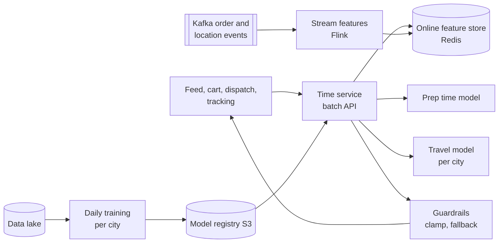

> **Real world — Zomato features:** Real-time features are computed from Kafka by Flink and stored in Redis Cluster; batch features are computed with Spark and kept in DynamoDB with hot keys cached in Redis. ([source](https://www.zomato.com/blog/elements-of-scalable-machine-learning/))

### Main flow (checkout ETA)

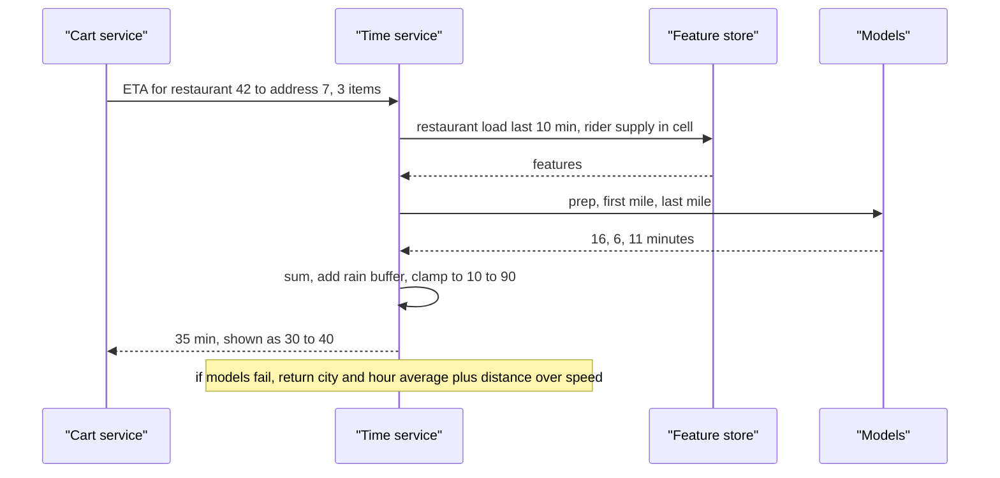

### Deep dives

- **Batch API.** A feed page needs ETAs for 200 restaurants; one call with 200 rows, not 200 calls (Swiggy's batch API halved P99).
- **Guardrails.** Clamp outputs to a sane range, reject NaN or negative, and fall back to a simple formula (distance ÷ city-hour speed + restaurant's average prep time). This is the Swiggy lesson.
- **Asymmetric loss.** Penalise under-prediction more, then show a range ("30-40 min").
- **Labels.** Prep time is hard to observe; add a "food ready" button (Zomato), infer from rider wait (DoorDash calls it a censored-data problem).
- **Re-prediction.** Recompute on each event (accepted, ready, picked up) and every 30-60 s from pings; smooth so the number does not jump.
- **Safe rollout.** Shadow the new model, compare errors, canary per city, and keep the old model hot for instant rollback.

### Failure cases

| Failure | Handling |
|---|---|
| Model outputs negative or huge | Clamp and fallback formula, alert, auto-rollback on error-rate spike |
| Feature store slow | Timeout at a few ms, use defaults for missing features |
| New restaurant, no history | Use cuisine and city averages (cold start) |
| Rain or NYE | Dynamic buffer from demand and supply stress; Zomato's own Weather Union stations feed weather-aware ops ([source](https://entrackr.com/2024/05/zomato-launches-real-time-hyperlocal-weather-info-network), secondary) |
| Restaurant forgets to press "ready" | Treat label as missing, not as a very long prep time; cap inputs |

### 60-second spoken summary

"I would build ETA as one Time service that every other service calls in batches. ETA is a sum of legs: time to assign, rider to restaurant, waiting for food, restaurant to customer, handover, plus a dynamic buffer for rain and demand. Each leg has its own model, trained per city, on features from an online feature store that Flink fills from Kafka. Zomato uses LightGBM for travel and an LSTM-based model for prep time, served on CPU in a couple of milliseconds. Late is worse than early, so I use an asymmetric loss and show a range. Every output passes guardrails: clamp to a sane range and fall back to a distance-over-speed formula, because Swiggy had an outage when a model returned negative ETAs with no fallback. ETA is recomputed on each order event and from rider pings."

### Follow-ups they ask

**Q: Why per-city models?**
A: Speeds, traffic, road density and restaurant behaviour differ a lot between Bengaluru and Indore; one model averages them badly. Zomato trains per city.

**Q: Why not just call Google Maps?**
A: Cost and quota at thousands of QPS, sparse Indian map data, and it doesn't know prep time or handover time. Use a routing engine or cached distances for the base and learn the rest. Swiggy built a central Distance Service with a cache after hitting Google's usage limits.

**Q: How do you know the model is good?**
A: Track the share of orders delivered within the promised window (for example within ±3 or ±5 minutes), the breach rate, and mean absolute error, per city, and A/B test changes.

**Q: Show the ETA to riders?**
A: Zomato chose not to, to avoid rash driving. Riders get the route and pickup time instead.

**Q: The ETA shown at checkout was 30 minutes but the order is running late. What happens?**
A: The live ETA is recomputed on every event and from pings, smoothed so it doesn't jump, and when it crosses the promised window the system triggers a delay message to the customer and flags the order for ops. The same signal can make dispatch prioritise that order's handover.

**Q: How do you handle the cold start of a brand-new restaurant?**
A: Fall back to averages for similar restaurants (same cuisine, same city, similar price) and for the dishes ordered, then shift weight to the restaurant's own history as orders accumulate. Embeddings for dishes help here because a new restaurant's "paneer tikka" looks like everyone else's.

---

## Q6. Notification system

### Why they ask it, and how often

This is **the most repeated single HLD for SDE-1 in the Zomato group**: Zomato (Z2, "resilient notification system at Zomato scale" with no duplicates, crash resilience and retry guarantees), Zomato Search (Z3, the same candidate again, now with **how other teams integrate, dedupe, and cooldowns at user level and team level**), District (Z13, push, SMS and email, some to one channel and some to several, with "in-depth discussion on Kafka"), Zomato (Z29, "notify users when a restaurant reopens, **only if delivery partners are available in that area**, for millions of users"), and Blinkit (B1, with "Kafka vs direct API calls"). Swiggy (S3) and Meesho asked it too, and those candidates blanked. Prepare this one fully.

### Clarifying questions

- "Transactional (order updates, OTP), promotional, or both?" (Both, with strict priority between them.)
- "Which channels?" (Push, SMS, email, WhatsApp, in-app.)
- "Who sends? Is this a platform other teams call?" (Yes. Many producer teams; that is where team cooldowns come from.)
- "Delivery guarantee?" (At least once to the provider, effectively once to the user through dedupe.)

### Requirements

**Functional:** one API and one event topic for all producer teams; templates; channel selection and fallback (push fails, send SMS); user preferences and quiet hours; dedupe; **user-level cooldown** (no more than N promos a day per user, a minimum gap between pushes); **team-level cooldown/quota** (the offers team may send at most X a minute, so a bug cannot spam everyone); scheduling; delivery tracking.
**Non-functional:** an OTP or "rider is arriving" goes out within seconds even during a 1-crore-user campaign; survives crashes without losing or duplicating; horizontally scalable; providers are rate-limited and fail independently.

### Estimates (assumptions, anchored)

| Quantity | Working | Result |
|---|---|---|
| Transactional | about 6 per order × 2M orders/day | 12M/day, about 140/s average, about 800/s at NYE peak |
| Promotional | campaigns to 1-2 crore users | bursty; paced by provider quotas |
| FCM ceiling | 600k messages/min per project (default) | a 1-crore push campaign takes at least **about 17 minutes** |

> **Real world — FCM and APNs limits:** FCM defaults to **600k messages/min per project** (429 beyond that); collapsible messages are limited to a **burst of 20 per device, refilling one every 3 minutes**; a device keeps at most **4 collapse keys** and **100 non-collapsible** messages, after which all stored messages are dropped. ([throttling](https://firebase.google.com/docs/cloud-messaging/throttling-and-quotas), [collapsible](https://firebase.google.com/docs/cloud-messaging/customize-messages/collapsible-message-types)) APNs needs HTTP/2, has a **4 KB payload** limit, priority 10 (immediate) or 5 (power-aware), and stores **only one notification per app** for an offline device, possibly reordering. ([source](https://developer.apple.com/documentation/usernotifications/sending-notification-requests-to-apns))

These limits shape the design: use **collapse keys** for order status ("only the latest status matters"), short TTLs for live updates, and pace campaigns.

### API for producer teams

```
POST /v1/notifications
Headers: X-Team-Id: offers-team, Idempotency-Key: offers:diwali24:user:991
{
  "user_id": 991,
  "template_id": "order_out_for_delivery",
  "params": {"rider_name": "Ravi", "eta_min": 7},
  "category": "TRANSACTIONAL",        // TRANSACTIONAL | PROMOTIONAL
  "priority": "P0",                   // P0 OTP, P1 order status, P2 promo
  "channels": ["PUSH", "SMS"],        // or omit and let rules decide
  "collapse_key": "order:9001:status",
  "expires_at": "2026-10-23T20:15:00Z",
  "send_at": null
}
-> 202 {"notification_id": "n_7c1", "status": "ACCEPTED"}
-> 409 duplicate idempotency key (returns original id)
-> 429 team quota exceeded, Retry-After: 30
GET /v1/notifications/{id} -> {status, attempts:[{channel, provider, status, at}]}
```

High-volume producers can skip HTTP and publish the same JSON to a Kafka topic per priority.

### Data model

```sql
CREATE TABLE notifications (
  id            CHAR(26) PRIMARY KEY,
  team_id       VARCHAR(32) NOT NULL,
  dedupe_key    VARCHAR(128) NOT NULL,
  user_id       BIGINT NOT NULL,
  template_id   VARCHAR(64) NOT NULL,
  params        JSON,
  category      VARCHAR(16) NOT NULL,
  priority      CHAR(2) NOT NULL,
  status        VARCHAR(16) NOT NULL,   -- ACCEPTED, SUPPRESSED, SENDING, SENT, DELIVERED, FAILED, EXPIRED
  suppress_reason VARCHAR(32),          -- DUPLICATE, USER_COOLDOWN, OPTED_OUT, QUIET_HOURS
  expires_at    DATETIME,
  created_at    DATETIME(3) NOT NULL,
  UNIQUE KEY uq_team_dedupe (team_id, dedupe_key),
  INDEX idx_user_created (user_id, created_at)
);
CREATE TABLE delivery_attempts (
  notification_id CHAR(26), attempt_no SMALLINT, channel VARCHAR(8),
  provider VARCHAR(16), provider_msg_id VARCHAR(64), status VARCHAR(16),
  error_code VARCHAR(32), at DATETIME(3),
  PRIMARY KEY (notification_id, attempt_no)
);
CREATE TABLE user_preferences (user_id BIGINT, category VARCHAR(16), channel VARCHAR(8),
  enabled BOOLEAN, quiet_start TIME, quiet_end TIME, PRIMARY KEY (user_id, category, channel));
CREATE TABLE device_tokens (user_id BIGINT, token VARCHAR(255), platform VARCHAR(8),
  updated_at DATETIME, PRIMARY KEY (user_id, token));
CREATE TABLE team_quotas (team_id VARCHAR(32) PRIMARY KEY, per_minute INT, per_day INT,
  allowed_categories VARCHAR(64));
-- Redis: cooldown:user:{id}:promo:day counter (TTL to midnight), lastpush:user:{id} (TTL 8 h),
--        quota:team:{id}:{minute} counter, dedupe:{team}:{key} SET NX EX 86400
```

The log tables are large and append-heavy; partition by day and keep about 30-90 days.

### Architecture

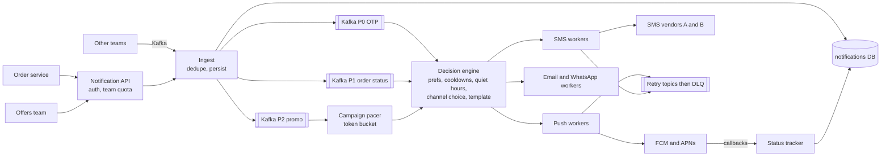

**Priority lanes are the heart of it.** P0 and P1 have their own topics and reserved worker capacity, so a 1-crore promo backlog in P2 cannot delay an OTP.

### Main flow

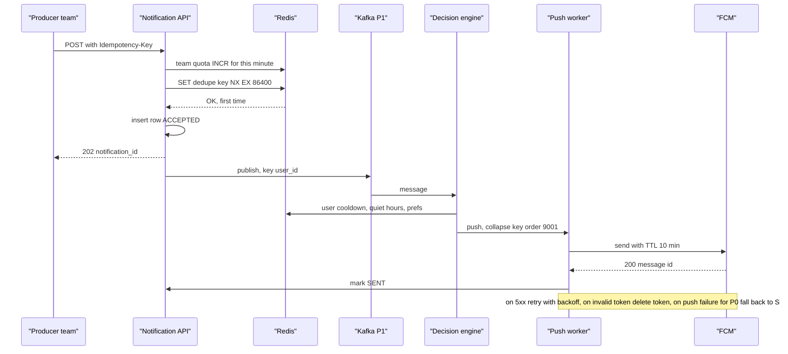

### Message lifecycle

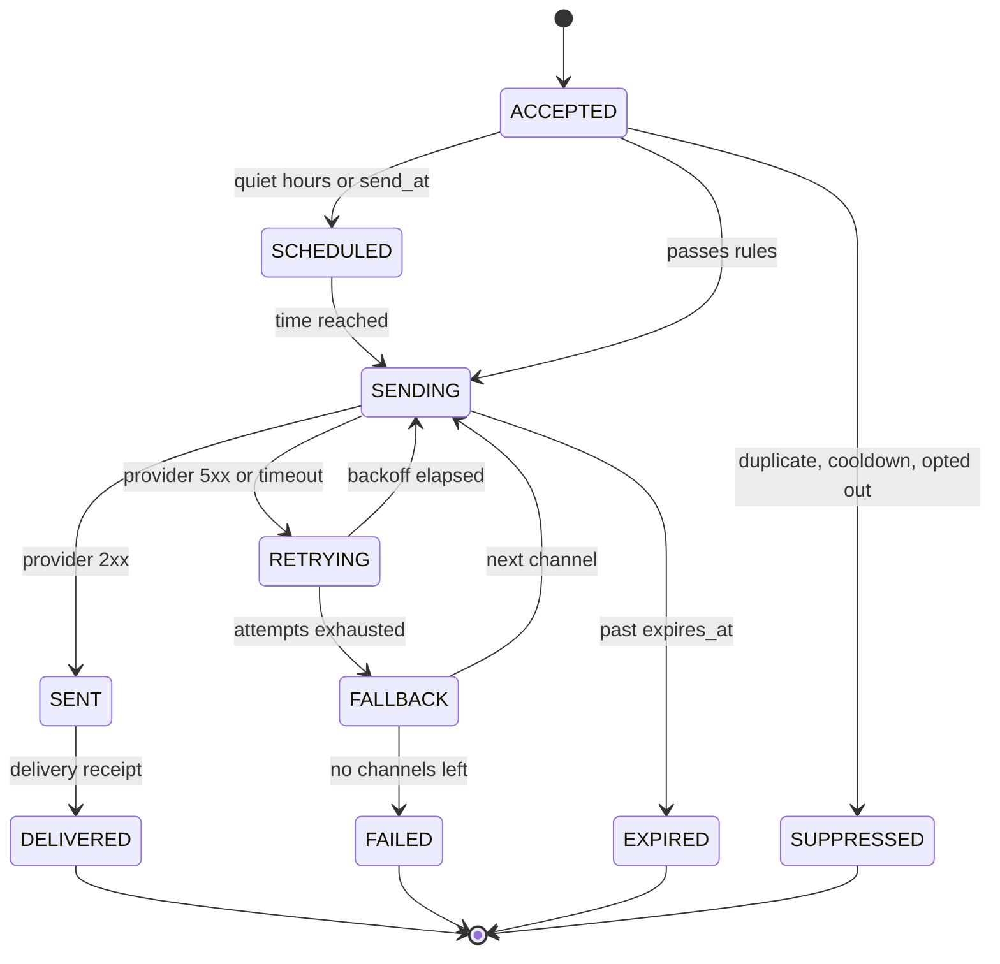

Persisting this state per message is what gives **crash resilience**: a sweeper finds messages stuck in SENDING or RETRYING longer than a threshold and re-drives them; dedupe makes the re-drive safe.

> **Real world — Swiggy Kabootar:** Swiggy's business-agnostic communication platform reaches customers, delivery executives, restaurants and support over push, SMS and email. Each message carries a self-contained context, passes through event, campaign, templating and router services, and has a **persisted state machine so a message stuck in a non-final state can be reprocessed**, with retries and fallback-template sequences. ([source](https://bytes.swiggy.com/kabootar-swiggys-communication-platform-e5a43cc25629), search-snippet source)

> **Real world — LinkedIn ATC:** Air Traffic Controller is the single decision maker for every notification: channel selection, aggregation (a week of reminders in one email), delivery-time optimisation (no overnight alerts), and dedupe, which is needed because its stream processor replays un-checkpointed requests after a restart. It also **rate-limits upstream apps** to prevent accidental spam. Over 1B requests a day; member complaints were cut in half. ([source](https://www.linkedin.com/blog/engineering/messaging-notifications/air-traffic-controller-member-first-notifications-at-linkedin)) That "rate-limits upstream apps" is exactly the team-level cooldown in Z3.

> **Real world — Uber CCG:** Uber's Consumer Communication Gateway stores each push in a per-user inbox sharded by user UUID, and re-plans a user's buffered pushes when a new one arrives, under constraints like **frequency caps (example: 2 a day)** and **minimum gaps (example: 8 hours)**, send windows and expiry. It fixed conflicting and duplicate pushes. ([source](https://www.uber.com/en-CA/blog/how-uber-optimizes-push-notifications-using-ml))

> **Real world — Razorpay and DoorDash:** Razorpay's notification service saw p99 rise from about 2 s to 4 s with a single queue for all request types and DB inserts on the hot path; the reported fix (secondary sources) added P0/P1 queues and a separate retry queue. ([source](https://engineering.razorpay.com/how-razorpays-notification-service-handles-increasing-load-f787623a490f)) A DoorDash intern project found that the default dedupe only **hid duplicates in the UI**, so users still received identical pushes. ([source](https://careersatdoordash.com/blog/part-3-doordash-2025-summer-intern-projects/)) Dedupe must happen *before* sending.

> **Caveat — Zomato:** Zomato has not published its notification architecture. The closest first-party fact: on NYE 2021, when the third-party calling provider failed, Zomato switched to an alternate provider. ([source](https://www.zomato.com/blog/our-learnings-from-nye/))

### Deep dives

**Dedupe, two layers.** (1) At ingest: `UNIQUE (team_id, dedupe_key)` in the DB plus a Redis `SET NX` fast path. The producer chooses a meaningful key like `order:9001:OUT_FOR_DELIVERY`, so a replayed Kafka event produces the same key. (2) At send: the worker checks the message's state before calling the provider and passes a provider-side idempotency id where supported. True exactly-once to a phone is impossible with external providers; at-least-once plus dedupe is "effectively once".

**User-level cooldown.** Promotional only; never block an OTP. A Redis counter per user per day (`INCR`, expire at midnight) and a "last push at" key with an 8 h TTL. If over the cap, mark SUPPRESSED with a reason, or defer to tomorrow if the producer allows.

**Team-level cooldown.** Each team has a quota in `team_quotas`; the API does a per-minute counter check (Q7's limiter) and returns 429 with Retry-After. This protects users from a buggy producer and protects shared provider quota. A team can also have a cooldown per *campaign* per user ("max one Diwali push per user").

**Channel routing and fallback.** Rules by category: OTP goes SMS first (push is unreliable for codes), order status goes push with a collapse key, falls back to SMS for "rider arriving" if push fails; promos are push or email only. Track per-provider error rates with a circuit breaker; on SMS vendor A failing, route to vendor B (Zomato's NYE 2021 lesson).

**Campaigns.** A scheduler splits the audience into batches and feeds P2 through a token bucket below the provider quota. Stagger also to protect your own backend: every tap opens the app and hits menus and feed.

> **Real world — Duolingo:** For a Super Bowl ad, Duolingo built a system to send about 4 million pushes in about 5 seconds, and learned that **each tap triggers several backend calls, so the downstream click load multiplies**. ([source](https://www.infoq.com/presentations/duolingo-high-scale-notification/), secondary)

**The Z29 twist: "restaurant reopens, notify only if riders are available."** Keep a subscriptions table keyed by restaurant. The restaurant's REOPENED event triggers a job that reads rider supply for the restaurant's zone from dispatch's cache; if supply is low, delay and re-check. Then fan out in waves sized to the kitchen's and riders' capacity, not all at once, or everyone orders in the same minute.

### Failure cases

| Failure | Handling |
|---|---|
| Worker crashes after provider accepted, before marking SENT | On restart message is re-driven; dedupe by state plus provider idempotency id; at worst one duplicate for non-critical, which collapse keys hide on the device |
| Provider 5xx or timeout | Retry topics with exponential backoff and jitter, then fallback channel, then DLQ |
| Provider 4xx (bad number, invalid token) | Do not retry; delete invalid tokens; mark FAILED |
| Kafka consumer down | Messages wait; P0 lag alert pages someone; expired ones are dropped at send time |
| Promo blast floods queues | Separate topics and workers; pacer; P0/P1 unaffected |
| Redis down | Dedupe falls back to the DB unique key; cooldown checks fail open for transactional, closed for promotional |
| Stale message | `expires_at` checked before every send ("rider arriving" an hour late is worse than nothing) |

### Trade-offs

- **Kafka vs direct API calls:** Kafka buffers bursts and replays after crashes; direct calls are simpler but couple producers to provider latency. Offer both: HTTP API that writes to Kafka.
- **Strict dedupe vs cost:** a DB unique key on every message is strong but adds writes; Redis first, DB as the backstop.
- **Central decision engine** (LinkedIn, Uber) gives consistent caps and quiet hours, at the cost of being a critical shared service; give it priority lanes.

### 60-second spoken summary

"I would build one notification platform that every team calls through an API or a Kafka topic, with a team id and an idempotency key on every request. Ingest enforces the team's quota, dedupes on team plus key in Redis with a database unique key as the backstop, persists the message as ACCEPTED, and publishes it to a topic by priority: P0 for OTPs, P1 for order status, P2 for promotions, each with reserved workers so a campaign never delays an OTP. A decision engine applies preferences, quiet hours and user cooldowns like two promos a day with an eight-hour gap, picks channels, renders templates and hands off to per-channel workers. Workers call FCM, APNs and multiple SMS vendors, using collapse keys and short TTLs for status, retry 5xx with backoff through retry topics, fall back to SMS for critical messages, and end in a DLQ. Each message has a persisted state, so a sweeper re-drives stuck ones after a crash, and dedupe makes that safe. Campaigns are paced below FCM's 600k per minute quota and staggered so the click spike doesn't hurt our own backend."

### Follow-ups they ask

**Q: How do other teams integrate?** (Z3)
A: A versioned API and a Kafka topic with one schema: team id, idempotency key, user, template id, params, category, priority, optional channels, collapse key, expiry, send time. Templates are registered by the team in a self-serve console; quotas are set per team. Teams get a status API and a delivery-events topic back.

**Q: How do you avoid duplicates if Kafka redelivers?** (Z2, Z13, B2)
A: The producer's key is deterministic, so a redelivered event carries the same key and hits the `SET NX` or the unique constraint. Before calling the provider the worker checks the stored state; after a crash, re-drive only touches non-final messages.

**Q: User-level vs team-level cooldown, where is each enforced?** (Z3)
A: Team quotas at ingest, so a buggy producer is stopped at the door with a 429. User cooldowns in the decision engine, because they depend on what the user already received from all teams.

**Q: Exactly once?**
A: Not end to end with external providers: a provider can accept a message and the ack can be lost. At-least-once plus dedupe plus collapse keys gives effectively once.

**Q: Kafka vs direct API calls?** (B1)
A: Kafka gives durable buffering for campaign bursts, replay after a crash, independent scaling of channels and priority lanes. Direct synchronous calls are fine only for something like an OTP where the caller wants an immediate provider response, and even then the platform should own retries.

**Q: Push failed. How do you know?**
A: FCM and APNs return errors synchronously for bad tokens; delivery receipts and app-open events come back asynchronously. For P0 and selected P1, if no delivery receipt within about a minute, send SMS.

**Q: How do you notify 1 crore users about a sale without crashing anything?**
A: Pre-compute the audience, split into batches, pace through a token bucket under provider quotas (FCM's 600k a minute means at least 17 minutes), randomise order within the window, and warm caches for the landing page because taps multiply backend load.

---

## Q7. Rate limiter, with working code

### Why they ask it, and how often

Six Zomato-group reports plus a Swiggy bar raiser: Z2 had to **implement token bucket and fixed window in code** and failed to finish sliding window; Z5 implemented a simple one then sliding window in pseudocode; Z7 discussed fixed and sliding windows "implemented using Redis"; Z19 token vs leaky bucket; District (Z31) asked about the **fixed-window boundary burst** and **why naive sliding-window counting is O(N)**; Z4 asked about handling a DDoS; Nugget's "ad pacing" (Z14) was rate limiting in disguise. Expect to write code.

### Clarifying questions

- "Limit by what key: user, IP, API key, endpoint?" (User for logged-in APIs, IP for login and OTP.)
- "One server or a fleet?" (A fleet, so state must be shared.)
- "Hard limit or allow bursts?" (Allow short bursts.)
- "If the limiter's store is down, allow or block?" (Depends on the endpoint; discuss.)

### Requirements

**Functional:** N requests per window per key, rules per endpoint (OTP: 5 per 10 minutes per phone; browse: 100 per minute per user); reject with **429** and `Retry-After`.
**Non-functional:** adds under about 1 ms; correct across many servers; highly available; does not become the outage itself.

### The algorithms in plain words

| Algorithm | Idea | Memory per key | Good | Bad |
|---|---|---|---|---|
| **Token bucket** | Bucket holds up to B tokens, refills at R per second; a request spends one | 2 numbers | Allows bursts up to B, smooth average | Two knobs to tune |
| **Leaky bucket** | Requests enter a queue that drains at a fixed rate | queue | Perfectly smooth output | Adds delay; bursts wait or drop |
| **Fixed window** | Count per key per clock minute | 1 counter | Simplest: INCR plus EXPIRE | Up to **2x the limit** across a boundary: 100 at 10:00:59 and 100 at 10:01:00 |
| **Sliding window log** | Keep every request timestamp, count those in the last 60 s | one entry per request | Exact | Memory and O(N) work per check, the Z31 point |
| **Sliding window counter** | Estimate = previous window count × fraction of it still inside + current count | 2 counters | Nearly exact, O(1) | Small approximation |

> **Real world — Cloudflare:** The sliding window counter is `rate = prev_count × ((window − elapsed)/window) + curr_count`. Their example: 42 × (45/60) + 18 = **49.5** against a limit of 50. On 400M requests from 270K sources, only **0.003%** were wrongly allowed or limited. ([source](https://blog.cloudflare.com/counting-things-a-lot-of-different-things/))

> **Real world — Figma:** For 500 requests/day × 10K users, a sliding **log** needs about 5M stored values (about 20 MB), while **counters** need about 600K (about 2.4 MB). ([source](https://www.figma.com/blog/an-alternative-approach-to-rate-limiting/))

> **Real world — Shopify:** Uses a **leaky bucket** of 40 requests per app per store leaking 2 per second, with a header like `32/40` and 429 plus `Retry-After` beyond it. ([source](https://shopify.dev/docs/api/admin-rest/usage/rate-limits))

### Code: single-process limiters in Go

Go matches your Myntra ratings service. All three are thread-safe and refill lazily (no background goroutine).

```go
package ratelimit

import (
	"math"
	"sync"
	"time"
)

// ---------- Token bucket ----------
type tokenBucket struct {
	tokens float64
	last   time.Time
}

type TokenBucketLimiter struct {
	mu       sync.Mutex
	capacity float64 // max burst
	rate     float64 // tokens per second
	buckets  map[string]*tokenBucket
}

func NewTokenBucketLimiter(capacity, ratePerSec float64) *TokenBucketLimiter {
	return &TokenBucketLimiter{capacity: capacity, rate: ratePerSec, buckets: map[string]*tokenBucket{}}
}

func (l *TokenBucketLimiter) Allow(key string, now time.Time) bool {
	l.mu.Lock()
	defer l.mu.Unlock()
	b, ok := l.buckets[key]
	if !ok {
		b = &tokenBucket{tokens: l.capacity, last: now}
		l.buckets[key] = b
	}
	elapsed := now.Sub(b.last).Seconds()
	if elapsed > 0 {
		b.tokens = math.Min(l.capacity, b.tokens+elapsed*l.rate) // lazy refill
		b.last = now
	}
	if b.tokens >= 1 {
		b.tokens--
		return true
	}
	return false
}

// ---------- Fixed window ----------
type fixedState struct {
	window int64
	count  int
}

type FixedWindowLimiter struct {
	mu     sync.Mutex
	limit  int
	size   time.Duration
	states map[string]*fixedState
}

func NewFixedWindowLimiter(limit int, size time.Duration) *FixedWindowLimiter {
	return &FixedWindowLimiter{limit: limit, size: size, states: map[string]*fixedState{}}
}

func (l *FixedWindowLimiter) Allow(key string, now time.Time) bool {
	l.mu.Lock()
	defer l.mu.Unlock()
	w := now.UnixNano() / int64(l.size)
	s, ok := l.states[key]
	if !ok || s.window != w { // new window: reset
		s = &fixedState{window: w}
		l.states[key] = s
	}
	if s.count >= l.limit {
		return false
	}
	s.count++
	return true
}

// ---------- Sliding window counter ----------
type slidingState struct {
	window    int64
	curCount  int
	prevCount int
}

type SlidingWindowLimiter struct {
	mu     sync.Mutex
	limit  int
	size   time.Duration
	states map[string]*slidingState
}

func NewSlidingWindowLimiter(limit int, size time.Duration) *SlidingWindowLimiter {
	return &SlidingWindowLimiter{limit: limit, size: size, states: map[string]*slidingState{}}
}

func (l *SlidingWindowLimiter) Allow(key string, now time.Time) bool {
	l.mu.Lock()
	defer l.mu.Unlock()
	size := int64(l.size)
	w := now.UnixNano() / size
	s, ok := l.states[key]
	if !ok {
		s = &slidingState{window: w}
		l.states[key] = s
	}
	if w != s.window {
		if w == s.window+1 {
			s.prevCount = s.curCount // previous window is the one that just ended
		} else {
			s.prevCount = 0 // idle for more than a full window
		}
		s.curCount = 0
		s.window = w
	}
	elapsedFrac := float64(now.UnixNano()%size) / float64(size)
	estimate := float64(s.prevCount)*(1-elapsedFrac) + float64(s.curCount)
	if estimate >= float64(l.limit) {
		return false
	}
	s.curCount++
	return true
}
```

Dry-run the sliding window with Cloudflare's numbers: limit 50, window 60 s, previous window had 42, we are 15 s into the current one with 18 so far. `elapsedFrac = 0.25`, estimate = 42 × 0.75 + 18 = 49.5, which is below 50, so allow and `curCount` becomes 19. The next request gives 50.5, rejected.

Talking points the interviewer probes:
- **One global mutex** is fine for an interview; in production shard the map (for example 64 maps each with its own lock) or use `sync.Map` with per-key locks to cut contention.
- **Memory leak:** maps grow forever. Evict keys idle longer than one window (a background sweep or an LRU).
- **Pass `now` in** so tests can control time.
- **Monotonic time:** Go's `time.Now()` carries a monotonic reading, so `Sub` is safe against wall-clock jumps.

### Distributed: Redis plus Lua

With 50 API servers each keeping its own counters, a user spraying requests across servers gets 50x the limit. Put the state in **Redis**, and make check-and-update **atomic**: Redis runs a Lua script without interleaving other commands, so two servers cannot both take the last token.

```lua
-- token_bucket.lua
-- KEYS[1] = "rl:tb:{user:991}:place_order"
-- ARGV[1] = capacity, ARGV[2] = refill per second, ARGV[3] = cost
local capacity = tonumber(ARGV[1])
local rate     = tonumber(ARGV[2])
local cost     = tonumber(ARGV[3])

local t   = redis.call('TIME')                       -- Redis's clock, not each app server's (Redis 5+ replicates script effects, so TIME before writes is fine)
local now = tonumber(t[1]) * 1000 + math.floor(tonumber(t[2]) / 1000)

local state  = redis.call('HMGET', KEYS[1], 'tokens', 'ts')
local tokens = tonumber(state[1]) or capacity
local ts     = tonumber(state[2]) or now

local elapsed = math.max(0, now - ts) / 1000
tokens = math.min(capacity, tokens + elapsed * rate)

local allowed = 0
local retry_ms = 0
if tokens >= cost then
  tokens = tokens - cost
  allowed = 1
else
  retry_ms = math.ceil((cost - tokens) / rate * 1000)
end

redis.call('HSET', KEYS[1], 'tokens', tokens, 'ts', now)
redis.call('PEXPIRE', KEYS[1], math.ceil(capacity / rate * 1000) + 1000)  -- idle keys vanish
return {allowed, retry_ms}
```

```go
package ratelimit

import (
	"context"
	_ "embed"
	"time"

	"github.com/redis/go-redis/v9"
)

//go:embed token_bucket.lua
var tokenBucketLua string
var tokenBucketScript = redis.NewScript(tokenBucketLua) // EVALSHA, falls back to EVAL

type Decision struct {
	Allowed    bool
	RetryAfter time.Duration
}

// AllowRedis fails open: if Redis is slow or down, the request is allowed and we emit a metric.
func AllowRedis(ctx context.Context, rdb *redis.Client, key string, capacity, rate float64) Decision {
	ctx, cancel := context.WithTimeout(ctx, 5*time.Millisecond) // the limiter must never be the slow part
	defer cancel()
	res, err := tokenBucketScript.Run(ctx, rdb, []string{key}, capacity, rate, 1).Int64Slice()
	if err != nil {
		// metrics.Inc("ratelimit.redis_error"); fall back to a local per-pod limiter if configured
		return Decision{Allowed: true}
	}
	return Decision{Allowed: res[0] == 1, RetryAfter: time.Duration(res[1]) * time.Millisecond}
}
```

Three details that show depth:
- **Fixed window in Redis has a classic bug:** `INCR` then `EXPIRE` as two commands; if the process dies between them, the key never expires and the user is blocked forever. Do both in one Lua script or a `MULTI`, or use `SET key 0 EX 60 NX` then `INCR`.
- **Use the store's clock** (`redis.call('TIME')`) so app servers with skewed clocks agree. Brandur's GCRA write-up gives the same advice. ([source](https://brandur.org/rate-limiting))
- **Hash tags** `{user:991}` keep all of one user's keys on the same Redis Cluster shard.

### Architecture

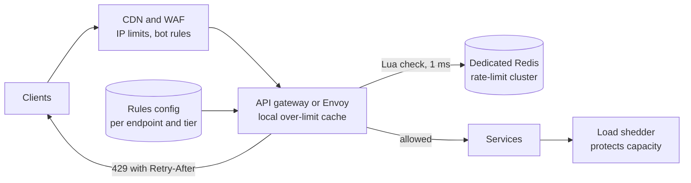

### Main flow

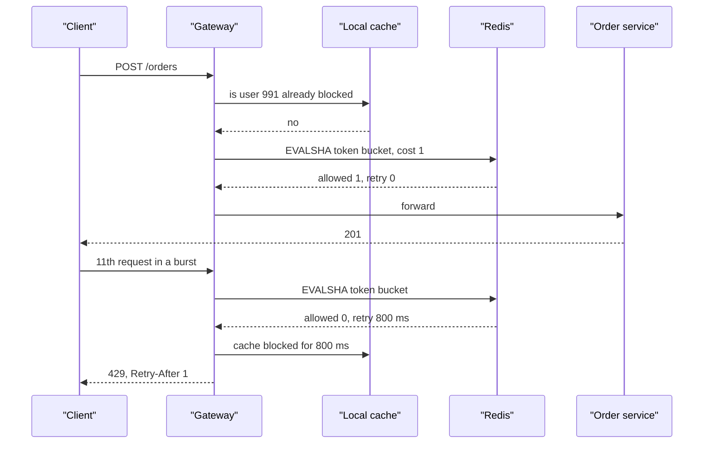

### How real companies do it

> **Real world — Stripe:** Stripe runs **four limiters**: a request rate limiter (token bucket in Redis, the most important, rejecting "millions" a month), a concurrent-requests limiter for CPU-heavy endpoints, a fleet usage load shedder that reserves capacity for critical methods (20% critical / 80% non-critical example, excess gets 503), and a worker utilisation shedder that drops low-priority traffic first. Advice: **fail open** if Redis is down, return clear 429 vs 503, keep kill switches, and dark-launch limiters first. ([source](https://stripe.com/blog/rate-limiters))

> **Real world — GitHub:** GitHub moved its limiter off a shared Memcached because cache memory pressure **evicted live rate-limit counters**. The new design is Redis sharded in the application, primary for writes, replicas for reads, with **Lua scripts** for atomicity. ([source](https://github.blog/2021-04-05-how-we-scaled-github-api-sharded-replicated-rate-limiter-redis/)) Lesson: give counters a dedicated Redis, not the general cache.

> **Real world — Envoy and Uber:** Lyft's open-source ratelimit service (Go, called by Envoy) uses Redis fixed windows keyed by domain plus descriptors, with an optional **local cache of over-limit keys** to skip Redis and a `shadow_mode` per rule. ([source](https://github.com/envoyproxy/ratelimit)) Uber's Global Rate Limiter found a central Redis counter "can't scale to hundreds of millions of RPS", so proxies enforce locally while controllers push **drop ratios** every second (1.5x the limit drops about 33%), and it **fails open** if the control plane is down; about 80M RPS across 1,100+ services. ([source](https://www.uber.com/blog/ubers-rate-limiting-system/))

> **Real world — Zomato:** The only first-party rate limit published is the public developer API's **1,000 calls a day**. ([source](https://www.zomato.com/policies/api-policy/)) Do not attribute an internal design to Zomato; present a gateway or mesh token bucket as the generic design.

Connect it to your Myntra work: "I used a per-pod token bucket starting at 180 requests per minute to protect a shared service. During a 5.7M-key cache warmup, the producer outran the bucket and requests were rejected; adding a 4 ms pacing delay so the producer matched the refill rate fixed it." That is exactly the client-side half of rate limiting: respect `Retry-After` and pace yourself.

### Failure cases

| Failure | Handling |
|---|---|
| Redis down or slow | Short timeout (a few ms). **Fail open** for browse and order APIs (availability matters more), **fail closed** for login, OTP and payment-attempt endpoints (abuse matters more). Optional local per-pod limiter as a fallback |
| Hot key (one abusive user or IP) | Local "already blocked" cache at each gateway for the Retry-After period, so Redis isn't hammered |
| Counters evicted under memory pressure | Dedicated Redis with `noeviction`, sized for keys × bytes |
| Clock skew between servers | Use Redis `TIME` inside the script |
| Limit too tight on launch | Shadow mode first: log would-be rejections, then enforce |
| DDoS | Limiter alone is not enough: CDN and WAF at the edge, IP reputation, captcha, autoscaling, and load shedding behind the gateway |
| Retry storms from clients | 429 with `Retry-After`; client SDKs use exponential backoff with jitter |

### Trade-offs

- **Token bucket vs sliding window counter:** token bucket allows bursts and is the common default (Stripe); sliding window counter is the most accurate cheap window (Cloudflare).
- **Central Redis vs local:** central is accurate but adds a network hop; local is free but per-pod; at Uber scale, local enforcement with pushed ratios.
- **Fail open vs fail closed:** per endpoint, as above.
- **Rate limiting vs load shedding:** rate limits are per client fairness; load shedding protects total capacity by priority. You need both on NYE.

### 60-second spoken summary

"I would put rate limiting at the gateway or mesh, keyed by user for logged-in APIs and by IP or phone for login and OTP, with rules per endpoint from config. The algorithm is a token bucket, which allows short bursts and stores just two numbers per key; a sliding window counter is the alternative when I want a strict window, and it avoids the fixed window's double burst at the boundary in O(1) memory, unlike a sliding log. Across a fleet the state lives in a dedicated Redis, and the check-and-decrement is one Lua script so it is atomic, using Redis's own clock. Rejections get a 429 with Retry-After, and gateways cache 'already blocked' locally. If Redis fails, browse and order APIs fail open and OTP and login fail closed. Stripe runs this as one of four limiters, alongside concurrency limits and priority load shedding, which is what keeps checkout alive on New Year's Eve."

### Follow-ups they ask

**Q: Explain the fixed-window boundary burst.** (Z31)
A: With 100 per minute, a client sends 100 at 10:00:59 and 100 at 10:01:00. Each window sees 100, so both pass, but 200 requests arrived in 2 seconds. Sliding windows and token buckets fix this.

**Q: Why is naive sliding window O(N)?** (Z31)
A: A sliding log stores every timestamp and must drop or count the ones in the last window on each request, so work and memory grow with the number of requests in the window. With a sorted set (`ZREMRANGEBYSCORE` then `ZCARD`) each call is O(log N) plus removals, but memory is still O(N). The sliding window counter gets close to the same answer with two counters.

**Q: Token bucket vs leaky bucket?** (Z7, Z19)
A: Token bucket limits the *average* rate but lets a full bucket go out at once, which suits APIs where short bursts are normal. Leaky bucket smooths output to a fixed rate by queueing, which suits protecting a fragile downstream (Shopify uses it), but it adds delay.

**Q: How would you rate-limit orders per restaurant so a kitchen isn't overwhelmed?**
A: The same machinery with key `restaurant:42`, capacity based on the kitchen's throughput. When it trips, mark the restaurant busy in listings or raise its prep time instead of returning an error to customers.

**Q: Design the Nugget "ad pacing" problem: spend Rs 10,000 at Rs 10 a click evenly over the day.** (Z14)
A: That is 1,000 tokens a day. Use a token bucket per campaign whose refill rate follows the expected traffic curve (more tokens per hour at dinner, fewer at 4 am), so the budget doesn't run out by noon. Count spend with increments plus an hourly reconciliation, as Zomato's ads pipeline does.

**Q: The limiter adds 1 ms per request at 1.3M requests a second. Too much?**
A: Pipeline calls, keep Redis in the same zone, cache blocked keys locally, and for very hot paths let each gateway fetch tokens in small batches and spend them locally. Beyond that, move to Uber-style local enforcement with centrally computed drop ratios.

**Q: Where do you put the limiter: client, gateway, or service?**
A: Edge (CDN/WAF) for IP floods, gateway for per-user and per-endpoint limits, and inside services for concurrency limits and load shedding. Clients should also back off on 429.

---

[← 06f_SD_How_Zomato_Is_Built_and_Final_Exam.md](06f_SD_How_Zomato_Is_Built_and_Final_Exam.md) · [07b_SD_QA_Payments_Booking_and_More.md →](07b_SD_QA_Payments_Booking_and_More.md)
