# System Design Solutions — 2. Payments, Booking, Inventory and More (Q8–Q20)

> **Covers:** Payments, seat booking, quick commerce, coupons, ratings, delayed jobs, NYE peak, URL shortener, chat, streaming, uploads, feature flags, leaderboards. **Reading time:** about 130 minutes of focused reading (diagrams and code extra).
> Built from research into Zomato's and Eternal's engineering blogs, Swiggy, Blinkit, Zepto, BookMyShow, Uber, DoorDash, Grab, Stripe, Razorpay, Cloudflare and ~100 interview reports. Company facts link to their source; anything not public is marked so — never claim more in the interview.
> Diagrams are Mermaid and render on GitHub. Report IDs like Z2 or B10 refer to `sources/interview_reports.md`; all research notes with links are in `sources/`.

[← 07a_SD_QA_Core_Zomato_Designs.md](07a_SD_QA_Core_Zomato_Designs.md) · [07c_SD_QA_LLD_Projects_RapidFire.md →](07c_SD_QA_LLD_Projects_RapidFire.md)

---

## Q8. Design a payment system with refunds and reconciliation

### Why they ask it

Payments came up in six interview reports, two of them at Zomato itself. One Zomato SWE1 candidate (Feb 2026) got end-to-end payment orchestration, chargebacks, the dispute lifecycle (won or lost), refunds (full, partial, proration), audit and compliance for India, and a Kafka vs SNS+SQS question. The feedback is the most useful line in this whole sheet: the candidate "handled happy paths well but needed more depth on **non-happy paths**: microservice orchestration failures, retries, cross-service consistency." They were rejected at "~80% close" ([report](https://leetcode.com/discuss/post/7609011/)). Another Zomato SDE-1 got "design a payments backend": user to Zomato to gateway to confirmation, tables for orders, transactions and users, then "what if payment fails midway", idempotent payment APIs and retries ([report](https://medium.com/@abhishekworks787/zomato-sde-1-interview-experience-effb60e232fa)).

So the lesson is clear before we start. Nobody fails this question by forgetting to draw a payment gateway box. People fail it because, when the interviewer says "the gateway timed out, now what?", they have nothing to say. Most of this answer is about what goes wrong.

### Clarifying questions to ask first

1. **Are we the payment gateway, or a merchant that uses gateways?** Zomato is a merchant. It sends customers to Razorpay, PayU and so on, and never sees card numbers. (Zomato did get an RBI payment aggregator licence in Jan 2024 and surrendered it about four months later, saying the business was not viable at that stage ([source](https://www.businesstoday.in/latest/corporate/story/zomato-payments-gets-rbis-nod-to-operate-as-online-payment-aggregator-414863-2024-01-25)).) Design as a merchant unless told otherwise.
2. **Which methods?** UPI, cards, net banking, wallets, cash on delivery, and Zomato's own stored balance (District has "District Money").
3. **Which refunds?** Full (order cancelled), partial (one item missing), and proration (a coupon spread across items, so refunding one item refunds only its share of the discount).
4. **Are payouts to restaurants and riders in scope?** Usually "mention it, don't design it".
5. **One gateway or several?** Several, with failover. Zomato routes around gateways that are down on New Year's Eve.

### Requirements

**Functional**
- Charge a customer for an order, using a gateway.
- Get the final result reliably, even if the app crashes or the network drops.
- Refund fully or partially, any number of times, never more than was paid.
- Record every rupee that moves, so finance can answer "where did this money go?" years later.
- Reconcile daily with what the gateway and bank actually settled.

**Non-functional**
- **Correctness beats latency.** Never charge twice. Never lose a payment. Never mark an order paid when it isn't.
- Every operation can be retried safely (it is idempotent: doing it twice has the same effect as doing it once).
- Full audit trail; records are never edited, only added.
- Highly available for the "start payment" step, because a payment outage is an order outage.

### Estimates (assumptions labelled)

- Zomato averages about 2M food orders a day (derived from 63M annual customers ordering 11.9 times a year in FY24 ([investor overview](https://b.zmtcdn.com/investor-relations/Zomato_overview_May-24.pdf))). The NYE 2023 peak was **8,400 orders/min, about 140 orders/s** ([Zomato blog](https://blog.zomato.com/a-tale-of-scale-behind-the-scenes-at-zomato-tech-for-nye-2023)).
- *Assumption:* about 1.3 payment attempts per order (failed UPI, retries), so about **180 payment creates/s at peak**.
- *Assumption:* about 3 webhooks per payment (created, authorized, captured), so about **550 webhooks/s** at peak.
- *Assumption:* about 4 ledger entries per paid order, so about **600 ledger rows/s** at peak, about 8M a day.
- *Assumption:* about 2 KB of rows per order across payments, entries and events, so about 4 GB/day, about 1.5 TB a year. That is small. **Payments are not a throughput problem; they are a correctness problem.** Say this out loud.

> **Real world — India's scale:** UPI crossed 20 billion transactions in a month for the first time in Aug 2025, and Dec 2025 hit 21.63 billion ([Entrackr](https://entrackr.com/news/upi-transaction-volume-dips-slightly-in-september-10518184), [Business Today](https://www.businesstoday.in/technology/news/story/upi-ends-2025-on-a-high-with-record-monthly-and-annual-transactions-with-plans-for-future-initiatives-509218-2026-01-02)). PhonePe's IPO filing reportedly shows a peak of 22,369 TPS in H1 FY26 ([Indian Startup News](https://indianstartupnews.com/news/how-phonepe-is-using-in-house-technology-stack-to-fix-the-profit-puzzle-as-it-prepares-for-ipo-11077019), secondary). Zomato's own billing platform handles about 1M payments a week and 10M events a day ([AWS blog](https://aws.amazon.com/blogs/database/unlocking-performance-scalability-and-cost-efficiency-of-zomatos-billing-platform-by-switching-from-tidb-to-dynamodb/)). A merchant's load is tiny next to a UPI app's.

### APIs

```http
POST /v1/payments
Idempotency-Key: 3f1c9a2e-7b44-4d1e-9a51-0c2f6a1b9e77
Authorization: Bearer <user token>
{ "order_id": "ord_8812", "amount_paise": 48900, "currency": "INR", "method_hint": "upi" }

201 Created
{ "payment_id": "pay_5521", "status": "PENDING",
  "gateway": "razorpay", "gateway_order_id": "order_Nx81...", "checkout_token": "..." }
```

```http
GET  /v1/payments/pay_5521            -> { "status": "PENDING" | "SUCCEEDED" | "FAILED" | ... }
POST /v1/webhooks/razorpay            (called by the gateway, HMAC-signed body)
POST /v1/refunds                      Idempotency-Key header
     { "payment_id": "pay_5521", "amount_paise": 12000, "reason": "ITEM_MISSING", "items": ["li_2"] }
GET  /v1/refunds/{refund_id}
```

Two rules hidden in these APIs. First, **amounts are integers in paise**, never floats: 0.1 + 0.2 is not 0.3 in floating point, and finance will not accept "about right". Second, every POST carries an `Idempotency-Key` that the client generates once per user action and reuses on every retry.

### Data model

```sql
CREATE TABLE payments (
  id                 BIGINT PRIMARY KEY,
  order_id           BIGINT NOT NULL,
  user_id            BIGINT NOT NULL,
  amount_paise       BIGINT NOT NULL CHECK (amount_paise > 0),
  currency           CHAR(3) NOT NULL DEFAULT 'INR',
  status             VARCHAR(20) NOT NULL,      -- CREATED, PENDING, SUCCEEDED, FAILED, EXPIRED
  gateway            VARCHAR(20) NOT NULL,
  gateway_order_id   VARCHAR(64) UNIQUE,
  gateway_payment_id VARCHAR(64) UNIQUE,        -- set when the gateway reports it
  refunded_paise     BIGINT NOT NULL DEFAULT 0,
  version            INT NOT NULL DEFAULT 0,     -- optimistic locking
  created_at         TIMESTAMP NOT NULL,
  updated_at         TIMESTAMP NOT NULL,
  INDEX idx_status_created (status, created_at)  -- for the "stuck PENDING" sweeper
);

-- Brandur Leach's design, simplified
CREATE TABLE idempotency_keys (
  user_id          BIGINT NOT NULL,
  idem_key         VARCHAR(255) NOT NULL,
  request_hash     CHAR(64) NOT NULL,            -- detects "same key, different body"
  locked_at        TIMESTAMP NULL,
  recovery_point   VARCHAR(32) NOT NULL,         -- started, payment_created, finished
  response_code    INT NULL,
  response_body    JSON NULL,
  created_at       TIMESTAMP NOT NULL,
  PRIMARY KEY (user_id, idem_key)
);

CREATE TABLE refunds (
  id                BIGINT PRIMARY KEY,
  payment_id        BIGINT NOT NULL REFERENCES payments(id),
  amount_paise      BIGINT NOT NULL CHECK (amount_paise > 0),
  status            VARCHAR(20) NOT NULL,       -- REQUESTED, PENDING, SUCCEEDED, FAILED
  gateway_refund_id VARCHAR(64) UNIQUE,
  reason            VARCHAR(40) NOT NULL,
  idem_key          VARCHAR(255) NOT NULL UNIQUE,
  created_at        TIMESTAMP NOT NULL
);

CREATE TABLE webhook_events (               -- dedupe table for at-least-once delivery
  event_id     VARCHAR(64) PRIMARY KEY,      -- Razorpay's x-razorpay-event-id
  event_type   VARCHAR(40) NOT NULL,
  payload      JSON NOT NULL,
  received_at  TIMESTAMP NOT NULL,
  processed_at TIMESTAMP NULL
);

-- ledger_accounts(id, code UNIQUE, normal_side) holds accounts like gateway_clearing:razorpay or restaurant_payable:4411

CREATE TABLE ledger_transactions (
  id          BIGINT PRIMARY KEY,
  source_type VARCHAR(20) NOT NULL,     -- PAYMENT, REFUND, PAYOUT, ADJUSTMENT
  source_id   BIGINT NOT NULL,
  created_at  TIMESTAMP NOT NULL,
  UNIQUE (source_type, source_id)       -- one ledger txn per business event, so replays are harmless
);

CREATE TABLE ledger_entries (           -- append-only, never UPDATE, never DELETE
  id           BIGINT PRIMARY KEY,
  txn_id       BIGINT NOT NULL REFERENCES ledger_transactions(id),
  account_id   BIGINT NOT NULL REFERENCES ledger_accounts(id),
  direction    CHAR(6) NOT NULL,        -- DEBIT or CREDIT
  amount_paise BIGINT NOT NULL CHECK (amount_paise > 0),
  INDEX idx_account (account_id, id)
);

-- outbox(id, aggregate_id, event_type, payload, created_at): written in the same txn, relayed to Kafka
```

**Why SQL here?** Payments need multi-row atomic writes (payment status + ledger entries + outbox row in one transaction), unique constraints as safety nets, and strong consistency. A relational DB gives all three for free. (Zomato's billing platform is on DynamoDB, using a single-table design; that works too, but you then build these guarantees yourself with transactions and conditional writes. See the follow-ups.)

### Architecture

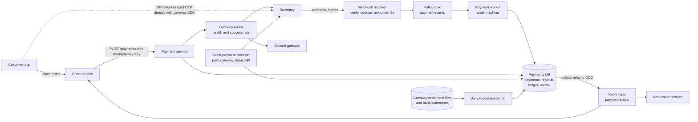

Read it in three lanes. **Top lane:** the order service asks the payment service to start a payment; the app then pays directly with the gateway's SDK, so card numbers and UPI PINs never touch Zomato's servers (this is what keeps you out of most PCI card-security scope). **Middle lane:** the gateway tells us the result by webhook; we verify, dedupe and push onto Kafka, and a worker moves the state machine. **Bottom lane:** two safety nets, a sweeper for payments stuck in PENDING and a daily reconciliation against settlement files.

### The main flow

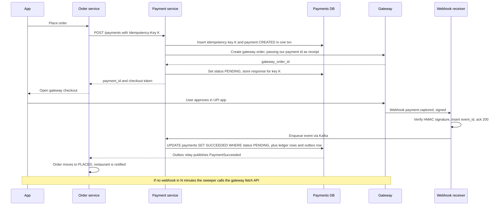

Notice the three separate database steps around the gateway call. That is deliberate, and it is the heart of the design.

### Payment state machine

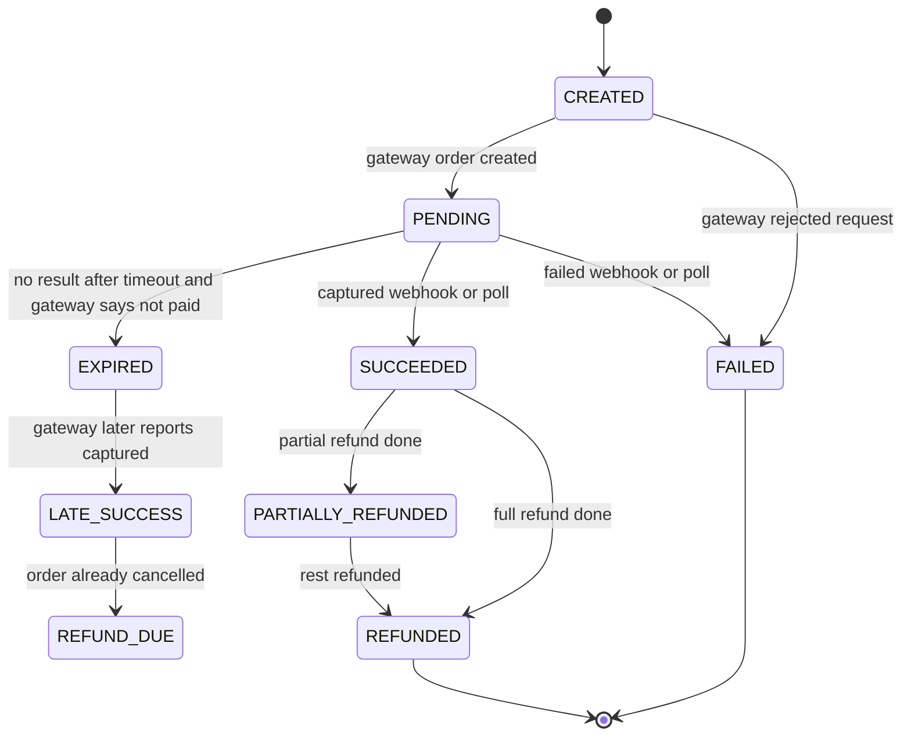

The rule that makes webhooks safe: **transitions only go forward, and every update is conditional on the current state.** `UPDATE payments SET status='SUCCEEDED' WHERE id=? AND status='PENDING'`. If a "failed" webhook arrives after "captured" (Razorpay does not guarantee order), the update matches zero rows and nothing happens. If the same webhook arrives twice, the second one also matches zero rows.

### Deep dive 1: idempotency keys, properly

An **idempotency key** is a unique string the client creates once per user intent ("pay for order 8812") and sends with every retry. The server remembers the key and the response, so a retry gets the stored response instead of a second charge.

> **Real world — Stripe:** Stripe's API accepts keys up to 255 characters (they suggest V4 UUIDs), may prune keys once they are at least 24 hours old, and **saves the status code and body of the first request once execution begins, including 500 errors**. A retry with different parameters is rejected as an error. Nothing is saved if the request conflicts with one that is still running, so that case can be retried ([Stripe docs](https://docs.stripe.com/api/idempotent_requests)). Clients retry with exponential backoff and random jitter so that retries don't arrive as a synchronized herd ([Stripe blog, 2017](https://stripe.com/blog/idempotency)).

> **Real world — Brandur Leach (ex-Stripe):** His Postgres design stores `idempotency_key`, `locked_at`, `request_params`, `response_code`, `response_body` and a `recovery_point`, with a unique index on `(user_id, idempotency_key)`. The request is split into **atomic phases**, each committed in its own transaction, and each advances the recovery point (`started` to `ride_created` to `charge_created` to `finished`). Calls to the outside world (a charge, an email, a Kafka publish) happen **between** phases and are treated as fallible. A **completer** process finishes abandoned requests, and a **reaper** deletes keys after about 72 hours ([brandur.org](https://brandur.org/idempotency-keys)).

> **Real world — Airbnb (via a secondary summary):** Airbnb's Orpheus library splits each payment request into **Pre-RPC** (record the idempotency key in the DB), **RPC** (call the provider) and **Post-RPC** (record the response). No service calls in the DB phases, **no DB transaction held open during the RPC**, and idempotency reads always go to the **primary, never a replica**, because replica lag could make a retry look new and charge twice. 5xx errors are retryable; 4xx are not ([summary](https://biweekly-engineering.beehiiv.com/p/handling-double-payments-airbnb-biweekly-engineering-episode-32), original post on Medium was blocked to the researcher).

Put together, the payment service does this on `POST /payments`:

1. **Phase 1 (one DB transaction, on the primary).** Insert the key. If it already exists: same request hash and a stored response, return it; same hash but still locked, return `409 Conflict, retry later`; different hash, return `422` "key reused with different body". Otherwise insert the payment as `CREATED`, set the recovery point to `started`, commit.
2. **The outside call, with no transaction open.** Call the gateway's create-order API, passing *our* payment ID as the gateway's receipt or reference field. If our process dies here, a retry can look up "is there already a gateway order with receipt pay_5521?" instead of creating a second one.
3. **Phase 2 (one DB transaction).** Store `gateway_order_id`, set `PENDING`, save the response against the key, set recovery point `finished`, commit.

> **Pause and think:** why not wrap all three steps in one big transaction? *Because the gateway call can take seconds. A transaction held open that long holds row locks and a DB connection the whole time. At peak this exhausts the connection pool, and everything else in the DB slows down. Worse, a rollback can't undo the gateway call, so the "atomic" transaction isn't atomic anyway.*

This is the same pattern as your Atlassian work: SQS consumers that must be idempotent because SQS delivers at least once. The only new thing is the external call in the middle.

### Deep dive 2: webhooks are the truth, the browser redirect is not

After the user pays, two things can tell us the result: the app (the gateway SDK calls back, or the browser redirects to our `callback_url`), and the **webhook**, a server-to-server HTTP POST from the gateway. The app's signal is a hint. The user can close the app, lose network, or tamper with it. The webhook is the truth.

> **Real world — Razorpay's webhook rules:** Your endpoint must respond within **5 seconds**, and any non-2xx counts as a failure. Razorpay retries with exponential backoff **for 24 hours**, and if it keeps failing, the webhook is **disabled** and you get an alert email. Delivery is **at-least-once**, so dedupe on the **`x-razorpay-event-id`** header. **Event order is not guaranteed.** If a webhook hasn't arrived within your time window, call the fetch APIs, and the browser `callback_url` is explicitly not a substitute for webhooks ([best practices](https://razorpay.com/docs/webhooks/best-practices/), [about webhooks](https://razorpay.com/docs/webhooks/)).

Each rule maps to a design decision:

| Razorpay rule | What we do |
|---|---|
| 5-second deadline | The receiver only verifies the signature, inserts into `webhook_events`, puts the event on Kafka, and returns 200. All real work happens in a worker. |
| At-least-once | `webhook_events.event_id` is the primary key. A duplicate insert fails, and we return 200 anyway (we already have it). |
| No ordering | Forward-only state machine with conditional updates. A late "failed" after "captured" is ignored and logged. |
| Disabled after 24h of failures | Alert on webhook error rate long before that. The sweeper (below) still settles payments even if webhooks stop. |
| Signature | Verify the HMAC-SHA256 of the raw body with the shared webhook secret, before parsing. Otherwise anyone could POST "payment captured" to our endpoint. |

### Deep dive 3: "payment pending" and the unknown outcome

This is the part the rejected candidate was missing. A payment can end in three ways from our side: we know it succeeded, we know it failed, or **we don't know**. The third happens constantly with UPI: the user approved in their UPI app, the bank debited them, but the gateway's response to us timed out. If you say "timeout means failure, cancel the order", you have just taken a customer's money and given them nothing.

The rules for the unknown case:

1. **Never treat a timeout as a failure.** Keep the payment `PENDING`. Show the user "Payment processing, we'll confirm in a few minutes", not "Payment failed, try again". If you tell them to try again, many will pay twice.
2. **Never retry the charge blindly.** If you retry, use the same idempotency key or the same gateway order, so the gateway recognises it.
3. **Ask, don't guess.** The sweeper runs every minute: `SELECT id FROM payments WHERE status='PENDING' AND created_at < NOW() - INTERVAL 2 MINUTE LIMIT 500`, and calls the gateway's fetch-payment API for each, with backoff (after 2 minutes, 5, 15, 60).
4. **Have a final timeout.** After, say, 30 minutes with the gateway confirming "not paid", mark `EXPIRED` and cancel the order. If a capture arrives *after* that (it happens), go to `LATE_SUCCESS` and refund automatically. The customer sees "refund initiated", which is annoying but honest.
5. **The order waits for the payment, not the other way round.** The order sits in `PAYMENT_PENDING`, and the restaurant is not told about it until the payment is `SUCCEEDED`. Zepto does exactly this with draft orders (see Q10).

What if the user pays twice, once from GPay and once from PhonePe, for the same order? Two gateway payments map to one order. The first `SUCCEEDED` wins (conditional update on the order), and the second is detected as "payment for an order that's already paid" and auto-refunded. Reconciliation would catch it anyway.

### Deep dive 4: the double-entry ledger

A **ledger** is the record of every money movement. **Double-entry** means every movement is written as at least two entries, debits and credits, that sum to zero. Money never appears or disappears; it moves from one account to another.

> **Real world — Modern Treasury:** Every transaction has at least two entries, and total debits must equal total credits. Store **immutable entries and derive balances** from them, rather than mutating a balance column ([Accounting for Developers](https://www.moderntreasury.com/journal/accounting-for-developers-part-i)).

A ₹500 order (₹420 food, ₹60 Zomato commission, ₹20 delivery fee), paid by UPI through Razorpay:

| Step | Account | Debit | Credit |
|---|---|---|---|
| Payment captured | gateway_clearing:razorpay (money the gateway owes us) | 500 | |
| | customer_order:8812 | | 500 |
| Order delivered (revenue recognised) | customer_order:8812 | 500 | |
| | restaurant_payable:4411 | | 420 |
| | zomato_commission_revenue | | 60 |
| | delivery_fee_revenue | | 20 |
| Gateway settles to our bank (next day, minus ₹9 fee) | bank:hdfc_current | 491 | |
| | gateway_fees_expense | 9 | |
| | gateway_clearing:razorpay | | 500 |

After settlement, `gateway_clearing:razorpay` is back to zero for this payment. That is the trick.

> **Real world — Stripe Ledger:** Stripe's Ledger is an immutable, append-only, double-entry log processing about **5 billion events a day**. Each producer system is modelled as a state machine whose events move funds between accounts. At steady state **clearing accounts are empty**, so **any clearing account with a nonzero balance means an event is missing, late or wrong**. 99.99% of dollar volume is verified within 4 days, and corrections are made by reverting and reprocessing, never by editing ([Stripe, Feb 2024](https://stripe.dev/blog/ledger-stripe-system-for-tracking-and-validating-money-movement)).

> **Real world — Uber LedgerStore:** Uber's immutable money-movement store holds over 2 trillion unique indexes. Strongly consistent indexes (built with a two-phase intent, write, commit) serve card authorization holds; eventually consistent indexes (materialized views) serve the payment history page ([Uber, Apr 2024](https://www.uber.com/blog/how-ledgerstore-supports-trillions-of-indexes/)).

Why bother instead of `UPDATE wallet SET balance = balance - 500`? Because a mutable balance can be wrong and nobody can tell *why*. With entries, any balance can be recomputed, every rupee has a history, and an audit simply replays entries. Mistakes are fixed with a new reversing transaction, never an edit. The `UNIQUE (source_type, source_id)` on `ledger_transactions` means a replayed event can't post twice.

### Deep dive 5: refunds, partial refunds and proration

A refund is a mini payment going the other way, with the same idempotency, webhook and state machine machinery.

```sql
BEGIN;
SELECT amount_paise, refunded_paise FROM payments WHERE id = :pid FOR UPDATE;   -- lock this payment row
-- application checks: refunded_paise + :amt <= amount_paise, else 422
INSERT INTO refunds (id, payment_id, amount_paise, status, reason, idem_key, created_at)
VALUES (:rid, :pid, :amt, 'REQUESTED', :reason, :key, NOW());
UPDATE payments SET refunded_paise = refunded_paise + :amt, version = version + 1 WHERE id = :pid;
COMMIT;
-- then, outside the transaction, call the gateway refund API with :rid as its reference
```

The row lock stops two support agents refunding the same item at the same moment and refunding ₹240 on a ₹120 item. Refunds then follow REQUESTED, PENDING, SUCCEEDED or FAILED, driven by refund webhooks and the sweeper.

**Proration.** Order: biryani ₹300, kebab ₹200, coupon ₹100 off. The kebab was missing. Refund ₹200? No. The coupon discounted the whole cart, so the kebab's share of the discount is ₹100 × 200/500 = ₹40, and the refund is ₹160. Store the per-line discount split at order time so refunds never have to guess.

**Refund to source vs to wallet.** Refunds to a UPI or card source take days at the bank. A refund to Zomato's own stored balance can be instant, because it is just two ledger entries inside our system. Offer both.

**Chargebacks and disputes** (the Z4 interviewer asked for this lifecycle). A chargeback is when the customer's bank forcibly reverses a payment because the customer disputed it with the bank. The gateway notifies us, money is held, and we either accept it or submit evidence (delivery proof, rider GPS trail, OTP handover logs).

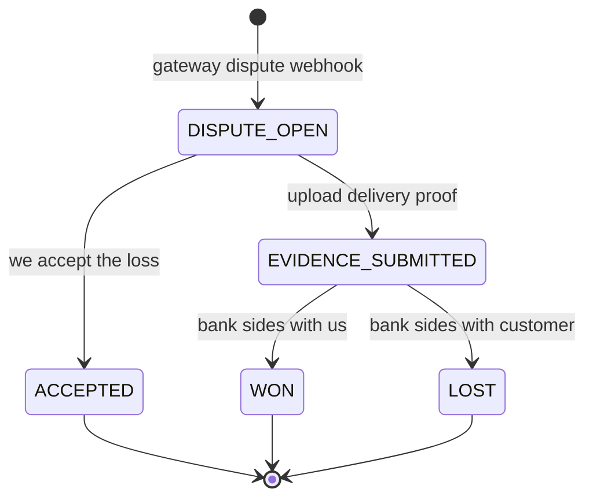

Each state change posts ledger entries: on open, debit `disputes_held`, credit `gateway_clearing`; on won, reverse it; on lost, move it to `chargeback_loss_expense`. Disputes have deadlines, so a delayed job (Q13) reminds the team before the evidence window closes.

### Deep dive 6: reconciliation

**Reconciliation** means comparing our records with someone else's records of the same money, line by line, and explaining every difference. Without it you only *believe* your system is right.

Three levels:

1. **Real time (minutes):** the stuck-payment sweeper above.
2. **Daily:** download the gateway's settlement report (every payment, refund and fee it settled to our bank). Match each line to our `payments` and `refunds` by `gateway_payment_id`. Then match the settlement total to the actual credit in our bank statement.
3. **Ledger invariants (continuous):** total debits equal total credits per transaction; every clearing account trends to zero after settlement (Stripe's trick).

Mismatch categories to name in the interview:

| What we see | Likely cause | Action |
|---|---|---|
| Gateway says captured, we say PENDING or FAILED | Webhook lost or ignored | Mark SUCCEEDED (if the order is alive) or auto-refund |
| We say SUCCEEDED, gateway has no record | Bug, or a fake success | Page someone. This should never happen |
| Amount differs | Currency or fee bug | Ledger adjustment plus a bug ticket |
| Refund in our DB, not at gateway | Refund API call failed after our commit | Retry the refund with the same reference |
| Clearing account nonzero for over 3 days | Missing settlement | Chase the gateway |

> **Real world — Zomato's own pattern:** Zomato's ads team rebuilt a Flink pipeline whose lost state had reset campaign counters, causing over-delivery and wrong billing. The fix emitted **incremental counts instead of running totals, plus an hourly reconciliation job as a fail-safe** ([Zomato blog, Apr 2025](https://www.zomato.com/blog/eliminating-bottlenecks-in-real-time-data-streaming-a-zomato-ads-flink-journey/)). Same lesson: never trust a single pipeline with money; always have an independent check.

### Deep dive 7: multiple gateways

> **Real world — Zomato and Swiggy:** On NYE, Zomato's payments team routed traffic away from individual gateways that were down ([Zomato blog](https://www.zomato.com/blog/our-learnings-from-nye/)). Swiggy wrote a few years ago about routing each transaction to the gateway most likely to succeed for that method, with separate models for netbanking, UPI and cards, and about 5% exploration traffic so they keep learning each gateway's success rate ([Swiggy Bytes, search snippet](https://bytes.swiggy.com/an-ml-approach-for-routing-payment-transactions-5a14efb643a8)).

A simple version: keep a rolling 5-minute success rate per (gateway, method, bank). Route to the best, send a small share to the others to keep measuring, and open a circuit breaker on a gateway whose success rate collapses. The one rule: **a payment, once created on gateway A, is settled on gateway A.** Failover applies to new payments only.

### Failure cases, explicitly

| # | Failure | What happens and what we do |
|---|---|---|
| 1 | User double-taps Pay | Same idempotency key, second request returns the first response |
| 2 | Our server crashes after the gateway order was created but before we saved it | Retry finds the key at recovery point `started`, looks up the gateway order by our receipt ID, continues |
| 3 | Gateway times out on create | Retry with same key. If still failing, circuit-break and offer another gateway for a *new* payment |
| 4 | User paid, webhook never arrives | Sweeper polls the fetch API and settles it |
| 5 | Webhook arrives twice or out of order | `event_id` dedupe and forward-only conditional update |
| 6 | Payment succeeds after we expired the order | LATE_SUCCESS, auto-refund, ledger entries both ways |
| 7 | Payment succeeded but order service is down | Outbox row is committed with the payment; relay publishes when Kafka or the order service is back |
| 8 | Refund API fails after we committed the refund row | Refund stays REQUESTED; sweeper retries with the same refund reference |
| 9 | Kafka consumer processes the same event twice | Conditional updates plus `UNIQUE (source_type, source_id)` on ledger transactions |
| 10 | Replica lag shows a key as missing | Idempotency reads go to the primary only (Airbnb's rule) |
| 11 | Fake "success" POSTed to our webhook URL | HMAC signature check rejects it |
| 12 | Gateway settles less than expected | Daily reconciliation flags it; clearing account stays nonzero |

### Trade-offs

- **Async webhook vs synchronous confirm:** async is robust but the user waits a few seconds on "processing". Update the UI from the SDK callback, but only a webhook or poll changes the database.
- **Strict ledger vs a balance column:** more rows and more thinking, in exchange for auditability. For money, always pay that cost.
- **SQL vs DynamoDB, Kafka vs SQS:** see the follow-ups; the short version is SQL and Kafka unless you have a specific reason.

### 60-second spoken summary

"Payments at Zomato are a correctness problem, not a scale problem: about 140 orders a second at the NYE peak. The order service calls a payment service with an idempotency key. The payment service writes the key and a CREATED payment in one transaction on the primary, calls the gateway with no transaction open, then records PENDING, which is Airbnb's pre-RPC, RPC, post-RPC split. The app pays directly with the gateway, so we never see card data. The webhook is the source of truth: we verify its HMAC, dedupe on Razorpay's event ID, ack within 5 seconds and process async, with a forward-only state machine so duplicates and out-of-order events do nothing. Timeouts are never failures: the payment stays PENDING, a sweeper polls the gateway, and late successes are auto-refunded. Every movement goes into an append-only double-entry ledger, and a daily reconciliation against settlement files plus Stripe's 'clearing accounts should be zero' check catches anything we missed. Refunds reuse the same machinery, with a row lock so we never refund more than was paid."

### Follow-ups they ask

**Q: The gateway call timed out. Did the charge happen?**
A: We don't know, and the design admits that. The payment stays PENDING, the user sees "processing", and we never blindly retry with a new key. The sweeper calls the gateway's fetch API with backoff. If the gateway confirms "not paid" after the final timeout, we expire it; if a capture shows up later, we auto-refund. Only the gateway can tell us the truth, so we ask it.

**Q: SQL or NoSQL for payments?**
A: SQL by default, because I need one transaction across the payment row, ledger entries and the outbox row, plus unique constraints as safety nets. It's also worth knowing that Zomato's billing platform moved from TiDB to DynamoDB and got 4x throughput at about half the cost, using a single-table design keyed by merchant, payout cycle and vertical ([AWS blog](https://aws.amazon.com/blogs/database/unlocking-performance-scalability-and-cost-efficiency-of-zomatos-billing-platform-by-switching-from-tidb-to-dynamodb/)). So NoSQL can work for high-volume billing if you design the keys and conditional writes carefully. If they push "MySQL or Postgres?", give the honest answer: either works, and say if you lack production experience comparing them.

**Q: Kafka or SNS+SQS for payment events?**
A: Kafka when many services consume the same events (orders, notifications, finance, analytics), when I want replay for rebuilding a ledger view, and when I want per-payment ordering by keying on payment ID. SNS fan-out to SQS queues is simpler to run, gives per-message retries and DLQs out of the box, but has no replay and only FIFO queues give ordering. Either way consumers must be idempotent, because both are at-least-once.

**Q: Doesn't Kafka's exactly-once solve duplicates?**
A: Only for Kafka-to-Kafka processing. Confluent is explicit that side effects in external systems, like calling a gateway or writing to our DB, still need idempotency ([Confluent](https://www.confluent.io/blog/exactly-once-semantics-are-possible-heres-how-apache-kafka-does-it/)). So I keep the event-ID dedupe and conditional updates.

**Q: How do restaurants get paid?**
A: A payout job runs per settlement cycle (say weekly). It sums each restaurant's `restaurant_payable` ledger balance, subtracts adjustments and refunds charged to them, creates a payout record with an idempotency key of (restaurant, cycle), and calls the bank payout API. The payout posts ledger entries (debit restaurant_payable, credit bank). If the job crashes halfway, re-running it skips payouts that already exist for that cycle.

**Q: The customer says they were charged but the app shows failed. How do you debug?**
A: Look up the order's payments by order ID, then each payment's webhook events and sweeper logs. Usually the gateway shows captured and we never processed it: a webhook failure, or a bug in the state machine. The fix is immediate (mark succeeded or refund), and reconciliation should have caught it within the day. If it didn't, the reconciliation job has a gap, and that is the real bug.

**Q: What about audit and compliance in India?**
A: Keep the ledger append-only, so every change is a new row with who, when and why. Keep raw webhook payloads. Generate tax invoices per order with GST broken out by component. Keep payment data in India, which as I understand it is what RBI's data localisation direction requires for payment systems, though the gateway carries most of that burden for a merchant. I'd say clearly that the legal details are something I'd confirm with the compliance team rather than guess.

---

## Q9. Design seat and ticket booking (BookMyShow, Zomato District)

### Why they ask it

Ticket and seat booking appeared in **12 reports**, more than any classic HLD except order flows. Blinkit asks it at SDE-1 and SDE-2: "two users selecting the same seat at the same time, pessimistic vs optimistic locking, Redis" ([B3](https://leetcode.com/discuss/post/8331559/)), "spurious load, prevention of double booking, quick search" ([B13](https://leetcode.com/discuss/post/5869260/)), and an LLD version with admins adding shows ([B9](https://leetcode.com/discuss/post/4470525/)). Swiggy asked train booking with concurrency control and waitlists; Zepto asked IRCTC with "concurrent booking handled fairly"; Meesho asked "two patients booking the same slot, like BookMyShow with 1000s of users".

It also matters because it is Zomato's own business now. On 21 Aug 2024 Zomato agreed to buy Paytm's ticketing business (TicketNew and Insider) for ₹2,048 crore, and it launched as the **District** app ([The Week](https://www.theweek.in/wire-updates/business/2024/08/21/del88-biz-ld-paytm-zomato.html)). District has not published how it locks seats or runs queues, so we'll say "not public; here's how it's typically done".

### Clarifying questions

1. **Reserved seating (movies) or general admission (a concert floor with 5,000 standing tickets)?** Different data models. We'll do both.
2. **How long can a user hold seats while paying?** Assume 10 minutes for movies. BookMyShow's Coldplay Ahmedabad sale gave each admitted user **4 minutes to pick up to 4 tickets**.
3. **Ticket limit per user?** BookMyShow cut it from 8 to 4 after the Coldplay Mumbai sale.
4. **Do we expect "hot" on-sales (a Coldplay drop) or just Friday-night movies?** Both, and they are almost different systems.
5. **Is payment ours or a gateway's?** A gateway, using Q8.

### Requirements

**Functional:** browse shows; see a seat map with live availability; select seats and hold them for a time; pay; get a confirmed ticket; holds expire automatically; cancel (if allowed).

**Non-functional:**
- **No double booking, ever.** This is the one hard correctness rule.
- Seat map can be a few seconds stale. The hold step is where truth is checked.
- Survive on-sales where demand is 100x to 1000x the supply, and be **fair** while doing it.

### Estimates (assumptions labelled)

- BookMyShow sells up to **200M tickets a year** (pre-COVID run rate, from an AWS case study ([AWS](https://aws.amazon.com/blogs/business-intelligence/how-bookmyshow-saved-80-in-costs-by-migrating-to-an-aws-modern-data-architecture/))). That is about 550K tickets a day, **about 6 per second on average**. *Assumption:* evening peaks at 10x, so about 60 tickets/s. Any single database handles that.
- A hot on-sale is a different animal. BookMyShow's CEO said they were "underprepared for **10 million instances**" hitting the site for Coldplay, largely bots ([Business Today](https://www.businesstoday.in/amp/india/story/we-were-underprepared-for-the-bots-bookmyshow-ceo-on-coldplay-ticketing-row-462362-2025-01-29)). *Assumption:* a stadium has about 50,000 seats. So 10M people want 50K seats: **200 people per seat**.
- The insight to say aloud: **the database is not the bottleneck in an on-sale. Admission is.** We can sell 50K seats in minutes with a normal DB if we let in only as many people as can actually buy. The design problem is the 9.95M who won't get a seat.

> **Real world — Ticketmaster, Eras Tour (Nov 2022):** 3.5M people registered for Verified Fan, about 1.5M got codes, and 2M were waitlisted. The site took **3.5 billion system requests, about 4x its previous peak**, and sold over 2M tickets that day. About **15% of interactions had problems**, including passcode-validation errors that made fans lose tickets already in their carts ([Ticketmaster](https://business.ticketmaster.com/press-release/taylor-swift-the-eras-tour-onsale-explained/)). Live Nation later told the US Senate that bot traffic was **3x anything seen before** and that bots attacked the access-code servers for the first time ([Semafor](https://www.semafor.com/article/01/24/2023/heres-how-ticketmaster-explained-the-taylor-swift-tour-debacle-to-congress), secondary). Notice what broke: not seat locking, but the code-validation service in front of it.

### APIs

```http
GET  /v1/shows/{show_id}/seatmap
  -> { "version": 1182, "seats": [{"id":"F12","status":"AVAILABLE","price_paise":35000}, ...] }

POST /v1/shows/{show_id}/holds          Idempotency-Key header
  { "seat_ids": ["F12","F13"] }
  -> 201 { "hold_id":"h_901", "expires_at":"2026-10-23T19:10:00Z", "amount_paise":70000 }
  -> 409 { "error":"SEATS_TAKEN", "seats":["F13"] }

DELETE /v1/holds/{hold_id}              (user backs out, release early)

POST /v1/holds/{hold_id}/confirm        (called by the payment flow after success)
  -> 200 { "booking_id":"b_7731", "tickets":[...] }

POST /v1/events/{event_id}/queue        (waiting room, hot on-sales only)
  -> { "queue_token":"...", "position": 48211, "eta_seconds": 960 }
```

### Data model

```sql
CREATE TABLE shows (
  id         BIGINT PRIMARY KEY,
  screen_id  BIGINT NOT NULL,
  title_id   BIGINT NOT NULL,
  starts_at  TIMESTAMP NOT NULL,
  INDEX idx_title_time (title_id, starts_at)
);

CREATE TABLE show_seats (                 -- one row per seat per show
  show_id         BIGINT NOT NULL,
  seat_id         VARCHAR(8) NOT NULL,     -- F12
  price_paise     BIGINT NOT NULL,
  status          VARCHAR(10) NOT NULL,    -- AVAILABLE, HELD, BOOKED
  hold_id         BIGINT NULL,
  hold_expires_at TIMESTAMP NULL,
  booking_id      BIGINT NULL,
  version         INT NOT NULL DEFAULT 0,
  PRIMARY KEY (show_id, seat_id),
  INDEX idx_expiry (status, hold_expires_at)   -- for the sweeper
);

CREATE TABLE holds (
  id          BIGINT PRIMARY KEY,
  show_id     BIGINT NOT NULL,
  user_id     BIGINT NOT NULL,
  status      VARCHAR(10) NOT NULL,        -- ACTIVE, CONFIRMED, EXPIRED, RELEASED
  expires_at  TIMESTAMP NOT NULL,
  idem_key    VARCHAR(255) NOT NULL UNIQUE
);

CREATE TABLE bookings (
  id          BIGINT PRIMARY KEY,
  hold_id     BIGINT NOT NULL UNIQUE,      -- one booking per hold, so a double confirm is harmless
  user_id     BIGINT NOT NULL,
  show_id     BIGINT NOT NULL,
  payment_id  BIGINT NOT NULL,
  status      VARCHAR(10) NOT NULL,        -- CONFIRMED, CANCELLED
  created_at  TIMESTAMP NOT NULL
);

CREATE TABLE booking_seats (               -- last line of defence against double booking
  booking_id  BIGINT NOT NULL,
  show_id     BIGINT NOT NULL,
  seat_id     VARCHAR(8) NOT NULL,
  PRIMARY KEY (show_id, seat_id)           -- the DB itself refuses a second booking of a seat
);
```

`booking_seats` with `PRIMARY KEY (show_id, seat_id)` is a belt-and-braces guarantee. Even if every lock above it has a bug, the database will refuse to insert the same seat twice for one show. (If cancellations free seats for resale, move cancelled rows to a history table, or use a partial unique index on active rows in Postgres.)

### Architecture

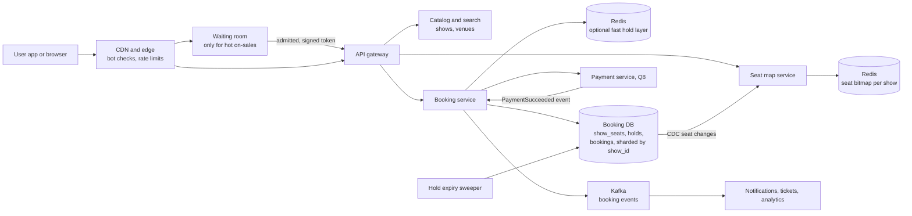

Shard the booking DB by `show_id`. Every seat operation touches exactly one show, so a show never spans shards and there are no cross-shard transactions.

### Two users, one seat: the core race

Here is what goes wrong without care. Two transactions both read F12 as available, both write HELD, and both users think they have it.

```
time   Asha's request                         Ravi's request
t1     SELECT status FROM show_seats
       WHERE seat='F12'   -> AVAILABLE
t2                                            SELECT ... -> AVAILABLE
t3     UPDATE ... SET status='HELD', hold=A
t4                                            UPDATE ... SET status='HELD', hold=R   <- overwrites Asha
t5     "You have F12!"                        "You have F12!"                        <- double booking
```

The bug is the gap between reading and writing (a "check-then-act" race). Every fix closes that gap.

### Deep dive 1: three ways to hold seats

**Option A: atomic conditional update (recommended default).** Put the check inside the write.

```sql
BEGIN;
UPDATE show_seats
SET status = 'HELD', hold_id = :hold, hold_expires_at = NOW() + INTERVAL 10 MINUTE, version = version + 1
WHERE show_id = :show
  AND seat_id IN ('F12','F13')
  AND (status = 'AVAILABLE' OR (status = 'HELD' AND hold_expires_at < NOW()));  -- expired holds count as free
-- application: if rows_affected <> 2 then ROLLBACK and return 409, else insert into holds and COMMIT
COMMIT;
```

The database locks each row as it updates it, so if Asha and Ravi run this at the same moment, one of them waits for the other's row lock, re-checks the WHERE clause, finds `status='HELD'`, and matches zero rows. All-or-nothing across seats comes from the transaction plus the row-count check. This is optimistic in spirit (no lock taken before deciding), fast, and fails quickly.

**Option B: pessimistic lock with `SELECT ... FOR UPDATE`.**

```sql
BEGIN;
SELECT seat_id, status, hold_expires_at FROM show_seats
WHERE show_id = :show AND seat_id IN ('F12','F13')
ORDER BY seat_id                -- always lock in the same order
FOR UPDATE;
-- application checks every seat is free, then:
UPDATE show_seats SET status='HELD', hold_id=:hold, hold_expires_at=... WHERE show_id=:show AND seat_id IN ('F12','F13');
COMMIT;
```

Correct, and useful when the decision needs logic the WHERE clause can't express ("don't leave a single orphan seat between two bookings"). The cost: other users wanting those rows wait. The trap: **deadlocks**. If Asha locks F12 then F13 while Ravi locks F13 then F12, each waits for the other forever (until the DB kills one). `ORDER BY seat_id` makes everyone lock in the same order, which removes that deadlock.

**Option C: Redis holds in front of the DB.** For a hot show, take the hold in Redis first:

```
SET hold:{show_77}:F12 h_901 NX PX 600000     -- NX: only if not exists. PX: expires in 10 minutes
```

For several seats at once, a short Lua script checks all keys are free and sets them all, atomically (Redis runs one script at a time). Redis answers in well under a millisecond and absorbs the "everyone clicks F12" storm so the DB only sees winners. The TTL makes expiry automatic.

| | A: conditional UPDATE | B: SELECT FOR UPDATE | C: Redis SET NX in front |
|---|---|---|---|
| Correctness source | DB row lock inside the write | DB row lock held for the transaction | Redis key, **but DB must still check** |
| Speed under contention | Good | Worse, waiters queue | Best |
| Complex rules (no orphan seats) | Hard | Easy | Hard, needs Lua |
| Expiry | `hold_expires_at` plus sweeper | Same | TTL, automatic |
| Failure risk | Low | Deadlocks if lock order differs | Redis failover can lose a hold |

> **Pause and think:** with Redis holds, do we still need the conditional update in the DB at confirm time? *Yes. Redis is an efficiency layer, not the source of truth. Read the next section.*

### Deep dive 2: why a Redis lock alone is not enough (Redlock and fencing)

> **Real world — Redis docs:** A single-instance lock is `SET resource random_value NX PX 30000`, released with a compare-and-delete script so you never delete someone else's lock. Setups that rely on replica failover are unsafe because **replication is asynchronous**: the primary can acknowledge the lock and crash before the key reaches the replica, so a second client gets the same lock. The docs recommend **fencing tokens** and note that Redis TTLs don't use a monotonic clock ([Redis docs](https://redis.io/docs/latest/develop/clients/patterns/distributed-locks/)). **Redlock** uses 5 independent primaries and counts a lock only if a majority (3 or more) agree.

> **Real world — Kleppmann vs antirez (2016):** Martin Kleppmann separated **efficiency locks** (a lost lock means wasted work; a single Redis is fine) from **correctness locks** (a lost lock means corrupted data). His key example: a process takes a lock, then hits a **stop-the-world GC pause** longer than the lease. The lock expires, someone else takes it, the first process wakes up and writes anyway. His fix is a **fencing token**: a number that increases with every lock grant, and the storage rejects writes carrying an older number ([Kleppmann](https://martin.kleppmann.com/2016/02/08/how-to-do-distributed-locking.html)). Redis's author replied that Redlock needs only bounded clock drift, and that a system able to enforce fencing barely needs a strong lock, while conceding Redis should use monotonic time ([antirez](http://antirez.com/news/101)).

How this lands in our design: the seat row's `hold_id` and `version` act as the fence. Confirmation is

```sql
UPDATE show_seats SET status='BOOKED', booking_id=:b
WHERE show_id=:show AND seat_id IN (...) AND status='HELD' AND hold_id=:my_hold AND hold_expires_at > NOW();
```

If my Redis lock silently expired during a GC pause and someone else now holds the seat, their `hold_id` is on the row and my update matches zero rows. Redis gave us speed; the database gave us correctness. That one sentence answers most locking follow-ups.

### Deep dive 3: hold expiry and the late payment

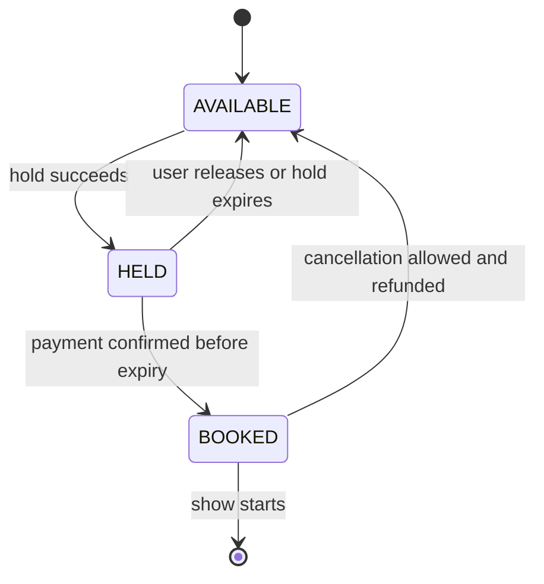

Expiry works in two layers. **Lazy expiry:** every hold query treats `HELD AND hold_expires_at < NOW()` as free (it's in Option A's WHERE clause), so a seat is usable the instant its hold expires, even if no job has run. **Sweeper:** every 30 seconds, `UPDATE show_seats SET status='AVAILABLE', hold_id=NULL WHERE status='HELD' AND hold_expires_at < NOW() LIMIT 1000`, so the seat map shows the truth and the `holds` rows get marked EXPIRED.

The ugly case: the user paid at minute 9:58, but the webhook arrives at minute 10:30. The confirm update fails because the hold expired. Two options: if the seats are still free, re-hold and confirm them (most of the time, nobody grabbed them in 30 seconds); otherwise refund automatically and apologise. To make this rarer, stop accepting payment initiation when less than a minute of hold remains, and extend the hold by a couple of minutes once the user is on the gateway page.

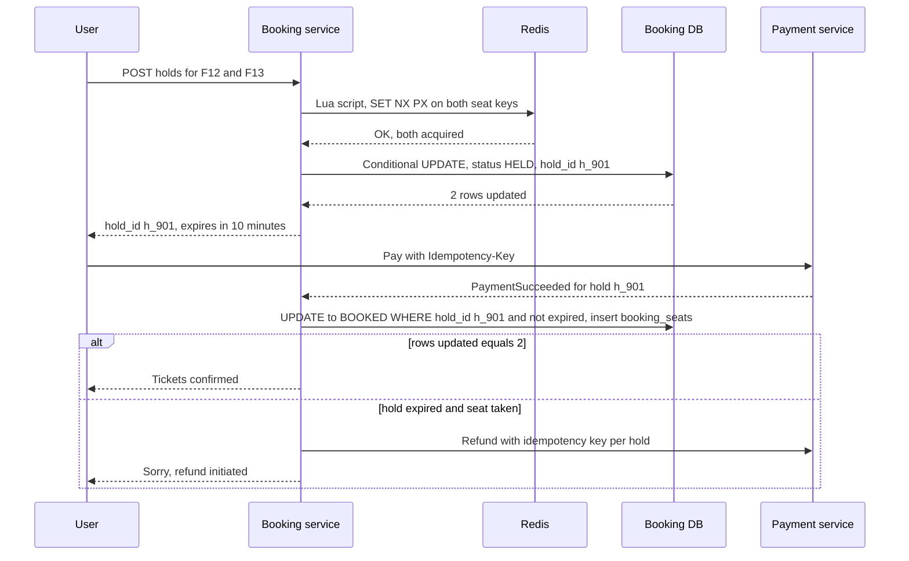

### Deep dive 4: the waiting room for hot on-sales

A **virtual waiting room** is a page in front of the booking system that holds users and lets them in at a rate the system can serve. Everyone admitted gets a signed token (a cookie or JWT) that the booking APIs check; anyone without one is sent back to the queue.

> **Real world — BookMyShow, Coldplay India (2024):** For the Mumbai sale on 22 Sep 2024 the site went down just before opening (press reported 15 to 20 minutes; the CEO later said about 9.5 minutes), and fans then saw queues of 6 to 10 lakh people ([Business Today](https://www.businesstoday.in/india/story/coldplay-india-tour-2025-band-adds-3rd-mumbai-show-amid-ticket-chaos-on-bookmyshow-details-here-446947-2024-09-22)). The CEO said the original queue was **linear (first come, first served)**; later shows used **randomised token IDs**, and the per-transaction limit was cut **from 8 to 4** ([Business Today](https://www.businesstoday.in/amp/india/story/we-were-underprepared-for-the-bots-bookmyshow-ceo-on-coldplay-ticketing-row-462362-2025-01-29)). For Ahmedabad (16 Nov 2024), users entered a waiting room between 11:00 and 11:59, arriving early did not help, at 12:00 everyone got a **random position**, and each admitted user had **4 minutes to pick up to 4 tickets** ([WION](https://embed.wionews.com/entertainment/coldplay-fans-upset-once-again-as-ahmedabad-concert-queues-go-in-lakhs-776663)). The Mumbai sale ended in a police complaint about bots and resale, so fairness is a real requirement, not a nice-to-have.

> **Real world — Queue-it and Cloudflare:** Queue-it's default is FIFO, but for scheduled sales early arrivals wait in a **pre-queue with no position**, are **randomised at start time**, and later arrivals join FIFO behind them, removing the advantage of refreshing at 11:59 ([Queue-it](https://queue-it.com/blog/first-in-first-out-randomization)). Cloudflare's Waiting Room gives each user an encrypted cookie with a bucket (first visit rounded to the minute); edge workers report counts to a per-data-centre Durable Object, which reports to a global one. **Free slots = active-user limit minus current active users**, handed to the oldest buckets first, and each worker gets its share of slots so it can **admit locally without coordinating** ([Cloudflare](https://blog.cloudflare.com/building-waiting-room-on-workers-and-durable-objects)).

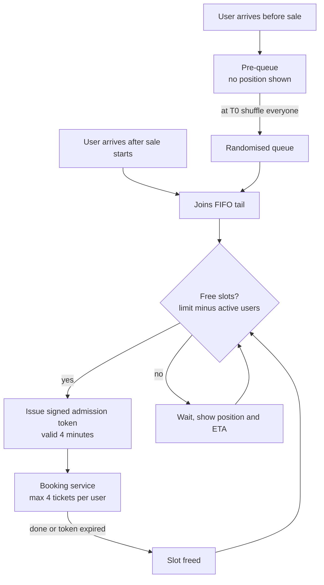

Design notes for the waiting room:

- **Admit by capacity, not by a fixed rate.** If 5,000 users can be in checkout at once and 300 just finished, admit 300 more.
- **The queue lives at the edge** (CDN workers, or a separate small service with Redis), so 10M waiting users never touch the booking DB. A queue position is a Redis sorted set entry or just a counter.
- **Show an ETA:** position ÷ admission rate. 60 people ahead at 30 per minute is 2 minutes (Cloudflare's own example).
- **Bots:** per-account and per-device caps, CAPTCHA on entry, verified accounts (phone OTP), and protect the token or code validation service, because that is what fell over at Ticketmaster.
- **Ticket cap per user** (4) is both fairness and capacity: it reduces the number of seats each admitted user can grab.

### Deep dive 5: general admission (no seat numbers)

A concert floor with 5,000 identical tickets is a counter, not a seat map.

```sql
UPDATE ticket_tiers SET held = held + :n
WHERE id = :tier AND sold + held + :n <= capacity;     -- 0 rows means sold out
```

The problem: every buyer hits **one row**. At a few thousand requests a second, row-lock waiting becomes the bottleneck (a "hot row"). Fixes:

1. **Redis counter as the gate:** a Lua script does "if remaining >= n then DECRBY remaining n, return OK". Persist each successful hold to the DB asynchronously, with the hold ID, and reconcile counts.
2. **Split the counter:** store the 5,000 tickets as 50 rows of 100. Each request picks a random row with stock. Contention falls 50x; the total is the sum of rows.
3. **Pre-generate tickets:** insert 5,000 ticket rows and have buyers claim one with `SELECT ... FOR UPDATE SKIP LOCKED LIMIT n` (skip rows someone else is claiming).

### Seat map reads

The seat map is read far more than written: thousands of people stare at the same show. Store it as a **bitmap** in Redis (one bit per seat: 1 means taken; 500 seats is 63 bytes), updated from DB changes via CDC. Serve it with a version number and let clients poll every few seconds, or push changes over SSE for hot shows. It can be stale; the hold call is the real check, and a 409 tells the user to pick again.

### Failure cases

| Failure | Handling |
|---|---|
| Two users click the same seat | One conditional update wins; the other gets 409 and a refreshed map |
| Redis primary fails over and loses holds | DB `hold_id` check at hold and confirm time; at worst one user sees "seat no longer available" |
| Payment succeeds after hold expiry | Re-hold if free, otherwise auto-refund |
| Payment webhook delivered twice | `bookings.hold_id UNIQUE` and conditional update make the second a no-op |
| Sweeper is down | Lazy expiry in the WHERE clause keeps seats bookable; the map is just staler |
| Deadlock on multi-seat lock | Lock in sorted seat order; DB kills one transaction, client retries |
| 10M users at T0 | Waiting room at the edge, admission by capacity, bots filtered before the queue |
| Booking DB shard for a hot show is overloaded | Redis gate in front, admission control upstream; all other shows are unaffected |

### Trade-offs

- **Hold length:** long holds are kind to slow payers but lock seats away from everyone else. On-sales use short windows (BookMyShow gave 4 minutes), normal shows 10.
- **FIFO vs randomised queue:** FIFO rewards bots and whoever refreshes hardest; a randomised pre-queue is fairer but feels arbitrary. BookMyShow moved to random.
- **Seat-map freshness vs cost:** push updates for hot shows, polling for the rest.

### 60-second spoken summary

"Seat booking has one hard rule: never sell a seat twice. I keep a row per seat per show with a status, a hold ID and an expiry. Holding seats is one conditional update, `SET HELD WHERE status is AVAILABLE or the old hold expired`, inside a transaction, and I check that the row count equals the seats requested, so two racing users can't both win. For hot shows I add a Redis `SET NX PX` gate so the DB only sees winners, but Redis is only for speed; the DB's hold ID acts as a fencing token at confirm time, which covers the GC-pause and failover problems Kleppmann describes. Holds expire lazily in the WHERE clause and via a sweeper; a late payment either re-holds or refunds. A `booking_seats` primary key on show and seat is the final guard. For an on-sale like Coldplay, where BookMyShow saw 10 million instances for a few tens of thousands of seats, the problem is admission, not the DB: a waiting room at the edge, randomised at T0 like Queue-it and BookMyShow's later sales, admitting by free capacity like Cloudflare, with a 4-ticket cap and bot checks."

### Follow-ups they ask

**Q: Optimistic or pessimistic locking here?**
A: For seat holds I use an atomic conditional update, which is optimistic in style: no lock is taken before deciding, and a loser just gets zero rows and a 409. Pessimistic `SELECT FOR UPDATE` is right when I need to read several rows and apply logic before writing (like the no-single-orphan-seat rule), but then I lock in sorted order to avoid deadlocks. With version-number optimistic locking (read version, write `WHERE version = v`), conflicts on a hot seat cause lots of retries, so it's worse than the conditional update for this case.

**Q: Why not just use Redis and skip the database?**
A: Redis replication is async, so a failover can lose a hold and hand the seat to two people, and a GC pause can outlive a lock's TTL. For a correctness lock you need a fencing check where the data lives. Also, bookings are money and need durability, queries and audits. Redis is my fast gate; the DB is the truth. This is the same trap as Blinkit's "assume infinite money, why not replace the DB with a cache?" question.

**Q: What if two people want seats next to each other and only scattered singles are left?**
A: The seat map shows it and they choose. If the product wants "best available, together", the booking service searches for a contiguous block in the bitmap and tries to hold it; if the hold fails, search again. Many cinemas also forbid leaving a single empty seat between bookings; that rule needs the read-then-decide flow under `SELECT FOR UPDATE` on that row of seats.

**Q: How would IRCTC-style train booking differ?**
A: A seat is sold per segment of the journey, not per train. Seat 23 can be sold Delhi to Kanpur and again Kanpur to Lucknow. So availability is per (seat, segment), and a booking must hold every segment between source and destination atomically. Waitlists are queues per class per train, promoted when a cancellation frees the right segments. A Zepto candidate scored by introducing exactly this "segment" entity.

**Q: How do you stop bots in an on-sale?**
A: Layers. Verified accounts (phone OTP) before the sale; a CAPTCHA at queue entry; per-account, per-device and per-payment-instrument limits; a random pre-queue so speed doesn't help; signed short-lived admission tokens bound to the account; and a ticket cap. And protect whatever validates entry (codes, tokens), because Ticketmaster's access-code servers were what bots hit hardest.

**Q: District hasn't published its design. What would you say if asked "how does District do it"?**
A: That it's not public, and then describe this standard approach. Bluffing internal details is worse than saying you don't know; a Zomato interviewer told one candidate exactly that.

---

## Q10. Design quick-commerce inventory and checkout (Blinkit, Zepto, Instamart)

### Why they ask it

Blinkit is an Eternal company, and Zepto's signature SDE-1 and SDE-2 question is "orders and deliveries in a quick-commerce platform: inventory, order prioritisation at peak, payment methods", asked to at least four candidates, with "SQL or NoSQL per component, with reasons" and "add-to-cart and place-order APIs with edge cases and error handling" ([P1](https://leetcode.com/discuss/post/5796138/), [P2](https://leetcode.com/discuss/post/5796357/)). Meesho's version had the exact trap: **block inventory at createOrder and decrement at confirmOrder** ([report](https://leetcode.com/discuss/post/5925685/)). Flipkart asked "a flash sale for 15 minutes under massive traffic, no overselling or underselling" ([F8](https://leetcode.com/discuss/post/8567797/)).

> **Real world — Blinkit:** Eternal's Oct 2026 shareholder letter describes quick commerce as "real-time inventory checks against a specific dark store, picker assignment, dispatch, all within a 10-minute delivery window", which it calls "sequences of tightly coupled, real-time handshakes". Blinkit ran **2,751 stores** that quarter and plans over 3,500 by Mar 2027 ([Eternal Q2FY27](https://www.eternal.com/blog/q2fy27)). In early 2024 it reported an average delivery time of **12.5 minutes** and a **fill rate above 99%** ([investor overview](https://b.zmtcdn.com/investor-relations/Zomato_overview_May-24.pdf)). Fill rate is the share of ordered items actually delivered, which is exactly "did we oversell?".

One honesty note before we design: **no Indian quick-commerce company has published how it prevents overselling.** The research found only interview-prep blogs. So the reservation design below is "the standard approach", not "what Blinkit does". Say so if asked.

### Clarifying questions

1. Is inventory per dark store, or shared? (Per store. A **dark store** is a small warehouse closed to walk-in customers, serving a few kilometres.)
2. When do we reserve stock: add to cart, checkout, or payment? (This is the key design choice; propose checkout.)
3. Payment methods? COD changes things: no payment wait, so confirm immediately.
4. Substitutions allowed if an item is missing at picking?
5. Flash sales on single items (₹1 deals)? That's the hot-row case.

### Requirements

**Functional:** map the user's location to a store; show only what that store has; add to cart; checkout reserves stock; pay; confirm; pick, pack, dispatch; release stock on failure or timeout.

**Non-functional:** never confirm an order the shelf can't fill; browsing can be a few seconds stale; checkout in well under a second; the whole flow fits a 10-minute promise, so picking must start seconds after payment.

### Estimates (assumptions labelled)

- 2,751 stores (sourced). *Assumption:* about 6,000 SKUs per store, so about **16M (store, SKU) rows**. At 100 bytes each, 1.6 GB: fits in one DB and comfortably in Redis.
- *Assumption:* 2M orders a day across stores, 3x peak, so about **70 orders/s** at peak, each with about 6 lines: **about 420 reservation updates/s**. Spread over 2,751 stores, that's well under one per second per store, except for a hot SKU in a flash sale, which can be thousands per second on one row.
- Browsing is 50 to 100x checkout, so reads must come from a cache or search index, never the inventory DB.

### APIs

```http
GET  /v1/serviceability?lat=28.45&lng=77.02     -> { "store_id": 1182, "eta_min": 11 }
GET  /v1/stores/1182/search?q=milk              -> items with price and an in_stock hint
POST /v1/cart/items      { "store_id":1182, "sku_id":"amul-taaza-500", "qty":2 }   -> soft check only
POST /v1/checkout        Idempotency-Key header
     { "cart_id":"c_77", "payment_method":"UPI" }
  -> 201 { "draft_order_id":"d_901", "status":"PAYMENT_PENDING", "reserved_until":"...", "payable_paise": 21400 }
  -> 409 { "error":"OUT_OF_STOCK", "lines":[{"sku_id":"amul-taaza-500","available":1}] }
POST /internal/orders/confirm   { "draft_order_id":"d_901", "payment_id":"pay_22" }   -> idempotent
```

### Data model

```sql
CREATE TABLE store_inventory (
  store_id    INT NOT NULL,
  sku_id      BIGINT NOT NULL,
  on_hand     INT NOT NULL CHECK (on_hand >= 0),      -- physically on the shelf
  reserved    INT NOT NULL DEFAULT 0 CHECK (reserved >= 0),
  version     INT NOT NULL DEFAULT 0,
  updated_at  TIMESTAMP NOT NULL,
  PRIMARY KEY (store_id, sku_id),
  CHECK (reserved <= on_hand)                          -- the DB itself forbids overselling
);

CREATE TABLE reservations (
  id          BIGINT PRIMARY KEY,
  draft_order_id BIGINT NOT NULL,
  store_id    INT NOT NULL,
  sku_id      BIGINT NOT NULL,
  qty         INT NOT NULL,
  status      VARCHAR(10) NOT NULL,     -- HELD, COMMITTED, RELEASED
  expires_at  TIMESTAMP NOT NULL,
  UNIQUE (draft_order_id, sku_id),
  INDEX idx_expiry (status, expires_at)
);

CREATE TABLE inventory_movements (     -- append-only stock journal, like a ledger for units
  id          BIGINT PRIMARY KEY,
  store_id    INT NOT NULL,
  sku_id      BIGINT NOT NULL,
  delta       INT NOT NULL,            -- +50 inward, -2 sold, -1 damaged
  reason      VARCHAR(20) NOT NULL,    -- INWARD, SALE, DAMAGE, AUDIT_ADJUST, RETURN
  ref_id      BIGINT NULL,             -- order or transfer id
  created_at  TIMESTAMP NOT NULL,
  UNIQUE (reason, ref_id, sku_id)      -- the same order can't deduct twice
);

CREATE TABLE draft_orders (
  id          BIGINT PRIMARY KEY,
  user_id     BIGINT NOT NULL,
  store_id    INT NOT NULL,
  status      VARCHAR(20) NOT NULL,    -- PAYMENT_PENDING, CONFIRMED, TERMINATED
  amount_paise BIGINT NOT NULL,
  idem_key    VARCHAR(255) UNIQUE NOT NULL,
  created_at  TIMESTAMP NOT NULL,
  INDEX idx_pending (status, created_at)
);
```

`available = on_hand - reserved`. The two `CHECK` constraints mean even buggy code can't push the database into "reserved more than we have".

### Architecture

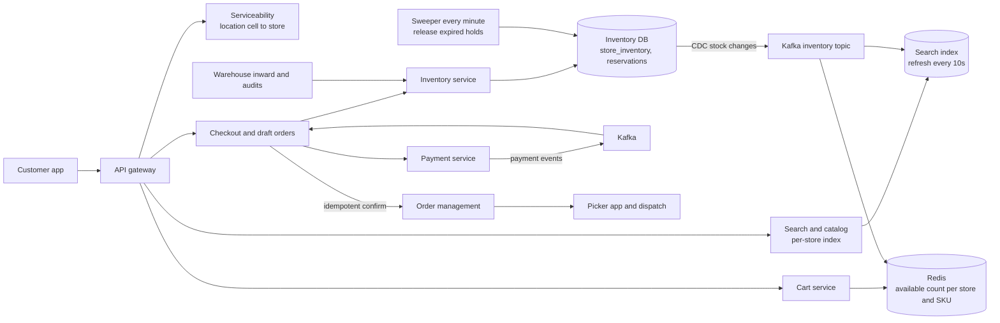

> **Real world — Zepto search:** Each of Zepto's hundreds of hubs has its own inventory, pricing and assortment, and search resolves against the customer's hub, not a global catalogue. Zepto raised its OpenSearch refresh interval from 1 s to 10 s, which was acceptable because stock status is only a tiebreaker in ranking and **final availability is re-checked against the real-time inventory service after retrieval** ([AWS blog, Aug 2026](https://aws.amazon.com/blogs/big-data/how-zepto-powers-sub-second-search-using-opensearch-service-or2-instances/)). Inventory, catalog, pricing and offers each publish to their own Kafka topic. Grofers (Blinkit) long ago mapped locations to merchants with S2 cells and a precomputed cache keyed by cell ID, with "no computation in real time" ([Lambda](https://lambda.blinkit.com/iris-359b5dfd589b), snippet).

So there are **three levels of truth**: the search index (seconds stale, for display), the Redis count (sub-second stale, for the cart's "only 2 left"), and the inventory DB (the only one that can say yes at checkout).

### Deep dive 1: when to reserve

| Reserve at | Good | Bad |
|---|---|---|
| Add to cart | User never sees "sold out" at checkout | Carts are abandoned constantly, so stock gets locked by people who never buy; needs short TTLs everywhere |
| **Checkout (recommended)** | Holds only for people about to pay; hold is short (5 to 10 minutes) | Occasionally "sorry, only 1 left" at checkout |
| After payment | No holds at all | User pays, then we find no stock, then refund: the worst experience |

Reserve at checkout, and make the cart do a soft check (read Redis, warn early).

### Deep dive 2: the atomic multi-line reservation

```sql
BEGIN;
-- lines sorted by sku_id so two checkouts lock rows in the same order (no deadlocks)
UPDATE store_inventory SET reserved = reserved + 2, version = version + 1
  WHERE store_id = 1182 AND sku_id = 501 AND on_hand - reserved >= 2;     -- expect 1 row
UPDATE store_inventory SET reserved = reserved + 1, version = version + 1
  WHERE store_id = 1182 AND sku_id = 777 AND on_hand - reserved >= 1;     -- expect 1 row
-- if any update touched 0 rows: ROLLBACK, return 409 with the short lines
INSERT INTO reservations (...) VALUES (...), (...);                        -- status HELD, expires_at now + 7 min
INSERT INTO draft_orders (...) VALUES (... 'PAYMENT_PENDING' ...);
COMMIT;
```

The `WHERE on_hand - reserved >= qty` is the same "check inside the write" trick as seat holds (Q9). It's all one store, so one shard, so one local transaction. That's a big reason to shard inventory by `store_id`.

### Deep dive 3: draft order, pay, idempotent confirm, sweeper

> **Real world — Zepto's draft orders:** Zepto's old Aurora Postgres `Customer_Orders` table had billions of rows, and row locks on status updates caused contention while autovacuum fell behind at peak. Zepto built a **Draft-Order service on DynamoDB** that accepts orders before payment and consumes payment events from Kafka (MSK); on success it calls an **idempotent** OMS Create Order API. A **sparse GSI** (a secondary index that only contains items with the indexed attribute) holds only orders still awaiting payment, a **job every 5 minutes** confirms or terminates stuck ones, and TTL deletes old drafts. Create Order got about 60% faster on average and 40% at p99. They rolled out at 10%, then 30%, then 100%. One lesson: `TransactWriteItems` averaged about 18 ms, while two sequential `PutItem` calls were each under 10 ms and used half the write capacity ([AWS blog, Nov 2025](https://aws.amazon.com/blogs/database/how-zepto-scales-to-millions-of-orders-per-day-using-amazon-dynamodb/)).

> **Real world — Swiggy Instamart:** Swiggy's public developer docs show Instamart's UPI checkout returning `PENDING_PAYMENT` with a separate confirm after payment verification; they don't say whether stock is held in between ([docs](https://mcp.swiggy.com/builders/docs/reference/instamart/), snippet). Swiggy also says an Instamart order is typically picked, packed and staged in under 4 minutes ([Swiggy blog](https://blog.swiggy.com/2023/03/25/pick-pack-and-deliver-how-women-are-playing-an-essential-role-in-ensuring-your-instamart-orders-reach-you-quickly/)).

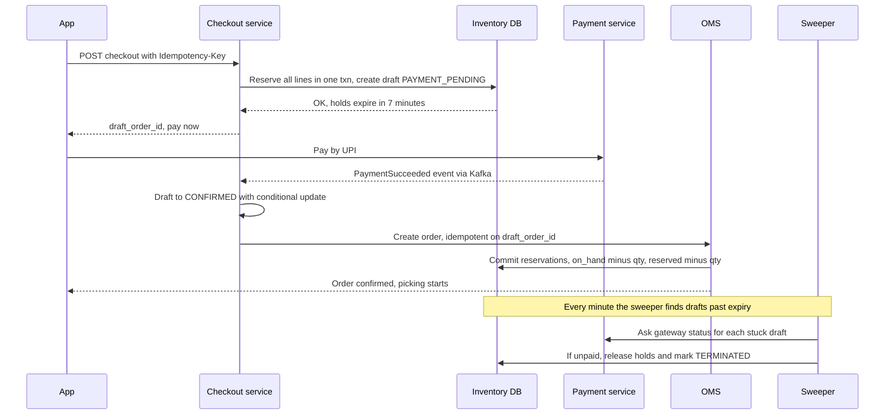

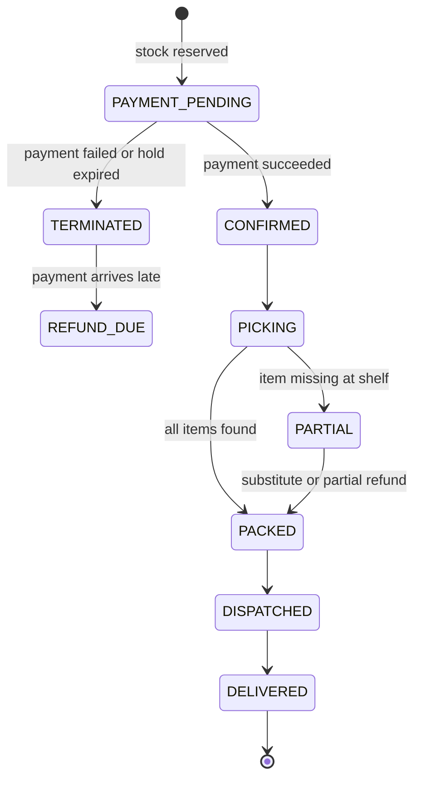

Three rules make this safe:

1. **Confirm is idempotent on `draft_order_id`.** The payment event can arrive twice; OMS returns the existing order the second time.
2. **The sweeper checks state before acting** and asks the gateway before releasing a hold whose payment might be in flight. Release is `UPDATE reservations SET status='RELEASED' WHERE id=? AND status='HELD'`, then decrement `reserved` only if that update touched a row, all in one transaction, so a double release can't free stock twice.
3. **Late payment after termination** gets a fresh reservation attempt; if stock is gone, auto-refund (Q8's LATE_SUCCESS path).

### Deep dive 4: the hot SKU (flash sale)

"₹1 Coke for the first 2,000 users at 6 pm" sends thousands of reservation attempts a second at one row. Row-lock waits explode and every other SKU in the store's transactions waits too. Fixes, in order of preference:

1. **Gate in Redis.** A Lua script: `if tonumber(redis.call('GET', k)) >= qty then redis.call('DECRBY', k, qty) return 1 else return 0 end`. Losers are rejected in microseconds without touching the DB. Winners then reserve in the DB as normal. Reconcile Redis to the DB every minute.
2. **Split the row.** 2,000 units stored as 20 sub-rows of 100; each request tries a random sub-row with stock.
3. **Admission control,** like Q9's waiting room, if the sale is huge.

### Deep dive 5: system stock vs shelf stock

The DB says 3 packets of milk; the shelf has 2 (one was damaged and nobody logged it). Picking finds the gap. Handle it as a normal path, not an exception: the picker app marks "not found", the order goes to PARTIAL, the customer gets a substitute offer or an instant partial refund (Q8, prorated), and an `AUDIT_ADJUST` movement of −1 corrects stock. Cycle counts (staff counting shelves) reconcile `on_hand` against the movement journal.

> **Real world — Instacart:** Instacart treats availability as a **probability from 0 to 1**, learned from shoppers' "found / not found" scans, with dynamic thresholds per retailer, region or category deciding what is shown as available; customers with a perfect found rate were **2x as likely to reorder** ([Instacart](https://company.instacart.com/tech-innovation/how-instacarts-item-availability-evolved-over-the-pandemic)). Instacart doesn't own the shelves, so it can't count exactly. A dark store can count, but the same idea helps: hide items whose recent "not found" rate is high even if the count says 1.

### Failure cases

| Failure | Handling |
|---|---|
| Two users take the last unit | Conditional update; one gets 409 "just sold out" |
| Payment never completes | Sweeper releases holds after expiry, after checking the gateway |
| Payment event delivered twice | Conditional draft update plus idempotent OMS create |
| Inventory service down | Checkout fails closed (can't promise stock); browsing still works from cache and index |
| Redis gate and DB disagree | DB wins at checkout; minute-level reconciliation resets Redis |
| Item missing at picking | PARTIAL path, substitute or prorated refund, audit movement |
| Store goes offline (power cut) | Serviceability marks it unavailable; users see the next store or "not serviceable" |

### 60-second spoken summary

"Inventory is per dark store and SKU, with on-hand and reserved columns and a CHECK that reserved never exceeds on-hand. Browsing reads a per-store search index and a Redis count, both slightly stale, which Zepto accepts with a 10-second index refresh because it re-checks live stock after retrieval. At checkout I reserve every line in one local transaction with `UPDATE ... WHERE on_hand - reserved >= qty`, sorted by SKU to avoid deadlocks, and create a draft order in PAYMENT_PENDING. The payment event moves the draft to CONFIRMED and calls an idempotent create-order, and a sweeper releases expired holds after checking the gateway, which is the shape of Zepto's DynamoDB draft-order design with its 5-minute cleanup job. Hot flash-sale SKUs get a Redis Lua gate or split rows. Shelf drift is a normal path: partial picks, substitutes, prorated refunds and audit adjustments. No quick-commerce company has published its oversell prevention, so this is the standard approach, not Blinkit's exact internals."

### Follow-ups they ask

**Q: SQL or NoSQL per component?**
A: Inventory: SQL (or DynamoDB with conditional writes), because I need atomic conditional decrements across several lines of one store. Draft orders: either; Zepto chose DynamoDB for write scale and TTL. Catalog and search: a search engine (OpenSearch or Solr, which Zomato uses for search). Cart: Redis or DynamoDB keyed by user, since it's short-lived. Order history: SQL or a document store.

**Q: How is this different from food delivery?**
A: The constraint is stock, not a kitchen's capacity. The store is fixed and close, so dispatch is simpler, but the time budget is tiny, so picking and packing is part of the critical path. And there's no restaurant to accept the order; the system accepts it.

**Q: What if the cache says in stock and the DB says no?**
A: The DB wins. The user gets "just sold out" at checkout with substitutes. Then I check why the cache lagged: CDC consumer lag is the usual cause, and it's worth alerting on.

**Q: How do you prioritise orders at peak (a Zepto follow-up)?**
A: Picking is the scarce resource, so the picker queue is a priority queue: older orders first (to protect the promise), then small orders that can be packed fast. If the store is overloaded, raise the displayed ETA or temporarily stop accepting orders for that store, the same "throttle demand where capacity is short" lever Zomato used on NYE.

**Q: Where would you use the Factory pattern here?**
A: For payment processors (UPI, card, wallet, COD), a Zepto interviewer's favourite. `PaymentProcessorFactory.get(method)` returns an object with `initiate()` and `handleCallback()`. COD's `initiate()` confirms immediately, so the draft never waits.

---

## Q11. Design coupons and promo codes

### Why they ask it

A Blinkit SDE-1 fresher was asked for a "coupon creation and validation system: admin-defined rules, expiry, limited-user coupons, a **5-minute payment window** after applying", with APIs, DB design and end-to-end logic ([B17](https://medium.com/@utkarsho.dev/blinkit-sde-1-interview-experience-fresher-39ba436055f3)). Swiggy asked an LLD coupon-based discount system with class diagrams, schema and Redis caching ([S9](https://leetcode.com/discuss/post/6051809/)), and a cart with discounts ([S6](https://leetcode.com/discuss/post/7069404/)). No food or quick-commerce company has published its coupon engine, so everything here is standard design.

### Clarifying questions

1. Coupon types? Flat (₹50 off), percentage with cap (20% up to ₹100), free delivery, BOGO, bank offers.
2. Limits? Total redemptions (first 10,000), per user (once, or 3 times), per day.
3. Who funds it? Restaurant-funded, platform-funded, or bank-funded changes the ledger entries.
4. Can coupons stack? Usually one coupon plus one bank offer.
5. Do we auto-apply the best coupon?

### Requirements

**Functional:** admins create coupons with rules; users see applicable coupons; apply at checkout; redeem on payment; release on failure; hard caps on total and per-user use.
**Non-functional:** validation under 50 ms (it's on the checkout path); never exceed a cap, even under a burst of thousands per second; resistant to abuse.

### Estimates (assumptions labelled)

*Assumption:* 140 orders/s at peak (the NYE number), about 60% with a coupon, so **about 85 redemptions/s**. Validation calls are higher, *assumption* 5x (users try codes, carts re-price), about 400/s. The dangerous case is a single viral code: "first 10,000 users get 50% off" at 8 pm can hit **thousands of attempts per second on one counter**.

### APIs

```http
GET  /v1/coupons/applicable?cart_id=c_77         -> list with computed discount, best first
POST /v1/cart/c_77/coupon   { "code": "BIRYANI20" }
  -> 200 { "discount_paise": 10000, "message": "20% off up to Rs 100 applied" }
  -> 422 { "error": "MIN_ORDER_NOT_MET", "min_order_paise": 29900 }
POST /internal/coupons/reserve   { "coupon_id": 88, "user_id": 5, "order_id": 901 }  -> hold for 5 minutes
POST /internal/coupons/confirm   { "order_id": 901 }
POST /internal/coupons/release   { "order_id": 901 }
```

### Data model

```sql
CREATE TABLE coupons (
  id              BIGINT PRIMARY KEY,
  code            VARCHAR(32) UNIQUE,           -- NULL for auto-applied offers
  type            VARCHAR(16) NOT NULL,         -- FLAT, PERCENT, FREE_DELIVERY, BOGO
  value           INT NOT NULL,                 -- paise for FLAT, basis points for PERCENT
  max_discount_paise BIGINT NULL,
  min_order_paise BIGINT NOT NULL DEFAULT 0,
  starts_at       TIMESTAMP NOT NULL,
  ends_at         TIMESTAMP NOT NULL,
  total_limit     INT NULL,
  per_user_limit  INT NOT NULL DEFAULT 1,
  funded_by       VARCHAR(16) NOT NULL,         -- PLATFORM, RESTAURANT, BANK
  rules           JSON NOT NULL,                -- {"cities":[...],"restaurant_ids":[...],"new_user":true,"payment":["HDFC_CC"]}
  status          VARCHAR(10) NOT NULL          -- DRAFT, ACTIVE, PAUSED, EXPIRED
);

CREATE TABLE coupon_budget (                    -- the global counter, split for hot coupons
  coupon_id   BIGINT NOT NULL,
  shard       SMALLINT NOT NULL,                -- 0..N-1
  remaining   INT NOT NULL CHECK (remaining >= 0),
  PRIMARY KEY (coupon_id, shard)
);

CREATE TABLE coupon_user_usage (
  coupon_id   BIGINT NOT NULL,
  user_id     BIGINT NOT NULL,
  used        INT NOT NULL DEFAULT 0,
  PRIMARY KEY (coupon_id, user_id)
);

CREATE TABLE coupon_redemptions (
  id          BIGINT PRIMARY KEY,
  coupon_id   BIGINT NOT NULL,
  user_id     BIGINT NOT NULL,
  order_id    BIGINT NOT NULL UNIQUE,          -- one coupon per order, and replays are harmless
  discount_paise BIGINT NOT NULL,
  status      VARCHAR(10) NOT NULL,            -- RESERVED, CONFIRMED, RELEASED, EXPIRED
  expires_at  TIMESTAMP NOT NULL,              -- the 5-minute payment window
  INDEX idx_expiry (status, expires_at)
);
```

### Architecture

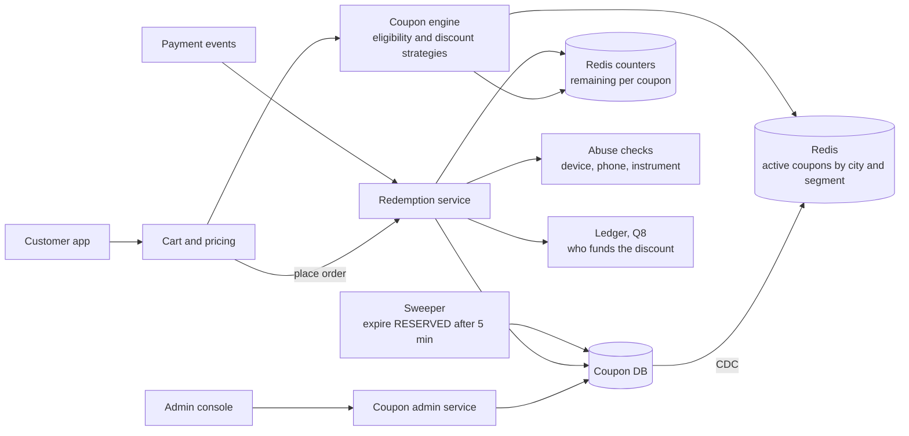

Note the split: **validation** (read-only, cached, fast, called many times) and **redemption** (writes, strict, called once per order).

### Deep dive 1: validating and computing the discount

Validation is a pipeline of cheap checks, cheapest first: exists and ACTIVE, within dates, city and restaurant match, min order met, payment method matches, user segment (new user?), per-user usage below limit, budget remaining. Each failed check returns a specific error so the app can say "add ₹40 more to use this".

Discount computation is the **Strategy pattern**: one `DiscountStrategy` interface with `compute(cart) -> paise`, and classes `FlatOff`, `PercentWithCap`, `FreeDelivery`, `Bogo`. Adding a new type means adding a class, not editing a switch statement. That's the extensibility answer LLD interviewers want.

**Best coupon selection:** fetch the user's eligible coupons (from cache, by city and segment), compute each one's discount on the current cart, and sort by discount. Stacking rules (one restaurant coupon plus one bank offer) become "pick the best from each group". This is a few dozen computations, so it's cheap; cache the result per cart version.

### Deep dive 2: limited redemptions under a burst

"First 10,000 users" is the same problem as general-admission tickets (Q9). Options:

1. **Conditional update on one row:** `UPDATE coupon_budget SET remaining = remaining - 1 WHERE coupon_id=? AND remaining > 0`. Correct, but every redemption queues on one row lock.
2. **Split the budget into N rows** (`shard` column): 10,000 as 20 rows of 500. Pick a random shard with stock; on 0 rows, try another. Contention drops 20x and the sum is exact.
3. **Redis gate:** `DECR coupon:88:remaining`; if the result is negative, `INCR` it back and reject. Fast enough for thousands per second. Persist the redemption row to the DB; reconcile Redis against the count of CONFIRMED plus RESERVED rows.

The **per-user limit** is a second conditional update in the same transaction: `UPDATE coupon_user_usage SET used = used + 1 WHERE coupon_id=? AND user_id=? AND used < :limit` (insert the row first if missing). For "once per user", a `UNIQUE (coupon_id, user_id)` on redemptions does it.

### Deep dive 3: the 5-minute window

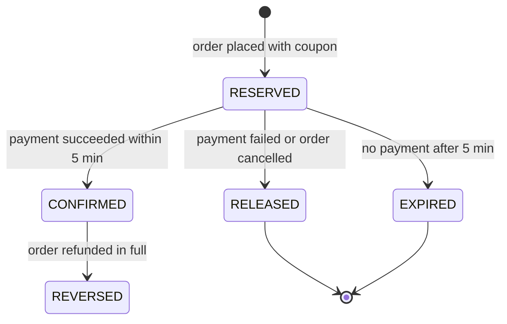

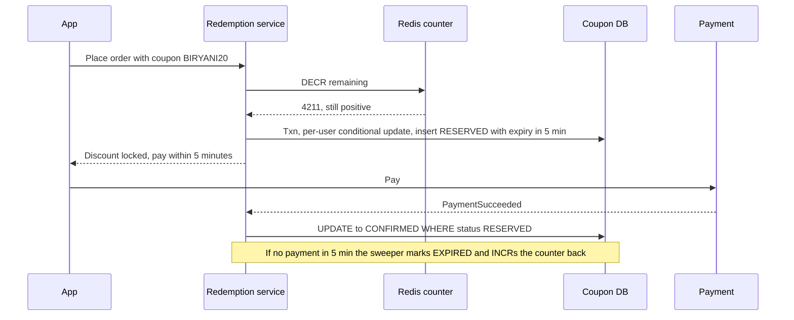

Releasing must give the unit back exactly once: `UPDATE ... SET status='EXPIRED' WHERE id=? AND status='RESERVED'`, and only if that touched a row, increment the counter and decrement per-user usage.

Full refund after delivery: should the user get the coupon back? It's a product decision; the system supports it as a REVERSED state that restores per-user usage but usually not the global budget.

### Deep dive 4: abuse

- **Multi-account abuse of WELCOME50:** tie "new user" to device ID, phone number and a hash of the payment instrument, not just the account.
- **Code guessing:** codes are short, so rate-limit the apply endpoint per user and device (token bucket, the same as your Myntra limiter) and lock out after repeated invalid codes.
- **Leaked private codes** (a code meant for one corporate partner posted on Telegram): bind codes to user segments, or issue unique single-use codes per user.
- **Refund abuse:** order, use the coupon, cancel, repeat. Per-user limits count RESERVED as used until released.

### Failure cases

| Failure | Handling |
|---|---|
| Burst on one coupon | Redis gate or split budget rows |
| Redis counter lost | Rebuild from `total_limit - count(RESERVED or CONFIRMED)` |
| Payment fails | RELEASED, counter restored once |
| Payment arrives after 5-min expiry | Re-reserve if budget remains; otherwise refund and ask the user to re-order. Pick one rule and state it |
| Same order replays redemption | `order_id UNIQUE` |
| Coupon edited mid-flight | Store the computed discount on the redemption row; the order uses that snapshot |

### 60-second spoken summary

"I split coupons into a read path and a write path. Validation and best-coupon selection read active coupons from Redis by city and segment, run cheap rule checks and compute discounts with a Strategy per coupon type. Redemption is strict: at order placement I reserve the coupon, decrementing a global budget with a Redis gate or split budget rows so a viral code can't oversell, and a per-user conditional update or unique key for per-user limits, all with a 5-minute expiry. Payment success confirms it; failure or a sweeper after 5 minutes releases it exactly once with a conditional state update. Redemptions are unique per order so replays are harmless, the discount is snapshotted on the order, and abuse checks tie new-user offers to device, phone and payment instrument."

### Follow-ups they ask

**Q: Why not just count redemptions with `SELECT COUNT(*)` before inserting?**
A: That's a check-then-act race: 50 requests all count 9,999 and all insert. The check must be inside the write (conditional update or atomic Redis decrement).

**Q: Redis says OK but the DB insert fails. Now what?**
A: Put the unit back (`INCR`) in the error path, and run a reconciliation every few minutes that resets the counter from the DB's RESERVED plus CONFIRMED count. The DB is the truth, Redis is the gate.

**Q: How do you show "best coupon" fast for millions of users?**
A: Coupons are few compared with users. Cache active coupons per city and segment; evaluate the handful that match against the cart on the fly. Precomputing per user isn't needed.

**Q: How does the discount hit the books?**
A: As ledger entries (Q8). A platform-funded ₹100 discount debits `marketing_discount_expense` and the customer pays ₹100 less; a restaurant-funded one reduces `restaurant_payable`. That's why `funded_by` is on the coupon.

**Q: Coupon expires at midnight while the user is paying at 11:59?**
A: The reservation snapshot rules: if it was reserved before expiry, honour it for its 5-minute window.

**Q: What design patterns fit?**
A: Strategy for discount types, Chain of Responsibility (or a list of validator objects) for eligibility rules, and Factory to build the strategy from the coupon type.

---

## Q12. Design ratings and reviews

### Why they ask it

It's listed as "likely" for Zomato, and it is **literally your Myntra project**, so expect it to merge with the resume grill. Interviewers at Eternal turn your own project into the HLD round more often than any other question (13+ reports). If they ask "design ratings for Zomato", you can design it *and* say "I built a version of this".

### Clarifying questions

1. What is rated: the delivery order, the restaurant, individual dishes, the rider? (Keep scope to delivery ratings for restaurants plus dish ratings.)
2. Who can rate? Only users with a delivered order (verified).
3. Can users edit or delete ratings?
4. How should a chain (50 outlets of one brand) show ratings: per outlet or per brand?
5. How is the list of reviews sorted? Recent, most helpful, with photos first?

### Requirements

**Functional:** rate 1 to 5 with optional text and photos; show average, count and star histogram per restaurant and dish; list reviews with pagination; edit and delete; moderation; brand-level aggregate for chains.
**Non-functional:** reads vastly outnumber writes; the aggregate can lag a few seconds; one user's rating must count exactly once.

### Estimates (assumptions labelled)

- About 2M orders a day (derived above). *Assumption:* 20% get rated, so **400K ratings a day**, about 5/s average, 30/s at peak.
- *Assumption:* every restaurant card and menu page shows a rating, so **tens of thousands of rating reads per second** at peak. Reads to writes is over 1,000:1. That ratio decides everything: precompute aggregates, cache them, never `AVG()` on read.
- Zomato's peak cache traffic gives context: about 1 billion GETs vs 100M SETs a minute on NYE 2023 ([Zomato blog](https://blog.zomato.com/a-tale-of-scale-behind-the-scenes-at-zomato-tech-for-nye-2023)).

### APIs

```http
POST /v1/orders/{order_id}/review    { "rating": 4, "text": "Biryani was great, raita was warm", "photo_ids": ["img_1"] }
  -> 201 { "review_id": "r_55", "status": "PUBLISHED" | "IN_MODERATION" }
  -> 409 already reviewed (use PATCH)
PATCH /v1/reviews/r_55               { "rating": 2 }
GET  /v1/restaurants/4411/rating     -> { "avg": 4.2, "count": 5120, "histogram": [210,180,420,1900,2410] }
GET  /v1/restaurants/4411/reviews?sort=recent&cursor=eyJ0IjoiMjAyNi0xMC0yMlQxOTozMiIsImlkIjo5OTF9
POST /v1/reviews/r_55/helpful
```

### Data model

```sql
CREATE TABLE reviews (
  id            BIGINT PRIMARY KEY,
  order_id      BIGINT NOT NULL UNIQUE,     -- one review per order: verified, and no double counting
  user_id       BIGINT NOT NULL,
  restaurant_id BIGINT NOT NULL,
  rating        TINYINT NOT NULL CHECK (rating BETWEEN 1 AND 5),
  body          TEXT NULL,
  status        VARCHAR(16) NOT NULL,       -- PUBLISHED, IN_MODERATION, REJECTED, DELETED
  helpful_count INT NOT NULL DEFAULT 0,
  created_at    TIMESTAMP NOT NULL,
  updated_at    TIMESTAMP NOT NULL,
  INDEX idx_rest_recent (restaurant_id, status, created_at, id)   -- cursor pagination
);

CREATE TABLE rating_histogram (             -- the precomputed aggregate
  entity_type  VARCHAR(10) NOT NULL,        -- RESTAURANT, DISH, BRAND
  entity_id    BIGINT NOT NULL,
  c1 INT NOT NULL DEFAULT 0, c2 INT NOT NULL DEFAULT 0, c3 INT NOT NULL DEFAULT 0,
  c4 INT NOT NULL DEFAULT 0, c5 INT NOT NULL DEFAULT 0,
  updated_at   TIMESTAMP NOT NULL,
  PRIMARY KEY (entity_type, entity_id)
);

CREATE TABLE processed_rating_events (      -- consumer idempotency
  event_id   VARCHAR(64) PRIMARY KEY,
  processed_at TIMESTAMP NOT NULL
);

CREATE TABLE brand_outlets (                -- source of truth for chain grouping
  brand_id      BIGINT NOT NULL,
  restaurant_id BIGINT NOT NULL,
  PRIMARY KEY (brand_id, restaurant_id)
);
```

### Architecture

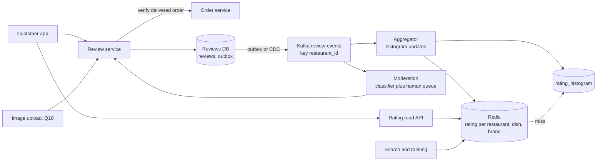

### Deep dive 1: aggregate with histograms, never averages

Store **counts per star**, not an average. The average is derived: `avg = (1·c1 + 2·c2 + 3·c3 + 4·c4 + 5·c5) / (c1+...+c5)`. Histograms win three ways: they update incrementally (a new 4-star is `c4 = c4 + 1`), they handle edits exactly (a change from 5 to 2 is `c5 - 1, c2 + 1`), and they give the star-breakdown bars for free.

**The chain problem is your Myntra problem.** At Myntra, colour variants of one product showed different ratings, and a new colour showed "No Ratings" because the cache was per style and only the rated style was refreshed. You fixed it by fetching the related styles, merging their histograms with one SQL query aggregated in Go, and writing the combined rating to every style in the group, for 5.7M styles. For Zomato chains: the brand histogram is the **sum of the outlets' histograms**. Never average the outlet averages. Your own example: style A 4.0★ from 1,000 ratings and style B 5.0★ from 10 give an average-of-averages of 4.5★, but the true answer is (4,000 + 50) / 1,010 ≈ **4.01★**.

> **Pause and think:** a brand has 50 outlets. A rating arrives for outlet 17. What's the cheapest correct update for the brand aggregate? *Add 1 to the right bucket of the brand's histogram too, in the same consumer step. No need to re-read all 50 outlets. Keep a nightly job that recomputes brands from scratch as a reconciliation check.*

### Deep dive 2: the write path and its idempotency

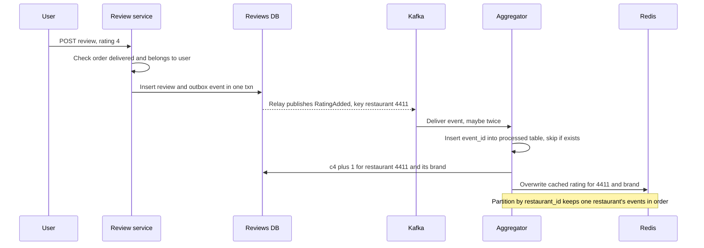

Two things to stress. **Idempotency:** Kafka is at-least-once, so a redelivered event would double-count without the `processed_rating_events` check (in the same transaction as the histogram update). **Cache update on every event, for every copy.** Your Myntra bug where the reviews section showed an old rating and the ratings section showed the new one came from two caches with only one refreshed. Rule: every cached copy of a value is updated by the same events.

**Hot restaurant:** a viral place getting hundreds of ratings a minute makes one histogram row hot. Batch: the aggregator buffers increments per restaurant for a second or two and applies one `c4 = c4 + 37`. Zomato's ads team did the same thing at a larger scale, emitting incremental counts plus an hourly reconciliation ([Zomato blog](https://www.zomato.com/blog/eliminating-bottlenecks-in-real-time-data-streaming-a-zomato-ads-flink-journey/)).

### Deep dive 3: ranking with a Bayesian average

A new place with one 5★ review should not outrank a place with 4.6★ from 5,000. The **Bayesian average** pretends every restaurant starts with C "virtual" ratings at the global mean m:

`score = (C × m + sum of ratings) / (C + n)`

With m = 3.9 and C = 50: the one-review place scores (195 + 5) / 51 ≈ **3.92**; the 5,000-review place scores (195 + 23,000) / 5,050 ≈ **4.59**. Use it for **sorting and search ranking**, and still *display* the true average and count. Add recency weighting (ratings older than a year count less) if the business wants "how good is it now".

### Deep dive 4: moderation and fake reviews

Moderation runs async: text goes through a classifier (abuse, spam, phone numbers), photos through image moderation; anything flagged goes to IN_MODERATION and a human queue, everything else publishes immediately. Rating counts can include IN_MODERATION reviews while text is hidden, or exclude them; pick one and be consistent. Fake-review defence: verified orders only (the `order_id UNIQUE` foreign key does most of the work), velocity checks on new accounts, and clusters of accounts sharing devices rating the same restaurant.

For "most helpful" sorting, don't sort by raw upvotes (old reviews win forever). Sort by a confidence-adjusted score such as the lower bound of the Wilson interval on helpful vs not-helpful votes.

### Failure cases

| Failure | Handling |
|---|---|
| Event delivered twice | processed-event table in the same txn |
| Aggregator down for an hour | Ratings still saved; Kafka retains events; aggregates catch up; display is stale |
| Cache and DB disagree | Overwrite cache on each event; TTL as safety net (you used 7 days at Myntra); nightly recompute |
| Edit races with the original event | Partitioning by restaurant keeps order; edit event carries old and new rating |
| Outlet moves to another brand | Rebuild both brand histograms from outlets |

### 60-second spoken summary

"Ratings are written rarely and read constantly, so I precompute. A review is accepted only for a delivered order, with `order_id` unique, and saved with an outbox event in one transaction. A Kafka consumer keyed by restaurant updates a star histogram per restaurant, dish and brand, idempotently via a processed-event table, and overwrites every cached copy. Averages are derived from histograms, which makes edits exact, and a chain's rating is the merge of its outlets' histograms, never an average of averages. That's exactly what I built at Myntra for 5.7 million product variants, including fixing a bug where two caches drifted apart. Ranking uses a Bayesian average so a single 5-star review doesn't beat thousands of 4.6s. Moderation is async with a human queue, and a nightly recompute reconciles aggregates."

### Follow-ups they ask

**Q: Why not `SELECT AVG(rating) FROM reviews WHERE restaurant_id = ?` with an index?**
A: It's O(number of reviews) per page view, and there are thousands of page views per second. Even with an index it reads thousands of rows each time. The histogram is O(1) to read and to update.

**Q: How do you handle an edit from 5 stars to 2?**
A: The edit event carries old and new values: decrement c5, increment c2, in one idempotent step. That's why we store the histogram, not just a sum and count (a sum and count also work for the average, but not for the breakdown bars).

**Q: Should a brand page show one rating for 50 outlets?**
A: Show the outlet's own rating on the outlet page (food quality varies by kitchen) and the merged brand histogram on the brand page. It's the same merge I did at Myntra across colour variants.

**Q: How do you warm the cache for a new aggregate type at launch?**
A: Backfill from the DB with a paced job, never all at once. At Myntra the first warmup run refreshed only about 22% because unpaced events emptied the downstream rate limiter's token bucket; a 4 ms pause between events and a higher limit got it to 99.99%. Pacing to the refill rate is the lesson.

**Q: Strong or eventual consistency for ratings?**
A: Eventual. A rating appearing two seconds late harms nobody. The review row itself is strongly written, so the user always sees their own review (read-your-writes from the primary for their own profile).

**Q: How would you detect a restaurant buying fake 5-star reviews?**
A: Only verified orders can rate, so they'd need fake orders, which cost money. On top: anomaly detection on rating velocity versus order volume, accounts with no other history, and many reviewers sharing devices or payment instruments.

---

## Q13. Design delayed jobs: auto-cancel if the restaurant doesn't accept

### Why they ask it

Every food platform has timers: "if the restaurant hasn't accepted in 3 minutes, call them; at 5 minutes, cancel and refund", "release this seat hold in 10 minutes" (Q9), "expire this coupon reservation in 5" (Q11), "send 'rate your order' an hour after delivery". Interviewers like it because the naive answer (`sleep(300)` in a thread) fails in instructive ways. Swiggy asked "design your own cron system" ([S4](https://leetcode.com/discuss/post/6260445/)), Flipkart a task scheduler with "what if two tasks arrive at the same time?" ([F7](https://leetcode.com/discuss/post/7591327/)), and District a voice-transcription pipeline with job status tracking and worker failures ([Z31](https://medium.com/@samarth.bhutani/district-zomato-sde-1-interview-experience-off-campus-56-lpa-ctc-7806143fa708)).

### Clarifying questions

1. How precise must timing be? (Within a few seconds is fine; nobody notices 5:03 vs 5:00.)
2. How many timers, and what fraction get cancelled before firing? (Most: restaurants usually accept within a minute.)
3. What does the job do? Escalate (IVR call), then cancel the order and refund.
4. Can a job run twice? (Assume yes, so it must be idempotent.)

### Requirements

**Functional:** schedule a job at time T with a payload; cancel or ignore it if the condition changed; run it at T (give or take seconds); retry on failure.
**Non-functional:** durable (a deploy or crash must not lose timers); at-least-once with idempotent handlers; scales to peak order rates.

### Estimates (assumptions labelled)

*Assumption:* 3 timers per order (escalate, cancel, rating prompt). At the NYE peak of about 140 orders/s, that's **about 420 timers created per second**, and at 2M orders a day about 6M timers a day. *Assumption:* 95% of accept-timers become no-ops because the restaurant accepted. Small numbers for a DB, as long as polling is indexed.

### APIs and data model

```http
POST   /internal/jobs  { "type":"ORDER_ACCEPT_TIMEOUT", "dedupe_key":"ord_8812:accept", "run_at":"2026-10-23T20:05:00Z", "payload":{"order_id":8812} }
DELETE /internal/jobs/{dedupe_key}       (optional, best effort)
```

```sql
CREATE TABLE scheduled_jobs (
  id            BIGINT PRIMARY KEY AUTO_INCREMENT,
  job_type      VARCHAR(40) NOT NULL,
  dedupe_key    VARCHAR(100) NOT NULL UNIQUE,   -- scheduling the same timer twice is a no-op
  run_at        TIMESTAMP NOT NULL,
  payload       JSON NOT NULL,
  status        VARCHAR(10) NOT NULL,           -- PENDING, RUNNING, DONE, FAILED, CANCELLED
  attempts      INT NOT NULL DEFAULT 0,
  locked_until  TIMESTAMP NULL,                 -- lease: if a worker dies, the job becomes claimable again
  INDEX idx_due (status, run_at)
);
```

### Architecture

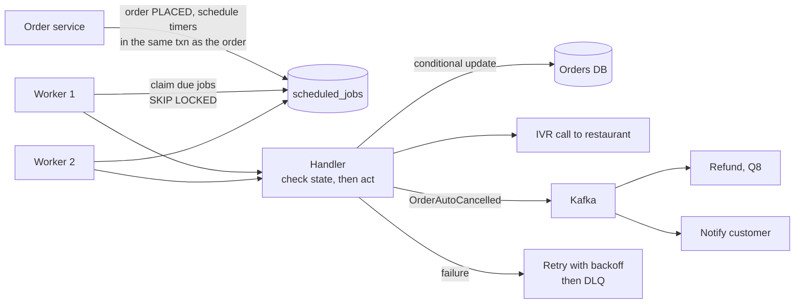

Write the timer row **in the same transaction as the order**, so an order can never exist without its timeout (the outbox idea again).

### The key idea: the job checks state, so duplicates and late runs are harmless

```sql
UPDATE orders SET status = 'AUTO_CANCELLED', cancelled_reason = 'RESTAURANT_TIMEOUT'
WHERE id = 8812 AND status = 'PLACED';    -- only if the restaurant still hasn't accepted
```

If the restaurant accepted at 4:59, the status is ACCEPTED, the update matches zero rows, and the job just marks itself DONE. If the job runs twice, the second run matches zero rows. You don't even need to cancel timers reliably; making them no-ops is more robust than deleting them, because the delete can fail.

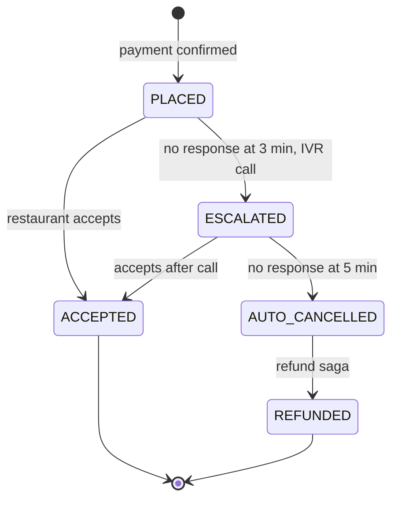

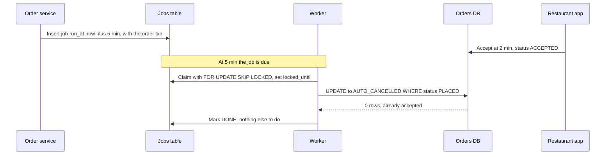

### Deep dive: five ways to build the timer

**1. DB table plus poller (the default answer).** Workers loop every second:

```sql
BEGIN;
SELECT id, job_type, payload FROM scheduled_jobs
WHERE status = 'PENDING' AND run_at <= NOW()
ORDER BY run_at LIMIT 100
FOR UPDATE SKIP LOCKED;            -- skip rows another worker is claiming: no blocking, no double claim
UPDATE scheduled_jobs SET status='RUNNING', locked_until = NOW() + INTERVAL 60 SECOND, attempts = attempts + 1 WHERE id IN (...);
COMMIT;
```

`SKIP LOCKED` (MySQL 8 and Postgres) lets ten workers grab ten different batches at once. If a worker dies mid-job, a reaper resets `RUNNING` jobs whose `locked_until` has passed back to PENDING. Simple, durable, transactional with the order. The limit is poll load on one table at very high rates; partition by `run_at` day and delete DONE rows.

**2. Redis sorted set.** `ZADD delayed <run_at_epoch> <job_id>`. Workers run a Lua script that does `ZRANGEBYSCORE delayed 0 now LIMIT 0 100` and moves those IDs to a "processing" set with a lease, atomically. Very fast, millions of timers. Weaker durability (a failover can lose recent writes, as with Redis locks in Q9), so keep the DB as the record or enable AOF persistence.

**3. Queue delay features.** SQS supports per-message delay up to 15 minutes, plus a visibility timeout that redelivers if a worker dies (familiar from your Atlassian SQS worker pools). Kafka has no per-message delay, but you can build **delay topics**: `delay-1m`, `delay-5m`, where a consumer reads a message and waits until its due time before processing (each topic has one fixed delay, so messages within it are already in time order).

> **Real world — Uber's retry topics:** Uber's "Reliable Reprocessing" sends failed messages through a chain of retry topics with increasing delays and finally a DLQ, committing the original offset so the main partition isn't blocked. Transient errors retry; code bugs go straight to the DLQ ([Uber, 2018](https://www.uber.com/blog/reliable-reprocessing/)).

> **Real world — DoorDash:** DoorDash ran 900+ async task types on Celery and RabbitMQ. **Celery countdowns (delayed tasks) overloaded the broker**, RabbitMQ went down at peak, and HA failover took over 20 minutes and lost messages. They moved to Kafka ([DoorDash, 2020](https://doordash.engineering/2020/09/03/eliminating-task-processing-outages-with-kafka/)). Lesson: don't park millions of delayed messages inside an in-memory broker.

**4. Durable workflow engines (Cadence, Temporal).** You write the order flow as code: `await restaurantAccepted or timer(5 minutes)`. The engine persists the timer and the workflow state, and workers can crash and restart without losing either.

> **Real world — Uber Cadence:** Cadence provides its own persistence, queues and **durable timers**, with a history service, a matching service and a Cassandra backend; Uber Eats used it to coordinate the 8 standard steps of an order workflow ([Uber, 2019](https://www.uber.com/blog/open-source-orchestration-tool-cadence-overview/)). DoorDash Drive used Cadence too, and found the hard part was that **not all downstream calls were idempotent**, so they saved a context of completed steps and skipped them on retry ([DoorDash, 2020](https://doordash.engineering/2020/08/14/workflows-cadence-event-driven-processing/)).

**5. In-memory timing wheel.** A ring of slots, one per second, each holding the jobs due then; a pointer advances every tick. O(1) insert and fire, used inside Kafka and Netty for request timeouts. Not durable on its own, so only for short, losable timers.

| | Durability | Precision | Throughput | Effort |
|---|---|---|---|---|
| DB poller | Strong, same txn as order | About 1 s | Thousands/s | Low |
| Redis ZSET | Medium | Sub-second | Very high | Medium |
| SQS delay | Strong | Seconds, max 15 min | High | Low on AWS |
| Kafka delay topics | Strong | Fixed buckets | Very high | Medium |
| Cadence or Temporal | Strong | Seconds | High | Highest, but models the whole flow |

### Failure cases

| Failure | Handling |
|---|---|
| Worker crashes after claiming | Lease expires, reaper makes it PENDING again; handler is idempotent |
| Job runs twice | State check makes it a no-op |
| Workers down for 20 minutes, then thousands fire at once | Process in `run_at` order with a rate limit; skip jobs whose purpose has expired (a "rate your order" prompt 6 hours late can be dropped) |
| Clock skew between workers | Compare against the DB's `NOW()`, not the worker's clock |
| Handler's downstream (IVR provider) is down | Retry with backoff, then fall back (Zomato switched to an alternate calling provider on NYE 2021 ([Zomato blog](https://www.zomato.com/blog/our-learnings-from-nye/))) |
| Poison job keeps failing | After N attempts, FAILED and a DLQ alert |

### 60-second spoken summary

"When an order is placed I insert a scheduled job, run_at five minutes later, in the same transaction, with a dedupe key per order and timer type. Workers poll with `SELECT ... FOR UPDATE SKIP LOCKED` so they never block or double-claim, and take a lease so a crashed worker's job comes back. The handler checks state before acting: `UPDATE orders SET AUTO_CANCELLED WHERE status = PLACED`. If the restaurant already accepted, it's a no-op, so duplicates, late runs and un-cancelled timers are all harmless. At higher scale I'd use a Redis sorted set or SQS delays, and for full order orchestration a durable workflow engine like Cadence, which Uber Eats uses for its order steps. Failures go through retries with backoff to a DLQ, the pattern Uber calls reliable reprocessing."

### Follow-ups they ask

**Q: Why not a cron job every minute that scans orders?**
A: That works at small scale and is basically the DB poller with worse precision. The problem is it scans the orders table, a hot table, instead of a small indexed jobs table. A dedicated table with an index on `(status, run_at)` makes each poll cheap.

**Q: Why not `Thread.sleep` or a goroutine timer?**
A: It lives in memory. A deploy, crash or autoscale-in loses every pending timer, and nobody knows. Timers that affect money must be durable.

**Q: How do you cancel a timer when the restaurant accepts?**
A: Optionally mark it CANCELLED, but correctness never depends on that; the handler's state check is the real guard. Deleting is a nice optimisation, not the safety mechanism.

**Q: What if Kafka has no delay feature?**
A: Delay topics with fixed delays, or keep delays in a DB or Redis and publish to Kafka when due. Or use SQS for the delay and Kafka for fan-out.

**Q: How do you make sure the refund happens exactly once after auto-cancel?**
A: The cancel step emits an event via outbox; the refund uses an idempotency key derived from the order (like `refund:ord_8812:auto_cancel`), so a replayed event can't refund twice.

**Q: SKIP LOCKED vs NOWAIT?**
A: NOWAIT errors immediately if a row is locked; SKIP LOCKED silently skips it and returns the next free rows. For work queues SKIP LOCKED is what you want.

---

## Q14. How would your design survive New Year's Eve or an IPL final?

### Why they ask it

Usually as a follow-up to any design: "now 10x traffic for two hours, what breaks?" A Zomato SWE1 candidate was asked how to handle a DDoS and "the interviewer was not convinced" by rate limiting, caching and queue buffering ([Z4](https://leetcode.com/discuss/post/7609011/)), and another Zomato candidate was shown a real DB spike graph and asked to flatten it without adding capacity ([Z3](https://leetcode.com/discuss/post/8385519/)). This is the question where Zomato's own engineering blog is your best weapon.

> **Real world — Zomato, NYE 2023:** Orders peaked at **8,400 per minute** and the platform at **80.92 million requests per minute**, crossing 3 million orders that day. Kafka handled **450M+ messages a minute**; ElastiCache was scaled to **35 TB** serving **1 billion GETs a minute**; DynamoDB peaked at 12.3M RCUs and 5.2M WCUs a minute; Aurora handled 610K selects/s and 16,000 write transactions/s. Infrastructure was **pre-scaled to 11,000 EC2 instances running about 40,000 ECS tasks across 300+ microservices**. Before the day, an in-house benchmarking platform ran **14,000 minutes** of load tests across 100+ services, peaking at **50M requests/min** with 30B+ requests fired. They reviewed **kill switches and degraded modes** so low-tier dependencies can't hurt critical services, and ran **chaos tests**: latency injected through the Kuma service mesh, kill switches flipped, cache misses injected ([Zomato blog, Feb 2024](https://blog.zomato.com/a-tale-of-scale-behind-the-scenes-at-zomato-tech-for-nye-2023)).

> **Real world — Zomato, NYE 2021:** SRE load-tested every component above expected load for over 15 days; teams tuned circuit breakers, added a **kill switch per feature**, and found each database's bottleneck. When the third-party calling provider failed, they switched providers; payments routed around gateway downtime; and they **throttled demand where delivery partners or kitchens were running out** ([Zomato blog](https://www.zomato.com/blog/our-learnings-from-nye/)). On NYE 2025, Zomato and Blinkit together delivered over 75 lakh orders through over 4.5 lakh delivery partners, per Deepinder Goyal ([IANS](https://ianslive.in/record-deliveries-on-new-years-eve-despite-strike-calls-deepinder-goyal--20260101183238)).

### Clarifying questions

1. How big is the spike, and how fast? (NYE is predictable; an IPL final's last over or rain at 8 pm is a sudden local spike.)
2. What must never fail? (Ordering, payment, tracking.) What can degrade?
3. Is the bottleneck us, or the physical world (riders, kitchens)?

### Estimates: read the numbers

- 8,400 orders/min ≈ **140 orders/s**. 80.92M requests/min ≈ **1.35M requests/s**. *Derived:* about **9,600 backend requests per order** at peak. Most of that is browsing, search, menus, tracking polls and internal fan-out, not checkout.
- *Derived:* 1B cache GETs vs 100M SETs a minute is about 10:1, so the read path lives in cache.
- The lesson: protect the small, critical write path (about 140 orders/s) from the huge read path (over a million requests/s). That's what tiers and load shedding do.

### The defence in layers

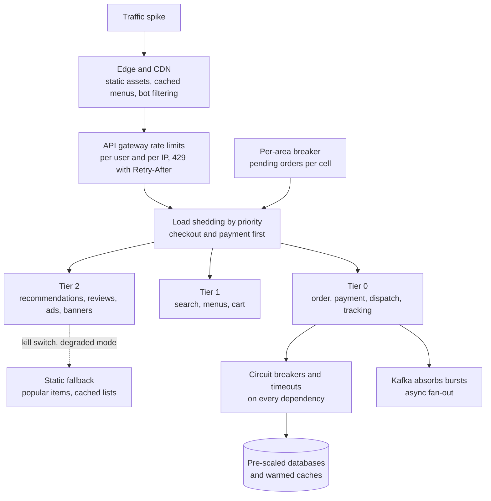

### Deep dive 1: before the day

1. **Load test with real traffic shapes.** Zomato records live requests into Kafka and replays them for benchmarks (a pipeline later moved to WarpStream, averaging 52M messages a minute during backfills ([WarpStream](https://www.warpstream.com/blog/eternal-case-study), vendor)). Their benchmarking rules are worth quoting: only read-only or safe-write traffic, isolated from production load, **ramped gradually so autoscaling can react**, and **auto-abort** on critical alerts or rising upstream errors.
2. **Pre-scale, don't trust autoscaling.** Autoscaling reacts to load that has already arrived and takes minutes to add capacity, while NYE load arrives in minutes. DoorDash makes the same point: autoscaling helps only if it is predictive, and adding capacity to one service often just moves the bottleneck ([DoorDash](https://doordash.engineering/2023/03/14/failure-mitigation-for-microservices-an-intro-to-aperture/)).
3. **Find each database's limit.** Connections, write IOPS, the slowest query. Cache hot queries. Add read replicas. For DynamoDB, pre-warm or set provisioned capacity (Swiggy even built a guard that flips on-demand tables to provisioned past a threshold to cap cost ([Swiggy Bytes](https://bytes.swiggy.com/how-to-limit-autoscaling-in-on-demand-dynamodb-tables-c57e20cbbbcf), snippet)).
4. **Warm caches** so the peak doesn't start with misses. Your Myntra 5.7M-style warmup is exactly this, including the pacing lesson.
5. **Chaos test the degraded modes.** A kill switch you've never flipped is a guess. Inject latency into a dependency through the mesh and check that the caller times out and degrades rather than hangs.
6. **Freeze deploys** for the window, staff a war room, and write runbooks ("if payment success rate drops below X, do Y").

### Deep dive 2: tiers, kill switches and degraded modes

Classify every service: **Tier 0** must work (place order, pay, assign rider, track). **Tier 1** should work (search, menus). **Tier 2** is nice to have (personalised recommendations, review writing, ads, banners, analytics writes). Every call from a higher tier to a lower tier needs a timeout, a fallback and a **kill switch** (a feature flag, Q19, that turns the call off instantly).

| Feature | Degraded mode |
|---|---|
| Personalised home feed | Cached "popular near you" list per area |
| Search ranking model | Simple popularity sort |
| Live ETA model | Last known ETA plus a buffer |
| Review writing | Accept and queue, publish later |
| Ads and banners | Off |
| Restaurant images | Lower resolution from CDN |

> **Real world — a kill switch that didn't reach the backend:** In a 2022 Instamart incident, a composite index in the wrong column order pinned the picker DB above 90% CPU. A feature-flag rollback did not reach the backend, so Swiggy shut Instamart down pan-India to recover ([Swiggy Bytes](https://bytes.swiggy.com/behindthebug-indexing-gone-wrong-6b4d682fd805), snippet). Test that your switches work where the load actually is.

### Deep dive 3: load shedding and breakers

**Rate limiting** caps each client ("100 requests a minute per user"). **Load shedding** protects the server ("I'm at capacity, so I'll drop low-priority work"). They're different, and the NYE answer needs both.

> **Real world — Stripe and DoorDash:** Stripe runs four limiters, including a fleet load shedder that **reserves capacity for critical methods** (their example keeps 20% for critical traffic) and a worker-utilisation shedder that drops the lowest-priority traffic first ([Stripe](https://stripe.com/blog/rate-limiters)). DoorDash uses Netflix's **adaptive concurrency limit**: a gRPC interceptor lowers the allowed in-flight requests as latency rises and can keep only high-priority requests, identified by header, during overload. They name the failure modes to avoid: **retry storms** (payment latency made Dasher-app retries amplify load) and **death spirals** (pods fail health checks and the survivors overload) ([DoorDash](https://doordash.engineering/2023/03/14/failure-mitigation-for-microservices-an-intro-to-aperture/)).

A circuit breaker stops calling a dependency that's failing, so you fail fast instead of piling up threads:

```mermaid
stateDiagram-v2
  [*] --> CLOSED
  CLOSED --> OPEN: error rate over threshold in window
  OPEN --> HALF_OPEN: cool-down timer elapsed
  HALF_OPEN --> CLOSED: trial requests succeed
  HALF_OPEN --> OPEN: trial requests fail
```

Pair breakers with **retry budgets** (retries may add at most 10% extra load) and exponential backoff with jitter, otherwise retries become the storm.

**Local hotspots.** Rain in one part of Bengaluru at 8 pm: orders pile up with no riders. More servers don't help; riders are the bottleneck.

> **Real world — Grab's Spampede:** Grab counts **unallocated bookings per (service, geohash at reduced precision, time bucket)** with Redis `INCR` and `EXPIRE`, and when the count passes a threshold, rejects new bookings from that area **before any downstream calls**, so one hotspot can't slow the app everywhere ([Grab](https://engineering.grab.com/preventing-app-performance-degradation-due-to-sudden-ride-demand-spikes)). Zomato's version is business-level: throttle demand where delivery partners or kitchens run out, plus supply repositioning with its Active Dispatch model.

So the area breaker shows "high demand, delivery may take longer" or temporarily marks restaurants in that cell unserviceable, protecting both users' expectations and the dispatch system.

```mermaid
sequenceDiagram
  participant A as App
  participant G as Gateway
  participant L as Load shedder
  participant S as Order service
  participant R as Reco service
  A->>G: Home feed request
  G->>L: Priority low
  L-->>G: Over capacity, shed
  G-->>A: Cached popular list
  A->>G: Place order
  G->>L: Priority critical
  L->>S: Admit
  S->>R: Get add-on suggestions, 50 ms timeout
  R--xS: Timeout, breaker opens
  S-->>A: Order placed without suggestions
```

### Failure cases at peak

| Failure | Response |
|---|---|
| Cache cluster node fails | Replicas take over; request coalescing so one miss, not thousands, hits the DB (Zomato tests cache-miss injection for exactly this) |
| A payment gateway degrades | Route new payments to another gateway (Q8) |
| SMS or calling provider fails | Switch provider, as Zomato did in 2021 |
| Kafka consumer lag grows | Non-critical consumers pause; scale consumers up to partition count |
| DB CPU spikes from one bad query | Kill it, roll back, and shed the feature using it (the Instamart lesson) |
| Riders run out in an area | Per-area breaker, higher ETAs, batching, incentives |

### 60-second spoken summary

"Zomato's NYE 2023 peak was 8,400 orders a minute but 81 million requests a minute, so the job is protecting a small critical write path from an enormous read path. Before the day: replay recorded production traffic above the expected peak, ramped and auto-aborting the way Zomato's benchmarking platform does; pre-scale, because autoscaling lags a spike; find each database's limit and warm caches; and chaos-test the degraded modes, injecting latency through the mesh and cache misses. On the day: CDN and rate limits at the edge, priority load shedding that keeps capacity for checkout and payment, timeouts, circuit breakers and retry budgets on every call, and kill switches that drop tier-2 features to static fallbacks. Kafka absorbs async fan-out. And because the physical world runs out too, a per-area breaker like Grab's Spampede or Zomato's demand throttling stops accepting orders that riders can't deliver."

### Follow-ups they ask

**Q: Why not just autoscale?**
A: Autoscaling reacts after load arrives, and new instances take minutes to boot, warm caches and pass health checks. NYE ramps faster than that, and some things don't autoscale at all (DB connections, Kafka partitions, cache memory). Pre-scale for the known peak; autoscale for the unknown remainder.

**Q: How do you flatten a DB spike without scaling up or adding latency?**
A: Find what's causing it first (slow query log, top queries by load at the spike time). Common fixes: cache the hot query, coalesce identical concurrent requests into one, spread a cron job that fires everything at :00 with jitter, batch many small writes into one, and fix a missing or wrong-order index. Most spikes are a synchronized something.

**Q: Rate limiting vs load shedding?**
A: Rate limiting is per client fairness and abuse protection, decided by the client's own usage. Load shedding is server self-protection, decided by the server's own load, dropping the least important work first. You can be under every client's limit and still need to shed.

**Q: What would you kill first?**
A: Anything not on the order path: recommendations, ads, review writes (queue them), analytics events (sample them), heavy images. Never payments, order placement or tracking.

**Q: How do you handle a DDoS?**
A: Mostly at the edge: CDN and WAF absorb volumetric traffic, IP and ASN reputation, bot challenges, per-IP rate limits. Inside, authenticated per-user limits and load shedding. Caching alone doesn't help against requests designed to miss the cache (random query strings), so normalise cache keys and rate-limit uncached endpoints harder.

**Q: Which metrics do you watch in the war room?**
A: Orders per minute against forecast, payment success rate per gateway, p99 latency and error rate of tier-0 services, Kafka consumer lag, DB CPU and connections, cache hit ratio, and unassigned orders per area.

---

## Q15. Design a URL shortener

### Why they ask it

The classic warm-up. A Blinkit intern was asked to scale a short-URL service with partitioning, sharding and DynamoDB vs Postgres ([B16](https://medium.com/@Ayush-Tibrewal/zomato-blinkit-interview-experience-sde-intern-selected-1b24989da5dd)); Zepto asks it as an HLD at SDE-3 ([P14](https://leetcode.com/discuss/post/5806260/)). Zomato-flavoured version: short links in SMS ("track your order: zoma.to/aZ3k9Q"), where every character costs money.

### Requirements and estimates

**Functional:** `POST /shorten` returns a short code; `GET /{code}` redirects; optional custom alias and expiry; click counts.
**Non-functional:** redirects under ~20 ms at the server; codes never collide; very read-heavy.

*Assumptions:* 50M new links a month (every order SMS), 100:1 reads to writes. Writes ≈ 20/s; reads ≈ 2,000/s average, maybe 20K/s at peak. 5 years × 600M links × 500 bytes ≈ **1.5 TB**. A 7-character base62 code (a–z, A–Z, 0–9) gives 62⁷ ≈ **3.5 trillion** codes: plenty.

### APIs and data

```http
POST /v1/links  { "url": "https://www.zomato.com/track/8812?t=...", "expires_at": "2026-11-23T00:00:00Z" }
  -> 201 { "code": "aZ3k9Q", "short_url": "https://zoma.to/aZ3k9Q" }
GET /aZ3k9Q  -> 302 Location: https://www.zomato.com/track/8812?t=...
```

```sql
CREATE TABLE links (
  code       VARCHAR(10) PRIMARY KEY,
  long_url   VARCHAR(2048) NOT NULL,
  owner_id   BIGINT NULL,
  created_at TIMESTAMP NOT NULL,
  expires_at TIMESTAMP NULL
);
```

This is a pure key lookup, so a key-value store (DynamoDB with `code` as partition key) scales without thinking about sharding. Postgres is also fine at 1.5 TB with hash partitioning on `code`.

### Architecture and the main flow

```mermaid
flowchart LR
  C["Client or SMS tap"] --> CDN["CDN<br/>caches popular redirects"]
  CDN --> R["Redirect service"]
  R --> RC[("Redis<br/>code to URL")]
  RC -.->|"miss"| KV[("Links store<br/>DynamoDB, key code")]
  R -->|"click event, async"| K["Kafka"]
  K --> AN["Click analytics"]
  W["Shorten service"] --> IDG["ID range allocator<br/>blocks of 1M per server"]
  W --> KV
```

```mermaid
sequenceDiagram
  participant U as User
  participant R as Redirect service
  participant C as Redis
  participant S as Links store
  U->>R: GET aZ3k9Q
  R->>C: GET link aZ3k9Q
  C-->>R: miss
  R->>S: Read by code
  S-->>R: long URL
  R->>C: SET with TTL 1 day
  R-->>U: 302 to long URL
  R-)R: Emit click event to Kafka, async
```

### Deep dive: generating codes

1. **Counter plus base62 (recommended).** A unique number, base62-encoded. To avoid a central counter on every request, each shorten server leases a block (IDs 1,000,000 to 1,999,999) from a small coordinator (a DB row updated with `UPDATE ... SET next = next + 1000000`), then hands them out locally. No collisions by construction. Downside: sequential codes are guessable; if links carry private order data, scramble the number with a reversible bit permutation before encoding, or add a few random characters.
2. **Hash the URL.** First 7 characters of base62(SHA-256(url)). Same URL gives the same code, which dedupes. But collisions happen, so insert with a conditional put (`attribute_not_exists(code)`), and on conflict append a salt and retry.
3. **Random codes.** Generate 7 random characters, conditional insert, retry on the rare collision. Simple and unguessable.

**301 vs 302:** a 301 (permanent) is cached by browsers, so repeat clicks never reach you: less load, but no click counts and you can't change the target. A 302 (temporary) hits you every time. Use 302 when analytics or expiry matter.

### Failure cases

Hot link (a promo SMS to 10M users): CDN and Redis absorb it. Store down: serve from cache; shortening fails but redirects mostly survive. Malicious URLs: scan targets on creation against a blocklist. Expired link: 410 Gone.

### 60-second spoken summary

"Shortening is a write of a code to a long URL, redirecting is a key lookup, and reads outnumber writes 100 to 1. Codes are 7 base62 characters, 3.5 trillion possibilities, generated from per-server ID blocks so there are no collisions and no central bottleneck, scrambled if they shouldn't be guessable. Links live in a key-value store keyed by code, with Redis and a CDN in front. I return 302 so every click is counted asynchronously through Kafka, and 301 only if analytics don't matter."

### Follow-ups they ask

**Q: How do you support custom aliases?**
A: Conditional insert of the requested code; 409 if it's taken. Keep custom codes in the same table so lookup is identical.

**Q: DynamoDB or Postgres?**
A: DynamoDB if it's only key lookups at large scale: no sharding work, conditional puts for uniqueness. Postgres if you need queries like "all links by this owner sorted by date" without adding a secondary index; a GSI on `owner_id` does that in DynamoDB too.

**Q: How do you count clicks without slowing redirects?**
A: Fire-and-forget an event to Kafka (or a local buffer flushed every second) and aggregate in a stream job. Never increment a DB counter on the redirect path.

**Q: How do you delete expired links?**
A: DynamoDB TTL on `expires_at`, or a nightly batch delete. Check `expires_at` on read anyway, since TTL deletion is lazy.

**Q: What if the ID allocator goes down?**
A: Each server still has the rest of its current block, so shortening keeps working for a while. The allocator is a single row with a conditional update, easy to make highly available.

---

## Q16. Design chat: customer support and WhatsApp-style messaging

### Why they ask it

A Nugget (Eternal) intern was asked for real-time support chat, 1-to-1 customer and agent, then groups, then message visibility and permissions, then why chat leans NoSQL, MongoDB indexing and the compound-index left-prefix rule, and to write a Mongo query ([Z5](https://leetcode.com/discuss/post/7407389/)). Blinkit rejected a fresher on "Design WhatsApp" ([B7](https://leetcode.com/discuss/post/5156809/)).

> **Real world — Zomato:** Nugget, Zomato's AI customer-support platform, handles **15M+ conversations a month with an 85% resolution rate**, and Zomato chose **MongoDB Atlas over DynamoDB and DocumentDB** for it ([MongoDB, vendor](https://www.mongodb.com/company/blog/innovation/zomato-ai-solution-nugget-reduces-support-costs)). On NYE 2023, chat support peaked at **19,500 concurrent sessions and 51,400 messages a minute** ([Zomato blog](https://blog.zomato.com/a-tale-of-scale-behind-the-scenes-at-zomato-tech-for-nye-2023)).

### Requirements and estimates

**Functional:** customer opens a chat about an order; routed to a bot or an agent; real-time messages both ways; history; delivered and read receipts; agents can add internal notes customers can't see; later, group chats (customer, agent, rider).
**Non-functional:** under ~300 ms delivery; no lost messages; ordered within a conversation.
*Sizing:* 51,400 messages/min ≈ **860 messages/s** at peak (sourced number, derived rate); *assumption* 1 KB each, so under 1 MB/s of writes. 20K concurrent connections fit on a handful of WebSocket servers.

### Data model (MongoDB)

```javascript
// conversations
{ _id: "conv_91", order_id: 8812, customer_id: 5, agent_id: 301,
  participants: [5, 301], status: "OPEN", channel: "SUPPORT", created_at: ISODate(), last_message_at: ISODate() }

// messages: one document per message
{ _id: ObjectId(), conv_id: "conv_91", seq: 42, sender_id: 301, sender_role: "AGENT",
  visibility: "ALL",            // or "INTERNAL" for agent-only notes
  body: "Refund of Rs 160 initiated", created_at: ISODate(), status: "DELIVERED" }

db.messages.createIndex({ conv_id: 1, seq: -1 })          // "latest messages in this chat"
db.messages.createIndex({ conv_id: 1, visibility: 1, seq: -1 })
db.conversations.createIndex({ agent_id: 1, status: 1, last_message_at: -1 })   // agent's open queue

// the query they asked to write: last 50 customer-visible messages, older than seq 120
db.messages.find({ conv_id: "conv_91", visibility: "ALL", seq: { $lt: 120 } })
           .sort({ seq: -1 }).limit(50)
```

**Left-prefix rule:** an index on `(conv_id, visibility, seq)` serves queries on `conv_id`, on `conv_id + visibility`, and on all three, but not a query on `visibility` alone, because the index is sorted by `conv_id` first. **Why NoSQL:** messages are append-only, read by one key (conversation) in time order, never joined, and huge in volume, so a document or wide-column store partitioned by conversation fits naturally. Permissions are a filter: customers' reads always add `visibility: "ALL"`; agents see everything.

### Architecture and flow

```mermaid
flowchart LR
  CA["Customer app"] -->|"WebSocket"| GW1["Chat gateway 1"]
  AG["Agent console"] -->|"WebSocket"| GW2["Chat gateway 2"]
  GW1 --> CS["Chat service<br/>assign seq, store, route"]
  GW2 --> CS
  CS --> M[("MongoDB<br/>sharded by conv_id")]
  CS --> REG[("Redis<br/>user to gateway registry")]
  CS --> PS["Redis pub-sub or Kafka<br/>per-gateway channel"]
  PS --> GW1
  PS --> GW2
  CS --> RT["Routing<br/>bot first, then agent by skill and load"]
  CS --> PN["Push notification<br/>if recipient offline"]
```

```mermaid
sequenceDiagram
  participant C as Customer
  participant G1 as Gateway 1
  participant S as Chat service
  participant DB as MongoDB
  participant G2 as Gateway 2
  participant A as Agent
  C->>G1: Send message with client_msg_id
  G1->>S: Forward
  S->>DB: Insert with next seq, unique on conv and client_msg_id
  S-->>G1: Ack with seq 43
  G1-->>C: Sent tick
  S->>G2: Publish to agent's gateway channel
  G2->>A: Push message
  A-->>S: Delivered and read acks
  S-->>C: Blue ticks via Gateway 1
  Note over C,S: On reconnect client sends last seq seen and the server replays the rest
```

### Deep dive: delivery guarantees

- **No duplicates on retry:** the client generates `client_msg_id`; a unique index on `(conv_id, client_msg_id)` makes resends harmless.
- **Ordering:** the server assigns `seq` per conversation (an atomic counter on the conversation document, `$inc`). Clients sort by `seq`, not by their own clocks.
- **Offline and reconnect:** the message is stored first, then pushed. If the recipient is offline, send a push notification; on reconnect the client asks for everything after its last `seq`. This is the same resumable-stream idea as Uber's push platform, which uses per-session sequence numbers and 4-second heartbeats ([Uber](https://www.uber.com/en/blog/real-time-push-platform/)).
- **Groups:** for small groups, fan out to each member's gateway. Large groups fan out through a queue.
- **Scale for history:** Discord moved trillions of messages from 177 Cassandra nodes to 72 ScyllaDB nodes and added request coalescing in front ([Discord](https://discord.com/blog/how-discord-stores-trillions-of-messages)); support chat is far smaller, so MongoDB sharded by `conv_id` is plenty.

### 60-second spoken summary

"Clients hold a WebSocket to a stateless gateway; a Redis registry maps users to gateways. The chat service stores each message first in MongoDB, sharded by conversation, with a server-assigned sequence number and a unique client message ID for idempotent retries, then routes it to the recipient's gateway via pub-sub, or sends a push if they're offline. Reconnecting clients replay from their last sequence. Agent-only notes are a visibility field the customer's queries always filter on, and indexes follow the left-prefix rule, conversation first. A routing service sends chats to a bot first, then to agents by skill and load, which is how Nugget-style support scales to Zomato's 19,500 concurrent sessions."

### Follow-ups they ask

**Q: Why WebSocket and not polling?**
A: Polling wastes requests when nothing changes and adds latency. Uber found 80% of its gateway traffic was polling before moving to push. Zomato moved rider tracking from HTTP polling to MQTT for similar reasons.

**Q: Separate indexes on conv_id and seq, or one compound index?**
A: One compound `(conv_id, seq)`. The query filters on conv_id and sorts on seq, and a compound index serves both from one sorted structure. Two separate indexes would make the DB pick one and sort the rest in memory.

**Q: How do read receipts work in a group?**
A: Store per-member "last read seq" on the conversation. A message is read by everyone when every member's last-read is at or past its seq. Don't store a receipt row per message per member.

**Q: A gateway server crashes. What happens?**
A: Clients reconnect (to any gateway), update the registry, and fetch messages after their last seq. Nothing is lost because messages were stored before delivery.

**Q: How do you route a chat to an agent?**
A: A queue per skill or language; agents pull or get assigned by least-load with a concurrency cap (say 3 chats each). It's the same shape as rider assignment: candidates, score, assign, timeout, reassign.

---

## Q17. Design music streaming (Spotify)

### Why they ask it

Seen at least three times in the Zomato group: "design a basic Spotify (playlist, add song, search): DB choice, normalise vs denormalise, schema" ([Z19](https://leetcode.com/discuss/post/3384363/)); Blinkit HLD and LLD of Spotify, then runnable code for **shuffle without repeats** ([B16](https://medium.com/@Ayush-Tibrewal/zomato-blinkit-interview-experience-sde-intern-selected-1b24989da5dd)); a "music player" design on campus ([Z21](https://leetcode.com/discuss/post/3768540/)); and reportedly "design the shuffle button of Spotify" (snippet only). The research found no Spotify engineering source, so this is standard design.

### Requirements and estimates

**Functional:** search songs, artists and albums; play with no stutter; create playlists and add, remove, reorder songs; shuffle; play history.
*Assumptions:* 100M songs, 4 MB average per bitrate, 3 bitrates, so about **1.2 PB** of audio (object storage plus CDN). Metadata about 100M × 1 KB = 100 GB (a SQL DB with a cache). 10M concurrent listeners at 160 kbps is 1.6 Tbps, which only a CDN can serve.

### Data model

```sql
CREATE TABLE songs (id BIGINT PRIMARY KEY, title VARCHAR(300), album_id BIGINT, duration_ms INT, audio_key VARCHAR(200));
CREATE TABLE artists (id BIGINT PRIMARY KEY, name VARCHAR(200));
CREATE TABLE song_artists (song_id BIGINT, artist_id BIGINT, PRIMARY KEY (song_id, artist_id));
CREATE TABLE playlists (id BIGINT PRIMARY KEY, owner_id BIGINT NOT NULL, name VARCHAR(200), updated_at TIMESTAMP);
CREATE TABLE playlist_items (
  playlist_id BIGINT NOT NULL,
  position    DECIMAL(20,10) NOT NULL,   -- fractional position: insert between 2.0 and 3.0 as 2.5
  song_id     BIGINT NOT NULL,
  added_at    TIMESTAMP NOT NULL,
  PRIMARY KEY (playlist_id, position)
);
```

Normalise the catalogue (songs, artists, albums change rarely and are joined at write time into a denormalised search document). **Fractional positions** make reordering one update instead of renumbering every row after the insert point.

### Architecture and the play flow

```mermaid
flowchart LR
  App["Player app"] --> API["API gateway"]
  API --> Meta["Catalog service"]
  API --> PL["Playlist service"]
  API --> Srch["Search<br/>inverted index"]
  API --> PB["Playback service<br/>entitlement, signed URLs"]
  Meta --> MDB[("Metadata SQL<br/>plus cache")]
  PL --> PDB[("Playlists DB")]
  PB --> CDN["CDN edge"]
  CDN --> S3[("Object storage<br/>audio chunks at 3 bitrates")]
  App -->|"play events"| K["Kafka"]
  K --> Hist["History, play counts,<br/>royalties, recommendations"]
  Ing["Ingest pipeline<br/>transcode and chunk"] --> S3
```

```mermaid
sequenceDiagram
  participant P as Player
  participant B as Playback service
  participant C as CDN
  P->>B: Play song 991
  B->>B: Check subscription and region rights
  B-->>P: Manifest with signed chunk URLs, valid 1 hour
  P->>C: GET chunk 1 at 160 kbps
  C-->>P: Audio bytes
  P->>C: Prefetch chunks 2 and 3
  Note over P,C: On a slow network the player switches to 96 kbps chunks
  P-)B: Play event after 30 seconds, async via Kafka
```

### Deep dive: streaming and shuffle

**Streaming:** audio is transcoded into several bitrates and split into chunks a few seconds long. The player fetches chunks ahead (buffering) and picks the bitrate per chunk from measured bandwidth, called **adaptive bitrate streaming**. Signed, expiring URLs let the CDN serve paying users without asking our servers for every chunk.

**Shuffle without repeats** is Fisher–Yates over the play queue, once, then play in that order:

```python
import random
def shuffle(songs):
    a = list(songs)
    for i in range(len(a) - 1, 0, -1):
        j = random.randint(0, i)        # inclusive, so a[i] may stay where it is
        a[i], a[j] = a[j], a[i]
    return a                            # every permutation equally likely, O(n)
```

Picking `random.choice` each time repeats songs; picking a random index from a "not yet played" list and removing it is correct but O(n) per removal. Fisher–Yates is O(n) total. Users often feel true random is "not random" (two songs by one artist back to back), so products spread same-artist tracks apart after shuffling.

**Play counts:** never `UPDATE songs SET plays = plays + 1` per play; send events to Kafka and aggregate in batches. Counts feed royalties, so reconcile them like money (Q8).

### 60-second spoken summary

"Metadata (songs, artists, albums, playlists) lives in SQL with a cache, and search runs on an inverted index built from denormalised documents. Audio is transcoded into several bitrates, split into few-second chunks in object storage, and served by a CDN with signed, expiring URLs, while the player prefetches and adapts bitrate to the network. Playlists use fractional positions so reorders are single-row updates. Shuffle is Fisher–Yates once over the queue, O(n), every order equally likely. Play events go to Kafka and are aggregated for history, recommendations and royalties."

### Follow-ups they ask

**Q: Normalise or denormalise?**
A: Normalise the source of truth (no duplicated artist names to drift), denormalise the read models: the search document and the "playlist with song titles" view are built from it and rebuilt on change.

**Q: How do you make the next song start instantly?**
A: Prefetch the first chunk of the next song in the queue while the current one plays, and keep the manifest cached.

**Q: Offline downloads?**
A: Encrypted chunks on the device plus a licence that expires unless the app checks in (say every 30 days).

**Q: How do you implement "shuffle" for a 10,000-song playlist without loading it all?**
A: Shuffle the list of song IDs (80 KB), not the songs. Fetch metadata lazily for the next few items.

**Q: SQL or NoSQL for playlists?**
A: SQL is fine: one user's playlists are small, and ordered reads by `(playlist_id, position)` are one index range scan. At huge scale, a wide-column store partitioned by `playlist_id` and clustered by position works the same way.

---

## Q18. Design image upload with pre-signed URLs

### Why they ask it

This is a **reported trap**. A Nugget candidate proposed sending images as base64 in the API body; asked "what about big images?", the interviewer wanted **pre-signed S3 URLs**, which the candidate didn't know ([Z5](https://leetcode.com/discuss/post/7407389/)). A Zomato SDE-1 got "design an image upload system" for 45 minutes with **code for the CRUD APIs, status codes, headers and authentication**, then SQL and indexing ([Z8](https://leetcode.com/discuss/post/4068294/)). District asked a voice-transcription pipeline: ~10 MB files, 100K uploads a day, pre-signed uploads, a queue, workers, retries and job status ([Z31](https://medium.com/@samarth.bhutani/district-zomato-sde-1-interview-experience-off-campus-56-lpa-ctc-7806143fa708)).

### Why base64 through the API is wrong

Base64 makes files about 33% larger. Every byte passes through your API servers, which tie up a thread and memory per upload, can't be retried halfway, and hit request-size limits. A **pre-signed URL** is a URL to object storage (S3) that carries a signature granting permission to upload one specific object, for a few minutes. The app uploads straight to S3, and your servers only handle tiny JSON requests.

### Estimates (assumptions labelled)

*Assumption:* 2M review and menu photos a day, 3 MB each from phones, so 6 TB/day raw, about 70 MB/s. Through API servers that's painful; S3 takes it without noticing. Processed sizes (thumbnail, medium, large in WebP) add about 30%.

### APIs (with the details they asked for)

```http
POST /v1/uploads
Authorization: Bearer eyJhbGciOi...
Content-Type: application/json
{ "purpose": "REVIEW_PHOTO", "content_type": "image/jpeg", "size_bytes": 3145728 }

201 Created
{ "upload_id": "up_77", "method": "PUT",
  "url": "https://zomato-uploads.s3.ap-south-1.amazonaws.com/raw/up_77?X-Amz-Signature=...&X-Amz-Expires=300",
  "headers": { "Content-Type": "image/jpeg" }, "expires_in": 300 }
400 bad content type | 413 too large | 401 no token | 429 too many uploads

PUT  <pre-signed url>         (app to S3 directly, raw bytes)   -> 200 from S3
POST /v1/uploads/up_77/complete  -> 202 Accepted { "status": "PROCESSING" }
GET  /v1/uploads/up_77           -> 200 { "status": "READY", "urls": { "thumb": "https://img.zmtcdn.example/..." } }
DELETE /v1/images/img_5          -> 204 No Content
```

```sql
CREATE TABLE uploads (
  id          VARCHAR(20) PRIMARY KEY,
  owner_id    BIGINT NOT NULL,
  purpose     VARCHAR(20) NOT NULL,
  s3_key      VARCHAR(300) NOT NULL UNIQUE,
  content_type VARCHAR(50) NOT NULL,
  size_bytes  BIGINT NOT NULL,
  status      VARCHAR(12) NOT NULL,     -- PENDING, UPLOADED, PROCESSING, READY, REJECTED, DELETED
  variants    JSON NULL,
  created_at  TIMESTAMP NOT NULL,
  INDEX idx_owner (owner_id, created_at)
);
```

### Architecture and flow

```mermaid
sequenceDiagram
  participant A as App
  participant U as Upload service
  participant S as S3
  participant Q as Queue
  participant W as Image worker
  A->>U: POST uploads with type and size
  U->>U: Auth, quota, allowed type, size limit
  U-->>A: Pre-signed PUT URL valid 5 minutes
  A->>S: PUT bytes directly
  S-->>A: 200
  S->>Q: ObjectCreated event
  Q->>W: Deliver event
  W->>S: Read raw, scan, strip location metadata, moderate, resize to WebP
  W->>U: Mark READY with variant keys
  A->>U: GET upload status
  U-->>A: READY with CDN URLs
```

```mermaid
stateDiagram-v2
  [*] --> PENDING: URL issued
  PENDING --> UPLOADED: S3 event received
  PENDING --> ABANDONED: no upload within 24h
  UPLOADED --> PROCESSING: worker picked it up
  PROCESSING --> READY: variants created
  PROCESSING --> REJECTED: malware or moderation fail
  READY --> DELETED: user deletes
```

### Deep dive: the details that score

- **Enforce limits in the signature.** A plain pre-signed PUT fixes the key and content type; an S3 pre-signed POST policy can also enforce a `content-length-range`, so nobody uploads 2 GB with your URL. Expire it in minutes.
- **Never trust the upload.** Check the file's real type from its bytes (magic numbers), not its extension; scan it; strip EXIF location data (a review photo shouldn't reveal someone's home); moderate.
- **Large files:** S3 multipart upload, with a pre-signed URL per part, so a failed part retries alone (the District voice files at 10 MB benefit from this on mobile networks).
- **Idempotent workers:** the queue redelivers; processing the same object twice overwrites the same variant keys, so it's harmless.
- **Serve through a CDN,** with the raw bucket private.
- **Cleanup:** an S3 lifecycle rule deletes `raw/` objects older than a day that never got confirmed.

### 60-second spoken summary

"The app asks our upload service for permission with the type and size. We authenticate, check quota and limits, create a PENDING row and return a pre-signed S3 URL valid for five minutes. The app uploads directly to S3, so bytes never touch our servers, and base64 inflation and request-size limits disappear. S3's object-created event goes to a queue; idempotent workers verify the real file type, scan, strip location metadata, moderate, and make WebP variants, then mark the row READY. The app polls status or gets a push, and images are served from a CDN. Abandoned uploads are cleaned up by a lifecycle rule, and large files use multipart upload."

### Follow-ups they ask

**Q: Why not upload through our server and then push to S3?**
A: Double the bandwidth, a long-held connection per upload on our fleet, and no benefit. Only do it if you must transform bytes before storage, and even then a worker after upload is better.

**Q: How is the pre-signed URL secure?**
A: It's signed with our credentials, scoped to one key and method, and expires in minutes. Anyone holding it can only do that one upload, briefly.

**Q: What status code for "accepted, processing"?**
A: 202 Accepted from the complete call, then the client polls GET status (200 with `status`). 201 Created for creating the upload record.

**Q: How do you stop someone uploading the same 1 GB file in a loop?**
A: Per-user rate limits on `POST /uploads`, size limits in the policy, and quotas per purpose.

**Q: Long polling or short polling for status?**
A: Short polling every couple of seconds is fine for a 5-second job. For longer jobs (transcription), push a notification or use a WebSocket when the status changes.

---

## Q19. Design feature flags and kill switches

### Why they ask it

A Blinkit intern called the **LLD of a feature-flag service like LaunchDarkly** the hardest part of the round ([B16](https://medium.com/@Ayush-Tibrewal/zomato-blinkit-interview-experience-sde-intern-selected-1b24989da5dd)). It also connects to Zomato's NYE story: kill switches and degraded modes are named practices there (Q14).

> **Real world — when flags go wrong:** Swiggy describes a 95-minute outage during a Kafka-to-SQS migration where a misconfigured feature flag in the Order Data Service stopped event processing for **all** topics, not just the one intended ([Swiggy Bytes](https://bytes.swiggy.com/behindthebug-breaking-the-event-pipeline-a-migration-gone-wrong-23ed215d6754), snippet), and the Instamart incident where a flag rollback didn't reach the backend (Q14). Zepto rolled out its new order store at 10%, then 30%, then 100% ([AWS blog](https://aws.amazon.com/blogs/database/how-zepto-scales-to-millions-of-orders-per-day-using-amazon-dynamodb/)).

### Requirements

Turn features on and off without deploying; percentage rollouts; targeting by city, app version, user segment; instant kill switches; audit log of who changed what; evaluation must add ~no latency and must keep working if the flag service is down.

*Assumptions:* 300+ services (Zomato's NYE count), thousands of flags, millions of evaluations per second across the fleet. So evaluation **must be local in memory**; a network call per check is impossible.

### Data model and classes

```sql
CREATE TABLE flags (
  key          VARCHAR(100) PRIMARY KEY,       -- "reco.home_feed.v2"
  type         VARCHAR(10) NOT NULL,           -- BOOLEAN, STRING, NUMBER
  enabled      BOOLEAN NOT NULL,               -- master switch, the kill switch
  default_value JSON NOT NULL,
  rules        JSON NOT NULL,                  -- ordered: [{"if":{"city":["BLR"]},"rollout":25,"value":true}]
  version      BIGINT NOT NULL,
  updated_by   VARCHAR(100) NOT NULL,
  updated_at   TIMESTAMP NOT NULL
);
CREATE TABLE flag_audit (id BIGINT PRIMARY KEY, flag_key VARCHAR(100), old_value JSON, new_value JSON,
                         changed_by VARCHAR(100), reason VARCHAR(300), changed_at TIMESTAMP);
```

```mermaid
classDiagram
  class FlagClient {
    +isEnabled(key, context) bool
    +getString(key, context, fallback) string
    -store FlagStore
    -evaluator Evaluator
  }
  class FlagStore {
    -flags Map
    +update(snapshot)
    +get(key) Flag
  }
  class Evaluator {
    +evaluate(flag, context) Value
  }
  class Rule {
    +matches(context) bool
    +rolloutPercent int
    +value Value
  }
  class Context {
    +userId string
    +city string
    +appVersion string
  }
  FlagClient --> FlagStore
  FlagClient --> Evaluator
  Evaluator --> Rule
  Evaluator --> Context
```

### Architecture and propagation

```mermaid
flowchart LR
  UI["Admin UI<br/>with approvals for prod"] --> FS["Flag service"]
  FS --> FDB[("Flags DB plus audit")]
  FS -->|"publish change, version N"| Bus["Pub-sub or streaming endpoint"]
  Bus --> SDK1["SDK in order service<br/>in-memory snapshot"]
  Bus --> SDK2["SDK in reco service"]
  SDK1 -.->|"poll every 30s as backup"| FS
  SDK1 --> Disk[("Last snapshot on disk")]
  App["Mobile app"] --> Edge["Flag config via CDN<br/>per segment"]
```

### Deep dive: evaluation that's fast, sticky and safe

- **Local evaluation:** the SDK holds a snapshot of all flags in memory; `isEnabled` is a map lookup plus a few rule checks, microseconds.
- **Sticky percentage rollout:** `bucket = hash(flag_key + ":" + user_id) % 100`, then `enabled if bucket < rollout`. The same user always gets the same answer (no flicker between requests), raising 10% to 30% keeps the first 10% in, and including the flag key means different flags pick different users.
- **Propagation:** push changes over a stream (SSE or pub-sub) for speed, with polling every 30 seconds as a backup, and carry a version number so a stale message can't overwrite a newer snapshot.
- **Failure:** if the flag service is down, keep using the last snapshot (saved to disk so a restarted pod has it). If a pod has never seen a snapshot, use the code's default, and choose defaults so "unknown" means "safe" (new risky feature: off).
- **Kill switches are flags with rules:** default ON, flip OFF in an incident, no rollout logic, highest priority in propagation, and tested in chaos drills so you know they reach the backend.
- **Blast radius:** a flag should control one thing (the Swiggy outage came from one flag governing all topics). Require review for production changes, and clean up flags once fully rolled out.

### 60-second spoken summary

"Flags live in a small DB with an audit table, edited through an admin UI. Every service embeds an SDK that holds an in-memory snapshot, so evaluation is a local lookup, not a network call. Changes are pushed by stream and also polled as a backup, versioned so stale updates are ignored. Percentage rollouts use a hash of flag key and user ID, so they're sticky and increase cleanly from 10 to 30 to 100 percent, as Zepto did. If the flag service dies, services keep the last snapshot, saved to disk. Kill switches are just flags with simple rules and top priority, rehearsed in chaos tests, because both Swiggy postmortems show a flag that doesn't reach the backend or controls too much is itself an outage."

### Follow-ups they ask

**Q: Why hash with the flag key and not just the user ID?**
A: With only the user ID, the same 10% of users would be guinea pigs for every experiment. Adding the flag key gives each flag an independent random-looking split.

**Q: How fast does a kill switch take effect?**
A: Seconds via the push stream; worst case one poll interval (30 s). If that's too slow for some switch, shorten its poll or keep it in a shared fast store like Redis that services read with a local cache of a few seconds.

**Q: Flags on mobile apps?**
A: The app fetches its evaluated flags at startup and periodically from a CDN-cached endpoint keyed by segment. Mobile can't receive every change instantly, so server-side flags are the real kill switches.

**Q: How do you avoid flag debt?**
A: Every flag has an owner and an expiry date; a job lists flags at 100% for more than 30 days and opens cleanup tickets.

**Q: A/B tests vs feature flags?**
A: Same bucketing engine; an experiment adds variant assignment logging and metrics analysis. The sticky hash is what makes results valid.

---

## Q20. Design a leaderboard or "trending restaurants"

### Why they ask it

"Top 10 most-ordered restaurants in your city this week", "trending right now", or a rider leaderboard. Flipkart asked a racing game with zero-lag leaderboard updates and the candidate "totally flopped" ([F6](https://leetcode.com/discuss/post/6933851/)); a Nugget interviewer added tournaments and leaderboards to a chess question ([Z14](https://leetcode.com/discuss/post/8540075/)).

### Requirements and estimates

Top K per city and period; a given restaurant's rank; "trending" means rising recently, not just popular forever; updates within seconds; approximate is fine for trending, exact for anything with prizes.
*Assumptions:* 800+ cities (Zomato's footprint), about 250K active restaurants, about 140 order events/s at peak. Tiny write rate; the read side is cached.

### Design with Redis sorted sets

A **sorted set** is a Redis structure of unique members, each with a score, kept sorted (a skip list), so add, increment and rank are O(log n).

```
ZINCRBY trend:blr:2026-10-23T20 1 rest:4411          # on each OrderDelivered event, hourly bucket
ZREVRANGE trend:blr:24h 0 9 WITHSCORES               # top 10
ZREVRANK  trend:blr:24h rest:4411                    # this restaurant's rank (0-based)
ZUNIONSTORE trend:blr:24h 24 trend:blr:2026-10-22T21 ... trend:blr:2026-10-23T20   # rebuild every minute
EXPIRE trend:blr:2026-10-23T20 90000                 # hourly buckets expire after ~25h
```

```mermaid
flowchart LR
  OS["Order service"] -->|"OrderDelivered"| K["Kafka<br/>key city"]
  K --> C["Leaderboard consumer<br/>dedupe by order id"]
  C --> Z[("Redis sorted sets<br/>per city per hour")]
  J["Every minute<br/>ZUNIONSTORE last 24 buckets<br/>with decay weights"] --> Z
  API["Trending API"] --> Cache["Response cache 60s"]
  Cache --> Z
  Z -->|"hourly snapshot"| DB[("Leaderboard history in SQL")]
  K --> DB2[("Order events<br/>source of truth for rebuild")]
```

```mermaid
sequenceDiagram
  participant O as Order service
  participant K as Kafka
  participant C as Consumer
  participant R as Redis
  participant U as User app
  O->>K: OrderDelivered for restaurant 4411 in BLR
  K->>C: Deliver event
  C->>R: SADD seen order id, skip if already present
  C->>R: ZINCRBY hourly bucket by 1
  U->>R: Trending in BLR, via API and 60s cache
  R-->>U: Top 10 with scores
```

### Deep dive: what "trending" means

Raw counts make the same big chains top every list forever. Two fixes:

1. **Time decay:** `ZUNIONSTORE ... WEIGHTS` with recent hours weighted more (1.0 for this hour, 0.9 for last hour, and so on).
2. **Rising vs usual:** score = this hour's orders ÷ the restaurant's usual orders for this hour and weekday (smoothed so tiny restaurants don't jump from 1 to 3 and look 300% hot). Compute it in the minute job.

**Correctness:** Kafka redelivers, so dedupe by order ID (a set with TTL, or idempotent per-order processing) or the leaderboard drifts up. Redis isn't the source of truth; the order events are, so a lost Redis can be rebuilt by replaying the last 24 hours.

**Scale:** one sorted set per city keeps each set small (thousands of members). For truly enormous streams (every search term across India), use a **count-min sketch** (a small fixed-size table of counters that estimates counts with bounded overcount) plus a min-heap of the top K, instead of an exact counter per item.

**Rider or game leaderboards with prizes:** exact, so increments are idempotent per event, and the final ranking is computed from the DB at period end, not trusted from Redis.

### 60-second spoken summary

"Order-delivered events flow through Kafka keyed by city into a consumer that dedupes by order ID and does `ZINCRBY` on an hourly Redis sorted set per city. Every minute a job unions the last 24 hourly sets with decay weights into a 24-hour set, and the API serves `ZREVRANGE` for top 10 and `ZREVRANK` for a restaurant's rank, behind a 60-second cache. Hourly sets expire on their own. Trending can divide by a restaurant's usual volume so it shows what's rising, not just what's big. Redis is a derived view; events are the truth, so it can be rebuilt, and for anything with prizes the final result comes from the database."

### Follow-ups they ask

**Q: Why a sorted set and not a SQL `ORDER BY COUNT(*)`?**
A: The SQL query re-counts on every read. The sorted set keeps the ranking up to date incrementally, and top-K and rank are O(log n) reads.

**Q: Ties?**
A: Redis orders equal scores by member name. If ties need a rule ("whoever got there first"), encode it in the score, such as `count × 10^10 + (MAX_TS - first_reached_ts)`.

**Q: What about "top 10 near me" instead of per city?**
A: Keep sets per H3 cell at a coarse resolution (or geohash prefix), and union the user's cell and its neighbours on read, cached per cell.

**Q: How do you show a user their own rank among millions of riders?**
A: `ZREVRANK` on the rider set gives it in O(log n) even for millions of members, and `ZSCORE` gives their score.

**Q: What if Redis goes down?**
A: Serve the last cached response (it's trending, a few minutes stale is fine), then rebuild from the last 24 hours of events in Kafka or the DB.

---

[← 07a_SD_QA_Core_Zomato_Designs.md](07a_SD_QA_Core_Zomato_Designs.md) · [07c_SD_QA_LLD_Projects_RapidFire.md →](07c_SD_QA_LLD_Projects_RapidFire.md)
