# System Design Solutions — 2. Payments, Booking, Inventory and More (Q8–Q20)

> **Covers:** Payments, seat booking, quick commerce, coupons, ratings, delayed jobs, NYE peak, URL shortener, chat, streaming, uploads, feature flags, leaderboards. **Reading time:** about 68 minutes of focused reading (diagrams and code extra).
> Built from research into Zomato's and Eternal's engineering blogs, Swiggy, Blinkit, Zepto, BookMyShow, Uber, DoorDash, Grab, Stripe, Razorpay, Cloudflare and ~100 interview reports. Company facts link to their source; anything not public is marked so — never claim more in the interview.
> Diagrams are Mermaid and render on GitHub. Report IDs like Z2 or B10 refer to `sources/interview_reports.md`; all research notes with links are in `sources/`.

[← 07a_SD_QA_Core_Zomato_Designs.md](07a_SD_QA_Core_Zomato_Designs.md) · [07c_SD_QA_LLD_Projects_RapidFire.md →](07c_SD_QA_LLD_Projects_RapidFire.md)

---

## Q8. Design a payment system with refunds and reconciliation

### Why they ask it

Six reports, two at Zomato. A Zomato SWE1 (Feb 2026) got orchestration, chargebacks, refunds and Kafka vs SNS+SQS, and was rejected at "~80% close" for needing "more depth on **non-happy paths**: microservice orchestration failures, retries, cross-service consistency" ([report](https://leetcode.com/discuss/post/7609011/)). Another Zomato SDE-1 got "what if payment fails midway" ([report](https://medium.com/@abhishekworks787/zomato-sde-1-interview-experience-effb60e232fa)). **People fail when asked "the gateway timed out, now what?"**, so most of this answer is about what goes wrong.

### Clarify, then requirements

Ask: **are we the gateway or a merchant?** Zomato is a merchant using Razorpay, PayU etc. and never sees card numbers (it got an RBI aggregator licence in Jan 2024 and surrendered it ~4 months later ([source](https://www.businesstoday.in/latest/corporate/story/zomato-payments-gets-rbis-nod-to-operate-as-online-payment-aggregator-414863-2024-01-25))). Methods: UPI, cards, wallets, COD. Refunds: full, partial, prorated. Payouts: mention only. Several gateways with failover.

**Functional:** charge; learn the final result even if the app crashes; refund repeatedly but never more than paid; record every rupee; reconcile daily. **Non-functional:** **correctness beats latency** (never charge twice, never lose a payment); every operation **idempotent** (twice = once); append-only audit; "start payment" highly available.

**Estimates:** NYE 2023 peaked at **8,400 orders/min ≈ 140/s** ([Zomato blog](https://blog.zomato.com/a-tale-of-scale-behind-the-scenes-at-zomato-tech-for-nye-2023)). *Assumptions:* 1.3 attempts per order → ~180 creates/s; ~3 webhooks each → ~550/s; ~4 GB/day. Say aloud: **payments are not a throughput problem; they are a correctness problem.**

### APIs

```http
POST /v1/payments                Idempotency-Key: 3f1c9a2e-...
{ "order_id": "ord_8812", "amount_paise": 48900, "currency": "INR", "method_hint": "upi" }
-> 201 { "payment_id": "pay_5521", "status": "PENDING", "gateway": "razorpay", "gateway_order_id": "order_Nx81...", "checkout_token": "..." }
GET  /v1/payments/pay_5521       -> { "status": "PENDING" | "SUCCEEDED" | "FAILED" | ... }
POST /v1/webhooks/razorpay       (called by the gateway, HMAC-signed body)
POST /v1/refunds                 Idempotency-Key  { "payment_id": "pay_5521", "amount_paise": 12000, "items": ["li_2"] }
```

Two hidden rules: **amounts are integers in paise**, never floats (0.1 + 0.2 ≠ 0.3), and every POST carries an `Idempotency-Key` the client creates once per user action and reuses on every retry.

### Data model

```sql
CREATE TABLE payments (
  id BIGINT PRIMARY KEY, order_id BIGINT, user_id BIGINT,
  amount_paise BIGINT NOT NULL CHECK (amount_paise > 0),
  status VARCHAR(20) NOT NULL,             -- CREATED, PENDING, SUCCEEDED, FAILED, EXPIRED
  gateway VARCHAR(20), gateway_order_id VARCHAR(64) UNIQUE, gateway_payment_id VARCHAR(64) UNIQUE,
  refunded_paise BIGINT NOT NULL DEFAULT 0, created_at TIMESTAMP,
  INDEX (status, created_at)               -- for the "stuck PENDING" sweeper
);
-- idempotency_keys(user_id, idem_key, request_hash, locked_at, recovery_point, response_code, response_body,
--                  PRIMARY KEY (user_id, idem_key))      -- Brandur Leach's design; hash detects "same key, different body"
-- webhook_events(event_id PRIMARY KEY, payload, processed_at)            -- dedupe
-- ledger_transactions(id, source_type, source_id, UNIQUE (source_type, source_id))   -- replays can't post twice
CREATE TABLE ledger_entries (              -- append-only, never UPDATE, never DELETE
  id BIGINT PRIMARY KEY, txn_id BIGINT, account_id BIGINT,
  direction CHAR(6) NOT NULL,              -- DEBIT or CREDIT
  amount_paise BIGINT NOT NULL CHECK (amount_paise > 0)
);
-- refunds(id, payment_id, amount_paise, status, idem_key UNIQUE); outbox(...) written in the same txn, relayed to Kafka
```

**Why SQL?** One transaction across payment status + ledger rows + outbox row, unique constraints as safety nets, strong consistency. (Zomato's billing runs on DynamoDB with a single-table design; that works, but you rebuild these guarantees with transactions and conditional writes.)

### Architecture

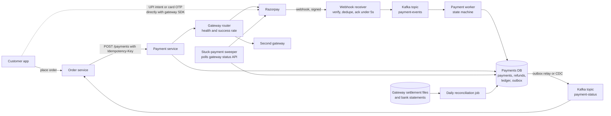

The app pays directly with the gateway's SDK, so card numbers and UPI PINs never touch Zomato (out of most PCI scope). The webhook drives the state machine; the sweeper and reconciliation are the safety nets.

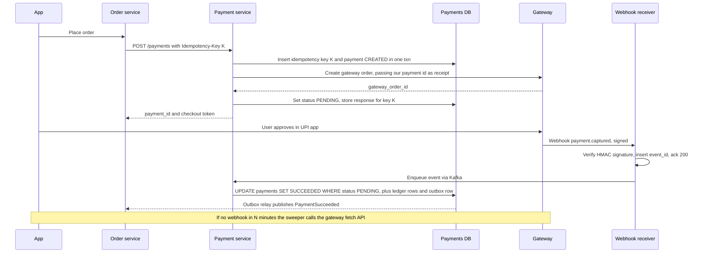

### Payment state machine

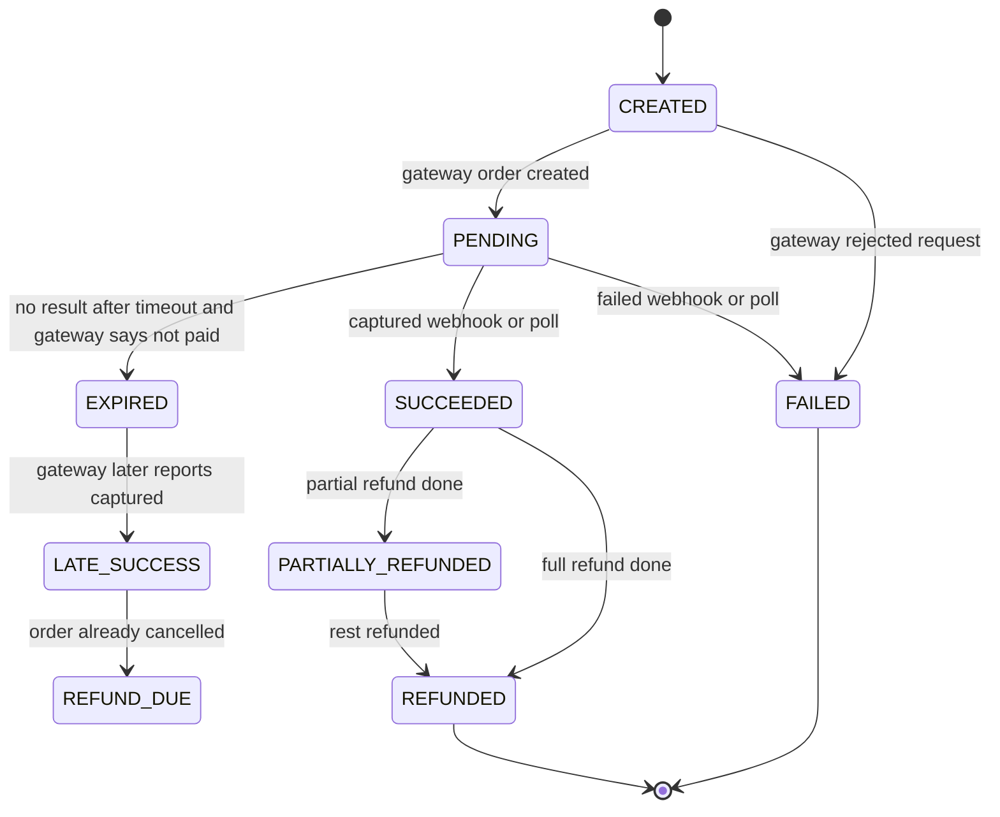

The rule that makes webhooks safe: **transitions only go forward, and every update is conditional on the current state**: `UPDATE payments SET status='SUCCEEDED' WHERE id=? AND status='PENDING'`. A late "failed" after "captured", or a duplicate webhook, matches zero rows.

### The core trick 1: idempotency keys, in three phases

An **idempotency key** is a unique string per user intent; the server stores the key and the response, so a retry gets the stored response, not a second charge.

> **Real world:** Stripe saves the first response once execution begins, **including 500s**, and rejects a retry with different parameters ([Stripe docs](https://docs.stripe.com/api/idempotent_requests)). Brandur Leach splits a request into **atomic phases** with a `recovery_point`, external calls **between** phases ([brandur.org](https://brandur.org/idempotency-keys)). Airbnb's Orpheus: **Pre-RPC, RPC, Post-RPC**, **no DB transaction open during the RPC**, idempotency reads on the **primary** because replica lag could make a retry look new ([summary](https://biweekly-engineering.beehiiv.com/p/handling-double-payments-airbnb-biweekly-engineering-episode-32), secondary).

1. **Phase 1 (one txn, primary).** Insert the key. Same hash with stored response → return it; still locked → `409`; different hash → `422`. Else insert payment `CREATED`.
2. **External call, no txn open.** Create the gateway order with *our* payment ID as receipt, so a crashed retry can look it up instead of creating a second.
3. **Phase 2 (one txn).** Store `gateway_order_id`, set `PENDING`, save the response.

Why not one big transaction? The gateway call takes seconds, exhausting connections at peak, and a rollback can't undo it anyway. (Your Atlassian SQS consumers, plus an external call in the middle.)

### The core trick 2: webhooks are the truth, the redirect is a hint

The app's callback can be lost or tampered with; the server-to-server **webhook** is the truth.

> **Real world — Razorpay:** respond within **5 seconds**; retries with backoff **for 24 hours**, then the webhook is **disabled**; delivery is **at-least-once**, dedupe on **`x-razorpay-event-id`**; **order not guaranteed**; if a webhook is late, call the fetch APIs ([best practices](https://razorpay.com/docs/webhooks/best-practices/)).

So: the receiver only verifies the **HMAC-SHA256 of the raw body** (else anyone can POST "captured"), inserts into `webhook_events` (duplicate → still return 200), enqueues, acks. The forward-only state machine handles ordering. Alert on webhook errors long before 24 hours.

### The core trick 3: the unknown outcome ("payment pending")

What the rejected candidate missed. With UPI the bank often debits the user but the gateway's reply to us times out; "timeout = failure" takes money and gives nothing.

1. **Never treat a timeout as failure.** Stay `PENDING`; show "processing", not "try again" (or they pay twice). Never retry with a new key.
2. **Ask, don't guess:** the sweeper selects `PENDING` older than 2 minutes and calls the gateway fetch API with backoff (2, 5, 15, 60 min).
3. **Final timeout:** after ~30 minutes with the gateway saying "not paid", `EXPIRED`; a capture after that → `LATE_SUCCESS`, auto-refund.
4. **The order waits for the payment:** it sits in `PAYMENT_PENDING` and the restaurant isn't told until `SUCCEEDED` (Zepto's draft orders, Q10). Paid twice (GPay and PhonePe)? First success wins, the second is auto-refunded.

### Double-entry ledger, refunds, reconciliation

**Double-entry:** every movement is at least two entries, debits = credits; balances are derived from immutable entries, never a mutable column ([Modern Treasury](https://www.moderntreasury.com/journal/accounting-for-developers-part-i)). A ₹500 order (₹420 food, ₹60 commission, ₹20 delivery):

| Step | Debit | Credit |
|---|---|---|
| Captured | gateway_clearing:razorpay 500 | customer_order:8812 500 |
| Delivered | customer_order:8812 500 | restaurant_payable 420, commission_revenue 60, delivery_fee_revenue 20 |
| Settled (₹9 fee) | bank 491, gateway_fees_expense 9 | gateway_clearing:razorpay 500 |

> **Real world — Stripe Ledger:** ~5 billion events a day; at steady state **clearing accounts are empty**, so **a nonzero clearing balance means an event is missing, late or wrong**; corrections are reversals, never edits ([Stripe, 2024](https://stripe.dev/blog/ledger-stripe-system-for-tracking-and-validating-money-movement)).

**Refunds** reuse the same machinery. In one transaction, `SELECT ... FROM payments WHERE id=:pid FOR UPDATE`, check `refunded_paise + amt <= amount_paise` (else 422), insert the refund as REQUESTED, bump `refunded_paise`; commit, then call the gateway with the refund ID as reference. The row lock stops two agents refunding ₹240 on a ₹120 item. **Proration:** biryani ₹300, kebab ₹200, ₹100 coupon; the missing kebab's discount share is 100 × 200/500 = ₹40, so refund ₹160 (store the per-line split at order time). Wallet refunds are instant (two ledger entries); to source takes days. **Chargebacks** (the bank forcibly reverses a payment): DISPUTE_OPEN → ACCEPTED or EVIDENCE_SUBMITTED (delivery proof, rider GPS, OTP logs) → WON or LOST, each posting ledger entries, with a delayed job (Q13) before the evidence deadline.

**Reconciliation** = matching our records with the gateway's and bank's, line by line: the real-time sweeper; a daily match of the settlement file to our rows by `gateway_payment_id`, then the total to the bank credit; continuous ledger invariants (clearing → zero). Gateway captured but we say failed → succeed or refund; we say succeeded but gateway has nothing → page someone. Zomato's ads team added **an hourly reconciliation job as a fail-safe** after lost Flink state broke billing counters ([Zomato blog](https://www.zomato.com/blog/eliminating-bottlenecks-in-real-time-data-streaming-a-zomato-ads-flink-journey/)).

**Multiple gateways:** Zomato routed around gateways down on NYE ([Zomato blog](https://www.zomato.com/blog/our-learnings-from-nye/)); route by rolling success rate per (gateway, method, bank) with a circuit breaker. A payment created on gateway A **settles on A**; failover is for new payments only.

### Failure cases

| Failure | Handling |
|---|---|
| Double-tap Pay | Same key returns the first response |
| Crash after gateway order, before saving | Retry at recovery point `started` looks up gateway order by our receipt ID |
| Paid, webhook never arrives | Sweeper polls fetch API |
| Webhook twice or out of order | `event_id` dedupe plus forward-only conditional update |
| Order service down after success | Outbox row committed with the payment; relayed later |
| Kafka redelivers to ledger | `UNIQUE (source_type, source_id)` |
| Fake "success" POST | HMAC check rejects it |

### 60-second spoken summary

"Payments are a correctness problem, not scale: about 140 orders a second at NYE peak. With an idempotency key, we write the key and a CREATED payment on the primary, call the gateway with no transaction open, then record PENDING, Airbnb's pre-RPC, RPC, post-RPC split. The app pays directly with the gateway, so we never see card data. The webhook is the truth: verify HMAC, dedupe on Razorpay's event ID, ack in 5 seconds, forward-only state machine. Timeouts are never failures: PENDING, a sweeper polls, late successes are auto-refunded. Every movement goes into an append-only double-entry ledger, and daily reconciliation plus Stripe's 'clearing accounts should be zero' check catches the rest."

### Follow-ups they ask

**Q: The gateway timed out. Did the charge happen?** We don't know, and the design admits it: stay PENDING, show "processing", never retry with a new key, sweeper polls the fetch API, expire only when the gateway confirms "not paid", auto-refund a late capture.

**Q: SQL or NoSQL?** SQL by default for one transaction across payment, ledger and outbox. But Zomato's billing moved from TiDB to DynamoDB for 4x throughput at about half the cost, with a single-table design ([AWS blog](https://aws.amazon.com/blogs/database/unlocking-performance-scalability-and-cost-efficiency-of-zomatos-billing-platform-by-switching-from-tidb-to-dynamodb/)), so NoSQL works with careful keys and conditional writes.

**Q: Kafka or SNS+SQS?** Kafka for many consumers, replay and per-payment ordering by key; SNS→SQS is simpler with built-in DLQs but no replay. Both are at-least-once, and Kafka's exactly-once covers only Kafka-to-Kafka, not gateway calls or DB writes ([Confluent](https://www.confluent.io/blog/exactly-once-semantics-are-possible-heres-how-apache-kafka-does-it/)), so consumers stay idempotent.

**Q: "Charged but app shows failed" — debug?** Find the order's payments, their webhook events and sweeper logs; usually gateway shows captured and we never processed it. Fix now (succeed or refund); if reconciliation didn't catch it within a day, that gap is the real bug.

---

## Q9. Design seat and ticket booking (BookMyShow, Zomato District)

### Why they ask it

Seat booking appeared in **12 reports**. Blinkit asks "two users selecting the same seat at the same time, pessimistic vs optimistic locking, Redis" ([B3](https://leetcode.com/discuss/post/8331559/)) and "spurious load, prevention of double booking" ([B13](https://leetcode.com/discuss/post/5869260/)); Swiggy asked train booking with waitlists; Zepto IRCTC. It is now Zomato's business: in Aug 2024 Zomato agreed to buy Paytm's ticketing (TicketNew, Insider) for ₹2,048 crore, launched as **District** ([The Week](https://www.theweek.in/wire-updates/business/2024/08/21/del88-biz-ld-paytm-zomato.html)). District hasn't published how it locks seats: say "not public; here's how it's typically done".

### Clarify, requirements, estimates

Clarify: reserved seating or general admission (both)? Hold time (10 min for movies, 4 for hot sales)? Per-user cap? Hot on-sales or Friday movies (almost different systems)? Payment via Q8.

**Functional:** browse shows, live-ish seat map, hold seats for a time, pay, confirm, auto-expire holds, cancel. **Non-functional:** **no double booking, ever**; seat map may be seconds stale (the hold is where truth is checked); survive 100–1000x demand on-sales, **fairly**.

**Estimates:** BookMyShow sells up to **200M tickets a year** ([AWS](https://aws.amazon.com/blogs/business-intelligence/how-bookmyshow-saved-80-in-costs-by-migrating-to-an-aws-modern-data-architecture/)) ≈ 6/s average, ~60/s peak: one DB handles it. For Coldplay the CEO said they were "underprepared for **10 million instances**", largely bots ([Business Today](https://www.businesstoday.in/amp/india/story/we-were-underprepared-for-the-bots-bookmyshow-ceo-on-coldplay-ticketing-row-462362-2025-01-29)); ~50K seats means ~200 people per seat. Say aloud: **in an on-sale the DB isn't the bottleneck; admission is.** At Ticketmaster's Eras Tour sale (3.5 billion requests), what broke was **passcode validation**, not seat locking ([Ticketmaster](https://business.ticketmaster.com/press-release/taylor-swift-the-eras-tour-onsale-explained/)).

### APIs and data model

```http
GET  /v1/shows/{show_id}/seatmap       -> { "version": 1182, "seats": [{"id":"F12","status":"AVAILABLE"}, ...] }
POST /v1/shows/{show_id}/holds         Idempotency-Key  { "seat_ids": ["F12","F13"] }
  -> 201 { "hold_id":"h_901", "expires_at":"...", "amount_paise":70000 }  |  409 { "error":"SEATS_TAKEN", "seats":["F13"] }
DELETE /v1/holds/{hold_id}
POST /v1/holds/{hold_id}/confirm       (called by the payment flow) -> { "booking_id":"b_7731" }
POST /v1/events/{event_id}/queue       (waiting room) -> { "queue_token":"...", "position":48211, "eta_seconds":960 }
```

```sql
CREATE TABLE show_seats (                -- one row per seat per show
  show_id BIGINT NOT NULL, seat_id VARCHAR(8) NOT NULL, price_paise BIGINT NOT NULL,
  status VARCHAR(10) NOT NULL,           -- AVAILABLE, HELD, BOOKED
  hold_id BIGINT NULL, hold_expires_at TIMESTAMP NULL, booking_id BIGINT NULL,
  version INT NOT NULL DEFAULT 0,
  PRIMARY KEY (show_id, seat_id),
  INDEX idx_expiry (status, hold_expires_at)
);
-- holds(id, show_id, user_id, status ACTIVE/CONFIRMED/EXPIRED/RELEASED, expires_at, idem_key UNIQUE)
-- bookings(id, hold_id UNIQUE, user_id, show_id, payment_id, status)   -- double confirm is harmless
CREATE TABLE booking_seats (             -- last line of defence
  booking_id BIGINT NOT NULL, show_id BIGINT NOT NULL, seat_id VARCHAR(8) NOT NULL,
  PRIMARY KEY (show_id, seat_id)          -- the DB itself refuses a second booking of a seat
);
```

Even if every lock above has a bug, `booking_seats` refuses the same seat twice. (For resale after cancellation, move cancelled rows to history or use a Postgres partial unique index.)

### Architecture

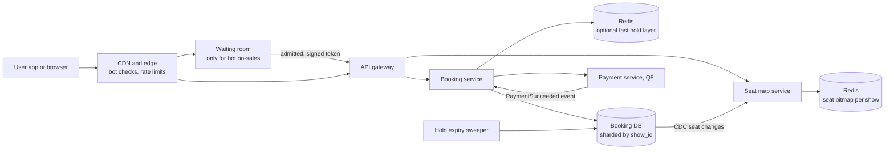

Shard by `show_id`: every seat operation touches one show, so no cross-shard transactions. The seat map is a Redis **bitmap** (1 bit per seat; 500 seats = 63 bytes) updated by CDC, polled every few seconds or pushed via SSE for hot shows; the hold call is the real check.

### The core trick: put the check inside the write

The race: Asha and Ravi both `SELECT` F12 as AVAILABLE, both `UPDATE` to HELD, both see "You have F12!". The bug is the gap between read and write (**check-then-act**). Every fix closes it.

**Option A — atomic conditional update (default):**

```sql
BEGIN;
UPDATE show_seats
SET status='HELD', hold_id=:hold, hold_expires_at=NOW() + INTERVAL 10 MINUTE, version=version+1
WHERE show_id=:show AND seat_id IN ('F12','F13')
  AND (status='AVAILABLE' OR (status='HELD' AND hold_expires_at < NOW()));  -- expired holds count as free
-- if rows_affected <> 2: ROLLBACK, return 409; else insert into holds, COMMIT
```

The DB row-locks as it updates; the loser waits, re-checks the WHERE, matches zero rows. All-or-nothing comes from the transaction plus the row count. Optimistic in spirit, fast, fails quickly.

**Option B — `SELECT ... FOR UPDATE`** then decide in code: needed for rules the WHERE can't express ("no single orphan seat"). Cost: waiters queue. Trap: **deadlocks** if Asha locks F12→F13 while Ravi locks F13→F12; fix with `ORDER BY seat_id` so everyone locks in the same order.

**Option C — Redis hold in front:** `SET hold:{show_77}:F12 h_901 NX PX 600000` (NX = only if absent, PX = 10-min TTL), multi-seat via a Lua script (atomic, since Redis runs one script at a time). Absorbs the "everyone clicks F12" storm so the DB sees only winners. **But Redis is not the truth.**

**Why Redis alone isn't enough.** Redis replication is **asynchronous**: the primary can ack a lock and die before the replica has it, so a second client gets it ([Redis docs](https://redis.io/docs/latest/develop/clients/patterns/distributed-locks/)). Kleppmann separates **efficiency locks** (loss = wasted work) from **correctness locks** (loss = corrupt data), and shows a **GC pause** outliving the lease; his fix is a **fencing token**, an ever-increasing number the storage checks ([Kleppmann](https://martin.kleppmann.com/2016/02/08/how-to-do-distributed-locking.html); antirez's reply [here](http://antirez.com/news/101)). In our design the row's `hold_id` is the fence:

```sql
UPDATE show_seats SET status='BOOKED', booking_id=:b
WHERE show_id=:show AND seat_id IN (...) AND status='HELD' AND hold_id=:my_hold AND hold_expires_at > NOW();
```

**Say this:** "Redis gave us speed; the database gave us correctness."

### Hold expiry and the late payment

**Lazy expiry:** the hold WHERE already treats expired holds as free, so seats are reusable instantly. **Sweeper** every 30 s resets expired HELD rows so the map is truthful. Ugly case: paid at 9:58, webhook at 10:30, confirm fails. If the seats are still free, re-hold and confirm; else auto-refund. Make it rarer: block payment start with under a minute left, extend the hold briefly once on the gateway page.

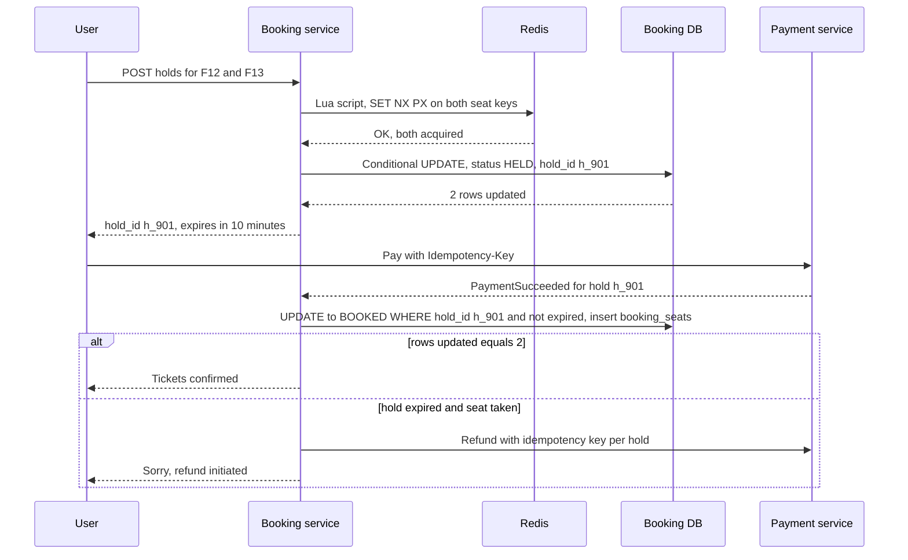

### The waiting room for hot on-sales

A **virtual waiting room** holds users in front of the booking system and admits them at the rate it can serve, giving each a signed token the booking APIs check.

> **Real world — BookMyShow Coldplay (2024):** the Mumbai queue was **linear (FIFO)**; later shows used **randomised token IDs** and a cap of 4 ([Business Today](https://www.businesstoday.in/amp/india/story/we-were-underprepared-for-the-bots-bookmyshow-ceo-on-coldplay-ticketing-row-462362-2025-01-29)). Ahmedabad: join 11:00–11:59, **random position at 12:00**, 4 minutes to buy ([WION](https://embed.wionews.com/entertainment/coldplay-fans-upset-once-again-as-ahmedabad-concert-queues-go-in-lakhs-776663)), like Queue-it's randomised pre-queue ([Queue-it](https://queue-it.com/blog/first-in-first-out-randomization)). Cloudflare admits by **free slots = active-user limit minus current active users**, giving each edge worker a share so it can **admit locally without coordinating** ([Cloudflare](https://blog.cloudflare.com/building-waiting-room-on-workers-and-durable-objects)).

Admit by capacity, not fixed rate; keep the queue at the edge (Redis sorted set or counter) so 10M waiters never touch the DB; ETA = position ÷ admission rate; bots: phone-verified accounts, CAPTCHA at entry, per-account/device/instrument caps, and **protect the token-validation service** (what fell at Ticketmaster).

**General admission** (5,000 identical floor tickets) is a counter: `UPDATE ticket_tiers SET held=held+:n WHERE id=:tier AND sold+held+:n <= capacity`. Every buyer hits one **hot row**; fix with a Redis Lua `DECRBY` gate, splitting into 50 rows of 100 (random pick), or pre-generated ticket rows claimed with `FOR UPDATE SKIP LOCKED`.

### Failure cases

| Failure | Handling |
|---|---|
| Two users click the same seat | One conditional update wins; other gets 409 and fresh map |
| Redis failover loses holds | DB `hold_id` check at hold and confirm |
| Payment after hold expiry | Re-hold if free, else auto-refund |
| Webhook twice | `bookings.hold_id UNIQUE` plus conditional update |
| Sweeper down | Lazy expiry keeps seats bookable |

### 60-second spoken summary

"Never sell a seat twice. A row per seat per show holds status, hold ID and expiry; holding is one conditional update, `SET HELD WHERE AVAILABLE or expired`, with a row-count check. For hot shows a Redis `SET NX PX` gate keeps losers off the DB, but the DB's hold ID is the fencing token at confirm, covering Kleppmann's GC-pause and failover problems. Holds expire lazily and via a sweeper; a late payment re-holds or refunds; `booking_seats` is the final guard. For a Coldplay on-sale, the problem is admission: an edge waiting room randomised at T0, admitting by free capacity, with a 4-ticket cap and bot checks."

### Follow-ups they ask

**Q: Optimistic or pessimistic?** Conditional update (optimistic style; loser gets 0 rows and 409). `SELECT FOR UPDATE` when logic must read several rows first, locked in sorted order. Version-number optimistic locking causes retry storms on a hot seat, so it's worse here.

**Q: Why not just Redis?** Async replication can lose a hold on failover, a GC pause can outlive a TTL, and bookings are money needing durability and audit. Redis is the gate; the DB is the truth (same trap as Blinkit's "infinite money, replace the DB with a cache?").

**Q: IRCTC?** Seats are sold per **segment** (Delhi–Kanpur, then Kanpur–Lucknow), so availability is per (seat, segment) and a booking holds all segments atomically; waitlists are queues per class per train. A Zepto candidate scored by introducing exactly this segment entity.

**Q: "How does District do it?"** Not public; describe this standard approach. Bluffing is worse than "I don't know".

---

## Q10. Design quick-commerce inventory and checkout (Blinkit, Zepto, Instamart)

### Why they ask it

Blinkit is Eternal's, and Zepto's signature SDE-1/2 question is "orders and deliveries in quick commerce: inventory, order prioritisation at peak, payment methods", with "SQL or NoSQL per component" and add-to-cart/place-order APIs with edge cases ([P1](https://leetcode.com/discuss/post/5796138/), [P2](https://leetcode.com/discuss/post/5796357/)). Meesho's trap: **block inventory at createOrder, decrement at confirmOrder** ([report](https://leetcode.com/discuss/post/5925685/)). Flipkart: a 15-minute flash sale with no overselling ([F8](https://leetcode.com/discuss/post/8567797/)).

> **Real world — Blinkit:** Eternal calls quick commerce "real-time inventory checks against a specific dark store, picker assignment, dispatch, all within a 10-minute delivery window"; **2,751 stores** in Q2FY27 ([Eternal](https://www.eternal.com/blog/q2fy27)); average delivery **12.5 minutes** and **fill rate above 99%** in early 2024 ([investor overview](https://b.zmtcdn.com/investor-relations/Zomato_overview_May-24.pdf)). Fill rate (share of ordered items actually delivered) is exactly "did we oversell?".

**Honesty note:** no Indian quick-commerce company has published how it prevents overselling. What follows is the standard approach, not "what Blinkit does".

### Clarify, requirements, estimates

A **dark store** is a small warehouse closed to walk-ins serving a few km; inventory is per store. Key choice: **when to reserve** (propose checkout). COD confirms immediately. Substitutions allowed? Flash sales (₹1 deals) = the hot-row case.

**Functional:** location → store; show that store's stock; cart; checkout reserves; pay; confirm; pick, pack, dispatch; release on failure or timeout. **Non-functional:** never confirm what the shelf can't fill; browsing may be seconds stale; checkout well under a second; picking starts seconds after payment.

*Assumptions:* ~6,000 SKUs × 2,751 stores ≈ **16M rows**, ~1.6 GB (fits one DB and Redis). ~70 orders/s peak × 6 lines ≈ **420 reservation updates/s**, under one per store per second, except a flash-sale SKU at thousands/s on one row. Browsing is 50–100x checkout, so reads never hit the inventory DB.

### APIs and data model

```http
GET  /v1/serviceability?lat=28.45&lng=77.02    -> { "store_id": 1182, "eta_min": 11 }
POST /v1/cart/items  { "store_id":1182, "sku_id":"amul-taaza-500", "qty":2 }   -> soft check only
POST /v1/checkout    Idempotency-Key  { "cart_id":"c_77", "payment_method":"UPI" }
  -> 201 { "draft_order_id":"d_901", "status":"PAYMENT_PENDING", "reserved_until":"..." }
  -> 409 { "error":"OUT_OF_STOCK", "lines":[{"sku_id":"amul-taaza-500","available":1}] }
POST /internal/orders/confirm  { "draft_order_id":"d_901", "payment_id":"pay_22" }   -> idempotent
```

```sql
CREATE TABLE store_inventory (
  store_id INT NOT NULL, sku_id BIGINT NOT NULL,
  on_hand  INT NOT NULL CHECK (on_hand >= 0),              -- physically on the shelf
  reserved INT NOT NULL DEFAULT 0 CHECK (reserved >= 0),
  PRIMARY KEY (store_id, sku_id),
  CHECK (reserved <= on_hand)                              -- the DB itself forbids overselling
);
-- reservations(id, draft_order_id, store_id, sku_id, qty, status HELD/COMMITTED/RELEASED, expires_at,
--              UNIQUE(draft_order_id, sku_id), INDEX(status, expires_at))
-- draft_orders(id, user_id, store_id, status PAYMENT_PENDING/CONFIRMED/TERMINATED, idem_key UNIQUE)
-- inventory_movements(id, store_id, sku_id, delta /* +50 inward, -2 sold */, reason INWARD/SALE/DAMAGE/AUDIT_ADJUST,
--         ref_id, UNIQUE (reason, ref_id, sku_id))   -- append-only stock journal; an order can't deduct twice
```

`available = on_hand - reserved`; the CHECKs mean even buggy code can't oversell.

### Architecture

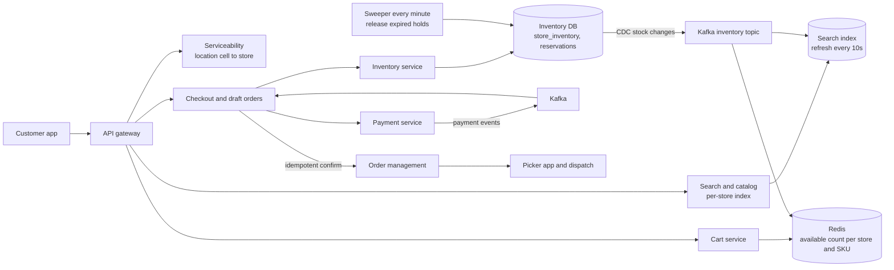

> **Real world — Zepto search:** search resolves against the customer's hub; Zepto raised OpenSearch refresh from 1 s to 10 s because **final availability is re-checked against the real-time inventory service after retrieval** ([AWS blog](https://aws.amazon.com/blogs/big-data/how-zepto-powers-sub-second-search-using-opensearch-service-or2-instances/)).

So **three levels of truth**: search index (seconds stale, display), Redis count (sub-second, "only 2 left"), inventory DB (the only one that can say yes at checkout).

### The core trick: reserve at checkout, atomically, then confirm idempotently

**When to reserve:** at add-to-cart, abandoned carts lock stock; after payment, the user pays then gets refunded (worst). **At checkout**, holds are short (5–10 min) and only for people about to pay; the cart does a soft Redis check.

```sql
BEGIN;
-- lines sorted by sku_id so two checkouts lock rows in the same order (no deadlocks)
UPDATE store_inventory SET reserved = reserved + 2
  WHERE store_id = 1182 AND sku_id = 501 AND on_hand - reserved >= 2;   -- expect 1 row
UPDATE store_inventory SET reserved = reserved + 1
  WHERE store_id = 1182 AND sku_id = 777 AND on_hand - reserved >= 1;   -- expect 1 row
-- any 0-row update: ROLLBACK, 409 with the short lines
INSERT INTO reservations (...) VALUES (...);                              -- HELD, expires now + 7 min
INSERT INTO draft_orders (...) VALUES (... 'PAYMENT_PENDING' ...);
COMMIT;
```

Same "check inside the write" as Q9. One store = one shard = one local transaction: a big reason to shard by `store_id`.

> **Real world — Zepto's draft orders:** row-lock contention on a billions-row Aurora table led Zepto to a **Draft-Order service on DynamoDB** that accepts orders before payment, consumes payment events from Kafka, and calls an **idempotent** OMS Create Order; a **sparse GSI** holds only orders awaiting payment, a **job every 5 minutes** confirms or terminates stuck ones; Create Order got ~60% faster, rolled out 10% → 30% → 100% ([AWS blog, Nov 2025](https://aws.amazon.com/blogs/database/how-zepto-scales-to-millions-of-orders-per-day-using-amazon-dynamodb/)).

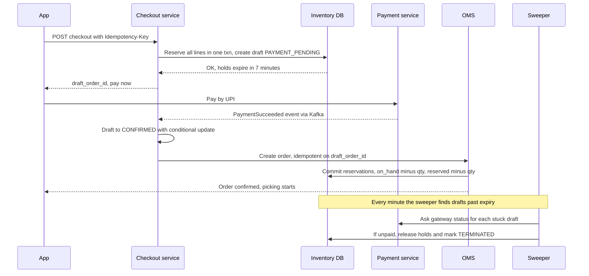

Three safety rules: (1) **confirm is idempotent on `draft_order_id`**; (2) the **sweeper asks the gateway first**, then releases with `UPDATE reservations SET status='RELEASED' WHERE id=? AND status='HELD'`, decrementing `reserved` only if that touched a row, so a double release can't free stock twice; (3) **late payment after termination** tries a fresh reservation, else auto-refund (Q8's LATE_SUCCESS).

**Hot SKU (₹1 Coke for 2,000 users):** thousands of attempts/s on one row also stall every other SKU in those transactions. Gate in Redis with Lua (`if GET >= qty then DECRBY`), losers rejected in microseconds, winners reserve in the DB, reconcile every minute; or split into 20 sub-rows of 100; or a Q9-style waiting room.

**System vs shelf stock:** DB says 3, shelf has 2. Treat it as a normal path: picker marks "not found", order goes PARTIAL, substitute or instant prorated refund, an `AUDIT_ADJUST −1` movement, and cycle counts reconcile. Instacart models availability as a **probability** learned from "found/not found" scans ([Instacart](https://company.instacart.com/tech-innovation/how-instacarts-item-availability-evolved-over-the-pandemic)); a dark store can hide items with a high recent not-found rate.

### Failure cases

| Failure | Handling |
|---|---|
| Two users take the last unit | Conditional update; one gets 409 "just sold out" |
| Payment never completes | Sweeper releases after checking the gateway |
| Payment event twice | Conditional draft update plus idempotent OMS create |
| Inventory service down | Checkout fails closed; browsing still works from cache and index |

### 60-second spoken summary

"Inventory is per dark store and SKU, with on-hand, reserved and a CHECK that reserved never exceeds on-hand. Browsing reads a slightly stale per-store index and Redis count; checkout reserves every line in one local transaction with `WHERE on_hand - reserved >= qty`, sorted by SKU, and creates a PAYMENT_PENDING draft. The payment event confirms it via an idempotent create-order; a sweeper releases expired holds after asking the gateway, the shape of Zepto's draft-order design. Hot SKUs get a Redis gate or split rows; shelf drift is a normal path. This is the standard approach, not Blinkit's published internals."

### Follow-ups they ask

**Q: SQL or NoSQL per component?** Inventory: SQL (or DynamoDB conditional writes) for atomic multi-line decrements. Drafts: either; Zepto chose DynamoDB for write scale and TTL. Search: OpenSearch/Solr. Cart: Redis or DynamoDB by user. Order history: SQL or documents.

**Q: Cache says in stock, DB says no?** DB wins, user sees "just sold out" with substitutes; then alert on CDC consumer lag, the usual cause.

**Q: Prioritising orders at peak?** Picking is scarce, so a priority picker queue: oldest first, then small quick-pack orders. If overloaded, raise the ETA or pause the store, Zomato's NYE "throttle demand where capacity is short" lever.

**Q: Where's the Factory pattern?** `PaymentProcessorFactory.get(method)` returning UPI/card/wallet/COD processors with `initiate()` and `handleCallback()`; COD's `initiate()` confirms immediately.

---

## Q11. Design coupons and promo codes

**Why they ask it.** Blinkit SDE-1 fresher: "coupon creation and validation: admin rules, expiry, limited-user coupons, a **5-minute payment window** after applying" ([B17](https://medium.com/@utkarsho.dev/blinkit-sde-1-interview-experience-fresher-39ba436055f3)); Swiggy asked the LLD with Redis caching ([S9](https://leetcode.com/discuss/post/6051809/)). No food or q-commerce company has published its coupon engine.

**Clarify:** types (flat, percent with cap, free delivery, BOGO, bank offer); limits (total, per user, per day); who funds it (platform, restaurant, bank — changes ledger entries); stacking (usually one coupon plus one bank offer); auto-apply best. **Non-functional:** validation under 50 ms; never exceed a cap even under thousands/s; abuse-resistant. *Assumption:* ~85 redemptions/s at peak, ~400 validations/s, but a viral "first 10,000 get 50% off" means **thousands/s on one counter**.

```sql
-- coupons(id, code UNIQUE, type FLAT/PERCENT/FREE_DELIVERY/BOGO, value, max_discount, min_order,
--         starts_at, ends_at, total_limit, per_user_limit, funded_by PLATFORM/RESTAURANT/BANK, rules JSON, status)
-- coupon_budget(coupon_id, shard, remaining CHECK >= 0)       -- global counter, split for hot coupons
-- coupon_user_usage(coupon_id, user_id, used)
-- coupon_redemptions(id, coupon_id, user_id, order_id UNIQUE,  -- one coupon per order; replays harmless
--         discount_paise, status RESERVED/CONFIRMED/RELEASED/EXPIRED, expires_at)   -- the 5-minute window
```

**Split the read path from the write path.** **Validation** (cached, called often): active coupons in Redis by city and segment; a pipeline of cheapest checks first (active, dates, city/restaurant, min order, payment method, segment, per-user usage, budget), each returning a specific error ("add ₹40 more"). Discounts use the **Strategy pattern** (`DiscountStrategy.compute(cart)` with `FlatOff`, `PercentWithCap`, `FreeDelivery`, `Bogo`), so a new type is a new class. Best coupon = compute the few eligible ones and sort. **Redemption** (strict, once per order) is below.

**Limited redemptions** are Q9's general-admission problem: a conditional `UPDATE coupon_budget SET remaining=remaining-1 WHERE ... AND remaining > 0` (one hot row), split into N budget rows (pick random shard, sum is exact), or a Redis `DECR` gate (negative → `INCR` back, reject) reconciled against RESERVED + CONFIRMED rows. **Per-user limit:** `UPDATE coupon_user_usage SET used=used+1 WHERE ... AND used < :limit` in the same transaction.

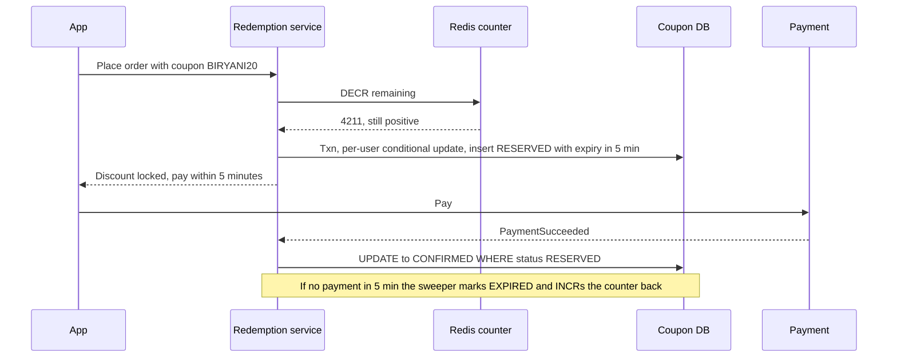

Release exactly once: `SET status='EXPIRED' WHERE id=? AND status='RESERVED'`, and only if a row changed, restore the counter and per-user usage. A full refund can move CONFIRMED → REVERSED (restores per-user use, usually not the budget; a product call).

**Abuse:** tie "new user" to device, phone and payment-instrument hash; rate-limit apply per user/device (token bucket, like your Myntra limiter) against code guessing; bind leaked private codes to segments or issue single-use codes; count RESERVED as used to stop order-cancel-repeat. **Failures:** Redis counter lost → rebuild from `total_limit − count(RESERVED or CONFIRMED)`; replayed redemption → `order_id UNIQUE`; coupon edited mid-flight → the redemption row snapshots the discount; payment after expiry → re-reserve if budget remains, else refund (state one rule).

**Summary:** "Validation is a cached read path with cheap rule checks and a Strategy per type. Redemption reserves at order placement: a Redis gate or split budget rows for the global cap, a per-user conditional update, a 5-minute expiry. Payment confirms; failure or the sweeper releases exactly once by conditional state update. Unique per order, discount snapshotted, abuse checks on device, phone and instrument."

**Follow-ups.** *Why not `SELECT COUNT(*)` then insert?* Check-then-act: 50 requests all count 9,999 and all insert. *Redis OK but DB insert fails?* `INCR` back in the error path plus periodic reconciliation; DB is truth. *How does the discount hit the books?* Ledger entries (Q8): platform-funded debits `marketing_discount_expense`, restaurant-funded reduces `restaurant_payable`. *Patterns?* Strategy for discounts, Chain of Responsibility for validators, Factory to build the strategy.

---

## Q12. Design ratings and reviews

**Why they ask it.** It is **literally your Myntra project**, and Eternal interviewers turn your own project into the HLD more than any other question (13+ reports). Design it *and* say "I built a version of this".

**Scope:** delivery ratings for restaurants plus dishes; only verified (delivered) orders; edits and deletes; chain/brand aggregates; review lists sorted by recent or helpful. **Non-functional:** read-heavy; aggregate may lag seconds; each rating counts exactly once. *Assumption:* 20% of ~2M daily orders rated ≈ 400K/day, ~30/s peak, but **tens of thousands of rating reads/s**: over 1,000:1. That ratio decides everything: **precompute, cache, never `AVG()` on read.**

```sql
-- reviews(id, order_id UNIQUE /* verified, no double count */, user_id, restaurant_id, rating 1..5, body,
--         status PUBLISHED/IN_MODERATION/REJECTED, INDEX (restaurant_id, status, created_at, id))  -- cursor pagination
-- rating_histogram(entity_type RESTAURANT/DISH/BRAND, entity_id, c1, c2, c3, c4, c5)
-- processed_rating_events(event_id PRIMARY KEY)               -- consumer idempotency
```

**Histograms, never averages.** Store counts per star; `avg = Σ(k·ck) / Σck`. Increments are O(1), an edit 5→2 is `c5−1, c2+1` exactly, and the breakdown bars come free. **The chain problem is your Myntra problem:** colour variants showed different ratings and new colours showed "No Ratings" because only the rated style's cache refreshed; you merged related styles' histograms and wrote the combined rating to every style, for 5.7M styles. Brand = **sum of outlets' histograms**, never average of averages: 4.0★ from 1,000 plus 5.0★ from 10 is 4.5★ averaged but truly (4,000 + 50)/1,010 ≈ **4.01★**. Update the brand bucket in the same consumer step; a nightly recompute reconciles.

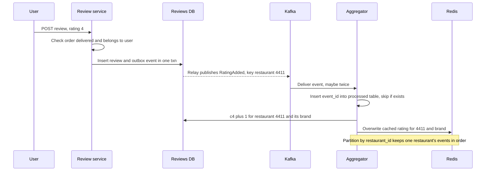

Stress two things: **idempotency** (the processed-event insert is in the same txn as the histogram update, since Kafka is at-least-once) and **update every cached copy from the same events** (your Myntra bug: reviews section stale, ratings section fresh, two caches with one refreshed). **Hot restaurant:** buffer increments a second and apply `c4 = c4 + 37`, like Zomato ads' incremental counts plus hourly reconciliation ([Zomato blog](https://www.zomato.com/blog/eliminating-bottlenecks-in-real-time-data-streaming-a-zomato-ads-flink-journey/)).

**Ranking with a Bayesian average:** `score = (C·m + Σratings)/(C + n)`, pretending C virtual ratings at global mean m. With m = 3.9, C = 50: one 5★ review scores ≈ 3.92; 4.6★ from 5,000 scores ≈ 4.59. Use for sorting; still *display* the true average. "Most helpful" uses a confidence-adjusted score (Wilson lower bound), not raw upvotes. **Moderation** is async: classifier for text and images, flagged → IN_MODERATION and a human queue. **Fake reviews:** verified orders do most of the work, plus velocity checks and device clusters.

**Summary:** "Rare writes, constant reads, so precompute. Reviews only for delivered orders, `order_id` unique, saved with an outbox event. A Kafka consumer keyed by restaurant updates star histograms per restaurant, dish and brand idempotently and overwrites every cached copy. Chains merge histograms, never average averages, exactly what I built at Myntra for 5.7 million variants. Ranking uses a Bayesian average; moderation is async; a nightly recompute reconciles."

**Follow-ups.** *Why not `AVG()` with an index?* O(reviews) per page view at thousands of views/s; histogram is O(1). *Cache warmup at launch?* Pace it: at Myntra the unpaced warmup refreshed only ~22% because it drained the downstream token bucket; a 4 ms pause and higher limit got 99.99%. *Consistency?* Eventual for aggregates; read-your-writes from the primary for the user's own review.

---

## Q13. Design delayed jobs: auto-cancel if the restaurant doesn't accept

**Why they ask it.** Every platform has timers: call the restaurant at 3 min, cancel and refund at 5, release a seat hold (Q9), expire a coupon (Q11). The naive `sleep(300)` fails instructively. Swiggy asked "design your own cron" ([S4](https://leetcode.com/discuss/post/6260445/)); District a job-status pipeline with worker failures ([Z31](https://medium.com/@samarth.bhutani/district-zomato-sde-1-interview-experience-off-campus-56-lpa-ctc-7806143fa708)).

**Requirements:** schedule at time T (± seconds is fine); ignore if the condition changed; retry; **durable** across deploys and crashes; at-least-once with idempotent handlers. *Assumption:* 3 timers per order × 140 orders/s ≈ **420 timers/s**, ~95% of accept-timers become no-ops.

```sql
CREATE TABLE scheduled_jobs (
  id BIGINT PRIMARY KEY AUTO_INCREMENT, job_type VARCHAR(40) NOT NULL,
  dedupe_key VARCHAR(100) NOT NULL UNIQUE,   -- "ord_8812:accept": scheduling twice is a no-op
  run_at TIMESTAMP NOT NULL, payload JSON NOT NULL,
  status VARCHAR(10) NOT NULL,               -- PENDING, RUNNING, DONE, FAILED, CANCELLED
  attempts INT DEFAULT 0,
  locked_until TIMESTAMP NULL,               -- lease: a dead worker's job becomes claimable again
  INDEX idx_due (status, run_at)
);
```

Insert the timer **in the same transaction as the order**, so an order never exists without its timeout.

**The key idea: the job checks state, so duplicates and late runs are harmless.**

```sql
UPDATE orders SET status='AUTO_CANCELLED', cancelled_reason='RESTAURANT_TIMEOUT'
WHERE id=8812 AND status='PLACED';   -- only if the restaurant still hasn't accepted
```

Accepted at 4:59 → zero rows, job marks itself DONE. Runs twice → zero rows. You don't even need reliable timer cancellation; a no-op is more robust than a delete that can fail.

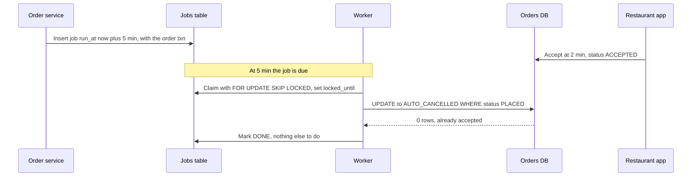

**Five ways to build the timer:**
1. **DB table plus poller (default).** Every second: `SELECT ... WHERE status='PENDING' AND run_at <= NOW() ORDER BY run_at LIMIT 100 FOR UPDATE SKIP LOCKED`, set RUNNING with a 60 s lease. `SKIP LOCKED` lets ten workers grab ten batches with no blocking or double claim; a reaper resets expired leases. Durable and transactional with the order.
2. **Redis sorted set:** `ZADD delayed <run_at> <job_id>`, a Lua script moves due IDs to a processing set. Very fast; weaker durability (failover, as in Q9).
3. **Queue delays:** SQS per-message delay up to 15 min plus visibility timeout (your Atlassian SQS pools). Kafka has none, so build fixed **delay topics** (`delay-1m`, `delay-5m`). Uber chains retry topics with increasing delays then a DLQ ([Uber](https://www.uber.com/blog/reliable-reprocessing/)). Warning: DoorDash's **Celery countdowns overloaded RabbitMQ**, which failed at peak and lost messages; they moved to Kafka ([DoorDash](https://doordash.engineering/2020/09/03/eliminating-task-processing-outages-with-kafka/)).
4. **Durable workflow engines (Cadence, Temporal):** `await accepted or timer(5m)` as code with persisted timers; Uber Eats used Cadence for its order steps ([Uber](https://www.uber.com/blog/open-source-orchestration-tool-cadence-overview/)).
5. **In-memory timing wheel:** ring of per-second slots, O(1), used in Kafka and Netty; not durable, so only for losable timeouts.

**Failures:** worker dies after claim → lease expires, job returns; workers down 20 min then a flood → process in `run_at` order with a rate limit and drop stale ones ("rate your order" 6 hours late); clock skew → compare to the DB's `NOW()`; IVR provider down → retry then fall back (Zomato switched calling providers on NYE 2021 ([Zomato blog](https://www.zomato.com/blog/our-learnings-from-nye/))); poison job → FAILED after N attempts, DLQ alert.

**Follow-ups.** *Why not `Thread.sleep`?* In memory: a deploy loses every timer silently. *Why not cron scanning orders?* It scans a hot table; a small indexed jobs table is cheap. *Exactly-once refund after auto-cancel?* Outbox event plus refund key `refund:ord_8812:auto_cancel`. *SKIP LOCKED vs NOWAIT?* NOWAIT errors on a locked row; SKIP LOCKED moves on, which a work queue wants.

---

## Q14. How would your design survive New Year's Eve or an IPL final?

**Why they ask it.** A follow-up to any design: "10x traffic for two hours, what breaks?" A Zomato SWE1's DDoS answer (rate limiting, caching, queues) left the interviewer "not convinced" ([Z4](https://leetcode.com/discuss/post/7609011/)); another had to flatten a real DB spike graph without adding capacity ([Z3](https://leetcode.com/discuss/post/8385519/)). Zomato's own blog is your best weapon.

> **Real world — Zomato NYE 2023:** **8,400 orders/min** but **80.92 million requests/min**; Kafka **450M+ messages/min**; cache serving **1 billion GETs/min**; pre-scaled to **11,000 EC2 instances across 300+ microservices**; **14,000 minutes** of load tests; reviewed **kill switches and degraded modes**; **chaos tests** injecting latency and cache misses ([Zomato blog](https://blog.zomato.com/a-tale-of-scale-behind-the-scenes-at-zomato-tech-for-nye-2023)). NYE 2021: a **kill switch per feature**, switched calling providers, **throttled demand where riders or kitchens ran out** ([Zomato blog](https://www.zomato.com/blog/our-learnings-from-nye/)).

**Read the numbers:** 140 orders/s vs 1.35M requests/s ≈ **9,600 backend requests per order**, mostly browsing, search, tracking polls and fan-out. Cache GETs to SETs ≈ 10:1. So the job is **protecting a tiny critical write path from a huge read path.**

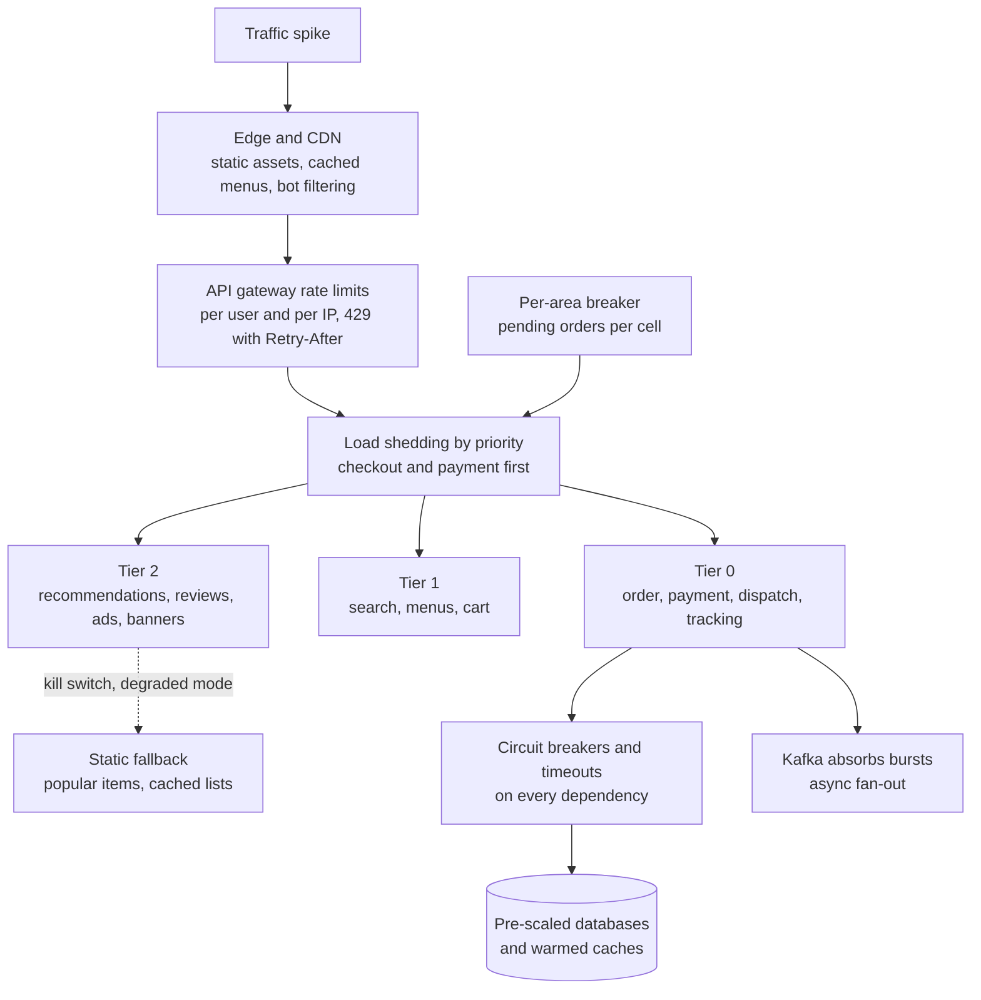

**Before the day:** replay recorded production traffic above the expected peak, **ramped so autoscaling can react** and **auto-aborting** on critical alerts (Zomato's benchmarking rules); **pre-scale**, because autoscaling reacts after load arrives and takes minutes, and some things don't autoscale (DB connections, Kafka partitions); find each DB's limit; **warm caches** (your Myntra 5.7M warmup, paced); chaos-test every kill switch; freeze deploys, war room, runbooks.

**Tiers and degraded modes:** Tier 0 must work (order, pay, assign, track); Tier 1 should (search, menus); Tier 2 is optional (recommendations, review writing, ads). Every call down a tier has a timeout, fallback and **kill switch** (Q19): personalised feed → cached "popular near you"; ranking model → popularity sort; ETA model → last ETA plus buffer; review writes → queued; ads → off. Test switches where the load is: in a 2022 Instamart incident, a wrong-order index pinned the DB and a **flag rollback didn't reach the backend**, so Swiggy shut Instamart pan-India ([Swiggy Bytes](https://bytes.swiggy.com/behindthebug-indexing-gone-wrong-6b4d682fd805)).

**Load shedding vs rate limiting:** rate limiting caps each client; load shedding protects the server by dropping low-priority work. Stripe's fleet shedder **reserves capacity for critical methods** ([Stripe](https://stripe.com/blog/rate-limiters)); DoorDash uses **adaptive concurrency limits** and warns of **retry storms** and **death spirals** ([DoorDash](https://doordash.engineering/2023/03/14/failure-mitigation-for-microservices-an-intro-to-aperture/)). A **circuit breaker** goes CLOSED → OPEN on high errors → HALF_OPEN after a cool-down → CLOSED if trials pass; pair it with **retry budgets** (≤10% extra load) and jittered backoff.

**Local hotspots:** rain in one part of Bengaluru means no riders; servers don't help. Grab's Spampede counts **unallocated bookings per geohash and time bucket** in Redis and rejects new bookings from that area **before any downstream calls** ([Grab](https://engineering.grab.com/preventing-app-performance-degradation-due-to-sudden-ride-demand-spikes)); Zomato throttles demand where riders run out. Show "high demand" or mark the cell unserviceable.

**Follow-ups.** *Flatten a DB spike without scaling?* Find the cause (slow-query log at spike time); cache the hot query, coalesce identical concurrent requests, jitter crons that fire at :00, batch writes, fix the index. Most spikes are a synchronized something. *DDoS?* At the edge: CDN, WAF, IP/ASN reputation, bot challenges; normalise cache keys since attackers use random query strings to miss cache. *What to kill first?* Anything off the order path; never payments, ordering or tracking. *War-room metrics?* Orders/min vs forecast, payment success per gateway, tier-0 p99 and errors, Kafka lag, DB CPU and connections, cache hit ratio, unassigned orders per area.

---

## Q15. Design a URL shortener

**Why they ask it.** The classic warm-up: a Blinkit intern scaled it with sharding and DynamoDB vs Postgres ([B16](https://medium.com/@Ayush-Tibrewal/zomato-blinkit-interview-experience-sde-intern-selected-1b24989da5dd)). Zomato flavour: SMS links ("zoma.to/aZ3k9Q"), where every character costs money.

**Sizing:** *assumption* 50M links/month, 100:1 reads → ~20 writes/s, ~2K reads/s average, 20K/s peak; 5 years ≈ **1.5 TB**. 7 base62 characters (a–z, A–Z, 0–9) = 62⁷ ≈ **3.5 trillion** codes.

**APIs and data:** `POST /v1/links {url, expires_at}` → `{code, short_url}`; `GET /aZ3k9Q` → `302 Location`. Table `links(code PK, long_url, owner_id, created_at, expires_at)`: a pure key lookup, so DynamoDB keyed by `code` (or hash-partitioned Postgres). Redirect path: CDN → redirect service → Redis → store; click events go async to Kafka.

**Generating codes:**
1. **Counter plus base62 (recommended):** each server leases a block of 1M IDs from a coordinator row (`UPDATE ... SET next = next + 1000000`) and hands them out locally: no collisions, no central hot spot. Sequential codes are guessable, so scramble with a reversible bit permutation if links carry private data.
2. **Hash the URL** (first 7 chars of base62 SHA-256): dedupes, but collisions need a conditional put (`attribute_not_exists(code)`) and salt-and-retry.
3. **Random 7 chars** with conditional insert: simple, unguessable.

**301 vs 302:** 301 is cached by browsers (less load, but no click counts, can't change target); 302 hits you every time. Use 302 when analytics or expiry matter. **Failures:** hot promo link → CDN and Redis absorb it; store down → redirects mostly survive from cache; malicious targets → scan against a blocklist at creation; expired → 410 Gone.

**Summary:** "Redirect is a key lookup at 100:1 reads. Codes are 7 base62 characters from per-server ID blocks, no collisions, scrambled if needed; a KV store keyed by code with Redis and CDN in front; 302 so clicks are counted async via Kafka."

**Follow-ups.** *Custom alias?* Conditional insert, 409 if taken. *Counting clicks?* Fire-and-forget to Kafka, aggregate in a stream; never a DB increment on the redirect path. *Expired links?* DynamoDB TTL, plus check `expires_at` on read since TTL deletion is lazy. *Allocator down?* Servers keep using their current block.

---

## Q16. Design chat: customer support and WhatsApp-style messaging

**Why they ask it.** A Nugget (Eternal) intern got 1-to-1 support chat, then groups, visibility, why NoSQL, the compound-index left-prefix rule, and a Mongo query ([Z5](https://leetcode.com/discuss/post/7407389/)). Nugget handles **15M+ conversations a month** and Zomato chose **MongoDB Atlas over DynamoDB and DocumentDB** ([MongoDB, vendor](https://www.mongodb.com/company/blog/innovation/zomato-ai-solution-nugget-reduces-support-costs)); NYE 2023 chat peaked at **19,500 concurrent sessions, 51,400 messages/min** ≈ 860/s ([Zomato blog](https://blog.zomato.com/a-tale-of-scale-behind-the-scenes-at-zomato-tech-for-nye-2023)).

**Requirements:** real-time both ways, history, delivered/read receipts, agent-only internal notes, later groups; ~300 ms delivery, no loss, ordered per conversation.

```javascript
// messages: one document per message
{ conv_id: "conv_91", seq: 42, sender_id: 301, sender_role: "AGENT",
  visibility: "ALL",   // or "INTERNAL" for agent-only notes
  client_msg_id: "c-7f1", body: "Refund of Rs 160 initiated", created_at: ISODate() }
db.messages.createIndex({ conv_id: 1, visibility: 1, seq: -1 })
// last 50 customer-visible messages older than seq 120
db.messages.find({ conv_id: "conv_91", visibility: "ALL", seq: { $lt: 120 } }).sort({ seq: -1 }).limit(50)
```

**Left-prefix rule:** `(conv_id, visibility, seq)` serves queries on `conv_id`, `conv_id + visibility`, or all three, but not `visibility` alone. **Why NoSQL:** append-only, read by one key in time order, never joined, huge volume. Permissions are a filter: customer reads always add `visibility: "ALL"`.

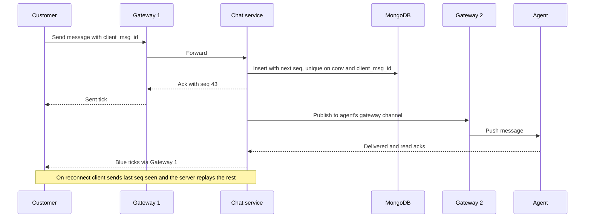

**Delivery guarantees:** clients hold WebSockets to stateless gateways; a Redis registry maps user → gateway. `client_msg_id` unique per conversation makes resends harmless; the server assigns `seq` (atomic `$inc` on the conversation) so clients sort by `seq`, not their clocks; store first, then push, and send a push notification if offline; reconnect replays after the last `seq` (Uber's push platform uses the same per-session sequence idea ([Uber](https://www.uber.com/en/blog/real-time-push-platform/))). Small groups fan out per member; large ones via a queue.

**Follow-ups.** *WebSocket vs polling?* Polling wastes requests and adds latency; Zomato moved rider tracking from polling to MQTT. *Group read receipts?* Per-member "last read seq", not a row per message per member. *Gateway crash?* Clients reconnect anywhere and replay; nothing lost because messages were stored first. *Agent routing?* Queue per skill or language, least-load with a cap of ~3 chats, bot first.

---

## Q17. Design music streaming (Spotify)

**Why they ask it.** Seen in the Zomato group: "basic Spotify (playlist, add song, search): DB choice, normalise vs denormalise" ([Z19](https://leetcode.com/discuss/post/3384363/)); Blinkit added runnable **shuffle without repeats** ([B16](https://medium.com/@Ayush-Tibrewal/zomato-blinkit-interview-experience-sde-intern-selected-1b24989da5dd)). No Spotify source was found; this is standard design.

**Sizing:** *assumption* 100M songs × 3 bitrates × 4 MB ≈ **1.2 PB** of audio (object storage plus CDN); metadata ~100 GB in SQL with a cache; 10M listeners at 160 kbps = 1.6 Tbps, which only a CDN serves.

**Data:** normalised `songs`, `artists`, `song_artists`, `playlists`, and `playlist_items(playlist_id, position DECIMAL, song_id)`. **Fractional positions** (insert between 2.0 and 3.0 as 2.5) make a reorder one update. Search uses denormalised documents built from the normalised source.

**Streaming:** transcode into several bitrates, split into few-second chunks; the playback service checks subscription and region rights and returns a manifest of **signed, expiring chunk URLs**, so the CDN serves paying users without asking us per chunk. The player prefetches and picks bitrate per chunk from measured bandwidth (**adaptive bitrate streaming**). Prefetch the next song's first chunk for instant start.

**Shuffle without repeats** is Fisher–Yates, once:

```python
import random
def shuffle(songs):
    a = list(songs)
    for i in range(len(a) - 1, 0, -1):
        j = random.randint(0, i)        # inclusive, so a[i] may stay put
        a[i], a[j] = a[j], a[i]
    return a                            # every permutation equally likely, O(n)
```

`random.choice` each time repeats songs; removing from a "not played" list is O(n) per pick. For 10,000 songs, shuffle the IDs (80 KB) and fetch metadata lazily. Products also spread same-artist tracks apart, because true random "feels" unrandom.

**Play counts:** never `plays = plays + 1` per play; events to Kafka, aggregated in batches, reconciled like money because they feed royalties.

**Follow-ups.** *Normalise or denormalise?* Normalise the truth, denormalise read models rebuilt on change. *Offline?* Encrypted chunks plus a licence that expires unless the app checks in. *SQL for playlists?* Yes: `(playlist_id, position)` is one range scan; at huge scale, a wide-column store partitioned by playlist.

---

## Q18. Design image upload with pre-signed URLs

**Why they ask it.** A **reported trap**: a Nugget candidate proposed base64 in the API body; the interviewer wanted **pre-signed S3 URLs** ([Z5](https://leetcode.com/discuss/post/7407389/)). A Zomato SDE-1 got 45 minutes with **CRUD API code, status codes, headers and auth**, then SQL and indexing ([Z8](https://leetcode.com/discuss/post/4068294/)).

**Why base64 is wrong:** files grow ~33%, every byte ties up an API thread and memory, no resume, request-size limits. A **pre-signed URL** is an S3 URL carrying a signature that permits one upload of one object for a few minutes; the app uploads straight to S3 and our servers handle only tiny JSON. *Assumption:* 2M photos/day × 3 MB ≈ 70 MB/s, painful through APIs, trivial for S3.

```http
POST /v1/uploads   Authorization: Bearer ...   { "purpose":"REVIEW_PHOTO", "content_type":"image/jpeg", "size_bytes":3145728 }
-> 201 { "upload_id":"up_77", "method":"PUT", "url":"https://...s3...amazonaws.com/raw/up_77?X-Amz-Signature=...", "expires_in":300 }
   400 bad type | 413 too large | 401 no token | 429 too many uploads
PUT  <pre-signed url>                (app to S3 directly)  -> 200
POST /v1/uploads/up_77/complete      -> 202 Accepted { "status":"PROCESSING" }
GET  /v1/uploads/up_77               -> 200 { "status":"READY", "urls":{ "thumb":"..." } }
```

Table `uploads(id, owner_id, purpose, s3_key UNIQUE, content_type, size_bytes, status PENDING/UPLOADED/PROCESSING/READY/REJECTED/DELETED, variants JSON, INDEX(owner_id, created_at))`.

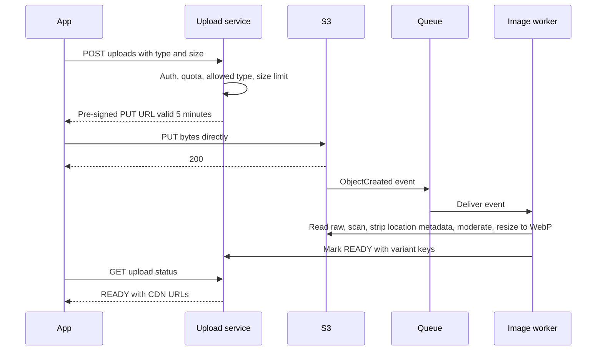

**Details that score:** a pre-signed **POST policy** can enforce `content-length-range`; check the real type from magic bytes, scan, **strip EXIF location**, moderate; **multipart upload** with a URL per part for large files (District's 10 MB voice files); idempotent workers (redelivery overwrites the same variant keys); private raw bucket, serve via CDN; a lifecycle rule deletes unconfirmed `raw/` objects after a day.

**Follow-ups.** *Why not proxy through our server?* Double bandwidth and a long-held connection per upload for no benefit. *Is the URL secure?* Signed, scoped to one key and method, expires in minutes. *Status codes?* 201 create, 202 accepted processing, poll GET 200; push or WebSocket for long jobs.

---

## Q19. Design feature flags and kill switches

**Why they ask it.** A Blinkit intern called the **LLD of a LaunchDarkly-style flag service** the hardest part of the round ([B16](https://medium.com/@Ayush-Tibrewal/zomato-blinkit-interview-experience-sde-intern-selected-1b24989da5dd)); kill switches are named NYE practice at Zomato (Q14). Swiggy had a 95-minute outage when one misconfigured flag stopped event processing for **all** topics, not one ([Swiggy Bytes](https://bytes.swiggy.com/behindthebug-breaking-the-event-pipeline-a-migration-gone-wrong-23ed215d6754)).

**Requirements:** toggle without deploy; percentage rollouts; targeting by city, app version, segment; instant kill switches; audit log; ~zero latency and keeps working if the flag service is down. With 300+ services and millions of checks/s, **evaluation must be local, in memory.**

Data: `flags(key PK, type, enabled /* master switch */, default_value, rules JSON /* ordered: city in [BLR], rollout 25 */, version, updated_by)` plus `flag_audit(old, new, changed_by, reason)`.

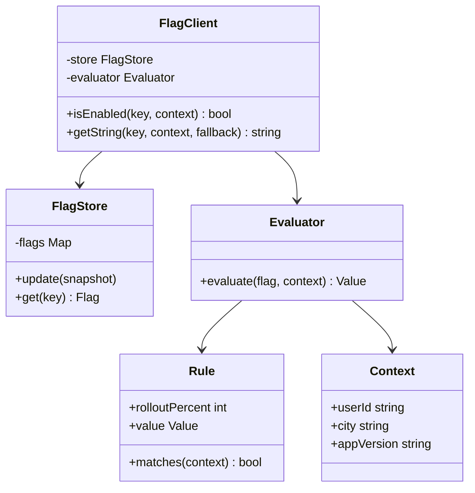

**Evaluation that's fast, sticky and safe:**
- **Local:** the SDK holds a snapshot; `isEnabled` is a map lookup plus rule checks, microseconds.
- **Sticky rollout:** `bucket = hash(flag_key + ":" + user_id) % 100`, on if `bucket < rollout`. Same user, same answer; 10% → 30% keeps the first 10% (Zepto rolled out 10/30/100 ([AWS blog](https://aws.amazon.com/blogs/database/how-zepto-scales-to-millions-of-orders-per-day-using-amazon-dynamodb/))); the flag key stops the same users being guinea pigs for every flag.
- **Propagation:** push via SSE or pub-sub, poll every 30 s as backup, versioned so stale messages can't overwrite newer snapshots.
- **Failure:** keep the last snapshot, saved to disk for restarted pods; code defaults chosen so "unknown" means safe.
- **Kill switches** are simple flags with top propagation priority, rehearsed in chaos drills so you know they reach the backend (the Instamart lesson, Q14). One flag controls one thing; prod changes need review; clean up flags at 100% (owner plus expiry date).

**Follow-ups.** *Kill-switch speed?* Seconds via push, worst case one poll interval. *Mobile?* Fetch evaluated flags from a CDN endpoint per segment at startup; server-side flags are the real kill switches. *A/B tests?* Same bucketing plus exposure logging and metrics.

---

## Q20. Design a leaderboard or "trending restaurants"

**Why they ask it.** "Top 10 most-ordered in your city this week", "trending now", rider leaderboards. A Flipkart candidate "totally flopped" on a zero-lag racing leaderboard ([F6](https://leetcode.com/discuss/post/6933851/)). *Assumptions:* 800+ cities, ~250K restaurants, ~140 order events/s at peak: tiny writes, cached reads.

A **sorted set** is a Redis structure of unique members with scores kept sorted (a skip list): add, increment and rank are O(log n).

```
ZINCRBY trend:blr:2026-10-23T20 1 rest:4411          # on each OrderDelivered, hourly bucket
ZUNIONSTORE trend:blr:24h 24 <last 24 hourly keys> WEIGHTS 1.0 0.9 ...   # every minute, with decay
ZREVRANGE trend:blr:24h 0 9 WITHSCORES               # top 10
ZREVRANK  trend:blr:24h rest:4411                    # this restaurant's rank
EXPIRE trend:blr:2026-10-23T20 90000                 # hourly buckets expire after ~25h
```

**What "trending" means:** raw counts crown the same chains forever. Use **time decay** (weights) and **rising vs usual**: this hour's orders ÷ the restaurant's usual for this hour and weekday, smoothed so tiny places don't jump 1 → 3 and look 300% hot.

**Correctness:** Kafka redelivers, so dedupe by order ID or scores drift up. Redis is a derived view; events are the truth, so a lost Redis is rebuilt by replaying 24 hours. Anything with **prizes** is computed exactly from the DB at period end. **Scale:** one set per city stays small; for India-wide search terms use a **count-min sketch** (small fixed table of counters estimating counts with bounded overcount) plus a top-K min-heap.

**Follow-ups.** *Why not `ORDER BY COUNT(*)`?* Re-counts every read; the sorted set stays ranked incrementally. *Ties?* Encode the rule in the score, e.g. `count × 10^10 + (MAX_TS − first_reached_ts)`. *Near me?* Sets per coarse H3 cell, union the user's cell and neighbours on read. *Redis down?* Serve the last cached response, rebuild from events.

---

[← 07a_SD_QA_Core_Zomato_Designs.md](07a_SD_QA_Core_Zomato_Designs.md) · [07c_SD_QA_LLD_Projects_RapidFire.md →](07c_SD_QA_LLD_Projects_RapidFire.md)
