# System Design Solutions — 3. Distributed Cache, Your Projects as HLD, LLD and Rapid Fire (Q21–Q32)

> **Covers:** Distributed cache, your own projects as HLD, LLD with Java code, 60 rapid-fire traps. **Reading time:** about 100 minutes of focused reading (diagrams and code extra).
> Built from research into Zomato's and Eternal's engineering blogs, Swiggy, Blinkit, Zepto, BookMyShow, Uber, DoorDash, Grab, Stripe, Razorpay, Cloudflare and ~100 interview reports. Company facts link to their source; anything not public is marked so — never claim more in the interview.
> Diagrams are Mermaid and render on GitHub. Report IDs like Z2 or B10 refer to `sources/interview_reports.md`; all research notes with links are in `sources/`.

[← 07b_SD_QA_Payments_Booking_and_More.md](07b_SD_QA_Payments_Booking_and_More.md) · [README →](README.md)

---

## Q21. Design a distributed cache / Redis-like key-value store (plus load balancer and consistent hashing)

This one has been asked in three Zomato-group rounds, phrased three different ways. A Zomato intern was asked to build a **distributed key-value store** with `get`, `set`, `addServer` and `removeServer` that redistributes data smoothly. The follow-ups covered consistent hashing, keeping data movement small, hotspots, hash map vs B+ tree, goroutines, and gRPC vs HTTP/1.1 vs HTTP/2 ([Z30](https://partik-malasi-05.medium.com/my-zomato-sde-intern-interview-experience-off-campus-a798d2c867f0)). A Nugget SDE-1 round went from plain hashing to consistent hashing while sharding a cache ([Z14](https://leetcode.com/discuss/post/8540075/)). An SDE-1 round asked for "consistent hashing vs normal hashing, step by step" ([Z19](https://leetcode.com/discuss/post/3384363/)). And Redis internals (why it is single-threaded, eviction, hot keys, thundering herd) came up in a 2026 SDE-1 round ([Z1](https://leetcode.com/discuss/post/8434690/)). So treat this question as three things: a single-node store, how keys are spread across nodes, and what sits in front of the nodes.

> **Real world — Zomato:** On NYE 2023, Zomato's ElastiCache (Redis) fleet held **35 TB in memory**, carried **20 Gbps**, and served **1 billion GETs/min** against about **100 million SETs/min**, so reads outnumbered writes about 10 to 1. Zomato also **injects cache misses on purpose** before NYE to test how the databases cope ([source](https://www.zomato.com/blog/a-tale-of-scale-behind-the-scenes-at-zomato-tech-for-nye-2023)).

### Requirements and numbers

Say these out loud in the first three minutes.

- **Functional:** `get(key)`, `set(key, value, ttl)`, `delete(key)`, `addServer(node)`, `removeServer(node)`.
- **Non-functional:** reads under 1 ms inside the data centre, it keeps working when a node dies, adding a node moves as little data as possible, and memory is bounded (old keys get evicted).
- **Consistency:** a cache can usually be **eventually consistent**. A stale or missing value just means a trip to the database. If they say "this is the source of truth, not a cache", the answer changes: you need replication with quorums and persistence (see the trap at the end).
- **Numbers (assumptions):** 1M reads/s and 100k writes/s, 1 KB values, 500M keys. That is about 500 GB of raw data. With 2 replicas it is 1.5 TB, so about 25 nodes of 64 GB each, plus headroom.

### One node first: what Redis actually does

One node is a **hash map** in RAM (key → value) plus a few extra pieces:

1. **Eviction.** When memory is full, something has to go. **LRU** (least recently used) throws out the key that was touched longest ago. Real Redis does not keep a perfect LRU list. It samples a few keys and evicts the oldest of the sample, which saves memory. It also offers an **LFU** (least frequently used) mode. Q30 has the code for both.
2. **TTL (time to live).** Each key can carry an expiry time. Redis expires keys in two ways. **Lazily:** when you read an expired key, it is deleted and you get nothing back. **Actively:** a background job samples keys that have a TTL and deletes the expired ones, so keys nobody reads don't sit in memory forever.
3. **Single-threaded command execution.** One thread runs every command, one after another. That sounds slow but is the reason Redis is fast. There are no locks, every command is atomic for free, and the work is pure memory access (about 100 ns). The slow part of a request is the network, and Redis handles thousands of connections on one thread with an **event loop** (epoll: "tell me which sockets have data ready"). Newer versions use extra threads only for socket reads and writes. The catch: one slow command (`KEYS *`, a huge `SMEMBERS`) blocks everyone.
4. **Persistence (optional).** **RDB** writes a snapshot of memory to disk every so often. **AOF** (append-only file) appends every write to a log. A pure cache can turn both off.

> **Pause and think:** Redis is single-threaded. How does Zomato get 1 billion GETs a minute out of it? *(Answer: by running many Redis processes and sharding keys across them. One process handles roughly 100k simple ops/s, so throughput grows with the number of shards. That is the rest of this question.)*

### Spreading keys across nodes: why `hash(key) % N` breaks

The obvious approach is `node = hash(key) % N`. It works until N changes. Go from 4 nodes to 5 and a key stays on the same node only if `h % 4 == h % 5`, which is true for about 1 key in 5. **About 80% of keys move.** For a cache that means 80% of reads miss at once, all of them land on the database, and the database falls over. This is exactly the "smooth redistribution" the Z30 interviewer was probing.

**Consistent hashing** fixes it. Imagine the hash space (say 0 to 2^64) bent into a circle, the **ring**. Hash each server onto the ring. To find a key's server, hash the key and walk clockwise to the first server you meet.

```
                 0 / 2^64
                    |
          S3 (vn) . | . S1 (vn)
              .     |     .
     k1 ->  .               .   <- k2 lands here, walks clockwise to S1
           .                 .
     S2    .                 .   S3 (vn)
           .                 .
            .               .
              .           .
          S1 (vn) . . . S2 (vn)

  Add S4 between S2 and S1: only keys in the arc (S2, S4] move from S1 to S4.
  Every other key stays where it was.
```

- **Adding a node** takes over only the keys between it and its counter-clockwise neighbour, about **1/N of all keys**.
- **Removing a node** hands its keys to the next node clockwise. Nothing else moves.
- **Virtual nodes.** With only a few points on the ring, the arcs come out uneven and one server might own 40% of the ring. So each physical server is placed at 100–200 points ("S1#vn0", "S1#vn1", ...). The load evens out, and when a server dies its load spreads over many servers instead of landing on one neighbour. Virtual nodes also let a bigger machine take more points (weighting).

**Redis Cluster** uses a simpler variant: **16,384 fixed hash slots**. The slot is `CRC16(key) mod 16384`, and each node owns a range of slots. Adding a node means moving some slots to it, and the client gets a `MOVED` redirect if it asks the wrong node. Both schemes have the same idea: changing the cluster moves a small, bounded amount of data.

> **Real world — Uber:** Uber's **Ringpop** combined SWIM gossip membership with a consistent-hash ring (FarmHash, stored in a red-black tree) and "handle or forward" routing. Its first user was the live driver-location layer. When a node fails, its keys move to the next node on the ring with no full rebalance. It favours availability (AP) and scaled to thousands of nodes ([source](https://www.uber.com/blog/ringpop-open-source-nodejs-library/)).

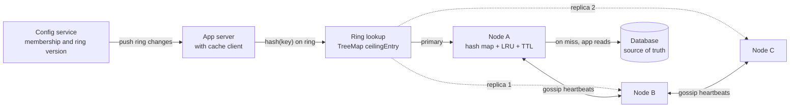

### Replication, failure and "add server smoothly"

- **Replication.** Store each key on its owner plus the next 1–2 *distinct* physical servers clockwise. Writes go to the primary, which copies them to the replicas asynchronously (fast, but a just-written key can be lost if the primary dies). If you need stronger guarantees, use Dynamo-style quorums: with N replicas, a write waits for W acks and a read asks R replicas. When **R + W > N**, every read overlaps the latest write.
- **Failure detection.** Nodes heartbeat each other (gossip) or a config service (ZooKeeper/etcd style). If a node misses heartbeats for a few seconds it is marked down, and the ring is updated so its range is served by the replicas.
- **Smooth `addServer`.** (1) Put the new node on the ring in a *joining* state. (2) Stream it the keys in the ranges it will own, from the current owners. (3) During the copy, writes go to both the old and new owners, and reads try the new owner first, then the old one. (4) Flip the ring version and let the old copies expire. For a pure cache you can skip the copy and accept about 1/N extra misses, as long as the database can absorb them. Say that trade-off out loud.

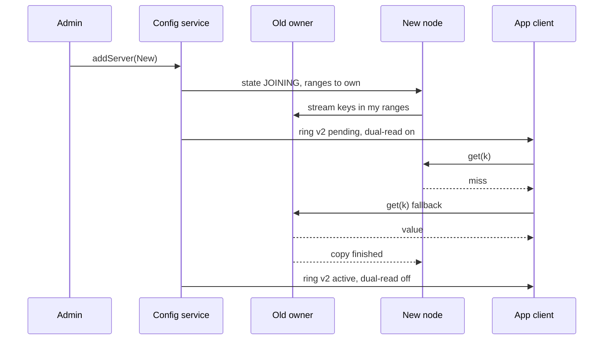

### Hot keys and stampedes

Consistent hashing spreads *keys* evenly. It does nothing for one *key* that gets enormous traffic, such as a viral restaurant's menu at 8 pm on NYE.

- **Hot key (the celebrity problem).** Fixes: a small **local in-process cache** on each app server for a few seconds; **key splitting** (`menu:42#1` ... `menu:42#8` on different nodes, the client picks one at random); or read from replicas as well as the primary.
- **Thundering herd (stampede).** A hot key expires and 10,000 requests miss at once, all hitting the DB. Fixes: **single-flight** (only one request rebuilds the value, the others wait for it), serve stale while revalidating, add jitter to TTLs so keys don't expire together, refresh early.

> **Real world — Facebook:** In "Scaling Memcache at Facebook", the server hands out a **lease** token for a missing key **only once every 10 seconds per key**, and other clients wait and retry. In a one-week test on herd-prone keys, peak DB queries fell from **17K/s to 1.3K/s**. When a cache server fails, requests go to a small **gutter pool** (about **1% of servers**) instead of rehashing, because one hot key can be **20% of a server's load** and rehashing it could knock over the next server. The gutter pool cut client-visible failures by 99% ([source](https://www.usenix.org/system/files/conference/nsdi13/nsdi13-final170_update.pdf)).

> **Real world — Discord:** Discord's Rust data services **coalesce** requests (many concurrent requests for the same row become one DB query) and route by **consistent hashing on channel ID**, so identical requests land on the same instance and can be merged ([source](https://discord.com/blog/how-discord-stores-trillions-of-messages)).

### The code: ring plus one node

The interviewer wants to see the ring (a sorted map with a "ceiling" lookup) and a node with LRU and TTL. In Java, `TreeMap.ceilingEntry(h)` returns the first entry with key at least `h`, which is exactly "walk clockwise".

```java
import java.nio.charset.StandardCharsets;
import java.security.MessageDigest;
import java.util.*;

public class ConsistentHashRing {
    private final TreeMap<Long, String> ring = new TreeMap<>();
    private final int virtualNodes;

    public ConsistentHashRing(int virtualNodes) { this.virtualNodes = virtualNodes; }

    public synchronized void addServer(String server) {
        for (int i = 0; i < virtualNodes; i++) ring.put(hash(server + "#vn" + i), server);
    }

    public synchronized void removeServer(String server) {
        for (int i = 0; i < virtualNodes; i++) ring.remove(hash(server + "#vn" + i));
    }

    public synchronized String serverFor(String key) {
        if (ring.isEmpty()) throw new IllegalStateException("no servers");
        Map.Entry<Long, String> e = ring.ceilingEntry(hash(key));
        return (e != null ? e : ring.firstEntry()).getValue();   // wrap around the circle
    }

    /** Owner plus the next distinct physical servers clockwise (for replication). */
    public synchronized List<String> replicasFor(String key, int n) {
        List<String> out = new ArrayList<>();
        if (ring.isEmpty()) return out;
        long h = hash(key);
        for (String s : ring.tailMap(h, true).values()) {
            if (!out.contains(s)) out.add(s);
            if (out.size() == n) return out;
        }
        for (String s : ring.headMap(h, false).values()) {
            if (!out.contains(s)) out.add(s);
            if (out.size() == n) return out;
        }
        return out;                                   // fewer servers than n
    }

    static long hash(String s) {
        try {
            byte[] d = MessageDigest.getInstance("MD5").digest(s.getBytes(StandardCharsets.UTF_8));
            long h = 0;
            for (int i = 0; i < 8; i++) h = (h << 8) | (d[i] & 0xFF);
            return h;
        } catch (Exception e) { throw new IllegalStateException(e); }
    }
}
```

```java
import java.util.*;

/** One cache node: LRU eviction plus TTL. LinkedHashMap with accessOrder=true keeps LRU order for us. */
public class KVNode {
    private static final class Entry {
        final String value; final long expiresAtMs;          // 0 = never expires
        Entry(String v, long e) { value = v; expiresAtMs = e; }
        boolean expired(long now) { return expiresAtMs > 0 && now >= expiresAtMs; }
    }

    private final int capacity;
    private final LinkedHashMap<String, Entry> map;

    public KVNode(int capacity) {
        this.capacity = capacity;
        this.map = new LinkedHashMap<>(16, 0.75f, true) {
            @Override protected boolean removeEldestEntry(Map.Entry<String, Entry> eldest) {
                return size() > KVNode.this.capacity;          // evict least recently used
            }
        };
    }

    public synchronized String get(String key) {
        Entry e = map.get(key);                             // also moves key to most-recent
        if (e == null) return null;
        if (e.expired(System.currentTimeMillis())) { map.remove(key); return null; }   // lazy expiry
        return e.value;
    }

    public synchronized void set(String key, String value, long ttlMs) {
        long exp = ttlMs > 0 ? System.currentTimeMillis() + ttlMs : 0;
        map.put(key, new Entry(value, exp));
    }

    public synchronized boolean delete(String key) { return map.remove(key) != null; }

    /** Active expiry: called by a background thread every 100 ms or so. */
    public synchronized int sweepExpired(int maxToCheck) {
        long now = System.currentTimeMillis();
        int removed = 0, checked = 0;
        Iterator<Entry> it = map.values().iterator();
        while (it.hasNext() && checked++ < maxToCheck) {
            if (it.next().expired(now)) { it.remove(); removed++; }
        }
        return removed;
    }
}
```

**Concurrency note.** `synchronized` on the whole node is the honest first version. Even `get` changes the LRU order, so a read lock would not be enough (Q30 explains this trap). Real stores either run commands on one thread (Redis) or split the map into many independently locked segments.

### The load balancer in front of everything

A **load balancer (LB)** spreads requests over a pool of servers and stops sending to dead ones.

- **L4 vs L7.** An **L4** LB sees only IP addresses and ports (TCP/UDP). It forwards connections without reading them, so it is very fast; AWS **NLB** is one. An **L7** LB reads the HTTP request, so it can route by path (`/api/orders` to the order service), terminate TLS, add headers and retry; AWS **ALB**, Nginx and Envoy are examples. A Zomato SDE-1 round asked exactly "ALB vs NLB vs Nginx" ([Z27](https://igreaper.medium.com/my-zomato-sde-1-interview-experience-5-rounds-self-doubt-and-a-moment-ill-never-forget-eaa8a6fb49e4)). A good answer: NLB for raw TCP, very high connection counts or static IPs (MQTT brokers, gRPC); ALB for HTTP routing as a managed AWS service; Nginx/Envoy when you want to run and configure the proxy yourself, or inside a service mesh.
- **Algorithms.** Round robin; weighted round robin (bigger machines get more); **least connections** (good when request times vary); **consistent hashing on a key** (sticky: the same user or the same cache key always goes to the same server).
- **Health checks.** The LB calls `/health` every few seconds and removes a server after a few failures. Keep the check cheap, but make it fail when the server really can't serve, for example when it has lost its DB pool.
- **The LB must not be a single point of failure.** Run two in an active-passive pair sharing a **virtual IP** (if the active one dies, the passive takes the IP over), or use DNS with several LB IPs. Managed LBs do this for you.
- **Connection draining** during deploys: stop sending new requests to a server but let in-flight ones finish.

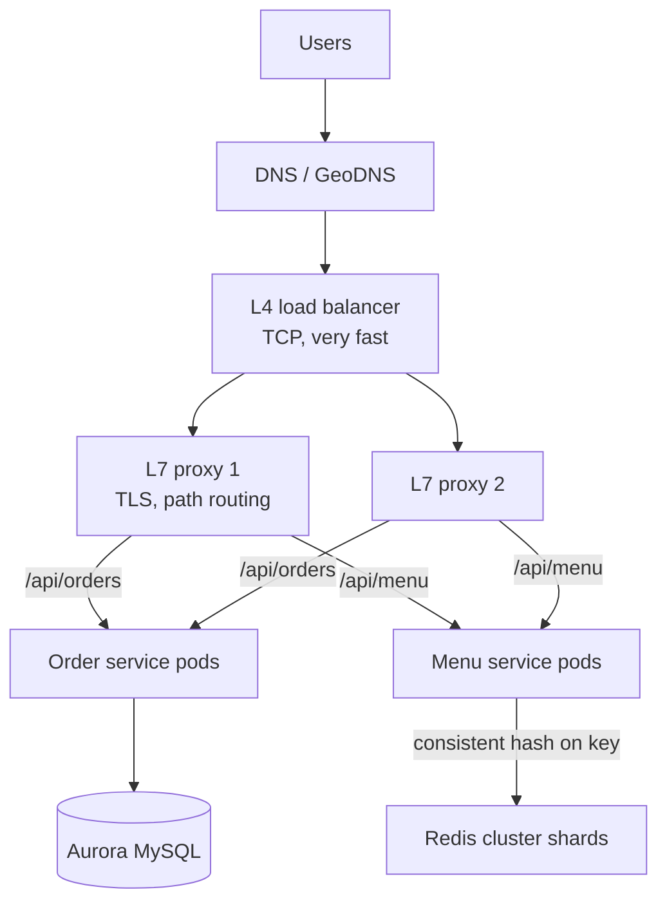

> **Real world — Zomato:** Zomato runs its service-to-service traffic through a **Kuma (Envoy-based) service mesh**, which it also uses to inject latency in chaos tests. A KubeCon India 2025 talk abstract mentions **500+ microservices with 10,000 dataplanes** and a plan for zone-aware routing to cut cross-AZ costs (abstract only) ([source](https://sessionize.com/arpit-mishra/)).

### Follow-ups and answers

- **"Hash map or B+ tree inside the node?"** (Z30.) A hash map gives O(1) point lookups, which is all a cache needs. A B+ tree gives O(log n) lookups but keeps keys sorted, so it supports range scans ("all keys from user:100 to user:200") and works well on disk because each node is a page. Choose a hash map for an in-memory cache, and a B+ tree (or an LSM tree) for a disk-based store that needs ranges.
- **"gRPC vs HTTP/1.1 vs HTTP/2 between clients and nodes?"** HTTP/1.1 handles one request at a time per connection, so you need many connections. HTTP/2 **multiplexes** many requests over one connection and compresses headers. gRPC runs on HTTP/2 with compact binary Protobuf messages and generated clients, so it suits internal, high-QPS calls. Real Redis uses its own simple text protocol (RESP) over TCP, which is even lighter.
- **"Assume infinite money. Why not replace the database with the cache?"** A Blinkit SDE-2 candidate failed this one ([B12](https://leetcode.com/discuss/post/7083108/)). Money buys RAM, not guarantees. (1) **Durability:** RAM is lost on a crash or power cut, and async replication can lose the last writes. (2) **Querying:** a KV store answers "get by key", not "all orders of this restaurant yesterday with GST over 500". There are no joins, secondary indexes or ad-hoc SQL. (3) **Transactions and constraints:** no multi-row ACID, foreign keys or unique constraints across keys. (4) **Eviction:** a cache is allowed to forget, and a source of truth isn't. (5) **Operations:** backups, point-in-time restore and audits are built for databases. Close with: "a cache is a copy optimised for reads; it can be rebuilt from the source of truth, so the source of truth must be something else."
- **"How does Redis scale if it is single-threaded?"** (Z12.) Scale out with Redis Cluster (more shards, more cores across machines), add read replicas for read-heavy keys, pipeline commands to save round trips, and keep commands O(1).
- **"What if a node dies during NYE?"** Replicas take over its ranges. Use a gutter pool or short TTLs on the fallback, and protect the DB with single-flight and rate limits, because a cold shard is effectively a stampede. Zomato tests exactly this by injecting cache misses.

---

## Q22. "Turn your own project into an HLD": redesign it, scale it 10x, tell me what breaks

This is the **most common design question in the Zomato group**. It showed up in 10 of the 34 Zomato/Eternal reports, at every level. Examples: "HLD of a feature the candidate built at a previous employer" ([Z27](https://igreaper.medium.com/my-zomato-sde-1-interview-experience-5-rounds-self-doubt-and-a-moment-ill-never-forget-eaa8a6fb49e4)); "redesign the candidate's internship system (phase 2)" with monolith vs microservices ([Z5](https://leetcode.com/discuss/post/7407389/)); "how would you scale your internship work" ([Z8](https://leetcode.com/discuss/post/4068294/)); a full HLD + LLD of a contract management system from the resume, with FR/NFR, traffic estimation, microservices, inter-service communication and schema ([Z11](https://leetcode.com/discuss/post/6647834/)); and a Blinkit fresher grilled on "RabbitMQ vs Kafka, why a cache, why Postgres, how it changes with more users" for their own project ([B17](https://medium.com/@utkarsho.dev/blinkit-sde-1-interview-experience-fresher-39ba436055f3)). A Blinkit candidate's takeaway: "don't put a system on your resume unless you can sketch its failure modes" ([B15](https://leetcode.com/discuss/post/8359730/)).

The good news is that you know the system better than the interviewer. The bad news is that they will push where you are weakest: numbers you never measured, failure paths you never tested, and "why not X?".

### The method (use the same 7 steps for every project)

1. **One sentence of problem and one of users.** "Variants of one product showed different ratings; customers on the product page and the rating-submission flow are the users."
2. **Numbers.** Give what you know (5.7M styles, batches of 20, 180 RPM per pod) and label everything else as an assumption ("assume 10 pods"). Then do one line of arithmetic. Interviewers love seeing you work out a throughput budget.
3. **Draw today's architecture.** Boxes for client, service, cache, DB, queue and external dependencies. Draw it in under two minutes and practise until you can.
4. **Walk one read and one write through it**, naming each hop.
5. **"What breaks at 10x?"** Go component by component: the stateless service, the DB, the cache, the queue, the dependency you call, and anything held in memory or per pod. For each, say what fails first and the signal you would watch.
6. **Phase 2 redesign.** Change only what the 10x analysis says must change. Over-engineering is a negative signal at SDE-1.
7. **What I'd do differently**, honestly. This is where you mention your own known weaknesses before they find them.

**Timebox it.** Two Blinkit candidates were rejected partly because the project discussion ate the time for the actual design question ([B12](https://leetcode.com/discuss/post/7083108/), [P14](https://leetcode.com/discuss/post/5806260/)). Give the 2-minute version, then stop and let them choose where to dig.

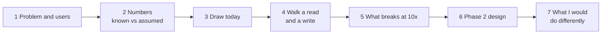

**The 10x checklist** (run through it in your head):

| Component | What usually breaks first | Fix to propose |
|---|---|---|
| Stateless API pods | Nothing, if truly stateless; CPU | Autoscale, but pre-scale for known peaks |
| Anything per pod (limits, in-memory data) | Totals change as pods scale; pods disagree | Move to a shared store (Redis) or a central quota |
| Database | Connections, then write throughput, then hot rows | Connection pooling, read replicas, batching, then sharding |
| Cache | Stampede on cold start, hot keys, two caches drifting apart | Single-flight, warmup, one invalidation path |
| Queue / Kafka | Consumer lag, poison messages, retry storms | More partitions and consumers, DLQ, delayed retries |
| External dependency | Its rate limit, its latency | Batching, a global limiter, timeouts, circuit breaker, fallback |

### Worked example A: Myntra aggregated ratings (the one they will pick)

**Today's design, in two sentences.** The Go ratings service serves ratings for the product page from Aerospike. On a cache miss or a new rating, it fetches the product's related styles from Accio in bulk batches of 20 (behind a per-pod token bucket starting at 180 requests/minute), caches that set for 7 days, runs one SQL query for the whole cluster, aggregates in Go, and writes the aggregate to every style in the cluster; rejected calls go to a Kafka error queue.

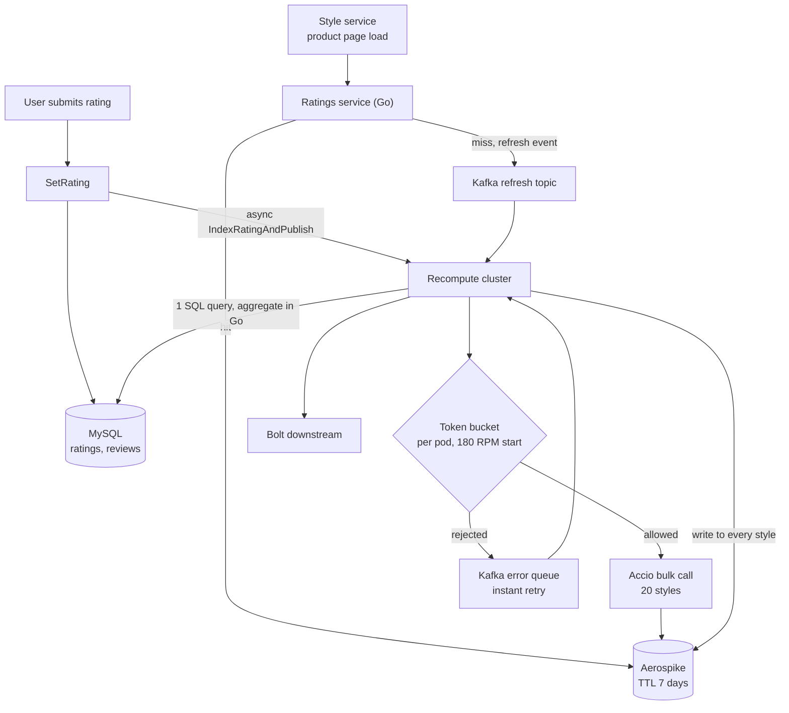

**Numbers to say.** 5,710,991 styles; 20 per Accio call, so about 285k calls to cover everything; 180 RPM per pod is 3 per second. *Assume 10 pods:* 30 Accio calls/s in total, so a full rebuild needs about 285,000 / 30 ≈ 9,500 s ≈ 2.6 hours if every batch needs Accio. That one calculation explains your warmup story: the producer has to be paced to the budget, which is what the 4 ms delay did.

**"Scale it 10x. What breaks?"** Go down the checklist.

1. **The per-pod limiter stops being a real limit.** Total load on Accio is per-pod limit × pod count, and pod count changes with autoscaling. At 10x traffic the service scales from 10 pods to, say, 60, and Accio sees 6x the calls you agreed with its team. *Fix:* a **global** limiter, either a token bucket in Redis updated atomically with a Lua script (keyed `accio:ratings-service`), or a quota that Accio enforces per caller. Mention fail-open vs fail-closed: if Redis is down, fall back to the per-pod limit.
2. **Instant retries become a retry storm.** The error queue retried immediately, so rejected work hit the same empty bucket and failed again, adding load exactly when the system was saturated. *Fix:* **delayed retry topics** (`ratings-retry-1m`, `ratings-retry-10m`), exponential backoff with jitter, a maximum attempt count, then a **dead-letter queue** with an alert.
3. **One rejection fails a batch of 20.** At 10x this multiplies wasted work. *Fix:* on a partial failure, re-enqueue only the failed style IDs.
4. **A race in "last writer wins".** Two recomputes for the same cluster: R1 reads MySQL at t1, R2 reads at t2 (newer). If R2 finishes first and R1 finishes second, the *older* aggregate overwrites the newer one and stays wrong until the next rating or the TTL. The rule "whoever finishes last is correct" holds only if the last to finish also *read* last. *Fix:* store a version with the aggregate (for example the max rating ID or `updated_at` included in the computation), and write only if the new version is higher. Aerospike's generation check or a compare-and-set does this. **Raise this yourself**; it shows real depth.
5. **MySQL read load.** Every recompute re-reads the whole cluster's rows. A popular product with thousands of ratings a minute during a sale recomputes over and over. *Fix:* debounce (recompute a cluster at most once every few seconds), read from a replica, or move to incremental counts (below).
6. **Hot clusters in the cache.** A sale-day bestseller's cluster key is read millions of times. *Fix:* a short local in-memory cache in the ratings pods, and request coalescing.
7. **Two caches drifting apart** (your ratings-mismatch bug). At 10x, more paths read ratings. *Fix:* one invalidation path. Every cache that holds a rating subscribes to the same "cluster rating changed" event.

**Phase 2 design: incremental histograms instead of recompute.** The aggregate is just five counters per cluster (count of 1★ ... 5★). A new rating adds 1 to one counter, and an edited rating subtracts 1 from one counter and adds 1 to another. So you don't need to re-read the cluster at all.

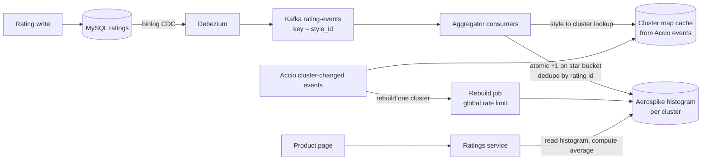

- **CDC instead of an async call inside the request.** The rating write commits to MySQL, and Debezium reads the binlog and publishes the event. The event can't be lost between "DB committed" and "event sent" (this is the outbox idea, Q32).
- **Idempotent increments.** Kafka delivers at least once, so dedupe on the rating ID before incrementing. A duplicate +1 would silently inflate counts forever.
- **Accio events** (if Accio publishes "style X moved to cluster Y") replace guessing with TTLs. Only a cluster change triggers a full rebuild, and rebuilds go through the global limiter.
- **Reads stay O(1):** read five numbers, compute the weighted average on the fly.
- **Reconciliation:** a nightly job recomputes a sample of clusters from MySQL and compares. Counters can drift because of bugs, so you check them against the source of truth.

> **Real world — Zomato:** Zomato's ads feedback pipeline had a Flink job holding **150 GB** of dedup state. Losing that state reset campaign counters, which over-delivered ads and broke billing. The fix was to **emit incremental counts instead of running totals**, plus an **hourly reconciliation job** as a fail-safe; state fell 99% ([source](https://www.zomato.com/blog/eliminating-bottlenecks-in-real-time-data-streaming-a-zomato-ads-flink-journey/)). That is the same "increments plus reconciliation" shape as phase 2 above, so use it as your bridge to Zomato.

**Likely follow-ups, with answers**

- *"Why Aerospike and not Redis?"* "It was the team's existing cache. Aerospike keeps its index in RAM and data on SSD, so it's cheaper for millions of keys with sub-millisecond reads. Redis keeps everything in RAM and has richer types. For five counters per cluster either works. I didn't choose it, but I understand why it fits."
- *"Why 20 per batch?"* "Accio's team recommended 20–25 as the balance between per-call latency and payload size. Fewer calls but bigger payloads; at 100 a single slow call would delay 100 styles."
- *"Why a 7-day TTL?"* "It's a safety net, not the freshness mechanism. Writes update the cache directly; the TTL just bounds how long a missed update can survive. Shorter TTLs would mean more misses, and therefore more Accio calls."
- *"What if Accio is down for an hour?"* "Reads keep serving cached aggregates. Recomputes that need Accio fail fast through a circuit breaker and go to the delayed retry topic. If the cluster set is already cached, recomputes don't need Accio at all."
- *"How would you know it's broken in production?"* "Error-queue depth and age, Accio 429 rate, cache hit ratio, recompute latency, and a mismatch counter from the reconciliation job."
- *"How does this map to Zomato?"* "Ratings across outlets of one brand, or across variants of a dish; Same pattern: a grouping service, cached histograms, event-driven increments, a global limit on the shared dependency, and a warmup before launch."

### Worked example B: Atlassian Marketplace publishing pipeline (SQS + worker pools)

**Today's design.** A Kotlin/Spring Boot API validates the vendor's publish request, saves it as `RECEIVED`, puts a message on SQS and returns **202 Accepted** with a request ID. A pool of workers takes messages, checks idempotency, calls the Marketplace APIs to create the app, marks it `PUBLISHED` and deletes the message. If a worker crashes, the message becomes visible again after the visibility timeout; after repeated failures it goes to a DLQ. *(Confirm details against what was actually built; the prep notes mark some of them "check".)*

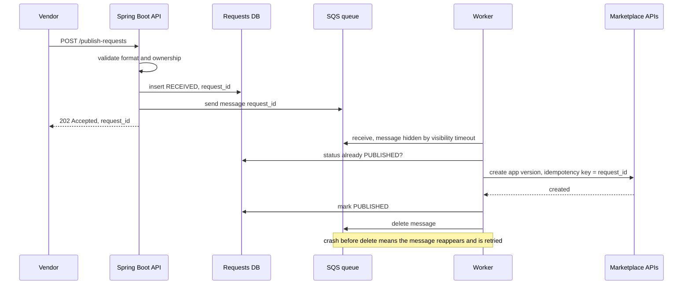

**What breaks at 10x?**

1. **The downstream Marketplace APIs, not SQS.** SQS standard queues scale almost without limit; what you call doesn't. *Fix:* cap worker concurrency (a bounded pool is a built-in rate limit), add a token bucket around the downstream client, and autoscale workers on **queue depth and age of the oldest message**, never beyond the downstream budget.
2. **The gap between DB insert and SQS send.** Crash between them and the request sits `RECEIVED` forever with no message. *Fix:* the **transactional outbox**: write the request and an outbox row in one transaction, and let a relay publish to SQS. A cheaper fix is a sweeper that re-enqueues requests stuck in `RECEIVED` for more than N minutes.
3. **Duplicates.** SQS standard is at-least-once, and a worker can die after creating the app but before deleting the message. *Fix:* idempotency in three layers (request ID check, a unique constraint on vendor + app + version, forward-only status) and pass the request ID as an idempotency key downstream if the API supports it.
4. **Visibility timeout vs slow jobs.** At 10x, downstream latency rises; a job that takes longer than the timeout becomes visible again while still running, and two workers process it at once. *Fix:* set the timeout above the p99 job time, and have long jobs extend it while they are running (a heartbeat).
5. **Ordering.** Two versions of the same app published back to back could be processed out of order. *Fix:* a FIFO queue with the app ID as the message group (ordered per app, parallel across apps), or a DB check that the version is newer than the last published one.
6. **Vendors polling for status.** *Fix:* `GET /publish-requests/{id}` backed by the DB, plus a webhook or notification when it finishes.

**Follow-ups:** *"Why SQS and not Kafka?"* SQS is a job queue: one worker handles each message, then it's deleted, with per-message retries and DLQs built in. Kafka is a replayable log for many independent consumers. Publishing jobs need the first. *"Why not a thread pool in the API?"* Work held in memory dies with the pod, and you can't scale the API and the workers independently. *"Why 202 and not 201?"* 201 means "created"; here creation hasn't happened yet.

### Worked example C: TraceX (FastAPI, NetworkX, SQLite → Postgres, JWT, case FSM)

**Today's design.** A Next.js frontend with its own server routes (a BFF) calls a FastAPI backend organised into foundation (login, roles), investigation (cases, workflow, assignment, alerts), detection (6 detectors, ML scoring, LinUCB ranking) and the AI assistant (teammate's part). SQLAlchemy over SQLite with Alembic migrations, so moving to Postgres is a config change. The graph lives in **NetworkX**, in memory, behind a `GraphStore` interface. Offline scripts load data, train, run detection and create cases.

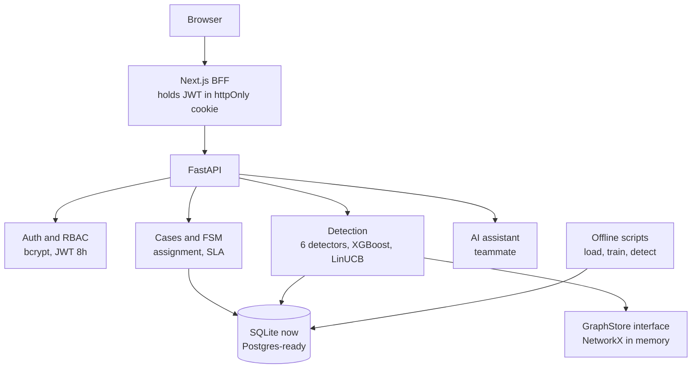

**What breaks at 10x (or "a real bank with 50M transactions a day")?**

1. **SQLite allows one writer at a time.** Several API processes writing cases and audit rows will queue on the file lock. *Fix:* Postgres (already a config change thanks to SQLAlchemy), with a connection pool.
2. **NetworkX is in memory, in one process.** Every API worker holds its own copy of the graph, startup gets slow, and the graph eventually doesn't fit in RAM. *Fix:* keep the `GraphStore` interface and swap in a graph database (Neo4j), or keep only a rolling window (say the last 90 days) in memory, partitioned so each worker owns a slice. Cycles live inside one **strongly connected component**, so SCCs are a natural partition.
3. **Batch detection becomes too slow.** *Fix:* stream transactions through Kafka; run cheap per-event checks (structuring, fan-out counts) on each event; run the expensive cycle search on a schedule, or only on the part of the graph touched by new edges.
4. **Two investigators update the same case.** Both read `IN_PROGRESS`; one closes it as a false positive while the other escalates. *Fix:* optimistic locking. Add a `version` column and run `UPDATE cases SET status=?, version=version+1 WHERE id=? AND version=?`. If zero rows change, return 409 Conflict and let the UI reload. The single transition function already rejects illegal moves; this makes it safe under concurrency too.
5. **The audit hash chain forks.** Two servers appending at once can both link to the same previous hash. *Fix:* send audit writes through one writer (a queue with one consumer), or keep one chain per case.
6. **JWT can't be revoked before it expires (8 hours).** A fired investigator keeps access until then. *Fix:* short access tokens (15 minutes) plus refresh tokens checked against the DB, or a small deny-list in Redis checked on each request.

**Follow-ups:** *"Why FastAPI?"* The ML and graph code is Python, so it runs in the same process; FastAPI adds validation and docs. CPU-heavy work scales with processes, not threads, because of the GIL. *"Why a state machine for cases?"* Illegal moves become impossible and every move is auditable; it's the same shape as a Zomato order lifecycle (Q26). *"How does auto-assignment scale?"* "Fewest open cases" becomes a min-heap, or a SQL query on an index of open-case counts per investigator; with many assigners, take the investigator row with `SELECT ... FOR UPDATE SKIP LOCKED` so two assigners don't both pick the same "least loaded" person.

### Worked example D: SupplySenseAI (FastAPI, in-memory, Cloud Run)

**Today's design.** A Next.js dashboard polls a FastAPI backend every 30–60 s. The backend holds **all data in memory**, calls OpenWeatherMap and GDACS (with timeouts, fallbacks and 30/15-minute caches) and Gemini for chat, and runs on Google Cloud Run with 0–3 instances.

**The one thing that breaks first, even at 2x:** each Cloud Run instance has *its own* in-memory data. With 3 instances a user's page can show different shipments on each refresh, depending on which instance answers, and an instance that scales to zero loses everything. Saying this before they do is the strongest move you can make with this project.

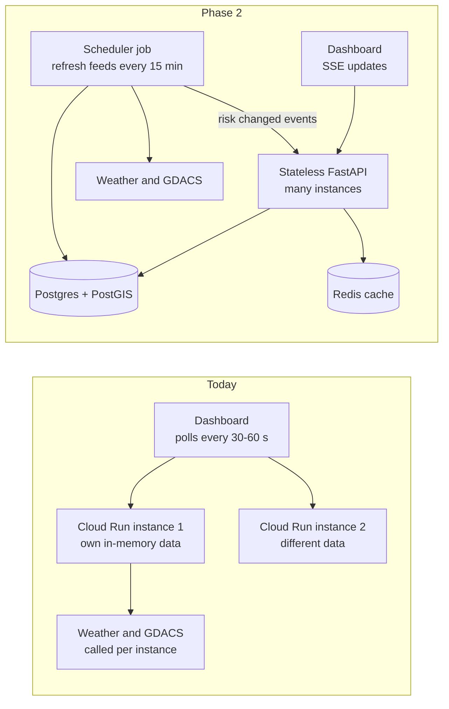

**Phase 2, step by step.** (1) Move shipments, hubs and lanes into **Postgres with PostGIS** so all instances share one truth and "shipments within 50 km of a flood" is an indexed geo query. (2) A **scheduled job** refreshes external feeds once for everybody instead of each instance calling them, and recomputes risk only for shipments affected by a change. (3) **Redis** caches computed scores and cascade results. (4) Push updates with **server-sent events** instead of polling. (5) Add login and keep each company's data separate (a `tenant_id` column on every table). (6) Move the hard-coded Gemini key into a secret manager and rotate it.

**Follow-ups:** *"What about Cloud Run cold starts?"* Keep one minimum instance warm for the demo; at scale, keep a minimum instance count. *"What if the weather API is down?"* Timeout, cached value, rule-based fallback, then a circuit breaker so you stop calling it for a minute after repeated failures. *"A million shipments a day?"* Shipment events through a queue, risk recomputed on change and not on page load, stateless API, a DB index on `(status, eta)`.

> **Pause and think:** For each of the four projects, what is the *one* component that breaks first at 10x? *(Myntra: the per-pod limiter and instant retries against Accio. Atlassian: the downstream Marketplace API, then the DB-to-SQS gap. TraceX: SQLite's single writer and the in-memory graph. SupplySense: per-instance in-memory state.)*

---

**Low-level design and schema questions (Q23 to Q32)**

**How these rounds are graded differs by company, so know which one you're in.** Zomato and Blinkit backend SDE-1 rounds have no formal machine coding round. LLD shows up inside mixed rounds as "model this schema" (menu configs, banner caps), "implement this class" (LRU/LFU, rate limiter) or "write a working API" (Z8, B5, Z15). Swiggy, Flipkart, Meesho and PhonePe run machine coding, where **running code beats pretty UML**: a Swiggy SDE-1 candidate was rejected with a partly working Splitwise ([S1](https://leetcode.com/discuss/post/7278246/)), and a Flipkart candidate said the evaluator "cared more about whether the features were working correctly than about design" ([F4](https://leetcode.com/discuss/post/6667785/)). Every LLD round ends with the same follow-up: **where exactly does the lock go?**

The recipe for every question below:
1. **Requirements (5 min).** Say what you'll build and what you'll skip. Expect them to add a requirement halfway.
2. **Entities and relationships**, then classes. Put an interface on whatever varies (Strategy for pricing, Factory for creating senders, Observer for notifications).
3. **Schema (PK, FK, indexes) and APIs** for Zomato/Blinkit/Zepto-style rounds; **runnable in-memory code with a small driver** for Swiggy/Flipkart-style rounds.
4. **Concurrency:** name the shared state, name the lock (or the conditional `UPDATE`), and say what happens when two requests race.
5. **Extensibility:** "a new coupon type is a new class, not an edit."

All code below is Java. Money is always a `long` count of **paise** (1 rupee = 100 paise), never `double`.

## Q23. LLD: restaurant menu with customisations (size, crust, toppings)

Asked as "LLD: restaurant menu with configurable options (size, crust, toppings; the Domino's case), as a schema" in a Zomato SDE-1 round that ended in an offer ([Z6](https://leetcode.com/discuss/post/7206483/)).

### Requirements

- A restaurant has categories and items. An item has a base price and **option groups**: Size (choose exactly 1), Crust (exactly 1), Toppings (0 to 5), Extra cheese (0 or 1).
- Each option changes the price (Large +₹150). **Some prices depend on another choice**: a topping costs ₹50 on a Regular pizza and ₹90 on a Large.
- **Some options are only allowed with others**: Cheese Burst crust only for Medium or Large.
- Options can be out of stock without hiding the whole item.
- **The order must remember exactly what was chosen and what it cost then**, even if the menu changes tomorrow.
- **Option groups are reusable:** the same "Crust" group is attached to 30 pizzas, so editing it once updates all of them.

### Classes

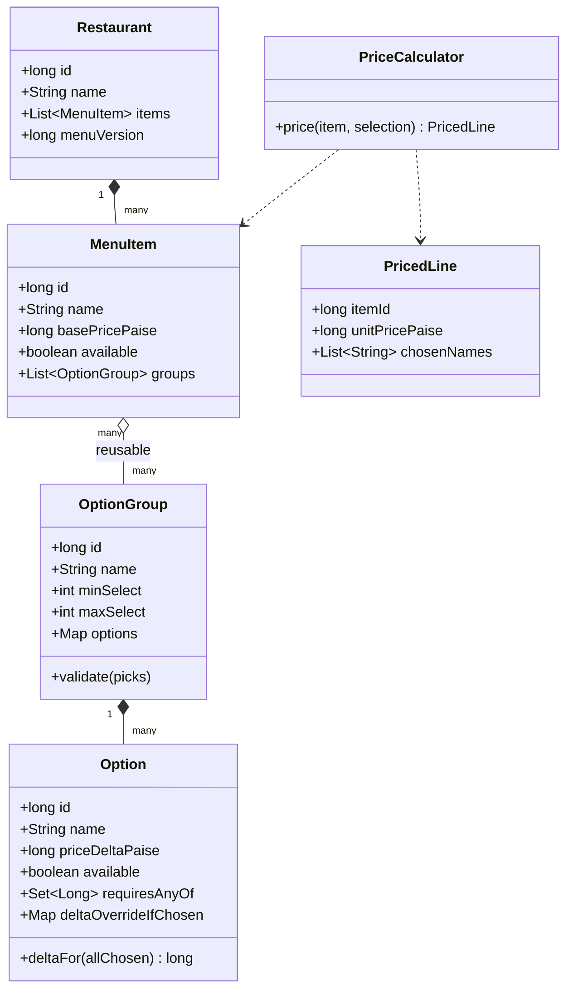

### Code

```java
import java.util.*;

final class Option {
    final long id; final String name; final long priceDeltaPaise;
    volatile boolean available = true;
    final Set<Long> requiresAnyOf;                 // e.g. Cheese Burst requires {MEDIUM, LARGE}
    final Map<Long, Long> deltaOverrideIfChosen;   // e.g. {LARGE -> 9000}: topping costs 90 on Large

    Option(long id, String name, long delta, Set<Long> requires, Map<Long, Long> overrides) {
        this.id = id; this.name = name; this.priceDeltaPaise = delta;
        this.requiresAnyOf = requires; this.deltaOverrideIfChosen = overrides;
    }

    long deltaFor(Set<Long> allChosen) {
        for (Map.Entry<Long, Long> e : deltaOverrideIfChosen.entrySet())
            if (allChosen.contains(e.getKey())) return e.getValue();
        return priceDeltaPaise;
    }
}

final class OptionGroup {
    final long id; final String name; final int minSelect, maxSelect;
    final Map<Long, Option> options = new LinkedHashMap<>();
    OptionGroup(long id, String name, int min, int max) {
        this.id = id; this.name = name; this.minSelect = min; this.maxSelect = max;
    }
}

final class MenuItem {
    final long id, restaurantId; final String name; final long basePricePaise;
    volatile boolean available = true;
    final List<OptionGroup> groups = new ArrayList<>();
    MenuItem(long id, long restaurantId, String name, long base) {
        this.id = id; this.restaurantId = restaurantId; this.name = name; this.basePricePaise = base;
    }
}

record PricedLine(long itemId, long unitPricePaise, List<String> chosenNames, List<Long> optionIds) {}

final class PriceCalculator {
    /** selection: groupId -> chosen option ids. Throws if the selection is invalid. */
    PricedLine price(MenuItem item, Map<Long, List<Long>> selection) {
        if (!item.available) throw new IllegalArgumentException(item.name + " is unavailable");
        Set<Long> groupIds = new HashSet<>();
        for (OptionGroup g : item.groups) groupIds.add(g.id);
        for (Long gid : selection.keySet())
            if (!groupIds.contains(gid)) throw new IllegalArgumentException("unknown group " + gid);

        Set<Long> allChosen = new HashSet<>();
        selection.values().forEach(allChosen::addAll);

        long total = item.basePricePaise;
        List<String> names = new ArrayList<>();
        List<Long> ids = new ArrayList<>();
        for (OptionGroup g : item.groups) {
            List<Long> picks = selection.getOrDefault(g.id, List.of());
            if (picks.size() < g.minSelect || picks.size() > g.maxSelect)
                throw new IllegalArgumentException(g.name + ": choose " + g.minSelect + " to " + g.maxSelect);
            if (new HashSet<>(picks).size() != picks.size())
                throw new IllegalArgumentException(g.name + ": duplicate option");
            for (long oid : picks) {
                Option o = g.options.get(oid);
                if (o == null || !o.available) throw new IllegalArgumentException("option " + oid + " unavailable");
                if (!o.requiresAnyOf.isEmpty() && Collections.disjoint(o.requiresAnyOf, allChosen))
                    throw new IllegalArgumentException(o.name + " not allowed with this choice");
                total += o.deltaFor(allChosen);
                names.add(o.name); ids.add(oid);
            }
        }
        return new PricedLine(item.id, total, names, ids);
    }
}
```

The price is **always computed on the server**. The app may show a price, but the checkout recomputes it, because a client can send anything.

### Schema

```sql
CREATE TABLE menu_items (
  id             BIGINT PRIMARY KEY,
  restaurant_id  BIGINT NOT NULL,
  category_id    BIGINT,
  name           VARCHAR(200) NOT NULL,
  base_price     BIGINT NOT NULL,              -- paise
  is_veg         BOOLEAN NOT NULL,
  is_available   BOOLEAN NOT NULL DEFAULT TRUE,
  INDEX idx_items_restaurant (restaurant_id, category_id)
);

CREATE TABLE option_groups (                   -- reusable across items
  id            BIGINT PRIMARY KEY,
  restaurant_id BIGINT NOT NULL,
  name          VARCHAR(100) NOT NULL,         -- 'Size', 'Crust', 'Toppings'
  min_select    INT NOT NULL,
  max_select    INT NOT NULL,
  CHECK (min_select >= 0 AND max_select >= min_select)
);

CREATE TABLE item_option_groups (              -- many-to-many: item <-> group
  item_id       BIGINT NOT NULL REFERENCES menu_items(id),
  group_id      BIGINT NOT NULL REFERENCES option_groups(id),
  display_order INT NOT NULL,
  PRIMARY KEY (item_id, group_id)
);

CREATE TABLE options (
  id           BIGINT PRIMARY KEY,
  group_id     BIGINT NOT NULL REFERENCES option_groups(id),
  name         VARCHAR(100) NOT NULL,          -- 'Large', 'Cheese Burst'
  price_delta  BIGINT NOT NULL DEFAULT 0,      -- paise
  is_available BOOLEAN NOT NULL DEFAULT TRUE,
  INDEX idx_options_group (group_id)
);

CREATE TABLE option_rules (                    -- dependencies and conditional prices
  option_id         BIGINT NOT NULL REFERENCES options(id),
  depends_on_option BIGINT NOT NULL REFERENCES options(id),
  rule_type         ENUM('REQUIRES','PRICE_OVERRIDE') NOT NULL,
  override_price    BIGINT NULL,               -- used when rule_type = PRICE_OVERRIDE
  PRIMARY KEY (option_id, depends_on_option, rule_type)
);

-- What was ordered: SNAPSHOT names and prices, don't just point at the menu
CREATE TABLE order_items (
  id              BIGINT PRIMARY KEY,
  order_id        BIGINT NOT NULL,
  item_id         BIGINT NOT NULL,
  item_name       VARCHAR(200) NOT NULL,       -- copied at order time
  qty             INT NOT NULL,
  unit_price      BIGINT NOT NULL,             -- base + options, at order time
  INDEX idx_order_items_order (order_id)
);
CREATE TABLE order_item_options (
  order_item_id   BIGINT NOT NULL REFERENCES order_items(id),
  option_id       BIGINT NOT NULL,
  option_name     VARCHAR(100) NOT NULL,       -- copied
  price_delta     BIGINT NOT NULL,             -- copied
  PRIMARY KEY (order_item_id, option_id)
);
```

**"Give me the full menu of restaurant 42"** is the hot read. In SQL it's a four-table join, so you don't run it per request. Build the menu as **one JSON document per restaurant** (items with nested groups and options), cache it in Redis under `menu:42:v{version}`, and bump `menu_version` on every edit so the old key simply stops being used. Many teams store this document in MongoDB or DynamoDB for exactly that reason.

> **Real world — Zomato:** Zomato's food-preparation-time work mentions about **3.5 million distinct dishes** and **150k+ restaurants** receiving orders each month ([source](https://www.zomato.com/blog/food-preparation-time/)). Zomato also digitises menus from photos with OCR and a dish classifier ([source](https://www.zomato.com/blog/elements-of-scalable-machine-learning/)). So the menu store has millions of items, and most of them are read far more often than they are edited.

### Concurrency and follow-ups

- **"The restaurant changes a price while a user has the item in the cart."** At checkout, recompute with the current menu. If the total changed, return **409 Conflict** with the new price and let the user confirm. Never silently charge a different amount. The cart stores `menu_version`, so a mismatch is cheap to detect.
- **"Two admins edit the same group at once."** Optimistic locking with a `version` column on `option_groups`: `UPDATE ... WHERE id=? AND version=?`.
- **"A topping runs out mid-dinner."** Flip `options.is_available`, bump the restaurant's menu version, and the cache is rebuilt. The calculator rejects it at checkout too, so a stale app can't order it.
- **"Nested options: choose a drink, then choose its size."** Let an option point to a child group (`options.child_group_id`). The tree becomes recursive, which is the **Composite** pattern; validation walks it recursively.
- **"Why not the Decorator pattern (each topping wraps the pizza)?"** It's the textbook pattern for adding cost layer by layer, and fine to mention. But the menu is data that restaurants edit in an admin panel, not code, so a data-driven model of groups and rules is more practical.
- **"Half-and-half pizza?"** Model "Left half toppings" and "Right half toppings" as two groups with their own min/max, and halve the price deltas with a PRICE_OVERRIDE rule.

## Q24. LLD: show a banner at most X times in Y hours, for Z days

Asked in a Zomato SDE-1 round as a schema plus approach: "show a banner X times in Y hours for Z durations: track frequency, enforce limits, reset counters" ([Z6](https://leetcode.com/discuss/post/7206483/)). Underneath, this is a **rate limiter for impressions**, and the interviewer wants to hear that you know it.

### Requirements

- A campaign runs between `start_at` and `end_at` (the **Z days**).
- Each user may see a given banner at most **X times in any Y-hour window**.
- Several banners compete for one slot (home-page carousel); pick by priority among those the user is still allowed to see.
- Targeting: city, new vs repeat user, app version.
- Count a view when it is **actually shown**, not when it's fetched.

### The design

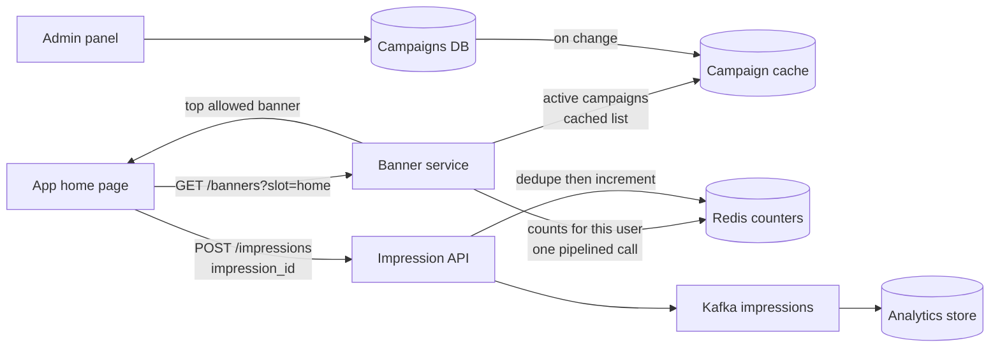

Serving and counting are separate, on purpose. **Serving reads** the counters (no writes) and returns the best eligible banner. **The app reports the impression** once the banner is on screen, and only then is the counter incremented. The trade-off: two requests in flight at the same moment can both be served the banner, so a user might occasionally see X+1. For a banner that's acceptable (a soft cap), and you should say so. If it had to be strict (a paid ad with a hard frequency cap), you'd reserve atomically at serve time instead.

### Fixed window vs sliding window

**Fixed window:** split time into buckets of Y hours (`bucket = floor(now / Y)`) and keep a counter per (banner, user, bucket). Cheap: one `INCR` and one `EXPIRE`. The flaw is the **boundary burst**.

```
X = 3 views per Y = 6 hours, fixed buckets 00:00-06:00, 06:00-12:00

time:     04:00  05:30  05:50 | 06:05  06:20  06:40
bucket:   [ 00-06: 1  2  3   ] [ 06-12: 1  2  3   ]
result:   user sees 6 views between 04:00 and 06:40, within 3 hours.
          "At most 3 in ANY 6-hour window" is broken.
```

**Sliding log:** keep the timestamp of every view in a Redis sorted set; on each check, drop timestamps older than `now − Y` and count the rest. Exact, and with X = 3 it costs only 3 entries per user per banner, so here it's the right choice. Sliding logs get expensive only when X is large (thousands of API calls per minute), which is where the sliding window counter comes in (Q31).

Redis, sliding log (one atomic Lua script):

```lua
-- KEYS[1] = bv:{banner}:{user}   ARGV[1] = now_ms  ARGV[2] = window_ms  ARGV[3] = max  ARGV[4] = impression_id
redis.call('ZREMRANGEBYSCORE', KEYS[1], 0, ARGV[1] - ARGV[2])
if redis.call('ZSCORE', KEYS[1], ARGV[4]) then return 1 end          -- duplicate impression report
redis.call('ZADD', KEYS[1], ARGV[1], ARGV[4])
redis.call('PEXPIRE', KEYS[1], ARGV[2])                               -- key disappears when idle
return redis.call('ZCARD', KEYS[1])
```

Using the impression ID as the sorted-set member makes the report **idempotent**: an app that retries the `POST` doesn't double count. The serving-side check is the same first line plus `ZCOUNT` with no `ZADD`. **Resetting counters** needs no cron job: the TTL deletes idle keys, and the campaign's `end_at` stops serving.

### Code (in-memory version, interview-ready)

```java
import java.util.*;
import java.util.concurrent.ConcurrentHashMap;

interface FrequencyCap {
    boolean canShow(String bannerId, String userId, long nowMs);
    /** Records an impression; returns false if it was a duplicate report. */
    boolean record(String bannerId, String userId, String impressionId, long nowMs);
}

final class FixedWindowCap implements FrequencyCap {
    private final int max; private final long windowMs;
    private final ConcurrentHashMap<String, long[]> counters = new ConcurrentHashMap<>(); // key -> {bucket, count}
    private final Set<String> seen = ConcurrentHashMap.newKeySet();   // in production: Redis SET NX with TTL

    FixedWindowCap(int max, long windowMs) { this.max = max; this.windowMs = windowMs; }

    public boolean canShow(String b, String u, long now) {
        long[] c = counters.get(b + ":" + u);
        return c == null || c[0] != now / windowMs || c[1] < max;
    }

    public boolean record(String b, String u, String impressionId, long now) {
        if (!seen.add(impressionId)) return false;
        long bucket = now / windowMs;
        counters.compute(b + ":" + u, (k, c) -> {
            if (c == null || c[0] != bucket) return new long[]{bucket, 1};
            c[1]++; return c;
        });
        return true;
    }
}

final class SlidingLogCap implements FrequencyCap {
    private final int max; private final long windowMs;
    private final ConcurrentHashMap<String, ArrayDeque<Long>> logs = new ConcurrentHashMap<>();
    private final Set<String> seen = ConcurrentHashMap.newKeySet();

    SlidingLogCap(int max, long windowMs) { this.max = max; this.windowMs = windowMs; }

    public boolean canShow(String b, String u, long now) {
        ArrayDeque<Long> log = logs.get(b + ":" + u);
        if (log == null) return true;
        synchronized (log) {
            while (!log.isEmpty() && log.peekFirst() <= now - windowMs) log.pollFirst();
            return log.size() < max;
        }
    }

    public boolean record(String b, String u, String impressionId, long now) {
        if (!seen.add(impressionId)) return false;
        ArrayDeque<Long> log = logs.computeIfAbsent(b + ":" + u, k -> new ArrayDeque<>());
        synchronized (log) {                 // lock per (banner, user), not a global lock
            while (!log.isEmpty() && log.peekFirst() <= now - windowMs) log.pollFirst();
            log.addLast(now);
        }
        return true;
    }
}

final class BannerService {
    record Banner(String id, int priority, long startAt, long endAt, FrequencyCap cap) {}
    private volatile List<Banner> active = List.of();      // swapped atomically when campaigns change

    void reload(List<Banner> banners) {
        List<Banner> copy = new ArrayList<>(banners);
        copy.sort(Comparator.comparingInt(Banner::priority).reversed());
        active = List.copyOf(copy);
    }

    Optional<Banner> pick(String userId, long now) {
        for (Banner b : active)
            if (now >= b.startAt() && now < b.endAt() && b.cap().canShow(b.id(), userId, now))
                return Optional.of(b);
        return Optional.empty();
    }
}
```

**Concurrency notes.** `ConcurrentHashMap.compute` runs atomically per key, so two impressions for the same user can't lose an increment. The sliding log locks only that one user's deque. The campaign list is an immutable list behind a `volatile` field: readers never lock, and a reload swaps in a new list (copy-on-write). In Redis, the Lua script gives the same atomicity across many servers.

### Schema

```sql
CREATE TABLE banners (
  id            BIGINT PRIMARY KEY,
  slot          VARCHAR(50) NOT NULL,          -- 'home_carousel'
  image_url     VARCHAR(500) NOT NULL,
  deeplink      VARCHAR(500),
  priority      INT NOT NULL,
  start_at      DATETIME NOT NULL,             -- Z days = end_at - start_at
  end_at        DATETIME NOT NULL,
  max_views     INT NOT NULL,                  -- X
  window_hours  INT NOT NULL,                  -- Y
  window_type   ENUM('FIXED','SLIDING') NOT NULL DEFAULT 'SLIDING',
  target_rules  JSON,                          -- city, segment, app version
  status        ENUM('DRAFT','LIVE','PAUSED','ENDED') NOT NULL,
  INDEX idx_banners_live (slot, status, start_at, end_at)
);

-- Analytics only. Enforcement reads Redis, not this table.
CREATE TABLE banner_impressions (
  impression_id CHAR(36) PRIMARY KEY,          -- client-generated UUID: dedupe for free
  banner_id     BIGINT NOT NULL,
  user_id       BIGINT NOT NULL,
  shown_at      DATETIME NOT NULL,
  INDEX idx_imp_banner_user_time (banner_id, user_id, shown_at)
);
```

If they insist "no Redis, do it in SQL": `SELECT COUNT(*) FROM banner_impressions WHERE banner_id=? AND user_id=? AND shown_at > NOW() - INTERVAL ? HOUR` uses the composite index above and works at small scale. It's an exact sliding window, but it costs a DB read per banner per page load, which is why the counters belong in Redis.

> **Real world — Uber:** Uber's notification gateway enforces **frequency caps (example: 2 per day)** and **minimum gaps (example: 8 hours)** between pushes, alongside send windows and restaurant hours ([source](https://www.uber.com/en-CA/blog/how-uber-optimizes-push-notifications-using-ml)). Banner caps and notification cooldowns are the same problem, so you can reuse this design in Q32.

### Follow-ups

- **"Same user on two phones?"** Key on `user_id`, not device ID. Logged-out users fall back to a device ID.
- **"Redis goes down?"** Fail open (show banners; worst case a user sees one too many) for promos. Fail closed only if over-showing costs money.
- **"Different X per segment?"** Put the cap on a (banner, segment) rule row instead of the banner.
- **"The ad must spread its budget over the whole day"** (the Nugget **ad pacing** question: Domino's pays ₹10,000 at ₹10 per click, so 1,000 clicks, and the spend must last all day ([Z14](https://leetcode.com/discuss/post/8540075/))). Give each hour a token allowance proportional to its expected traffic (hour-weighted token bucket); unused tokens roll forward. Same machinery, applied to budget instead of views.

## Q25. LLD: cart with discounts (Strategy pattern, money in paise)

Swiggy SDE-2 asked for a cart with add/remove, total, inventory validation, discounts, payment and notifications ([S6](https://leetcode.com/discuss/post/7069404/)). Swiggy also asked a coupon-based discounting system with class diagrams, APIs and schema ([S9](https://leetcode.com/discuss/post/6051809/)), and Blinkit asked for coupon creation and validation with admin rules, expiry, limited-user coupons and a **5-minute payment window** after applying ([B17](https://medium.com/@utkarsho.dev/blinkit-sde-1-interview-experience-fresher-39ba436055f3)).

### Requirements

- A cart belongs to one user and **one restaurant** (adding from another restaurant asks to clear the cart).
- Lines carry an item, chosen options (Q23) and a quantity.
- The bill has: item subtotal, item-level offers, coupon discount, delivery fee, packaging, taxes, total.
- Discount types: flat (₹100 off above ₹499), percent with a cap (40% up to ₹80), free delivery, buy-one-get-one.
- Coupon rules: expiry, minimum order, first order only, per-user limit, global limit, payment-method specific.
- Everything is recomputed on the server at checkout.

### Why paise, never `double`

`0.1 + 0.2` in floating point is `0.30000000000000004`. Over millions of orders those errors add up and reconciliation never balances. Store money as a whole number of paise in a `long` (or `BIGINT` in the DB). Make every rounding rule explicit. Here: **percentage discounts round down**, so the customer is never promised more than the coupon allows.

### Classes

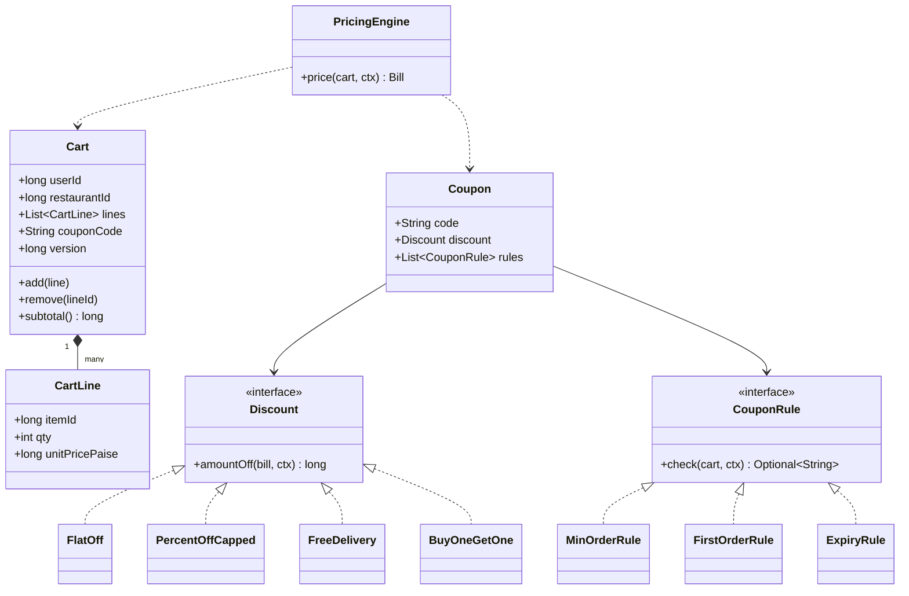

### Code

```java
import java.util.*;

record CartLine(long lineId, long itemId, int qty, long unitPricePaise) {
    long total() { return unitPricePaise * qty; }
}

final class Cart {
    final long userId; long restaurantId = -1; long version = 0;
    final List<CartLine> lines = new ArrayList<>();
    String couponCode;
    Cart(long userId) { this.userId = userId; }

    synchronized void add(long restaurantId, CartLine line) {
        if (!lines.isEmpty() && restaurantId != this.restaurantId)
            throw new IllegalStateException("cart has items from another restaurant");
        if (line.qty() <= 0) throw new IllegalArgumentException("qty must be positive");
        this.restaurantId = restaurantId;
        lines.add(line); version++;
    }
    synchronized void remove(long lineId) {
        lines.removeIf(l -> l.lineId() == lineId); version++;
        if (lines.isEmpty()) restaurantId = -1;
    }
    synchronized long subtotal() { return lines.stream().mapToLong(CartLine::total).sum(); }
}

record Context(long userId, int pastOrders, String paymentMethod, long nowMs) {}

/** Running bill; discounts read it, the engine fills it in. All values in paise. */
final class Bill {
    long subtotal, deliveryFee, packaging, couponOff, tax, total;
    final List<String> notes = new ArrayList<>();
}

interface Discount { long amountOff(Bill bill, Cart cart, Context ctx); }

final class FlatOff implements Discount {
    final long off;
    FlatOff(long off) { this.off = off; }
    public long amountOff(Bill b, Cart c, Context x) { return Math.min(off, b.subtotal); }
}

final class PercentOffCapped implements Discount {
    final int percent; final long cap;
    PercentOffCapped(int percent, long cap) { this.percent = percent; this.cap = cap; }
    public long amountOff(Bill b, Cart c, Context x) {
        long raw = Math.floorDiv(b.subtotal * percent, 100);   // round DOWN
        return Math.min(raw, cap);
    }
}

final class FreeDelivery implements Discount {
    public long amountOff(Bill b, Cart c, Context x) { return b.deliveryFee; }
}

final class BuyOneGetOne implements Discount {
    final long itemId;
    BuyOneGetOne(long itemId) { this.itemId = itemId; }
    public long amountOff(Bill b, Cart c, Context x) {
        return c.lines.stream().filter(l -> l.itemId() == itemId)
                .mapToLong(l -> (l.qty() / 2) * l.unitPricePaise()).sum();
    }
}

interface CouponRule { Optional<String> check(Bill bill, Context ctx); }   // empty = passes

record MinOrderRule(long min) implements CouponRule {
    public Optional<String> check(Bill b, Context x) {
        return b.subtotal >= min ? Optional.empty() : Optional.of("add items worth " + (min - b.subtotal) / 100 + " more");
    }
}
record FirstOrderRule() implements CouponRule {
    public Optional<String> check(Bill b, Context x) {
        return x.pastOrders() == 0 ? Optional.empty() : Optional.of("only for your first order");
    }
}
record ExpiryRule(long validFrom, long validTo) implements CouponRule {
    public Optional<String> check(Bill b, Context x) {
        return (x.nowMs() >= validFrom && x.nowMs() < validTo) ? Optional.empty() : Optional.of("coupon expired");
    }
}

record Coupon(String code, Discount discount, List<CouponRule> rules) {}

interface FeeCalculator { long fee(Cart cart, Bill bill); }       // delivery fee is a Strategy too

final class PricingEngine {
    private final FeeCalculator delivery, packaging;
    private final int taxBasisPoints;                               // assumption: 500 = 5 percent
    PricingEngine(FeeCalculator d, FeeCalculator p, int taxBp) { delivery = d; packaging = p; taxBasisPoints = taxBp; }

    Bill price(Cart cart, Coupon coupon, Context ctx) {
        Bill b = new Bill();
        b.subtotal = cart.subtotal();
        b.deliveryFee = delivery.fee(cart, b);
        b.packaging = packaging.fee(cart, b);
        if (coupon != null) {
            Optional<String> failed = coupon.rules().stream()
                    .map(r -> r.check(b, ctx)).flatMap(Optional::stream).findFirst();
            if (failed.isPresent()) b.notes.add(failed.get());
            else b.couponOff = Math.min(coupon.discount().amountOff(b, cart, ctx),
                                         b.subtotal + b.deliveryFee);     // never below zero
        }
        long taxable = Math.max(0, b.subtotal - b.couponOff);
        b.tax = Math.floorDiv(taxable * taxBasisPoints, 10_000);
        b.total = b.subtotal + b.deliveryFee + b.packaging + b.tax - b.couponOff;
        return b;
    }

    /** "Apply best offer" button: try each eligible coupon, keep the cheapest total. */
    Optional<Coupon> best(Cart cart, List<Coupon> coupons, Context ctx) {
        return coupons.stream()
                .filter(c -> price(cart, c, ctx).notes.isEmpty())
                .min(Comparator.comparingLong(c -> price(cart, c, ctx).total));
    }
}
```

Adding a new discount type ("₹50 off on UPI") means one new `Discount` class and maybe one new `CouponRule`; the engine doesn't change. That's the **open/closed principle**, and it's the sentence the interviewer is waiting for. The tax rule (on the post-discount amount, at an assumed 5%) is an assumption; say "I'd confirm the tax rule with finance".

### Schema and the concurrency traps

```sql
CREATE TABLE coupons (
  id               BIGINT PRIMARY KEY,
  code             VARCHAR(40) NOT NULL UNIQUE,
  discount_type    ENUM('FLAT','PERCENT','FREE_DELIVERY','BOGO') NOT NULL,
  value            BIGINT NOT NULL,            -- paise for FLAT, percent for PERCENT
  max_discount     BIGINT,                     -- cap, paise
  min_order        BIGINT NOT NULL DEFAULT 0,
  valid_from       DATETIME NOT NULL,
  valid_to         DATETIME NOT NULL,
  per_user_limit   INT NOT NULL DEFAULT 1,
  global_limit     INT,                        -- NULL = unlimited
  used_count       INT NOT NULL DEFAULT 0,
  rules            JSON                        -- first_order, payment_method, cities
);

CREATE TABLE coupon_redemptions (
  id          BIGINT PRIMARY KEY,
  coupon_id   BIGINT NOT NULL,
  user_id     BIGINT NOT NULL,
  order_id    BIGINT NOT NULL,
  status      ENUM('HELD','USED','RELEASED') NOT NULL,
  held_until  DATETIME NOT NULL,               -- the 5-minute payment window
  UNIQUE KEY uq_redemption_order (coupon_id, order_id),
  INDEX idx_redemption_user (coupon_id, user_id, status)
);
```

- **"Only the first 1,000 users get it" and 5,000 people hit Pay at once.** Never do "read `used_count`, check, write". Use one conditional update, which the database runs atomically: `UPDATE coupons SET used_count = used_count + 1 WHERE id = ? AND used_count < global_limit`. If it changed 1 row you got a slot, and if it changed 0 the coupon is exhausted. For a very hot coupon, keep the counter in Redis (`DECR` on a pre-loaded count) and write the result to the DB asynchronously.
- **Per-user limit under a double tap.** Two checkout requests from the same user. Insert the redemption in the same transaction as the order and count `HELD` + `USED` rows for that user. For a limit of 1, a unique key on `(coupon_id, user_id)` lets the database reject the second insert outright.
- **The 5-minute payment window (B17).** On "Pay", insert a `HELD` redemption with `held_until = now + 5 min` and take the slot. On payment success, mark it `USED`. A sweeper job (or a delayed message) releases holds past `held_until` and gives the slot back: `UPDATE ... SET status='RELEASED' WHERE id=? AND status='HELD'`. The `AND status='HELD'` makes the sweeper safe even if it races with a late payment success.
- **Inventory (Swiggy S6, Meesho).** For quick commerce, reserve at order creation (`UPDATE stock SET reserved = reserved + n WHERE sku=? AND store=? AND available - reserved >= n`), convert to a decrement on payment, release on failure or timeout. The Meesho machine coding trap was exactly this: block at `createOrder`, decrement at `confirmOrder` ([Meesho](https://leetcode.com/discuss/post/5925685/)).
- **Cart storage.** A Redis hash per user (`cart:{userId}`) with a TTL of a few days; the cart is a draft, and losing one is annoying but not dangerous. Use the `version` field so two devices editing the same cart don't overwrite each other: write only if the version is unchanged.

> **Real world — Zepto:** Zepto's Draft-Order service on DynamoDB accepts the order **before payment**, consumes payment events from Kafka (MSK), and on success calls an **idempotent** Create Order API. A job runs **every 5 minutes** to confirm or terminate orders stuck awaiting payment, and a sparse index holds only those pending orders. Create Order got about 60% faster on average ([source](https://aws.amazon.com/blogs/database/how-zepto-scales-to-millions-of-orders-per-day-using-amazon-dynamodb/)). Coupon holds fit the same "hold, then confirm or sweep" shape.

**Follow-ups.** *"Stack two coupons?"* Add a `stackable` flag and an order of application (item offers first, then cart coupons, then payment offers), and cap the combined discount. *"Show 'add ₹120 more to unlock'"* is the `MinOrderRule` message. *"Where does notification fit?"* After payment the order service publishes `OrderPlaced`, and the notification service subscribes (Observer, Q32); the cart never calls it directly.

## Q26. Schema: delivery partners and orders, with the SQL they ask you to write

This is the most-asked schema question in the group. "Schema for delivery partners and orders. Follow-up: an SQL query for the top 5 delivery partners in an area by count of a given order type" ([Z2](https://leetcode.com/discuss/post/8377019/)). "SQL on order state transitions (Created, Confirmed, Reached Merchant, Reached Customer, Delivered): latest state per order in the last hour, excluding delivered. How it behaves at scale, which indexes" ([Z12](https://leetcode.com/discuss/post/7573378/)). "Database design for a food delivery app: Users, Orders, PK/FK" ([Z33](https://www.geeksforgeeks.org/interview-experiences/zomato-interview-experience-for-sde1-1-year-experienced/)). One Zomato SDE-1 candidate was rejected on an SQL query after an hour of MongoDB and SQL ([Z23](https://leetcode.com/discuss/post/5007288/)). Practise writing these by hand.

### Entities

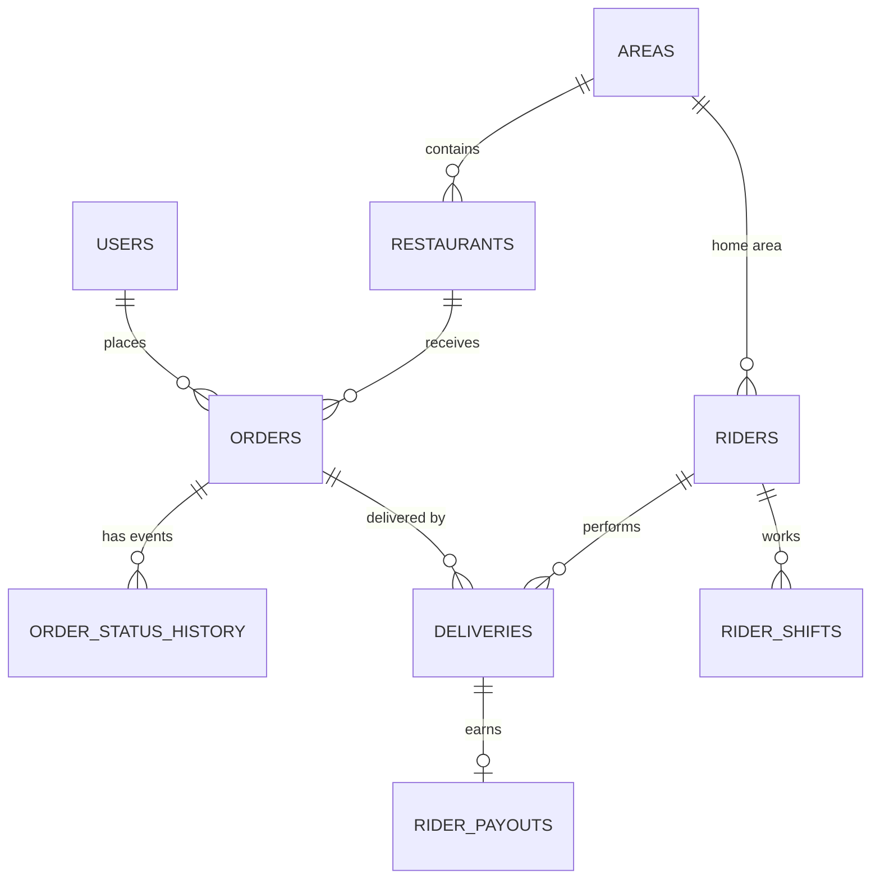

### DDL (MySQL 8)

```sql
CREATE TABLE areas (
  id        INT PRIMARY KEY,
  city_id   INT NOT NULL,
  name      VARCHAR(100) NOT NULL              -- 'Koramangala'
);

CREATE TABLE riders (
  id            BIGINT PRIMARY KEY,
  name          VARCHAR(100) NOT NULL,
  phone         VARCHAR(15) NOT NULL UNIQUE,
  vehicle_type  ENUM('BICYCLE','BIKE','EV') NOT NULL,
  home_area_id  INT NOT NULL REFERENCES areas(id),
  status        ENUM('OFFLINE','IDLE','ON_TRIP','SUSPENDED') NOT NULL,
  rating        DECIMAL(3,2),
  joined_at     DATETIME NOT NULL,
  INDEX idx_riders_area_status (home_area_id, status)
);

CREATE TABLE orders (
  id             BIGINT PRIMARY KEY,
  user_id        BIGINT NOT NULL,
  restaurant_id  BIGINT NOT NULL,
  area_id        INT NOT NULL,                 -- delivery area, denormalised for queries
  order_type     ENUM('DELIVERY','TAKEAWAY','SCHEDULED','GOLD') NOT NULL,
  status         VARCHAR(30) NOT NULL,         -- CURRENT status, kept in sync with history
  total_paise    BIGINT NOT NULL,
  placed_at      DATETIME NOT NULL,
  updated_at     DATETIME NOT NULL,
  version        INT NOT NULL DEFAULT 0,       -- optimistic locking
  INDEX idx_orders_user_time (user_id, placed_at),
  INDEX idx_orders_restaurant_time (restaurant_id, placed_at),
  INDEX idx_orders_status_updated (status, updated_at)
);

CREATE TABLE order_status_history (            -- append-only event log
  id          BIGINT PRIMARY KEY AUTO_INCREMENT,
  order_id    BIGINT NOT NULL REFERENCES orders(id),
  status      VARCHAR(30) NOT NULL,
  created_at  DATETIME(3) NOT NULL,
  actor       VARCHAR(30) NOT NULL,            -- 'restaurant', 'rider:812', 'system'
  INDEX idx_hist_time (created_at),
  INDEX idx_hist_order_time (order_id, created_at)
);

CREATE TABLE deliveries (
  id             BIGINT PRIMARY KEY,
  order_id       BIGINT NOT NULL,
  rider_id       BIGINT NOT NULL REFERENCES riders(id),
  status         ENUM('ASSIGNED','PICKED_UP','DELIVERED','REASSIGNED','CANCELLED') NOT NULL,
  assigned_at    DATETIME NOT NULL,
  picked_up_at   DATETIME NULL,
  delivered_at   DATETIME NULL,
  distance_m     INT NULL,
  INDEX idx_deliv_rider_time (rider_id, delivered_at),
  INDEX idx_deliv_order (order_id)
);

CREATE TABLE rider_shifts (
  id BIGINT PRIMARY KEY, rider_id BIGINT NOT NULL, starts_at DATETIME NOT NULL, ends_at DATETIME,
  INDEX idx_shift_rider (rider_id, starts_at)
);

CREATE TABLE rider_payouts (
  id BIGINT PRIMARY KEY, rider_id BIGINT NOT NULL, delivery_id BIGINT NOT NULL UNIQUE,
  base_paise BIGINT NOT NULL, distance_paise BIGINT NOT NULL, incentive_paise BIGINT NOT NULL,
  tip_paise BIGINT NOT NULL DEFAULT 0, paid_at DATETIME NULL
);
```

**Design choices to say out loud.**
- **Why is `deliveries` separate from `orders`?** Different owner (the logistics service) and a different lifecycle. If a rider's bike breaks down, the order is reassigned: the old delivery row becomes `REASSIGNED` and a new row is created, so nothing in the order's history is overwritten. That's why `deliveries.order_id` is *not* unique.
- **Current status on `orders` plus an append-only history table.** The current status answers "what's happening now" with one indexed lookup; the history answers "when did each step happen" for ETAs, disputes and analytics. Both are written in **one transaction**.
- **Rider location is not a MySQL table.** Riders ping every few seconds; the latest point goes to an in-memory store (Redis GEO or a cell index), and the history goes to Kafka and then to cheap storage. Zomato hasn't published how it stores rider pings, so present this as the usual approach.

> **Real world — Zomato:** Zomato runs **Aurora MySQL** (610k selects/s and 16,000 write transactions/s at the NYE 2023 peak) alongside DynamoDB and MongoDB ([source](https://www.zomato.com/blog/a-tale-of-scale-behind-the-scenes-at-zomato-tech-for-nye-2023)), and Aurora MySQL changes are captured by **Debezium** into Kafka for the data platform ([source](https://aws.amazon.com/blogs/opensource/how-zomato-boosted-performance-25-and-cut-compute-cost-30-migrating-trino-and-druid-workloads-to-aws-graviton/)). So a relational orders schema with heavy analytics pushed off to a separate store matches what Zomato actually describes.

### Query 1: top 5 delivery partners in an area by count of a given order type (Z2)

```sql
SELECT d.rider_id, r.name, COUNT(*) AS orders_done
FROM orders o
JOIN deliveries d ON d.order_id = o.id AND d.status = 'DELIVERED'
JOIN riders r     ON r.id = d.rider_id
WHERE o.area_id    = :area_id
  AND o.order_type = :order_type
  AND o.placed_at >= :from_ts                 -- always bound the time range
GROUP BY d.rider_id, r.name
ORDER BY orders_done DESC, d.rider_id         -- deterministic tie-break
LIMIT 5;
```

- **Join to `deliveries`, not `orders.rider_id`,** so a reassigned order counts for the rider who actually delivered it.
- **Index:** `orders(area_id, order_type, placed_at)` turns the `WHERE` into a range scan; `deliveries(order_id)` serves the join.
- **Ties** (they may ask "what if 6th and 5th are equal?"): use `DENSE_RANK()`:

```sql
WITH counts AS (
  SELECT d.rider_id, COUNT(*) AS n
  FROM orders o JOIN deliveries d ON d.order_id = o.id AND d.status = 'DELIVERED'
  WHERE o.area_id = :area_id AND o.order_type = :order_type AND o.placed_at >= :from_ts
  GROUP BY d.rider_id
)
SELECT rider_id, n FROM (
  SELECT rider_id, n, DENSE_RANK() OVER (ORDER BY n DESC) AS rnk FROM counts
) t WHERE rnk <= 5;
```

- **Top 5 in *every* area at once:** add `o.area_id` to the GROUP BY and use `ROW_NUMBER() OVER (PARTITION BY area_id ORDER BY n DESC)`.
- **At Zomato scale** you wouldn't run this on the live orders DB every time a dashboard loads. A stream job keeps `rider_daily_stats(rider_id, area_id, order_type, day, delivered_count)` up to date, and the query becomes a small `SUM ... GROUP BY` over that table.

### Query 2: average delivery time

```sql
-- Average minutes from order placed to delivered, per restaurant, today
SELECT o.restaurant_id,
       AVG(TIMESTAMPDIFF(SECOND, o.placed_at, d.delivered_at)) / 60 AS avg_minutes,
       COUNT(*) AS orders
FROM orders o
JOIN deliveries d ON d.order_id = o.id AND d.status = 'DELIVERED'
WHERE o.placed_at >= CURDATE()
GROUP BY o.restaurant_id
HAVING COUNT(*) >= 20                          -- ignore tiny samples
ORDER BY avg_minutes DESC;
```

**Say this unprompted:** averages hide the bad experiences, so delivery teams watch the **p90 or p95**. Postgres has `PERCENTILE_CONT(0.9) WITHIN GROUP (ORDER BY ...)`; MySQL 8 doesn't, so you'd compute it with `ROW_NUMBER()` over the sorted durations or in the analytics store.

### Query 3: latest state per order in the last hour, excluding delivered (Z12)

```sql
WITH ranked AS (
  SELECT h.order_id, h.status, h.created_at,
         ROW_NUMBER() OVER (PARTITION BY h.order_id
                            ORDER BY h.created_at DESC, h.id DESC) AS rn
  FROM order_status_history h
  WHERE h.created_at >= NOW() - INTERVAL 1 HOUR
)
SELECT order_id, status, created_at
FROM ranked
WHERE rn = 1 AND status <> 'DELIVERED';
```

- **Why filtering the history to the last hour is safe:** if an order has *any* event in the last hour, its *latest* event is also in the last hour (latest is at least as recent). So the filter never hides an order's true latest state.
- **`h.id DESC` as a tie-breaker:** two events can share a timestamp (a retried event, or millisecond collisions).
- **Without window functions** (older MySQL), use a join on the max:

```sql
SELECT h.order_id, h.status, h.created_at
FROM order_status_history h
JOIN (SELECT order_id, MAX(id) AS max_id           -- id is monotonic per insert
      FROM order_status_history
      WHERE created_at >= NOW() - INTERVAL 1 HOUR
      GROUP BY order_id) last ON last.max_id = h.id
WHERE h.status <> 'DELIVERED';
```

- **Indexes:** `(created_at)` for the one-hour range scan; `(order_id, created_at)` if you query per order.
- **"How does this behave at scale?"** At about 2M orders a day and 5–6 events per order, the history table grows by roughly 10M rows a day (assumption). The one-hour range stays small, so the query is fine *with* the `created_at` index; without it, it's a full table scan. Better still, **don't derive the current state from history at all**: read `orders.status` with the index `(status, updated_at)`: `SELECT id, status FROM orders WHERE updated_at >= NOW() - INTERVAL 1 HOUR AND status <> 'DELIVERED'`. Partition the history table by day and archive old partitions.

### Keeping status consistent: the state machine in code

```java
import java.util.*;

enum OrderStatus {
    CREATED, CONFIRMED, REACHED_MERCHANT, PICKED_UP, REACHED_CUSTOMER, DELIVERED, CANCELLED;

    private static final Map<OrderStatus, Set<OrderStatus>> NEXT = new EnumMap<>(OrderStatus.class);
    static {
        NEXT.put(CREATED, EnumSet.of(CONFIRMED, CANCELLED));
        NEXT.put(CONFIRMED, EnumSet.of(REACHED_MERCHANT, CANCELLED));
        NEXT.put(REACHED_MERCHANT, EnumSet.of(PICKED_UP, CANCELLED));
        NEXT.put(PICKED_UP, EnumSet.of(REACHED_CUSTOMER));
        NEXT.put(REACHED_CUSTOMER, EnumSet.of(DELIVERED));
        NEXT.put(DELIVERED, EnumSet.noneOf(OrderStatus.class));
        NEXT.put(CANCELLED, EnumSet.noneOf(OrderStatus.class));
    }
    boolean canMoveTo(OrderStatus to) { return NEXT.get(this).contains(to); }
}

final class OrderStatusService {
    private final javax.sql.DataSource ds;
    OrderStatusService(javax.sql.DataSource ds) { this.ds = ds; }

    /** Returns true if this call made the transition; false if it was a duplicate or stale event. */
    boolean transition(long orderId, OrderStatus from, OrderStatus to, String actor) throws Exception {
        if (!from.canMoveTo(to)) throw new IllegalStateException(from + " -> " + to + " not allowed");
        try (var c = ds.getConnection()) {
            c.setAutoCommit(false);
            try (var up = c.prepareStatement(
                    "UPDATE orders SET status=?, updated_at=NOW(), version=version+1 WHERE id=? AND status=?")) {
                up.setString(1, to.name()); up.setLong(2, orderId); up.setString(3, from.name());
                if (up.executeUpdate() == 0) { c.rollback(); return false; }   // someone else moved it
            }
            try (var ins = c.prepareStatement(
                    "INSERT INTO order_status_history(order_id, status, created_at, actor) VALUES (?,?,NOW(3),?)")) {
                ins.setLong(1, orderId); ins.setString(2, to.name()); ins.setString(3, actor);
                ins.executeUpdate();
            }
            c.commit();
            return true;
        }
    }
}
```

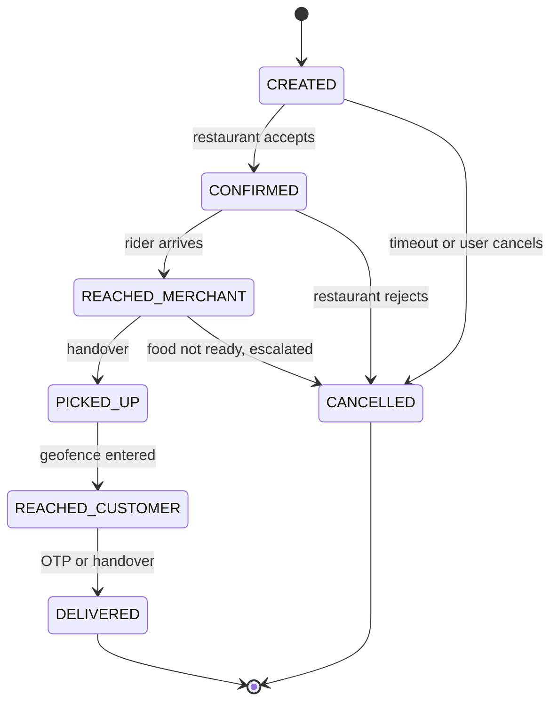

**Concurrency.** The rider app retries "picked up" on a flaky network, and a restaurant taps "cancel" at the same moment. The conditional `UPDATE ... WHERE status = ?` is the lock: exactly one of them changes a row, the other sees 0 rows and returns "already moved". A duplicate event becomes a harmless no-op, which is exactly what Kafka consumers need (B2: "how would you handle duplicate events?").

**Follow-ups.**
- *"Restaurants with no cuisines, JOINs only"* (District, [Z11](https://leetcode.com/discuss/post/6647834/)): `SELECT r.id FROM restaurants r LEFT JOIN restaurant_cuisines rc ON rc.restaurant_id = r.id WHERE rc.restaurant_id IS NULL;`. That's an **anti-join**.
- *"One manager runs several restaurants and one restaurant has several managers"* (Nugget, [Z5](https://leetcode.com/discuss/post/7407389/)): a join table `restaurant_managers(manager_id, restaurant_id, role, PRIMARY KEY(manager_id, restaurant_id))` with an index on `restaurant_id` for the reverse lookup.
- *"SQL or NoSQL for the orders table, which is read for order and payment details?"* ([B10](https://leetcode.com/discuss/post/4630366/)): SQL. Orders need transactions (order + payment + history together), constraints and ad-hoc queries for support and finance. "Can't SQL scale?" It can: read replicas, caching the order-details read, and sharding by `user_id` or `order_id` when one primary isn't enough. Mention that Zomato's own billing platform moved to DynamoDB for throughput, which is a fair counterpoint ([source](https://aws.amazon.com/blogs/database/unlocking-performance-scalability-and-cost-efficiency-of-zomatos-billing-platform-by-switching-from-tidb-to-dynamodb/)).

## Q27. "Which restaurants are open right now?"

The District version: "a restaurant timing system: one in-memory structure answering both 'all open/close slots for a restaurant' and 'all restaurants open now'; data loaded daily" ([Z11](https://leetcode.com/discuss/post/6647834/), selected). It mixes schema, intervals and data structures.

### The traps hidden in the question

1. **Past midnight.** A bar open Friday 19:00 to 02:00 is open at 01:00 on *Saturday*. If you store "Friday, 19:00–02:00" and check `open <= now < close`, it is never open after midnight.
2. **Several slots per day** (lunch 12–15, dinner 19–23).
3. **Week wrap:** Sunday 22:00 to Monday 02:00.
4. **Overrides:** holidays, "closed today", and the live "pause orders" switch a busy kitchen flips.

**The fix for 1 and 3: measure time as minutes since Monday 00:00** (0 to 10,079), and split any interval that crosses midnight into two. Friday 19:00–02:00 becomes `[Fri 19:00, Sat 00:00)` and `[Sat 00:00, Sat 02:00)`. Sunday's late slot spills into Monday using `(day + 1) % 7`. After splitting, every interval is a plain `[start, end)` with `start < end`.

### Schema

```sql
CREATE TABLE opening_hours (
  restaurant_id BIGINT   NOT NULL,
  day_of_week   TINYINT  NOT NULL,             -- 0 = Monday
  open_minute   SMALLINT NOT NULL,             -- 0..1439
  close_minute  SMALLINT NOT NULL,             -- may be <= open_minute: crosses midnight
  PRIMARY KEY (restaurant_id, day_of_week, open_minute)
);
CREATE TABLE hours_overrides (
  restaurant_id BIGINT NOT NULL, on_date DATE NOT NULL,
  is_closed BOOLEAN NOT NULL, open_minute SMALLINT, close_minute SMALLINT,
  PRIMARY KEY (restaurant_id, on_date)
);
-- live switch lives on restaurants.is_accepting_orders
```

If they want plain SQL without splitting (`:d` = today, `:p` = yesterday, `:t` = minute of day):

```sql
SELECT DISTINCT restaurant_id FROM opening_hours
WHERE (day_of_week = :d AND open_minute < close_minute AND :t >= open_minute AND :t < close_minute)
   OR (day_of_week = :d AND open_minute >= close_minute AND :t >= open_minute)   -- today's late slot, before midnight
   OR (day_of_week = :p AND open_minute >= close_minute AND :t < close_minute);  -- yesterday's slot, after midnight
```

### The in-memory structure: an interval tree

There are three honest options. Name them all and pick one.

| Option | "Open now?" | Memory | When it wins |
|---|---|---|---|
| Scan all intervals | O(n) | n intervals | Fewer than about 10k restaurants per city |
| **Interval tree** (sorted by start, each subtree knows its max end) | O(log n + k) typically | n intervals | Arbitrary times ("open at 9:47 pm Friday?"), cheap rebuild |
| **Precompute the open set per minute** | O(1) | 10,080 sets per city | Only "now" matters and you refresh as time passes |

```java
import java.util.*;

public final class OpenNowIndex {
    public record Interval(long restaurantId, int start, int end) {}  // minutes of week, [start, end)

    private final Interval[] byStart;          // sorted by start
    private final int[] maxEnd;                // max end inside the implicit subtree rooted at i
    private final Map<Long, List<Interval>> byRestaurant = new HashMap<>();

    public OpenNowIndex(List<int[]> rows, List<Long> ids) {   // row = {day, openMin, closeMin}
        List<Interval> all = new ArrayList<>();
        for (int i = 0; i < rows.size(); i++) {
            int day = rows.get(i)[0], open = rows.get(i)[1], close = rows.get(i)[2];
            long id = ids.get(i);
            if (close > open) all.add(new Interval(id, day * 1440 + open, day * 1440 + close));
            else {                                              // crosses midnight (close == open: 24 h)
                all.add(new Interval(id, day * 1440 + open, (day + 1) * 1440));
                int next = (day + 1) % 7;
                if (close > 0) all.add(new Interval(id, next * 1440, next * 1440 + close));
            }
        }
        all.sort(Comparator.comparingInt(Interval::start));
        byStart = all.toArray(new Interval[0]);
        maxEnd = new int[byStart.length];
        build(0, byStart.length - 1);
        for (Interval iv : byStart) byRestaurant.computeIfAbsent(iv.restaurantId(), k -> new ArrayList<>()).add(iv);
    }

    private int build(int lo, int hi) {
        if (lo > hi) return Integer.MIN_VALUE;
        int mid = (lo + hi) >>> 1;
        maxEnd[mid] = Math.max(byStart[mid].end(), Math.max(build(lo, mid - 1), build(mid + 1, hi)));
        return maxEnd[mid];
    }

    /** All restaurants open at minute-of-week t. */
    public Set<Long> openAt(int t) {
        Set<Long> out = new HashSet<>();
        query(0, byStart.length - 1, t, out);
        return out;
    }

    private void query(int lo, int hi, int t, Set<Long> out) {
        if (lo > hi) return;
        int mid = (lo + hi) >>> 1;
        if (maxEnd[mid] <= t) return;                // nothing in this subtree is still open at t
        query(lo, mid - 1, t, out);
        Interval iv = byStart[mid];
        if (iv.start() <= t && t < iv.end()) out.add(iv.restaurantId());
        if (iv.start() <= t) query(mid + 1, hi, t, out);   // right side starts later; skip if already after t
    }

    /** All slots of one restaurant. */
    public List<Interval> slots(long restaurantId) { return byRestaurant.getOrDefault(restaurantId, List.of()); }
}
```

The array sorted by start is treated as a balanced tree (the middle element is the root). `maxEnd` lets a whole subtree be skipped when everything in it closed before `t`, and the right subtree is skipped when its intervals all start after `t`. One structure answers both questions from Z11: `slots(id)` and `openAt(t)`.

**Concurrency: copy-on-write for the daily reload.** Build a brand-new index off to the side, then swap it in with one atomic reference write. Readers never lock and never see a half-built index.

```java
final class TimingService {
    private final java.util.concurrent.atomic.AtomicReference<OpenNowIndex> index = new java.util.concurrent.atomic.AtomicReference<>();
    private final Set<Long> paused = java.util.concurrent.ConcurrentHashMap.newKeySet();   // live "pause orders"

    void dailyReload(List<int[]> rows, List<Long> ids) { index.set(new OpenNowIndex(rows, ids)); }
    void setPaused(long id, boolean p) { if (p) paused.add(id); else paused.remove(id); }

    Set<Long> openNow(int minuteOfWeek) {
        Set<Long> open = index.get().openAt(minuteOfWeek);
        open.removeAll(paused);                      // holiday overrides are applied in dailyReload
        return open;
    }
}
```

### At Zomato scale

"Open" changes only at slot boundaries, so you can precompute. A job runs every minute and writes `open:{city}` (a Redis set). Search intersects it with the set of restaurants that can deliver to the user's cell and with "accepting orders right now". The live pause switch must take effect in seconds, so it updates the set directly instead of waiting for the next minute.

> **Real world — Blinkit:** Blinkit's (then Grofers') merchant-discovery service "Iris" maps merchants to Google S2 cells and keeps a cache keyed by cell ID holding the visible merchants, precomputed so that "no computation happens in real time" (search snippet of the Lambda by Blinkit post) ([source](https://lambda.blinkit.com/iris-359b5dfd589b)). Precomputing "open now" is the same idea applied to time instead of space.

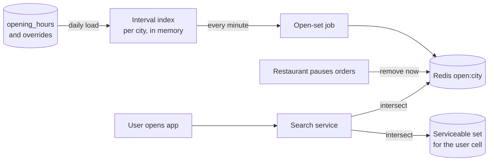

**Follow-ups.** *"Time zones?"* Store hours in the restaurant's local time with a `tz` column; India is one zone, but the design shouldn't assume it. *"Closing in 15 minutes?"* Query `openAt(t)` minus `openAt(t + 15)` gives "closing soon". *"DST?"* Converting at query time with the restaurant's zone handles it.

## Q28. Parking lot (machine-coding style, thread-safe)

Asked at Flipkart SDE-2 (entities, interfaces, fee calculation, spot assignment, **extensibility**; [F2](https://leetcode.com/discuss/post/5303379/)) and Swiggy SDE-2 (Vehicle, Slot, Ticket, Payment, allocation strategy, class diagram; [S7](https://leetcode.com/discuss/post/7383296/)). A Swiggy variant asked for slots **reservable by multiple companies** ([S8](https://leetcode.com/discuss/post/7480610/)). In machine coding, write code that runs, then talk.

### Requirements (what I'd say in minute one)

Multiple floors; spot types SMALL, MEDIUM, LARGE; bikes fit anywhere, cars need MEDIUM or LARGE, trucks need LARGE; give the nearest free spot that fits; a ticket on entry, a fee on exit; free counts per floor and type; many entry gates working at once. **Out of scope:** payments beyond computing the fee, and reservations (offered as an extension).

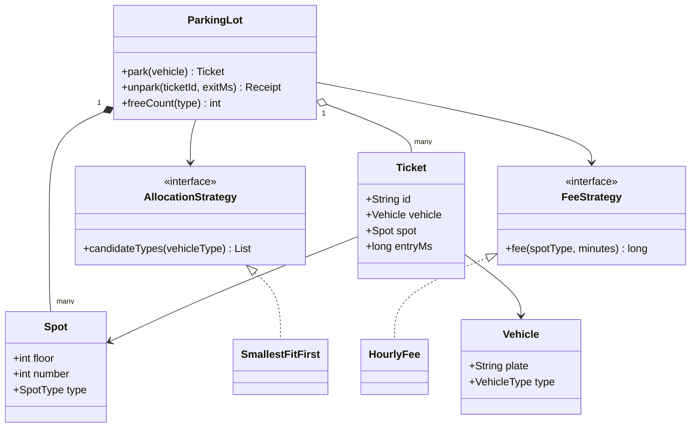

### Code

```java
import java.util.*;
import java.util.concurrent.*;
import java.util.concurrent.atomic.AtomicInteger;

enum VehicleType { BIKE, CAR, TRUCK }
enum SpotType { SMALL, MEDIUM, LARGE }

record Vehicle(String plate, VehicleType type) {}
record Spot(int floor, int number, SpotType type) {}
record Ticket(String id, Vehicle vehicle, Spot spot, long entryMs) {}
record Receipt(String ticketId, long minutes, long feePaise) {}

interface AllocationStrategy { List<SpotType> candidateTypes(VehicleType v); }
final class SmallestFitFirst implements AllocationStrategy {
    public List<SpotType> candidateTypes(VehicleType v) {
        return switch (v) {
            case BIKE -> List.of(SpotType.SMALL, SpotType.MEDIUM, SpotType.LARGE);
            case CAR -> List.of(SpotType.MEDIUM, SpotType.LARGE);
            case TRUCK -> List.of(SpotType.LARGE);
        };
    }
}

interface FeeStrategy { long fee(SpotType type, long minutes); }
final class HourlyFee implements FeeStrategy {
    private final Map<SpotType, Long> perHour;                    // paise
    HourlyFee(Map<SpotType, Long> perHour) { this.perHour = perHour; }
    public long fee(SpotType t, long minutes) {
        long hours = Math.max(1, (minutes + 59) / 60);            // round up, minimum 1 hour
        return hours * perHour.get(t);
    }
}

final class ParkingLot {
    private static final Comparator<Spot> NEAREST =
            Comparator.comparingInt(Spot::floor).thenComparingInt(Spot::number);

    private final Map<SpotType, ConcurrentSkipListSet<Spot>> free = new EnumMap<>(SpotType.class);
    private final Map<SpotType, AtomicInteger> freeCounts = new EnumMap<>(SpotType.class);
    private final ConcurrentHashMap<String, Ticket> active = new ConcurrentHashMap<>();
    private final ConcurrentHashMap<String, String> plateToTicket = new ConcurrentHashMap<>();
    private final AllocationStrategy allocation; private final FeeStrategy fees;

    ParkingLot(List<Spot> spots, AllocationStrategy a, FeeStrategy f) {
        allocation = a; fees = f;
        for (SpotType t : SpotType.values()) {
            free.put(t, new ConcurrentSkipListSet<>(NEAREST));
            freeCounts.put(t, new AtomicInteger());
        }
        for (Spot s : spots) { free.get(s.type()).add(s); freeCounts.get(s.type()).incrementAndGet(); }
    }

    Ticket park(Vehicle v, long nowMs) {
        if (plateToTicket.putIfAbsent(v.plate(), "PENDING") != null)
            throw new IllegalStateException(v.plate() + " is already parked");
        for (SpotType t : allocation.candidateTypes(v.type())) {
            Spot s = free.get(t).pollFirst();                     // atomic: two gates never get the same spot
            if (s != null) {
                freeCounts.get(t).decrementAndGet();
                Ticket ticket = new Ticket(UUID.randomUUID().toString(), v, s, nowMs);
                active.put(ticket.id(), ticket);
                plateToTicket.put(v.plate(), ticket.id());
                return ticket;
            }
        }
        plateToTicket.remove(v.plate());
        throw new IllegalStateException("no spot for " + v.type());
    }

    Receipt unpark(String ticketId, long exitMs) {
        Ticket t = active.remove(ticketId);                       // atomic: a second call gets null
        if (t == null) throw new IllegalArgumentException("unknown or already used ticket");
        long minutes = Math.max(0, (exitMs - t.entryMs()) / 60_000);
        long fee = fees.fee(t.spot().type(), minutes);
        free.get(t.spot().type()).add(t.spot());
        freeCounts.get(t.spot().type()).incrementAndGet();
        plateToTicket.remove(t.vehicle().plate());
        return new Receipt(ticketId, minutes, fee);
    }

    int freeCount(SpotType t) { return freeCounts.get(t).get(); }

    public static void main(String[] args) throws Exception {
        List<Spot> spots = new ArrayList<>();
        for (int f = 0; f < 2; f++)
            for (int n = 0; n < 3; n++) spots.add(new Spot(f, n, SpotType.values()[n]));
        ParkingLot lot = new ParkingLot(spots, new SmallestFitFirst(),
                new HourlyFee(Map.of(SpotType.SMALL, 2000L, SpotType.MEDIUM, 4000L, SpotType.LARGE, 8000L)));

        ExecutorService gates = Executors.newFixedThreadPool(4);   // 4 gates racing for 2 MEDIUM + 2 LARGE spots
        List<Future<Ticket>> results = new ArrayList<>();
        for (int i = 0; i < 6; i++) {
            Vehicle car = new Vehicle("KA01-" + i, VehicleType.CAR);
            results.add(gates.submit(() -> lot.park(car, 0)));
        }
        int ok = 0;
        for (Future<Ticket> r : results) { try { r.get(); ok++; } catch (ExecutionException e) { } }
        gates.shutdown();
        System.out.println("parked " + ok + " cars, medium free = " + lot.freeCount(SpotType.MEDIUM));  // parked 4
    }
}
```

### Where the locks are, and why

- **Spot allocation** is `ConcurrentSkipListSet.pollFirst()`, which removes and returns the smallest element atomically. Two gates calling it at the same instant get two different spots, or one gets `null`. No global lock, so gates don't queue behind each other.
- **Exit** is `ConcurrentHashMap.remove(ticketId)`, so a double-tapped exit is charged once.
- **Same plate twice** is blocked by `putIfAbsent`.
- **Free counts** use `AtomicInteger`, because `ConcurrentSkipListSet.size()` walks the whole set (O(n)) and is only approximate under concurrency.
- **The honest simpler answer:** `synchronized` on `park` and `unpark` is also correct, and for a 500-spot lot it's fast enough. Say that, then explain why the lock-free version scales better when gates are added.
- **With a database:** `UPDATE spots SET ticket_id=? WHERE id=? AND ticket_id IS NULL` (1 row = you got it), or `SELECT ... FOR UPDATE SKIP LOCKED LIMIT 1` to grab the first free spot without blocking other gates.

### Extensions they'll ask for

- **EV charging spots:** a new `SpotType` plus a strategy rule; nothing else changes.
- **Weekend or night pricing:** a new `FeeStrategy` (or a chain: base fee, then a surcharge decorator).
- **Display boards:** Observer. The lot publishes `SpotFreed` and `SpotTaken`, and each floor's board subscribes.
- **Multi-company reservations (S8):** add `Reservation(companyId, spotType, from, to)` and a per-company quota. Booking a slot is an interval-overlap check per spot (`existing.from < new.to AND new.from < existing.to`), and two companies booking the same spot is solved with a unique constraint on `(spot_id, slot_start)` for fixed slots, or a row lock on the spot.

## Q29. Splitwise (Swiggy machine coding): balances and debt simplification with heaps

Asked at Swiggy SDE-1 as a 60-minute LLD in your own IDE: "about 10 minutes on requirements and objects, a UML diagram, then code"; the interviewer "expected a fully working application" and partial functionality was rejected ([S1](https://leetcode.com/discuss/post/7278246/)). Swiggy SDE-2 asked the workat.tech version over about 3 hours ([S11](https://leetcode.com/discuss/post/4540407/)). **Optimise for working code first.**

### Requirements

Users; add an expense paid by one user and split **EQUAL**, **EXACT** (amounts given) or **PERCENT**; show all balances or one user's balances ("u2 owes u1: 250"); simplify debts to fewer transfers. Amounts in paise, and rounding must not lose a paisa.

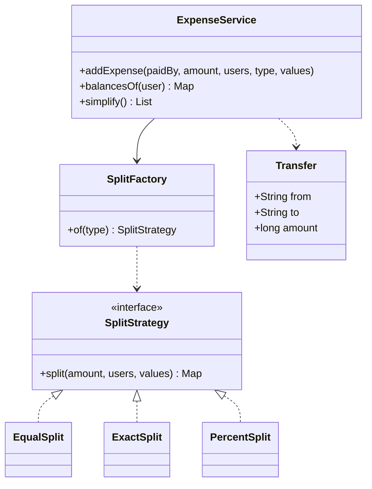

### Code

```java
import java.util.*;

enum SplitType { EQUAL, EXACT, PERCENT }

interface SplitStrategy { Map<String, Long> split(long amount, List<String> users, List<Long> values); }

final class EqualSplit implements SplitStrategy {
    public Map<String, Long> split(long amount, List<String> users, List<Long> v) {
        Map<String, Long> out = new LinkedHashMap<>();
        long base = amount / users.size(), rem = amount % users.size();
        for (int i = 0; i < users.size(); i++) out.put(users.get(i), base + (i < rem ? 1 : 0));  // first 'rem' users pay 1 paisa more
        return out;
    }
}
final class ExactSplit implements SplitStrategy {
    public Map<String, Long> split(long amount, List<String> users, List<Long> v) {
        if (v.size() != users.size() || v.stream().mapToLong(Long::longValue).sum() != amount)
            throw new IllegalArgumentException("exact shares must add up to the total");
        Map<String, Long> out = new LinkedHashMap<>();
        for (int i = 0; i < users.size(); i++) out.put(users.get(i), v.get(i));
        return out;
    }
}
final class PercentSplit implements SplitStrategy {            // values in basis points: 2500 = 25 percent
    public Map<String, Long> split(long amount, List<String> users, List<Long> bp) {
        if (bp.size() != users.size() || bp.stream().mapToLong(Long::longValue).sum() != 10_000)
            throw new IllegalArgumentException("percentages must add up to 100");
        Map<String, Long> out = new LinkedHashMap<>();
        long assigned = 0;
        for (int i = 0; i < users.size(); i++) {
            long share = amount * bp.get(i) / 10_000;
            out.put(users.get(i), share); assigned += share;
        }
        out.merge(users.get(0), amount - assigned, Long::sum);  // leftover paise go to the first user
        return out;
    }
}

final class SplitFactory {
    static SplitStrategy of(SplitType t) {
        return switch (t) { case EQUAL -> new EqualSplit(); case EXACT -> new ExactSplit(); case PERCENT -> new PercentSplit(); };
    }
}

record Transfer(String from, String to, long amount) {}

final class ExpenseService {
    // owes.get(a).get(b) = amount a owes b. Only one direction is ever non-zero for a pair.
    private final Map<String, Map<String, Long>> owes = new HashMap<>();

    synchronized void addExpense(String paidBy, long amount, List<String> users, SplitType type, List<Long> values) {
        if (amount <= 0) throw new IllegalArgumentException("amount must be positive");
        Map<String, Long> shares = SplitFactory.of(type).split(amount, users, values);
        for (Map.Entry<String, Long> e : shares.entrySet())
            if (!e.getKey().equals(paidBy)) addDebt(e.getKey(), paidBy, e.getValue());
    }

    private void addDebt(String debtor, String creditor, long amt) {
        long reverse = get(creditor, debtor);                  // creditor already owes debtor? net it off
        if (reverse >= amt) put(creditor, debtor, reverse - amt);
        else { put(creditor, debtor, 0); put(debtor, creditor, get(debtor, creditor) + amt - reverse); }
    }
    private long get(String a, String b) { return owes.getOrDefault(a, Map.of()).getOrDefault(b, 0L); }
    private void put(String a, String b, long v) {
        if (v == 0) { Map<String, Long> m = owes.get(a); if (m != null) m.remove(b); }
        else owes.computeIfAbsent(a, k -> new HashMap<>()).put(b, v);
    }

    synchronized List<String> balancesOf(String user) {
        List<String> out = new ArrayList<>();
        owes.getOrDefault(user, Map.of()).forEach((to, v) -> out.add(user + " owes " + to + ": " + v));
        owes.forEach((from, m) -> { Long v = m.get(user); if (v != null) out.add(from + " owes " + user + ": " + v); });
        return out.isEmpty() ? List.of("No balances") : out;
    }

    /** Greedy: largest debtor pays largest creditor. At most n-1 transfers. */
    synchronized List<Transfer> simplify() {
        Map<String, Long> net = new HashMap<>();                // positive = should receive
        owes.forEach((from, m) -> m.forEach((to, v) -> { net.merge(from, -v, Long::sum); net.merge(to, v, Long::sum); }));
        PriorityQueue<Map.Entry<String, Long>> creditors = new PriorityQueue<>((x, y) -> Long.compare(y.getValue(), x.getValue()));
        PriorityQueue<Map.Entry<String, Long>> debtors = new PriorityQueue<>((x, y) -> Long.compare(y.getValue(), x.getValue()));
        net.forEach((u, v) -> {
            if (v > 0) creditors.add(new AbstractMap.SimpleEntry<>(u, v));
            else if (v < 0) debtors.add(new AbstractMap.SimpleEntry<>(u, -v));
        });
        List<Transfer> plan = new ArrayList<>();
        while (!creditors.isEmpty() && !debtors.isEmpty()) {
            var c = creditors.poll(); var d = debtors.poll();
            long x = Math.min(c.getValue(), d.getValue());
            plan.add(new Transfer(d.getKey(), c.getKey(), x));
            if (c.getValue() > x) creditors.add(new AbstractMap.SimpleEntry<>(c.getKey(), c.getValue() - x));
            if (d.getValue() > x) debtors.add(new AbstractMap.SimpleEntry<>(d.getKey(), d.getValue() - x));
        }
        return plan;
    }

    public static void main(String[] args) {
        ExpenseService s = new ExpenseService();
        s.addExpense("u1", 100_000, List.of("u1", "u2", "u3", "u4"), SplitType.EQUAL, List.of());
        s.addExpense("u2", 50_000, List.of("u1", "u3"), SplitType.EXACT, List.of(20_000L, 30_000L));
        s.addExpense("u4", 120_000, List.of("u1", "u2", "u3", "u4"), SplitType.PERCENT, List.of(4000L, 2000L, 2000L, 2000L));
        System.out.println(s.balancesOf("u1"));
        System.out.println(s.simplify());
    }
}
```

**Why greedy with heaps works.** Only each person's **net** position matters (total owed to them minus total they owe). Every step settles at least one person completely, so there are at most n−1 transfers, and each step costs O(log n). **Finding the true minimum number of transfers is NP-hard** (it reduces to partitioning people into zero-sum groups), so say "greedy is the standard, near-optimal answer; the exact minimum needs exponential search over subsets, fine for under about 15 people".

**Concurrency.** `synchronized` on the service is correct and simple. In a real app, put a lock per **group** (expenses in different groups never touch the same balances), or in a DB update the pairwise balance rows inside one transaction, locking the rows in a fixed order (smaller user ID first) so two expenses can't deadlock.

```sql
CREATE TABLE expenses (id BIGINT PRIMARY KEY, group_id BIGINT, paid_by BIGINT NOT NULL,
  amount_paise BIGINT NOT NULL, split_type VARCHAR(10) NOT NULL, created_at DATETIME NOT NULL);
CREATE TABLE expense_shares (expense_id BIGINT NOT NULL, user_id BIGINT NOT NULL,
  share_paise BIGINT NOT NULL, PRIMARY KEY (expense_id, user_id));

-- Net balance per user in a group (positive = should receive). The expense log is the source of truth.
SELECT user_id, SUM(delta) AS net_paise FROM (
  SELECT e.paid_by AS user_id, s.share_paise AS delta
  FROM expenses e JOIN expense_shares s ON s.expense_id = e.id
  WHERE e.group_id = :g AND s.user_id <> e.paid_by
  UNION ALL
  SELECT s.user_id, -s.share_paise
  FROM expenses e JOIN expense_shares s ON s.expense_id = e.id
  WHERE e.group_id = :g AND s.user_id <> e.paid_by
) t GROUP BY user_id;
```

**Follow-ups.** *"Edit or delete an expense?"* Never mutate; add a reversing expense, then the new one (like a ledger). *"Settle up?"* A settlement is just an expense of type EXACT from the payer to the receiver. *"Command-line input?"* A tiny parser mapping `EXPENSE u1 1000 4 u1 u2 u3 u4 EQUAL` to `addExpense`; write it last, once the core works.

## Q30. LRU and LFU cache classes, thread-safe

The Zomato group's favourite "implement a class" question: LFU at Blinkit ([B1](https://leetcode.com/discuss/post/8514070/)), LRU at Blinkit ([B2](https://leetcode.com/discuss/post/8515131/)), LFU pseudocode plus how LRU works at Zomato ([Z1](https://leetcode.com/discuss/post/8434690/)), LRU internals for Android ([Z32](https://roundz.substack.com/p/interview-experience-184-zomato-sde1-fresher)). Write it without `LinkedHashMap` (they'll ask you to), then make it thread-safe.

### LRU: hash map plus doubly linked list, O(1) for both operations

The **map** finds a node in O(1). The **doubly linked list** keeps nodes in order of use: most recent at the head, least recent at the tail. A hit moves the node to the head (O(1), because each node knows its neighbours). Eviction removes the tail.

```
 head <-> [k7] <-> [k2] <-> [k9] <-> tail          get(k9): unlink k9, insert at head
 head <-> [k9] <-> [k7] <-> [k2] <-> tail          put(k5) when full: evict tail.prev (k2)
```

```java
import java.util.HashMap;
import java.util.Map;
import java.util.concurrent.locks.ReentrantLock;

public class LRUCache<K, V> {
    private static final class Node<K, V> {
        K key; V val; Node<K, V> prev, next;
        Node(K k, V v) { key = k; val = v; }
    }

    private final int capacity;
    private final Map<K, Node<K, V>> map = new HashMap<>();
    private final Node<K, V> head = new Node<>(null, null), tail = new Node<>(null, null);  // sentinels
    private final ReentrantLock lock = new ReentrantLock();

    public LRUCache(int capacity) {
        if (capacity <= 0) throw new IllegalArgumentException("capacity must be positive");
        this.capacity = capacity;
        head.next = tail; tail.prev = head;
    }

    public V get(K key) {
        lock.lock();
        try {
            Node<K, V> n = map.get(key);
            if (n == null) return null;
            unlink(n); addFront(n);                  // a read CHANGES the order
            return n.val;
        } finally { lock.unlock(); }
    }

    public void put(K key, V val) {
        lock.lock();
        try {
            Node<K, V> n = map.get(key);
            if (n != null) { n.val = val; unlink(n); addFront(n); return; }
            if (map.size() == capacity) {
                Node<K, V> lru = tail.prev;
                unlink(lru); map.remove(lru.key);
            }
            n = new Node<>(key, val);
            map.put(key, n); addFront(n);
        } finally { lock.unlock(); }
    }

    private void unlink(Node<K, V> n) { n.prev.next = n.next; n.next.prev = n.prev; }
    private void addFront(Node<K, V> n) { n.next = head.next; n.prev = head; head.next.prev = n; head.next = n; }
}
```

### LFU: evict the least frequently used, ties broken by least recent

Keep three maps: key → value, key → frequency, frequency → keys in order of use (a `LinkedHashSet`, which is ordered and has O(1) remove). Track `minFreq`. On a hit, move the key from bucket f to bucket f+1; if bucket f was the minimum and is now empty, `minFreq` becomes f+1. A new key always starts at frequency 1, so `minFreq` resets to 1.

```java
import java.util.*;
import java.util.concurrent.locks.ReentrantLock;

public class LFUCache<K, V> {
    private final int capacity;
    private final Map<K, V> values = new HashMap<>();
    private final Map<K, Integer> freq = new HashMap<>();
    private final Map<Integer, LinkedHashSet<K>> buckets = new HashMap<>();
    private int minFreq = 0;
    private final ReentrantLock lock = new ReentrantLock();

    public LFUCache(int capacity) { this.capacity = capacity; }

    public V get(K key) {
        lock.lock();
        try {
            if (!values.containsKey(key)) return null;
            touch(key);
            return values.get(key);
        } finally { lock.unlock(); }
    }

    public void put(K key, V value) {
        if (capacity <= 0) return;
        lock.lock();
        try {
            if (values.containsKey(key)) { values.put(key, value); touch(key); return; }
            if (values.size() == capacity) {
                LinkedHashSet<K> b = buckets.get(minFreq);
                K victim = b.iterator().next();      // least recently used among the least frequent
                b.remove(victim);
                if (b.isEmpty()) buckets.remove(minFreq);
                values.remove(victim); freq.remove(victim);
            }
            values.put(key, value); freq.put(key, 1);
            buckets.computeIfAbsent(1, f -> new LinkedHashSet<>()).add(key);
            minFreq = 1;
        } finally { lock.unlock(); }
    }

    private void touch(K key) {
        int f = freq.get(key);
        freq.put(key, f + 1);
        LinkedHashSet<K> b = buckets.get(f);
        b.remove(key);
        if (b.isEmpty()) { buckets.remove(f); if (minFreq == f) minFreq = f + 1; }
        buckets.computeIfAbsent(f + 1, x -> new LinkedHashSet<>()).add(key);
    }
}
```

### Thread safety: the trap and the better answers

- **The trap:** "use a read-write lock so reads run in parallel". It's wrong for LRU and LFU, because **`get` writes**: it moves a node or changes a frequency. Two "readers" relinking the same list at once corrupt it. Every operation needs the exclusive lock.
- **`ConcurrentHashMap` alone doesn't help**, because the map and the list must change together atomically.
- **Scaling past one lock:** (1) **Striping/sharding:** 16 independent LRU caches, picking one by `hash(key) % 16`; contention drops about 16x, but eviction is per shard, so it's approximate LRU. (2) **Buffer the reorders:** record hits in a lock-free buffer and apply them to the list in batches under the lock; this is how high-performance Java caches (for example Caffeine) work. (3) **Approximate LRU, like Redis:** keep a "last accessed" timestamp per key (no list), and on eviction sample a few keys and evict the oldest.

**Follow-ups.**
- *"LRU or LFU for Zomato's menu cache?"* LRU adapts quickly to what's popular *now* (dinner-time restaurants). Pure LFU keeps yesterday's heavy hitters forever unless counts decay; Redis's LFU mode uses a logarithmic counter that decays over time for exactly this reason.
- *"Add TTL?"* Store `expiresAt` in the node; check it on `get` (lazy) and sweep with a background task (active), as in Q21.
- *"Why a doubly linked list and not a singly linked one?"* Unlinking a node in O(1) needs its predecessor.

> **Real world — Twitter:** A study of 153 production cache clusters at Twitter found that **FIFO performs as well as LRU** for many workloads, that **more than 35% of clusters are write-heavy**, and that TTLs matter: more than 25% of workloads have a mean TTL under 20 minutes ([source](https://junchengyang.com/publication/osdi20-twemcache.pdf)). A good line for the interview: "the eviction policy matters less than people think; measure the hit ratio first."

## Q31. Rate limiter class / API rate limiter LLD (interfaces plus strategies)

Rate limiting came up in six Zomato-group reports, usually with code. "Implement token bucket and fixed window in code"; the candidate couldn't finish sliding window ([Z2](https://leetcode.com/discuss/post/8377019/)). "What it is, implement a simple one, then sliding window in pseudocode" ([Z5](https://leetcode.com/discuss/post/7407389/)). "Fixed and sliding window using Redis and log storage, plus leaky vs token bucket" ([Z7](https://leetcode.com/discuss/post/6493240/)). District's LLD round: "fixed-window boundary burst, why naive sliding-window counting is O(N), leaky bucket; complexity, edge cases, scale" ([Z31](https://medium.com/@samarth.bhutani/district-zomato-sde-1-interview-experience-off-campus-56-lpa-ctc-7806143fa708)). Swiggy's bar raiser had it coded too ([S6](https://leetcode.com/discuss/post/7069404/)). You also have a real story: the Myntra per-pod token bucket.

### The four algorithms in one table

| Algorithm | State per key | Allows bursts? | Accuracy | Use it for |
|---|---|---|---|---|
| **Token bucket** | tokens, last refill time | Yes, up to capacity | Exact average rate | APIs where short bursts are fine (Stripe, your Myntra limiter) |
| **Leaky bucket** | queue level, last leak time | No; output is smoothed | Exact | Protecting a fragile downstream at a steady rate (Shopify) |
| **Fixed window** | count, window index | Up to 2x at a boundary | Approximate | Cheapest; per-day quotas where the boundary doesn't matter |
| **Sliding window log** | one timestamp per request | No | Exact | Small limits (OTP: 5 per hour) |
| **Sliding window counter** | two counts | Barely | Very close | Large limits at scale (Cloudflare, Figma) |

**Why the naive sliding window is O(N):** keeping a log of every request and counting the ones in the last window costs memory and time proportional to the number of requests in the window. At a limit of 10,000/min that's 10,000 timestamps per user. The **sliding window counter** keeps only the previous and current window counts and *estimates*: `rate = prev × (W − elapsed)/W + curr`.

> **Real world — Cloudflare:** Cloudflare's example: 42 requests in the previous minute, 18 so far in this one, 15 s into the minute: 42 × (45/60) + 18 = **49.5** against a limit of 50. Tested on **400M requests from 270K sources**, only **0.003%** were wrongly allowed or limited ([source](https://blog.cloudflare.com/counting-things-a-lot-of-different-things/)). **Figma** compared memory for 500 req/day × 10K users: about **20 MB** for a sliding log vs about **2.4 MB** for counters ([source](https://www.figma.com/blog/an-alternative-approach-to-rate-limiting/)).

### Classes

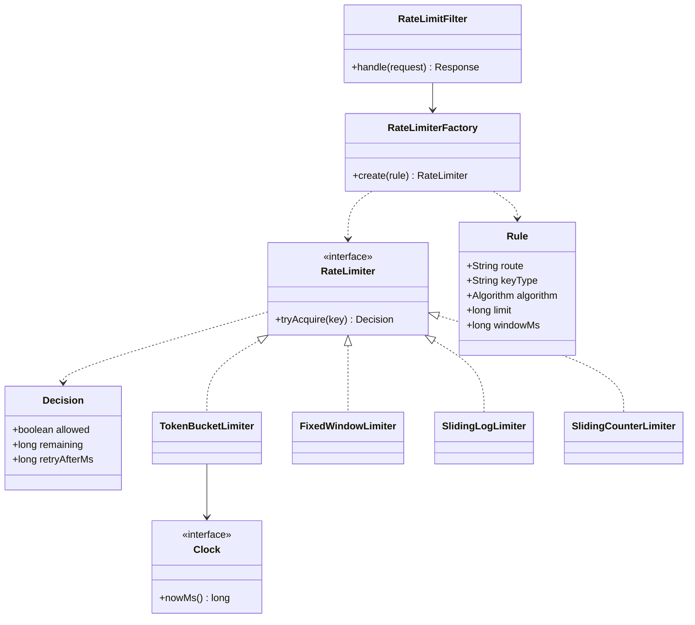

The **Clock** interface is a small touch that interviewers notice: tests can move time forward without `Thread.sleep`.

### Code

```java
import java.util.*;
import java.util.concurrent.ConcurrentHashMap;

record Decision(boolean allowed, long remaining, long retryAfterMs) {}
interface Clock { long nowMs(); }
interface RateLimiter { Decision tryAcquire(String key); }

final class TokenBucketLimiter implements RateLimiter {
    private static final class Bucket { double tokens; long last; Bucket(double t, long l) { tokens = t; last = l; } }
    private final long capacity; private final double refillPerMs; private final Clock clock;
    private final ConcurrentHashMap<String, Bucket> buckets = new ConcurrentHashMap<>();

    TokenBucketLimiter(long capacity, long refillPerSecond, Clock clock) {
        this.capacity = capacity; this.refillPerMs = refillPerSecond / 1000.0; this.clock = clock;
    }

    public Decision tryAcquire(String key) {
        long now = clock.nowMs();
        Bucket b = buckets.computeIfAbsent(key, k -> new Bucket(capacity, now));
        synchronized (b) {                                       // lock one key only
            b.tokens = Math.min(capacity, b.tokens + (now - b.last) * refillPerMs);
            b.last = now;
            if (b.tokens >= 1) { b.tokens -= 1; return new Decision(true, (long) b.tokens, 0); }
            return new Decision(false, 0, (long) Math.ceil((1 - b.tokens) / refillPerMs));
        }
    }
}

final class FixedWindowLimiter implements RateLimiter {
    private final long limit, windowMs; private final Clock clock;
    private final ConcurrentHashMap<String, long[]> counts = new ConcurrentHashMap<>();   // {window, count}
    FixedWindowLimiter(long limit, long windowMs, Clock c) { this.limit = limit; this.windowMs = windowMs; clock = c; }

    public Decision tryAcquire(String key) {
        long now = clock.nowMs(), w = now / windowMs;
        long[] out = new long[2];                                // {allowed 0 or 1, count after}
        counts.compute(key, (k, v) -> {                          // atomic per key
            if (v == null || v[0] != w) v = new long[]{w, 0};
            if (v[1] < limit) { v[1]++; out[0] = 1; }
            out[1] = v[1];
            return v;
        });
        if (out[0] == 1) return new Decision(true, limit - out[1], 0);
        return new Decision(false, 0, (w + 1) * windowMs - now);
    }
}

final class SlidingLogLimiter implements RateLimiter {
    private final long limit, windowMs; private final Clock clock;
    private final ConcurrentHashMap<String, ArrayDeque<Long>> logs = new ConcurrentHashMap<>();
    SlidingLogLimiter(long limit, long windowMs, Clock c) { this.limit = limit; this.windowMs = windowMs; clock = c; }

    public Decision tryAcquire(String key) {
        long now = clock.nowMs();
        ArrayDeque<Long> log = logs.computeIfAbsent(key, k -> new ArrayDeque<>());
        synchronized (log) {
            while (!log.isEmpty() && log.peekFirst() <= now - windowMs) log.pollFirst();
            if (log.size() < limit) { log.addLast(now); return new Decision(true, limit - log.size(), 0); }
            return new Decision(false, 0, log.peekFirst() + windowMs - now);
        }
    }
}

final class SlidingCounterLimiter implements RateLimiter {
    private static final class W { long index, prev, curr; }
    private final long limit, windowMs; private final Clock clock;
    private final ConcurrentHashMap<String, W> state = new ConcurrentHashMap<>();
    SlidingCounterLimiter(long limit, long windowMs, Clock c) { this.limit = limit; this.windowMs = windowMs; clock = c; }

    public Decision tryAcquire(String key) {
        long now = clock.nowMs(), idx = now / windowMs;
        W w = state.computeIfAbsent(key, k -> { W x = new W(); x.index = idx; return x; });
        synchronized (w) {
            if (idx == w.index + 1) { w.prev = w.curr; w.curr = 0; w.index = idx; }
            else if (idx > w.index + 1) { w.prev = 0; w.curr = 0; w.index = idx; }
            double elapsed = (now - idx * windowMs) / (double) windowMs;
            double estimate = w.prev * (1 - elapsed) + w.curr;
            if (estimate < limit) { w.curr++; return new Decision(true, (long) (limit - estimate - 1), 0); }
            return new Decision(false, 0, Math.max(1, (long) ((1 - elapsed) * windowMs)));   // rough hint
        }
    }
}

enum Algorithm { TOKEN_BUCKET, FIXED_WINDOW, SLIDING_LOG, SLIDING_COUNTER }
record Rule(String route, String keyType, Algorithm algorithm, long limit, long windowMs) {}

final class RateLimiterFactory {
    static RateLimiter create(Rule r, Clock c) {
        return switch (r.algorithm()) {
            case TOKEN_BUCKET -> new TokenBucketLimiter(r.limit(), Math.max(1, r.limit() * 1000 / r.windowMs()), c);
            case FIXED_WINDOW -> new FixedWindowLimiter(r.limit(), r.windowMs(), c);
            case SLIDING_LOG -> new SlidingLogLimiter(r.limit(), r.windowMs(), c);
            case SLIDING_COUNTER -> new SlidingCounterLimiter(r.limit(), r.windowMs(), c);
        };
    }
}

/** Middleware: pick the rule for the route, build the key, answer 429 with headers. */
final class RateLimitFilter {
    record Request(String route, String userId, String ip) {}
    record Response(int status, Map<String, String> headers) {}
    private final Map<String, Rule> rules; private final Map<String, RateLimiter> limiters = new ConcurrentHashMap<>();
    private final Clock clock;
    RateLimitFilter(Map<String, Rule> rules, Clock clock) { this.rules = rules; this.clock = clock; }

    Response handle(Request req) {
        Rule rule = rules.get(req.route());
        if (rule == null) return new Response(200, Map.of());
        RateLimiter rl = limiters.computeIfAbsent(req.route(), k -> RateLimiterFactory.create(rule, clock));
        String key = rule.route() + ":" + ("ip".equals(rule.keyType()) ? req.ip() : req.userId());
        Decision d = rl.tryAcquire(key);
        Map<String, String> h = new HashMap<>(Map.of(
                "X-RateLimit-Limit", String.valueOf(rule.limit()),
                "X-RateLimit-Remaining", String.valueOf(d.remaining())));
        if (d.allowed()) return new Response(200, h);
        h.put("Retry-After", String.valueOf((d.retryAfterMs() + 999) / 1000));
        return new Response(429, h);
    }
}
```

**Concurrency.** `computeIfAbsent` creates each key's state exactly once, then a `synchronized` block on *that key's* object makes check-and-update atomic. Different users never contend. A global `synchronized` on `tryAcquire` would be correct but would serialise the whole API. **Memory:** idle keys pile up, so evict state for keys not seen in a few windows (a scheduled sweep, or store state in a size-bounded cache from Q30).

### Distributed version (many API pods)

Per-pod limiters have exactly the Myntra problem: the real limit is per-pod limit × pod count. For a shared limit, keep the state in Redis and make the check-and-update **one atomic Lua script** (two separate commands would race between pods):

```lua
-- Token bucket. KEYS[1]=bucket key  ARGV: capacity, refill_per_ms, now_ms
local b = redis.call('HMGET', KEYS[1], 'tokens', 'ts')
local cap, rate, now = tonumber(ARGV[1]), tonumber(ARGV[2]), tonumber(ARGV[3])
local tokens = tonumber(b[1]) or cap
local ts = tonumber(b[2]) or now
tokens = math.min(cap, tokens + (now - ts) * rate)
local allowed = 0
if tokens >= 1 then tokens = tokens - 1; allowed = 1 end
redis.call('HSET', KEYS[1], 'tokens', tokens, 'ts', now)
redis.call('PEXPIRE', KEYS[1], math.ceil(cap / rate) * 2)
return allowed
```

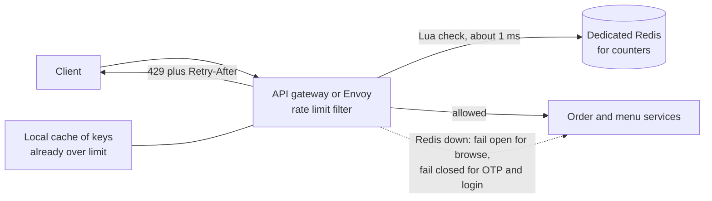

> **Real world — Stripe and GitHub:** Stripe runs four limiters (request rate, concurrent requests, and two load shedders), uses a **token bucket in Redis**, and advises **failing open** if Redis is down and **dark-launching** limiters first ([source](https://stripe.com/blog/rate-limiters)). GitHub moved its limiter off a shared Memcached because cache memory pressure **evicted live rate-limit counters**; the new design uses Redis sharded by key, with **Lua scripts** for atomicity ([source](https://github.blog/2021-04-05-how-we-scaled-github-api-sharded-replicated-rate-limiter-redis/)). Moral: keep limiter counters in their **own** Redis, not the shared cache.

> **Real world — Uber:** At about **80M RPS across 1,100+ services**, Uber concluded a central Redis counter "can't scale to hundreds of millions of RPS". Its Global Rate Limiter enforces locally in the mesh proxy, aggregates usage per zone, and pushes down **drop ratios** every second; it fails open, and removing the Redis hop cut P99.5 latency by up to 90% ([source](https://www.uber.com/blog/ubers-rate-limiting-system/)). Zomato hasn't published its internal rate-limiting design, so present yours as a generic gateway design.

**Follow-ups.**
- *"Leaky vs token bucket?"* Token bucket lets a burst through immediately, up to its capacity, and holds the long-run average. Leaky bucket queues requests and lets them out at a fixed rate, so the downstream sees a smooth flow but requests wait. Use leaky bucket in front of something that can't take bursts (an SMS provider with a hard TPS).
- *"Where do you put it?"* At the edge or gateway, keyed by IP or API key for abuse (OTP spam, coupon scraping); per user for fairness; and service-to-service as load shedding, which protects you from overload rather than from abuse.
- *"Which key for logged-out users?"* IP, with care: many users share one carrier NAT IP in India, so set IP limits generously and use device ID or a stricter per-phone-number limit for OTP.
- *"Clock skew across pods?"* Use the Redis server's clock (`TIME`) inside the script instead of each pod's clock.
- *"Handle a DDoS?"* (Z4's interviewer wasn't convinced by "rate limiting".) A limiter in your app is the last line. A real DDoS is absorbed upstream: CDN/WAF scrubbing, per-IP limits at the edge, challenge pages, autoscaling the edge, and load shedding by priority so checkout survives while browse degrades.

## Q32. Notification service LLD (Observer + Factory, channel strategies, retry)

The **most repeated single HLD in the group** is the notification system: Zomato asked it twice to the same candidate, the second time adding team-level cooldowns and "how other teams integrate" ([Z2](https://leetcode.com/discuss/post/8377019/), [Z3](https://leetcode.com/discuss/post/8385519/)); District asked push/SMS/email with no duplicates plus a Kafka deep dive ([Z13](https://leetcode.com/discuss/post/7617100/)); Blinkit asked it on draw.io with UML ([B1](https://leetcode.com/discuss/post/8514070/)); and a Zomato HLD twist was "notify users when a restaurant reopens, **only if delivery partners are available in that area**" ([Z29](https://www.geeksforgeeks.org/interview-experiences/zomato-interview-experience-for-sde1-1-year-experienced/)). The LLD-with-code version was asked at Swiggy, where the candidate blanked ([S3](https://leetcode.com/discuss/post/7389374/)). This section is the class-level design; the HLD version lives earlier in this sheet.

### Requirements

- Other services trigger notifications by **publishing domain events** (`OrderPlaced`, `RiderArriving`) or calling an API with a template ID.
- Channels: push, SMS, email, WhatsApp. One notification can go to one channel or several, with fallback (push failed → SMS).
- **No duplicates**, even when an event is delivered twice.
- **Cooldowns:** per user (max 3 promos a day) and per sending team (Marketing can't send more than N an hour).
- **Retries** with backoff for temporary failures; give up and dead-letter after a few attempts.
- **Priority:** "your rider is here" must never wait behind a promo blast.
- User preferences (opted out of promotional SMS) and quiet hours.

### Where the patterns go

- **Observer:** services publish events; a `NotificationListener` subscribes. The order service doesn't know notifications exist, so adding "send a WhatsApp on delivery" doesn't touch it.
- **Factory:** `ChannelSenderFactory.get(Channel)` returns the right sender; adding WhatsApp is one new class registered in the factory.
- **Strategy:** provider routing inside a channel (pick the SMS vendor by cost and recent success rate, the Zomato intern's mini-design [Z30](https://partik-malasi-05.medium.com/my-zomato-sde-intern-interview-experience-off-campus-a798d2c867f0)), and the retry policy.
- **Template Method / templates:** rendering "Hi {name}, your order from {restaurant} is on the way" per channel and language.

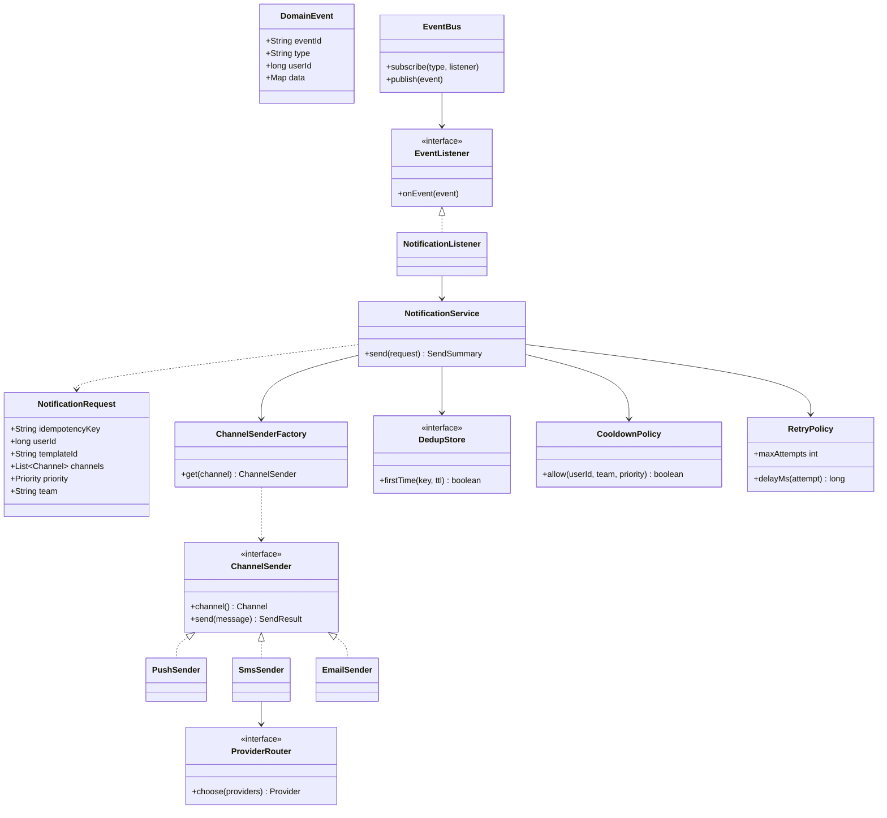

### Code (core classes)

```java
import java.util.*;
import java.util.concurrent.*;

enum Channel { PUSH, SMS, EMAIL, WHATSAPP }
enum Priority { TRANSACTIONAL, PROMOTIONAL }

record DomainEvent(String eventId, String type, long userId, Map<String, String> data) {}
record NotificationRequest(String idempotencyKey, long userId, String templateId, List<Channel> channels,
                           Priority priority, String team, Map<String, String> params) {}
record Message(String notificationId, long userId, Channel channel, String body, int attempt) {}
record SendResult(boolean ok, boolean retryable, String error) {}

/* ---------- Observer ---------- */
interface EventListener { void onEvent(DomainEvent e); }
final class EventBus {                                   // in production this is Kafka; same contract
    private final Map<String, List<EventListener>> subs = new ConcurrentHashMap<>();
    void subscribe(String type, EventListener l) { subs.computeIfAbsent(type, k -> new CopyOnWriteArrayList<>()).add(l); }
    void publish(DomainEvent e) { subs.getOrDefault(e.type(), List.of()).forEach(l -> l.onEvent(e)); }
}

final class NotificationListener implements EventListener {
    private final NotificationService service;
    NotificationListener(NotificationService s) { service = s; }
    public void onEvent(DomainEvent e) {
        switch (e.type()) {
            case "RIDER_ARRIVING" -> service.send(new NotificationRequest(
                    e.eventId() + ":push", e.userId(), "rider_arriving", List.of(Channel.PUSH, Channel.SMS),
                    Priority.TRANSACTIONAL, "logistics", e.data()));
            case "ORDER_DELIVERED" -> service.send(new NotificationRequest(
                    e.eventId() + ":rate", e.userId(), "rate_order", List.of(Channel.PUSH),
                    Priority.PROMOTIONAL, "growth", e.data()));
            default -> { }
        }
    }
}

/* ---------- Factory ---------- */
interface ChannelSender { Channel channel(); SendResult send(Message m); }
final class ChannelSenderFactory {
    private final Map<Channel, ChannelSender> senders = new EnumMap<>(Channel.class);
    ChannelSenderFactory(List<ChannelSender> all) { all.forEach(s -> senders.put(s.channel(), s)); }
    ChannelSender get(Channel c) {
        ChannelSender s = senders.get(c);
        if (s == null) throw new IllegalArgumentException("no sender for " + c);
        return s;
    }
}

/* ---------- Strategy: SMS provider routing ---------- */
record Provider(String name, long costPaise, double recentSuccessRate) {}
interface ProviderRouter { Provider choose(List<Provider> providers); }
final class BestValueRouter implements ProviderRouter {      // cheapest among providers above 95 percent success
    public Provider choose(List<Provider> ps) {
        return ps.stream().filter(p -> p.recentSuccessRate() >= 0.95)
                 .min(Comparator.comparingLong(Provider::costPaise))
                 .orElse(ps.stream().max(Comparator.comparingDouble(Provider::recentSuccessRate)).orElseThrow());
    }
}

/* ---------- Dedupe, cooldown, retry ---------- */
interface DedupStore { boolean firstTime(String key, long ttlMs); }   // Redis: SET key 1 NX PX ttl
interface UserPrefs { boolean allowed(long userId, Channel c, Priority p); }
interface TemplateRenderer { String render(String templateId, Channel c, Map<String, String> params); }
interface RetryScheduler { void scheduleRetry(Message m, ChannelSender s, long delayMs); }   // delay topic or ZSET
interface DeadLetter { void park(Message m, String error); }

final class CooldownPolicy {
    private final FrequencyCap perUser, perTeam;                // reuse Q24 caps
    CooldownPolicy(FrequencyCap perUser, FrequencyCap perTeam) { this.perUser = perUser; this.perTeam = perTeam; }
    boolean allow(NotificationRequest r, long now) {
        if (r.priority() == Priority.TRANSACTIONAL) return true;    // never throttle "rider arriving"
        return perUser.canShow("promo", String.valueOf(r.userId()), now) && perTeam.canShow("team", r.team(), now);
    }
    void record(NotificationRequest r, long now) {
        if (r.priority() == Priority.TRANSACTIONAL) return;
        perUser.record("promo", String.valueOf(r.userId()), r.idempotencyKey() + ":u", now);
        perTeam.record("team", r.team(), r.idempotencyKey() + ":t", now);
    }
}

final class RetryPolicy {
    final int maxAttempts; final long baseMs, capMs;
    RetryPolicy(int max, long base, long cap) { maxAttempts = max; baseMs = base; capMs = cap; }
    long delayMs(int attempt) {                                  // exponential backoff with full jitter
        long exp = Math.min(capMs, baseMs * (1L << Math.min(attempt, 20)));
        return ThreadLocalRandom.current().nextLong(exp + 1);
    }
}

record SendSummary(String status, List<Channel> sentOn) {}

final class NotificationService {
    private final DedupStore dedup; private final CooldownPolicy cooldown; private final UserPrefs prefs;
    private final TemplateRenderer templates; private final ChannelSenderFactory factory;
    private final RetryPolicy retry; private final RetryScheduler scheduler; private final DeadLetter dlq;

    NotificationService(DedupStore d, CooldownPolicy c, UserPrefs p, TemplateRenderer t, ChannelSenderFactory f,
                        RetryPolicy r, RetryScheduler s, DeadLetter q) {
        dedup = d; cooldown = c; prefs = p; templates = t; factory = f; retry = r; scheduler = s; dlq = q;
    }

    SendSummary send(NotificationRequest r) {
        long now = System.currentTimeMillis();
        if (!dedup.firstTime(r.idempotencyKey(), TimeUnit.DAYS.toMillis(1))) return new SendSummary("DUPLICATE", List.of());
        if (!cooldown.allow(r, now)) return new SendSummary("COOLDOWN", List.of());
        List<Channel> sent = new ArrayList<>();
        for (Channel c : r.channels()) {                         // ordered: first that works wins (fallback)
            if (!prefs.allowed(r.userId(), c, r.priority())) continue;
            Message m = new Message(r.idempotencyKey() + ":" + c, r.userId(), c,
                                    templates.render(r.templateId(), c, r.params()), 0);
            if (attempt(factory.get(c), m)) { sent.add(c); break; }
        }
        if (!sent.isEmpty()) cooldown.record(r, now);
        return new SendSummary(sent.isEmpty() ? "QUEUED_FOR_RETRY_OR_FAILED" : "SENT", sent);
    }

    /** Called first by send(), later by the retry consumer. */
    boolean attempt(ChannelSender s, Message m) {
        SendResult res;
        try { res = s.send(m); } catch (RuntimeException ex) { res = new SendResult(false, true, ex.getMessage()); }
        if (res.ok()) return true;
        if (res.retryable() && m.attempt() + 1 < retry.maxAttempts)
            scheduler.scheduleRetry(new Message(m.notificationId(), m.userId(), m.channel(), m.body(), m.attempt() + 1),
                                    s, retry.delayMs(m.attempt()));
        else dlq.park(m, res.error());
        return false;
    }
}
```

**Two details worth pointing at in the code.** (1) The **retry is scheduled, never slept**: `Thread.sleep` in a worker holds a thread hostage and loses the retry if the pod dies. Put it on a delay topic or a Redis sorted set keyed by due time (the fix for the Myntra instant-retry weakness). (2) The **dedupe key is derived from the event ID**, so Kafka redelivering `RIDER_ARRIVING` produces the same key and the second one is dropped. The provider message ID is also passed as `notificationId`, so a provider that supports idempotency won't double-send on a retry.

### Concurrency and failure notes

- **Dedupe must be atomic.** "Check if sent, then send, then mark sent" lets two consumers both pass the check. `SET key NX` (or a DB insert on a unique key) claims the key in one step. The catch: if you claim and then crash before sending, the notification is lost. For transactional messages, store state instead (below) so a sweeper finds stuck rows.
- **Per-user ordering** (don't show "delivered" before "picked up"): partition the Kafka topic by `user_id` or `order_id`, and use **collapse keys** so a newer status replaces the older one on the device.
- **Priority lanes:** separate topics and worker pools for TRANSACTIONAL and PROMOTIONAL, so a 10M-user promo can't delay OTPs.
- **Provider outage:** circuit breaker per provider; the router skips open breakers; SMS falls back to a second vendor.

```mermaid
stateDiagram-v2
    [*] --> CREATED
    CREATED --> SUPPRESSED: duplicate or cooldown or opted out
    CREATED --> QUEUED: accepted
    QUEUED --> SENT: provider accepted
    QUEUED --> RETRY_WAIT: temporary failure
    RETRY_WAIT --> QUEUED: delay elapsed
    RETRY_WAIT --> DEAD_LETTER: max attempts
    QUEUED --> DEAD_LETTER: permanent failure
    SENT --> DELIVERED: delivery receipt
    SENT --> FAILED: bounce or invalid token
    SUPPRESSED --> [*]
    DELIVERED --> [*]
    FAILED --> [*]
    DEAD_LETTER --> [*]
```

```sql
CREATE TABLE notifications (
  id               BIGINT PRIMARY KEY,
  idempotency_key  VARCHAR(120) NOT NULL UNIQUE,   -- the dedupe guarantee lives here
  user_id          BIGINT NOT NULL,
  team             VARCHAR(40) NOT NULL,
  template_id      VARCHAR(60) NOT NULL,
  channel          ENUM('PUSH','SMS','EMAIL','WHATSAPP') NOT NULL,
  priority         ENUM('TRANSACTIONAL','PROMOTIONAL') NOT NULL,
  status           VARCHAR(20) NOT NULL,
  attempts         INT NOT NULL DEFAULT 0,
  next_attempt_at  DATETIME NULL,
  provider         VARCHAR(40), provider_msg_id VARCHAR(120),
  created_at       DATETIME NOT NULL,
  INDEX idx_notif_user_time (user_id, created_at),
  INDEX idx_notif_retry (status, next_attempt_at)    -- sweeper: stuck QUEUED or RETRY_WAIT rows
);
CREATE TABLE user_channel_prefs (
  user_id BIGINT NOT NULL, channel VARCHAR(10) NOT NULL, promo_opt_in BOOLEAN NOT NULL,
  quiet_from SMALLINT, quiet_to SMALLINT, PRIMARY KEY (user_id, channel)
);
```

```mermaid
sequenceDiagram
    participant OS as Order service
    participant K as Kafka
    participant NL as Notification listener
    participant NS as Notification service
    participant R as Redis dedupe and caps
    participant P as Push provider
    OS->>K: OrderEvent RIDER_ARRIVING, key order_id
    K->>NL: deliver, maybe twice
    NL->>NS: send request, key eventId plus push
    NS->>R: SET key NX
    R-->>NS: OK first time
    NS->>P: send with collapse key order_id
    P-->>NS: 503 temporary
    NS->>K: retry topic, delay 2 s with jitter
    K->>NS: retry attempt 1
    NS->>P: send again
    P-->>NS: 200 accepted
```

> **Real world — Swiggy, LinkedIn, Razorpay:** Swiggy's **Kabootar** platform passes messages through event, campaign, templating and router services, and keeps a **persisted state machine per message** so stuck ones can be reprocessed, with retries and fallback templates (search snippet) ([source](https://bytes.swiggy.com/kabootar-swiggys-communication-platform-e5a43cc25629)). LinkedIn's **Air Traffic Controller** is the single decision maker for channel selection, aggregation, delivery-time optimisation and **dedupe**, which it needs because its stream processor replays requests after a restart; it also **rate-limits upstream apps** ([source](https://www.linkedin.com/blog/engineering/messaging-notifications/air-traffic-controller-member-first-notifications-at-linkedin)). Razorpay's notification service hit bottlenecks from DB inserts and **a single queue for all request types**; per secondary write-ups, the fix added P0/P1 queues and a separate retry queue ([source](https://engineering.razorpay.com/how-razorpays-notification-service-handles-increasing-load-f787623a490f)).

> **Real world — FCM, APNs, DoorDash:** FCM's default quota is **600k messages/min per project** ([source](https://firebase.google.com/docs/cloud-messaging/throttling-and-quotas)), so a 10M-user blast takes at least about 17 minutes; stagger it. APNs stores only **one** notification per app for an offline device and supports a collapse ID ([source](https://developer.apple.com/documentation/usernotifications/sending-notification-requests-to-apns)). DoorDash found its default dedupe only **hid duplicates in the UI** while users still got identical pushes (search snippet) ([source](https://careersatdoordash.com/blog/part-3-doordash-2025-summer-intern-projects/)). Zomato hasn't published its notification architecture, so don't attribute one to it.

**Follow-ups.**
- *"How do other teams integrate?"* (Z3.) Two doors: publish a domain event the platform subscribes to, or call `POST /v1/notifications` with `{idempotency_key, user_id, template_id, channels, priority, params}` and get `202` plus a notification ID. Teams own templates; the platform owns delivery, dedupe, caps and preferences. Each team gets a quota (the team-level cooldown) so one team can't spam everybody.
- *"Notify only if riders are available in that area"* (Z29). Add a pre-send **eligibility check** (Chain of Responsibility: dedupe → preferences → cooldown → business rule). The rule asks the logistics service for rider supply in the user's cell; for millions of users, batch by cell (one supply lookup per cell, not per user) and release notifications cell by cell as supply allows.
- *"Kafka or direct API calls between services?"* (B1.) Kafka for events: the order service doesn't wait for notifications, a notification outage doesn't break ordering, and events can be replayed. A direct API for "send this OTP now", where the caller needs an answer.
- *"Exactly once?"* Not end to end; the provider is an external side effect. At-least-once delivery plus an idempotency key gives exactly-once *effect* for your side, and collapse keys hide the rare duplicate on the device.

---

## Rapid fire: 60 follow-ups and traps

**Databases and SQL**

1. **Q: Assume infinite money. Why not replace the database with a cache?** A: Money buys RAM, not durability, querying or transactions. RAM is lost on crash and async replication drops recent writes; a KV store has no joins, secondary indexes or ad-hoc SQL; no multi-row ACID or constraints; and a cache is allowed to evict. A cache is a rebuildable copy, so the source of truth has to live elsewhere ([B12](https://leetcode.com/discuss/post/7083108/)).
2. **Q: What if we use only Redis and no database?** A: Fine for ephemeral data (sessions, rate-limit counters, live rider location). For orders and payments you'd lose data on failover (async replication), you'd have only key lookups, and AOF fsync-every-write makes it slow. Use Redis in front of a DB, not instead of one ([B3](https://leetcode.com/discuss/post/8331559/)).
3. **Q: Separate indexes on A and B, or one composite (A, B), for `WHERE A=10 AND B=20`?** A: Composite. It jumps straight to the (10, 20) entries. With two separate indexes the DB either uses the more selective one and filters the rest row by row, or merges both lists (MySQL's index merge), which is slower ([Z9](https://leetcode.com/discuss/post/6023375/)).
4. **Q: Will the composite (A, B) help `WHERE B = 20`?** A: No. The **left-prefix rule**: (A, B) is sorted by A first, so it helps queries on A, or A and B, but not B alone. Put the equality columns first and the range column last.
5. **Q: When does an index hurt?** A: Every insert or update must also update each index (slower writes, more disk); low-selectivity columns (a boolean) rarely get used; too many indexes confuse the planner and waste memory.
6. **Q: Clustered vs non-clustered index?** A: In InnoDB the table *is* the primary-key B+ tree (clustered), with rows stored in PK order. Secondary indexes store the PK, so a lookup through them does a second lookup in the clustered index, unless the index **covers** every column the query needs.
7. **Q: Why MySQL and not PostgreSQL?** A: If you haven't run both in production, say so: "I don't have enough real-world exposure to make that trade-off confidently; I used MySQL because the team did." A candidate was rejected partly for over-explaining this ([Z2](https://leetcode.com/discuss/post/8377019/)). Then you may add the textbook points: Postgres has richer types (JSONB, arrays), PostGIS and more index types; MySQL/InnoDB is simple to operate and very common for read-heavy OLTP, and Zomato runs Aurora MySQL.
8. **Q: Orders are read-heavy. Isn't NoSQL better? Can't SQL scale?** A: SQL can scale reads with replicas and caching, and writes by sharding on user or order ID. Pick NoSQL when the access pattern is a known key lookup at huge write volume and you can live without joins (Zomato's billing ledger moved to DynamoDB) ([B10](https://leetcode.com/discuss/post/4630366/)).
9. **Q: Nearby restaurants in SQL?** A: A bounding box on `lat`/`lng` indexes is not enough, and the interviewer said so ([Z5](https://leetcode.com/discuss/post/7407389/)). Use a geo index: PostGIS `ST_DWithin(geog, point, 5000)` on a GiST index, MySQL spatial `POINT` with an R-tree `SPATIAL INDEX`, or a geohash/H3 cell column with a B-tree index (query the cell and its neighbours, then filter by exact distance). Delivery uses road distance and rider capacity on top.
10. **Q: Offset vs cursor pagination?** A: `OFFSET 100000` scans and throws away 100k rows, and rows shift when new ones arrive. A cursor (keyset) remembers the last `(created_at, id)` and asks `WHERE (created_at, id) < (?, ?) ORDER BY created_at DESC, id DESC LIMIT 20`, using a composite index. Constant cost, stable pages ([Z15](https://leetcode.com/discuss/post/8559623/)).
11. **Q: Paginate a history that comes from three independent tables?** A: Query each table with the same cursor condition and `LIMIT n`, merge the three sorted lists in the app (a k-way merge) or with `UNION ALL ... ORDER BY ... LIMIT n` if they share a DB, and return the smallest n plus a cursor of the last `(created_at, source, id)`. Better at scale: one denormalised `user_transactions` read table fed by CDC.
12. **Q: "What other pagination is there besides offset and cursor?"** A: Page-number (which is offset underneath), time-range ("since" / "until" parameters), and seek by ID ranges. The District candidate was asked this exact trap.
13. **Q: How can a DB make the app slow?** A: Missing indexes (full scans), N+1 queries, lock waits on hot rows, long transactions, exhausted connection pools (requests queue for a connection), and replica lag sending users stale reads. Check with `EXPLAIN ANALYZE` and slow-query logs ([Z1](https://leetcode.com/discuss/post/8434690/)).
14. **Q: What does connection pooling buy?** A: Opening a DB connection costs a TCP + TLS + auth handshake and server memory. A pool keeps, say, 20 open connections per pod and lends them out. Size it so pods × pool size stays under the DB's max connections.
15. **Q: You see a DB spike on a graph. How do you flatten it without scaling up or adding latency?** A: Find the query (slow log, top queries by time). Typical causes: a cron or batch job at :00, a cache expiring for many keys at once, a retry storm. Fixes: spread jobs with jitter, stagger TTLs, single-flight cache rebuilds, batch writes, move the batch to a replica ([Z3](https://leetcode.com/discuss/post/8385519/)).
16. **Q: DynamoDB partition key and sort key for a rider onboarding table?** A: PK `rider_id`, SK `doc#<type>` or `step#<n>` so one query fetches everything for a rider; a GSI on `status` (sparse: only riders `PENDING_VERIFICATION`) for the ops queue. Avoid low-cardinality partition keys like `city`, which become hot partitions ([B4](https://leetcode.com/discuss/post/6207331/)).
17. **Q: MongoDB compound index and a query?** A: `db.messages.createIndex({chatId: 1, sentAt: -1})`, then `db.messages.find({chatId: "c1"}).sort({sentAt: -1}).limit(50)`. The left-prefix rule applies, as in SQL ([Z5](https://leetcode.com/discuss/post/7407389/)).
18. **Q: Multi-tenant database designs?** A: (1) Shared tables with a `tenant_id` column: cheapest, but noisy neighbours and a missed `WHERE tenant_id` leaks data. (2) Schema per tenant: better isolation, migrations multiply. (3) Database per tenant: strongest isolation, highest cost; good for big enterprise customers ([Z27](https://igreaper.medium.com/my-zomato-sde-1-interview-experience-5-rounds-self-doubt-and-a-moment-ill-never-forget-eaa8a6fb49e4)).

**Caching and Redis**

19. **Q: Why is Redis fast, and how does it scale if single-threaded?** A: In memory, simple data structures, one thread so no locks, and an event loop for many connections. It scales out with Redis Cluster (16,384 slots across shards) and read replicas ([Z12](https://leetcode.com/discuss/post/7573378/)).
20. **Q: Hot key (celebrity problem)?** A: Local in-process cache for a few seconds, key splitting across shards, replicas for reads, request coalescing.
21. **Q: Thundering herd?** A: Single-flight or leases (one rebuilder per key), stale-while-revalidate, jittered TTLs, early probabilistic refresh, warmup before launch. Facebook's leases cut peak DB load from 17K/s to 1.3K/s ([source](https://www.usenix.org/system/files/conference/nsdi13/nsdi13-final170_update.pdf)).
22. **Q: Cache penetration (lookups for keys that don't exist)?** A: Cache the "not found" result with a short TTL, or put a Bloom filter in front that says "definitely not present".
23. **Q: On a write, update the cache or delete it?** A: Delete. Two concurrent writers updating the cache can leave the older value last; a delete is idempotent and the next read refills from the DB (Facebook's rule).
24. **Q: Does your API hit the cache or the DB first, and why a TTL?** A: Cache first (cache-aside). The TTL bounds how long a missed invalidation can serve stale data; it's a safety net, not the main freshness mechanism ([B10](https://leetcode.com/discuss/post/4630366/)).
25. **Q: Two caches showing different values for the same thing?** A: They're refreshed by different triggers. Make every copy subscribe to the same change event, which is the Myntra reviews-vs-ratings bug.
26. **Q: Plain hashing vs consistent hashing, step by step?** A: `hash % N` with N going 4 → 5 moves about 80% of keys. On a ring with virtual nodes, adding a node moves only the keys in its new arcs, about 1/N, and a dead node's load spreads across many servers ([Z19](https://leetcode.com/discuss/post/3384363/)).

**Messaging and async**

27. **Q: Why asynchronous? What problem does it solve?** A: The caller doesn't wait for slow side effects, spikes queue up instead of crashing services, a downstream outage doesn't fail the user's request, and consumers scale independently ([B2](https://leetcode.com/discuss/post/8515131/)).
28. **Q: What happens if the consumer is down?** A: Kafka keeps the messages (retention), and the consumer resumes from its committed offset when it returns. Lag grows meanwhile, so alert on lag and on the age of the oldest message.
29. **Q: How do you handle duplicate events?** A: Assume at-least-once. Make consumers idempotent: a processed-event-ID table with a unique key, upserts, or conditional state transitions (`WHERE status = 'CONFIRMED'`) so a repeat is a no-op.
30. **Q: Consumption lags production. What do you do?** A: Add consumers up to the partition count; add partitions (plan ahead, since it changes key-to-partition mapping); batch processing and DB writes; move slow work (external calls) off the hot path; check for one hot partition from a skewed key ([Z12](https://leetcode.com/discuss/post/7573378/)).
31. **Q: Kafka vs SQS vs RabbitMQ?** A: Kafka is a replayable, partitioned log: many consumer groups read the same events, ordered per key, at huge throughput. SQS is a managed job queue: each message is processed by one worker and deleted, with visibility timeouts and DLQs built in, and no replay. RabbitMQ is a broker with flexible routing (exchanges, topics) and per-message acks, good for task queues with complex routing at moderate scale ([Z15](https://leetcode.com/discuss/post/8550229/)).
32. **Q: Kafka vs SNS + SQS, for ordering and replay?** A: Kafka orders within a partition and can replay by resetting offsets. SNS + SQS fans out to many queues but standard queues don't guarantee order (FIFO queues do, per message group, at lower throughput), and once a message is deleted it's gone ([Z4](https://leetcode.com/discuss/post/7609011/)).
33. **Q: Why Kafka instead of just writing events to a DB table that others poll?** A: Polling a table loads the DB and adds latency; Kafka handles fan-out to many consumers, ordering per key, retention and replay. The outbox pattern combines the two: write to a table in the same transaction, then relay to Kafka ([B17](https://medium.com/@utkarsho.dev/blinkit-sde-1-interview-experience-fresher-39ba436055f3)).
34. **Q: Poison message blocking a partition?** A: Retry a few times with backoff, then send it to a DLQ topic and move on; alert, fix, replay. Uber's consumer proxy uses out-of-order commits for the same reason ([source](https://www.uber.com/en-AU/blog/introducing-ufowarder/)).
35. **Q: Is Kafka exactly-once?** A: Only Kafka-to-Kafka (idempotent producer plus transactions). Side effects outside Kafka (a DB write, a push) still need idempotency ([source](https://www.confluent.io/blog/exactly-once-semantics-are-possible-heres-how-apache-kafka-does-it/)).

**APIs, payments, concurrency**

36. **Q: How do you upload a large image or audio file?** A: Not base64 through your API (33% bigger, ties up app servers and memory). The API returns a **pre-signed S3 URL** valid for a few minutes; the client uploads directly to S3; an S3 event triggers processing. The Nugget candidate didn't know this and lost points ([Z5](https://leetcode.com/discuss/post/7407389/), [Z31](https://medium.com/@samarth.bhutani/district-zomato-sde-1-interview-experience-off-campus-56-lpa-ctc-7806143fa708)).
37. **Q: Make a payment API idempotent?** A: The client sends an `Idempotency-Key` header; the server stores key → status and response with a unique constraint on (user, key), on the primary DB. A retry with the same key returns the saved response, a different body with the same key is an error, and the gateway call carries the same key ([source](https://stripe.com/blog/idempotency)).
38. **Q: Payment fails midway (debited, but no confirmation)?** A: Order stays `PAYMENT_PENDING`; the gateway webhook (deduped on event ID) is the source of truth; a poller or reconciler checks pending payments after a few minutes; if money was taken but the order can't be fulfilled, auto-refund ([Z28](https://medium.com/@abhishekworks787/zomato-sde-1-interview-experience-effb60e232fa)).
39. **Q: Two users select the same seat at the same moment?** A: Hold it with a conditional write: `UPDATE seats SET status='HELD', held_by=?, hold_until=NOW()+INTERVAL 10 MINUTE WHERE id=? AND status='AVAILABLE'`. One gets 1 row, the other 0 and sees "just taken". A Redis `SET seat:x user NX PX 600000` can sit in front for speed, but the DB check is the real guarantee ([B3](https://leetcode.com/discuss/post/8331559/)).
40. **Q: Pessimistic vs optimistic locking?** A: Pessimistic (`SELECT ... FOR UPDATE`) locks the row while you work: safe under heavy contention but blocks others. Optimistic reads a `version`, then updates `WHERE version = ?` and retries on conflict: no blocking, good when conflicts are rare. Seats on a hot show: pessimistic or conditional update; profile edits: optimistic.
41. **Q: Why isn't a Redis lock enough on its own?** A: A GC pause or network delay can outlast the lock's TTL, and async replication can lose the lock on failover, so two clients both think they hold it. Use a **fencing token** (a number that only increases) checked by the database, or the DB's own conditional update ([source](https://martin.kleppmann.com/2016/02/08/how-to-do-distributed-locking.html)).
42. **Q: Two threads buy the last unit?** A: `UPDATE stock SET qty = qty - 1 WHERE sku = ? AND qty >= 1`, check rows affected. In memory: `AtomicInteger` with a compare-and-set loop, or a lock per SKU ([F8](https://leetcode.com/discuss/post/8567797/)).
43. **Q: Design a thread-safe queue.** A: An array or linked list with a `ReentrantLock` and two `Condition`s (`notEmpty`, `notFull`): `put` waits while full, `take` waits while empty, each signals the other. That's `ArrayBlockingQueue` ([Z22](https://leetcode.com/discuss/post/4473000/)).
44. **Q: Count orders in the last X minutes (X up to 30)?** A: A ring of 30 one-minute buckets, each with `(minute, count)`; on write, if the bucket's minute is stale reset it; on read, sum buckets whose minute is within X. O(30) per query, constant memory, a lock per bucket or one `ReentrantLock` ([Z7](https://leetcode.com/discuss/post/6493240/)).
45. **Q: Give a deadlock scenario and the fix.** A: Transaction 1 locks order A then payment B; transaction 2 locks B then A. Fix: always lock in a fixed order (smaller ID first), keep transactions short, and use lock timeouts; databases detect deadlocks and kill one transaction ([Z11](https://leetcode.com/discuss/post/6647834/)).
46. **Q: Snake game with O(1) moves?** A: A deque of body cells plus a hash set of occupied cells. Each move pushes the new head and pops the tail (unless food was eaten); collision is a set lookup ([Z12](https://leetcode.com/discuss/post/7573378/)).

**Security**

47. **Q: Someone steals the session ID. How do you stop them? What if they share your IP?** A: HTTPS only, `HttpOnly` + `Secure` + `SameSite` cookies, short session lifetimes, rotate the ID on login and privilege changes. Binding to IP fails behind shared NAT, so bind to a device fingerprint or key instead (device-bound tokens), detect anomalies (new device, impossible travel), and require re-authentication for sensitive actions ([Z9](https://leetcode.com/discuss/post/6023375/)).
48. **Q: How do you revoke a JWT?** A: You can't before expiry, by design. Use short access tokens (around 15 minutes) with refresh tokens checked against the DB, or a deny-list of token IDs in Redis checked per request.
49. **Q: Hashing vs encryption?** A: Hashing is one-way (store passwords as bcrypt/argon2 hashes, with salt). Encryption is two-way with a key (store card tokens or PII you must read back).
50. **Q: QR-code login like WhatsApp Web?** A: The desktop shows a QR containing a random session challenge; the logged-in phone scans it and calls the server to approve that challenge; the desktop, waiting on a WebSocket or long poll, receives a session. Expire challenges in about a minute. For a code that changes every minute, use TOTP: HMAC(secret, floor(time / 60)) ([Z16](https://leetcode.com/discuss/post/7371586/)).

**Architecture and operations**

51. **Q: ALB vs NLB vs Nginx?** A: NLB is L4 (TCP), very fast, static IPs, huge connection counts. ALB is managed L7 (HTTP routing, TLS). Nginx/Envoy is a self-run L7 proxy with full control, used in meshes ([Z27](https://igreaper.medium.com/my-zomato-sde-1-interview-experience-5-rounds-self-doubt-and-a-moment-ill-never-forget-eaa8a6fb49e4)).
52. **Q: Monolith or microservices, and when do you split?** A: Start with a modular monolith. Split a piece out when it needs to scale differently (dispatch), deploy independently (a separate team), or isolate failures (payments). Each service owns its data. Microservices add network calls, retries, distributed debugging and consistency problems ([Z5](https://leetcode.com/discuss/post/7407389/)).
53. **Q: Circuit breaker?** A: Closed (calls flow, failures counted) → open after a threshold (fail fast, return a fallback) → half-open after a cool-down (let a few trial calls through; success closes it). It stops a slow dependency from tying up every thread ([B8](https://leetcode.com/discuss/post/5123971/)).
54. **Q: How do you survive 10x traffic on a known peak like NYE?** A: Pre-scale (autoscaling reacts too slowly), load-test with recorded traffic, warm caches, kill switches and degraded modes for non-critical features, shed load by priority. Zomato does exactly this, and pre-scaled to 11,000 EC2 instances for NYE 2023 ([source](https://www.zomato.com/blog/a-tale-of-scale-behind-the-scenes-at-zomato-tech-for-nye-2023)).
55. **Q: Why are high-cardinality Prometheus labels bad?** A: Each unique label combination is a separate time series. Putting `user_id` or `order_id` in a label creates millions of series and blows up memory. Keep labels to bounded sets (route, status code); put IDs in logs or traces ([Z15](https://leetcode.com/discuss/post/8550229/)).
56. **Q: Your design is too complex. Simplify it.** A: One service, MySQL, Redis and one queue. Add Kafka, shards and more services only where a number forces you to. Interviewers reward this.

**Process traps**

57. **Q: You don't know the answer. What do you say?** A: "I haven't used X in production. Here's how I'd reason about it..." and then reason from first principles. Interviewers accepted this from candidates (Z5, Z9) and penalised bluffing (Z2).
58. **Q: You didn't understand the follow-up.** A: Restate it in your own words ("you're asking what happens if the consumer crashes after writing to the DB but before committing the offset?"). Needing 2–3 iterations to understand a follow-up was itself held against a candidate ([Z2](https://leetcode.com/discuss/post/8377019/)).
59. **Q: The interviewer adds a requirement halfway.** A: That's the test. Say what changes in the schema, the API and the data flow, and what stays. Don't restart the design ([Z15](https://leetcode.com/discuss/post/8559623/)).
60. **Q: Did you use AI tools to build your project?** A: Say so honestly, then prove ownership by explaining every design decision and trade-off without notes. A District candidate blamed messy hand-written code on relying on AI assistance, so practise writing the Q26–Q31 code by hand on paper ([Z15](https://leetcode.com/discuss/post/8559623/)).

---

[← 07b_SD_QA_Payments_Booking_and_More.md](07b_SD_QA_Payments_Booking_and_More.md) · [README →](README.md)
