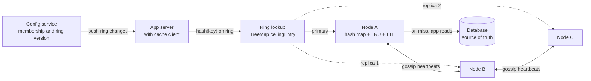
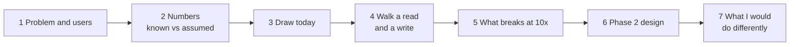
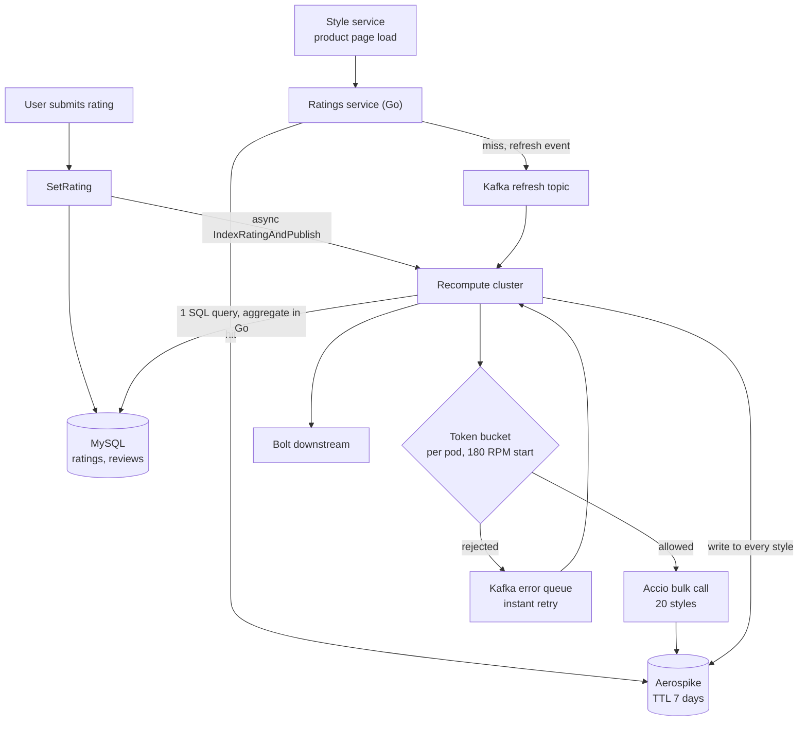
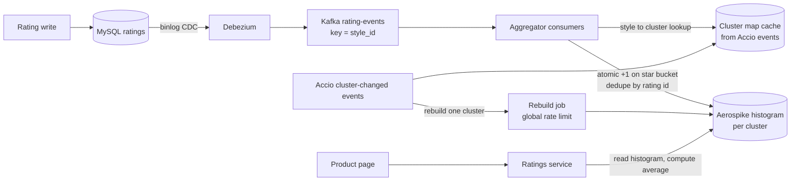
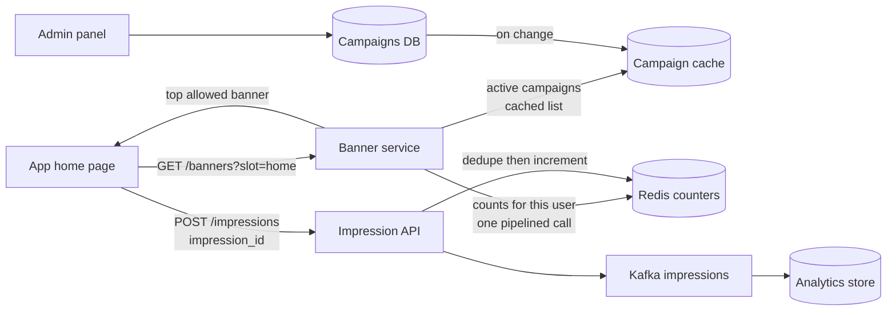
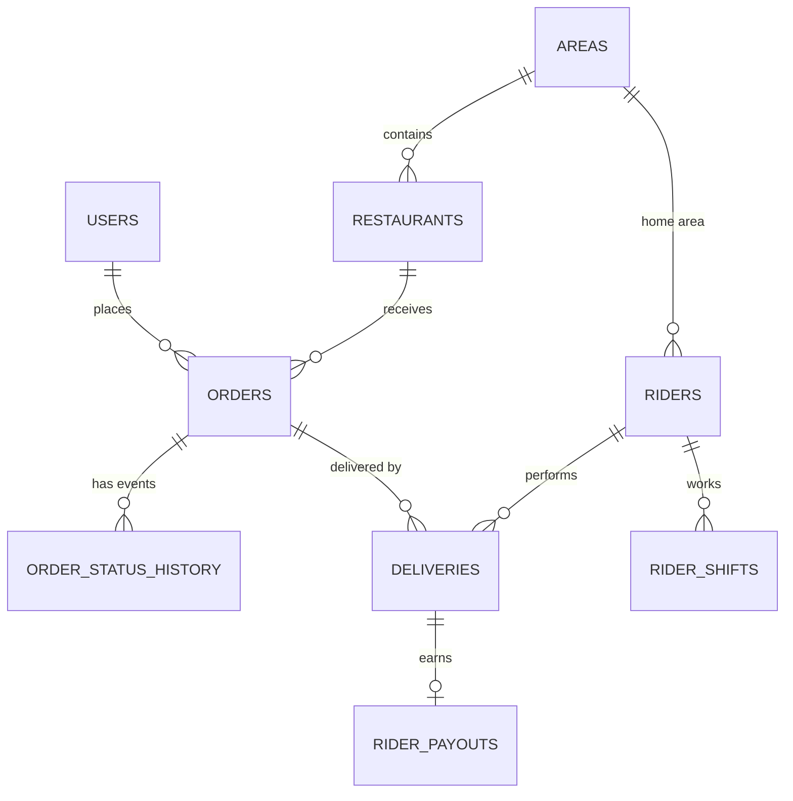
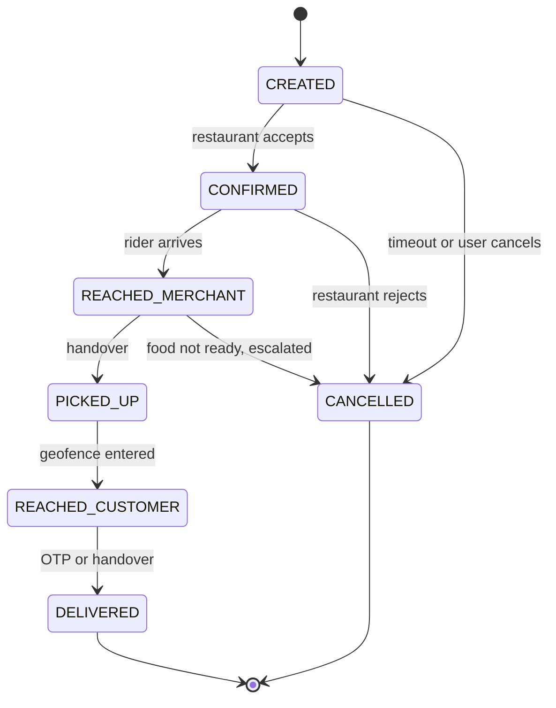
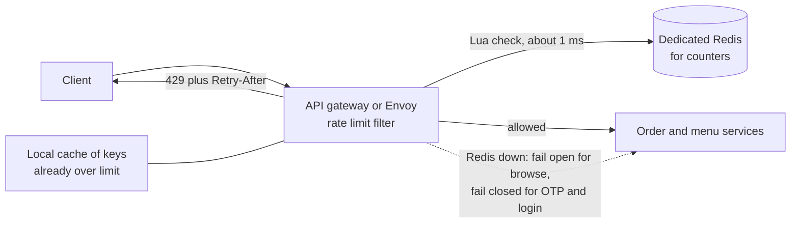
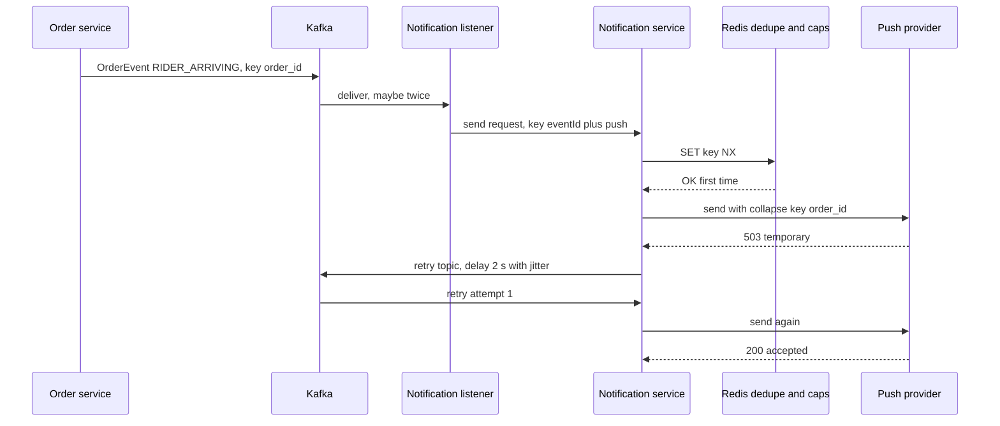

# System Design Solutions — 3. Distributed Cache, Your Projects as HLD, LLD and Rapid Fire (Q21–Q32)

> **Covers:** Distributed cache, your own projects as HLD, LLD with Java code, 40 rapid-fire traps. **Reading time:** about 55 minutes of focused reading (diagrams and code extra).
> Built from research into Zomato's and Eternal's engineering blogs, Swiggy, Blinkit, Zepto, BookMyShow, Uber, DoorDash, Grab, Stripe, Razorpay, Cloudflare and ~100 interview reports. Company facts link to their source; anything not public is marked so — never claim more in the interview.
> Diagrams are Mermaid and render on GitHub. Report IDs like Z2 or B10 refer to `sources/interview_reports.md`; all research notes with links are in `sources/`.

[← 07b_SD_QA_Payments_Booking_and_More.md](07b_SD_QA_Payments_Booking_and_More.md) · [README →](README.md)

---

## Q21. Design a distributed cache / Redis-like key-value store (plus load balancer and consistent hashing)

Asked three ways: a KV store with `addServer`/`removeServer` that redistributes smoothly ([Z30](https://partik-malasi-05.medium.com/my-zomato-sde-intern-interview-experience-off-campus-a798d2c867f0)); plain to consistent hashing ([Z14](https://leetcode.com/discuss/post/8540075/), [Z19](https://leetcode.com/discuss/post/3384363/)); Redis internals ([Z1](https://leetcode.com/discuss/post/8434690/)). Three parts: one node, spreading keys, what sits in front.

> **Real world — Zomato:** On NYE 2023 Zomato's ElastiCache (Redis) fleet held **35 TB**, carried **20 Gbps**, and served **1 billion GETs/min** vs about **100 million SETs/min**. Zomato **injects cache misses on purpose** before NYE to test the databases ([source](https://www.zomato.com/blog/a-tale-of-scale-behind-the-scenes-at-zomato-tech-for-nye-2023)).

**Requirements.** `get`, `set(k, v, ttl)`, `delete`, add/remove server; sub-ms reads; survives a node death; bounded memory; **eventually consistent** is fine for a cache. Numbers (assumed): 1M reads/s, 100k writes/s, 1 KB values, 500M keys ≈ 500 GB; with 2 replicas 1.5 TB, about 25 nodes of 64 GB plus headroom.

### One node: what Redis actually does

A **hash map** in RAM plus:
1. **Eviction.** **LRU** (least recently used) drops the key touched longest ago. Redis approximates it by sampling a few keys and evicting the oldest; it also has **LFU** (least frequently used). Code in Q30.
2. **TTL.** Expired lazily (on read) and actively (a job samples TTL keys).
3. **Single-threaded execution.** One thread: no locks, every command atomic, memory access ~100 ns; an **event loop** (epoll) serves thousands of connections. Catch: one slow `KEYS *` blocks everyone. Scale = many shards (~100k ops/s each).
4. **Persistence (optional).** **RDB** snapshots; **AOF** appends every write to a log.

### Why `hash(key) % N` breaks, and consistent hashing

Going from 4 to 5 nodes, a key stays put only if `h % 4 == h % 5`: **about 80% of keys move**, 80% of reads miss, and the DB falls over.

**Consistent hashing:** bend the hash space into a **ring**, place each server on it, and a key belongs to the first server clockwise. Adding a node takes only the keys in its arc (**about 1/N**); removing one hands its keys to the next node. **Virtual nodes** (100–200 points per server) even out arc sizes, spread a dead server's load over many servers, and allow weighting. **Redis Cluster** uses **16,384 fixed slots** (`CRC16(key) mod 16384`); adding a node moves slots, and a wrong-node client gets a `MOVED` redirect.



```java
TreeMap<Long, String> ring = new TreeMap<>();                      // hash -> server
void addServer(String s) { for (int i = 0; i < V; i++) ring.put(hash(s + "#vn" + i), s); }
String serverFor(String key) {
    Map.Entry<Long, String> e = ring.ceilingEntry(hash(key));      // "walk clockwise"
    return (e != null ? e : ring.firstEntry()).getValue();         // wrap around
}
```

Replicas: keep walking clockwise for the next 1–2 *distinct* servers. The node is a `LinkedHashMap(16, 0.75f, true)` whose `removeEldestEntry` returns `size() > capacity` (LRU for free), plus `expiresAt` per entry and a sweeper. `synchronized` on the node is the honest first version; `get` changes LRU order, so a read lock isn't enough (Q30).

### Replication, failure, smooth `addServer`

- **Replication:** owner plus next 1–2 distinct servers; async copy is fast but can lose the latest write. For stronger guarantees use quorums: N replicas, write waits for W acks, read asks R; **R + W > N** means reads overlap the latest write.
- **Failure detection:** gossip or a config service (ZooKeeper/etcd); missed heartbeats → marked down, ring updated.
- **Smooth add:** new node joins as *joining*, streams its ranges, clients dual-read (new, then old), then the ring version flips. A pure cache can skip the copy and accept ~1/N extra misses if the DB can absorb them; say that trade-off.

### Hot keys and stampedes

- **Hot key** (one viral menu at 8 pm on NYE): local in-process cache for a few seconds, **key splitting** (`menu:42#1..#8`, client picks one), read from replicas.
- **Thundering herd** (hot key expires, 10,000 misses at once): **single-flight** (one rebuilder), serve stale while revalidating, jittered TTLs.

> **Real world — Facebook:** Memcache **leases** (one per key every 10 s) cut peak DB queries from **17K/s to 1.3K/s**; failed servers' traffic goes to a small **gutter pool** instead of rehashing ([source](https://www.usenix.org/system/files/conference/nsdi13/nsdi13-final170_update.pdf)).

### The load balancer in front

- **L4 vs L7.** L4 forwards TCP by IP/port (AWS **NLB**); L7 reads HTTP for path routing, TLS, retries (**ALB**, Nginx, Envoy). For "ALB vs NLB vs Nginx" ([Z27](https://igreaper.medium.com/my-zomato-sde-1-interview-experience-5-rounds-self-doubt-and-a-moment-ill-never-forget-eaa8a6fb49e4)): NLB for raw TCP and static IPs; ALB for managed HTTP routing; Nginx/Envoy when you run the proxy yourself.
- **Algorithms:** round robin, weighted, **least connections**, **consistent hash on a key** (sticky).
- **Health checks** that fail when the server truly can't serve; an active-passive LB pair on a virtual IP (no single point of failure); **connection draining** on deploys. Zomato's internal traffic runs through a **Kuma (Envoy) mesh**, reportedly 500+ microservices (talk abstract only) ([source](https://sessionize.com/arpit-mishra/)).

### Follow-ups

- **Hash map or B+ tree?** Hash map: O(1) point lookups, all a cache needs. B+ tree: O(log n), sorted (range scans), page-friendly on disk.
- **gRPC vs HTTP/1.1 vs HTTP/2?** HTTP/1.1: one request at a time per connection; HTTP/2 multiplexes; gRPC = HTTP/2 + binary Protobuf + generated clients, for internal high-QPS calls.
- **"Infinite money, why not replace the DB with the cache?"** (failed a Blinkit SDE-2, [B12](https://leetcode.com/discuss/post/7083108/)). Money buys RAM, not guarantees: crash and async replication lose writes; no joins, secondary indexes or ad-hoc SQL; no multi-row ACID or constraints; a cache may evict. **Say:** "a cache is a rebuildable copy optimised for reads, so the source of truth must be something else."

---

## Q22. "Turn your own project into an HLD": redesign it, scale it 10x, tell me what breaks

The **most common design question in the Zomato group** (10 of 34 reports): "HLD of a feature you built" ([Z27](https://igreaper.medium.com/my-zomato-sde-1-interview-experience-5-rounds-self-doubt-and-a-moment-ill-never-forget-eaa8a6fb49e4)); "redesign your internship system, monolith vs microservices" ([Z5](https://leetcode.com/discuss/post/7407389/)); full HLD + LLD of a resume system ([Z11](https://leetcode.com/discuss/post/6647834/)); "RabbitMQ vs Kafka, why Postgres" for a fresher's project ([B17](https://medium.com/@utkarsho.dev/blinkit-sde-1-interview-experience-fresher-39ba436055f3)). A Blinkit takeaway: "don't put a system on your resume unless you can sketch its failure modes" ([B15](https://leetcode.com/discuss/post/8359730/)).

### The method (same 7 steps for every project)

1. **Problem and users**, one sentence each.
2. **Numbers:** what you know (5.7M styles, batches of 20, 180 RPM per pod), everything else labelled "assume". Do one line of arithmetic aloud.
3. **Draw today's architecture** in under two minutes.
4. **Walk one read and one write**, naming each hop.
5. **What breaks at 10x?** Component by component: what fails first and what signal you'd watch.
6. **Phase 2:** change only what step 5 forces. Over-engineering is a negative signal at SDE-1.
7. **What I'd do differently**, honestly: name your weaknesses before they find them.

**Timebox it.** Two Blinkit candidates were rejected partly because the project ate the design time ([B12](https://leetcode.com/discuss/post/7083108/), [P14](https://leetcode.com/discuss/post/5806260/)). Give the 2-minute version, then let them choose where to dig.



**The 10x checklist**

| Component | What breaks first | Fix |
|---|---|---|
| Anything per pod (limits, in-memory data) | Totals change as pods scale; pods disagree | Shared store (Redis) or central quota |
| Database | Connections, then writes, then hot rows | Pooling, replicas, batching, then sharding |
| Cache | Cold-start stampede, hot keys, two caches drifting | Single-flight, warmup, one invalidation path |
| Queue / Kafka | Lag, poison messages, retry storms | Partitions and consumers, DLQ, delayed retries |
| External dependency | Its rate limit and latency | Batching, global limiter, timeouts, circuit breaker |

### Worked example A: Myntra aggregated ratings (the one they will pick)

**Today.** The Go ratings service serves ratings from Aerospike. On a miss or new rating it fetches the product's related styles from Accio in bulk batches of 20 (behind a per-pod token bucket starting at 180 requests/minute), caches the set for 7 days, runs one SQL query for the cluster, aggregates in Go, and writes the aggregate to every style; rejected calls go to a Kafka error queue.



**Numbers to say.** 5,710,991 styles / 20 ≈ 285k Accio calls; 180 RPM = 3/s per pod; *assume 10 pods* → 30/s, so a full rebuild ≈ 9,500 s ≈ 2.6 hours. Hence the paced warmup (the 4 ms delay).

**"Scale it 10x. What breaks?"**

1. **The per-pod limiter stops being a limit.** Accio load = limit × pod count; 10 → 60 pods sends 6x the agreed calls. *Fix:* a **global** limiter (Redis token bucket via atomic Lua) or an Accio-side quota; fall back to the per-pod limit if Redis is down.
2. **Instant retries become a retry storm**: rejected work hits the same empty bucket. *Fix:* **delayed retry topics** (`retry-1m`, `retry-10m`), exponential backoff with jitter, max attempts, then a **DLQ** with an alert.
3. **One rejection fails a batch of 20.** *Fix:* re-enqueue only the failed style IDs.
4. **A race in "last writer wins".** R1 reads MySQL at t1, R2 at t2 (newer). If R2 finishes first, R1's *older* aggregate overwrites it and stays wrong until the next rating or TTL. *Fix:* store a version (max rating ID or `updated_at` used) with the aggregate and write only if higher (Aerospike generation check / compare-and-set). **Raise this yourself**; it shows real depth.
5. **MySQL load and hot keys** on a sale-day bestseller. *Fix:* debounce recomputes per cluster, replica reads, a short local cache, or go incremental (below).
6. **Two caches drifting** (your ratings-mismatch bug). *Fix:* one invalidation path; every cache holding a rating subscribes to the same "cluster rating changed" event.

**Phase 2: incremental histograms.** The aggregate is five counters per cluster (1★..5★): a new rating is +1 on one bucket, an edit −1/+1. No re-reading the cluster.



- **CDC**: Debezium reads the binlog, so no event is lost between commit and send (the outbox idea).
- **Idempotent increments**: dedupe on rating ID, or a redelivered +1 inflates counts forever.
- **Accio cluster-changed events** replace TTL guessing; only they trigger rebuilds.
- **Reads stay O(1)** (five numbers); **nightly reconciliation** against MySQL catches counter drift.

> **Real world — Zomato:** Zomato's ads Flink job held **150 GB** of dedup state; losing it reset campaign counters and over-delivered ads. The fix: **emit incremental counts instead of running totals** plus an **hourly reconciliation job**; state fell 99% ([source](https://www.zomato.com/blog/eliminating-bottlenecks-in-real-time-data-streaming-a-zomato-ads-flink-journey/)). Same "increments plus reconciliation" shape: use it as your bridge to Zomato.

**Follow-ups**
- *"Why Aerospike, not Redis?"* "The team's existing cache: index in RAM, data on SSD, cheaper for millions of keys; Redis is all-RAM. I didn't choose it, but I understand why it fits."
- *"Why 20 per batch?"* Accio's team recommended 20–25: at 100 one slow call delays 100 styles.
- *"Why a 7-day TTL?"* A safety net; writes update the cache directly. Shorter TTL = more Accio calls.
- *"Accio down an hour?"* Reads serve cached aggregates; recomputes fail fast (circuit breaker) into the retry topic.
- *"How would you know it's broken?"* Error-queue depth and age, Accio 429s, hit ratio, reconciliation mismatches.
- *"Map it to Zomato?"* Ratings across outlets of one brand: grouping service, cached histograms, event-driven increments, a global limit on the shared dependency.

### Worked example B: Atlassian Marketplace publishing (SQS + workers)

**Today.** Spring Boot API validates, saves `RECEIVED`, sends to SQS, returns **202** with a request ID. Workers check idempotency, call Marketplace APIs, mark `PUBLISHED`, delete the message; a crash makes it reappear after the visibility timeout; repeated failures go to a DLQ. *(Confirm details against what was actually built; the prep notes mark some "check".)*

**What breaks at 10x?**
1. **Downstream APIs, not SQS.** *Fix:* bounded worker pool, client token bucket, autoscale on **queue depth and oldest-message age** within the downstream budget.
2. **Gap between DB insert and SQS send**: crash between them and the request sits `RECEIVED` forever. *Fix:* **transactional outbox**, or a sweeper re-enqueuing rows stuck `RECEIVED` > N minutes.
3. **Duplicates** (at-least-once; death after create, before delete). *Fix:* request-ID check, unique (vendor, app, version), request ID as downstream idempotency key.
4. **Visibility timeout < slow job** → two workers run it. *Fix:* timeout above p99 plus a heartbeat; FIFO with app ID as message group if version order matters.

**Follow-ups:** *Why SQS not Kafka?* SQS is a job queue with per-message retries and DLQ; Kafka is a replayable log for many consumers. *Why not a thread pool in the API?* Work dies with the pod. *Why 202 not 201?* Nothing is created yet.

### Worked example C: TraceX (FastAPI, NetworkX, SQLite → Postgres, JWT, case FSM)

**Today.** Next.js BFF (JWT in httpOnly cookie) → FastAPI: RBAC, case FSM, 6 detectors + XGBoost + LinUCB; SQLAlchemy over SQLite; **NetworkX** graph in memory behind a `GraphStore` interface.

**What breaks at 10x (or "a bank with 50M transactions a day")?**
1. **SQLite has one writer.** *Fix:* Postgres (a config change via SQLAlchemy) with a pool.
2. **NetworkX in memory per process** won't fit or share. *Fix:* swap Neo4j behind `GraphStore`, or a rolling window partitioned by **strongly connected component** (cycles live inside one SCC).
3. **Batch detection too slow.** *Fix:* stream via Kafka; cheap checks per event, cycle search only on touched subgraphs.
4. **Two investigators update one case.** *Fix:* optimistic locking: `UPDATE cases SET status=?, version=version+1 WHERE id=? AND version=?`; 0 rows → 409 Conflict.
5. **Audit hash chain forks** under concurrent appends. *Fix:* one writer, or one chain per case.
6. **JWT can't be revoked for 8 hours.** *Fix:* 15-minute access tokens + DB-checked refresh tokens, or a Redis deny-list.

**Follow-ups:** *Why FastAPI?* The ML and graph code is Python; CPU work scales with processes (GIL). *Why an FSM?* Illegal moves impossible, every move auditable, same shape as a Zomato order (Q26). *Auto-assignment at scale?* `SELECT ... FOR UPDATE SKIP LOCKED` on the least-loaded investigator so two assigners don't collide.

### Worked example D: SupplySenseAI (FastAPI, in-memory, Cloud Run)

**Today.** Next.js dashboard polls FastAPI every 30–60 s; **all data in memory**; calls OpenWeatherMap and GDACS (timeouts, fallbacks, 30/15-minute caches) and Gemini; Cloud Run 0–3 instances.

**Breaks first, even at 2x:** each instance has *its own* data, so refreshes disagree and scale-to-zero loses everything. Say it before they do.

**Phase 2.** (1) **Postgres + PostGIS** as shared truth ("within 50 km of a flood" is an indexed geo query). (2) One **scheduled job** refreshes feeds and recomputes risk only for affected shipments. (3) **Redis** for scores. (4) **SSE** instead of polling. (5) Login plus `tenant_id`. (6) Gemini key in a secret manager. *Weather API down?* Timeout, cached value, rule fallback, circuit breaker.

> **Check yourself:** the one component that breaks first at 10x per project? *(Myntra: per-pod limiter and instant retries against Accio. Atlassian: downstream API, then the DB-to-SQS gap. TraceX: SQLite's single writer and the in-memory graph. SupplySense: per-instance in-memory state.)*

---

**Low-level design and schema questions (Q23 to Q32)**

**Know your round.** Zomato and Blinkit SDE-1 have no formal machine coding: LLD appears as "model this schema", "implement this class" or "write a working API" (Z8, B5, Z15). Swiggy, Flipkart, Meesho, PhonePe run machine coding, where **running code beats pretty UML**: a Swiggy SDE-1 was rejected with a partly working Splitwise ([S1](https://leetcode.com/discuss/post/7278246/)); a Flipkart evaluator "cared more about whether the features were working" ([F4](https://leetcode.com/discuss/post/6667785/)). Every LLD round ends with: **where exactly does the lock go?**

Recipe: (1) requirements and what you'll skip; (2) classes, with an interface on whatever varies; (3) schema + APIs (Zomato) or runnable code with a driver (Swiggy); (4) name the shared state and the lock; (5) "a new coupon type is a new class, not an edit." All code is Java; money is a `long` of **paise**, never `double`.

## Q23. LLD: restaurant menu with customisations (size, crust, toppings)

Asked as a schema in a Zomato SDE-1 round that ended in an offer (the Domino's case, [Z6](https://leetcode.com/discuss/post/7206483/)).

**Requirements.** **Option groups** with min/max picks (Size exactly 1, Toppings 0–5); **prices that depend on another choice** (topping ₹50 Regular, ₹90 Large); **options requiring others** (Cheese Burst only Medium/Large); per-option stock; **reusable groups**; orders **snapshot** choices and prices.

```java
final class Option {
    final long id; final String name; final long priceDeltaPaise;
    volatile boolean available = true;
    final Set<Long> requiresAnyOf;                 // Cheese Burst requires {MEDIUM, LARGE}
    final Map<Long, Long> deltaOverrideIfChosen;   // {LARGE -> 9000}
    long deltaFor(Set<Long> chosen) {
        for (var e : deltaOverrideIfChosen.entrySet()) if (chosen.contains(e.getKey())) return e.getValue();
        return priceDeltaPaise;
    }
}
record OptionGroup(long id, String name, int minSelect, int maxSelect, Map<Long, Option> options) {}

final class PriceCalculator {
    /** selection: groupId -> chosen option ids. Throws if invalid. */
    PricedLine price(MenuItem item, Map<Long, List<Long>> selection) {
        Set<Long> chosen = new HashSet<>(); selection.values().forEach(chosen::addAll);
        long total = item.basePricePaise;
        for (OptionGroup g : item.groups) {
            List<Long> picks = selection.getOrDefault(g.id(), List.of());
            if (picks.size() < g.minSelect() || picks.size() > g.maxSelect()) throw new IllegalArgumentException(g.name());
            for (long oid : picks) {
                Option o = g.options().get(oid);
                if (o == null || !o.available) throw new IllegalArgumentException("option unavailable");
                if (!o.requiresAnyOf.isEmpty() && Collections.disjoint(o.requiresAnyOf, chosen))
                    throw new IllegalArgumentException(o.name + " not allowed with this choice");
                total += o.deltaFor(chosen);
            }
        }
        return new PricedLine(item.id, total, List.copyOf(chosen));
    }
}
```

Also reject unavailable items, unknown groups and duplicate picks. The price is **always recomputed on the server**; a client can send anything.

**Schema (say these tables):** `menu_items(id, restaurant_id, category_id, name, base_price, is_available)`; `option_groups(id, restaurant_id, name, min_select, max_select, CHECK(max >= min))`; `item_option_groups(item_id, group_id, display_order, PK(item_id, group_id))` — the many-to-many that makes groups reusable; `options(id, group_id, name, price_delta, is_available)`; `option_rules(option_id, depends_on_option, rule_type ENUM('REQUIRES','PRICE_OVERRIDE'), override_price)`. Orders **snapshot**: `order_items(order_id, item_id, item_name, qty, unit_price)` and `order_item_options(order_item_id, option_id, option_name, price_delta)` copy names and prices at order time, never just point at the menu.

**The hot read** ("full menu of restaurant 42") is a four-table join, so build **one JSON document per restaurant**, cache it as `menu:42:v{version}`, and bump `menu_version` on every edit so the old key just stops being used.

> **Real world — Zomato:** about **3.5 million distinct dishes** across **150k+ restaurants** monthly ([source](https://www.zomato.com/blog/food-preparation-time/)): read far more than edited.

**Follow-ups.** *Price changed while in cart?* Recompute at checkout; if different, **409 Conflict** with the new price (cart stores `menu_version`). *Topping runs out?* Flip `is_available`, bump menu version. *Nested options (drink, then its size)?* `options.child_group_id`: the **Composite** pattern, validated recursively. *Why not Decorator?* Fine to mention, but the menu is admin-edited data, not code.

## Q24. LLD: show a banner at most X times in Y hours, for Z days

Asked in a Zomato SDE-1 round: "track frequency, enforce limits, reset counters" ([Z6](https://leetcode.com/discuss/post/7206483/)). It's a **rate limiter for impressions**; say so.

**Requirements.** Campaign runs `start_at` to `end_at` (Z days); at most **X views in any Y-hour window** per user; several banners compete for one slot by priority; targeting; count a view when **actually shown**, not fetched.



**Serving reads counters; the app reports the impression and only then is it counted.** Trade-off: two in-flight requests can both be served, so a user may see X+1 (a soft cap, fine for banners; say so). For a paid hard cap, reserve atomically at serve time.

**Fixed vs sliding window.** Fixed buckets (`floor(now / Y)`, `INCR` + `EXPIRE`) allow a **boundary burst**: X=3 per 6 h, three views before 06:00 and three after = 6 in under 3 hours. A **sliding log** (timestamps in a Redis sorted set) is exact, and with X=3 costs just 3 entries per user per banner, so it's right here.

One Lua script on `bv:{banner}:{user}` does it atomically: `ZREMRANGEBYSCORE` (drop entries older than the window), `ZSCORE` (seen this impression ID? return), `ZADD now impression_id`, `PEXPIRE window`, `ZCARD`.

The impression ID as member makes reports **idempotent**; **no reset cron**: TTL deletes idle keys. Java: a `FrequencyCap` interface (`canShow`, `record`), `FixedWindowCap` via atomic `ConcurrentHashMap.compute`, `SlidingLogCap` with a deque per (banner, user) locked individually; campaigns are an immutable list behind a `volatile` field (copy-on-write).

Schema: `banners(slot, priority, start_at, end_at, max_views, window_hours, target_rules JSON, status, INDEX(slot, status, start_at, end_at))`; `banner_impressions(impression_id PK, banner_id, user_id, shown_at, INDEX(banner_id, user_id, shown_at))` for analytics, or an exact SQL window if they forbid Redis (a DB read per page load).

> **Real world — Uber:** push **frequency caps (e.g. 2/day)** and **minimum gaps (e.g. 8 hours)** ([source](https://www.uber.com/en-CA/blog/how-uber-optimizes-push-notifications-using-ml)): the same problem, reused in Q32.

**Follow-ups.** *Two phones?* Key on `user_id`. *Redis down?* Fail open for promos, closed only if over-showing costs money. *Ad pacing* (Nugget: ₹10,000 at ₹10/click must last all day, [Z14](https://leetcode.com/discuss/post/8540075/)): hour-weighted token bucket, unused tokens roll forward.

## Q25. LLD: cart with discounts (Strategy pattern, money in paise)

Swiggy ([S6](https://leetcode.com/discuss/post/7069404/), [S9](https://leetcode.com/discuss/post/6051809/)); Blinkit coupons with a **5-minute payment window** ([B17](https://medium.com/@utkarsho.dev/blinkit-sde-1-interview-experience-fresher-39ba436055f3)).

**Requirements.** One restaurant per cart; bill = subtotal − coupon + delivery + packaging + tax; flat, percent-capped, free-delivery, BOGO discounts; expiry, min-order, first-order, per-user and global limits; recomputed server-side.

**Why paise:** `0.1 + 0.2 = 0.30000000000000004`; errors accumulate and reconciliation never balances. Make rounding explicit: **percent discounts round down**.

```java
interface Discount { long amountOff(Bill bill, Cart cart, Context ctx); }
record FlatOff(long off) implements Discount {
    public long amountOff(Bill b, Cart c, Context x) { return Math.min(off, b.subtotal); } }
record PercentOffCapped(int percent, long cap) implements Discount {
    public long amountOff(Bill b, Cart c, Context x) { return Math.min(Math.floorDiv(b.subtotal * percent, 100), cap); } }
// FreeDelivery returns b.deliveryFee; BuyOneGetOne returns (qty / 2) * unitPrice for its item

interface CouponRule { Optional<String> check(Bill bill, Context ctx); }    // empty = passes
// MinOrderRule, FirstOrderRule, ExpiryRule: each returns a reason string on failure ("add 120 more")
record Coupon(String code, Discount discount, List<CouponRule> rules) {}

final class PricingEngine {
    Bill price(Cart cart, Coupon coupon, Context ctx) {
        Bill b = new Bill();
        b.subtotal = cart.subtotal(); b.deliveryFee = delivery.fee(cart, b); b.packaging = packaging.fee(cart, b);
        if (coupon != null) {
            Optional<String> failed = coupon.rules().stream().map(r -> r.check(b, ctx)).flatMap(Optional::stream).findFirst();
            if (failed.isPresent()) b.notes.add(failed.get());
            else b.couponOff = Math.min(coupon.discount().amountOff(b, cart, ctx), b.subtotal + b.deliveryFee);
        }
        b.tax = Math.floorDiv(Math.max(0, b.subtotal - b.couponOff) * taxBp, 10_000);   // assumed rule
        b.total = b.subtotal + b.deliveryFee + b.packaging + b.tax - b.couponOff;
        return b;
    }
}
```

A new discount ("₹50 off on UPI") is one new class and the engine doesn't change: the **open/closed principle**, the sentence they wait for. "Best offer" = price each eligible coupon, keep the minimum.

Schema: `coupons(code UNIQUE, discount_type, value, max_discount, min_order, valid_from, valid_to, per_user_limit, global_limit, used_count, rules JSON)` and `coupon_redemptions(coupon_id, user_id, order_id, status ENUM('HELD','USED','RELEASED'), held_until, UNIQUE(coupon_id, order_id))`.

**Concurrency traps**
- **First 1,000 users, 5,000 tap Pay:** never read-check-write: `UPDATE coupons SET used_count = used_count + 1 WHERE id = ? AND used_count < global_limit`; 1 row = got it (very hot: Redis `DECR`).
- **Per-user limit, double tap:** a unique key on `(coupon_id, user_id)` rejects the second insert.
- **5-minute window (B17):** insert `HELD` with `held_until = now + 5 min`; success → `USED`; a sweeper runs `UPDATE ... SET status='RELEASED' WHERE id=? AND status='HELD'`, safe against a late success.
- **Inventory:** reserve at create (`WHERE available - reserved >= n`), decrement on payment, release on failure (the Meesho trap, [Meesho](https://leetcode.com/discuss/post/5925685/)).
- **Cart storage:** Redis hash `cart:{userId}` with a TTL plus a `version` so two devices don't overwrite each other.

> **Real world — Zepto:** Draft-Order accepts orders before payment, calls an **idempotent** Create Order on the payment event, and a job **every 5 minutes** settles stuck orders ([source](https://aws.amazon.com/blogs/database/how-zepto-scales-to-millions-of-orders-per-day-using-amazon-dynamodb/)). Same "hold, then confirm or sweep" shape.

**Follow-ups.** *Stack two coupons?* `stackable` flag, fixed order (item offers, cart coupons, payment offers), cap the total. *Notifications?* Order service publishes `OrderPlaced`; the notifier subscribes (Observer); the cart never calls it.

## Q26. Schema: delivery partners and orders, with the SQL they ask you to write

Most-asked schema question: "top 5 delivery partners in an area by order type" ([Z2](https://leetcode.com/discuss/post/8377019/)); "latest state per order in the last hour, excluding delivered; which indexes" ([Z12](https://leetcode.com/discuss/post/7573378/)). One SDE-1 was rejected on an SQL query ([Z23](https://leetcode.com/discuss/post/5007288/)). **Practise these by hand.**



```sql
CREATE TABLE riders (id BIGINT PRIMARY KEY, name VARCHAR(100), phone VARCHAR(15) UNIQUE,
  home_area_id INT NOT NULL REFERENCES areas(id), status ENUM('OFFLINE','IDLE','ON_TRIP') NOT NULL,
  INDEX (home_area_id, status));

CREATE TABLE orders (
  id BIGINT PRIMARY KEY, user_id BIGINT NOT NULL, restaurant_id BIGINT NOT NULL,
  area_id INT NOT NULL,                                    -- denormalised for queries
  order_type ENUM('DELIVERY','TAKEAWAY','SCHEDULED','GOLD') NOT NULL,
  status VARCHAR(30) NOT NULL,                             -- CURRENT status
  total_paise BIGINT NOT NULL, placed_at DATETIME NOT NULL, updated_at DATETIME NOT NULL,
  version INT NOT NULL DEFAULT 0,
  INDEX (user_id, placed_at), INDEX (restaurant_id, placed_at),
  INDEX (status, updated_at), INDEX (area_id, order_type, placed_at));

CREATE TABLE order_status_history (                        -- append-only event log
  id BIGINT PRIMARY KEY AUTO_INCREMENT, order_id BIGINT NOT NULL REFERENCES orders(id),
  status VARCHAR(30) NOT NULL, created_at DATETIME(3) NOT NULL, actor VARCHAR(30) NOT NULL,
  INDEX (created_at), INDEX (order_id, created_at));

CREATE TABLE deliveries (
  id BIGINT PRIMARY KEY, order_id BIGINT NOT NULL, rider_id BIGINT NOT NULL REFERENCES riders(id),
  status ENUM('ASSIGNED','PICKED_UP','DELIVERED','REASSIGNED','CANCELLED') NOT NULL,
  assigned_at DATETIME NOT NULL, picked_up_at DATETIME, delivered_at DATETIME,
  INDEX (rider_id, delivered_at), INDEX (order_id));
-- rider_shifts(rider_id, starts_at, ends_at); rider_payouts(delivery_id UNIQUE, base, distance, incentive, tip)
```

**Say out loud.** `deliveries` is separate (logistics owns it; reassignment marks the old row `REASSIGNED` and adds one, so `order_id` isn't unique). Current status on `orders` plus append-only history, written in **one transaction**. Rider pings go to Redis GEO and Kafka, not MySQL (Zomato hasn't published this; present it as the usual approach).

> **Real world — Zomato:** **Aurora MySQL** hit 610k selects/s and 16,000 write transactions/s at NYE 2023 ([source](https://www.zomato.com/blog/a-tale-of-scale-behind-the-scenes-at-zomato-tech-for-nye-2023)), with changes captured by **Debezium** into Kafka ([source](https://aws.amazon.com/blogs/opensource/how-zomato-boosted-performance-25-and-cut-compute-cost-30-migrating-trino-and-druid-workloads-to-aws-graviton/)).

**Query 1: top 5 riders in an area by order type (Z2)**

```sql
SELECT d.rider_id, r.name, COUNT(*) AS orders_done
FROM orders o
JOIN deliveries d ON d.order_id = o.id AND d.status = 'DELIVERED'
JOIN riders r     ON r.id = d.rider_id
WHERE o.area_id = :area_id AND o.order_type = :order_type
  AND o.placed_at >= :from_ts                 -- always bound the time range
GROUP BY d.rider_id, r.name
ORDER BY orders_done DESC, d.rider_id         -- deterministic tie-break
LIMIT 5;
```

Join `deliveries` so reassigned orders count for whoever delivered. Index `orders(area_id, order_type, placed_at)`. **Ties:** wrap counts in a CTE and filter `DENSE_RANK() OVER (ORDER BY n DESC) <= 5`. **Every area:** `ROW_NUMBER() OVER (PARTITION BY area_id ORDER BY n DESC)`. **At scale:** a stream job maintains `rider_daily_stats(rider_id, area_id, order_type, day, delivered_count)`.

**Query 2: average delivery time** — `AVG(TIMESTAMPDIFF(SECOND, placed_at, delivered_at))/60 ... GROUP BY restaurant_id HAVING COUNT(*) >= 20`. **Say unprompted:** averages hide bad experiences; watch **p90/p95** (`PERCENTILE_CONT` in Postgres).

**Query 3: latest state per order in the last hour, excluding delivered (Z12)**

```sql
WITH ranked AS (
  SELECT h.order_id, h.status, h.created_at,
         ROW_NUMBER() OVER (PARTITION BY h.order_id ORDER BY h.created_at DESC, h.id DESC) AS rn
  FROM order_status_history h
  WHERE h.created_at >= NOW() - INTERVAL 1 HOUR
)
SELECT order_id, status, created_at FROM ranked WHERE rn = 1 AND status <> 'DELIVERED';
```

- **The one-hour filter is safe:** any event in the hour means the latest is too. `h.id DESC` breaks ties. No window functions? Join on `MAX(id) GROUP BY order_id`.
- **At scale:** ~10M history rows/day (assumption): fine *with* the `created_at` index. Better, skip history: `SELECT id, status FROM orders WHERE updated_at >= NOW() - INTERVAL 1 HOUR AND status <> 'DELIVERED'` on `(status, updated_at)`. Partition history by day.

**The state machine, and the lock that keeps it consistent**



In code: an `OrderStatus` enum with an `EnumMap` of allowed moves; `transition(orderId, from, to)` checks it, then in one transaction runs `UPDATE orders SET status=?, updated_at=NOW(), version=version+1 WHERE id=? AND status=?` and, if 1 row changed, inserts the history row; 0 rows → rollback, return "already moved". **That conditional `UPDATE` is the lock**: a retried "picked up" and a simultaneous "cancel" can't both win; duplicate events become no-ops (B2).

**Follow-ups.**
- *Restaurants with no cuisines, JOINs only* ([Z11](https://leetcode.com/discuss/post/6647834/)): `SELECT r.id FROM restaurants r LEFT JOIN restaurant_cuisines rc ON rc.restaurant_id = r.id WHERE rc.restaurant_id IS NULL;` (an **anti-join**).
- *Many managers, many restaurants* ([Z5](https://leetcode.com/discuss/post/7407389/)): join table `restaurant_managers(manager_id, restaurant_id, role)` with composite PK plus an index on `restaurant_id`.
- *SQL or NoSQL for orders?* ([B10](https://leetcode.com/discuss/post/4630366/)): SQL (transactions, constraints, ad-hoc queries), scaled with replicas, caching, sharding. Counterpoint: Zomato's billing moved to DynamoDB for throughput ([source](https://aws.amazon.com/blogs/database/unlocking-performance-scalability-and-cost-efficiency-of-zomatos-billing-platform-by-switching-from-tidb-to-dynamodb/)).

## Q27. "Which restaurants are open right now?"

District: one in-memory structure answering "all slots for a restaurant" and "all restaurants open now", loaded daily ([Z11](https://leetcode.com/discuss/post/6647834/), selected).

**Traps:** (1) **past midnight** (Fri 19:00–02:00 is open 01:00 *Saturday*); (2) several slots a day; (3) **week wrap** Sun→Mon; (4) holidays and the live "pause orders" switch. **Fix for 1 and 3:** measure **minutes since Monday 00:00** (0–10,079) and split crossing intervals: Fri 19:00–02:00 → `[Fri 19:00, Sat 00:00)` + `[Sat 00:00, Sat 02:00)`, using `(day + 1) % 7` for Sunday.

Schema: `opening_hours(restaurant_id, day_of_week, open_minute, close_minute, PK(restaurant_id, day_of_week, open_minute))` where `close <= open` means it crosses midnight; `hours_overrides(restaurant_id, on_date, is_closed, ...)`; live switch on `restaurants.is_accepting_orders`.

Three options: **scan** all intervals (O(n), fine under ~10k per city); an **interval tree** (sorted by start, each subtree knows its max end; O(log n + k), any time); or **precompute** the open set per minute (O(1), only "now").

```java
// byStart: intervals sorted by start, treated as an implicit balanced tree (mid = root)
// maxEnd[mid] = max end in that subtree
private void query(int lo, int hi, int t, Set<Long> out) {
    if (lo > hi) return;
    int mid = (lo + hi) >>> 1;
    if (maxEnd[mid] <= t) return;                       // everything here closed before t
    query(lo, mid - 1, t, out);
    Interval iv = byStart[mid];
    if (iv.start() <= t && t < iv.end()) out.add(iv.restaurantId());
    if (iv.start() <= t) query(mid + 1, hi, t, out);   // right side starts later
}
```

A `byRestaurant` map answers `slots(id)`, so one structure serves both questions. **Concurrency: copy-on-write daily reload**: build aside, swap with one `AtomicReference.set`; readers never lock; paused restaurants are a concurrent set subtracted at query time.

**At Zomato scale:** "open" changes only at slot boundaries, so a job writes `open:{city}` (a Redis set) every minute; search intersects it with the user cell's serviceable set; the pause switch updates the set directly, in seconds.

> **Real world — Blinkit:** "Iris" precomputes visible merchants per S2 cell so "no computation happens in real time" (search snippet) ([source](https://lambda.blinkit.com/iris-359b5dfd589b)). Precomputing "open now" is the same idea for time.

**Follow-ups.** *Time zones / DST?* Store local time plus a `tz` column; convert at query time. *Closing in 15 minutes?* `openAt(t)` minus `openAt(t + 15)`.

## Q28. Parking lot (machine-coding style, thread-safe)

Flipkart SDE-2 (fee, spot assignment, **extensibility**, [F2](https://leetcode.com/discuss/post/5303379/)), Swiggy SDE-2 ([S7](https://leetcode.com/discuss/post/7383296/)), and a multi-company reservation variant ([S8](https://leetcode.com/discuss/post/7480610/)). Write code that runs, then talk.

**Requirements:** floors; SMALL/MEDIUM/LARGE spots; bike anywhere, car MEDIUM+, truck LARGE; nearest free spot that fits; ticket on entry, fee on exit; free counts; many gates at once. Out of scope: payments, reservations (offered as extension).

```java
interface AllocationStrategy { List<SpotType> candidateTypes(VehicleType v); }   // SmallestFitFirst
interface FeeStrategy { long fee(SpotType type, long minutes); }                // HourlyFee: ceil hours, min 1

final class ParkingLot {
    private final Map<SpotType, ConcurrentSkipListSet<Spot>> free;          // ordered by (floor, number)
    private final ConcurrentHashMap<String, Ticket> active = new ConcurrentHashMap<>();
    private final ConcurrentHashMap<String, String> plateToTicket = new ConcurrentHashMap<>();

    Ticket park(Vehicle v, long now) {
        if (plateToTicket.putIfAbsent(v.plate(), "PENDING") != null) throw new IllegalStateException("already parked");
        for (SpotType t : allocation.candidateTypes(v.type())) {
            Spot s = free.get(t).pollFirst();                // atomic: two gates never get the same spot
            if (s != null) {
                Ticket tk = new Ticket(UUID.randomUUID().toString(), v, s, now);
                active.put(tk.id(), tk); plateToTicket.put(v.plate(), tk.id());
                return tk;
            }
        }
        plateToTicket.remove(v.plate());
        throw new IllegalStateException("no spot for " + v.type());
    }

    // unpark: Ticket t = active.remove(ticketId) (atomic, so a double-tapped exit is charged once),
    // compute fee via FeeStrategy, add the spot back to free, remove the plate mapping.
}
```

**Where the locks are.** `pollFirst()` removes the smallest element atomically, so gates never queue on a global lock; `putIfAbsent` blocks a duplicate plate; keep free counts in `AtomicInteger`s, since skip-list `size()` is O(n). **Honest simpler answer:** `synchronized` on `park`/`unpark` is correct and fast enough for 500 spots; say that, then explain why lock-free scales with more gates. **With a DB:** `UPDATE spots SET ticket_id=? WHERE id=? AND ticket_id IS NULL`, or `SELECT ... FOR UPDATE SKIP LOCKED LIMIT 1`.

**Extensions.** EV spots: a new `SpotType` plus rule. Night pricing: a new `FeeStrategy` or surcharge decorator. Boards: Observer. **Multi-company reservations (S8):** `Reservation(companyId, spotType, from, to)` with per-company quota; overlap check `existing.from < new.to AND new.from < existing.to`; unique `(spot_id, slot_start)` or a row lock stops double booking.

## Q29. Splitwise (Swiggy machine coding): balances and debt simplification with heaps

Swiggy SDE-1, 60 minutes in your IDE, "expected a fully working application"; partial was rejected ([S1](https://leetcode.com/discuss/post/7278246/)); SDE-2 got the 3-hour version ([S11](https://leetcode.com/discuss/post/4540407/)). **Working code first.**

**Requirements:** add expense paid by one user, split **EQUAL / EXACT / PERCENT**; show balances ("u2 owes u1: 250"); simplify debts; paise, no lost paisa.

```java
interface SplitStrategy { Map<String, Long> split(long amount, List<String> users, List<Long> values); }
// EqualSplit: base = amount / n, the first (amount % n) users pay 1 paisa more, so nothing is lost.
// ExactSplit: shares must sum to amount. PercentSplit: basis points sum to 10_000, leftover paise to user 0.

final class ExpenseService {
    private final Map<String, Long> net = new HashMap<>();          // positive = should receive

    synchronized void addExpense(String paidBy, long amount, List<String> users, SplitType t, List<Long> vals) {
        SplitFactory.of(t).split(amount, users, vals).forEach((u, share) -> {
            net.merge(u, -share, Long::sum); net.merge(paidBy, share, Long::sum); });
    }

    /** Greedy: largest debtor pays largest creditor. At most n-1 transfers. */
    synchronized List<Transfer> simplify() {
        Comparator<long[]> big = (a, b) -> Long.compare(b[1], a[1]);
        PriorityQueue<long[]> cr = new PriorityQueue<>(big), dr = new PriorityQueue<>(big);  // {userIdx, amount}
        List<String> ids = new ArrayList<>(net.keySet());
        for (int i = 0; i < ids.size(); i++) { long v = net.get(ids.get(i));
            if (v > 0) cr.add(new long[]{i, v}); else if (v < 0) dr.add(new long[]{i, -v}); }
        List<Transfer> plan = new ArrayList<>();
        while (!cr.isEmpty() && !dr.isEmpty()) {
            long[] c = cr.poll(), d = dr.poll(); long x = Math.min(c[1], d[1]);
            plan.add(new Transfer(ids.get((int) d[0]), ids.get((int) c[0]), x));
            if (c[1] > x) cr.add(new long[]{c[0], c[1] - x});
            if (d[1] > x) dr.add(new long[]{d[0], d[1] - x});
        }
        return plan;
    }
}
```

For "u2 owes u1: 250" views, also keep a pairwise `owes[a][b]` map, netting against the reverse direction on each new debt.

**Why greedy works.** Only **net** positions matter; each step settles at least one person, so ≤ n−1 transfers. **The true minimum is NP-hard** (zero-sum subset partition): "greedy is the standard near-optimal answer."

**Concurrency.** `synchronized` is correct; in production lock per **group**, or lock DB balance rows in a fixed order (smaller user ID first) to avoid deadlock. Schema: `expenses(id, group_id, paid_by, amount_paise, split_type)` + `expense_shares(expense_id, user_id, share_paise)`; balances are a `SUM` over that log.

**Follow-ups.** *Edit/delete?* Never mutate: add a reversing expense (ledger). *Settle up?* An EXACT expense from payer to receiver. *CLI input?* A tiny parser, written last.

## Q30. LRU and LFU cache classes, thread-safe

The favourite "implement a class": Blinkit ([B1](https://leetcode.com/discuss/post/8514070/), [B2](https://leetcode.com/discuss/post/8515131/)), Zomato ([Z1](https://leetcode.com/discuss/post/8434690/), [Z32](https://roundz.substack.com/p/interview-experience-184-zomato-sde1-fresher)). Write it without `LinkedHashMap`, then make it thread-safe. Full code is in `01b_DSA_Must_Code.md`.

**LRU = hash map + doubly linked list, O(1).** Map finds the node; list keeps use order (head = most recent); evict `tail.prev`.

```java
public V get(K key) {
    lock.lock();
    try {
        Node<K, V> n = map.get(key);
        if (n == null) return null;
        unlink(n); addFront(n);                     // a read CHANGES the order
        return n.val;
    } finally { lock.unlock(); }
}
public void put(K key, V val) {
    lock.lock();
    try {
        Node<K, V> n = map.get(key);
        if (n != null) { n.val = val; unlink(n); addFront(n); return; }
        if (map.size() == capacity) { Node<K, V> lru = tail.prev; unlink(lru); map.remove(lru.key); }
        n = new Node<>(key, val); map.put(key, n); addFront(n);
    } finally { lock.unlock(); }
}
private void unlink(Node<K, V> n) { n.prev.next = n.next; n.next.prev = n.prev; }
private void addFront(Node<K, V> n) { n.next = head.next; n.prev = head; head.next.prev = n; head.next = n; }
```

**LFU:** three maps (key → value, key → freq, freq → `LinkedHashSet` of keys in use order) plus `minFreq`. A hit moves the key from bucket f to f+1; if bucket f was the minimum and is now empty, `minFreq = f + 1`. Evict the first key of `buckets[minFreq]` (least recent among least frequent). A new key starts at freq 1, so `minFreq = 1`.

**Thread safety: the trap.** "A read-write lock so reads run in parallel" is **wrong**: `get` writes (moves a node), so two "readers" corrupt the list. `ConcurrentHashMap` alone can't keep map and list in sync. **Past one lock:** **stripe** into 16 caches by `hash % 16`; **buffer reorders** and apply in batches (Caffeine); or **sampled LRU** like Redis.

**Follow-ups.** *LRU or LFU for Zomato's menu cache?* LRU adapts to what's popular *now*; pure LFU keeps yesterday's hits unless counts decay (Redis LFU uses a decaying log counter). *TTL?* `expiresAt` per node, lazy check plus sweep. *Why doubly linked?* O(1) unlink needs the predecessor.

> **Real world — Twitter:** across 153 production clusters, **FIFO performed as well as LRU** for many workloads and **>35% were write-heavy** ([source](https://junchengyang.com/publication/osdi20-twemcache.pdf)). Line: "the eviction policy matters less than people think; measure the hit ratio first."

## Q31. Rate limiter class / API rate limiter LLD (interfaces plus strategies)

Six Zomato-group reports: token bucket and fixed window in code, couldn't finish sliding window ([Z2](https://leetcode.com/discuss/post/8377019/)); leaky vs token ([Z7](https://leetcode.com/discuss/post/6493240/)); District: "boundary burst, why naive sliding window is O(N)" ([Z31](https://medium.com/@samarth.bhutani/district-zomato-sde-1-interview-experience-off-campus-56-lpa-ctc-7806143fa708)). Your real story: the Myntra per-pod bucket.

| Algorithm | State per key | Bursts? | Use it for |
|---|---|---|---|
| **Token bucket** | tokens, last refill | Yes, up to capacity | APIs where bursts are fine (Stripe, Myntra) |
| **Leaky bucket** | queue level, last leak | No, output smoothed | Fragile downstream at a steady rate |
| **Fixed window** | count, window index | Up to 2x at a boundary | Cheapest; daily quotas |
| **Sliding window log** | a timestamp per request | No, exact | Small limits (OTP 5/hour) |
| **Sliding window counter** | two counts | Barely | Large limits at scale |

**Why naive sliding is O(N):** the log stores every request in the window. The **counter** estimates `rate = prev × (W − elapsed)/W + curr`.

> **Real world — Cloudflare:** 42 last minute, 18 so far, 15 s in: 42 × 45/60 + 18 = **49.5** vs 50; only **0.003%** of 400M requests were misjudged ([source](https://blog.cloudflare.com/counting-things-a-lot-of-different-things/)).

**Design:** `RateLimiter.tryAcquire(key) → Decision(allowed, remaining, retryAfterMs)`, one class per algorithm, a factory from a per-route `Rule`, and a filter returning **429 + `Retry-After`**. Inject a **`Clock`** so tests move time without `Thread.sleep`; interviewers notice.

```java
final class TokenBucketLimiter implements RateLimiter {
    private static final class Bucket { double tokens; long last; Bucket(double t, long l) { tokens = t; last = l; } }
    private final ConcurrentHashMap<String, Bucket> buckets = new ConcurrentHashMap<>();
    public Decision tryAcquire(String key) {
        long now = clock.nowMs();
        Bucket b = buckets.computeIfAbsent(key, k -> new Bucket(capacity, now));
        synchronized (b) {                                           // lock one key only
            b.tokens = Math.min(capacity, b.tokens + (now - b.last) * refillPerMs);
            b.last = now;
            if (b.tokens >= 1) { b.tokens -= 1; return new Decision(true, (long) b.tokens, 0); }
            return new Decision(false, 0, (long) Math.ceil((1 - b.tokens) / refillPerMs));
        }
    }
}

```

Sliding counter: same shape with `{index, prev, curr}`, rolling `curr` into `prev` as the window advances. Fixed window: atomic `compute` on `{window, count}`. **Concurrency:** `computeIfAbsent` once, then `synchronized` on *that key's* state, so users never contend (a global lock serialises the API). Sweep idle keys.

**Distributed (many pods):** per-pod limits have the Myntra problem (limit × pod count). Put state in Redis with **one atomic Lua script** (two commands would race):

```lua
-- Token bucket. KEYS[1]=bucket  ARGV: capacity, refill_per_ms, now_ms
local b = redis.call('HMGET', KEYS[1], 'tokens', 'ts')
local cap, rate, now = tonumber(ARGV[1]), tonumber(ARGV[2]), tonumber(ARGV[3])
local tokens = math.min(cap, (tonumber(b[1]) or cap) + (now - (tonumber(b[2]) or now)) * rate)
local allowed = 0
if tokens >= 1 then tokens = tokens - 1; allowed = 1 end
redis.call('HSET', KEYS[1], 'tokens', tokens, 'ts', now)
redis.call('PEXPIRE', KEYS[1], math.ceil(cap / rate) * 2)
return allowed
```



> **Real world:** Stripe: **token bucket in Redis**, **fail open**, dark-launch first ([source](https://stripe.com/blog/rate-limiters)). GitHub left shared Memcached because it **evicted live counters**, so keep counters in their **own** Redis ([source](https://github.blog/2021-04-05-how-we-scaled-github-api-sharded-replicated-rate-limiter-redis/)). Uber (~**80M RPS**) enforces locally in the mesh with pushed **drop ratios** ([source](https://www.uber.com/blog/ubers-rate-limiting-system/)). Zomato hasn't published its design.

**Follow-ups.**
- *Leaky vs token?* Token lets a burst through up to capacity; leaky queues and drains at a fixed rate (use before an SMS provider with hard TPS).
- *Where?* Gateway by IP/API key for abuse, per user for fairness, service-to-service as load shedding.
- *Logged-out key?* IP, generously (carrier NAT), plus per-phone limits for OTP. *Clock skew?* Redis `TIME` in the script.
- *DDoS?* (Z4 wasn't convinced by "rate limiting".) Absorbed upstream: CDN/WAF, edge limits, challenge pages, priority shedding.

## Q32. Notification service LLD (Observer + Factory, channel strategies, retry)

The **most repeated single HLD in the group**: Zomato twice to one candidate, adding team cooldowns and "how do other teams integrate" ([Z2](https://leetcode.com/discuss/post/8377019/), [Z3](https://leetcode.com/discuss/post/8385519/)); District, no duplicates ([Z13](https://leetcode.com/discuss/post/7617100/)); "notify on reopen **only if riders are available**" ([Z29](https://www.geeksforgeeks.org/interview-experiences/zomato-interview-experience-for-sde1-1-year-experienced/)); Swiggy with code ([S3](https://leetcode.com/discuss/post/7389374/)).

**Requirements.** Triggered by **domain events** or an API; push/SMS/email/WhatsApp with fallback; **no duplicates**; **cooldowns** per user and per team; **retries** then DLQ; **priority** ("rider is here" never waits behind a promo); preferences.

**Patterns.** **Observer:** a `NotificationListener` subscribes to events, so the order service doesn't know notifications exist. **Factory:** `ChannelSenderFactory.get(channel)`; WhatsApp is one new class. **Strategy:** SMS provider routing (cheapest above 95% success, [Z30](https://partik-malasi-05.medium.com/my-zomato-sde-intern-interview-experience-off-campus-a798d2c867f0)) and retry policy.

```java
final class NotificationService {
    SendSummary send(NotificationRequest r) {
        long now = System.currentTimeMillis();
        if (!dedup.firstTime(r.idempotencyKey(), TimeUnit.DAYS.toMillis(1))) return new SendSummary("DUPLICATE", List.of());
        if (!cooldown.allow(r, now)) return new SendSummary("COOLDOWN", List.of());   // TRANSACTIONAL always allowed
        List<Channel> sent = new ArrayList<>();
        for (Channel c : r.channels()) {                      // ordered: first that works wins (fallback)
            if (!prefs.allowed(r.userId(), c, r.priority())) continue;
            Message m = new Message(r.idempotencyKey() + ":" + c, r.userId(), c,
                                    templates.render(r.templateId(), c, r.params()), 0);
            if (attempt(factory.get(c), m)) { sent.add(c); break; }
        }
        if (!sent.isEmpty()) cooldown.record(r, now);
        return new SendSummary(sent.isEmpty() ? "RETRY_OR_FAILED" : "SENT", sent);
    }

    // attempt(sender, m): ok -> true; retryable and attempts left -> scheduleRetry(backoff + full jitter);
    // else park in the DLQ. The retry consumer calls attempt() again.
}
// DedupStore.firstTime = Redis SET key 1 NX PX ttl. CooldownPolicy reuses the Q24 FrequencyCap per user and per team.
```

**Point at two details.** (1) **Retry is scheduled, never slept**: `Thread.sleep` holds a thread and dies with the pod; use a delay topic or Redis sorted set (the Myntra fix). (2) **The dedupe key derives from the event ID**, so a Kafka redelivery is dropped.



**Concurrency and failure.** **Dedupe must be atomic**: check-send-mark lets two consumers pass; `SET NX` or a unique-key insert claims in one step (claim-then-crash loses it, so keep a state row a sweeper can find). **Per-user ordering:** partition by `user_id`/`order_id`, plus **collapse keys** so a newer status replaces the older on the device. **Priority lanes:** separate topics and pools for TRANSACTIONAL vs PROMOTIONAL. **Outage:** circuit breaker per provider. Schema: `notifications(idempotency_key UNIQUE, user_id, team, channel, priority, status, attempts, next_attempt_at, INDEX(status, next_attempt_at))` (states QUEUED → SENT / RETRY_WAIT / DEAD_LETTER) and `user_channel_prefs`.

> **Real world:** Swiggy's **Kabootar** persists a **state machine per message** to reprocess stuck ones (search snippet) ([source](https://bytes.swiggy.com/kabootar-swiggys-communication-platform-e5a43cc25629)). LinkedIn's **Air Traffic Controller** centralises channel choice, **dedupe** and **upstream rate limits** ([source](https://www.linkedin.com/blog/engineering/messaging-notifications/air-traffic-controller-member-first-notifications-at-linkedin)). FCM's default quota is **600k messages/min per project** (a 10M blast takes ≥17 minutes) ([source](https://firebase.google.com/docs/cloud-messaging/throttling-and-quotas)). Zomato hasn't published its notification architecture; don't attribute one.

**Follow-ups.**
- *How do other teams integrate?* (Z3.) Publish a domain event, or `POST /v1/notifications {idempotency_key, user_id, template_id, channels, priority, params}` → `202` + ID. Teams own templates; the platform owns delivery, dedupe, caps, prefs; each team has a quota.
- *Only if riders are available* (Z29): a pre-send eligibility chain (Chain of Responsibility) with a supply check batched per cell, released cell by cell.
- *Kafka or direct calls?* (B1.) Kafka for events (decoupled, replayable); direct API for "send this OTP now".
- *Exactly once?* Not end to end: at-least-once plus an idempotency key gives exactly-once *effect*.

---

## Rapid fire: 40 follow-ups and traps

**Databases and SQL**

1. **Only Redis, no DB?** Fine for ephemeral data; orders lose writes on failover and need queries ([B3](https://leetcode.com/discuss/post/8331559/)).
2. **Indexes on A and B, or composite (A, B), for `A=10 AND B=20`?** Composite ([Z9](https://leetcode.com/discuss/post/6023375/)).
3. **Does (A, B) help `WHERE B = 20`?** No: **left-prefix rule**. Equality columns first, range column last.
4. **When does an index hurt?** Slower writes; low-selectivity columns rarely used.
5. **Clustered vs secondary?** InnoDB rows live in the PK B+ tree; secondary indexes hold the PK, so a second lookup unless the index **covers** the query.
6. **Why MySQL not Postgres?** If you haven't run both, say so; over-explaining cost a candidate ([Z2](https://leetcode.com/discuss/post/8377019/)).
7. **Nearby restaurants in SQL?** Not a lat/lng box ([Z5](https://leetcode.com/discuss/post/7407389/)): PostGIS `ST_DWithin`, a spatial index, or geohash/H3 cells plus neighbours.
8. **Offset vs cursor?** `OFFSET` scans and drops rows; keyset `WHERE (created_at, id) < (?, ?) LIMIT 20` is constant-cost ([Z15](https://leetcode.com/discuss/post/8559623/)).
9. **Paginate across three tables?** Same cursor + `LIMIT n` each, k-way merge.
10. **How can a DB slow the app?** Missing indexes, N+1, hot-row locks, exhausted pools, replica lag ([Z1](https://leetcode.com/discuss/post/8434690/)).
11. **Connection pooling?** Skips handshakes per query; keep pods × pool size under DB max connections.
12. **Flatten a DB spike without scaling?** Causes: :00 crons, mass TTL expiry, retry storms; jitter, single-flight, batching ([Z3](https://leetcode.com/discuss/post/8385519/)).
13. **DynamoDB keys for rider onboarding?** PK `rider_id`, SK `doc#<type>`, sparse GSI on pending; never PK `city` ([B4](https://leetcode.com/discuss/post/6207331/)).
14. **Multi-tenant?** `tenant_id` column (cheap, leak risk), schema per tenant, DB per tenant (strongest) ([Z27](https://igreaper.medium.com/my-zomato-sde-1-interview-experience-5-rounds-self-doubt-and-a-moment-ill-never-forget-eaa8a6fb49e4)).

**Caching and Redis**

15. **Cache penetration?** Cache "not found" briefly, or a Bloom filter in front.
16. **On write, update or delete the cache?** Delete: concurrent updates can leave the older value.
17. **Why a TTL with cache-aside?** It bounds staleness from a missed invalidation ([B10](https://leetcode.com/discuss/post/4630366/)).
18. **Two caches disagree?** Different refresh triggers; subscribe every copy to one change event (the Myntra bug).
19. **Plain vs consistent hashing?** `% N` from 4 to 5 moves ~80% of keys; a ring moves ~1/N ([Z19](https://leetcode.com/discuss/post/3384363/)).

**Messaging and async**

20. **Why async?** Caller doesn't wait, spikes queue, outages don't fail the user ([B2](https://leetcode.com/discuss/post/8515131/)).
21. **Consumer down?** Kafka retains; it resumes from its committed offset. Alert on lag.
22. **Duplicate events?** Assume at-least-once; processed-ID unique key, upserts, or conditional transitions.
23. **Consumers lag?** Consumers up to partition count, more partitions, batching, check for a hot key ([Z12](https://leetcode.com/discuss/post/7573378/)).
24. **Kafka vs SQS vs RabbitMQ?** Kafka: replayable log, many groups. SQS: job queue, DLQ, no replay. RabbitMQ: flexible routing ([Z15](https://leetcode.com/discuss/post/8550229/)).
25. **Why not a polled DB table?** Polling loads the DB; the **outbox** writes in the transaction, then relays to Kafka ([B17](https://medium.com/@utkarsho.dev/blinkit-sde-1-interview-experience-fresher-39ba436055f3)).
26. **Poison message?** Retry with backoff, then DLQ topic; fix and replay.
27. **Kafka exactly-once?** Only Kafka-to-Kafka; external side effects need idempotency ([source](https://www.confluent.io/blog/exactly-once-semantics-are-possible-heres-how-apache-kafka-does-it/)).

**APIs, payments, concurrency**

28. **Large upload?** **Pre-signed S3 URL**; client uploads directly; S3 event triggers processing ([Z5](https://leetcode.com/discuss/post/7407389/)).
29. **Idempotent payment API?** `Idempotency-Key`, unique (user, key) storing the response; retries get it back ([source](https://stripe.com/blog/idempotency)).
30. **Debited, no confirmation?** `PAYMENT_PENDING`; webhook is truth; reconciler; auto-refund ([Z28](https://medium.com/@abhishekworks787/zomato-sde-1-interview-experience-effb60e232fa)).
31. **Same seat, same moment?** `UPDATE ... WHERE id=? AND status='AVAILABLE'`; 1 row wins. Redis `SET NX` can front it ([B3](https://leetcode.com/discuss/post/8331559/)).
32. **Pessimistic vs optimistic?** `FOR UPDATE` for heavy contention; `WHERE version = ?` when conflicts are rare.
33. **Why isn't a Redis lock enough?** GC pauses outlast TTLs, failover loses locks; use a **fencing token** checked by the DB ([source](https://martin.kleppmann.com/2016/02/08/how-to-do-distributed-locking.html)).
34. **Thread-safe queue?** `ReentrantLock` with `notEmpty`/`notFull` conditions, i.e. `ArrayBlockingQueue` ([Z22](https://leetcode.com/discuss/post/4473000/)).
35. **Orders in the last X ≤ 30 minutes?** Ring of 30 minute-buckets; reset stale on write, sum fresh on read ([Z7](https://leetcode.com/discuss/post/6493240/)).
36. **Deadlock?** T1 locks A then B, T2 B then A; lock in fixed order, short transactions, timeouts ([Z11](https://leetcode.com/discuss/post/6647834/)).

**Security, architecture, process**

37. **Stolen session ID, same IP?** Secure cookies, rotate on login, bind to a device key not IP, re-auth for sensitive actions ([Z9](https://leetcode.com/discuss/post/6023375/)).
38. **Circuit breaker?** Closed (count failures) → open (fail fast) → half-open (trial calls) ([B8](https://leetcode.com/discuss/post/5123971/)).
39. **Survive NYE 10x?** Pre-scale (Zomato pre-scaled to 11,000 EC2 instances for NYE 2023), load-test, warm caches, kill switches ([source](https://www.zomato.com/blog/a-tale-of-scale-behind-the-scenes-at-zomato-tech-for-nye-2023)).
40. **Don't know, or didn't understand?** "I haven't used X in production; here's how I'd reason" (bluffing was penalised in Z2); restate unclear follow-ups; a requirement added halfway is the test, so adapt, don't restart ([Z15](https://leetcode.com/discuss/post/8559623/)).

---

[← 07b_SD_QA_Payments_Booking_and_More.md](07b_SD_QA_Payments_Booking_and_More.md) · [README →](README.md)
