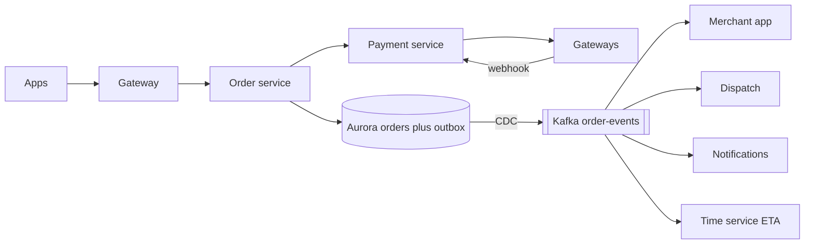
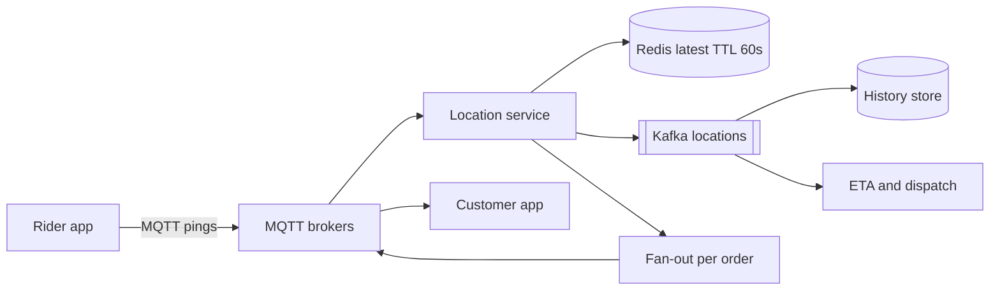
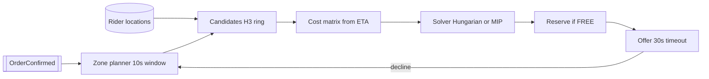
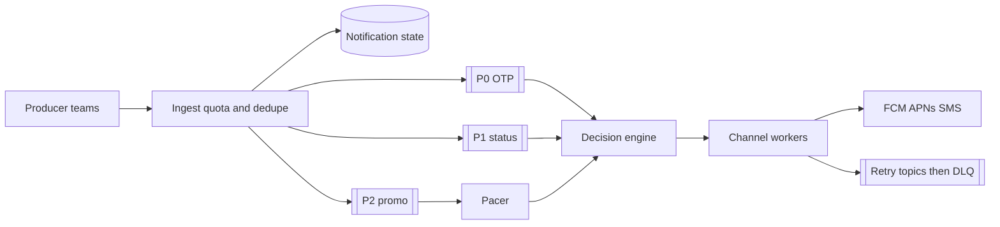
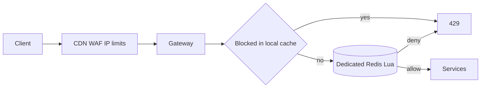
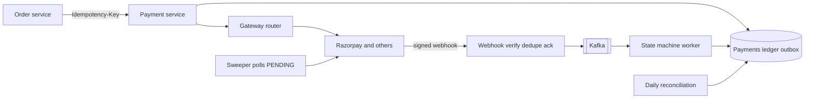
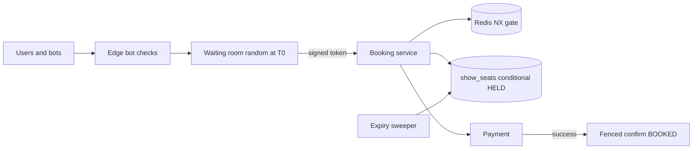
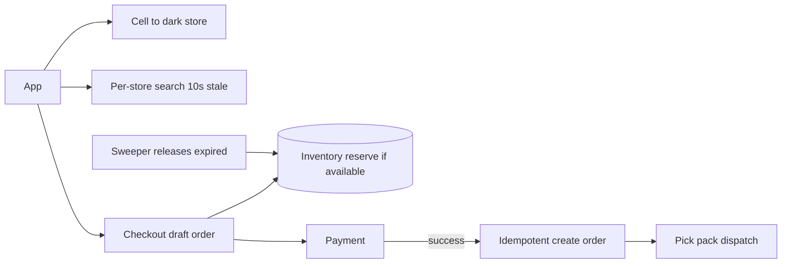

# System Design Revision Sheet: Zomato Round 2

> **Reading time:** 45–60 minutes. **What it is:** all of system design on one page, for the night before and the morning of. Each idea gets one or two lines, "say this" lines are in *italics*, and every question in the solution sheets has a design card.
> **How to use it:** Night before: read all of it and say the italic lines out loud. Morning of: Sections 1, 2, 5 and 6 (about 20 minutes). If a card feels shaky, open its chapter.
> **Chapters:** [06 master](06_System_Design_Master.md) · [07a](07a_SD_QA_Core_Zomato_Designs.md) · [07b](07b_SD_QA_Payments_Booking_and_More.md) · [07c](07c_SD_QA_LLD_Projects_RapidFire.md) · [interview reports](sources/interview_reports.md). IDs like Z2 or B10 refer to the reports file. Where a fact is **not public**, say "here's how it's typically done".

---

## 1. The round

### 1.1 The 7-step framework

| Step | Do | 45 min | Mini (15–20) |
|---|---|---|---|
| 1. Requirements | Functional, non-functional (latency, availability, consistency, durability), out of scope | 4–5 | 2 |
| 2. Estimates | Average and **peak** QPS, storage, ending with "so this means..." | 3 | 1 |
| 3. APIs | Method, path, payload, status codes, auth, cursor pagination, Idempotency-Key | 5 | 3 |
| 4. Data model | Entities, keys, indexes per API, SQL or NoSQL **per component**, with the reason | 7 | 4 |
| 5. Diagram | Client, CDN, gateway, services, cache, DB, queue. Walk one request through it. | 8 | 4 |
| 6. Deep dive + failures | The hardest part, then "what if this fails or is slow?" for **every arrow** | 12–14 | 4 |
| 7. Trade-offs | What you chose and gave up, the first bottleneck, next steps | 3–5 | 1 |

- **New constraint mid-round:** go back to step 1 and walk forward. *"That changes the requirements. Let me update them and see what moves."* Don't restart.
- **Checkpoints:** requirements by minute 5, schema by 20, diagram by 28. In a mini-design, follow their lead.
- **Phrases:** *"Can I ask a few questions about scope and scale first?"* · *"I'm picking X over Y because Z; the cost is W."* · *"The two hardest parts are A and B. Which should I go deep on?"* · *"This call can time out, so we'll retry, so it must be idempotent."* · *"I don't know that internal detail. Here's how I'd reason about it."*

### 1.2 What they score (synthesised from the reports; no rubric is published)

Requirements asked before drawing · numbers said aloud · APIs with payloads and codes · **schema and indexes** (the most common Zomato SDE-1 type) · every box justified · two levels of depth on one part (Kafka got 40 minutes in Z27) · **failure handling** · the alternative named and why it lost · absorbing new constraints (B6, Z15) · honesty · clean hand-written code when asked.

### 1.3 Why people were rejected

| Report | What happened | Do instead |
|---|---|---|
| **Z2** | Bluffed "MySQL vs Postgres", needed 2–3 tries at a follow-up, even though the design was "good" | *"I don't have enough real-world exposure to make that trade-off confidently,"* then reason from features (PostGIS), what the team runs, and the write pattern. Paraphrase each follow-up back once. |
| **Z4** | Payments: strong happy path, weak non-happy paths, "~80% close" | For every arrow: timeout, retry, duplicate, crash halfway, cross-service consistency |
| **Z15** | Messy hand-written code | Practise LRU, token bucket and the cursor SQL on paper |
| **B12** | Failed "infinite money, replace the DB with a cache?"; the project ate the time | Know the 5-point answer (3.3). Give a 2-minute project version, then stop. |
| **B15** | Grilled on own vs team work | Only list systems whose failure modes you can sketch |

**Traps to have ready:** "can't SQL scale?" · separate indexes vs composite (Z9) · "nearby restaurants in SQL" (a bounding box isn't enough) · base64 upload (they want pre-signed URLs) · "only Redis, no DB?" · "why async, what if the consumer is down, duplicates?" (B2) · "other pagination?" (page-number, time-range) · stolen session ID shared behind the same IP (Z9) · "flatten this DB spike without scaling" (Z3) · DDoS: rate limiting alone didn't convince them (Z4).

### 1.4 What the Eternal group asks most

1. Your own project as an HLD (10 of 34 reports). 2. Schema and live SQL. 3. **Notification system** (the most repeated single HLD). 4. Rate limiter with code. 5. Order flow and tracking. 6. LRU/LFU and Redis internals. 7. BookMyShow. 8. Payments. Kafka appears as a follow-up in about 12 reports. No machine-coding round for Zomato/Blinkit backend: LLD = implement a class, model a schema, or write an API.

---

## 2. Numbers to quote

| Zomato fact | Number | Source |
|---|---|---|
| NYE 2023 peak | **8,400 orders/min ≈ 140/s**; **80.92M requests/min ≈ 1.35M/s** | [blog](https://www.zomato.com/blog/a-tale-of-scale-behind-the-scenes-at-zomato-tech-for-nye-2023) |
| Fleet | **300+ microservices, 11,000 EC2, ~40,000 ECS tasks** (pre-scaled) | same |
| Kafka / Redis | **450M+ msgs/min** / **35 TB**, ~**1B GETs** vs ~100M SETs per min | same |
| Aurora / DynamoDB | **610k selects/s, 16k write txn/s** / 12.3M RCU + 5.2M WCU per min | same |
| Benchmarking | 14,000 minutes, 100+ services, 50M RPM peak, replayed traffic, auto-abort | same |
| Mesh | Kuma (Envoy); 500+ services, ~10,000 dataplanes (talk abstract) | [abstract](https://sessionize.com/arpit-mishra/) |
| Search | **100M+ queries/day on Solr**; DocValues gave 10x throughput, ~80% lower cost | [blog](https://www.zomato.com/blog/explained-how-zomato-handles-100-million-daily-search-queries-p1/) |
| Logs | 150M logs/min, 50+ TB/day on ClickHouse | [blog](https://www.zomato.com/blog/building-a-cost-effective-logging-platform-using-clickhouse-for-petabyte-scale) |
| FY24 | 247k restaurants, 400k delivery partners, **≈2M orders/day (derived)** | [deck](https://b.zmtcdn.com/investor-relations/Zomato_overview_May-24.pdf) |
| Billing | TiDB → one DynamoDB table: **4x throughput, ~90% lower latency, ~50% cost, zero downtime** | [AWS](https://aws.amazon.com/blogs/database/unlocking-performance-scalability-and-cost-efficiency-of-zomatos-billing-platform-by-switching-from-tidb-to-dynamodb/) |
| Blinkit | 2,751 dark stores (Q2 FY27); 12.5-min average delivery | [letter](https://www.eternal.com/blog/q2fy27) |

**Derived lines:** peak ≈ **6x** an average minute (~1,400/min) · **≈9,600 requests per order**, so reads need caching and writes need correctness · cache reads to writes ≈ **10:1** · *"140 orders/s is small for one MySQL primary; data volume and blast radius force sharding, not write rate."*

**Latency:** RAM 100 ns · SSD random read 150 µs (RAM is ~1,000x faster) · DC round trip 0.5 ms · Redis ~1 ms · indexed SQL 2–10 ms · Delhi–Mumbai ~30 ms · a new HTTPS connection costs ~3 RTTs (reuse connections). **Fan-out:** 5 parallel calls → 1 − 0.99⁵ ≈ 5% of pages hit someone's p99. **Little's Law, L = λW:** 140 checkouts/s × 3 s = 420 in flight; at 10 s, 1,400. That's how a slow dependency exhausts a healthy service.

**Shortcuts:** 1 day ≈ 10⁵ s · 1M/day ≈ 12/s · peak = 2–10x · 62⁷ ≈ 3.5 trillion · one Redis node ≈ 100k ops/s · 2–3 lakh riders pinging every 4 s = **50–75k writes/s**, about 100 GB/day of history (keep it out of the orders DB) · orders ≈ 2 TB/year; images ~100x bigger, so S3 plus CDN.

---

## 3. Concept cheat sheets

### 3.1 Scaling and load balancing

- **DNS TTL:** long = slow failover. **HTTP/2** multiplexes one connection (gRPC); **HTTP/3** = QUIC, survives Wi-Fi to 4G.
- **Stateless app servers** + sessions in Redis, or **short JWTs (15 min) + revocable refresh tokens**. A JWT can't be revoked early, and sticky sessions lose users when a server dies.
- **LB algorithms:** round robin; **least connections** when request times vary (round robin keeps feeding a slow server); consistent hash for stickiness. **L4 (NLB)** forwards TCP fast, for MQTT and gRPC; **L7 (ALB, Nginx, Envoy)** routes by path and terminates TLS. Shallow readiness checks (a DB-calling check can drain the pool: death spiral).
- **Gateway vs mesh:** the gateway does auth, rate limits and routing at the edge; the mesh puts an Envoy sidecar beside each service for mTLS, retries, timeouts and metrics. Zomato uses its Kuma mesh to inject latency in chaos tests.
- *"Autoscale for everyday variation, **pre-scale for known peaks**, because autoscaling lags a spike."* Low CPU with high latency means threads are waiting, so CPU autoscaling won't help; timeouts and breakers will.
- **Microservices:** split for independent scale, deploys or failure isolation; **each service owns its data**. DoorDash's satellite services shared the monolith's DB and failed with it.
- *"Synchronous for the decision, asynchronous for the consequences."*

### 3.2 Databases

| Component | Store | Why |
|---|---|---|
| Orders, payments, ledger | Aurora MySQL | Transactions, constraints, ad-hoc queries |
| Billing, draft orders (known keys, huge volume) | DynamoDB | Zomato billing, Zepto drafts |
| Menus, support chat | MongoDB | Nested data read as a whole (Nugget uses Atlas) |
| Carts, OTPs, counters, latest rider location | Redis + TTL | Known key, cheap to lose |
| GPS history | Kafka → S3, or a Cassandra-like store | Append-only. **No evidence Zomato uses Cassandra.** |
| Search / logs / analytics | Solr / ClickHouse / Iceberg + Trino | Off the OLTP path |

*"SQL scales too: replicas, caching, sharding, distributed SQL. Zomato's Aurora did 610k selects/s. NoSQL makes scale-out the default for narrow access patterns, at the cost of joins."*

- **B+ tree** (InnoDB): fast reads and ranges, in-place updates. **LSM tree** (Cassandra, RocksDB): append writes, compaction, Bloom filters. LSM suits pings, B+ tree suits orders. The **WAL** gives durability, and replication and CDC both read it.
- **Indexes:** InnoDB clusters rows on the PK; secondary indexes store the PK (so lookups do a second hop unless the index is **covering**). Keep PKs small and increasing: random UUIDs cause page splits.
- **Leftmost prefix:** (A, B, C) serves A, A+B and A+B+C, not B alone. **Equality columns first, range column last.** Swiggy Instamart's wrong-order composite index pushed DB CPU above 90%.
- **Z9 trap:** *"For `A=10 AND B=20`, one composite (A, B). It seeks straight to the matches; separate indexes make the planner pick one and filter, or merge two scans. (A, B) also serves A alone. Every extra index slows writes."* Low-cardinality columns are useless alone; use them in a composite or a partial index (DynamoDB: a sparse GSI).
- **EXPLAIN:** Seq Scan = no index; separate Sort = index doesn't give order.
- **ACID:** *"Atomicity is about failure, isolation is about concurrency."* MySQL gets isolation from MVCC snapshots plus row and gap locks.

| Anomaly | Picture | Stopped by |
|---|---|---|
| Dirty read | Read an uncommitted price that gets rolled back | Read Committed (Postgres default) |
| Non-repeatable read | The same row changes between two reads | Repeatable Read (MySQL default) |
| Phantom | A new matching row appears | Serializable (InnoDB gap locks mostly) |
| Lost update | Two read-modify-writes, coupon used 101 times | Atomic `SET x = x + 1 WHERE ...`, FOR UPDATE, or a version column |
| Write skew | Each transaction checks a rule and writes a different row | Serializable, FOR UPDATE on the rows read, or a unique constraint |

- **Deadlock:** fix with a consistent lock order (smaller ID first), short transactions, and retry the victim.
- **Normalise the source of truth, denormalise read models:** snapshot item price and name on the order; keep `orders.status` alongside an append-only history table.
- **Pools:** pods × pool size must stay under the DB's connection limit. A DB makes the app slow through missing indexes, N+1 queries, lock waits, pool exhaustion and replica lag.
- **Replication:** async can lose the last writes on failover. **Read-your-writes:** send the user's own recent reads to the leader. **Money and state transitions always read the leader** (Airbnb: idempotency checks on a lagging replica double-charge). Split brain needs fencing or Raft. Quorums: **R + W > N**.
- **Sharding orders:** *"Shard the source of truth by user_id (or put the shard inside a Snowflake ID); serve the restaurant view from a CDC-fed read model; salt hot keys."* Salting (`key#0..N`) is what Deliveroo and Zomato billing (`_<division-number>`) did.
- **Consistent hashing:** `hash % N` going 4 → 5 nodes moves ~80% of keys; a ring with 100–200 virtual nodes per server moves ~1/N. Redis Cluster uses 16,384 slots.
- **CAP per feature:** CP for payments, order status, coupon caps and seat holds; AP for the menu display, search, ratings, the rider dot and notifications.
- **2PC vs saga:** 2PC blocks with locks held if the coordinator dies. A **saga** is local steps plus **compensations** (refund, release). Orchestrate the money path; use choreography for side effects. Every step must be idempotent.
- **IDs:** Snowflake = 41-bit time + 10-bit machine + 12-bit sequence (sorted BIGINT). **OLAP** off the orders DB: Aurora → Debezium → Kafka → Flink → Iceberg → Trino.

### 3.3 Caching

- **Cache-aside** (default): read the cache, on a miss load from the DB; on a write, update the DB and **then delete the key**. Write-through for a small read-after-write cart; write-behind only for counters; write-around for logs.
- **Hit ratio:** going from 90% to 99% cuts DB load **10x**, because the DB only sees misses.
- **Delete, not update:** two writers' SETs can land in the wrong order and leave a stale value; deletes are idempotent. A slow reader can still re-set an old value, so put a **TTL on everything**, or use leases or a delayed double delete.
- *"The cache is for browsing, the database is for deciding."* TTLs: menu 5–15 min, stock 30–60 s, open/closed 30 s; never cache money or order status for decisions.
- **Eviction:** LRU, LFU, FIFO (as good as LRU for many Twitter workloads). Redis samples keys for approximate LRU. Use **`noeviction` for locks and counters**, and give rate-limit counters **their own Redis** (GitHub's shared cache evicted live counters).
- **Invalidation:** TTL → explicit delete → **CDC-driven deletes** (nobody can forget) → versioned keys → broadcast to pods' in-memory caches.

| Failure | Fix |
|---|---|
| **Stampede** (hot key expires, thousands of misses) | Single-flight or a lock (`SET NX PX`), leases (Facebook: 17K → 1.3K DB queries/s), serve stale while refreshing, early refresh, **TTL jitter**, warmup |
| **Penetration** (keys that don't exist) | Cache "not found" briefly; a **Bloom filter** (false positives, never false negatives) |
| **Avalanche** (mass expiry or the cluster dies) | Jitter, replicas, in-process cache, shed load on the DB path. Zomato injects cache misses before NYE. |
| **Hot key** (one shard melts) | In-process cache for a few seconds, salted copies across shards, read replicas |
| **Two caches drift** (your Myntra bug) | One owner, both invalidated by one event |

**Redis structures:** string (JSON, `INCR`, locks) · hash (cart, bucket state) · set (dedupe) · **sorted set** (leaderboards, delay queues, sliding-log limits, queue positions) · geo (`GEOSEARCH` radius, longitude first) · bitmap (seat map) · HyperLogLog (unique counts) · stream / pub-sub.

**Single-threaded yet fast:** RAM, no locks, epoll serving thousands of sockets, and every command is atomic; one slow `KEYS *` blocks everyone. Scale with Cluster shards and replicas; use Lua for check-and-set. Replication is **async**, so locks need fencing.

**The infinite-money trap:** *"Money buys RAM, not guarantees: (1) durability, since RAM and async replication lose writes; (2) querying, key lookups only; (3) multi-key transactions and constraints; (4) eviction is a feature of a cache and a bug for a source of truth; (5) backups, restore and audit. A cache is a rebuildable copy. With infinite money I'd give the DB enough RAM to hold everything in its buffer pool."* "Only Redis?" is fine for OTPs, sessions and live locations, not for orders or money.

### 3.4 Async: Kafka, queues, idempotency

- **Queues give** decoupling, load levelling (spikes wait in the backlog), retries and fan-out.
- **Kafka:** a replicated, partitioned **log**; reading doesn't delete (7-day default retention), so you can **replay**. A message's key picks its partition, and **ordering holds only within a partition**, so key by `order_id`. A consumer group gets every message; **parallelism within a group is capped by the partition count**. Offsets are committed **after** processing (at-least-once). Rebalances pause consumption; batches slower than `max.poll.interval.ms` cause duplicate loops. Safe producer settings: `acks=all` + RF 3 + `min.insync.replicas=2` + idempotent producer. It's fast because of sequential I/O, the page cache, zero-copy and batching.
- **Kafka vs SQS vs RabbitMQ:** *"Kafka is a replayable log for many consumer groups with per-key order at huge volume. SQS is a managed job queue: visibility timeout, DLQ, no replay, fan-out needs SNS, FIFO via message groups. RabbitMQ has flexible routing and per-message acks at moderate scale. Order events go on Kafka; 'make this PDF' jobs go on SQS."*
- **SQS visibility timeout:** a crashed worker's message reappears. Set the timeout above p99 job time, or extend it with a heartbeat. After `maxReceiveCount` attempts, the message goes to the DLQ.
- **Delivery semantics:** ack then process = at-most-once (can lose); process then ack = at-least-once (can duplicate). True exactly-once is impossible end to end; **Kafka's exactly-once covers Kafka-to-Kafka only**. *"At-least-once delivery plus idempotent consumers gives effectively-once."*
- **Idempotency techniques:** absolute sets instead of deltas · a **processed-event-ID table written in the same transaction** as the side effect · unique business keys (one refund per order) · **conditional state updates** (`WHERE status='ASSIGNED'`) · Redis `SET NX EX` for cheap dedupe · idempotency keys passed to external APIs.
- **Retries:** exponential backoff with **full jitter**, retry 5xx and timeouts but never 4xx, retry at **one layer only**, keep a retry budget (~10% of traffic). Otherwise 3 layers × 3 retries hit the failing service with 27–64x its load.
- **Poison messages:** retry topics with growing delays (1 min, 10 min), then a DLQ, **committing the original offset** so the partition isn't blocked (Uber's reliable reprocessing). Alert on DLQ depth.
- **Head-of-line blocking:** one slow message stalls its partition. Hand messages to a worker pool, hash keys to fixed workers to keep order, and commit only up to the oldest unfinished message.
- **Consumer lag:** alert on lag measured in **time**. To fix it: find the slow call, add consumers up to the partition count, add partitions, batch writes, split urgent and bulk topics.
- **Dual-write problem → outbox:** writing the order and the event to an `outbox` table in **one transaction**, with Debezium or a poller relaying to Kafka, means neither can be lost. Consumers dedupe on the outbox ID. Use raw CDC for analytics and cache invalidation; use the outbox for domain events other services depend on.
- **Delayed jobs:** a DB table polled with `FOR UPDATE SKIP LOCKED`, a Redis sorted set scored by run time, SQS delays (≤15 min), Kafka delay topics, or Cadence/Temporal durable timers. **The handler re-checks state**, so late or duplicate runs are no-ops.

### 3.5 APIs and real-time

- **Status codes:** 201 created · 202 accepted (async work) · 401 who are you vs 403 not allowed · 409 conflict (seat taken, key in flight) · 422 business rule broken · 429 you're too fast vs 503 I'm overloaded. Retry 5xx, never 4xx.
- **Idempotent methods:** GET, PUT and DELETE are; POST isn't, unless it carries an idempotency key.
- **Idempotency keys:** the client makes one key per user action and reuses it on retries. The server inserts it under a **unique index** on the **primary**: a stored response is replayed, a key still in flight gets 409, the same key with a different body gets 422. Store the response, including errors. For crashes mid-way, use **recovery points** plus a completer (Brandur) and **never hold a DB transaction across the gateway call** (Airbnb).
- **Pagination:** OFFSET reads and discards skipped rows and shifts when rows are inserted. A **cursor** = last `(created_at, id)`, opaque, with index `(user_id, created_at DESC, id DESC)`, fetching LIMIT n+1. **Three source tables:** each branch applies the cursor and n+1, then UNION ALL or a k-way merge in the app; the cursor must include the source, `(created_at, src, id)`. At scale, build one feed table from events. Other kinds: page-number, time-range.
- **Webhooks:** verify the **HMAC over the raw body** with a constant-time compare, insert the event ID under a unique key, enqueue, **return 200 within 5 s**, process asynchronously with a forward-only state machine, and reconcile anything stuck in PENDING.
- **Real-time:** short polling (rare checks) · long polling (fallback) · **SSE** (server to client, resumes with Last-Event-ID) · **WebSocket** (two-way, e.g. chat) · **MQTT** (2-byte header, QoS 0/1/2, retained messages, last will, made for flaky mobile networks; **Zomato moved tracking from polling to MQTT**, with its open-source Pulse client) · FCM/APNs only to wake a closed app.
- **Persistent connections at scale:** a connection registry or pub/sub channels per order, sequence numbers for resume, **jittered reconnects** after a node dies, and a polling fallback.
- **REST** for apps, **gRPC** (HTTP/2 + Protobuf + streaming) between services, **BFF** to compose each app's screens.

### 3.6 Reliability

- **Slow is worse than dead:** a slow dependency holds threads until callers cascade. **Timeouts** a little above the dependency's p99, with **deadlines propagated** down the call chain.
- **Circuit breaker:** CLOSED → OPEN (fail fast to a fallback) once the error rate passes a threshold with a minimum call count → HALF_OPEN after a cool-down (trial calls) → CLOSED. For writes that must not be lost, the fallback can be "queue and replay" (B8).
- **Bulkheads:** separate pools, topics and queues per dependency or priority (Razorpay split into P0 and P1 queues).
- **Load shedding vs rate limiting:** shedding protects the server by priority (Stripe reserves capacity for critical calls; DoorDash uses adaptive concurrency); rate limiting is per-client fairness. You need both.
- **Degraded modes and kill switches:** tier-0 (order, pay, track) never hard-depends on tier-2 (recommendations, reviews, ads). **Zomato flips kill switches in chaos tests before NYE**; Swiggy's flag rollback that never reached the backend is why you test them.

| Rate-limit algorithm | State | Bursts | Use |
|---|---|---|---|
| **Token bucket** | 2 numbers | Up to capacity | Default (Stripe; your Myntra limiter) |
| Leaky bucket | Queue | Smoothed | Fixed-rate downstream (Shopify: 40, leaking 2/s) |
| Fixed window | 1 counter | **2x at the boundary** | Cheap daily quotas |
| Sliding log | 1 entry per request (**O(N)**) | None | Small limits like OTPs |
| **Sliding counter** | 2 counters | Barely | Default sliding window (Cloudflare 49.5) |
| GCRA | 1 timestamp | Configurable | Token bucket with less state |

- **Availability math:** in series it multiplies (0.999³ ≈ **99.7%**); in parallel, 1 − 0.01² = **99.99%**, assuming independent failures. 99.9% ≈ 43 min/month; 99.99% ≈ 4.3 min/month.
- **RPO / RTO:** orders need RPO ≈ 0 and RTO in minutes; the rider location needs neither (the next ping regenerates it).
- **SLO** + error budget (100% − SLO); alert on **p99 and symptoms**; no user IDs in metric labels.

### 3.7 Concurrency

- Every race is **read, check, write** with someone else's write in between.
- **Atomic conditional update (say this first):** `UPDATE seats SET status='HELD', held_by=? WHERE id=? AND status='AVAILABLE'`, or `UPDATE stock SET avail=avail-? WHERE sku=? AND avail>=?`. **1 row means you won, 0 rows means 409.** Back it with a unique constraint.
- **Pessimistic** (`SELECT ... FOR UPDATE`, sorted lock order, tiny transactions, no RPC inside) for multi-row decisions under contention. **Optimistic** (`WHERE version = ?`) for low-contention edits like menus; on a hot concert its retries spiral.
- **Redis lock:** acquire with `SET key token NX PX ttl` in one command; release with a Lua compare-and-delete. A GC pause can outlive the lease and failover can lose the key (Kleppmann), so it's an **efficiency lock**. For correctness, **fence**: the DB rejects stale holders (`WHERE hold_id = ? AND version = ?`).
- **In-memory LLD:** lock per key, `ConcurrentHashMap.compute`, an `AtomicInteger` CAS loop, `ConcurrentSkipListSet.pollFirst()`, and copy-on-write reloads behind an `AtomicReference`.

### 3.8 Geo, search, dispatch, ETA

- **Nearby, in layers:** haversine in a WHERE clause is a full scan → a bounding box only uses one B-tree range (a latitude strip across the country) → a **spatial index** (PostGIS `ST_DWithin` on GiST, MySQL R-tree) or an **indexed cell column**: query the user's cell plus neighbours, then the exact distance.
- **Grids:** geohash (base32 string, prefix = containment, search 9 cells for edges) · quadtree (adapts to density, in memory, for fairly static data) · S2 (Hilbert curve, polygon covering; Blinkit's Iris precomputes cell → merchants) · **H3** (hexagons with equal-distance neighbours, `kRing`; res 9 ≈ 0.1 km², res 7 ≈ 5 km²; Uber computes surge per hexagon) · Redis GEO (geohash scores in a sorted set; shard per city or cell).
- **Road vs straight line:** the grid generates candidates, then road ETAs rank them. Swiggy's fallback chain: geohash-8 distance cache → A* on OSM → haversine. **Serviceable = road ETA + rider capacity**, precomputed as cell → restaurant list.
- **Search:** an inverted index (term → postings), an analyser (tokenise, stem, synonyms, n-grams), BM25, then **retrieve → filter → Learn-to-Rank**. Zomato: **Solr, not Elasticsearch**, with a BiLSTM-CRF tagger for "Burger 150rs wala". Sync the index with **CDC**, never dual writes; "the index may be stale, the decision point must not be". Typeahead = a **trie with top-k at each node**, debounced, under 10–50 ms.
- **Dispatch:** greedy is suboptimal, so do **global matching in short windows per zone**: Hungarian (O(n³), 1:1 only) or **ILP/MIP** for batching (DoorDash, Swiggy). Building the cost matrix dominates (Grab), so prune candidates with an H3 ring. Offer to one rider with a timeout (never broadcast: Gojek), assign just-in-time, reserve the rider with a conditional update. **Zomato's matcher is not public**; it has published Active Dispatch (RL repositioning of idle partners) and demand throttling.
- **ETA:** a sum of legs (assign + first mile + wait + last mile + handover + buffer). Zomato's Time service: **LightGBM per city**, an LSTM for prep time trained on the **"Food Order Ready" button** label (+9% 5-minute accuracy). Asymmetric loss, show a range, **guardrails** (clamp plus fallback; Swiggy's negative-ETA outage had no fallback), batch API.

### 3.9 Security and LLD

- **Authn vs authz;** IDOR is fixed by scoping every query with `AND user_id = :caller`. A JWT is signed, not encrypted. **Hashing** (bcrypt, one-way) vs **encryption** (reversible). Stolen session: HttpOnly and Secure cookies, rotate the ID, bind to a device rather than an IP (carrier NAT), step-up OTP. Mask PII and OTPs in logs.
- **SOLID:** S = one reason to change (pricer, repository, notifier) · O = a new discount is a new class · L = a subclass must not surprise callers · I = a CloudKitchen shouldn't implement `bookTable` · D = inject interfaces (a fake payment processor in tests).

| Pattern | Zomato use |
|---|---|
| Strategy | Discounts, pricing, fees, rider matching, SMS provider routing |
| Factory (map registry) | Payment processors, notification senders |
| Observer | Order status → push, dashboard, analytics (Kafka at scale) |
| State | Order, seat and payment lifecycles, plus a conditional DB update |
| Decorator vs data-driven | Pizza toppings; a real menu should be option-group rows |
| Builder / Singleton | Order construction / config (prefer DI) |
| Chain of Responsibility | Coupon validators, notification eligibility checks |
| Composite | Nested menu options |

**LLD recipe:** requirements (expect additions) → entities → an interface on what varies → schema and APIs (Zomato/Zepto) or a runnable `main` (Swiggy/Flipkart) → **where the lock goes** → "adding X is a new class".

---

## 4. Design cards

### Q1. Food delivery end to end (07a)
- **Short sync path:** gateway → order service → Aurora → payment service. **Everything else hangs off Kafka:** merchant, dispatch, notifications, ETA, analytics.
- `POST /orders` with an **Idempotency-Key** and `UNIQUE(user_id, key)`. **Re-price on the server**, store money in paise, snapshot item prices.
- One transaction inserts the order (PAYMENT_PENDING) **plus an outbox row**; CDC publishes it keyed by order_id. The webhook moves PAYMENT_PENDING → CONFIRMED with a **conditional update**.
- **State machine** enforced in one function. Restaurant rejects or doesn't answer within 5 min → **saga**: idempotent refund (`refund-<order_id>`).
- **Failures:** double tap (key) · paid but we crashed (webhook retries + reconciler) · event lost (outbox) · consumer down (Kafka waits, watch lag) · NYE (pre-scale, kill switches, demand throttling).

### Q2. Live tracking (07a)
- Two streams: **pings** (75k/s, loss-tolerant, MQTT QoS 0) and **status** (must not be lost: QoS 1 plus sequence numbers).
- Location service validates and snaps to roads, overwrites **only the latest position** in Redis (TTL 60 s), and streams history to Kafka → columnar store.
- The customer gets a **snapshot GET**, subscribes to `track/order/id`, resends the last seq on reconnect, and falls back to polling. Drop out-of-order pings.
- *Zomato moved from polling to MQTT (TLS overhead, jumpy markers); Uber found 80% of gateway calls were polling.* Server-side storage is **not public**.

### Q3. Dispatch and batching (07a)
- **Per-zone planner, 10 s windows.** Candidates from an H3 ring (20–30 riders). Cost = rider ETA vs food-ready time + last mile + acceptance probability + fairness.
- Solve with Hungarian (1:1) or **MIP with batches of 2–3**. Reserve with `WHERE state='FREE'`, offer with a 30 s timeout, and on decline the order joins the next window. Just-in-time assignment.
- Failures: planner crash (reservation expiry + standby lease), rider goes dark (reassign), no riders (widen the ring, incentives, throttle demand).

### Q4. Nearby restaurants and search (07a)
"Near me" means **"delivers to me"**: a precomputed **cell → serviceable restaurants with road ETA** in Redis → Solr text query filtered to those IDs → live open/busy flags → LTR re-rank → cursor saved under a search_id. Catalog changes flow by CDC → indexer. Solr down? Serve the cached per-cell feed.

### Q5. ETA service (07a)
One Time service with a **batch API**; per-leg models per city using a Flink → Redis feature store; asymmetric loss and a range shown; **clamp plus fallback** (distance ÷ city speed + average prep); re-predict on every event; shadow then canary new models; cold start from cuisine and city averages.

### Q6. Notification system (07a, 07c)
- **API and Kafka entry** with team_id + idempotency key. **Team quota at ingest** (429). Dedupe with **Redis `SET NX` backed by a DB unique key**. Persist status as ACCEPTED.
- **Priority lanes:** P0 OTP, P1 order status, P2 promo, each with its own topic and workers.
- Decision engine: preferences, quiet hours, **user cooldown** (e.g. 2 promos/day, 8 h gap; never on OTPs), channel choice, templates.
- Workers use collapse keys and TTLs (APNs keeps 1 per app while offline) and **fall back** (push → SMS, SMS vendor A → B). Retry topics → DLQ. A **persisted state machine plus a sweeper** makes crashes safe.
- **Z29 twist (riders available):** check rider supply per cell, release in waves. Campaigns are paced under FCM's 600k/min. **LLD:** Observer (events), Factory (senders), Strategy (provider routing), Chain (eligibility).

### Q7. Rate limiter, with code (07a, 07c)
- Lives at the gateway or mesh. Key by user, or by IP/phone for OTP. Rules per route. **429 + Retry-After.**
- **Token bucket with lazy refill**; sliding counter when the window must be strict; per-key lock in-process.
- Across pods: a **dedicated Redis + Lua** with `TIME` (no app clock skew), hash tags, and a local cache of blocked keys. **Fail open for browsing, fail closed for OTP and login.**
- Fixed-window bug: INCR and EXPIRE as separate commands means a crash leaves a key that never expires; do both in one script. Uber-scale: local enforcement + pushed drop ratios. **Ad pacing and banner caps are rate limiting in disguise.**

### Q8. Payments, refunds, reconciliation (07b)
- *"A correctness problem, not a scale problem."* Phase 1 transaction writes the key + CREATED; the gateway is called **with no transaction open**; phase 2 records PENDING. Our payment ID goes to the gateway as its receipt.
- The **webhook is the truth** (HMAC, dedupe on `x-razorpay-event-id`, 200 within 5 s; Razorpay retries for 24 h, unordered); a **forward-only** conditional state machine.
- **A timeout is not a failure:** stay PENDING, the sweeper polls the gateway with backoff, a late capture means **auto-refund**.
- **Double-entry append-only ledger** (clearing accounts trend to zero). Refunds take a row lock (`refunded + amt <= amount`); prorate coupons per line. Daily reconciliation against settlement files.
- Gateway routing by success rate, but a payment that started on gateway A settles on A. Chargebacks: OPEN → evidence → WON or LOST.

### Q9. Seat booking (BookMyShow, District) (07b)
- A `show_seats` row with status, hold_id, expiry and version. **Hold = one conditional update** (`AVAILABLE or expired`), checking the row count; `booking_seats PK(show, seat)` is the last guard. Shard by show_id.
- A Redis `SET NX PX` gate in front for speed only; **confirm is fenced in the DB** (`WHERE hold_id = mine AND not expired`).
- Lazy expiry in the WHERE clause plus a conditional sweeper. **Paid after the hold expired:** re-hold or auto-refund.
- On-sales (BookMyShow Coldplay: 10M instances): **admission is the bottleneck, not the DB.** Edge waiting room, **randomised at T0**, admit by free capacity, 4-ticket cap, bot checks. General admission = a split counter or a Redis gate. IRCTC = per-segment seats. District's internals are **not public**.

### Q10. Quick-commerce inventory (07b)
- `store_inventory(on_hand, reserved)` with `CHECK reserved <= on_hand`. **Reserve at checkout** in one local transaction, SKUs sorted: `WHERE on_hand - reserved >= qty`.
- A draft order in PAYMENT_PENDING → idempotent confirm → commit the reservation. The sweeper checks the gateway, then releases exactly once (Zepto's draft-order pattern).
- **Three levels of truth:** search index (10 s stale), Redis count, DB. Hot flash SKU: Redis Lua gate or split rows. Shelf drift: a partial pick, substitute or prorated refund, plus an audit movement. No company has published its oversell design.

### The other cards (07b, 07c)
- **Coupons:** cached validation using a Strategy per type; strict redemption with a Redis or split-row budget plus a per-user unique key or conditional update; a **5-min RESERVED hold**, confirmed or released exactly once; `order_id UNIQUE`; abuse checks tied to device, phone and payment instrument.
- **Ratings:** `order_id UNIQUE` (verified); outbox → consumer keyed by restaurant → **star histogram** (edits exact); a **brand = sum of outlet histograms, never an average of averages**; Bayesian average for ranking; every cached copy updated from one event.
- **Delayed jobs:** a job row written **in the order's transaction**; workers poll with `SKIP LOCKED` and a lease; the handler's conditional update makes late or duplicate runs no-ops. Never sleep in memory.
- **NYE survival:** replay real traffic above the peak, pre-scale, warm caches, chaos-test, freeze deploys; tiers plus kill switches, priority shedding, breakers plus retry budgets; per-area breaker (Grab's Spampede, Zomato's demand throttling). Flatten a DB spike: find the query, cache or coalesce it, jitter crons and TTLs, batch, fix the index.
- **URL shortener:** 7 base62 chars from leased ID blocks, KV store keyed by code, Redis + CDN in front, **302** to keep counting clicks, async click events.
- **Chat:** WebSocket gateways + a Redis user→gateway registry; **store first**, then route; server-assigned seq + `client_msg_id` unique; replay from the last seq; MongoDB index `(conv_id, seq)` (left prefix); a visibility field for internal notes.
- **Spotify:** metadata in SQL, audio chunks at several bitrates on a CDN with signed URLs (ABR); fractional playlist positions; **Fisher–Yates** shuffle; play counts via Kafka.
- **Image upload:** a pre-signed PUT (5 min, server-chosen key, type and size limits) → S3 event → idempotent workers (scan, strip EXIF, WebP) → READY; 202 then poll; multipart for big files.
- **Feature flags:** SDK evaluates an in-memory snapshot; push plus a 30 s poll; versioned; snapshot saved to disk; sticky `hash(flag:user) % 100`; kill switches tested; one flag controls one thing.
- **Leaderboard:** dedupe by order ID, then `ZINCRBY` hourly sets per city; a minute job `ZUNIONSTORE`s them with decay; `ZREVRANGE` / `ZREVRANK`; rebuild from events.
- **Distributed cache:** a node = hash map + LRU + lazy and active TTL; a **ring with virtual nodes** (`TreeMap.ceilingEntry`); replicas on the next distinct nodes; smooth addServer = joining state, stream, dual-read, flip; hot keys = local cache or split keys; hash map vs B+ tree = point lookups vs ranges.
- **Menu customisation:** item → reusable option groups (min/max) → options with price deltas; REQUIRES and PRICE_OVERRIDE rules; **snapshot** chosen options on the order; menu JSON cached per version.
- **Banner X times in Y hours:** a sliding-log Redis sorted set keyed `{banner}:{user}`, with the impression ID as member for idempotency; serve and count separately (soft cap); TTL resets it.
- **Cart:** a Strategy per discount, a rule chain, paise, round down, recompute on the server; `used_count < limit` conditional update; one restaurant per cart.
- **Schema + SQL:** separate `deliveries` table (reassignment); `orders.status` + history in one transaction; top-5 riders = join deliveries, `GROUP BY`, index `(area_id, order_type, placed_at)`, `DENSE_RANK` for ties; latest state in the last hour = `ROW_NUMBER` over history, or better `orders.status` with index `(status, updated_at)`; no-cuisine restaurants = LEFT JOIN … IS NULL.
- **Open now:** minutes-of-week, split slots that cross midnight, interval tree or a per-minute precomputed set, copy-on-write reload, a live pause set.
- **Parking lot:** `ConcurrentSkipListSet.pollFirst()` per spot type, `remove(ticketId)` for exit, Strategy for allocation and fees. **Splitwise:** net balances + two heaps (≤ n−1 transfers; the exact minimum is NP-hard). **LRU** = hash map + doubly linked list; **LFU** = frequency buckets + minFreq; **`get` writes**, so a read-write lock is wrong; stripe the locks.

### Your projects as HLD (07c)
Use the order: problem → numbers → draw → walk a read and a write → **what breaks at 10x** → phase 2 → what you'd do differently. Two minutes, then let them pick.
- **Myntra ratings:** Go service, Aerospike (7-day TTL as a safety net), Accio batches of 20 behind a **per-pod token bucket starting at 180 RPM**, one SQL query, aggregate written to every style (5.7M styles), Kafka error queue. **Breaks:** the per-pod limit × autoscaled pods (→ a global Redis limiter), **instant retries** (→ delayed retry topics + DLQ), a last-writer-wins race (→ version check), recompute load (→ debounce). **Phase 2:** CDC → idempotent histogram increments + nightly reconciliation (the same shape as Zomato Ads' fix). The 4 ms warmup pacing = matching the bucket's refill rate.
- **Atlassian SQS:** API → RECEIVED → SQS → **202** → idempotent workers → PUBLISHED → DLQ. **Breaks:** the downstream API, not SQS (bounded workers + token bucket); the DB-to-SQS gap (outbox or a sweeper); visibility timeout below job time (heartbeat); ordering (FIFO per app ID).
- **TraceX:** FastAPI + NetworkX + SQLite + JWT + a case FSM. **Breaks:** SQLite's single writer (→ Postgres), the in-memory graph (→ `GraphStore` swapped for Neo4j, or partitions by SCC), concurrent case edits (→ version column, 409), audit-chain forks (single writer), 8 h JWTs (→ refresh tokens or a deny-list).
- **SupplySense:** **per-instance in-memory state on Cloud Run** breaks first, even at 2x (say it before they do). → Postgres + PostGIS, a scheduled feed refresher, Redis, SSE instead of polling, tenant_id, secrets in a manager.

---

## 5. Top 40 follow-ups, one line each

1. **Why async?** Slow work leaves the user's path, spikes queue, a failure downstream doesn't fail the order.
2. **Consumer down?** Messages wait at the committed offset; alert on lag in time; it resumes later.
3. **Duplicate events?** At-least-once delivery; dedupe table in the same transaction, or a conditional transition.
4. **Kafka vs SQS?** Replayable multi-group log with per-key order vs a managed one-worker job queue with a DLQ.
5. **Ordering in Kafka?** Per partition only: key by order_id plus a version check.
6. **Consumer lag?** Find the slow call, consumers up to the partition count, more partitions, batching.
7. **Exactly-once?** Only Kafka-to-Kafka; external side effects need idempotency.
8. **Poison message?** Retry topics, then a DLQ; commit past it; alert.
9. **Dual write?** Outbox in the same transaction, with a CDC or poller relay.
10. **Infinite money, cache instead of DB?** Durability, queries, transactions, eviction, operations.
11. **Composite or separate indexes?** Composite (A, B); left prefix; equality before range.
12. **When does an index hurt?** Write-heavy tables, unused or low-selectivity columns, tiny tables.
13. **MySQL or Postgres?** Admit limited exposure, then reason: PostGIS and extensions vs ecosystem; Zomato runs Aurora MySQL.
14. **Can't SQL scale?** Yes: replicas, cache, sharding, distributed SQL.
15. **Nearby in SQL?** PostGIS, an R-tree, or a cell column + neighbours, then exact distance.
16. **Offset vs cursor?** The cursor `(created_at, id)` has constant cost and stable pages.
17. **Three-table pagination?** n+1 from each source, merge, cursor includes the source.
18. **DB spike without scaling?** Find the query; coalesce, cache, jitter crons and TTLs, fix the index.
19. **How does a DB slow an app?** Missing indexes, N+1, locks, pool exhaustion, replica lag.
20. **Shard key for orders?** user_id + a CDC read model keyed by restaurant; salt hot keys.
21. **Read your own write?** Read the leader for that user briefly.
22. **Delete or update cache on write?** Delete, after the DB write, with a TTL.
23. **Stampede?** Single-flight or leases, stale-while-revalidate, jitter, warmup.
24. **Hot key?** In-process cache, salted copies, replicas.
25. **Redis single-threaded and fast?** RAM, no locks, epoll; scale with Cluster shards.
26. **Consistent hashing?** ~1/N of keys move instead of ~80%; virtual nodes even it out.
27. **POST safe to retry?** Idempotency key, unique index on the primary, replay the stored response.
28. **Payment timed out?** Stay PENDING, poll the gateway, refund late captures.
29. **Webhook handling?** HMAC over the raw body, dedupe the event ID, 200 within 5 s, async.
30. **Same seat, two users?** Conditional update; 0 rows means 409; unique constraint.
31. **Optimistic vs pessimistic?** Version for low contention; FOR UPDATE or conditional update for hot rows.
32. **Redis lock enough?** No: GC pauses and failover, so fence in the DB.
33. **Last unit, two threads?** `avail >= 1` conditional decrement or a CAS loop.
34. **Token vs leaky bucket?** Bursts with an average cap vs a smooth fixed outflow.
35. **Fixed-window flaw?** 2x burst across the boundary; the sliding counter fixes it.
36. **Fail open or closed?** Open for browsing, closed for OTP and login.
37. **Circuit breaker states?** Closed → Open → Half-open → Closed.
38. **Why pre-scale?** Autoscaling lags spikes; Zomato pre-scaled to 11,000 EC2.
39. **Image upload?** A pre-signed S3 URL, never base64.
40. **Polling vs MQTT?** A persistent pub/sub connection with tiny headers; Zomato switched.

---

## 6. Final 10-minute checklist

- [ ] Opener ready: *"Before I design, can I ask about scope and scale?"*
- [ ] Numbers in your head: **8,400 orders/min, 80.92M requests/min, ~9,600 requests per order, 6x peak, 35 TB Redis, 450M Kafka msgs/min, 300+ services.**
- [ ] For every arrow: **timeout, retry + jitter, idempotency key, dedupe, DLQ, fallback**.
- [ ] Default answers: cache-aside + delete, outbox + idempotent consumers, conditional update, token bucket in Redis + Lua, cursor pagination, pre-signed upload.
- [ ] The Z9 answer, the infinite-money answer, the MySQL/Postgres honesty line.
- [ ] Your project drawn in under 2 minutes, plus its 10x breakpoints.
- [ ] Not public: Zomato's dispatch algorithm, rider-location storage, notification architecture, District's seat locking. Say so.
- [ ] Paraphrase every follow-up once. Admit gaps, then reason.
- [ ] Watch the clock: requirements done by minute 5, schema by 20.
