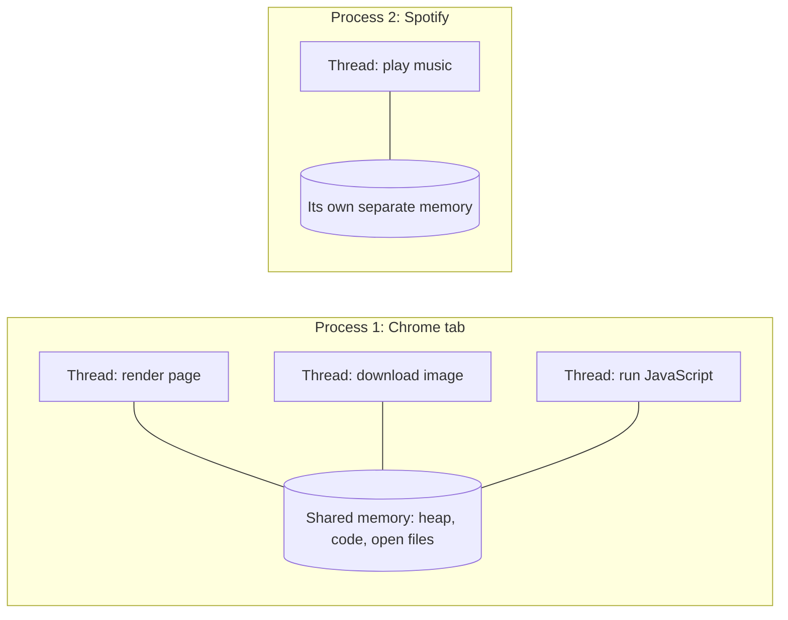
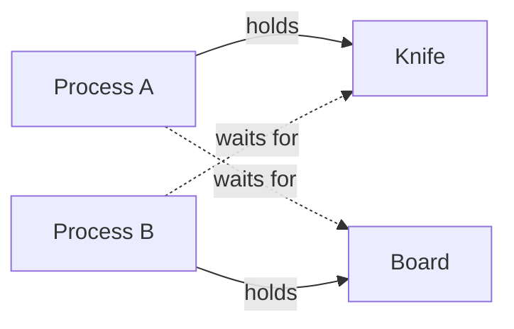
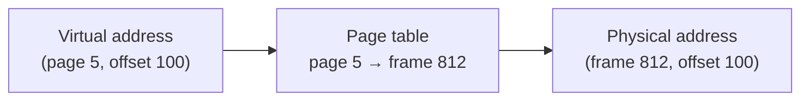
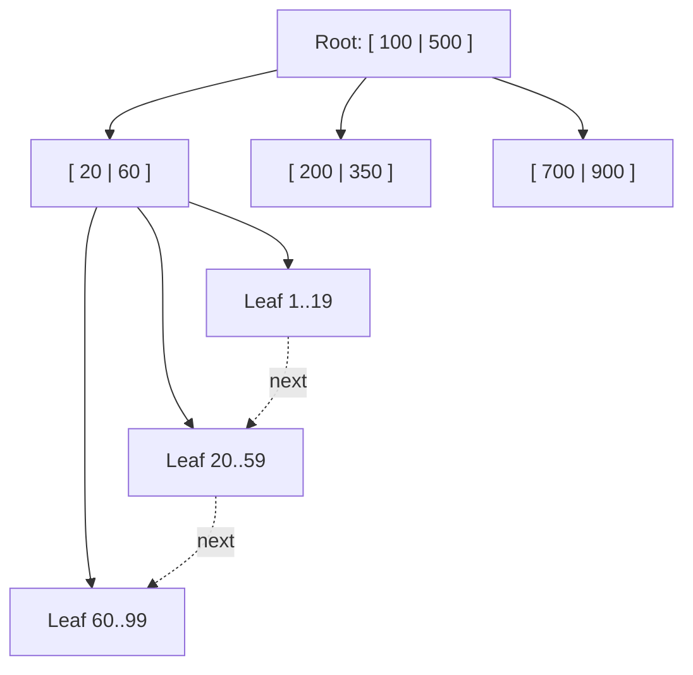
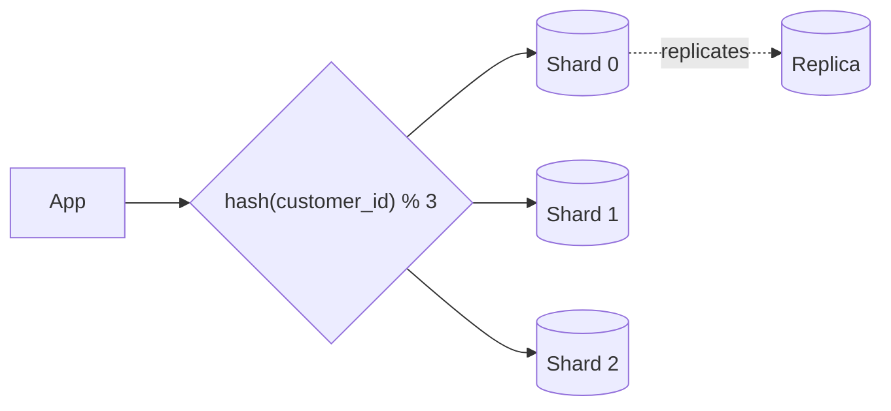
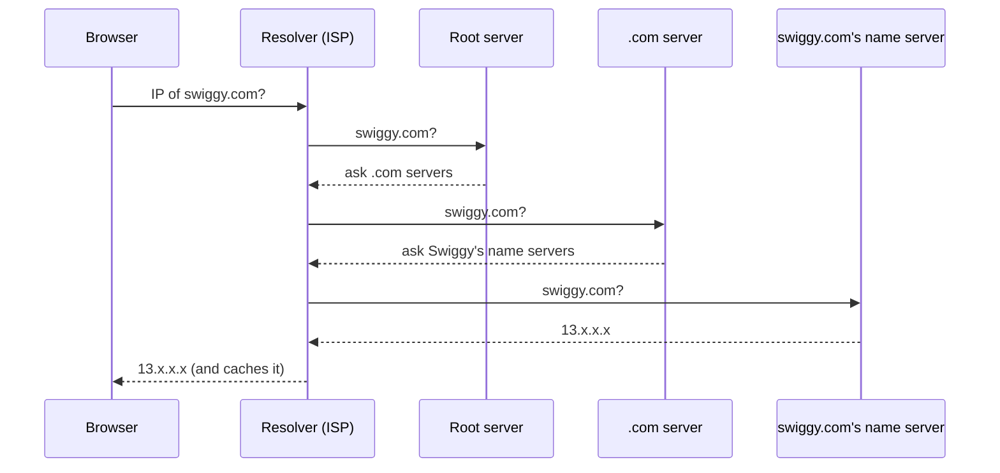
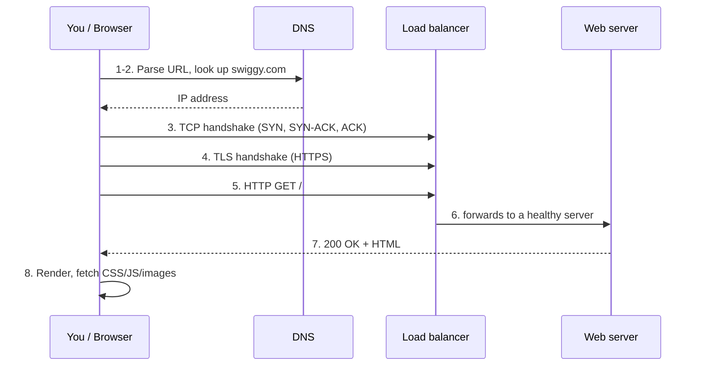
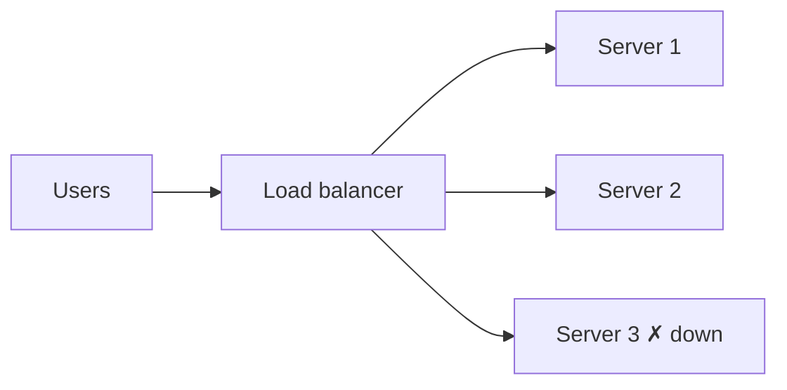
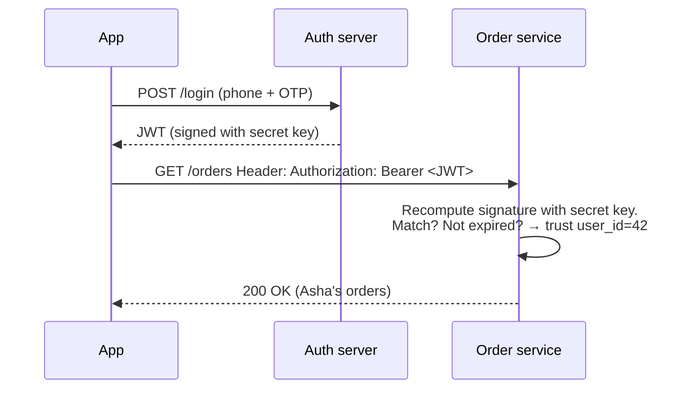

# CS Fundamentals From Zero: Swiggy ASDE / SDE-1

> **Who this is for:** someone who has heard these words but never really understood them. Every term is explained the first time it shows up, with an everyday example.
> **How to read it:** one part per sitting. Part A (OS) and Part B (DBMS) are the most asked. At the end of each part, cover the answers and say them out loud.
> **Tags:**
> - **[Asked at Swiggy]** means the question appears in a real Swiggy interview report (2021–2026).
> - **[Likely]** means it is a standard follow-up, or was asked at similar companies.
>
> Java and Spring questions are in `05_Java_and_Spring_From_Zero.md`, not here.

**What Swiggy actually asked from this file**, from the interview reports:
- **OS:** process vs thread; mutex vs semaphore; deadlock (including the "4 processes, 4 resources" question); the "Word file in write mode" question; cache memory and the TLB; page replacement, then "implement LRU"; multithreading vs async.
- **DBMS:** ACID; indexing ("what is it, where is it used, how is it implemented"); joins; normalisation; sharding; SQL vs NoSQL; MongoDB vs SQL; "design a DB for a food shop".
- **SQL:** joins in the online test, plus a "department count including zero" query.
- **Networks:** what happens when you type a URL; which data structure DNS uses; TCP vs UDP; TCP vs HTTP; HTTP vs REST; load balancer.
- **Security:** hashing vs encryption; salting; JWT; AES and block ciphers; secure API design.
- **Puzzles:** O(2ⁿ) vs O(n!); why hashing is O(1).

One Dec 2024 ASDE candidate could not answer the indexing question and **still got the offer**. Interviewers care more about how you think and whether you are honest than about perfect recall. If you don't know something, say what you do know and reason from it.

---

## PART A: Operating Systems

### A1. What is an operating system?

A computer has hardware: the CPU (the "brain" that runs instructions), RAM (fast, temporary memory), the disk (slow, permanent storage) and devices like the keyboard and network card. Many programs want to use that hardware at the same time: Chrome, Spotify, VS Code.

The **operating system (OS)** is the manager that sits between the programs and the hardware. Windows, macOS, Linux and Android are all operating systems.

**Real-life example: a restaurant manager.** The kitchen has a few stoves (CPUs), counter space (RAM) and a store room (disk). Many orders arrive. The manager decides:
- which order gets a stove now,
- who gets which shelf,
- that two cooks don't grab the same pan.

That is exactly the OS's job:

| OS job | Restaurant version |
|---|---|
| **CPU scheduling**: deciding which program runs on the CPU right now | Deciding which order gets the stove |
| **Memory management**: giving each program its own part of RAM | Giving each cook their own counter space |
| **File system**: organising data on disk into files and folders | Organising the store room |
| **Device management**: talking to the keyboard, screen and network | Handling the phone and the delivery door |
| **Protection**: one program can't read or break another's memory | One cook can't throw away another's dish |

**System call.** A program cannot touch hardware directly. It *asks* the OS, for example "please read this file". That request is called a **system call**. Like a waiter who must go through the manager to get something from the locked store room.

---

### A2. Process vs thread [Asked at Swiggy]

**Program.** A file of instructions sitting on disk, for example `chrome.exe`. It is just a recipe written in a book. Nothing is happening yet.

**Process.** A program that is *running*. When you start it, the OS loads it into RAM and gives it its own:
- **memory space**: its own private area of RAM,
- **resources**: open files, network connections,
- **state**: where it currently is in the code.

A process is like a full **kitchen** set up to cook from that recipe, with its own stoves, counters and ingredients. Two processes are two separate kitchens. One kitchen can't reach into the other's fridge.

**Thread.** A single line of work happening *inside* a process. One process can have many threads. All threads in a process **share the same memory** (the same kitchen), but each has its own:
- **program counter**: which line of code it is on,
- **stack**: its own scratch space for local variables and function calls.

Threads are the **cooks** inside one kitchen. They share the fridge and counters, but each is working on their own dish at their own step.



| | Process | Thread |
|---|---|---|
| Memory | Own, private, isolated | Shared with other threads of the same process |
| Cost to create | Heavy: the OS must set up a whole new memory space | Light: it reuses the process's memory |
| Talking to each other | Hard: needs inter-process communication (pipes, sockets, shared files) | Easy: just read and write the same variables |
| If one crashes | The others are safe (isolation) | It can crash the whole process |
| Switching between them (**context switch**) | Slower | Faster |

**Why do we need both?**
- **Processes give safety (isolation).** Chrome runs each tab as a separate process. If one tab crashes, the others survive. Your bank app can't read WhatsApp's memory.
- **Threads give speed and easy sharing.** Inside the Swiggy app, one thread draws the screen while another fetches the restaurant list over the network. If both were one thread, the screen would freeze while waiting for the network. Threads share memory, so the network thread can just put the list where the screen thread will read it.

**Context switch.** The CPU core can run only one thing at a time. To run another thread or process, the OS saves the current one's state (registers, program counter) and loads the next one's. Think of a cook bookmarking where they are in one recipe before switching to another. Switching between processes costs more because memory maps (and caches like the TLB, see A8) must also change.

#### Interview questions
- **"What is the difference between a process and a thread?"**
  > "A process is a running program with its own private memory and resources. A thread is a unit of execution inside a process. Threads of the same process share the memory but each has its own stack and program counter. Creating and switching processes is costlier, but processes are isolated, so one crashing doesn't affect another. Threads are cheap and can share data easily, but a bug in one thread can corrupt shared data or crash the whole process."
- **"Why do we need both?"**
  > "Processes for isolation and safety, threads for doing many things at once cheaply inside one application. Chrome uses a process per tab so one tab crashing doesn't kill the browser. Inside a tab it uses threads so rendering and network loading happen together."
- **"What does a thread share and what does it not share?"** [Likely]
  > "Shared: code, heap (objects), global variables, open files. Not shared: the stack, the registers and the program counter."
- **"What is a context switch?"** [Likely]
  > "Saving the state of the running thread or process and loading another's so the CPU can switch work. It is pure overhead, and process switches cost more than thread switches."

---

### A3. Concurrency vs parallelism

- **Concurrency** means *dealing with* many tasks over the same period by switching between them. It works even on one CPU core.
  - **Example:** one cook handling three dishes: stir dal, then flip roti, then check rice, then back to dal. All three are "in progress", but only one is touched at any instant.
- **Parallelism** means *doing* many tasks at the exact same instant. It needs multiple CPU cores.
  - **Example:** three cooks, each making one dish at the same time.

```
Concurrency (1 core):   A A B B A C C B A ...   (taking turns)
Parallelism (3 cores):  core1: A A A A
                        core2: B B B B
                        core3: C C C C           (truly simultaneous)
```

A modern laptop does both. It has, say, 8 cores (parallelism), and each core switches between many threads (concurrency).

#### Interview questions
- **"Concurrency vs parallelism?"** [Likely]
  > "Concurrency is about structure: many tasks in progress at once, taking turns, possible on a single core. Parallelism is about execution: tasks literally running at the same time on multiple cores. A web server is concurrent because it handles thousands of requests at once. It is parallel only if it has several cores working simultaneously."

---

### A4. Race conditions, mutex and semaphore [Asked at Swiggy]

#### The problem: race condition

Threads share memory, so two threads can change the same variable at the same time and produce a wrong answer.

**Swiggy example: the last item in stock.** Instamart has 1 packet of milk left. Two customers press "Buy" at the same moment, so two threads run this code:

```
if (stock > 0) {      // step 1: check
    stock = stock - 1; // step 2: update
    confirmOrder();
}
```

1. Thread A checks: stock is 1, OK.
2. Before A updates, the OS switches to Thread B. B checks: stock is still 1, OK.
3. Both subtract. Stock becomes −1, and **two orders are confirmed for one packet**.

Even `count++` is not safe. It is really three steps: read the value, add 1, write it back. Two threads can both read 5 and both write 6, so one increment is lost.

- **Race condition:** the result depends on the unlucky timing of threads.
- **Critical section:** the piece of code that touches shared data. Only one thread should be inside it at a time.

#### Fix 1: mutex (lock)

A **mutex** (short for *mutual exclusion*) is a lock. A thread must **lock** it before entering the critical section and **unlock** it after. If another thread already holds it, you wait.

**Real-life example: a single-person restroom key** at a café. Whoever has the key goes in; others wait. Only the person who took the key returns it.

```
lock(m)
  if (stock > 0) { stock--; confirmOrder(); }
unlock(m)
```

Now the "check then update" happens as one unbreakable unit. This property is called being **atomic**.

#### Fix 2: semaphore

A **semaphore** is a counter that controls how many threads can use something at once. It has two operations:
- **wait()**, also called P or acquire: if the counter is above 0, decrease it and go in. If it is 0, wait.
- **signal()**, also called V or release: increase the counter, possibly waking a waiting thread.

**Real-life example: a parking lot with 3 spaces and a display board.** The board starts at 3. Each car entering does −1, each car leaving does +1. At 0, cars wait at the gate.

- **Counting semaphore:** the counter can be any number. Use it to limit "at most N at once", for example at most 10 database connections.
- **Binary semaphore:** the counter is only 0 or 1. It looks like a mutex, but is not quite the same (see below).

#### Mutex vs semaphore

| | Mutex | Semaphore |
|---|---|---|
| What it is | A lock: locked or unlocked | A counter |
| How many can enter | Exactly 1 | Up to N |
| Ownership | **Yes**: only the thread that locked it may unlock it | **No**: any thread can signal |
| Used for | Protecting shared data (mutual exclusion) | Limiting access to N resources, or signalling between threads ("data is ready") |
| Real-life | Restroom key | Parking board with N spaces |

**Signalling example (where semaphores shine).** In the Swiggy app, a "producer" thread downloads restaurant data and a "consumer" thread displays it. The consumer calls `wait()` on a semaphore that starts at 0, so it sleeps. When the data arrives, the producer calls `signal()`, which wakes the consumer. A mutex can't do this cleanly, because the thread that unlocks must be the one that locked.

#### Interview questions
- **"Mutex vs semaphore?"** [Asked at Swiggy]
  > "A mutex is a lock that allows only one thread into a critical section, and it has ownership: the thread that locks it must unlock it. A semaphore is a counter that allows up to N threads, and any thread can signal it. I use a mutex to protect shared data, like a stock counter. I use a counting semaphore to limit access to a pool, like 10 DB connections, or to signal between threads, like 'data is ready'."
- **"Is a binary semaphore the same as a mutex?"** [Likely]
  > "Similar in behaviour, but a mutex has ownership and a binary semaphore doesn't. Any thread can release a binary semaphore, so it is suited to signalling, while a mutex is for locking."
- **"What is a race condition? Give an example."** [Likely]
  > "When the result depends on the timing of threads accessing shared data. Two users buying the last item: both check stock = 1 before either updates, so both succeed and stock goes to −1. Fix it with a lock around check-and-update, or an atomic DB update like `UPDATE ... SET stock = stock - 1 WHERE id = ? AND stock > 0`."

---

### A5. Deadlock [Asked at Swiggy]

**Deadlock** is when two or more threads or processes wait for each other forever, so none of them can move.

**Real-life example: two cooks, one knife, one cutting board.**
- Cook A grabs the knife and waits for the board.
- Cook B grabs the board and waits for the knife.

Neither will let go, and nothing gets chopped, ever.



#### The 4 conditions (all four must hold at the same time)

| # | Condition | Meaning | Kitchen version |
|---|---|---|---|
| 1 | **Mutual exclusion** | A resource can be used by only one at a time | Only one cook can use the knife at a time |
| 2 | **Hold and wait** | A process holds one resource while waiting for another | A holds the knife and waits for the board |
| 3 | **No preemption** | You can't forcibly take a resource away | No one can snatch the knife from A |
| 4 | **Circular wait** | A cycle: A waits for B, B waits for A | A → board (B has it), B → knife (A has it) |

Break **any one** of these and deadlock can't happen.

#### How to handle deadlock

1. **Prevention:** design the system so one condition can never hold.
   - **Break circular wait (most practical).** Always grab resources in a fixed global order: knife first, then board, for everyone. Then no cycle can form. In code, if you lock two accounts for a money transfer, always lock the lower account ID first.
   - **Break hold and wait.** Ask for everything at once. If you can't get it all, take nothing.
   - **Allow preemption.** If you can't get the next resource, release what you hold and retry later. Locks with a **timeout** do this.
   - **Break mutual exclusion.** Rarely possible: some things, like a printer, just can't be shared.
2. **Avoidance:** before granting a resource, check whether the system stays in a "safe state". The classic method is the **Banker's algorithm**. Like a bank that never lends so much that it couldn't let at least one customer finish and repay.
3. **Detection and recovery:** let deadlocks happen, detect cycles in a "who waits for whom" graph, then kill or roll back one process. Databases do this: MySQL detects a deadlock between two transactions and aborts one of them.
4. **Ignore it (the ostrich approach):** many general-purpose OSes just assume it is rare, and the user restarts the app.

#### The "4 processes, 4 resources" question [Asked at Swiggy]

The exact wording wasn't in the report. The common versions:

**Version 1: "There are 4 identical resources and 4 processes. Each process needs 2 resources to finish. Can deadlock occur?"**

Yes. Worst case: each process grabs 1 resource. All 4 are now taken, and every process waits for a second one that will never come. That is deadlock.

**The general rule.** With `n` processes, each needing at most `k` of the same resource, deadlock is **impossible** if:

```
total resources  ≥  n × (k − 1) + 1
```

Why: in the worst case every process holds `k − 1` and waits for one more. If even one extra resource exists, one process can finish and release its resources, and then the rest can finish too.

- Here: `4 × (2 − 1) + 1 = 5`. We only have 4, so deadlock **can** happen.
- With 5 resources it couldn't.
- If each process needed only 1 resource: `4 × 0 + 1 = 1 ≤ 4`, so no deadlock is possible.

**Version 2: "4 processes and 4 different resources, each process holds one and wants the next."** P1 holds R1 and wants R2, P2 holds R2 and wants R3, P3 holds R3 and wants R4, P4 holds R4 and wants R1. That is a circular wait, so deadlock.

**How to answer if the wording is unclear:** ask "Are the resources identical, and how many does each process need?" Then apply the formula.

#### Interview questions
- **"What is deadlock? What are the necessary conditions?"** [Asked at Swiggy]
  > "Deadlock is when a set of processes are each waiting for a resource held by another in the set, so none can proceed. Four conditions must all hold: mutual exclusion, hold and wait, no preemption and circular wait. Breaking any one prevents it. The most practical fix is ordering resources: everyone acquires locks in the same global order, so a cycle can't form."
- **"4 resources, 4 processes, each needs 2: is deadlock possible?"** [Asked at Swiggy]
  > "Yes. If each process grabs one, all four are held and everyone waits for a second. The safe condition is resources ≥ n(k−1)+1, which is 5 here, so we'd need at least 5."
- **"Deadlock vs starvation?"** [Likely]
  > "In deadlock, nobody progresses because of a cycle. In starvation, the system progresses but one process keeps getting skipped, for example a low-priority job that never gets the CPU. The fix for starvation is aging: slowly raising the priority of a process the longer it waits."
- **"How would you avoid deadlock when transferring money between two accounts?"** [Likely]
  > "Lock both accounts in a fixed order, say smaller account ID first. Then two transfers A→B and B→A both lock A first, so there's no cycle. Also use lock timeouts as a safety net."

---

### A6. The "Word file in write mode" question [Asked at Swiggy]

> **Question (from the report):** "A process has a Word file open in write mode, and it gets preempted. Can another process open the same file in write mode?"

**First, the key words.**
- **Preempted:** the OS paused the process and gave the CPU to someone else (because its time slice ended, for example). It is like a cook being told "step aside from the stove for a minute".
- **Being preempted only takes away the CPU.** The process is still alive and still holds everything else: its memory, its open files and its locks. The cook stepped away from the stove but still has their notebook open on the table.

**So the answer is about file locking, not about preemption.**
- **On Windows with MS Word:** when Word opens a file for editing, it asks the OS for an **exclusive lock** (a "share mode" that says "no one else may write"). Preemption doesn't release this lock. A second program trying to open it for writing gets an error, or "file is locked, open read-only?". You have seen this message yourself.
- **On Linux:** the OS by default *allows* two processes to open the same file for writing. Locks there are mostly **advisory**: programs must voluntarily check them with calls like `flock`/`fcntl`. If the second program doesn't check, both can write and corrupt the file.
- **Either way:** preemption changes nothing. Whether the second open succeeds depends on whether the first process took a lock and on the OS's locking rules.

#### Interview questions
- **Model answer:**
  > "Preemption only takes away the CPU. The process still holds its open files and locks. So it depends on locking, not preemption. Word on Windows opens the file with an exclusive lock, so a second process can't open it for writing; it gets 'file in use' or a read-only option. On Linux, locks are advisory by default, so two processes could open it for writing unless they use file locks, and that can corrupt the file. That's exactly why applications use locks."

---

### A7. CPU scheduling (brief)

**Scheduling** decides which ready process or thread gets the CPU next. It is like a bank deciding the order in which customers are served.

| Algorithm | How it works | Real-life | Downside |
|---|---|---|---|
| **FCFS** (First Come First Served) | In arrival order | Normal bank queue | One long job makes everyone wait (the **convoy effect**) |
| **SJF** (Shortest Job First) | Shortest task first | "Only one item? Go ahead of me" | Needs to know job length; long jobs can starve |
| **Priority** | Highest priority first | Hospital emergency room | Low priority may starve; fix with **aging** |
| **Round Robin** | Each gets a fixed time slice (**quantum**), then goes to the back of the line | A teacher giving each student 2 minutes, in rotation | Too small a quantum means too many context switches |

**Preemptive** schedulers can interrupt a running process (Round Robin). **Non-preemptive** ones let it run until it finishes or blocks (plain FCFS). Real OSes mix these. Linux's default scheduler gives each process a fair share of CPU time.

- **"Which scheduler is best for interactive systems?"** [Likely]
  > "A preemptive one like Round Robin or a priority scheduler with aging, because every program gets the CPU often, so the system feels responsive."

---

### A8. Memory: virtual memory, paging, TLB, cache, page replacement [Asked at Swiggy]

#### Virtual memory

Every process *believes* it has a large, private, continuous block of memory starting at address 0. That is a **virtual address space**. In reality, its data is scattered across physical RAM, and some of it may even sit on disk.

**Real-life example: a hotel.** Each guest is told "your room is Room 1". The front desk keeps a register: Guest A's Room 1 is actually floor 3, room 312; Guest B's Room 1 is floor 7, room 705. Guests never see the real room numbers. They can't wander into someone else's room, and the hotel can move them around.

Why it is useful:
- **Isolation:** a process can't even name another process's memory.
- **Run programs bigger than RAM:** parts that aren't being used stay on disk.
- **Simplicity:** every program is written as if memory starts at 0.

#### Paging

To make the mapping easy, memory is cut into fixed-size blocks:
- **Page:** a block of virtual memory, usually 4 KB.
- **Frame:** a block of physical RAM of the same size.
- **Page table:** a per-process table that says "virtual page 5 → physical frame 812". This is the hotel register.



**Page fault.** The process touches a page that isn't in RAM right now (it is on disk). The OS pauses the process, loads the page from disk into a free frame, updates the page table and resumes. Disk is roughly 100,000× slower than RAM, so frequent page faults make everything crawl.

**Thrashing.** So many page faults that the computer spends all its time swapping pages in and out and does almost no real work. You see this when too many heavy apps are open.

#### TLB (Translation Lookaside Buffer)

The page table lives in RAM. Without help, every memory access would cost *two* RAM trips: one to read the page table, one to get the actual data.

The **TLB** is a tiny, very fast cache inside the CPU that remembers recent "page → frame" translations.
- **TLB hit:** the translation is found instantly.
- **TLB miss:** walk the page table in RAM, then save the result in the TLB.

**Real-life example:** a delivery partner who has memorised the 20 addresses they visit most. They don't open Google Maps for those; for any other address they look it up.

On a **process context switch** the TLB is usually flushed (or entries are tagged per process), because the new process has a different page table. That is part of why process switches cost more than thread switches.

#### Cache memory

The CPU is much faster than RAM. To avoid waiting, CPUs have small, fast memory called **cache** (L1, L2, L3), which keeps recently used data close by.
- **L1:** tiniest and fastest, inside each core.
- **L3:** larger and slower, shared between cores.

**Real-life example:** a cook keeps salt, chilli and oil on the counter (cache) instead of walking to the store room (RAM) each time. The store room is closer than the warehouse across town (disk).

Caches work because of **locality**:
- **Temporal locality:** what you used just now, you will probably use again soon.
- **Spatial locality:** what's next to what you used, you will probably use next. This is why looping over an array in order is fast.

Order of speed: CPU registers > L1 > L2 > L3 > RAM > SSD > hard disk > network.

#### Page replacement

When RAM is full and a new page is needed, the OS must **evict** (throw out) some page. Which one?

| Algorithm | Rule | Comment |
|---|---|---|
| **FIFO** | Evict the page that came in first | Simple, but may evict a page that's used all the time. Has **Belady's anomaly**: more frames can cause *more* faults. |
| **Optimal (OPT)** | Evict the page that won't be used for the longest time in the future | Best possible, but needs to see the future, so it is only a benchmark |
| **LRU** (Least Recently Used) | Evict the page unused for the longest time in the past | Uses the past to guess the future. Very good in practice. |

**Worked example.** 3 frames; pages requested in order: `7 0 1 2 0 3 0 4`.

- **FIFO:**
  - `7`, `0`, `1` fill the frames: 3 faults. Frames = [7,0,1].
  - `2`: evict 7 (oldest). Fault. [0,1,2]
  - `0`: hit.
  - `3`: evict 0 (oldest). Fault. [1,2,3]
  - `0`: evict 1. Fault. [2,3,0]
  - `4`: evict 2. Fault. [3,0,4]
  - **7 faults.**
- **LRU:**
  - `7 0 1`: 3 faults. [7,0,1]
  - `2`: least recently used is 7, evict it. Fault. [0,1,2]
  - `0`: hit (0 is now most recent).
  - `3`: LRU is 1, evict it. Fault. [0,2,3]
  - `0`: hit.
  - `4`: LRU is 2, evict it. Fault. [0,3,4]
  - **6 faults.** LRU kept page 0, which was popular. FIFO threw it out just because it was old.

**"Implement LRU"** was asked straight after this question at Swiggy. The standard answer is a **HashMap + doubly linked list**, both operations in O(1). The full code is in `02_DSA_From_Zero.md`. The idea in one breath:
> "A doubly linked list keeps pages in order of use: most recent at the head, least recent at the tail. A hash map goes from key to list node, so I can find any page in O(1). On access I move the node to the head. On insert when full, I remove the tail node and delete its key from the map."

#### Interview questions
- **"What is virtual memory and why do we need it?"** [Likely]
  > "Each process gets its own virtual address space that the OS maps to physical RAM through page tables. It gives isolation, lets programs be bigger than RAM by keeping unused pages on disk, and makes every program simpler to write."
- **"What is a TLB?"** [Asked at Swiggy]
  > "A small, fast hardware cache in the CPU that stores recent virtual-to-physical page translations. Without it every memory access would need an extra RAM read of the page table. With a high hit rate, translation is almost free."
- **"What is cache memory?"** [Asked at Swiggy]
  > "Small, fast memory close to the CPU (L1, L2, L3) that holds recently used data so the CPU doesn't wait for slower RAM. It works because programs reuse recent data and access nearby data."
- **"Which page replacement policy would you use?"** [Asked at Swiggy]
  > "LRU in practice. Optimal is best but needs future knowledge, and FIFO can evict hot pages and even suffers Belady's anomaly. LRU uses the recent past as a guess for the near future, which matches locality. Real OSes use cheap approximations of LRU like the clock algorithm, because exact LRU on every memory access is too expensive in hardware."
- **"What is thrashing?"** [Likely]
  > "When the system spends most of its time handling page faults, swapping pages in and out, instead of running programs, because the active pages of all processes don't fit in RAM. Fix: run fewer processes or add RAM."

---

### A9. Multithreading vs async programming [Asked at Swiggy]

Both are ways to "not sit idle while waiting". They work very differently.

**The problem.** Most backend work is **waiting**: for the database, for another service, for the network. That is called **I/O-bound** work (I/O = input/output). While a thread waits, it does nothing useful.

**Multithreading.** Use many threads. While one waits for the DB, the OS runs another.
- **Real-life:** a restaurant hires 10 waiters. Each waiter takes a table's order and *stands there waiting* at the kitchen until the food is ready. More tables means more waiters.
- **Cost:** each thread uses memory (its stack, often about 1 MB) and context switching. Thousands of threads get expensive.

**Async (asynchronous) programming.** One thread (or a few) starts a task, and *instead of waiting*, moves on to other work. When the result is ready, a **callback**, **promise** or **future** picks it up. An **event loop** keeps checking "what's ready now?"
- **Real-life:** one smart waiter takes table 1's order, hands it to the kitchen, goes to take table 2's order, then table 3's. When the kitchen rings a bell ("table 1 ready"), they deliver it. One waiter, many tables, no standing around.
- **Examples:** JavaScript/Node.js (`async/await`), Java `CompletableFuture`, Python `asyncio`.

| | Multithreading | Async |
|---|---|---|
| How it avoids idling | Many threads; the OS switches when one blocks | One thread never blocks; it registers "call me back when done" |
| Best for | **CPU-bound** work (heavy calculation) on multiple cores | **I/O-bound** work with huge numbers of waits (web servers, API calls) |
| Cost | Memory per thread, context switches, locks | Code is harder to follow (callbacks); one CPU-heavy task blocks the loop |
| Shared-data bugs | Race conditions are common, so locks are needed | Fewer, if it is single-threaded |

**They can combine.** Go's **goroutines** are very lightweight threads (a few KB each) that the Go runtime schedules on a few OS threads. You write simple blocking-style code and get async-like efficiency. You used this at Myntra, and it is a nice point to mention.

#### Interview questions
- **"Define multithreading."** [Asked at Swiggy]
  > "Running multiple threads inside one process so different tasks progress together, sharing memory. It improves responsiveness and uses multiple cores, but needs synchronisation like locks to avoid race conditions."
- **"Multithreading vs async?"** [Asked at Swiggy]
  > "Multithreading uses many threads, and a thread blocks while waiting. Async uses few threads that never block: they start an I/O operation and handle the result later through callbacks or futures, using an event loop. Async is great for many I/O waits, like a server calling other APIs. Threads are needed for CPU-heavy work across cores."

---

## PART B: DBMS (Database Management Systems)

### B1. What is a database?

A **database** is an organised collection of data that many users and programs can read and change safely at the same time. A **DBMS** is the software that manages it: MySQL, PostgreSQL, MongoDB.

**Why not just use an Excel file or a text file?** Imagine Swiggy storing all orders in one giant spreadsheet:
- **Two people editing at once** overwrite each other. A DBMS handles **concurrency**.
- **Finding one order** among a billion means scrolling through everything. A DBMS has **indexes**.
- **The computer crashes mid-save** and leaves half-written data. A DBMS guarantees **durability** and **atomicity** (ACID, see B4).
- **Anyone can read everything.** A DBMS has **access control**.
- **Typos** like "Bengaluru" vs "Bangalore" vs "Bengalru". A DBMS enforces **constraints**.

---

### B2. Tables, keys and joins [Asked at Swiggy]

#### Tables

A **relational database** stores data in **tables**: rows and columns, like a sheet with strict rules.
- **Row** (record): one thing, for example one customer.
- **Column** (attribute): one property, for example the customer's name.
- **Schema:** the fixed structure: which columns exist and what type each is.

#### Keys

| Key | What it is | Example |
|---|---|---|
| **Primary key (PK)** | Uniquely identifies each row. Can't be NULL or repeated. | `customer_id` in Customers |
| **Foreign key (FK)** | A column that points to another table's primary key. It links tables. | `customer_id` in Orders points to Customers |
| **Candidate key** | Any column (or set) that *could* be the primary key | `email`, `phone` |
| **Composite key** | A primary key made of 2+ columns together | `(order_id, item_id)` in OrderItems |
| **Unique key** | Must be unique but may allow NULL | `phone` |

**Real-life:** your Aadhaar number is a primary key for you. When a bank form asks for your Aadhaar, that field is a foreign key pointing to you.

#### Joins

A **join** combines rows from two tables using a related column. Use these tiny tables:

**Customers**

| id | name |
|---|---|
| 1 | Asha |
| 2 | Ravi |
| 3 | Meera |

**Orders**

| order_id | customer_id | amount |
|---|---|---|
| 101 | 1 | 250 |
| 102 | 1 | 400 |
| 103 | 2 | 150 |
| 104 | 9 | 300 |

Meera (3) has no orders. Order 104 belongs to customer 9, who doesn't exist (bad data, but useful here).

**1. INNER JOIN.** Only rows that match in **both** tables.
```sql
SELECT c.name, o.order_id
FROM Customers c
INNER JOIN Orders o ON c.id = o.customer_id;
```
Result: Asha-101, Asha-102, Ravi-103. Meera is missing (no orders) and order 104 is missing (no customer).

**2. LEFT JOIN** (LEFT OUTER JOIN). **All** rows from the left table, plus matches from the right. Where there is no match, the right side is NULL.
```sql
SELECT c.name, o.order_id
FROM Customers c
LEFT JOIN Orders o ON c.id = o.customer_id;
```
Result: Asha-101, Asha-102, Ravi-103, **Meera-NULL**.

Use it for "show every customer, even those with zero orders".

**3. RIGHT JOIN.** The mirror: all rows from the right table. Result: Asha-101, Asha-102, Ravi-103, **NULL-104**.

**4. FULL OUTER JOIN.** All rows from both; NULLs where there's no match. Result: the 3 matches + Meera-NULL + NULL-104. MySQL doesn't support it directly; you write `LEFT JOIN ... UNION ... RIGHT JOIN`.

**5. CROSS JOIN.** Every row of A paired with every row of B: 3 × 4 = 12 rows. Use it for "all combinations", like every size × every crust on a pizza menu.

**6. SELF JOIN.** A table joined with itself. Use it when rows point to other rows in the same table, like employees and their managers (see SQL query C9).

Memory trick: think of two overlapping circles. INNER = the overlap. LEFT = the whole left circle. FULL = both circles.

#### Interview questions
- **"Explain all types of joins."** [Asked at Swiggy]
  > "INNER returns only matching rows from both tables. LEFT returns all rows from the left table, with NULLs where the right has no match. RIGHT is the mirror. FULL OUTER returns everything from both. CROSS gives every combination. A SELF join joins a table to itself, like employee to manager. For example, to list all customers including those with no orders, I'd use a LEFT JOIN from Customers to Orders."
- **"How do you find customers who never ordered?"** [Likely]
  > "LEFT JOIN Customers to Orders and keep rows where the order side is NULL: `WHERE o.order_id IS NULL`. Or use `NOT EXISTS`."
- **"Primary key vs unique key?"** [Likely]
  > "Both enforce uniqueness. A primary key can't be NULL, and there's only one per table; it also usually becomes the clustered index in MySQL. A table can have many unique keys, and they allow NULL."

---

### B3. Normalisation (1NF, 2NF, 3NF) [Asked at Swiggy]

**Normalisation** means organising tables so that each fact is stored **in only one place**. This avoids **redundancy** (repeated data) and **anomalies** (bugs caused by that repetition).

**The messy starting table (a food shop's orders):**

| order_id | customer_name | customer_phone | items | restaurant | restaurant_city |
|---|---|---|---|---|---|
| 1 | Asha | 98xxx | Dosa, Coffee | Udupi Cafe | Bengaluru |
| 2 | Asha | 98xxx | Idli | Udupi Cafe | Bengaluru |

Problems (anomalies):
- **Update anomaly:** Asha changes her phone number. You must update it in every row. Miss one, and the data disagrees with itself.
- **Insert anomaly:** you can't add a new restaurant until someone orders from it.
- **Delete anomaly:** delete the only order from a restaurant and you lose the fact that the restaurant exists.

**1NF (First Normal Form): every cell holds one single value.** "Dosa, Coffee" in one cell breaks this, so move items into one row each:

| order_id | item |
|---|---|
| 1 | Dosa |
| 1 | Coffee |
| 2 | Idli |

**2NF: 1NF, plus no column depends on only *part* of a composite key.**
- Suppose the key is `(order_id, item)` and the table also stores `customer_name`.
- `customer_name` depends only on `order_id`, not on the item. That is a **partial dependency**.
- Fix: move order-level facts into an `Orders` table keyed by `order_id`.

**3NF: 2NF, plus no column depends on another *non-key* column.**
- In `Orders(order_id, restaurant, restaurant_city)`, `restaurant_city` depends on `restaurant`, not on the order. That is a **transitive dependency**: order → restaurant → city.
- Fix: move it into `Restaurants(restaurant_id, name, city)`.

**Final design:**
```
Customers(customer_id PK, name, phone)
Restaurants(restaurant_id PK, name, city)
Orders(order_id PK, customer_id FK, restaurant_id FK, created_at)
OrderItems(order_id FK, item_id FK, quantity)   -- PK = (order_id, item_id)
MenuItems(item_id PK, restaurant_id FK, name, price)
```

Now Asha's phone number is stored exactly once.

**A one-line memory aid for 3NF:** "Every non-key column must depend on *the key, the whole key, and nothing but the key*."

**Denormalisation.** Sometimes we deliberately repeat data to avoid slow joins on hot read paths. For example, storing `restaurant_name` directly on the order so the order-history screen needs no join. It is a trade-off: faster reads, but harder updates.

#### Interview questions
- **"What is normalisation? Explain 1NF, 2NF, 3NF."** [Asked at Swiggy]
  > "Normalisation organises tables so each fact is stored once, avoiding update, insert and delete anomalies. 1NF: every cell holds a single atomic value, so no lists in a cell. 2NF: no partial dependency, meaning a non-key column must depend on the whole composite key. 3NF: no transitive dependency, so non-key columns don't depend on other non-key columns. For example, restaurant city belongs in a Restaurants table, not in Orders."
- **"When would you denormalise?"** [Likely]
  > "When reads heavily outnumber writes and joins are slowing a hot path, like order history. I'd copy a few stable fields, such as the restaurant name, into the orders table, accepting extra work when those fields change."

---

### B4. ACID [Asked at Swiggy]

A **transaction** is a group of database operations that must succeed or fail **together** as one unit.

**Payment example.** Asha pays ₹500 for her Swiggy order. Behind the scenes:
1. Deduct ₹500 from Asha's wallet.
2. Add ₹500 to the restaurant's account.
3. Mark the order as PAID.

**ACID** is the set of guarantees that keeps this safe.

| Letter | Meaning | In the payment example |
|---|---|---|
| **A**tomicity | All or nothing | If step 2 fails, step 1 is **undone** (rolled back). Asha never loses ₹500 into thin air. |
| **C**onsistency | The DB moves from one valid state to another, and all rules (constraints) hold | A rule says "balance ≥ 0". A transaction that would make it −200 is rejected. Total money before = total money after. |
| **I**solation | Concurrent transactions don't see each other's half-done work | While Asha's payment is mid-way, another query doesn't see "money deducted but order not paid". |
| **D**urability | Once committed, it stays, even if the server crashes a second later | After "Payment successful", a power cut can't undo it. |

**How databases do it (simple version):**
- **Atomicity and durability:** the DB first writes every change to a **log** on disk (a write-ahead log, also called a redo/undo log) *before* applying it. After a crash, it replays the log to finish committed transactions and undo uncommitted ones. Like a cashier who writes each step in a register first, so after a power cut they can see exactly what was finished.
- **Isolation:** **locks** and **MVCC** (Multi-Version Concurrency Control). With MVCC the DB keeps old versions of rows, so readers see a consistent snapshot while writers work.

```sql
START TRANSACTION;
UPDATE wallets SET balance = balance - 500 WHERE user_id = 1 AND balance >= 500;
UPDATE accounts SET balance = balance + 500 WHERE restaurant_id = 7;
UPDATE orders  SET status = 'PAID' WHERE order_id = 101;
COMMIT;   -- or ROLLBACK; if anything failed
```

#### Interview questions
- **"What is ACID? Explain with an example."** [Asked at Swiggy]
  > "ACID is the set of guarantees for transactions. Atomicity: all steps succeed or none do; if crediting the restaurant fails, the debit from the user is rolled back. Consistency: constraints always hold, so a balance can't go negative. Isolation: concurrent transactions don't see each other's partial work. Durability: once committed, the data survives crashes, because the DB writes to a log on disk before confirming."
- **"How does a database ensure durability?"** [Likely]
  > "With a write-ahead log. Every change is first appended to a log file on disk and flushed. Only then is the commit acknowledged. After a crash, the DB replays the log."

---

### B5. Isolation levels (simple version)

Full isolation (transactions behaving as if they ran one after another) is slow. So databases offer **levels**: trade a bit of correctness for speed. First, the three problems they prevent:

| Problem | What happens | Example |
|---|---|---|
| **Dirty read** | You read data another transaction hasn't committed yet, and it later rolls back | You see "₹500 credited", but the payment fails and rolls back. You read something that never truly existed. |
| **Non-repeatable read** | You read the same row twice in one transaction and get different values, because someone committed a change in between | You read the price ₹200, the restaurant updates it, you read ₹250 |
| **Phantom read** | You run the same query twice and *new rows* appear | "Count orders today" = 10, someone inserts one, now it's 11 |

| Isolation level | Dirty read | Non-repeatable | Phantom | Speed |
|---|---|---|---|---|
| Read Uncommitted | possible | possible | possible | fastest |
| Read Committed (Postgres default) | prevented | possible | possible | |
| Repeatable Read (MySQL default) | prevented | prevented | possible in theory (MySQL largely prevents it with gap locks) | |
| Serializable | prevented | prevented | prevented | slowest |

- **"What isolation level would you use for payments?"** [Likely]
  > "At least Repeatable Read, and for the critical 'check balance and deduct' step I'd use a row lock (`SELECT ... FOR UPDATE`) or a conditional update like `UPDATE ... WHERE balance >= amount`. That makes the check-and-deduct atomic without making the whole system Serializable."

---

### B6. Indexing from zero [Asked at Swiggy]

> **Question from the report:** "What is indexing, where is it used, and how is it implemented?"

#### The problem

Swiggy's `Orders` table has 1 billion rows. Query: `SELECT * FROM Orders WHERE customer_id = 42;`

Without help, the DB reads **every row** and checks each one. That is a **full table scan**, O(n). Like finding every page that mentions "Asha" in a 1,000-page book by reading every page.

#### The idea

An **index** is a separate, sorted structure that maps a column's values to where the rows live. It is exactly like the **index at the back of a textbook**: look up "Deadlock → pages 45, 112", then jump straight there.

#### How it's implemented: the B+ tree

Most SQL databases (MySQL InnoDB, PostgreSQL) build indexes as a **B+ tree**.

**Intuition, step by step:**
1. A sorted list lets you binary search: log₂(1 billion) ≈ 30 steps. Good, but data is on disk, and each step might be a slow disk read.
2. Disk reads come in **pages** (blocks) of about 16 KB. So instead of a binary tree (2 children per node), make each node hold **hundreds of keys**, with hundreds of children.
3. With ~500 children per node, a tree only **3–4 levels deep** can hold billions of keys, so a lookup takes only 3–4 disk reads.
4. In a **B+ tree** specifically:
   - all actual data pointers live in the **leaf** (bottom) nodes,
   - the upper nodes are just signposts,
   - the leaves are **linked together** in sorted order like a chain.

   That chain makes **range queries** ("orders between 1 Jan and 31 Jan") fast: find the start, then walk sideways.



**Real-life:** a library. The signboard says "Floor 2: Science". The floor sign says "Aisle 5: Computer Science". The aisle sign says "Shelf C: Databases". Three hops, and you are at the right shelf without walking every aisle. Books on the shelf are in order, so you can grab a range.

#### Clustered vs secondary index (MySQL InnoDB)

- **Clustered index:** the table rows themselves are stored *inside* the B+ tree, sorted by primary key. One per table. A lookup by primary key goes straight to the row.
- **Secondary index:** for example on `customer_id`. Its leaves store the **primary key** of matching rows. So a lookup is: search the secondary index → get the PK → search the clustered index → get the row.

#### Where indexes help

- `WHERE` filters: `WHERE customer_id = 42`
- `JOIN ... ON` columns, usually foreign keys
- `ORDER BY` / `GROUP BY` on the indexed column (the data is already sorted)
- Range queries: `WHERE created_at BETWEEN ...`
- Uniqueness checks (a unique index)

#### Costs: why not index everything?

1. **Slower writes:** every INSERT, UPDATE or DELETE must update every index too.
2. **Extra storage:** each index is another tree on disk.
3. **Low-selectivity columns gain little.** An index on `gender` or `is_veg` (2–3 distinct values) narrows almost nothing, so the DB may scan anyway.

#### Composite (multi-column) index

An index on `(restaurant_id, created_at)` is sorted first by restaurant, then by time within each restaurant, like a phone book sorted by surname, then first name.

- **Leftmost prefix rule:** it helps queries filtering on `restaurant_id`, or on `restaurant_id AND created_at`. It does **not** help a query filtering only on `created_at`. A phone book sorted by surname can't find "all people named Ravi".
- **Order the columns:** equality-filtered columns first, the range column last.
- **Covering index:** if the index contains every column the query needs, the DB answers from the index alone, without visiting the table.

#### When an index is NOT used

- A function on the column: `WHERE YEAR(created_at) = 2025`. Rewrite it as a range: `created_at >= '2025-01-01' AND created_at < '2026-01-01'`.
- A leading wildcard: `LIKE '%dosa'`. (`'dosa%'` is fine.)
- Skipping the leftmost column of a composite index.
- A type mismatch: comparing a string column with a number.

Use `EXPLAIN SELECT ...` to see whether the DB uses an index.

#### Hash index

A hash index maps a key to its location with a hash function. It gives O(1) exact-match lookups but **can't do ranges or sorting**. That is why B+ trees are the default.

#### Interview questions
- **"What is indexing, where is it used, how is it implemented?"** [Asked at Swiggy]
  > "An index is a separate sorted data structure that lets the database find rows without scanning the whole table, like a book's index. It's used on columns in WHERE, JOIN, ORDER BY and range queries, like `customer_id` on orders. It's implemented as a B+ tree: each node holds hundreds of keys, so the tree is only 3–4 levels deep even for billions of rows, meaning 3–4 disk reads per lookup. Leaves are linked, so range scans are fast. The cost is slower writes and extra storage, so I only index columns that queries actually filter on."
- **"Why B+ tree and not a binary search tree or hash?"** [Likely]
  > "A binary tree is too deep: about 30 levels for a billion rows, each potentially a disk read. A B+ tree is wide and shallow, matching disk page size. A hash index gives O(1) equality lookups but can't do range queries or sorting, which databases need constantly."
- **"What is a composite index? Does the order matter?"** [Likely]
  > "An index on multiple columns, sorted by the first column, then the second within it. Order matters because of the leftmost prefix rule: an index on (restaurant_id, created_at) helps queries on restaurant_id alone or both, but not on created_at alone."

---

### B7. SQL vs NoSQL, and MongoDB vs SQL [Asked at Swiggy]

**SQL databases** (relational: MySQL, PostgreSQL) store data in tables with a fixed schema and relations between them. They support joins and ACID transactions across many rows and tables.

**NoSQL databases** ("not only SQL") are a family of other designs:

| Type | How data looks | Example DBs | Swiggy-style use |
|---|---|---|---|
| **Key-value** | A giant hash map: key → value | Redis, Aerospike, DynamoDB | Sessions, cart cache, rider's live location |
| **Document** | JSON-like documents, each can have different fields | MongoDB | Restaurant menus with varied customisations |
| **Wide-column** | Rows with flexible columns, built for huge write volume | Cassandra | Event logs, order-tracking pings |
| **Graph** | Nodes and edges | Neo4j | "Friends who ordered from here", fraud rings |

| | SQL | NoSQL |
|---|---|---|
| Schema | Fixed; changing it needs a migration | Flexible; each document can differ |
| Relations / joins | Built in | Mostly none; you store related data together (**embed**) or join in your code |
| Transactions | Strong ACID across tables | Often per-document or per-key; many are **eventually consistent** (replicas agree after a short delay) |
| Scaling | Mostly **vertical** (a bigger machine) + read replicas; sharding is hard | Built for **horizontal** scaling (more machines) |
| Best when | Data is structured and relationships and correctness matter | Huge scale, simple access patterns, or a changing shape |

**MongoDB vs SQL, concretely.** A restaurant's menu: a pizza has sizes and crusts, a biryani has a spice level, a combo has nested items. In SQL that becomes many tables with joins. In MongoDB, one document per restaurant:
```json
{ "_id": "r7", "name": "Pizza Hub",
  "menu": [ { "name": "Margherita", "sizes": ["S","M","L"], "crusts": ["thin","pan"] },
            { "name": "Coke", "price": 60 } ] }
```
You read the whole menu in one fetch and add new fields without migrations.

**But for orders and payments, use SQL.** Money needs ACID across tables (wallet, order, ledger), and reports need joins.

**Real-life:** SQL is a government office with strict printed forms (every field fixed and checked). MongoDB is a folder where each person's file can hold whatever documents are relevant to them.

#### Interview questions
- **"SQL vs NoSQL? When would you use each?"** [Asked at Swiggy]
  > "SQL has fixed schemas, joins and strong ACID transactions, so it's right for orders, payments and user accounts where correctness and relationships matter. NoSQL trades some of that for flexible schemas and easy horizontal scaling. I'd use a key-value store like Redis for sessions and caches, a document store for menus with varied structure, and Cassandra-style stores for very high-volume event data. Most real systems use both."
- **"Why MongoDB over SQL?" / "MongoDB vs SQL?"** [Asked at Swiggy]
  > "MongoDB stores JSON-like documents with flexible fields, so a nested object like a menu can be read in one query without joins, and it shards horizontally. SQL is better when you need multi-table transactions, joins and strict constraints. If I'd used MongoDB in a project, I'd justify it by the data shape. For example, records with varying fields that are always read as a whole."
- **"Can NoSQL databases do joins?"** [Likely]
  > "Generally not like SQL. You design around access patterns: embed related data in one document, or join in application code. MongoDB has `$lookup`, but it's limited and costly."

---

### B8. Sharding and replication [Asked at Swiggy]

One database server has limits: disk, CPU and how many queries it can handle. Two ways to grow:

**Replication: copies of the same data on multiple servers.**
- One **primary** (leader) takes all **writes**. It copies changes to **replicas** (followers), which serve **reads**.
- **Why:**
  - more read capacity (most apps read far more than they write),
  - **high availability**: if the primary dies, a replica is promoted.
- **Catch: replication lag.** Replicas may be a little behind. You update your address, and for a second a read from a replica still shows the old one. Fix: read your own writes from the primary.
- **Real-life:** a head chef (primary) writes the recipe book. Copies are given to every branch kitchen (replicas). Branches read their copy; only the head chef edits, and updates are posted to the branches.

**Sharding (horizontal partitioning): splitting the data across servers.** Each server (**shard**) holds only a *part* of the rows.
- Choose a **shard key**, say `customer_id`. Rule: `shard = hash(customer_id) % 4`. Customer 42 always lives on, say, shard 2.
- **Why:** when data or writes are too big for one machine, each shard handles only its slice.
- **Catches:**
  - queries across shards (for example "top restaurants overall") must ask every shard and merge the results,
  - joins and transactions across shards are hard,
  - a bad key creates a **hot shard** (for example sharding by city puts all of Bengaluru on one server),
  - adding shards means moving data. **Consistent hashing** reduces how much moves.
- **Real-life:** a library with so many books that it opens 4 buildings: A–F, G–M, N–S, T–Z. Each building is smaller and faster to search. But a "list all books by this publisher" request means visiting all four.



**Partitioning vs sharding.** Partitioning often means splitting a table *inside one* server (for example by month). Sharding means splitting across *different* servers.

#### Interview questions
- **"What is sharding?"** [Asked at Swiggy]
  > "Splitting a table's rows across multiple database servers by a shard key, like `hash(customer_id)`, so each server stores and serves only part of the data. It scales writes and storage beyond one machine. The costs are cross-shard queries and transactions, hot shards if the key is skewed, and data movement when adding shards, which consistent hashing reduces."
- **"Sharding vs replication?"** [Likely]
  > "Replication copies the same data to many servers for read scaling and failover. Sharding splits different data across servers for write and storage scaling. Big systems do both: each shard has its own replicas."

---

### B9. "Design a DB for a food shop" [Asked at Swiggy]

The report also said "reduce its complexity, then joins". Here's how to talk through it.

**Step 1: say the requirements out loud.**
> "Customers place orders from a menu. An order has multiple items with quantities. We need the bill, order status and payment."

**Step 2: find the nouns. They become tables.** Customer, MenuItem, Order, OrderItem, Payment. If it's multi-restaurant like Swiggy, add Restaurant.

**Step 3: the schema.**
```sql
CREATE TABLE customers (
  customer_id  BIGINT PRIMARY KEY,
  name         VARCHAR(100) NOT NULL,
  phone        VARCHAR(15) UNIQUE NOT NULL
);

CREATE TABLE restaurants (
  restaurant_id BIGINT PRIMARY KEY,
  name          VARCHAR(100) NOT NULL,
  city          VARCHAR(50)
);

CREATE TABLE menu_items (
  item_id       BIGINT PRIMARY KEY,
  restaurant_id BIGINT NOT NULL REFERENCES restaurants(restaurant_id),
  name          VARCHAR(100) NOT NULL,
  price         DECIMAL(10,2) NOT NULL,
  is_available  BOOLEAN DEFAULT TRUE
);

CREATE TABLE orders (
  order_id      BIGINT PRIMARY KEY,
  customer_id   BIGINT NOT NULL REFERENCES customers(customer_id),
  restaurant_id BIGINT NOT NULL REFERENCES restaurants(restaurant_id),
  status        VARCHAR(20) NOT NULL,       -- PLACED, PREPARING, DELIVERED, CANCELLED
  total_amount  DECIMAL(10,2) NOT NULL,
  created_at    TIMESTAMP NOT NULL
);

CREATE TABLE order_items (
  order_id   BIGINT REFERENCES orders(order_id),
  item_id    BIGINT REFERENCES menu_items(item_id),
  quantity   INT NOT NULL,
  unit_price DECIMAL(10,2) NOT NULL,        -- price AT ORDER TIME
  PRIMARY KEY (order_id, item_id)
);

CREATE TABLE payments (
  payment_id BIGINT PRIMARY KEY,
  order_id   BIGINT UNIQUE REFERENCES orders(order_id),
  amount     DECIMAL(10,2) NOT NULL,
  method     VARCHAR(20),                   -- UPI, CARD, COD
  status     VARCHAR(20)                    -- PENDING, SUCCESS, FAILED
);

CREATE INDEX idx_orders_customer ON orders(customer_id, created_at);
```

**Step 4: explain the choices. These are the points that impress.**
1. **The `order_items` table** solves the many-to-many relation: one order has many items, and one item appears in many orders. It is called a **junction table**.
2. **`unit_price` is copied into `order_items`.** If the menu price changes tomorrow, old bills must still show what the customer actually paid. This is a *deliberate* copy, not a normalisation mistake.
3. **Money uses `DECIMAL`, not `FLOAT`.** Floats have rounding errors (0.1 + 0.2 ≠ 0.3).
4. **Index on `(customer_id, created_at)`** for the "my orders, newest first" screen.
5. **`total_amount` is stored** on the order even though it can be computed, so the order list loads without summing items each time. Mention that this is a small, deliberate denormalisation.

**Step 5: "reduce complexity".** Start simple: one restaurant means no Restaurants table. Add complexity only when the requirement needs it. Interviewers like hearing "I'd start with X and add Y when we need Z".

**Step 6: a join query to show it works:**
```sql
-- Bill for order 101
SELECT m.name, oi.quantity, oi.unit_price, oi.quantity * oi.unit_price AS line_total
FROM order_items oi
JOIN menu_items m ON m.item_id = oi.item_id
WHERE oi.order_id = 101;
```

---

## PART C: SQL practice (easy → medium)

**SQL in Swiggy rounds:** ASDE online tests had "two easy-to-medium SQL queries (simple joins)" (Dec 2024) and "1 SQL question on joins" (2022). Several SDE-1 tests had one SQL question; one called it a "hard SQL query".

Practise on LeetCode's "SQL 50" list after reading this.

**The order SQL actually runs a query in.** Knowing this explains most errors:
```
FROM / JOIN  →  WHERE  →  GROUP BY  →  HAVING  →  SELECT  →  ORDER BY  →  LIMIT
```
- So `WHERE` can't use an alias defined in `SELECT`.
- And `WHERE` can't filter on `COUNT(*)`; that is what `HAVING` is for.

**Sample tables used below:**
```
employees(emp_id, name, salary, dept_id, manager_id)
departments(dept_id, dept_name)
customers(customer_id, name, email)
orders(order_id, customer_id, restaurant_id, amount, created_at)
```

### C1. Basic filter and sort
*"The 5 most expensive orders above ₹500."*
```sql
SELECT order_id, amount
FROM orders
WHERE amount > 500
ORDER BY amount DESC
LIMIT 5;
```
Filter first (`WHERE`), sort (`ORDER BY ... DESC` = biggest first), then keep 5 (`LIMIT`).

### C2. Aggregates
*"How many orders, total revenue and average order value?"*
```sql
SELECT COUNT(*) AS total_orders, SUM(amount) AS revenue, AVG(amount) AS avg_order
FROM orders;
```
**Aggregate functions** squash many rows into one value: `COUNT`, `SUM`, `AVG`, `MIN`, `MAX`.
- `COUNT(*)` counts rows.
- `COUNT(column)` counts only rows where that column is **not NULL**. This difference matters in C5.

### C3. GROUP BY
*"Revenue per restaurant."*
```sql
SELECT restaurant_id, SUM(amount) AS revenue
FROM orders
GROUP BY restaurant_id;
```
`GROUP BY` puts rows into buckets (one per restaurant), then the aggregate runs inside each bucket. It is like sorting receipts into piles by restaurant, then adding up each pile.

**Rule:** every column in `SELECT` must either be in `GROUP BY` or be inside an aggregate.

### C4. HAVING
*"Restaurants with more than 100 orders."*
```sql
SELECT restaurant_id, COUNT(*) AS num_orders
FROM orders
GROUP BY restaurant_id
HAVING COUNT(*) > 100;
```
- `WHERE` filters **rows** *before* grouping.
- `HAVING` filters **groups** *after* grouping.

Both together: *"restaurants with more than 100 orders above ₹300"*. Use `WHERE amount > 300` to drop rows, then `HAVING COUNT(*) > 100` to drop groups.

### C5. Department employee count, including zero [Asked at Swiggy, OA]
*"List each department with its number of employees, including departments with 0. Sort by count descending, then by department name."*
```sql
SELECT d.dept_id, d.dept_name, COUNT(e.emp_id) AS emp_count
FROM departments d
LEFT JOIN employees e ON e.dept_id = d.dept_id
GROUP BY d.dept_id, d.dept_name
ORDER BY emp_count DESC, d.dept_name ASC;
```
**The two traps:**
1. **Use `LEFT JOIN` from departments.** An INNER JOIN would silently drop departments with no employees.
2. **Use `COUNT(e.emp_id)`, not `COUNT(*)`.** For an empty department, the LEFT JOIN produces one row where every `e.` column is NULL. `COUNT(*)` would count that row and give 1. `COUNT(e.emp_id)` skips NULLs and gives the correct 0.

### C6. Second highest salary
```sql
SELECT MAX(salary) AS second_highest
FROM employees
WHERE salary < (SELECT MAX(salary) FROM employees);
```
The inner query finds the top salary. The outer query finds the biggest salary *below* it. If there's no second salary, `MAX` of nothing returns NULL, which is what LeetCode expects.

### C7. Nth highest salary
**Way 1: `LIMIT` with `OFFSET`.**
```sql
SELECT DISTINCT salary
FROM employees
ORDER BY salary DESC
LIMIT 1 OFFSET 2;     -- 3rd highest: skip 2, take 1  (OFFSET = N-1)
```
`DISTINCT` matters. With salaries 100, 100, 90, the "2nd highest" should be 90, not 100.

**Way 2: a window function (cleaner, and works per group too).**
```sql
SELECT DISTINCT salary
FROM (
  SELECT salary, DENSE_RANK() OVER (ORDER BY salary DESC) AS rnk
  FROM employees
) t
WHERE rnk = 3;
```

#### Window functions in 2 minutes

A **window function** calculates something across a set of related rows **without collapsing them** into one row. `GROUP BY` collapses; a window function keeps every row and adds a column.

Syntax: `FUNCTION() OVER (PARTITION BY ... ORDER BY ...)`
- `PARTITION BY` = "restart the calculation for each group", like separate piles.
- `ORDER BY` inside `OVER` = "in what order to rank or accumulate".

**Ranking functions:** salaries 100, 100, 90, 80.

| salary | ROW_NUMBER | RANK | DENSE_RANK |
|---|---|---|---|
| 100 | 1 | 1 | 1 |
| 100 | 2 | 1 | 1 |
| 90 | 3 | **3** (skips 2) | **2** (no gap) |
| 80 | 4 | 4 | 3 |

- `ROW_NUMBER`: always unique: 1, 2, 3, 4.
- `RANK`: ties share a number, then the next number is skipped (like Olympic medals: two golds means no silver).
- `DENSE_RANK`: ties share, no gaps. This is the one to use for "Nth highest".

### C8. Customers who never ordered
```sql
SELECT c.name
FROM customers c
LEFT JOIN orders o ON o.customer_id = c.customer_id
WHERE o.order_id IS NULL;
```
LEFT JOIN keeps everyone. Customers with no orders get NULLs on the order side, so keep only those.

The same thing with `NOT EXISTS`:
```sql
SELECT c.name FROM customers c
WHERE NOT EXISTS (SELECT 1 FROM orders o WHERE o.customer_id = c.customer_id);
```
Avoid `NOT IN (subquery)` if the subquery can return NULL: it then returns no rows at all, a classic bug.

### C9. Self join: employees earning more than their manager
```sql
SELECT e.name AS employee
FROM employees e
JOIN employees m ON e.manager_id = m.emp_id
WHERE e.salary > m.salary;
```
Same table, two nicknames (**aliases**): `e` for the employee and `m` for the manager. Each employee row is matched with its manager's row.

### C10. Highest-paid employee in each department
```sql
SELECT dept_id, name, salary
FROM (
  SELECT dept_id, name, salary,
         RANK() OVER (PARTITION BY dept_id ORDER BY salary DESC) AS rnk
  FROM employees
) t
WHERE rnk = 1;
```
`PARTITION BY dept_id` ranks separately inside each department. `RANK` keeps ties: two people sharing the top salary both appear.

### C11. Duplicate emails
```sql
SELECT email, COUNT(*) AS times
FROM customers
GROUP BY email
HAVING COUNT(*) > 1;
```

### C12. Customers who ordered from at least 3 different restaurants in the last 30 days
```sql
SELECT customer_id
FROM orders
WHERE created_at >= NOW() - INTERVAL 30 DAY
GROUP BY customer_id
HAVING COUNT(DISTINCT restaurant_id) >= 3;
```
`COUNT(DISTINCT ...)` counts *different* restaurants, not orders. Ordering 5 times from the same place counts as 1.

### C13. Top 3 customers by spend, with their names
```sql
SELECT c.name, SUM(o.amount) AS total_spent
FROM orders o
JOIN customers c ON c.customer_id = o.customer_id
GROUP BY c.customer_id, c.name
ORDER BY total_spent DESC
LIMIT 3;
```

### C14. Running total of daily revenue
```sql
SELECT order_date, daily_revenue,
       SUM(daily_revenue) OVER (ORDER BY order_date) AS running_total
FROM (
  SELECT DATE(created_at) AS order_date, SUM(amount) AS daily_revenue
  FROM orders
  GROUP BY DATE(created_at)
) t;
```
The inner query makes one row per day. The window `SUM ... OVER (ORDER BY date)` adds up all days so far: day 1, then day 1+2, then 1+2+3…

### C15. Day-over-day change with LAG
```sql
SELECT order_date, daily_revenue,
       daily_revenue - LAG(daily_revenue) OVER (ORDER BY order_date) AS change_vs_yesterday
FROM (
  SELECT DATE(created_at) AS order_date, SUM(amount) AS daily_revenue
  FROM orders GROUP BY DATE(created_at)
) t;
```
`LAG(x)` = "the value of x in the previous row". `LEAD(x)` = the next row. The first day has no previous row, so its change is NULL.

#### Interview questions
- **"WHERE vs HAVING?"** [Likely]
  > "WHERE filters individual rows before grouping. HAVING filters groups after GROUP BY, so it can use aggregates like COUNT(*) > 100."
- **"COUNT(*) vs COUNT(column)?"** [Likely]
  > "COUNT(*) counts all rows. COUNT(column) counts rows where that column isn't NULL. That's why, after a LEFT JOIN, I count a column from the right table to get 0 for unmatched rows."
- **"RANK vs DENSE_RANK vs ROW_NUMBER?"** [Likely]
  > "ROW_NUMBER is always unique. RANK gives ties the same number and then skips. DENSE_RANK gives ties the same number without gaps, so I use DENSE_RANK for Nth highest."

---

## PART D: Computer Networks

### D1. The basics: IP, ports, packets

- **IP address:** the "home address" of a machine on the internet, for example `142.250.183.4`.
  - **IPv4:** 4 numbers, about 4.3 billion addresses, which have run out.
  - **IPv6:** much longer, practically unlimited.
- **Port:** which *program* on that machine should receive the data. If the IP address is a building's address, the port is the flat number.
  - Web traffic uses port 80 (HTTP) or 443 (HTTPS).
  - MySQL usually uses port 3306.
- **Packet:** data is cut into small chunks called packets. Each one travels separately through routers and is reassembled at the other end. Like sending a long letter as numbered postcards.

### D2. DNS (Domain Name System) [Asked at Swiggy]

Computers talk using IP addresses, but humans remember names like `swiggy.com`. **DNS is the internet's phone book**: it turns a name into an IP address.

**How a lookup works.** The first time anyone near you asks:
1. Your browser checks **its own cache**, then the **OS cache**, then your router.
2. If none has it, the query goes to a **recursive resolver**, usually run by your ISP (Jio, Airtel) or a public one like Google's 8.8.8.8. It does the legwork for you.
3. The resolver asks a **root server**: "where is `.com`?" The root replies with the `.com` servers.
4. It asks the **TLD server** (top-level domain, here `.com`): "where is `swiggy.com`?" That server replies with Swiggy's **authoritative name servers**.
5. It asks Swiggy's **authoritative server**: "what is the IP of `swiggy.com`?" The answer is the IP address.
6. The resolver returns the IP to you and **caches** it for a while. The **TTL** (time to live) says how long.



**"What data structure does DNS use?"** [Asked at Swiggy]
- **The name space is a tree (a hierarchy).**
  - The root is at the top.
  - Below it are TLDs (`.com`, `.in`, `.org`).
  - Below those are domains (`swiggy.com`), then subdomains (`api.swiggy.com`).
  - You read a name right to left, walking down the tree: `api.swiggy.com.` means root → com → swiggy → api.
- **Lookups and caches inside servers use hash tables.** A name gives an IP in O(1). The cached entries have TTLs. A trie-like structure is a valid answer for matching names label by label.

> **Model answer:** "DNS's namespace is a hierarchical tree: root, then top-level domains like .com, then domains, then subdomains. Resolution walks down that tree. Inside a resolver, records are cached in a hash-table-like structure keyed by name, with TTL-based expiry, for O(1) lookups."

**Real-life:** asking for a shop in a new city. You ask a local guide (the resolver). The guide asks the state office (root), which points to the city office (TLD), which points to the market association (authoritative), which knows the exact shop number. The guide remembers it for next time (cache).

### D3. TCP vs UDP [Asked at Swiggy]

Both are **transport protocols**: rules for moving data between two programs. A **protocol** is just an agreed set of rules for communication.

**TCP (Transmission Control Protocol): reliable, ordered, connection-based.**
- **Connection first, with the three-way handshake:**
  - client: "SYN" (can we talk?)
  - server: "SYN-ACK" (yes, can you hear me?)
  - client: "ACK" (yes). Now they are connected.
- **Every packet is acknowledged.** Lost ones are re-sent.
- **Packets are numbered**, so they are reassembled in order.
- **Flow and congestion control:** it slows down if the receiver or the network is overwhelmed.
- **Real-life:** a registered courier with tracking and a delivery signature. Slower, but guaranteed and in order.

**UDP (User Datagram Protocol): fast, no guarantees.**
- No handshake: it just sends.
- No acknowledgements, no re-sending, no ordering.
- Very low overhead.
- **Real-life:** shouting announcements on a railway platform. Fast, and if someone misses one word, nobody repeats it.

| | TCP | UDP |
|---|---|---|
| Connection | Yes (handshake) | No |
| Reliable delivery | Yes (ACK + retransmit) | No |
| Order guaranteed | Yes | No |
| Speed / overhead | Slower, heavier | Faster, lighter |
| Used for | Web pages (HTTP), APIs, payments, email, file transfer, DB connections | Video calls, live streaming, online games, DNS queries, VoIP |

**Why does video calling use UDP?** If a video frame from 1 second ago is lost, re-sending it is pointless; it is already outdated. You'd rather skip it than freeze the call waiting.

**Why does DNS use UDP?** One tiny question and one tiny answer. A handshake would cost more than the query itself. If there is no reply, just ask again.

### D4. TCP vs HTTP [Asked at Swiggy]

They work at **different layers**, so it's not "either/or". HTTP **runs on top of** TCP.

**Layers.** Networking is built in layers, each doing one job (the TCP/IP model):

| Layer | Job | Examples | Real-life (sending a parcel) |
|---|---|---|---|
| **Application** | What the message *means* | HTTP, DNS, SMTP (email) | The letter's content and language |
| **Transport** | Delivering it between programs, reliably or not | TCP, UDP | Courier service: tracked or untracked |
| **Network** | Routing between machines across the internet | IP | Postal routing between cities |
| **Link / physical** | Moving bits over a wire or Wi-Fi | Ethernet, Wi-Fi | The truck and the roads |

(The **OSI model** is the 7-layer textbook version: Physical, Data Link, Network, Transport, Session, Presentation, Application. TCP/IP is the 4-layer practical version.)

- **TCP** is a *transport* protocol: it makes sure bytes get from A to B, complete and in order. It doesn't care what the bytes mean.
- **HTTP** (HyperText Transfer Protocol) is an *application* protocol: it defines the *format* of web requests and responses ("GET /menu", "200 OK", headers, body). It relies on TCP for delivery.

> **Model answer:** "They're at different layers. TCP is a transport-layer protocol that gives a reliable, ordered byte stream between two machines. HTTP is an application-layer protocol that defines the request and response format for the web: methods, URLs, headers, status codes. HTTP traditionally runs on top of TCP. HTTP/3 actually runs on QUIC, which is built on UDP."

### D5. HTTP: methods and status codes

An **HTTP request** has:
- a **method** (what to do),
- a **URL** (on what),
- **headers** (extra info: auth token, content type),
- an optional **body** (data, usually JSON).

The **response** has:
- a **status code**,
- headers,
- a body.

**Methods:**

| Method | Meaning | Swiggy example | Idempotent? |
|---|---|---|---|
| **GET** | Read data; no changes | `GET /restaurants/7/menu` | Yes |
| **POST** | Create something new | `POST /orders` (place an order) | **No** |
| **PUT** | Replace a whole resource | `PUT /users/42/address` (full new address) | Yes |
| **PATCH** | Change part of a resource | `PATCH /orders/101` `{status: "CANCELLED"}` | Usually no |
| **DELETE** | Remove | `DELETE /cart/items/5` | Yes |

**Idempotent** means doing it once or ten times has the same effect.
- `DELETE` item 5 twice: it is still just gone.
- `POST /orders` twice creates **two orders**. That is why payment and order APIs use an **idempotency key**: the client sends a unique ID, and the server ignores duplicates with the same ID. You built exactly this kind of duplicate handling with SQS at Atlassian.

**Status codes.** The first digit tells the category:

| Code | Meaning | When |
|---|---|---|
| **200** OK | Success | Menu loaded |
| **201** Created | Created something | Order placed |
| **204** No Content | Success, nothing to return | Item deleted |
| **301 / 302** | Moved permanently / temporarily (redirect) | Old URL → new URL |
| **304** Not Modified | Use your cached copy | Images not changed |
| **400** Bad Request | Your input is wrong | Quantity = −3 |
| **401** Unauthorized | Not logged in / bad token | Expired login |
| **403** Forbidden | Logged in but not allowed | User tries to open the admin page |
| **404** Not Found | Doesn't exist | Wrong order ID |
| **409** Conflict | Clashes with the current state | Cancelling an already-delivered order |
| **429** Too Many Requests | Rate limited | Spamming OTP requests |
| **500** Internal Server Error | Server bug | Unhandled exception |
| **502 / 503 / 504** | Bad gateway / unavailable / gateway timeout | A downstream service is down or slow |

Rule of thumb: **4xx = the client's fault, 5xx = the server's fault.**

### D6. REST, and HTTP vs REST [Asked at Swiggy]

**REST** (REpresentational State Transfer) is **a style (a set of guidelines) for designing APIs** over HTTP. It is not a protocol or a library.

**The core ideas:**
1. **Everything is a resource with a URL (a noun).** `/restaurants`, `/restaurants/7`, `/orders/101`. Not `/getRestaurantMenu`.
2. **Use HTTP methods as the verbs.** `GET /orders/101` to read, `POST /orders` to create, `DELETE /orders/101` to remove.
3. **Stateless:** every request carries everything the server needs (like the auth token). The server doesn't remember the previous request. That lets *any* server behind a load balancer handle *any* request, which is what makes scaling easy.
4. **Proper status codes and standard formats** (usually JSON).
5. **Cacheable:** GET responses can be cached.

**Real-life:** a library with a strict, simple system. Every book has a shelf code (the URL). You can only borrow, return, add or remove (the methods). The librarian doesn't remember you, so you show your card each time (stateless, token in each request).

**Good vs bad design:**
```
Bad:  POST /createOrder        GET /getOrder?id=101     POST /deleteOrder
Good: POST /orders             GET /orders/101          DELETE /orders/101
      GET  /users/42/orders?status=DELIVERED&page=2      (filtering + pagination)
```

> **"HTTP vs REST?" model answer:** "HTTP is a protocol: the actual rules for sending requests and responses on the web. REST is an architectural style for designing APIs, usually built on HTTP: resources identified by URLs, HTTP methods as actions, stateless requests, and standard status codes. You can use HTTP without being RESTful. For example, `POST /getUser` is HTTP but not REST."

> **"What is REST?" model answer:** "A way of designing APIs where everything is a resource with a URL, HTTP methods like GET, POST, PUT and DELETE are the actions, every request is stateless so it carries its own auth, and responses use standard status codes and JSON. Statelessness is what lets us put any number of servers behind a load balancer."

### D7. What happens when you type a URL and press Enter? [Asked at Swiggy]

Asked as "www.facebook.com" and as "how does a URL work". This is the most famous networking question. Tell it as a story of 8 steps.



1. **Parse the URL.** `https://www.swiggy.com/restaurants`:
   - protocol: `https`, so port 443
   - host: `www.swiggy.com`
   - path: `/restaurants`
2. **DNS lookup:** check the browser cache → OS cache → resolver → root → TLD → authoritative, and get the IP (D2).
3. **TCP connection:** the three-way handshake with that IP on port 443 (D3).
4. **TLS handshake (because HTTPS):** the server proves its identity with a certificate, and both sides agree on a secret key to encrypt everything (E4).
5. **Send the HTTP request:** `GET /restaurants`, with headers such as cookies, user-agent and accepted formats.
6. **On the server side:**
   - The request usually hits a **load balancer** (D8) first, which forwards it to one of many servers.
   - That server may call other services, a cache (Redis) and a database.
   - Static files may come from a **CDN** (D8) instead.
7. **Response:** status `200 OK` with HTML in the body.
8. **The browser renders:**
   - parses the HTML,
   - finds the CSS, JS and image links and fetches them (often from the CDN, often in parallel),
   - builds the page layout, paints the pixels and runs the JavaScript.

The connection may be kept alive for the next requests.

**Tip:** say all 8 steps in 60–90 seconds. Then offer: "I can go deeper into DNS, TCP/TLS or the server side." The interviewer will pick one.

### D8. Load balancer and CDN [Asked at Swiggy]

**Load balancer (LB).** A machine or service that sits in front of many identical servers and spreads incoming requests across them.

**Real-life:** the person at a bank's entrance who directs each customer to a free counter. If a counter closes, they stop sending people there.



- **Why:**
  - **Scalability:** add more servers to handle more users.
  - **Availability:** if one server dies, the LB stops sending it traffic.
  - **No single server overload.**
- **How it picks a server:**
  - **Round robin:** 1, 2, 3, 1, 2, 3…
  - **Least connections:** the server with the fewest active requests.
  - **IP hash:** the same user always goes to the same server.
  - **Weighted:** stronger servers get more.
- **Health checks:** the LB pings each server (for example `GET /health`) every few seconds and removes dead ones.
- **L4 vs L7:**
  - An **L4** (transport-level) LB routes by IP and port only. It is fast.
  - An **L7** (application-level) LB reads the HTTP request and can route `/api/payments` to payment servers and `/api/menu` to menu servers.

**CDN (Content Delivery Network).** A network of servers spread across many cities that keep **copies of static content**: images, videos, JS and CSS files. You download from the nearest one.

**Real-life:** instead of every customer in India driving to one central warehouse in Bengaluru, a company stocks popular items in local stores in every city. That is exactly what Instamart's dark stores do for groceries. A CDN does it for files.

**Why:** faster (shorter distance), and it takes huge load off your main servers. Food photos on Swiggy come from a CDN.

> **"What is a load balancer?" model answer:** "A component that distributes incoming requests across multiple servers, using strategies like round robin or least connections. It health-checks servers and stops routing to unhealthy ones. That gives horizontal scalability and high availability, because no single server is a bottleneck or a single point of failure."

### D9. WebSockets (brief)

Normal HTTP is **request → response**: the client asks and the server answers. The server can't speak first.

How do you show a **live rider location** on the order-tracking screen?
- **Polling:** the app asks "any update?" every 5 seconds. Simple, but wasteful: most answers are "no change".
- **Long polling:** the app asks, and the server *holds* the request open until there's news, then answers. The app immediately asks again.
- **WebSocket:** starts as HTTP, then "upgrades" to a **permanent two-way connection**. Either side can send messages any time. It is ideal for chat, live tracking and live scores.
- **SSE (Server-Sent Events):** a one-way stream from server to client over HTTP. Good for live updates where the client doesn't need to send anything back.

**Real-life:**
- Polling = calling the restaurant every 5 minutes: "is my food ready?"
- WebSocket = keeping the phone line open so they tell you the moment it's ready.

---

## PART E: Security basics [Asked at Swiggy]

### E1. Hashing vs encryption, and salting

**Encryption** scrambles data **so it can be unscrambled later** by someone with the **key**. It is **two-way**.
- Use it for data you need back: card details, messages, files.
- **Real-life:** a locked box. Whoever has the key can open it.

**Hashing** turns data into a fixed-size "fingerprint" using a **one-way** function. You **can't** reverse it.
- The same input always gives the same hash.
- A tiny change in the input gives a completely different hash.
- **Real-life:** a fingerprint. You can check whether a fingerprint matches a person, but you can't rebuild the person from the fingerprint.
- Examples: SHA-256 (for checking file integrity), **bcrypt / Argon2** (for passwords; slow on purpose).

| | Encryption | Hashing |
|---|---|---|
| Direction | Two-way (decrypt with a key) | One-way |
| Output size | Grows with the input | Fixed (for example 256 bits) |
| Used for | Keeping data secret but recoverable | Passwords, integrity checks, checksums |

**Why passwords are hashed, not encrypted.** If the DB leaks and passwords were *encrypted*, an attacker who also steals the key gets every password. With hashing, there's nothing to decrypt.
- **At signup:** store `hash(password)`.
- **At login:** compute `hash(typed password)` and compare it with the stored hash.

**Salting.** Problem: many people use "password123", so they all get the *same* hash. Attackers have precomputed huge tables of common passwords and their hashes (**rainbow tables**). One lookup cracks them all.

- **Fix:** a **salt** is a random value generated per user and stored next to the hash. Compute `hash(salt + password)`.
- Now two users with "password123" have *different* hashes, and precomputed tables are useless. The attacker must attack each user separately.
- **Real-life:** every user adds a secret, unique spice to the same recipe, so the final dishes all taste different.

**Pepper** (an extra point if you want it): a secret value added to all passwords and stored *outside* the DB, for example in a config secret.

> **"Hashing vs encryption, and what is salting?" model answer:** "Encryption is two-way: data is scrambled with a key and can be decrypted, used for things we need back, like card data. Hashing is one-way: it produces a fixed fingerprint that can't be reversed, used for passwords and integrity checks. We hash passwords with a slow algorithm like bcrypt, and add a salt, a random per-user value, before hashing. That way identical passwords get different hashes and precomputed rainbow tables don't work."

### E2. JWT (JSON Web Token) [Asked at Swiggy]

**The problem.** HTTP is stateless. After you log in, how does the server know it's still you on the next request?

**Old way: sessions.**
- The server creates a session, stores it (in memory or Redis) and gives you a session ID cookie.
- Every request, the server looks up the session.
- Downside: every server needs access to that session store.

**JWT way.** The server gives you a **signed token** that *itself* contains who you are. Any server can verify it without looking anything up.

**Structure:** three Base64-encoded parts joined by dots: `xxxxx.yyyyy.zzzzz`
1. **Header:** the algorithm, for example `{"alg": "HS256", "typ": "JWT"}`.
2. **Payload:** the **claims** (facts), for example `{"user_id": 42, "role": "customer", "exp": 1762000000}`. `exp` is the expiry time.
3. **Signature:** `HMAC-SHA256(header + "." + payload, SECRET_KEY)`. Only the server knows the secret key.



**Why can't a user cheat by changing `user_id` to 43?** The signature was computed over the original payload with a secret they don't have. If they change the payload, the server's recomputed signature won't match, so the token is rejected.

**Important:**
- The payload is only **encoded, not encrypted**. Anyone can decode and read it, so **never put passwords or secrets in a JWT**.
- **Downside:** you can't easily **revoke** a JWT before it expires (for example on logout or a stolen phone), because servers don't look it up. Fixes:
  - **Short expiry** (15 minutes) plus a longer-lived **refresh token** to get new ones.
  - A **blocklist** of revoked token IDs.
- Send it over **HTTPS only**, usually in the `Authorization: Bearer <token>` header.

**Real-life:** a concert wristband stamped with a hologram. Security at any gate can check the hologram without calling the box office. But if you lose it before the concert ends, it's hard to cancel.

> **"What is JWT and how does it work?" model answer:** "A JWT is a self-contained, signed token for stateless authentication. It has a header, a payload with claims like user ID and expiry, and a signature computed over both with a secret key. After login, the server issues it; the client sends it in the Authorization header. Any server can verify the signature and expiry without a database lookup, which scales well. The payload is only encoded, so no secrets go in it, and revocation is hard, so we use short expiries with refresh tokens."

### E3. Symmetric vs asymmetric encryption; AES and block ciphers [Asked at Swiggy]

**Symmetric encryption:** the **same key** locks and unlocks.
- It is fast, so it is used for bulk data.
- **The problem:** how do you share the key safely with someone far away?
- **Real-life:** a house key. You and your family have copies of the same key.
- **Example:** **AES** (Advanced Encryption Standard), the most widely used symmetric cipher today.

**Asymmetric encryption** (public-key): **two keys**, a **public key** (share it with everyone) and a **private key** (keep it secret).
- Data locked with the public key can only be opened with the private key.
- It is slower, but solves the key-sharing problem.
- **Real-life:** a post-office box with a slot. Anyone can drop a letter in (public key), but only you can open the box (private key).
- **Examples:** RSA, Elliptic Curve.
- It is also used for **digital signatures**: you sign with the private key, and anyone can verify with the public key.

**Block cipher.** An encryption algorithm that works on **fixed-size chunks (blocks)** of data at a time.
- AES uses 128-bit (16-byte) blocks, with keys of 128, 192 or 256 bits.
- Longer messages are split into blocks.
- A **mode** decides how blocks connect:
  - **ECB** encrypts each block alone. It is insecure: identical blocks give identical output, so patterns leak.
  - **CBC** and **GCM** mix in the previous block or a counter, so patterns vanish. **AES-GCM** also detects tampering.
- (A **stream cipher**, by contrast, encrypts byte by byte.)

**Polybius cipher** (it came up once): an old cipher that puts letters in a 5×5 grid and replaces each with its (row, column) pair, e.g. A=11, B=12. It is very **weak**: every letter always maps to the same pair, so it is a **substitution cipher** and falls to **frequency analysis**. "E" is the most common letter in English, so its pair will be the most common pair. The key point: modern ciphers like AES are secure because the key is secret, not because the method is secret.

> **"Encryption you used in your project?"** Be honest about what you used: HTTPS/TLS for transport, bcrypt for passwords, JWT for auth, and SSH (which uses asymmetric keys to agree on a symmetric session key) for the Raspberry Pi data transfer at IIT Bombay. That last one is a strong, true example from your resume.

### E4. HTTPS and TLS, simply

**HTTPS = HTTP + TLS.** TLS (Transport Layer Security; its older name is SSL) encrypts the connection, so nobody on the café Wi-Fi can read or change your traffic.

**The clever trick: use both kinds of encryption.**
1. **Hello:** the browser says "hello" and lists the ciphers it supports.
2. **Certificate:** the server sends its **certificate**, a document saying "I am swiggy.com, and here is my public key". It is signed by a trusted **Certificate Authority (CA)**. The browser already trusts a built-in list of CAs, so it can check the signature. This prevents a fake server pretending to be Swiggy.
3. **Key exchange:** using asymmetric cryptography (modern TLS uses a Diffie-Hellman key exchange), both sides agree on a fresh **symmetric session key** without ever sending it in the open.
4. **Encrypted traffic:** everything after that is encrypted with the fast symmetric key (AES).

**Real-life:** you and a shop agree on a secret code word in a way that eavesdroppers can't figure out (asymmetric). After that you both speak in that quick code (symmetric). And the shop first shows you a government-issued ID (the certificate) so you know it's really them.

**HTTPS gives three things:**
- **Confidentiality:** nobody can read the traffic.
- **Integrity:** nobody can change it unnoticed.
- **Authentication:** you are really talking to swiggy.com.

### E5. Secure API design [Asked at Swiggy]

The Dec 2024 report mentioned "no unencrypted data in headers".

1. **HTTPS everywhere.** Headers, body and tokens are all encrypted in transit. Never send tokens or passwords over plain HTTP.
2. **No sensitive data in URLs or plain headers.** URLs get logged everywhere: server logs, browser history, proxies. So don't put `?password=...` or card numbers in a URL. Tokens go in the `Authorization` header, over HTTPS.
3. **Authentication:** *who are you?* Use JWT or OAuth tokens, with short expiry.
4. **Authorization:** *are you allowed?* Check on every request that user 42 can only see **their own** orders. Changing `/orders/101` to `/orders/102` must not show someone else's order. That bug is called **IDOR** (Insecure Direct Object Reference) and is one of the most common real-world bugs.
5. **Input validation:**
   - Never trust the client. Check types, ranges and lengths.
   - Use **parameterised queries** to prevent **SQL injection**. Concatenating user input into SQL lets an attacker type `' OR '1'='1` and dump the table.
6. **Rate limiting:** cap requests per user or IP (for example 5 OTP requests per hour). Return **429** when exceeded. This stops brute force, spam and accidental overload. It connects to the token-bucket rate limiter you built at Myntra.
7. **Don't leak information:** return generic error messages to clients, with no stack traces. Log the details internally.
8. **Least privilege:** each service and DB user gets only the permissions it needs.
9. **Hash passwords with salt** (E1). Encrypt sensitive data at rest. Keep secrets in a secret manager, not in code or Git.

> **Model answer:** "Use HTTPS everywhere. Never put secrets in URLs. Authenticate every request with short-lived tokens. Authorise per resource, so a user can't read another user's order by changing an ID. Validate all input and use parameterised queries against SQL injection. Rate-limit sensitive endpoints like login and OTP. Return generic errors. Store passwords hashed with salt and keep keys in a secrets manager."

---

## PART F: Complexity puzzles [Asked at Swiggy]

### F1. Which is bigger: O(2ⁿ) or O(n!)? Prove it.

**Answer: n! grows faster.** For large n, n! is much bigger than 2ⁿ.

**Intuition:** both are products of n numbers:
```
2ⁿ = 2 × 2 × 2 × 2 × ... × 2      (n twos)
n! = 1 × 2 × 3 × 4 × ... × n      (n numbers, growing)
```
Compare them factor by factor. After the first few, every factor of n! is **bigger than 2** and keeps growing, while 2ⁿ always multiplies by just 2.

**Quick numbers:**

| n | 2ⁿ | n! |
|---|---|---|
| 1 | 2 | 1 |
| 3 | 8 | 6 |
| 4 | 16 | **24** (overtakes here) |
| 10 | 1,024 | 3,628,800 |
| 20 | ~1 million | ~2.4 × 10¹⁸ |

**Proof (simple version):** for n ≥ 4, n! > 2ⁿ, by induction.
- **Base case:** n = 4: 24 > 16. ✓
- **Step:** assume k! > 2ᵏ for some k ≥ 4. Then (k+1)! = (k+1) × k! > (k+1) × 2ᵏ > 2 × 2ᵏ = 2ᵏ⁺¹, because k+1 > 2. ✓

**Even stronger:** the ratio n!/2ⁿ itself goes to infinity. Each step multiplies it by (n+1)/2, which keeps growing. So 2ⁿ = O(n!), but n! is **not** O(2ⁿ).

**Real meaning:** O(2ⁿ) is "try every subset" (subset sum by brute force). O(n!) is "try every ordering" (travelling salesman by brute force). Orderings explode faster than subsets.

> **Model answer:** "n! is bigger. Both multiply n factors, but 2ⁿ multiplies by 2 each time while n! multiplies by 1, 2, 3 … n, and from 3 onwards each factor exceeds 2. By induction, n! > 2ⁿ for all n ≥ 4: the base case is 24 > 16, and (k+1)! = (k+1)·k! > (k+1)·2ᵏ > 2ᵏ⁺¹. The ratio n!/2ⁿ grows without bound, so n! dominates."

### F2. Why is hashing O(1)?

**How a hash map works:**
1. There is an array of **buckets** (slots), say of size m.
2. To store key → value, compute `index = hash(key) % m`. The hash function turns any key into a number.
3. Put the entry in that bucket. To look it up later, compute the same index and jump straight there.

Computing the hash and jumping to an array index takes constant time, regardless of how many items are stored. **Array indexing is O(1)** because the address is computed directly: `start + index × size`.

**Real-life:** a coat-check counter. You hand in your coat and get token #47. To get it back, the attendant goes directly to hook #47 instead of searching every hook.

**But it's O(1) on average, not always.**
- **Collisions:** two different keys can land in the same bucket.
  - **Chaining** handles this by keeping a small list in each bucket.
  - **Open addressing** handles it by probing the next free slot.
- **Average O(1)** holds if:
  - the hash function spreads keys evenly, and
  - the **load factor** (items ÷ buckets) stays small. Java's HashMap resizes, doubling the array, when the load factor passes 0.75.
- **Worst case O(n):** if every key collides into one bucket, you are searching a list. Java 8+ turns a long bucket list into a balanced tree, so the worst case becomes O(log n).
- **Resizing is O(n)** but happens rarely, so **amortised** (averaged over many operations) it is still O(1) per insert.

> **Model answer:** "The hash function converts the key directly into an array index, and array access is constant time, so we jump straight to the right bucket without searching. It's O(1) on average, assuming a good hash function and a bounded load factor, which is maintained by resizing. With collisions in one bucket it can degrade to O(n), or O(log n) in Java 8+, which converts long chains into balanced trees. Resizing is O(n) occasionally but amortised O(1)."

---

## Final checklist: can you say each of these out loud in about 60 seconds?

- [ ] Process vs thread, and why both exist
- [ ] Mutex vs semaphore (restroom key vs parking board)
- [ ] Deadlock: the 4 conditions, how to prevent it, the "4 resources, 4 processes" formula
- [ ] The Word-file-in-write-mode answer (preemption ≠ releasing locks)
- [ ] Virtual memory, paging, TLB, cache; LRU vs FIFO vs Optimal (and LRU = HashMap + doubly linked list)
- [ ] Multithreading vs async
- [ ] All join types, with the Customers/Orders example
- [ ] 1NF/2NF/3NF with the food-shop table
- [ ] ACID with the payment example
- [ ] Indexing: what, where, B+ tree, costs, composite index, leftmost prefix
- [ ] SQL vs NoSQL; MongoDB vs SQL
- [ ] Sharding vs replication
- [ ] Food shop schema (5 tables + why `unit_price` is copied)
- [ ] The department-count-with-zero query; Nth highest salary
- [ ] URL → page in 8 steps; DNS as a tree
- [ ] TCP vs UDP; TCP vs HTTP; REST and HTTP vs REST; status codes
- [ ] Load balancer, CDN, WebSockets
- [ ] Hashing vs encryption, salting, JWT, AES/block cipher, HTTPS
- [ ] Secure API checklist
- [ ] 2ⁿ vs n! proof; why hashing is O(1)

**Going deeper:** `../01c_CS_Fundamentals_SQL_Design.md` has the same topics in compact revision form, plus Kafka and Redis.
