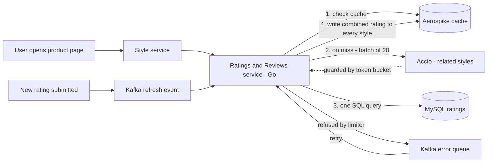
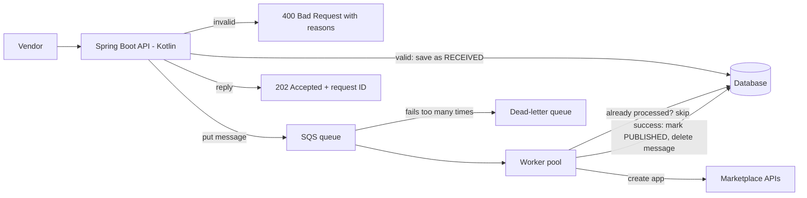
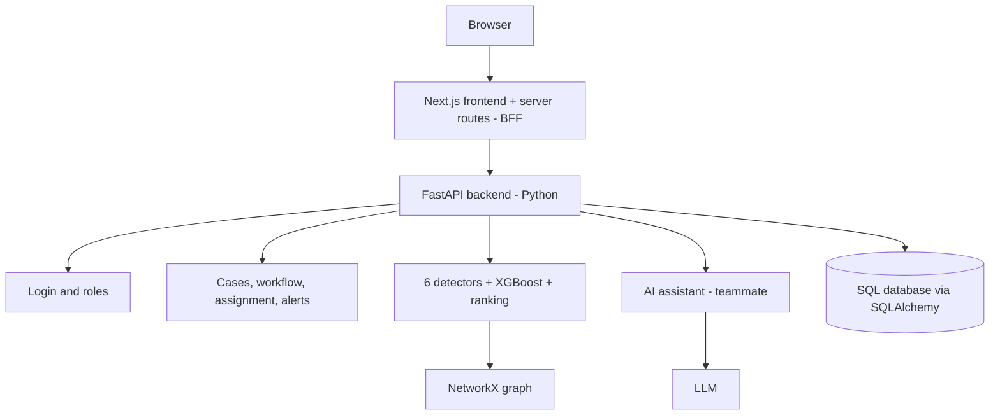
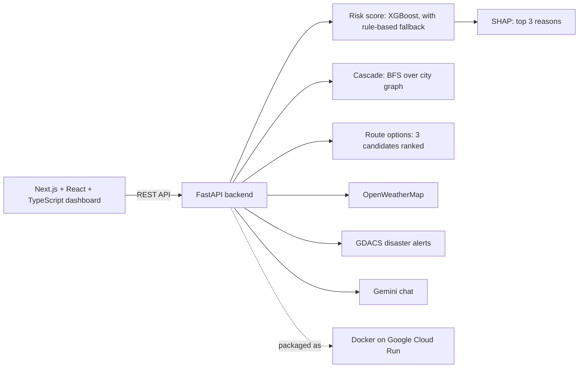

# Resume, Projects and Behavioural Questions: Swiggy

> **Who this is for:** Vaideeka, preparing for Swiggy ASDE / SDE-1 interviews.
> **Reading time:** about 75–90 minutes on a first read. After that, re-read Parts 1, 3 and 7 before every interview.
> **What it does:** explains every idea behind your resume from zero, then gives model answers to the questions Swiggy actually asks about resumes, projects and behaviour.
> **Where the facts come from:** your resume (latest version), your Myntra internship report (`../05_Myntra_Deep_Dive.md`), the code of both projects (`../03_Projects_TraceX_SupplySenseAI.md`), and the older brief (`../02_Resume_and_Skills_Brief.md`). Nothing about your work has been invented. Anything marked **(check)** is a reconstruction, so confirm it matches what you actually did.

---

## How to use this file

Swiggy asks about your resume in almost every round:
- **ASDE Round 1** sometimes opens with a project. One 2025 campus report started with "explain a project from your resume".
- **SDE-1 LLD rounds** spent 10–15 minutes on projects first.
- **The Hiring Manager (HM) round** is mostly resume plus behaviour.

One Dec 2025 candidate (who was selected) listed exactly what the HM asked about their project:
1. What was the **scope and requirements**?
2. Why did you make those **implementation choices**?
3. What **production issues** did you face, and how did you fix them?
4. What would have **prevented** those issues?
5. What would you **do differently** now?

Part 3 answers all five for Myntra and Atlassian. Learn them as stories, not as lines to memorise.

**The golden rule.** Anything on your resume is fair game. If you can't talk about something for two minutes, say *"I used it at a basic level, in X, for Y."* That is always better than bluffing. A Swiggy candidate was waitlisted partly for pretending, and interviewers notice.

---

## Part 1: Introducing yourself, and the Swiggy-specific questions

### 1.1 The 60-second introduction

> "Hi, I'm Vaideeka, a final-year Computer Science student at IIT Bhilai.
> I've done two backend internships. At **Myntra**, I worked on the Ratings & Reviews microservice in **Go**. Different colours of the same product were showing different ratings, so I built a pipeline that gives every variant one combined rating, for **5.7 million products**. It uses bulk API calls, caching in Aerospike, a rate limiter and a Kafka error queue. I also built the service's staging environment.
> Before that, at **Atlassian**, I built an **event-driven app-publishing system** in Kotlin and Spring Boot, using **AWS SQS and worker pools**, which removed manual steps from releasing apps on the Atlassian Marketplace.
> I also build full-stack projects. **TraceX** is a graph-based anti-money-laundering platform that won the **Union Bank of India iDEA Hackathon 2026**, and **SupplySense AI** predicts shipment delays from live weather and disaster data.
> I'm excited about Swiggy because delivering food and groceries in minutes, across hundreds of cities, is exactly the kind of high-traffic, real-time backend problem I enjoy."

> ⚠️ **Confirm the hackathon claim.** Your latest resume says *iDEA Hackathon 2026: National Winner, 1st rank among 27,000+ teams, presented at the Global Fintech Fest 2026*. The older prep docs (`02`, `03`) say "top 10 of 27,000". Use whichever is true, and use the same words every time. If you won, say "won". If you were in the top 10, say "top 10". An interviewer may have both versions in front of them.

**Delivery tips**
- Say the numbers slowly: "**five point seven million**", "**twenty-seven thousand teams**".
- Don't list all your skills. They have the resume. Steer toward what you know best: Myntra, caching, queues.
- End on a hook so the first follow-up lands where you are strong. For example: *"The Myntra ratings pipeline was the most interesting problem I've worked on."*

### 1.2 The two-minute version ("walk me through your resume")

1. **Education.** IIT Bhilai, CSE. Core courses: DSA, DBMS, OS, Cloud Computing, Information Security, System Design.
2. **Myntra (Jul–Dec 2025).** Problem: variants showed different ratings. What you built: bulk fetch of related styles, a cache, one combined rating written to every variant, a rate limiter, an error queue and a cache warmup. Impact: 5.7M styles, and 2 queries became 1. You also built the staging environment.
3. **Atlassian (May–Jul 2025).** App publishing had manual steps. You built an event-driven pipeline: request → validation → SQS queue → worker pool → app created automatically.
4. **Earlier.** Research intern at IIT Bombay (TIH-IoT, Chanakya Fellowship): a React Native data-visualisation app, ML for judging whether soil is safe for a drone to land on, and secure data transfer from a Raspberry Pi over SSH. Summer intern at RDSO (Indian Railways): a Flutter app for analysing construction materials.
5. **Projects.** TraceX and SupplySense AI.
6. **Achievements.** iDEA Hackathon 2026 (see the note above), Hack-A-Sol 2024 winner (AI/ML track) and 1st runner-up overall, Amazon ML Challenge 2024, GSSoC 2026 contributor.
7. **Close.** "I like owning a system end to end, from the data model to how it behaves under load."

### 1.3 "Why Swiggy?"

**Bad answers:** "It's a big company." "I like ordering food." These are true for everyone, so they say nothing about you.

**A good answer has three parts:** the problem, your fit, and something specific about how Swiggy works.

> "Three reasons.
> **First, the problem.** Swiggy isn't just an app. It's a real-time logistics system. Every order needs a restaurant, a delivery partner and an accurate delivery-time promise, and it all has to work at dinner peak, during IPL matches and on rainy days. Instamart is even tighter: a grocery order is picked and packed in a few minutes and delivered in about ten.
> **Second, my fit.** At Myntra I worked on a high-traffic service with a cache, Kafka and rate limiting, and I ran a 5.7-million-item cache warmup without overloading a shared service. At Atlassian I built queue-based workers. Those are the building blocks Swiggy uses.
> **Third, I've read Swiggy's engineering blog.** I liked how delivery assignment is done in small time windows per zone instead of one order at a time. I also liked the post-mortem where a delivery-time model returned negative predictions and the team rolled back. The lesson that every model needs sanity bounds and a fallback stuck with me. I'd like to work where engineering is that honest about failures."

**Facts you can safely mention** (from Swiggy's engineering blog, `bytes.swiggy.com`; most posts are from 2019–2022, so say "Swiggy wrote a few years ago…"):
- **Batching.** One delivery partner carries two orders from the same restaurant to nearby customers. Swiggy wrote that batching "could double the capacity" of the fleet.
- **Assignment** runs at short regular intervals over all orders and riders in a zone, not order by order.
- **Serviceability** ("can we deliver this restaurant to you, and how fast?") was estimated at about **200 million checks per minute** at peak, with a target of under 200 ms.
- **Kafka** is central at Swiggy: its messaging platform is Kafka-based, and the predicted delivery time shown on the app is powered by Kafka.
- **The negative-ETA incident.** A new delivery-time model predicted negative times. Swiggy rolled back within about 3 hours, and the post-mortem noted there had been no fallback for negative predictions.
- **Instamart** assigns you to the nearest dark store. A dark store is a small warehouse closed to walk-in customers. An order is picked and packed in under 4 minutes.

> Don't over-quote numbers. One fact, used well, beats five recited.

### 1.4 "Tell me one thing you don't like about Swiggy"

This was asked in a real Swiggy SDE-1 interview. It tests whether you can be honest *and* constructive. Never say "nothing", which sounds fake, and never trash the product.

**The formula:** a small, real user-experience observation, why it probably happens, and how you might fix it.

> "One small thing I've noticed as a user: sometimes the delivery-time estimate changes after I've ordered, say from 30 to 40 minutes. I understand why. Prep time and rider availability are hard to predict, especially at peak. But from the user's side, a promise that moves feels worse than a slightly longer but accurate one. I'd be curious how the team trades off a tight estimate that converts better against a safer estimate that's kept more often. It's the kind of problem I'd enjoy working on."

Why this works: it is real, it is gentle, it shows you understand the system (ETA, peak load), and it ends with curiosity, not complaint. Other safe topics: too many notifications, or rising delivery and platform fees, framed as a trade-off, never as an attack.

### 1.5 "Rate yourself on your tech stack" (out of 10)

This is a trap if you say 9 or 10: the interviewer will then ask the hardest questions they know. Be honest and specific.

| Skill | Suggested rating | What to say |
|---|---|---|
| DSA in C++ | 7 | "Comfortable with mediums; I practise hards." |
| Go | 6–7 | "Used it in production at Myntra: goroutines, contexts, maps, database/sql." |
| Java | 6 | "Comfortable with OOP and collections; Swiggy rounds may need Java or Go, and I've prepared both." |
| Kotlin / Spring Boot | 5–6 | "Used at Atlassian for the publishing service." |
| SQL / MySQL | 7 | "Joins, grouping, indexes; I rewrote production queries at Myntra." |
| Kafka / SQS | 6 | "Used both; I understand partitions, consumer groups, visibility timeouts and DLQs." |
| Python / FastAPI | 7 | "Both my projects' backends." |
| React / Next.js | 6 | "Built the full TraceX frontend." |
| Docker / Kubernetes | 5 | "Docker for my projects; Kubernetes as a user at Myntra (pods, scaling)." |

> **Important for 2026:** recent Swiggy reports say the OA and DSA rounds allowed **only Java or Go**. You use C++ for DSA, so practise your DSA in Java (or Go) too. If you rate Java a 6, be ready to answer Java questions at that level.

---

## Part 2: The concepts behind your resume, explained from zero

Read this part slowly. Every term in it shows up in Part 3. Each idea comes with a real-life comparison.

### 2.1 Microservices

**What it is.** Instead of one giant program that does everything (a **monolith**), the system is split into many small programs. Each one owns one job and talks to the others over the network.

**Analogy.** A small dhaba has one cook who takes the order, cooks, bills and cleans. That's a monolith. A big restaurant has a separate person for each job: order-taker, tandoor chef, curry chef, cashier. That's microservices. If the tandoor chef is slow, the cashier still works. If tandoor orders double, you hire a second tandoor chef without hiring a second cashier.

**At Myntra.** A product page is built from many services. Your **Ratings & Reviews service** only answers "what are the ratings for these product IDs?".

**Trade-off.**
- **Gains:** teams work independently, each part scales on its own, and one failure doesn't take everything down.
- **Costs:** network calls can fail or be slow, debugging spans many services, and data is spread around.

### 2.2 Go basics: goroutines and channels

**Go** is a programming language from Google, popular for backend services. You used it at Myntra.

- **Goroutine.** A super-lightweight thread. A *thread* is one line of work a program can run in parallel with others. An operating-system thread uses about 1 MB of memory; a goroutine starts at a few KB. So a Go service can run thousands at once. You start one with `go doSomething()`.
  - *Analogy:* in a Swiggy kitchen, each goroutine is a helper you can hire instantly and almost for free, for one small task.
- **Channel.** A pipe for sending values safely from one goroutine to another.
  - *Analogy:* the kitchen's order window. The cook puts a finished plate on the window, and the waiter picks it up. Nobody grabs plates out of each other's hands.
- **Two Go facts that mattered in your work.** First, looping over a Go **map** (key → value table) gives a *random* order on purpose. That caused your SQL bug. Second, Go maps are not safe if two goroutines write to them at the same time.
- **context.** A way to set a timeout on a call ("give up after 2 seconds") and cancel work that is no longer needed.

### 2.3 MySQL vs Aerospike

- **MySQL** is a **relational database**. Data lives in tables (rows and columns), and you ask questions in SQL. It is safe and flexible, but each query takes milliseconds and has to work through a lot of data.
  - *Analogy:* the restaurant's main ledger book. Complete and accurate, but slow to search.
- **Aerospike** is a **key-value store**: you give it a key (a style ID) and get back a value (that style's rating) in under a millisecond. It keeps its index in memory and data on SSD, so it can hold huge amounts of data cheaply. At Myntra it was used as the **cache**.
  - *Analogy:* a sticky note on the counter with today's popular answers.
- **Aerospike vs Redis** (a likely follow-up): Redis keeps everything in RAM and has richer data types (lists, sorted sets). Aerospike is cheaper at very large data sizes because data sits on SSD.

### 2.4 Caching and cache warmup

**Cache.** A fast storage layer you check *before* the slow database.
- **Hit:** the answer is in the cache, so return it immediately.
- **Miss:** the answer isn't there, so compute it from the database and store it in the cache for next time.
- **TTL (time to live):** how long an entry stays before it is thrown away. At Myntra it was **7 days**. It is a safety net, so a wrong value can't live forever.

*Analogy:* a chai stall that keeps a flask of ready chai. Most customers are served from the flask (a hit). When it's empty, the owner brews a fresh pot (a miss), which is slow, then refills the flask.

**Cache warmup.** Filling the cache *before* real traffic arrives. If you launch with an empty cache, every request misses at the same moment and they all hit the slow systems behind it. This is sometimes called a *thundering herd*.

*Analogy:* making 50 cups of chai before the office lunch break, so the first 50 customers aren't all waiting on one pot.

At Myntra you warmed the cache for **5,710,991 styles** before launch.

### 2.5 Rate limiting with a token bucket

**Rate limiter.** A cap on how many requests you send (or accept) per second. It protects a service from being flooded.

**Token bucket**, the version you used:
- Picture a bucket that holds at most, say, 10 tokens.
- Tokens drip in at a steady rate, say 3 per second.
- Every request takes one token. If the bucket is empty, the request is refused.
- Result: a short burst of up to 10 goes through instantly, but over time you can't go faster than 3 per second.

*Analogy:* a Swiggy restaurant can keep 10 parcels ready on the shelf, but the kitchen only produces 3 new ones per minute. A burst of riders can take 10 immediately. After that, riders wait for the kitchen's pace.

At Myntra the limit was **per pod** (one running copy of the service), starting at **180 requests per minute per pod**, which is 3 per second. A catch worth mentioning: each pod has its own bucket, so the true total is *limit × number of pods*, and that number changes as the service scales.

### 2.6 Kafka and error queues

**Kafka** is a durable **event log**.
- A **producer** writes events, such as "user X rated style Y", into a named stream called a **topic**.
- **Consumers** read the topic at their own pace and remember how far they've read. That position is the **offset**.
- Messages stay for days even after being read, so nothing is lost if a consumer is slow or restarts, and you can replay old events.
- A topic is split into **partitions** so many consumers can share the work. Order is guaranteed only within a partition.

*Analogy:* a restaurant's order spike (the metal spike where paper orders are stuck in sequence). Any cook can read it, nobody throws the slips away immediately, and each cook remembers which slip they've reached.

**Error queue.** When some work fails (at Myntra, when the rate limiter refused a call), you don't throw it away. You put it on a separate Kafka topic and process it again later.

*Analogy:* an order that couldn't be cooked because the tandoor was full goes into a "do this next" tray instead of the bin.

Related words you should know:
- **Exponential backoff:** wait before retrying, and wait longer each time (1 s, 2 s, 4 s…).
- **Jitter:** a little randomness in that wait, so all retries don't hit at the same instant.
- **Dead-letter queue (DLQ):** where messages go after failing too many times, so a human can inspect them.

### 2.7 Staging environment and production parity

Code usually passes through three places (**environments**):

| Environment | What it is | Analogy |
|---|---|---|
| **Dev** | Developers' playground. Many parts are fake ("mocked"). | Practising a dish at home |
| **Stage** | A realistic copy of production, used for final testing. | Full dress rehearsal in the real kitchen |
| **Production** | Real users, real money. | Opening night |

**Production parity** means stage behaves like production: same database types, same cache, same Kafka, same downstream services. Then a test that passes on stage is likely to pass in production too.

The ratings service had **no stage**, so changes went from half-fake dev straight to customers. You built it.

### 2.8 Event-driven architecture

There are two ways for services to work together:
- **Request-response:** "Do this and I'll wait for the answer." Like standing at the counter until your food is ready.
- **Event-driven:** "Here's what happened. Whoever cares, react to it." Like getting a token number. You go sit down, the kitchen works in the background, and your number is called when it's ready.

In event-driven systems, the first service just records an **event** (a message) and replies immediately. Other services react to it later.
- **Gains:** fast responses, bursts are absorbed, failed steps can be retried, and parts are loosely connected.
- **Costs:** results aren't instant, and you need status tracking and protection against processing the same event twice.

### 2.9 AWS SQS

**SQS (Simple Queue Service)** is Amazon's managed message queue. You put messages in, and workers take them out. You used it at Atlassian.

The clever part is the **visibility timeout**:
1. A worker takes a message. SQS doesn't delete it; it *hides* it for a while (30 seconds by default).
2. If the worker finishes, it deletes the message. Done.
3. If the worker crashes, it never deletes the message. After the timeout, the message **reappears** and another worker picks it up.

*Analogy:* at a Swiggy restaurant, a rider "claims" an order on the board. If they don't confirm pickup within 10 minutes, the order goes back on the board for another rider.

Other facts:
- After too many failures, a message moves to a **dead-letter queue**.
- A **standard** queue may occasionally deliver the same message twice ("at-least-once").
- A **FIFO** queue keeps strict order and removes duplicates, but is slower.

**SQS vs Kafka** in one line: SQS is a to-do list where each job is done once and crossed off. Kafka is a logbook that many readers can read and re-read.

### 2.10 Worker pools

A **worker pool** is a fixed number of workers that pull jobs from a queue and process them in parallel.

**Why fixed, not unlimited?** Unlimited workers would use up all memory and flood the systems they call. A fixed pool is a built-in speed limit. When all workers are busy, new jobs simply wait in the queue. This is called **backpressure**: the queue acts as a buffer.

*Analogy:* a kitchen with exactly 5 cooks. On a rush night, orders pile up on the spike, but the kitchen doesn't collapse. To go faster, open a second kitchen with 5 more cooks reading the same spike. That is **horizontal scaling**: adding more machines instead of a bigger machine.

### 2.11 Idempotency

**Idempotent** means doing something twice has the same effect as doing it once.
- Pressing a lift's call button five times still calls one lift: idempotent.
- Clicking "Pay ₹500" twice and getting charged ₹1,000: not idempotent.

Why it matters for you: SQS can deliver a message twice. Suppose a worker creates the app, then crashes just before deleting the message. The message reappears, and without protection the app is published twice.

The usual protections:
1. Every request has a **unique ID**. Check "have I already processed this ID?" before acting.
2. Add a **unique constraint** in the database, so a duplicate insert simply fails.
3. Let the status move only forward: RECEIVED → IN_PROGRESS → PUBLISHED.

### 2.12 Spring Boot

**Spring Boot** is the most common Java (and Kotlin) framework for building web services.

Its big idea is **dependency injection**. You don't create the objects your code needs. Spring creates them (as **beans**) and hands them to you.
- *Analogy:* a chef who doesn't go shopping. The ingredients are delivered to the station each morning, so the chef just cooks. That makes it easy to swap a real supplier for a fake one in tests.

The usual layers are `@RestController` (handles HTTP requests) → `@Service` (business logic) → `@Repository` (database). `@Transactional` makes a method all-or-nothing in the database.

### 2.13 Kotlin

A modern language that runs on the Java platform and mixes freely with Java code in the same project.
- **Null safety:** a variable can't be empty (`null`) unless you mark it with `?`. This prevents the most common Java crash, the `NullPointerException`.
- **Coroutines:** lightweight tasks, similar in spirit to Go's goroutines.
- **Data classes:** one line gives you `equals`, `hashCode` and `toString`.

### 2.14 React Native, Flutter, SSH, Raspberry Pi (brief)

- **React Native:** write one mobile app in JavaScript/React that runs on both Android and iOS. You used it at IIT Bombay.
- **Flutter:** Google's toolkit for the same goal, written in the Dart language. Everything on screen is a "widget". You used it at RDSO.
- **Raspberry Pi:** a credit-card-sized computer, often used to collect sensor data in research projects.
- **SSH (Secure Shell):** an encrypted connection between two computers. You used it to send data from the Raspberry Pi to the mobile app securely. *Analogy:* a sealed, locked courier bag instead of a postcard.

### 2.15 The ideas in your projects

- **Graphs / NetworkX.** A graph is dots (**nodes**) joined by arrows (**edges**). In TraceX, each bank account is a node and each money transfer is an arrow. **NetworkX** is a Python library with ready-made graph algorithms.
  - *Analogy:* a Swiggy city map. Restaurants and homes are dots, and roads are lines.
- **XGBoost.** A machine-learning model that builds hundreds of small decision trees (chains of yes/no questions like "more than 20 transfers this week?"), each fixing the mistakes of the previous ones. It is usually the best choice for table-shaped data.
  - *Analogy:* a panel of interviewers where each one focuses on what the previous one missed.
- **Isolation Forest.** Finds outliers *without* labelled examples. It cuts the data randomly; an unusual point gets isolated in very few cuts because it sits alone.
  - *Analogy:* in a crowd photo, the one person in a bright yellow costume is the easiest to point out.
- **SHAP.** Explains *one* prediction by splitting it among the features. For example: "delay risk 78: carrier's late rate +20, monsoon +15, tight deadline +10." It is based on a fair way of sharing credit from game theory.
- **LLM copilot.** An AI assistant (a large language model, like ChatGPT) built into the app to summarise cases. The risk is that it makes things up, so TraceX only lets it use real case data and rejects any number that doesn't match the data.
- **Docker.** Packs your app and everything it needs into an **image**. A running copy is a **container**, and it behaves the same on any machine.
  - *Analogy:* a tiffin box. The whole meal is packed and sealed, and it tastes the same wherever you open it.
- **Google Cloud Run.** Runs your container for you. No servers to manage, it adds copies when traffic grows, and it scales to zero when idle, so it is nearly free for a project.

---

## Part 3: Your experiences, explained and answered

### 3.1 Myntra: Software Engineer Intern, Ratings & Reviews (Jul–Dec 2025)

#### What you built, in simple words

On Myntra, each colour of a product is a separate **style** with its own ID. The red shirt and the blue shirt are two styles of one product, and together they form a **cluster**.

Ratings were stored and shown *per style*. So red showed 4.4★ from 1.6k ratings, blue showed 4.3★ from 3.5k, and a newly added green showed **"No Ratings"**, even though it is the same shirt with 5,000+ ratings.

You made every style in a cluster show **one combined rating**:
1. **Find the siblings.** Another internal service, **Accio**, knows which styles are related. You ask it in **batches of 20 styles per call**, which means about 20× fewer calls.
2. **Cache the sibling list** in Aerospike for 7 days, because it rarely changes.
3. **Compute the combined rating correctly.** Add up the 1★–5★ counts across all styles, then average. Never average the averages. Example: A is 4.0★ from 1,000 ratings and B is 5.0★ from 10. The average of averages says 4.5★, but the correct answer is (4×1000 + 5×10) / 1010 ≈ **4.01★**.
4. **Write the result to every style** in the cluster.
5. **Protect Accio** with a token-bucket rate limiter (180 requests/min per pod).
6. **Never lose refused work.** Refused events go to a **Kafka error queue** and are retried.
7. **Warm the cache** for all 5.7M styles before launch.

Along the way you found a tricky **SQL bug** and merged **two queries into one**. That is the "50% fewer DB connections" on your resume: per rating computation, not across the whole service.



#### The SQL bug, in plain words (your best debugging story)

The old code grouped styles using a SQL `CASE` expression, built by looping over a Go map:

```sql
CASE WHEN style IN (…) THEN 'A' WHEN style IN (…) THEN 'B' … END
```

Two facts collided:
1. SQL `CASE` checks lines **in order and stops at the first match**.
2. Go **shuffles map order** on every run.

Some style IDs appeared in two groups' lists, so whichever line happened to come first "won". **The same input gave different answers on different runs.** That is why it was hard to catch.

Your fix: one simple, **parameterised** query that returns per-style counts (values are passed separately from the SQL text, which also blocks SQL injection), with the grouping done in Go code where it is predictable and testable.

#### The warmup story (your best failure story)

- **Run 1 refreshed only ~22%** (1.28M of 5.71M). Events were fired as fast as possible, so the token bucket emptied instantly and nearly everything after that was refused. And one refused Accio call failed a whole batch of 20.
- **Runs 2–3** improved slowly, retrying only what had failed.
- **Run 4:** you added a **4 ms pause between events** and raised the limit. Events now arrived at about the bucket's refill rate, and success reached **99.99%**.
- **Run 5** cleared the last 120. 100% done.

**Lesson:** "Work out the throughput budget first (pods × per-pod limit) and pace the sender to match it."

#### The staging environment

The service had only dev and production. You built stage:
- pointed the service at the stage versions of everything it talks to, with **timeouts**
- created the MySQL database with the production structure but made-up data, because real reviews are user data
- set up Aerospike
- stored the database and event credentials in **Vault**, a secrets manager, so passwords never sit in code
- deployed, then checked connections and logs

#### The five HM questions, answered for Myntra

**1. "What was the scope and requirements?"**
> "Every colour and size of a product should show one combined rating. That had to work for all 5.7 million live styles, stay correct whenever a new rating came in, and not overload Accio, a shared service that many teams use. The non-functional requirements were: no slowdown on the product page, nothing lost if a call fails, and a safe rollout."

**2. "Why those implementation choices?"**
- **Batches of 20:** Accio's team recommended 20–25 per call. Batching cut calls about 20×.
- **Cache the sibling list for 7 days:** sibling relationships rarely change and are needed on every recompute.
- **Aggregate in Go, not SQL:** the data per request is small; the SQL version was string-built, buggy and untestable; Go is predictable and saves a round trip.
- **Token bucket:** allows short bursts but caps the average, and the team already had one.
- **Kafka error queue instead of dropping:** a dropped event means a permanently wrong rating for that cluster.
- **Eventual consistency is acceptable:** a rating that is a few seconds old harms nobody. Money would be a different story.

**3. "What production issues did you face, and how did you resolve them?"**
- **The warmup reaching only 22%:** fixed by pacing (4 ms) and a higher limit, and by retrying only failures.
- **The non-deterministic SQL grouping bug:** fixed by one parameterised query plus grouping in Go.
- **The ratings mismatch:** the reviews section of the page read from a different cache that wasn't being refreshed, so it showed an old rating. You made both caches refresh on the same events.

**4. "What would have prevented them?"**
- Warmup: a quick calculation of the throughput budget *before* run 1, and pacing from the start.
- SQL bug: never relying on map order (sort the keys if order matters), and a test that runs the same input many times and checks the output never changes.
- Mismatch: a rule that every cached copy of a value updates on the same triggers, written down in the design doc.

**5. "What would you do differently?"**
- **Delayed retries.** Error-queue retries were instant, because the Go services had no delay function available. Instant retries can hit the same empty bucket again. Better: exponential backoff with jitter, a maximum number of attempts, then a dead-letter queue, plus an alert on the queue's size.
- **Retry individual styles** when a batch fails, instead of failing all 20.
- **A global rate limit** (a shared counter in Redis, or a quota enforced at Accio) instead of per pod, so the total doesn't change when pods scale.
- **Versioned cache writes.** If two recomputes for the same cluster race, the older one can finish last and overwrite newer data. Store the version (the latest rating ID used) and only write if it is newer.

#### Other likely Myntra questions

- **"50% fewer DB connections, 50% of what?"** → "For each aggregated-rating computation, two queries became one. It's not a service-wide number." Say exactly that.
- **"How does the cache stay in sync with the database?"** → Every new rating triggers a recompute from the database that overwrites every style in the cluster. A miss triggers a full recompute. The 7-day TTL is the safety net.
- **"Why Go?"** → It was the service's language, and it suits network-heavy work: cheap goroutines, built-in connection pooling, `context` for timeouts, and a single binary to deploy.
- **"How would this apply at Swiggy?"** → "The same pattern fits a restaurant brand with many outlets (should all outlets show one rating, or separate ones?), or a dish with size variants: a source-of-truth service for the grouping, a cache of aggregates with a TTL, event-driven updates, a rate limit on shared services, and a warmup before launch."

### 3.2 Atlassian: Software Engineer Intern, Marketplace (May–Jul 2025)

> **(check)** The Atlassian flow below is a standard design reconstructed from your resume bullets. Replace anything that differs from what you actually built. If a part was owned by another team, say so.

#### What you built, in simple words

**Atlassian Marketplace** is the app store for Jira, Confluence and Bitbucket. Outside companies (**vendors**) publish apps there. Publishing used to need manual steps, with a person checking each request and creating the app by hand. That was slow, error-prone and couldn't keep up.

You built an **event-driven** system that does it automatically:
- The API does only the quick part (validates the request).
- It drops the request onto an **SQS queue** and replies **"202 Accepted"** immediately, which means "received, not finished yet".
- A **worker pool** picks requests off the queue and creates the apps in the background.

*Analogy:* a Swiggy restaurant counter. The cashier checks your order and gives you a token number in seconds. The kitchen (the workers) cooks in the background. The cashier never makes the next customer wait while your biryani cooks.



#### The five HM questions, answered for Atlassian

**1. "Scope and requirements?"**
> "Automate app publishing end to end. Functional: accept a publish request, validate it, and create the app and its listing automatically. Non-functional: handle high volumes and bursts, never lose a request, never publish the same app twice, and scale by adding machines."

**2. "Why those choices?"**
- **A queue instead of doing the work inside the API call:** the work is slow and touches several systems. With a queue, the API stays fast, bursts wait safely, and failures can be retried without the vendor noticing.
- **SQS specifically:** it is fully managed and has crash recovery built in through the visibility timeout. Each job needs to be done once, by one worker, which is exactly what SQS does.
- **A fixed-size worker pool:** a natural speed limit, so we don't flood the Marketplace APIs or run out of memory.
- **Validating before queuing:** the vendor gets a clear error straight away, and workers never waste time on requests that will fail.
- **Kotlin and Spring Boot:** the team's stack. Spring's dependency injection makes the code testable with fake SQS clients.

**3. "What production issues could happen, and how did you handle them?"** If you don't have a real incident from Atlassian, say so honestly, then explain the failure cases you designed for:
- **A worker crashes halfway:** the message isn't deleted, so it reappears after the visibility timeout and another worker retries.
- **Duplicate delivery:** handled with idempotency (unique request ID, a unique constraint, forward-only status).
- **A request that always fails:** after N attempts it moves to the DLQ and an alert fires.
- **The downstream API is down:** retry with exponential backoff and jitter.

**4. "What would prevent issues?"**
- Set the visibility timeout longer than the slowest job, so a slow but healthy worker's message doesn't reappear and get processed twice.
- Monitor queue length, the age of the oldest message and DLQ size.
- Load-test with bursts before launch.

**5. "What would you do differently?"** The **outbox pattern**.
- Saving the request to the database and putting it on SQS are two separate steps. A crash between them loses the message.
- Fix: in *one* database transaction, save the request *and* an "outbox" row. A small background process then moves outbox rows onto SQS.
- Also add a status webhook, so vendors are told when publishing finishes instead of having to check.

#### Other likely Atlassian questions

- **"Why SQS and not Kafka?"** → "SQS is a job queue: each job is done once and deleted. Kafka is a log that many services can read and replay. I used SQS at Atlassian for jobs and Kafka at Myntra for events."
- **"Why not a thread pool inside the API server?"** → "Work held in memory is lost if the server crashes, and you can't scale the API and the workers separately. A queue is durable and gives retries for free."
- **"10× traffic?"** → "The queue absorbs the burst. Add workers based on queue length, and cap how many run at once so the systems we call aren't overwhelmed."
- **"How did you test it?"** **(check)** → Unit tests with a fake SQS client, integration tests against a local AWS emulator such as LocalStack, and deliberately crashing a worker to confirm retries and the DLQ work.

### 3.3 IIT Bombay (TIH-IoT, Chanakya Fellowship): Research Intern (Mar–Dec 2024)

**What you did:** a **React Native** app for visualising data; work with a cross-functional team on ML that judges whether soil is suitable for a drone (UAV) to land; and automated, secure, real-time data transfer from a **Raspberry Pi** to the mobile app over **SSH**.

**Likely questions**
- *"Precision or recall for 'safe to land'?"*
  - **Precision** = of the spots the model called safe, how many really were.
  - **Recall** = of the truly safe spots, how many the model found.
  - Here precision matters more: calling unsafe soil safe could crash the drone, while missing a safe spot only costs time.
  - (Older prep notes mention 75% precision. Quote it only if you're sure.)
- *"How did you know the data transfer was correct?"* → Compare what was sent with what was received: record counts and **checksums**. A checksum is a fingerprint of a file computed on both ends; if the fingerprints match, the file is intact.
- *"What if Wi-Fi drops mid-transfer?"* → Retry with resume, then verify the checksum after each transfer.

### 3.4 RDSO, Indian Railways: Summer Intern (Jun–Jul 2024)

**What you did:** a **Flutter** app that automates analysis of railway construction materials, with real-time input validation, interactive graphs and rule-based recommendations, which reduced manual effort.

**Likely questions**
- *"Why Flutter?"* → One codebase for Android and iOS, fast UI building, and good charting libraries.
- *"What is 'rule-based'?"* → Recommendations come from fixed if-then rules written from domain standards (for example, "if this value exceeds the limit, recommend X"). There is no ML, which makes them predictable and easy to audit.

Keep these two internships short in interviews (about 30 seconds each) unless asked. Swiggy cares most about backend work.

---

## Part 4: Your projects, explained and answered

### 4.1 TraceX: graph-based anti-money-laundering platform

#### What it does, in simple words

Criminals **launder** money by moving it through many accounts until its origin is hidden. Banks must catch this; that work is called **AML** (anti-money laundering). Their systems raise thousands of **alerts**, and human investigators check each one, mostly by hand. Most alerts are false alarms.

TraceX helps investigators:
1. finds laundering patterns automatically
2. ranks alerts so the riskiest come first
3. turns them into **cases** assigned to investigators
4. gives each investigator a workspace showing the money trail as a picture, with an AI assistant that summarises the case

**Why a graph?** Accounts are dots and transfers are arrows. Laundering shows up as *shapes*:
- money going round in a loop (a **cycle**, called round-tripping)
- money hopping quickly through a chain of accounts (**layering**)
- one account sending to many (**fan-out**)

You can't see these by looking at one transaction at a time.

**Ownership. Say this correctly.** TraceX is a two-person project. Say "I built" only for **your** parts:
- login and permissions
- porting the detection engine into the new system, including saving the ranking model's learning
- alert generation
- the case workflow
- automatic assignment and deadlines
- similar-case search
- the whole frontend

For the AI assistant and the reports, say "my teammate built that, and here's how it works."



#### Key ideas you must be able to explain

- **Finding cycles fast.** Searching every possible cycle in 5 million transactions is hopeless. First compute **strongly connected components (SCCs)**: groups where every account can reach every other. A cycle can only exist inside one SCC, so you throw away everything else and search only inside small SCCs, with caps on length and count.
- **Scoring.** Each account gets a score out of 100 from three signals: the ML model (XGBoost), detected patterns (round-trip +30, layering +25, …) and its position in the graph.
- **Honest model numbers.** On the public IBM dataset, only 0.48% of accounts are launderers. The model gets F1 = 0.21 and AUC = 0.78. Defend it like this: *"With 0.48% positives, accuracy is meaningless. Predicting 'nobody' would score 99.5%. ML is one of three signals, and the output is a ranked queue for humans, not a verdict."*
- **The case workflow is a state machine.** A **state machine** is a fixed list of states and the moves allowed between them: NEW → ASSIGNED → IN_PROGRESS → … → CLOSED. Only one function can change a status, and it rejects illegal moves. *Swiggy link:* an order's life is the same idea (placed → accepted → preparing → picked up → delivered).
- **Auto-assignment.** Each case goes to the investigator with the **fewest open cases**, with a deadline based on priority. *Swiggy link:* assigning an order to the least-busy nearby rider.
- **Login (your work).** Passwords are stored as **bcrypt hashes**. A hash is a one-way scramble, and bcrypt is deliberately slow so stolen hashes are hard to crack. After login, the user gets a **JWT**, a signed token that says who they are. It is stored in an **httpOnly cookie**, which page scripts can't read, so injected scripts can't steal it.
- **N+1 query fix: 325 ms → 96 ms.** The code ran one query for a list, then one more query per item. Fetching everything in one query fixed it. Same family as your Myntra 2→1 fix.
- **Tests:** grew from 106 to 500+, about 97% coverage, run automatically on every change (CI).

#### Likely questions

- *"Walk me through it."* → Problem → graph → detectors → scoring and ranking → cases → investigator workspace. Then say what *you* built.
- *"Would NetworkX scale?"* → "No. It's in memory, in one process. That's why it sits behind an interface, so it can be swapped for a graph database like Neo4j, looking only at a recent window such as 90 days."
- *"How would you make it real-time?"* → Stream transactions through Kafka, run cheap checks (structuring, fan-out) on each event, and run the expensive cycle search on a schedule.
- *"What if the AI makes things up?"* → It can only fetch data through tools locked to the current case, and every number it writes must match real data or the answer is rejected.
- *"Did you use AI coding tools?"* → Be honest: "We used Claude Code for a lot of the implementation. I designed and reviewed it and can explain every part." Only say this if it's true, and make sure you *can* explain every part.

### 4.2 SupplySense AI: supply-chain risk platform

#### What it does, in simple words

Floods, cyclones, port strikes and festival rush delay shipments, and one delay ripples outward. SupplySense AI gives each shipment a **delay-risk score (0–100) with its top three reasons**. It pulls **live weather and disaster data**, shows how one disruption **spreads** through the network of cities, and suggests **alternative routes**. It is a solo project.



#### Key ideas

- **The cascade uses BFS** (breadth-first search). Start from the disrupted city, visit its neighbours, then their neighbours, level by level. Impact fades at each hop: it is multiplied by the lane weight and by 0.85. The search stops after 4 hops or when impact drops below 0.05.
  - *Swiggy link:* if a dark store runs out of stock or riders, which nearby areas are affected?
- **Route suggestions.** Three candidate routes (direct road, via another port, air) are scored on cost, time, carbon and risk. Each metric is rescaled to 0–1, then combined with weights. Say it precisely: *"a weighted ranking of three candidates"*, not "optimal routing".
- **Fallbacks.** If the ML model is unavailable, a rule-based scorer is used. Weather calls have timeouts, cached values and fallbacks.

#### Weak spots. Raise them before the interviewer does.

1. **Synthetic labels.** There was no real delay data, so the training labels were generated. Never present the 92% accuracy as a real result. Say: *"It proves the pipeline end to end. With real delivery data I'd retrain and test on later dates."*
2. **All data lives in memory**, with no database. Each Cloud Run copy has different data. The fix is Postgres plus a cache.
3. **A Gemini API key was hard-coded** in a public repo's deploy script. **Rotate it before your interview**, and say: *"That was a mistake. Keys belong in a secret manager, and I'd add secret scanning to CI."*
4. **"Real-time" is the browser polling** every 30–60 seconds. The next step is pushing updates with server-sent events or WebSockets.
5. **The BFS used `list.pop(0)`**, which is O(n). A `deque` makes it O(1).

### 4.3 "How would you design X from your resume?" (DB + API design)

A 2024 Swiggy SDE-1 candidate was asked in the HM round to design the **database and APIs for a tool from their resume**. Here is a worked example for **TraceX's case workflow**, the part you built. Practise drawing it in 5 minutes.

**Step 1: State the requirements out loud.**
- Investigators see their assigned cases, ranked by priority.
- A case moves through allowed states only.
- Every change is recorded.
- Supervisors can reassign.

**Step 2: Tables.**

```sql
users(id PK, name, email UNIQUE, password_hash, role)          -- role: INVESTIGATOR / SUPERVISOR / ADMIN
accounts(id PK, account_number UNIQUE, holder_name, risk_score)
alerts(id PK, account_id FK -> accounts, pattern, score, created_at)
cases(id PK, alert_id FK -> alerts UNIQUE, assignee_id FK -> users,
      status, priority, sla_deadline, created_at, updated_at)
case_events(id PK, case_id FK -> cases, actor_id FK -> users,
            from_status, to_status, note, created_at)          -- the history / audit trail
```

- **Index** `cases(assignee_id, status)`, because "my open cases" is the most common query.
- **Why SQL?** Cases, users and alerts are related to each other, and changing a status plus writing its history must happen together. That needs a **transaction** (all or nothing).

**Step 3: APIs (REST).**

| Method + path | What it does | Notes |
|---|---|---|
| `POST /auth/login` | Log in, set JWT cookie | 401 if wrong password |
| `GET /cases?assignee=me&status=OPEN&cursor=…` | My cases, by priority | Cursor pagination |
| `GET /cases/{id}` | One case with its alert and graph | 403 if not your case |
| `PATCH /cases/{id}/status` body `{to: "ESCALATED", note}` | Move the case | 409 if the move isn't allowed |
| `PATCH /cases/{id}/assignee` | Reassign | Supervisors only |
| `GET /cases/{id}/events` | The case's history | |

- **HTTP verbs:** GET reads, POST creates, PATCH partly updates, DELETE removes. GET and PATCH-to-a-fixed-value are **idempotent**; POST is not.
- **Status codes worth saying:** 200 OK, 201 Created, 400 bad input, 401 not logged in, 403 not allowed, 404 not found, 409 conflict.

**Step 4: Mention one scaling idea.** Cache the ranked queue per investigator and refresh it when a case changes, or move to Postgres with read replicas.

> You can do the same for **SupplySense**: shipments, carriers and cities tables; `GET /shipments?risk>70`; `POST /simulate`. And for **Atlassian**: a `publish_requests` table with a unique request ID and status, `POST /apps/publish` → 202, `GET /apps/publish/{id}` for status.

---

## Part 5: Behavioural questions

### 5.1 What STAR is, and why it works

Behavioural questions ("tell me about a time when…") are answered with **STAR**:
- **S: Situation.** Set the scene in 1–2 sentences.
- **T: Task.** What *you* had to achieve.
- **A: Action.** What *you* did, step by step. This is the longest part.
- **R: Result.** What happened, with a number if possible, plus what you learned.

**Why it works:** interviewers are checking whether you can tell a clear story that shows ownership. STAR stops you rambling.

**Rules**
- Each answer takes 60–90 seconds.
- Say **"I"** for your work and **"we"** for the team's.
- End with a number or a clear lesson.
- Always have a "what I'd do differently" ready.

### 5.2 Ten ready stories, mapped to real Swiggy questions

#### Story 1: "Most challenging task in the last two years" (asked at Swiggy)
**Use:** Myntra aggregated ratings.
- **S:** At Myntra, colours of the same product showed different ratings, and new colours showed "No Ratings", across 5.7M products.
- **T:** Make every variant show one correct rating, kept in sync, without overloading Accio, a shared service.
- **A:**
  - Fetched related styles in batches of 20 and cached them for 7 days.
  - Computed the weighted aggregate and wrote it to every style.
  - Added a token-bucket limiter and a Kafka error queue so nothing was lost.
  - Merged two queries into one.
  - Warmed the cache for all 5.7M styles before launch.
- **R:** 100% of 5,710,991 styles consistent, half the DB round trips per computation, and load and memory-leak tests passed.

#### Story 2: "A production issue under pressure" / "a failure" (asked at Swiggy)
**Use:** the warmup that started at 22%.
- **S:** The cache warmup was due before launch. Run 1 refreshed only 1.28M of 5.71M styles.
- **T:** Finish the warmup without hurting Accio.
- **A:**
  - Found the cause: events were fired unpaced, the token bucket emptied, and one refusal failed a whole batch of 20.
  - Re-ran only the failures.
  - Added a 4 ms pause between events and raised the limit.
- **R:** 99.99% in run 4, 100% in run 5.
- **Lesson:** "Calculate the throughput budget first and pace the sender." Say what you'd do differently: pace from run 1, and retry styles one by one.

#### Story 3: "A hard bug" / "debugging"
**Use:** the Go map-order SQL bug.
- **S:** In testing, some clusters showed wrong ratings, and *which* clusters changed between runs.
- **T:** Find the source of the randomness.
- **A:** Traced it to SQL `CASE` lines built from a Go map: first match wins, and Go randomises map order, so shared IDs went to different groups on different runs. Replaced it with one parameterised query and grouping in Go.
- **R:** Correct every time, one query instead of two, and testable.
- **Lesson:** never depend on map order.

#### Story 4: "What strengths and weaknesses would your professor mention?" (asked at Swiggy)

**Strengths (with proof):**
1. *"I go deep until I understand the root cause."* The SQL bug: I didn't patch the symptom, I found why it was random.
2. *"I pick things up fast."* I learned Go at Myntra and Kotlin at Atlassian on the job, and shipped production work in both.

**Weaknesses (real, but with what you're doing about them):**
1. *"I sometimes jump into building before calculating limits. My warmup run 1 failed because I didn't work out the throughput first. Now I do a quick back-of-the-envelope calculation before any bulk job."*
2. *"I used to hesitate to ask questions early, because I wanted to figure things out alone. I've learned that a 5-minute question to the right person can save a day, so now I time-box solo debugging and then ask."* (Use this only if it's true. Otherwise choose a different real one.)

Never say "I'm a perfectionist" or "I work too hard". Interviewers have heard those a thousand times.

#### Story 5: "Ambiguous requirements" / "a time you didn't have all the information"
**Use:** Myntra stage environment.
- **S:** My first project at Myntra was to give the ratings service a stage environment. There was no existing stage and no checklist.
- **T:** Work out what "production-like" meant for this service and build it.
- **A:**
  - Listed every dependency the service talks to (MySQL, Aerospike, Kafka, downstream services).
  - Asked the owners of each for their stage endpoints.
  - Added timeouts.
  - Created the schema with mock data, because real reviews are user data.
  - Stored credentials in Vault.
  - Deployed and verified the connections and logs.
- **R:** The team got a safe place to test changes before production.

#### Story 6: "Conflict / disagreement"
**Use:** a design trade-off, kept respectful.

> ⚠️ **This is a template, not a fact.** The source docs only say that you fixed the ranking model losing its learning on restart. They don't record any disagreement about it. Swap in a real disagreement you had (TraceX, the hackathon, or an internship), keeping this shape: evidence → agreement → you take ownership.

- **S (example):** During TraceX, my teammate and I disagreed about whether to keep the detection model's ranking memory in process (simple) or save it to the database (more work).
- **T:** Decide without slowing the project down.
- **A:** I showed a concrete failure: on every restart, the ranking forgot everything it had learned from investigators. We agreed on persistence because correctness mattered more than a day of extra work, and I took ownership of building it.
- **R:** The ranking kept its learning across restarts.
- **Lesson:** argue with evidence, not opinions, and offer to do the extra work yourself.

#### Story 7: "Leadership" / "a hackathon"
**Use:** iDEA Hackathon 2026 (Union Bank of India). **Confirm "winner" vs "top 10" first; see Part 1.**
- **S:** A national fintech hackathon with 27,000+ teams. The problem was investigating money-laundering alerts faster.
- **T:** Build a working solution in a short time and present it convincingly.
- **A:**
  - We modelled transactions as a graph and built the detectors and alert ranking.
  - I owned login and permissions, the case workflow, assignment and the whole frontend.
  - We split work by module so we never blocked each other.
- **R:** National winner, 1st rank. I presented the solution to senior leadership from 12+ banks at the Global Fintech Fest 2026.
- **Lesson:** "A clear demo of one real workflow beats ten half-built features."

**Backup:** Hack-A-Sol 2024 (IIIT Raipur), winner of the AI/ML track and 1st runner-up overall.

#### Story 8: "Why are you leaving / other offers / why Swiggy over others?" (asked at Swiggy)
- As a fresher you're not "leaving" a job. If asked about internships: *"Both were fixed-term internships. I'm looking for a full-time backend role."*
- **Other offers.** Be honest but brief. *"I'm in process with a couple of companies. Swiggy is my top choice because of the real-time logistics problems and the overlap with my stack: Go or Java, Kafka, caching."* Never invent offers.
- **"Why a startup-like company over big tech?"** *"Faster ownership. At Myntra I owned a feature end to end, and I want that pace."*

#### Story 9: "SWOT analysis of yourself" (asked at Swiggy)
**SWOT** = Strengths, Weaknesses, Opportunities, Threats.
- **Strengths:** real backend production work at scale (Go, Kafka, caching, queues), and fast learning across stacks.
- **Weaknesses:** limited experience operating systems long-term in production (on-call, incidents). Working on it by studying post-mortems and building monitoring into my projects.
- **Opportunities:** Swiggy's scale (peaks, real-time logistics) would grow my system-design skills quickly.
- **Threats:** spreading myself too thin across ML, frontend and backend. I'm addressing it by focusing on backend first.

#### Story 10: "Where do you see yourself in 3–5 years?" / career goals
> "In two to three years, I want to be the engineer a team trusts to own a critical service end to end: design, on-call, scaling for peaks like IPL nights. Longer term, I'd like to lead the design of larger systems, especially in real-time logistics, where backend and ML meet, like delivery-time prediction or assignment."

#### Bonus: "Lead a bug-fix effort" / "handle a production incident" (asked at Swiggy SDE-1)
**Use:** Myntra ratings mismatch, or the Big Fashion Festival.
- The PDP's reviews section showed an old rating while the ratings section showed the new one.
- I found that two separate caches were involved and only one was refreshed.
- I made both refresh on the same events.
- During the Big Fashion Festival (Myntra's biggest sale) I monitored error rates, slow responses (p99 latency), cache hit rate and queue length, and helped debug live issues.

### 5.3 Quick map: question → story

| They ask | Tell |
|---|---|
| Most challenging task | Story 1 (Myntra aggregation) |
| Failure / mistake | Story 2 (warmup 22%) |
| Hard bug | Story 3 (map order) |
| Strengths / weaknesses | Story 4 |
| Ambiguity | Story 5 (stage environment) |
| Conflict | Story 6 (TraceX persistence) |
| Leadership / teamwork | Story 7 (iDEA hackathon) |
| Improving performance | Myntra 2→1 queries; TraceX N+1 (325 → 96 ms) |
| Learning something fast | Go at Myntra, Kotlin at Atlassian |
| Why Swiggy | Part 1.3 |
| Something you don't like about Swiggy | Part 1.4 |

---

## Part 6: Questions to ask, and red flags to avoid

### 6.1 Questions to ask the interviewer (pick 1–2)

Good questions show curiosity about the work, not the perks.
- "What does the first 3–6 months look like for a new engineer on this team?"
- "How does the team prepare for peaks like IPL nights or New Year's Eve?"
- "What's one technical challenge the team is working on right now?"
- "How are post-mortems done here? I liked the 'Behind the Bug' series on the engineering blog."
- **For ASDE:** "Is this role full-time from day one, or does it start as an internship with conversion?" One ASDE candidate found out only after the offer that it was a 3-month internship. Ask the recruiter politely, not the interviewer in Round 1.

Avoid asking about salary, leave or work-from-home in technical rounds. Save those for HR.

### 6.2 Red flags to avoid (from real Swiggy reports)

1. **Pretending not to know a problem or puzzle you've seen before.** A Swiggy candidate did this, the interviewer noticed, and they were waitlisted. Say: *"I've seen something similar. Let me solve it properly and explain my reasoning."* Honesty is rewarded.
2. **Making a confident wrong claim.** The same candidate told the interviewer a stack *couldn't* solve next-greater-element, which is wrong. If unsure, say *"I think X, but let me check by working through an example."*
3. **Bluffing on a resume skill.** If you list Kubernetes, expect "what is a pod?". Know the basics of everything listed (Part 2), or say "basic level".
4. **Inflating numbers.** "50% fewer DB connections" is *per computation*. "92% accuracy" in SupplySense came from synthetic labels. Say both precisely. Interviewers respect precision and punish exaggeration.
5. **Claiming teammates' work.** In TraceX, say "I" only for your parts.
6. **Silence.** Think out loud. Swiggy interviewers give hints, but only if they can hear your thinking.
7. **Rambling.** Keep stories to 60–90 seconds. Stop, and let them ask follow-ups.
8. **Being negative about past teams or companies.** Always frame problems as learning.
9. **Leaving the API key in SupplySense's public repo.** Rotate it and clean the history before the interview. An interviewer who opens your GitHub will see it.

---

## Final checklist (before each Swiggy interview)

- [ ] Say the 60-second intro out loud three times.
- [ ] Confirm the iDEA claim (winner vs top 10) and use the same words everywhere.
- [ ] Draw the Myntra and Atlassian diagrams from memory in under 2 minutes each.
- [ ] Answer the five HM questions for Myntra and Atlassian without notes.
- [ ] Explain token bucket, visibility timeout, idempotency and Kafka vs SQS, each in under a minute, each with an analogy.
- [ ] Design the TraceX case DB and APIs on paper in 5 minutes.
- [ ] Rehearse Stories 1, 2, 3 and 4 with a timer (60–90 s each).
- [ ] Rotate the SupplySense Gemini key; check that both demo links work.
- [ ] Prepare "Why Swiggy" with one real fact from the engineering blog.
- [ ] Practise DSA in **Java or Go**, not only C++. 2026 Swiggy rounds required it.
- [ ] Pick two questions to ask the interviewer.
